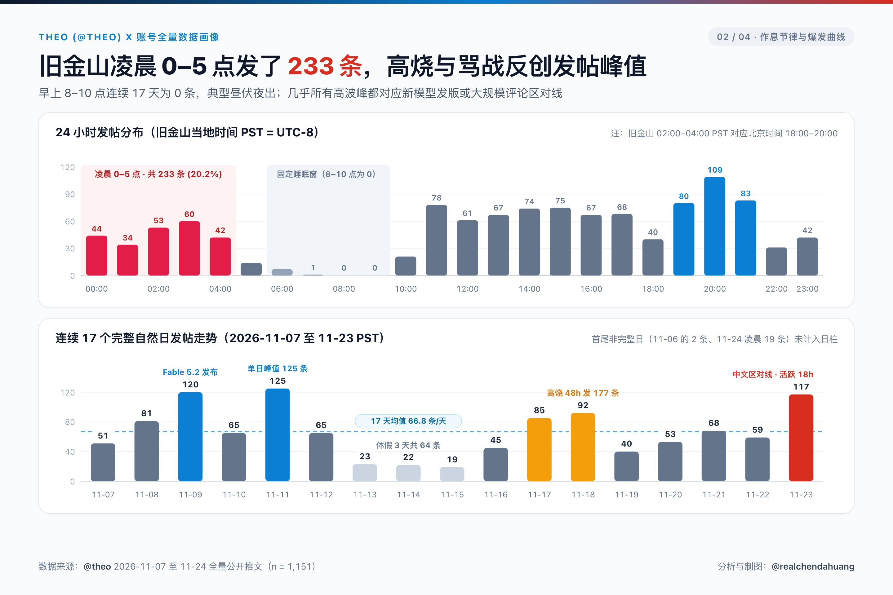

# T3 Code를 설치하기 전에 (Before You Install T3 Code)

<p align="center">
  <strong>유엔 공식 언어:</strong>
  <a href="../../README.md">English</a> ·
  <a href="./README.zh-CN.md">简体中文</a> ·
  <a href="./README.fr.md">Français</a> ·
  <a href="./README.es.md">Español</a> ·
  <a href="./README.ru.md">Русский</a> ·
  <a href="./README.ar.md">العربية</a>
</p>
<p align="center">
  <strong>글로벌 커뮤니티 에디션:</strong>
  <a href="./README.zh-TW.md">繁體中文</a> ·
  <a href="./README.ja.md">日本語</a> ·
  <a href="./README.ko.md"><strong>한국어</strong></a> ·
  <a href="./README.de.md">Deutsch</a> ·
  <a href="./README.pt-BR.md">Português</a> ·
  <a href="./README.it.md">Italiano</a> ·
  <a href="./README.nl.md">Nederlands</a> ·
  <a href="./README.pl.md">Polski</a> ·
  <a href="./README.tr.md">Türkçe</a> ·
  <a href="./README.vi.md">Tiếng Việt</a> ·
  <a href="./README.id.md">Bahasa Indonesia</a> ·
  <a href="./README.hi.md">हिन्दी</a>
</p>


> **감사 범위 및 검증 원칙**  
> 이 저장소는 `pingdotgg/t3code` (T3 Code)에 대한 독립 보안, 텔레메트리, 거버넌스 및 공개 기록 감사 아카이브다. 2026년 11월 24–25일에 공개된 발단 게시물 2편과 **문서화된 감사 연재 18편**, **180개 이상의 정본 1차 출처 URL**(GitHub 커밋, 풀 리퀘스트, 이슈, 원문 소스 파일, 공식 문서, USPTO TSDR 상표 기록 및 아카이브된 공개 게시물), 6편의 심층 기술 보고서([`docs/dossiers/`](../dossiers/01-telemetry-and-gdpr-timeline.md)), 그리고 **연속된 `@theo` X 게시물 1,151건**(2026년 11월 7–24일)의 정량 데이터셋을 하나로 정리했다. 단축 리다이렉트 URL과 개인 연락처 정보는 일절 포함하지 않는다. 사실 관계 업데이트, 새로 병합된 패치 또는 추가 번역은 1차 출처를 첨부해 Pull Request로 기여할 수 있다 — [`CONTRIBUTING.md`](../../CONTRIBUTING.md) 및 [`docs/COMPLETE-SOURCE-INDEX.md`](../COMPLETE-SOURCE-INDEX.md)를 참고하라.

---

## 목차

- [구조화된 감사 결과 및 위험 매트릭스](#구조화된-감사-결과-및-위험-매트릭스)
- [연대기 타임라인 (2023–2026)](#연대기-타임라인-20232026)
- [1. 발단 분쟁: "Steal Our Code", 포크 네이밍 위협과 이중 잣대](#1-발단-분쟁-steal-our-code-포크-네이밍-위협과-이중-잣대)
- [2. 텔레메트리, 교차 도구 자격 증명 읽기 및 GDPR 제소 이후 심야 긴급 패치 (1, 7, 11, 12편)](#2-텔레메트리-교차-도구-자격-증명-읽기-및-gdpr-제소-이후-심야-긴급-패치-1-7-11-12편)
- [3. 로컬 저장소, 프로세스 감시, 안전장치 우회 및 비공개 보안 패치 (2, 3, 13편)](#3-로컬-저장소-프로세스-감시-안전장치-우회-및-비공개-보안-패치-2-3-13편)
- [4. Google Antigravity 약관 리스크 및 비암호화 T3 Connect 릴레이 (4, 5편)](#4-google-antigravity-약관-리스크-및-비암호화-t3-connect-릴레이-4-5편)
- [5. 비즈니스 장부, 투자자 이해충돌, 스폰서 및 77,000 스타 퍼널 (6, 8, 17, 18편)](#5-비즈니스-장부-투자자-이해충돌-스폰서-및-77000-스타-퍼널-6-8-17-18편)
- [6. 거버넌스, 포크 스크래핑 봇, 상표 등록 기록, 1,151개 트윗 데이터셋 및 과거 이력 (9, 10, 14, 15, 16편)](#6-거버넌스-포크-스크래핑-봇-상표-등록-기록-1151개-트윗-데이터셋-및-과거-이력-9-10-14-15-16편)
- [7. 실행 가능한 피해 완화 및 조치 플레이북](#7-실행-가능한-피해-완화-및-조치-플레이북)
- [8. 1차 출처 및 18부작 원문 게시물 색인](#8-1차-출처-및-18부작-원문-게시물-색인)

---

## 구조화된 감사 결과 및 위험 매트릭스

| 영역 및 감사 편수 | 위험도 / 영향 | 핵심 문서화 사실 및 출처 근거 | 현황 (2026년 11월 25일 기준) | 심층 보고서 |
|---|---|---|---|---|
| **텔레메트리 및 GDPR 이후 프라이버시**<br>*(1, 7, 11, 12편)* | **치명적 (Critical)** | 홈페이지에 `"No telemetry / Unless you opt in. Full stop."`을 내걸고도 기본 PostHog 분석 활성화(`PR #174`, `3bdaa6e1`이 6월 18일 삭제); 비공개 소스 `ingest.t3.codes`를 통한 원본 이벤트 보관(`PR #15028`); `~/.codex/auth.json` 및 `~/.claude.json`의 솔트 없는(unsalted) SHA-256 교차 도구 해싱(`Identify.ts`, `telemetryId.ts`); 옵트아웃 PR 4건 거부(`#13458`, `#16763`, `#21248`, `#27077`); Managed Policy 사각지대(`docs/user/telemetry.md`); 심야 GDPR 대응 PR에서 **시간당 220만 건의 IP + UA 스팬** Axiom 30일 보관(`#42380`), `git.cwd` 경로 유출(`#42450`), Win/Mac 옵트아웃 무시(`#42376`, `#42464`), 불완전한 계정 삭제(`#42285`), 익명 배치 혼합 전송(`#42466`) 시인. | 부분적인 심야 패치 적용; `AnalyticsService.ts`는 여전히 시작 시 디스크 식별자 생성; 호스팅 웹 앱에는 여전히 토글 없음; `ingest.t3.codes`는 비공개 소스 유지 | [**Dossier 01**](../dossiers/01-telemetry-and-gdpr-timeline.md) |
| **로컬 안전성 및 비공개 보안 공지**<br>*(2, 3, 13편)* | **치명적 (Critical)** | 사이드바 "영구 삭제(permanent delete)"가 실제로는 `statev2.sqlite`에 `"thread.deleted"`만 추가(25.9–41.6 GB 비대화, `#17845`); `t3-resource-monitor`가 커맨드라인 포함 전체 OS 프로세스 스캔(`ProcessesToUpdate::All`, `#11222`, `PR #41889`); Claude Auto 모드가 3번째 시도에서 `git push --force`를 무음 승인(`#15353`, 52–53일 이상 방치); `slopalytics.com`용 비공개 모델 필터 21시간 만에 제거(`#41237`); 비공개 보안 수정(`#39483`, `#41757`, `#42386`, `#42504`)에도 **GitHub Security Advisories 0건**; 미해결 Windows Base64 PowerShell 백신 오탐 이슈(`#30997`); `SECURITY.md`가 OS 전체 `filesystem:read`와 iOS HTTP를 의도된 동작으로 선언. | `#17845`, `#15353`, `#26489`, `#30997` 미해결/오픈 상태 유지; 게시된 Security Advisories `0`건 | [**Dossier 02**](../dossiers/02-local-safety-and-security-audit.md) |
| **Antigravity 약관 및 T3 Connect 릴레이**<br>*(4, 5편)* | **높음 (High)** | `docs/user/faq.md`는 Google Antigravity 약관(ToS) 안전을 보장하지만 `antigravityUsageLimits.ts`는 OS 키링/Windows `CredReadW` 토큰을 추출해 `antigravity/hub/2.24.0`을 위장하고 비공개 `v1internal` 엔드포인트를 호출; `antigravityAuthSupport.ts`가 가짜 `SSH_CONNECTION`을 주입해 계정 간 교차 라우팅 유발(`#41973`); 신규 $20 계정이 3분 만에 정지됨(`#41536`); `PR #33800`이 위장된 `claude`/`xai`/`antigravity` CLIProxyAPI 허브 폴링 연결; T3 Connect는 **종단간 암호화(E2EE) 전무**, 기본값 비활성 `requireConnectDeviceApproval`(`#36419`), 그리고 개방형 OVH Caddy TLS 종단 게이트웨이(`PR #32945`) 사용. | Antigravity 스푸핑 코드 활성 유지; T3 Connect E2EE 암호화 명시적 거부(`#32098`, 11월 25일 답변) | [**Dossier 03**](../dossiers/03-antigravity-tos-and-t3connect-relay.md) |
| **비즈니스 장부, 스폰서 및 77k 스타**<br>*(6, 8, 17, 18편)* | **높음 (High)** | 무료 클라이언트에 $800k+ 지출(T3 언급 `162`회 vs 유료 제품 언급 `0`회); **하루 31.7T 토큰**($10.19M/일 상당) 컴퓨팅 레이더를 $300k+ OpenAI 얼리 액세스 토큰 및 VC 접촉에 활용; Vibe Kanban 및 Daytona와 엔젤 투자 이해충돌; 스폰서 스택(Clerk, Axiom, Vercel 독점 계약); Codex 0% 악용(`Endless` / `codex#45444`); 10계정 `CLIProxyAPI` Gist(`555%` 쿼터) vs FAQ 정지 경고 모순; 5회 프롬프트 / 30초 유휴 토스트가 호스트 자격 증명으로 `PUT user/starred/...` 실행(`#27832`, `#29922`, `#29987`), Macroscope 우회 및 `driver.ts#L60-L99` 임의 저장소 스타 버그 19일간 방치. | `driver.ts` 미고정 스타 지정 및 `zhilsinger` 리뷰 19일째 미수정; 저장소 스타 77k+ vs 워처 ~129명 | [**Dossier 04**](../dossiers/04-business-ledger-sponsors-and-77k-stars.md) |
| **거버넌스, 상표 및 과거 이력**<br>*(발단 1–2편, 9, 10, 15, 16편)* | **중간–높음 (Medium–High)** | 하루 500커밋 / 700개 에이전트 / `yolo merges` vs `CONTRIBUTING.md`(`"here's my advice: Don't"`), `.github/VOUCHED.td` 공개 지목 자동 차단, `174`건의 `unwanted` 라벨, Plan 모드 삭제(`#5551`, `#9190`, `#33131`) 및 `#33639` 욕설 응대; 공개 `@bot` 포크 스크래핑(`@MiaAI_lab`), Community Notes 수익 창출 박탈 선동 및 자동 차단 봇; GitHub 계정 정지 위협 당시 `T3 Code`/`T3 Tools`/`T3 Connect` **USPTO 등록 0건**(`PING LABS` `97294243` 포기 처리; EquipmentShare `7795672` 등록); 17시간 뒤 사후 `PR #41898` `TRADEMARK.md` 추가; 2024–2026년 반복 패턴(`vsc-material-but-i-wont-sue-you`, 인도 개발자 반발, $20k FFmpeg 현상금, 11월 25일 새벽 4시 비공개 전환 위협 삭제). | `CONTRIBUTING.md` / `.github/VOUCHED.td` 및 `TRADEMARK.md`가 `main`에 활성 유지 | [**Dossier 05**](../dossiers/05-governance-trademark-and-history.md) |
| **1,151개 트윗 정량 데이터셋**<br>*(14편)* | **감사 기준선** | 11월 7–24일 전수 코퍼스(`n = 1,151`, 17.24일, 일평균 66.8건, 답글 75.6%, 중앙 간격 2.7분): 빅테크 임원·직원·KOL 20명 대상 **욕설/모욕 0.0%**(`0/43` 엄격 primary-`@`, 감사 인사 `32.6%`) vs 일반 개발자 대상 **적대적 표현 8.0%**(`61/766`) 및 25시간 중국 포크 위기 구간의 직접 인신공격 **4.0배 급증 14.4%**(`19/132`). | 4개의 포렌식 차트가 포함된 재현 가능한 정규식 감사 | [**Dossier 06**](../dossiers/06-tweet-forensic-dataset-1151.md) |
| **전체 1차 URL 카탈로그** | **참조 인덱스** | 본 포털, `canonical_refs.txt`, `tco_resolved.json`, `all_18_posts.txt`, `missing_posts_full.json`의 모든 정본 `https://` URL 교차 검증 전체 목록. | 100% 정본화 완료 (`t.co` 링크 0건) | [**Source Index**](../COMPLETE-SOURCE-INDEX.md) |

---

## 연대기 타임라인 (2023–2026)

| 날짜 / 시각 | 주요 사건 | 검증 가능한 근거 / 출처 |
|---|---|---|
| **2023-05-14** | `@theo`가 자신의 YouTube 스폰서 목록(`@vercel`, `@clerk`, `@upstash`, `@axiomhq`, `@PlanetScale`) 공개. 이후 Clerk와 Axiom은 T3 Code의 핵심 인증 및 로깅 인프라를 구성. | [`1657488850472804353`](https://x.com/theo/status/1657488850472804353) |
| **2024-04 / 2024-09** | Vercel CEO가 단 한 명의 유튜버(`Theo`)만 후원하고 있다고 확인; `@theo`는 스폰서 계약에 경쟁사 홍보를 제한하는 독점 조항이 있었음을 인정. | [`1776260839965863965`](https://x.com/rauchg/status/1776260839965863965) · [Video](https://www.youtube.com/watch?v=uv179CTAK-w) |
| **2024** *(2년 전)* | `@theo`가 원작자의 성격을 조롱하며 VS Code 테마를 `vsc-material-but-i-wont-sue-you`로 포크; 별도로 인도 튜토리얼 채널을 겨냥한 영상이 괴롭힘 사태를 촉발하자 국적 기반 공격을 규탄하는 사과 영상(`I screwed up.`) 게시. | [`vsc-material-but-i-wont-sue-you`](https://github.com/t3dotgg/vsc-material-but-i-wont-sue-you) · [`I screwed up.`](https://www.youtube.com/watch?v=o2CSJYXJBpc) |
| **2025-02 – 2025-05** | USPTO가 T3 Tools Inc.의 유일한 상표 출원(`PING LABS`, 일련번호 `97294243`)을 거절하고 `ABANDONED`(2025년 5월 19일) 처리. EquipmentShare가 소프트웨어/SaaS 9류·42류에 `T3` 등록(`Reg. 7795672`, 2025년 5월 13일). | [TSDR `97294243`](https://tsdr.uspto.gov/statusview/sn97294243) · [TSDR `90644500`](https://tsdr.uspto.gov/#caseNumber=90644500&caseSearchType=US_APPLICATION&caseType=DEFAULT&searchType=statusSearch) |
| **2025-10** | `@theo`가 X에서 FFmpeg와 충돌하며 FFmpeg 메인테이너를 몰아내기 위한 **$20,000 현상금**을 내걸었으나 Windscribe가 $21,000로 맞불을 놓고 VLC 창립자가 반대하며 FFmpeg 개발자들이 공개 괴롭힘을 기록하자 영상과 트윗을 삭제하고 현상금 철회. | [FFmpeg Record](https://www.youtube.com/watch?v=1oQ3KMeaH04) |
| **2026-03-06** | **PR #174**가 `pingdotgg/t3code`에 병합되어 동의 대화상자, 설정 UI 토글, 텔레메트리 문서 없이 기본 활성화 PostHog 텔레메트리 적용. | [PR #174](https://github.com/pingdotgg/t3code/pull/174) |
| **2026-04-26** | `@theo`가 *"Github has a fake star problem"*을 게시하며 GitHub 스타가 `"mostly a way for companies to trick VCs into investing"`(VC 투자를 끌어내기 위한 기만 수단)라고 서술. | [`2048122499834036340`](https://x.com/theo/status/2048122499834036340) |
| **2026-06-18** | **커밋 `3bdaa6e1`**이 3개월 이상의 기본 텔레메트리 수집 이후 T3 Code 홈페이지에서 `No telemetry / Unless you opt in. Full stop.` 문구를 조용히 삭제. | [Commit `3bdaa6e1`](https://github.com/pingdotgg/t3code/commit/3bdaa6e10046945ccc08264d2d6f3b81775efcb3) |
| **2026-06-23** | 메인테이너 Julius가 **Issue #1397**을 `not planned`로 닫음: *"We will not make this easier to opt out of, it is crucial for us to know how many users we have"*. | [Issue #1397](https://github.com/pingdotgg/t3code/issues/1397) |
| **2026-07 – 2026-11-17** | **Issue #4123**(아카이브된 "No telemetry" 스크린샷)이 11월 4일 조용히 닫힘; 4개의 커뮤니티 옵트아웃 PR(`#13458`, `#16763`, `#21248`, `#27077`)이 거부됨(`#27077`은 147개 테스트 통과에도 `unwanted`로 닫힘). | [Issue #4123](https://github.com/pingdotgg/t3code/issues/4123) · [PR #27077](https://github.com/pingdotgg/t3code/pull/27077) |
| **2026-08-06 – 2026-09-02** | **PR #5551**이 Build/Plan 토글을 숨김(`Reality check for those upset`, 비추천 10건); **PR #9190**이 컨텍스트 미터 숨김(비추천 16건, 저장소 최다). | [PR #5551](https://github.com/pingdotgg/t3code/pull/5551) · [PR #9190](https://github.com/pingdotgg/t3code/pull/9190) |
| **2026-08-19 – 2026-08-22** | `@theo`가 Codex 0% 쿼터 이후 **$800+**를 추가 추출했다고 과시하고 `@maria_rcks`가 *Endless*를 공개; 반발 이후 양측 모두 게시물 삭제(`2090972426876129658`); OpenAI가 0% 턴 차단을 강화(`openai/codex#45444`). | [`2090972426876129658`](https://x.com/maria_rcks/status/2090972426876129658) · [`codex#45444`](https://github.com/openai/codex/issues/45444) |
| **2026-10-03 – 2026-10-10** | **Issue #15353**(Claude Auto 무음 `git push --force`, 10월 3일), `privacy-policy.astro`(`2026-10-06`), **Issue #17845**(`statev2.sqlite` 가짜 삭제, 10월 10일)가 기록됨. | [Issue #15353](https://github.com/pingdotgg/t3code/issues/15353) · [Issue #17845](https://github.com/pingdotgg/t3code/issues/17845) |
| **2026-10 – 2026-10-19** | **PR #15028**이 텔레메트리를 비공개 소스 `ingest.t3.codes`로 라우팅; **PR #21506**이 `Identify.ts`에 솔트 없는 SHA-256 교차 도구 귀속 추가; `@theo`가 10계정 `CLIProxyAPI` Gist(`555%` 쿼터) 게시. | [PR #15028](https://github.com/pingdotgg/t3code/pull/15028) · [PR #21506](https://github.com/pingdotgg/t3code/pull/21506) · [Gist](https://gist.github.com/t3dotgg/59a521d2ee8d70aaf90e280c175072af) |
| **2026-10-30 – 2026-11-06** | **PR #27832**, **#29922**, **#29987**이 호스트 자격 증명으로 `PUT user/starred/...`를 호출하는 5프롬프트/30초 유휴 스타 토스트 배포; `zhilsinger`가 11월 6일 `Request changes` 제출(19일간 무응답). | [PR #27832](https://github.com/pingdotgg/t3code/pull/27832) · [PR #29922](https://github.com/pingdotgg/t3code/pull/29922) |
| **2026-11-08 – 2026-11-22** | `@bot` 포크 스크래핑(`@MiaAI_lab`), Plan 모드 삭제(`#33131`), `$800k+` 지출 및 `31.7T/일` / `$10.19M/일` 레이더 공개, `$300k+` OpenAI 무료 토큰, `CONTRIBUTING.md` 개편, Vibe Kanban/Daytona 이해충돌, `PR #41237`로 21시간 만에 모델 필터 제거. | [PR #33131](https://github.com/pingdotgg/t3code/pull/33131) · [`2122860770329608290`](https://x.com/theo/status/2122860770329608290) · [PR #41237](https://github.com/pingdotgg/t3code/pull/41237) |
| **2026-11-23 19:11–19:54 CST** | `@theo`가 `"Chinese knockoff"`과 `"Temu3 Code"`를 게시하며 GitHub 계정 정지를 위협(`2124829315657576890`); MIT 포크 작성자가 30분 내 `Stardust`로 개명; DM으로 비공개 사과했으나 공개 게시물은 유지. | [`2124829315657576890`](https://x.com/theo/status/2124829315657576890) · [Origin 2](https://x.com/realchendahuang/status/2125062675147448475) |
| **2026-11-24 06:06–12:23 CST** | `@theo`가 미국 수조 달러 기업들의 MIT 코드 복제는 환영(`2124989435154726982`), 법률 준수 지적은 조롱(`"get a better lawyer"`), 발단 1–2편 게시; **12:21 CST**(`04:21Z`, 계정 정지 위협 17시간 후) `@theo`가 `TRADEMARK.md`를 소급 추가하는 **PR #41898** 병합. | [`2124989435154726982`](https://x.com/theo/status/2124989435154726982) · [PR #41898](https://github.com/pingdotgg/t3code/pull/41898) |
| **2026-11-24 17:04–21:21 CST** | 감사 **1–5편** 게시(1편 **조회수 181만+**, 북마크 6,640건 돌파). `18:39 CST`에 `@theo`가 중국 테크 트위터를 `"the biggest fucking cesspit"`이라 비난(`2125177503526588877`); `19:13–19:36 CST`에 Managed Policy가 모든 텔레메트리를 끈다고 주장(`2125186071357251715`). | [Part 1](https://x.com/realchendahuang/status/2125153472450527440) → [Part 5](https://x.com/realchendahuang/status/2125218189596676555) |
| **2026-11-24 심야 – 2026-11-25 ~07:00 CST** | 공식 EU GDPR 진정 접수; **6시간 심야 스프린트**로 `#42380`(시간당 220만 IP 스팬), `#42285`/`#42430`(계정 삭제), `#42376`/`#42464`(Win/Mac 옵트아웃 무시), `#42450`(경로 수집 부인 90분 만에 드러난 `git.cwd` 경로 유출), `#42459`/`#41859`(푸시 유출), `#42466`(익명 배치), `#41757`/`#42386`/`#42504`(비공개 보안 패치) 병합. 해 뜨기 전 `@theo`가 비공개 소스 전환 위협 트윗 게시 후 삭제. | [Part 11](https://x.com/realchendahuang/status/2125394810559426993) · [Part 12](https://x.com/realchendahuang/status/2125395501663281198) · [Part 13](https://x.com/realchendahuang/status/2125395980354994414) |
| **2026-11-25 08:27–10:28 CST** | 비즈니스 장부, Managed Policy 사각지대, `yolo merges`, `@bot` 스크래핑, GDPR 이후 공개 사실, 1,151개 트윗 데이터셋, USPTO 기록, 스폰서 관계, 77k 스타 엔진을 다룬 감사 **6–18편** 게시. | [Part 6](https://x.com/realchendahuang/status/2125385742243520653) → [Part 18](https://x.com/realchendahuang/status/2125416210120765799) |

---

## 1. 발단 분쟁: "Steal Our Code", 포크 네이밍 위협과 이중 잣대

2026년 11월 23–25일 48시간 동안, T3 Code의 커뮤니티 MIT 포크 명칭을 둘러싼 분쟁은 전체 소스코드 감사, 유럽 GDPR 제소, 그리고 약 20건의 심야 긴급 패치로 비화했다.

2026년 11월 23일 밤부터 24일 오전(베이징 시간) 사이, 한 사용자가 중국인 개발자(`@DDdxx666`)가 만든 무료 오픈소스 MIT 포크를 공식 앱으로 착각해 UI를 비판했다. `@theo`는 해당 저장소가 적법한 MIT 포크인지 확인하지도 않은 채 11분 만에 두 차례 게시물을 올려 이를 `"Chinese knockoff"` 및 `"Temu3 Code"`라고 부르고 원작자의 작업물을 직접 조롱했으며, GitHub에 연락해 계정을 정지시키겠다고 위협했다(`"Do it right now or I'm going to contact GitHub and have your account taken down"`). 같은 시기 T3 Code 공식 웹사이트([`https://t3.codes/`](https://t3.codes/))는 GitHub 저장소 링크 라벨을 `"Steal our code (legally)"` (`"steal our code"`)로 표기하고 있었다([발단 1](https://x.com/realchendahuang/status/2125059292919394654), [발단 2](https://x.com/realchendahuang/status/2125062675147448475)).

포크 작성자는 즉시 응해 30분 만에 저장소 이름을 `Stardust`로 바꾸고 모든 T3 브랜딩을 제거했다. `@theo`는 DM으로 비공개 사과를 보냈지만, 합산 조회수 20만 회를 넘긴 두 공개 게시물은 삭제나 해명 없이 그대로 남겨두었다. 11시간도 채 지나지 않은 11월 24일 `06:12 BJ` (`2124989435154726982`), 수조 달러 규모의 미국 AI 연구소들이 T3 Code 기능을 복제하는 것이 선을 넘은 일인지 묻는 질문에는 정반대 입장을 취했다: `"Nah. Open source is open source, even if a trillion dollar company uses it!"` 한편 T3 직원 `@maria_rcks` 본인은 `maria-rcks/t3libre` (*"T3 Code, liberated"*)라는 공개 포크를 운영하고 있었고, `t3code-quota-ui`, `t3code-atlas`, `t3code-bar` 같은 영어권 저장소에는 어떠한 공개 위협도 가해지지 않았다.


11월 24일 베이징 시간 17:04부터 필자는 `pingdotgg/t3code`의 커밋 이력, 소스 파일, PR, 이슈, 공식 문서, USPTO TSDR 기록, 그리고 `@theo`의 공개 X 타임라인을 감사했다. 24시간 동안 직접 링크와 스크린샷으로 뒷받침된 **18편의 문서화된 감사 연재**를 게시했다. 1편 단독으로 **조회수 181만 회**와 **북마크 6,640건**을 넘어섰고, 유럽에서의 GDPR 진정 접수와 T3 팀의 6시간 심야 패치 스프린트로 이어졌다.

---

## 2. 텔레메트리, 교차 도구 자격 증명 읽기 및 GDPR 제소 이후 심야 긴급 패치 (1, 7, 11, 12편)

> **심층 기술 감사:** 전체 소스 라인 매핑, `FeatureUsage.ts` 액션 목록, `DesktopShellEnvironment.ts` 누락 사항, 11월 23–25일 분 단위 로그는 [**Dossier 01: Telemetry Architecture, Cross-Tool Identity Stitching & the Nov 24–25 GDPR Overnight Sprint**](../dossiers/01-telemetry-and-gdpr-timeline.md)에 수록되어 있다.

### 2.1 기본 텔레메트리, 삭제된 홈페이지 약속 및 교차 도구 자격 증명 해싱 (`1편`)

**2026년 3월 6일**, `pingdotgg/t3code`는 저장소 텔레메트리 문서, 첫 실행 동의 프롬프트, 설정 UI 토글이 전혀 없는 상태에서 PostHog 텔레메트리를 기본 활성화하는 **PR #174**를 병합했다. 옵트아웃 환경 변수는 코드 속에 묻혀 있었고, 기본 설치본은 실행 즉시 이벤트를 전송하기 시작했다([1편](https://x.com/realchendahuang/status/2125153472450527440)).

기본 수집이 3개월 이상 진행되는 동안에도 T3 Code 홈페이지에는 두 줄의 문구가 뚜렷하게 표시되어 있었다: `No telemetry / Unless you opt in. Full stop.` **2026년 6월 18일**, `@theo`는 홈페이지 개편 과정에서 공지나 기존 사용자 안내 없이 이 두 줄을 조용히 삭제했다([`commit 3bdaa6e1`](https://github.com/pingdotgg/t3code/commit/3bdaa6e10046945ccc08264d2d6f3b81775efcb3)).


2026년 10월, `@theo`는 10초 간격 배치 텔레메트리 업로드(`FLUSH_INTERVAL_MS = 10_000`)를 T3의 비공개 소스 게이트웨이 [`https://ingest.t3.codes/`](https://ingest.t3.codes/)로 경유시키는 **PR #15028**을 병합했다. [`apps/server/src/telemetry/AnalyticsService.ts`](https://github.com/pingdotgg/t3code/blob/main/apps/server/src/telemetry/AnalyticsService.ts)의 1번 줄은 인제스트 엔드포인트가 PostHog로 전달하기 전에 모든 원본 이벤트 사본을 보관한다는 점을 명시한다:

```ts
// apps/server/src/telemetry/AnalyticsService.ts (lines 1, 71–74, 149)
// T3 ingest retains events and forwards to PostHog; UUIDs deduplicate retries there.
...
  posthogHost: Config.String("T3CODE_POSTHOG_HOST").pipe(
    Config.withDefault("https://ingest.t3.codes"),
  ),
  enabled: Config.Boolean("T3CODE_TELEMETRY_ENABLED").pipe(Config.withDefault(true)),
...
  const { distinctId, installId } = yield* getTelemetryIdentity;
```

[`ProviderUsageAnalytics.ts`](https://github.com/pingdotgg/t3code/blob/main/apps/server/src/telemetry/ProviderUsageAnalytics.ts)와 `FeatureUsage.ts`에서 수집한 필드에는 프로바이더, 모델 선택(`ProviderDimensions.ts`를 통해 카탈로그 외 커스텀 모델/엔드포인트 ID를 원문 그대로 전송), reasoning effort, 권한 모드, 실행 시간, 입력/출력/캐시/추론 토큰 수, 하위 에이전트 토큰, 로컬 프로젝트/스레드 수, **35종의 UI/명령 액션**(`COMMAND_FEATURES` `18`개 + `METHOD_FEATURES` `17`개), OS 상세 정보, WSL 배포판, 아키텍처가 포함되었다.

**2026년 10월 19일**, `@theo`는 한 개인에게 몇 대의 머신이 속하는지 집계하기 위해 **PR #21506**을 추가로 병합했다. [`apps/server/src/telemetry/Identify.ts`](https://github.com/pingdotgg/t3code/blob/main/apps/server/src/telemetry/Identify.ts)는 사용자 홈 디렉터리에 있는 별개 AI 도구들의 자격 증명 파일—`~/.codex/auth.json`과 `~/.claude.json`—을 몰래 읽어 OpenAI `user_id` JWT 클레임과 Claude `oauthAccount.accountUuid`를 디코딩한 뒤, 연결된 T3 Connect 사용자 ID 및 기기 ID와 함께 해싱하기 시작했다:

```ts
// apps/server/src/telemetry/Identify.ts (lines 257–269, 321–338)
  const codexTokens = yield* readJsonIdentityFile(
    "codex",
    path.join(homeDirectory, ".codex", "auth.json"),
    decodeCodexAuthJson,
  )...
  const claudeJson = yield* readJsonIdentityFile(
    "claude",
    path.join(homeDirectory, ".claude.json"),
    decodeClaudeJson,
  )...
  const raw: ReadonlyArray<readonly [TelemetryOwnerSource, Option.Option<string>]> = [
    ["connect", connectUser],
    ["openai", Option.flatMap(codexTokens, (tokens) => Option.flatMap(Option.fromUndefinedOr(tokens.id_token), openAiUserId))],
    ["claude", Option.flatMap(claudeJson, (json) => Option.fromUndefinedOr(json.oauthAccount?.accountUuid))],
  ];
  return raw.flatMap(([source, value]) =>
    Option.isSome(value) && value.value.trim() !== "" ? [{ source, ownerId: hashTelemetryId(value.value) }] : [],
  );
```

그리고 [`packages/shared/src/telemetryId.ts`](https://github.com/pingdotgg/t3code/blob/main/packages/shared/src/telemetryId.ts)(8–9번 줄)의 `hashTelemetryId`는 **솔트 없는(unsalted) SHA-256 다이제스트**(`Hex.encode(sha256(new TextEncoder().encode(value)))`)를 계산한다. 서버가 이미 Clerk에서 온 평문 T3 Connect 계정 ID를 보유하고 있으므로 백엔드에서 평문을 해싱하면 솔트 없는 다이제스트를 특정 실명 인물로 곧바로 역추적할 수 있으며, 유출된 제3자 OpenAI 또는 Claude ID 역시 동일한 해시와 결정론적으로 조인된다.


커뮤니티의 반발은 반복적으로 묵살되었다. **6월 23일**, 한 개발자가 설정 토글을 요청하는 **Issue #1397**을 열었지만 핵심 메인테이너 Julius는 `not planned`로 닫으며 `We will not make this easier to opt out of, it is crucial for us to know how many users we have`라고 답했다. 7월에는 한 사용자가 어겨진 약속(`"No telemetry"`)을 지적하며 아카이브된 홈페이지 스크린샷을 **Issue #4123**에 올렸으나 `@theo` 계정이 10월 21일 무관한 커밋으로 닫았다가 반발 후 재오픈한 뒤 11월 4일 다시 조용히 닫았다. 9월부터 11월 사이 기여자들은 **4개의 별도 옵트아웃 PR**(`#13458`, `#16763`, `#21248`, `#27077`)을 제출했다. 실물 하드웨어에서 **147개 테스트를 모두 통과**하고 Macroscope 승인까지 받은 `#27077`마저 **11월 17일** `unwanted` 태그가 붙은 채 닫혔다.


### 2.2 Managed Policy와 공식 문서의 모순 (`7편`)

11월 24일 비판이 거세지자 `@theo`는 X에서 T3 Code가 업계 최고의 기업용 Managed Policy를 갖추고 있어 `"trivial to set up and turn off all telemetry"`(설정이 사소할 정도로 쉽고 모든 텔레메트리를 끈다)며 대화 데이터는 디스크에 남아 `"never touches any of our servers"`(자사 서버를 절대 거치지 않는다)고 주장했다([`2125186071357251715`](https://x.com/theo/status/2125186071357251715), [`2125191784859115766`](https://x.com/theo/status/2125191784859115766), [7편](https://x.com/realchendahuang/status/2125391659492081947)).

[`docs/user/managed-policy.md`](https://github.com/pingdotgg/t3code/blob/main/docs/user/managed-policy.md)와 [`docs/user/telemetry.md`](https://github.com/pingdotgg/t3code/blob/main/docs/user/telemetry.md)를 직접 확인하면 정반대의 사실이 드러난다:
1. **관리자 전용 구성:** 데스크톱 사용자는 여전히 설정 UI 토글이 전혀 없다. Managed Policy로 텔레메트리를 끄려면 MDM/Group Policy를 쓰거나 관리자 보호 경로(`/Library/Application Support/T3Code/policy.json` on macOS, `C:\Program Files\T3Code\policy.json` 또는 `HKLM\SOFTWARE\Policies\T3Tools\T3Code` on Windows, `/etc/t3code/policy.json` on Linux)에 `policy.json`을 작성해야 한다.
2. **호스팅 웹 앱(`app.t3.codes`) 사각지대:** `docs/user/telemetry.md`는 브라우저 앱이 서버 환경 변수를 읽지 않으며, Managed Policy를 무시하고, 추적 기능이 포함된 빌드의 경우 연결 트레이스를 전송하며 `"has no relay tracing toggle"`(릴레이 트레이싱 토글이 없다)고 명시적으로 시인한다.
3. **서버 정책 밖의 모바일 앱:** 서버 환경 변수와 Managed Policy는 `"do not disable mobile tracing"`(모바일 트레이싱을 비활성화하지 못한다).
4. **옵트아웃을 무시하는 `Publish agent activity`:** 호스트에서 활성화되면 프로젝트 제목, 스레드 제목, 모델명, 실시간 활동 상태가 T3 Connect 릴레이로 전송되며 `"The telemetry opt-out does not disable it."`이라고 적혀 있다. (게다가 실패한 Axiom 스팬과 모바일 크래시 로그는 `"can quote a value the app was handling"`일 수 있으며, `Agent feedback`은 최대 16 KB의 대화 메시지를 첨부할 수 있다.)


### 2.3 2시간 만에 뒤집힌 11월 25일 해명 (`11편`)

11월 25일 오전, `@theo`는 공개 텔레메트리 덤프([`t3code-telemetry-events-jsonl-a4896cdc.gz`](https://files.tslop.org/2026/11/t3code-telemetry-events-jsonl-a4896cdc.gz))와 함께 장문의 해명문([`2125332390239494211`](https://x.com/theo/status/2125332390239494211))을 올려 세 가지 단호한 보장을 내놓았고, 이어진 답글에서는 옵트아웃 시 로컬 추적 파일 기록을 부인했다([`2125370330244128924`](https://x.com/theo/status/2125370330244128924))([11편](https://x.com/realchendahuang/status/2125394810559426993)):

- **"파일 경로를 수집한 적이 없다":** 90분 후 Julius는 **PR #42450**을 병합하며 릴레이로 전달된 웹훅 실행이 전체 실행 스팬을 Axiom으로 내보냈고, 여기에는 `git.cwd`(**절대 워크스페이스 경로, OS 사용자 이름, 저장소 이름**)가 담긴 Git 스팬이 포함되었다고 시인했다.
- **"환경 변수는 언제나 깔끔하게 텔레메트리를 껐다":** **PR #42376**은 Windows 데스크톱이 기존 프로세스에서 실행될 때 저장된 사용자 `T3CODE_TELEMETRY_ENABLED=false` 환경 변수를 무시했음을 확인했고, **PR #42464**는 macOS/Linux 첫 실행 시 릴레이 트레이싱이 셸 환경 탐색 전에 평가되어 실행 전체 동안 `~/.zshrc` 옵트아웃을 무시했음을 확인했다. (`DesktopShellEnvironment.ts`는 여전히 `T3CODE_OTEL_SDK_DISABLED` 전달을 누락하고 있다.)
- **"옵트아웃 시 추적 파일을 쓰지 않는다" & "Claude 해시는 망가져 있었다":** [`AnalyticsService.ts#L152`](https://github.com/pingdotgg/t3code/blob/main/apps/server/src/telemetry/AnalyticsService.ts#L152)(149번 줄)는 여전히 시작 시 무조건 `getTelemetryIdentity`를 호출해 로컬 설치 ID를 기록하고 `~/.codex/auth.json` 및 `~/.claude.json`을 읽어 해싱한다. 한편 `@theo`의 ~100MB 덤프(압축 크기 `6,056,594` 바이트, `95,789`건 이벤트)의 gzip 헤더를 검사한 결과 트윗 20분 전에 생성된 원본 파일명 `events.clean.jsonl`이 확인되었음에도, 10월 20일 기준 **4대의 별도 머신**(`installId`)을 정확히 같은 SHA-256 해시로 묶은 **264건의 활성 Claude 계정 기록**과 비공개 프록시 모델명 원문(`vibeproxy/gpt-6-luna`, `muse-proxy-wonder-full`)이 그대로 남아 있었다.


### 2.4 GDPR 제소 이후 6시간 심야 긴급 대응 (`12편`)

11월 24일 밤 공식 EU GDPR 진정이 접수된 이후, 심야 긴급 PR들을 통해 4건의 더 깊은 프라이버시 실태가 드러났다([12편](https://x.com/realchendahuang/status/2125395501663281198)):

1. **시간당 220만 건의 IP 태그 릴레이 스팬 (`PR #42380`):** Axiom으로 내보낸 모든 릴레이 요청 스팬—대략 **시간당 220만 스팬, 30일 보관**—이 `user.id` 바로 옆에 `client.address`(`cf-connecting-ip`에서 온 호출자 IP)와 `user_agent.original`을 기록했음을 시인했다(Cloudflare의 1% Workers 호출 로그는 여전히 별도라는 점도 명시). 병합 후 3시간 반이 지난 시점에도 `@theo`는 IP가 이미 제거되어 있었다고 답글을 달았다.
2. **불완전한 계정 삭제 (`PR #42285` & `PR #42430`):** 과거 Clerk에서 사용자를 삭제해도 PlanetScale 릴레이 행과 활성 Cloudflare 터널이 그대로 남아 있었으며, 실제 프라이버시 삭제 요청이 들어왔을 때 **수작업 SQL 작성과 수동 터널 해체**가 필요했음을 시인했다.
3. **모바일 푸시 유출 (`PR #42459` & `PR #41859`):** Android FCM 알림은 매 푸시마다 평문 Clerk `user_id` 값을 Google에 전송했고, iOS 푸시 요청 스팬/오류는 토큰이 담긴 전체 기기 푸시 URL을 기록했다.
4. **"익명" 피드백의 혼합 전송 (`PR #42466`):** 익명이어야 할 `agent.feedback` 이벤트가 `docs/user/telemetry.md`와 모순되게 식별된 `installId` 이벤트 및 전체 호스트 지문(OS, 아키텍처, 원본 WSL 배포판)과 같은 HTTP POST 배치에 묶여 전송되었음을 시인했다. 한편 `privacy-policy.astro`는 10월 6일 이후 수정되지 않은 채 유지되었다.


---

## 3. 로컬 저장소, 프로세스 감시, 안전장치 우회 및 비공개 보안 패치 (2, 3, 13편)

> **심층 기술 감사:** SQLite 정리 SQL 원문, Rust `sysinfo` 호출, `ClaudeAdapterV2.ts` 권한 라인, 그리고 전체 `SECURITY.md` 경계 분석은 [**Dossier 02: Local Safety, Silent Code-Execution Bypasses, and Undisclosed Security Audit**](../dossiers/02-local-safety-and-security-audit.md)에 수록되어 있다.

### 3.1 SQLite 가짜 스레드 삭제 및 전 머신 프로세스 스캔 (`2편`)

사용자가 사이드바에서 스레드를 삭제하면 확인 대화상자(`useThreadActionMenu.ts`)는 `"This permanently clears conversation history for this thread."`라고 약속한다. 실제로는 `ThreadDeletion.ts`가 `statev2.sqlite`에 `"thread.deleted"` 이벤트 하나만 추가하고, `ProjectionMaintenance.ts`는 `thread.created`와 최신 스트림 이벤트(`MAX(newer.sequence)`)를 제외하면서 이전 이벤트를 보존한다. 사용자들은 `statev2.sqlite`가 3주 만에 **25.9 GB**(90%가 "삭제된" 스레드), 6주 만에 **41.6 GB**, 7주 만에 **33 GB**까지 비대해졌다고 보고했으며, **Issue #17845**(및 **#28903**)은 10월 10일 이후 미수정 상태로 남아 있다([2편](https://x.com/realchendahuang/status/2125160473176023486)).


백그라운드 Rust 헬퍼 `t3-resource-monitor`(**Issue #11222**, `native/resource-monitor/src/main.rs`가 `with_cmd(UpdateKind::Always)`와 함께 `ProcessesToUpdate::All` 호출)는 진단 창이 닫혀 있어도 5초마다 머신의 모든 프로세스를 스캔해, Windows에서 아무 관련 없는 440개 이상의 앱과 게임에 대해 옵트아웃 없이 약 280–300개의 상시 핸들을 열었다. 문서는 활성 구독자가 있을 때만 샘플링한다고 주장해 왔다. **11월 24일**이 되어서야 **PR #41889**는 프로세스 진단이 평문 API 키, 데이터베이스 비밀번호, 인증 토큰을 자주 포함하는 **전체 프로세스 커맨드라인 인자**를 실시간 텔레메트리와 히스토리 스냅샷에 수집해 왔음을 확인했다.


2편에서 검증된 추가 로컬 결함은 다음과 같다:
- **사내 호스트명 파비콘 유출:** 프론트엔드 요청이 내부 호스트명(예: `devbox.localdomain`)을 Google 파비콘 API로 유출했다(`PR #16950`, `PR #32657`).
- **강제 시작 네트워크 요청:** 텔레메트리를 꺼도 서버 시작 시 아무런 옵트아웃 없이 무조건 [`https://raw.githubusercontent.com/`](https://raw.githubusercontent.com/)에서 호환성 매니페스트를 가져온다(**Issue #36479**).
- **승인 및 정책 우회:** 전체 접근 및 WSL/Tailscale 승인·정책 우회 수정 사항(`PR #21806`, `PR #27322`).
- **Claude 쿼터 1.7배 소모 및 136배 전력 소모:** Agent SDK를 통해 Claude를 구동하면 11월 초까지 5시간 쿼터가 정상 속도의 **1.7배**로 소진되었다(`Issue #7338`, `Issue #24649`, 댓글 81개); GPU/전력 버그는 일반 Electron 대비 **136배**에 달해 MacBook 19코어 GPU가 **60W**에 고정되어 78분 만에 배터리를 소진시키고 웹 탭을 닫은 뒤에도 **18W**를 소모했다(`Issue #3143`, `Issue #40581`).

### 3.2 52일 방치된 무음 `git push --force` vs 21시간 만에 삭제된 모델 프라이버시 필터 (`3편`)

**10월 3일** 이후 **52–53일 이상** 이어진 **Issue #15353**([댓글](https://github.com/pingdotgg/t3code/issues/15353#issuecomment-6889019695))에서 Claude Auto 모드는 위험한 명령을 무음으로 실행했다(`requiresClaudeApproval`이 거짓으로 평가될 때 `ClaudeAdapterV2.ts`가 `"allow"`로 단락 평가). 커스텀 규칙이 전혀 없어도 Claude 분류기가 `git push --force origin main`을 두 번 차단하고 세 번째 시도를 수동 승인으로 에스컬레이션하자, T3 Code는 아무런 UI 대화상자 없이 이를 조용히 승인하고 `"source": "user_temporary"`를 기록했다. 커뮤니티 수정 PR 두 건(`#15360`, `#35207`)은 봇에 의해 자동 종료될 때까지 검토조차 받지 못했고 `#40692`는 계류 중이었다([3편](https://x.com/realchendahuang/status/2125201882687881378)).


반면 **11월 22일**, **Issue #40948**은 `PR #29001`이 보고 대상을 화이트리스트로 제한했기 때문에 `@theo`의 공개 텔레메트리 리더보드 [`https://slopalytics.com/`](https://slopalytics.com/)([`t3-usage.json`](https://slopalytics.com/data/t3-usage.json))에 최신 모델이 나타나지 않는다고 지적했다. **21시간 만에**, Theo가 직접 제거를 요청했다고 명시한 **PR #41237**이 `@theo` 계정 아래 병합되어 `ollama/acme-internal`과 엔터프라이즈 `acme-azure-deployment` 이름까지 원문 그대로 분석 서버로 전송하게 되었다.


### 3.3 보안 공지 0건, 비공개 취약점 패치 및 `SECURITY.md` (`13편`)

11월 25일 기준 `pingdotgg/t3code`의 [GitHub Security Advisories](https://github.com/pingdotgg/t3code/security/advisories) 탭에는 **게시된 공지 0건**이 올라와 있다([13편](https://x.com/realchendahuang/status/2125395980354994414)). 그럼에도 메인테이너들은 기존 사용자에게 알리지 않은 채 고위험 패치들을 조용히 병합했다:
- **병합된 비공개 보안 패치:** `PR #39483`(기기 승인 전 릴레이 `jti`/`nonce`를 통한 `ServerSecretStore` 경로 탐색 취약점), `PR #41756`(교차 도메인 엔터프라이즈 GitHub/GitLab 토큰 유출), `PR #41886`, `PR #22190`, `PR #37823`, `PR #39464`, `PR #39480`, `PR #40133`, `PR #41757` & `PR #42386`(비샌드박스 데스크톱 브라우저 프리뷰 및 팝업 격리), `PR #42504`(이전에는 승인 없이 로컬 명령을 실행하던 신뢰할 수 없는 저장소 설정에 대해 뒤늦게 확인 프롬프트를 추가한 약 3,000줄 규모 패치).
- **미해결 / 오픈 보안 항목:** `Issue #26489`(외부 경로 탐색/심볼릭 링크 위험), `PR #36216`, `PR #23428`, `PR #33144`, `PR #30997`(AVG/Avast에서 `IDP.HELU.PSE96`으로 탐지되는 `powershell.exe -ExecutionPolicy Bypass -EncodedCommand <base64>`를 실행하는 Windows 런처 `externalLauncher.ts` 이슈).
- **급조된 [`SECURITY.md`](https://github.com/pingdotgg/t3code/blob/main/SECURITY.md) (`PR #38812`, `PR #41942`):** 워크스페이스 외부의 OS 전체 `filesystem:read`, iOS/LAN의 평문 HTTP 전송, 유출된 릴레이 서명 키를 통한 전체 머신 장악을 취약점이 아닌 **의도된 설계 경계**로 규정했으며, [`https://ingest.t3.codes/`](https://ingest.t3.codes/)는 여전히 비공개 소스 상태다(`2125370330244128924`).


---

## 4. Google Antigravity 약관 리스크 및 비암호화 T3 Connect 릴레이 (4, 5편)

> **심층 기술 감사:** 전체 `cliproxyApi.ts` 헤더 맵(`PR #33800`), `AntigravityAcpSupport.ts`, `contracts/src/settings.ts`, `ManagedEndpointProvider.ts` 라인 참조는 [**Dossier 03: Google Antigravity ToS Spoofing, `PR #33800`, and T3 Connect Relay Architecture**](../dossiers/03-antigravity-tos-and-t3connect-relay.md)에 수록되어 있다.

### 4.1 Google Antigravity 헤더 스푸핑, 가짜 `SSH_CONNECTION` 및 3분 계정 정지 (`4편`)

T3 Code의 공식 [`docs/user/faq.md`](https://github.com/pingdotgg/t3code/blob/main/docs/user/faq.md#will-i-get-banned-for-using-my-subscription)는 유료 사용자에게 다음과 같이 보장한다: *"We work with all of the labs and T3 Code is within the TOS of Claude Code, Codex, and Google Antigravity... If it works in T3 Code, you can trust it is safe."* **Issue #40713**에서 사용자들이 계정 정지를 보고하자 한 메인테이너는 Antigravity 백엔드를 호출하거나 토큰을 재사용한다는 점을 부인하며 모든 요청이 Google 공식 CLI에서 나온다고 주장했으나, 곧 개발자들(`schlessera`)이 T3 Code 자체 소스 파일을 들어 반박했다([4편](https://x.com/realchendahuang/status/2125213397507858657)):

1. **위장된 User-Agent, 키체인 추출 및 `v1internal` 호출 ([`antigravityUsageLimits.ts`](https://github.com/pingdotgg/t3code/blob/main/apps/server/src/provider/antigravityUsageLimits.ts#L20-L45)):** 로컬 파일, `@napi-rs/keyring` 또는 Windows 자격 증명 관리자(`advapi32.dll` 상의 `ffi-rs`를 통한 `CredReadW`)에서 Google OAuth 자격 증명을 추출하고 Google 내부 클라이언트 문자열을 하드코딩해 문서화되지 않은 Google의 `v1internal` 백엔드로 직접 `POST` 요청을 보낸다([445–476번 줄](https://github.com/pingdotgg/t3code/blob/main/apps/server/src/provider/antigravityUsageLimits.ts#L445-L476)). Google 직원은 [공식 개발자 포럼](https://discuss.ai.google.dev/t/185992)에서 [Google Antigravity ToS](https://antigravity.google/terms) 제6조가 서드파티 도구의 자격 증명 추출 또는 재사용을 통한 백엔드 직접 질의를 금지한다고 확인했다:

```ts
// apps/server/src/provider/antigravityUsageLimits.ts (lines 20–24, 450–454)
export function antigravityUserAgent(platform: NodeJS.Platform, architecture: NodeJS.Architecture) {
  return `antigravity/hub/2.24.0 (aidev_client; os_type=${platform}; arch=${architecture}; cl=963137146)`;
}
const DAILY_ENDPOINT = "https://daily-cloudcode-pa.googleapis.com";
...
HttpClientRequest.post(`${endpoint}/v1internal:${operation}`).pipe(
  HttpClientRequest.setHeaders({
    Authorization: `Bearer ${accessToken}`,
    "User-Agent": antigravityUserAgent(platform, architecture),
  }),
```

2. **가짜 `SSH_CONNECTION` 주입 및 계정 혼선 ([`antigravityAuthSupport.ts#L230-L236`](https://github.com/pingdotgg/t3code/blob/main/apps/server/src/provider/antigravityAuthSupport.ts#L230-L236)):** Google의 CLI가 하나의 로그인을 OS 키체인 안에 격리하므로, T3는 CLI가 로컬에 평문 토큰 파일을 쓰도록 속이기 위해 위조된 `SSH_CONNECTION` 환경 변수를 주입한다. 11월 24일 Google이 해당 폴백을 제거하는 CLI 업데이트를 배포하자, **Issue #41973**은 계정 A의 프롬프트가 계정 B로 조용히 라우팅되었음을 확인했다:

```ts
// apps/server/src/provider/antigravityAuthSupport.ts (lines 230–236)
// The 1.5 CLI ignores AGY_ACP_FORCE_FILE_STORAGE and keeps Google sign-ins in one OS keyring
// entry for every profile, unless it believes it runs over SSH. Sign-in then uses `--login`.
...(auth.authMethod === "oauth-personal"
  ? { SSH_CONNECTION: baseEnv.SSH_CONNECTION || "127.0.0.1 0 127.0.0.1 0" }
  : {}),
GEMINI_HOME: profile.geminiHome,
AGY_ACP_FORCE_FILE_STORAGE: "1",
```

3. **신규 계정 3분 정지 (`Issue #41536`) 및 클라이언트 스푸핑 (`PR #26876`):** 11월 23일 **Issue #41536**은 **프록시를 전혀 쓰지 않고** T3 Code 내부의 관리형 Antigravity만 사용한 신규 `$20` Google AI 구독 계정이 **설정 3분 만에 첫 메시지에서 정지**된 사례를 기록했다(Google은 개인 계정에 단 한 번의 이의 제기만 허용하며, 메인테이너들은 경고 추가 없이 중복 이슈로 닫았다). 앞서 `@theo`는 모델 화이트리스트를 우회하기 위해 T3 Code를 `"zed"`로 위장한 **PR #26876**(`AntigravityAcpSupport.ts`)을 직접 병합한 바 있다. 그리고 11월 23일 `@theo`가 `T3 Code -> Antigravity binary ✅` 도식을 그리고([`2124665075638411641`](https://x.com/theo/status/2124665075638411641)) 사용자 `@Only_21Mil`의 두 번째 Google AI Ultra 계정이 정지되자 CLIProxy 탓으로 돌렸음에도([`2124703048140517397`](https://x.com/theo/status/2124703048140517397)), 병합된 [**PR #33800**](https://github.com/pingdotgg/t3code/pull/33800)은 위장된 `claude-code/2.1.273`, `grok-cli/1.0.77`, `antigravityUserAgent` 헤더를 사용하는 [`cliproxyApi.ts`](https://github.com/pingdotgg/t3code/blob/main/apps/server/src/usage/cliproxyApi.ts) 허브 폴링을 네이티브로 연결하고 있다.


### 4.2 T3 Connect: 종단간 암호화 전무 및 OVH TLS 종단 게이트웨이 (`5편`)

**T3 Connect에는 종단간 암호화(E2EE)가 전혀 없으며, 모든 프롬프트, 소스 파일, 터미널 출력은 기술적으로 T3 측에서 평문으로 열람 가능하다**([5편](https://x.com/realchendahuang/status/2125218189596676555)). 현재 [`ManagedEndpointProvider.ts`](https://github.com/pingdotgg/t3code/blob/main/infra/relay/src/environments/ManagedEndpointProvider.ts)는 T3 자체 Cloudflare 계정 내부에 Cloudflare Tunnels 및 DNS 레코드를 프로비저닝한다(`06_t3-connect.md`). TLS는 페이로드 암호화 없이 Cloudflare 엣지에서 종단되며, Workers Route를 연결하면 코드 수정이나 클라이언트 알림 없이 모든 트래픽을 포착할 수 있다.

새 기기 승인([`PR #36419`](https://github.com/pingdotgg/t3code/pull/36419)에서 추가된 `requireConnectDeviceApproval`)은 기본값이 **`false`**다. [`SECURITY.md`](https://github.com/pingdotgg/t3code/blob/main/SECURITY.md)가 시인하듯 유출된 릴레이 서명 키나 탈취된 클라우드 계정은 연결된 머신에 대한 세션을 직접 발급할 수 있으며 이는 로컬 셸과 동등하다. **Issue #32098**이 상호 인증과 E2EE 암호화를 요청하자 메인테이너는 전체 E2EE 구현이 너무 큰 변경이라며 이슈를 닫았고, 토론 `#21286`과 `#37831`은 미응답 상태로 남았으며, 11월 25일 `@theo`는 E2EE 암호화가 불가능하다고 선언했다(`2125370330244128924`).

Cloudflare Tunnels 비용이 **월 $25,000**에 달하자 `@theo`는 트래픽을 T3가 임대한 OVH Hillsboro 게이트웨이(`gw.t3coderelay.com`)로 이전하는 **PR #32945**를 열었으며, 여기에서도 T3 자체 Caddy가 TLS를 종단하고 Unix 소켓을 통해 Go `yamux` 프록시로 평문을 전달할 뿐 여전히 E2EE는 없다. 한편 [`privacy-policy.astro`](https://github.com/pingdotgg/t3code/blob/main/apps/marketing/src/pages/privacy-policy.astro)(`effectiveDate="2026-10-06"`)는 E2EE 부재를 밝히거나 비보관 보증을 제공하지 않은 채 `"encrypted network transport"`(암호화된 네트워크 전송)를 약속하고 있다.


---

## 5. 비즈니스 장부, 투자자 이해충돌, 스폰서 및 77,000 스타 퍼널 (6, 8, 17, 18편)

> **심층 기술 감사:** 전체 매출/레이더 인용, `infra/relay/src/observability.ts` Axiom 설정, 그리고 완전한 `GitHubStarPrompt.tsx` 해부는 [**Dossier 04: The Business Ledger, Investor Conflicts, Sponsor Stack & The 77k-Star Engine**](../dossiers/04-business-ledger-sponsors-and-77k-stars.md)에 수록되어 있다.

### 5.1 $800,000+ 지출 및 하루 31.7T 토큰 ($10.19M/일) 컴퓨팅 레이더 (`8편`)

17.24일 동안 작성한 1,151개 트윗 전반에서 `@theo`는 T3 Code를 **162회(14.1%)** 언급한 반면, 기존 유료 사업 3곳(`T3 Chat`, `UploadThing`, [`https://ping.gg/`](https://ping.gg/))은 **0회** 언급했다. 11월 12일 그는 무료 MIT 클라이언트에 사비로 **$800k+**를 지출했다고 확인했다([`2120729779511124267`](https://x.com/theo/status/2120729779511124267), [8편](https://x.com/realchendahuang/status/2125392410763239723)).

그 대가로 `ingest.t3.codes`로 유입된 텔레메트리는 11월 18일 기준 **하루 31.7조 토큰**—API 환산 지출 **하루 $10.19M**(**일일 ~$10.2M** 정점)—을 추적하는 실시간 컴퓨팅 레이더를 구축했으며, 정확한 시장 점유율(`99%` 구독 기반, Codex/Claude/Antigravity 합산 `~98.5%`, 오픈 웨이트 모델 시험 비중은 `15%`에서 `6%`로 하락하고 프롬프트 기준 0.5% 미만)도 집계했다. 11월 23일 한 댓글 작성자가 점유율을 추측하자 `@theo`는 자신의 애널리틱스에 접근 권한이 없다며 조롱했다(`2124682906132181482`).

이 레이더는 곧바로 협상력으로 전환되었다: 단일 GPT-6.2 Astra 벤치마크에 소진한 **무료 OpenAI 얼리 액세스 토큰 $300k+**(`2122760447103484410`), Google 베어메탈 벤치마킹 및 DeepMind 협업(단, DeepMind의 `@PatrickToulme`가 `"many PRs"`(수많은 PR)를 병합했다는 `@theo`의 주장과 달리 `pingdotgg/t3code`의 git 로그는 **커밋 1건** `PR #31158`만 기록됨), 그리고 투자자 문의(`"multiple investors have asked me about this"`, [`2123885732330885417`](https://x.com/theo/status/2123885732330885417))로 이어졌다.


### 5.2 엔젤 투자자 이해충돌 (`6편`) 및 스폰서/쿼터 위선 (`17편`)

- **Vibe Kanban 및 Daytona 이해충돌 ([6편](https://x.com/realchendahuang/status/2125385742243520653)):** 11월 16일(`2122201981167251877`) `@theo`는 **Vibe Kanban**의 투자자이자 기여자였음을 공개했는데, 이 회사는 폐업 전 T3 Code의 UI 방향으로 피벗한 바 있으며 이후 그는 해당 UI가 `"for running out of runway and killing your business"`(런웨이 소진과 사업 말아먹기에 딱 좋다)고 조롱했다. 11월 18일(`2123011578090127499`)에는 T3 Code 내부 유료 클라우드 샌드박스 도입을 운 띄운 지 불과 9일 만에(`2119705561679933806`) 경쟁사들과 함께 클라우드 샌드박스 회사 **Daytona**에 투자했음을 확인했다.
- **릴레이에 내장된 스폰서 스택 ([17편](https://x.com/realchendahuang/status/2125411353393553744)):** `@theo`의 2023년 5월 YouTube 스폰서 목록(`1657488850472804353`)에 있던 두 스폰서—**Clerk**와 **Axiom**—가 T3 Code의 클라우드 인증과 30일 IP 태그 릴레이 로깅을 구동한다. 2024년 4월 Vercel CEO `@rauchg`는 Vercel이 Theo 한 명만 후원했다고 확인했고(`1776260839965863965`), 이후 Theo는 스폰서 계약의 독점 조항을 인정했다(`uv179CTAK-w`). 그는 또한 Cursor와 Cline의 엔젤 투자자다.
- **Codex 0% 악용 및 10계정 CLIProxyAPI 모순:** 2026년 8월 21일 `@theo`는 Codex의 0% 쿼터 유예 구간을 넘어 **$800+**를 추출했다고 과시했고 T3 직원 `@maria_rcks`는 0% 이후에도 턴을 반복하는 *Endless*를 배포했다. 8월 22일 반발이 일자 양측 모두 게시물을 삭제하고 Maria는 Codex가 계정을 정지하길 바란다고 썼으며(`2090972426876129658`), 이는 OpenAI의 강제 차단 회귀(`openai/codex#45444`)로 이어졌다. 10월에는 `@theo`가 12대 이상의 머신에서 **Claude 7계정 + Codex 3계정**(`555%` 쿼터)을 묶는 452스타 Gist(`59a521d2ee8d70aaf90e280c175072af`)를 공개했다(또한 110만 건의 프록시 요청에서 `$14,662` / `$15k` Ultra 산출량을 과시하고 Grok Bot + `$100` Claude 설정 튜토리얼도 작성함). 정작 T3 Code 자체의 `docs/user/faq.md`는 정지 위험 때문에 내장 계정 전환을 거부한 직후 해당 Gist를 링크하며 `"Early apologies if it gets you banned 💀"`(정지당하면 미리 사과드린다)고 적고 있다.


### 5.3 T3 Code가 25일 만에 3만에서 7만 7천 스타로 급등한 방법 (워처 129명) (`18편`)

*"Github has a fake star problem"*(`2048122499834036340`, 스타가 `"to trick VCs into investing"`(VC 투자 유치용 기만 도구)이 되었다고 경고)을 게시한 지 6개월 후, `@theo`는 3건의 PR을 직접 작성해 자가 병합했다([18편](https://x.com/realchendahuang/status/2125416210120765799)):
1. **10월 30일 (`PR #27832`):** 5회 프롬프트 전송 후([`GitHubStarPrompt.tsx`](https://github.com/pingdotgg/t3code/blob/main/apps/web/src/components/GitHubStarPrompt.tsx)에서 `PROMPTS_BEFORE_ASKING = 5`, 6번째 프롬프트에 트리거) 우측 상단 스타 프롬프트를 추가해 즉시 일일 스타 증가를 **10배**로 끌어올렸고(`2117065834267136469`), GitHub Trending에서 **하루 +3,094 스타**를 기록했다(`2117172614158508400`).
2. **11월 3일 (`PR #29922` & `PR #29987`):** 사용자가 에이전트 턴을 기다리는 동안 작동하는 **30초 창 유휴 감지**(`IDLE_MS = 30_000`)로 업그레이드하고, 브라우저 리다이렉트를 `sourceControl.star` RPC로 교체해 160개 파티클 폭죽을 터뜨리기 직전 **호스트 서버의 GitHub 자격 증명**으로 `PUT user/starred/pingdotgg/t3code`를 직접 실행하도록 바꿨다.
3. **리뷰 우회 및 임의 저장소 스타 지정 버그:** Macroscope가 `PR #29922`에 `Needs Human Approval` 플래그를 달았지만 `@theo`는 그대로 자가 병합했다. 11월 6일 `zhilsinger`는 `Request changes`를 제출하며 공유 호스트 자격 증명 불투명성(`GitHubStarPrompt.tsx#L115`에서 인정)과 [`packages/source-control-github/src/server/driver.ts#L60-L99`](https://github.com/pingdotgg/t3code/blob/main/packages/source-control-github/src/server/driver.ts#L60-L99)가 `pingdotgg/t3code`를 절대 고정(pin)하지 않는 문제를 지적했다:

```ts
// packages/source-control-github/src/server/driver.ts (lines 60–66, 90–96)
const starredPath = (repository: string) => {
  const segments = repository.split("/");
  // "." and ".." survive encoding and would normalize the URL out of user/starred.
  return segments.length === 2 && segments.every((segment) => !["", ".", ".."].includes(segment))
    ? `user/starred/${segments.map(encodeURIComponent).join("/")}`
    : undefined;
};
...
  return Effect.fn("GitHubDriver.starRepository")(
    function* (host: string, repository: string) {
      const path = starredPath(repository);
      if (path === undefined) return false;
      const response = yield* api.rest({ host, operation: "starRepository", method: "PUT", path });
```

`source-control:write` 권한이 있는 모든 클라이언트는 호스트의 자격 증명을 사용해 임의의 저장소에 스타를 누를 수 있다. 저장소가 3만 스타에서 7만 7천 스타(워처 129명)로 오르는 동안 `zhilsinger`의 리뷰는 단 한 줄의 답변도 없이 **19일간** 방치되었다.


---

## 6. 거버넌스, 포크 스크래핑 봇, 상표 등록 기록, 1,151개 트윗 데이터셋 및 과거 이력 (9, 10, 14, 15, 16편)

> **심층 기술 감사:** 전체 거버넌스 자동화 코드(`.github/scripts/pr-limits.cjs`), USPTO TSDR 감사, 완전한 `n = 1,151` 방법론 및 어휘 표는 [**Dossier 05: Repository Governance, Fork-Scraping Bots, Trademark Overreach & Historical Record**](../dossiers/05-governance-trademark-and-history.md) 및 [**Dossier 06: The 1,151-Tweet Quantitative Forensic Dataset (Nov 7–24, 2026)**](../dossiers/06-tweet-forensic-dataset-1151.md)에 수록되어 있다.

### 6.1 내부 개발 속도 vs 외부 적대감 (`9편`) 및 포크 스크래핑 (`10편`)

- **하루 500커밋 및 `yolo merges` vs `CONTRIBUTING.md` ([9편](https://x.com/realchendahuang/status/2125392916369871309)):** `@theo`는 하루 **500커밋** 배포(`2120741101250515322`), **700개 에이전트** 구동, Julius의 에이전트 루프를 통한 일괄 PR 병합, `"my yolo merges breaking shit sometimes"`(`2119951615679672513`), 그리고 `"free content"`를 위해 머신 초기화를 감수한다는 발언을 서술했다(`2119993037971730879`). 반면 외부 사용자에게는 **PR #5551**이 Plan 모드를 숨기고(`"Reality check for those upset"`, 비추천 10건), **PR #9190**이 컨텍스트 링을 숨겼으며(비추천 16건, 저장소 최다), **PR #33131**이 황당한 AI 요약과 함께 Plan 모드를 삭제했고, **Issue #33639**에서 불만을 제기한 사용자에게는 `"uninstall our software"` / `"ungrateful prick"`이라 응수했다(그리고 **PR #41572**는 다음 날 아침 거부됨). `CONTRIBUTING.md`는 `"here's my advice: Don't"`로 시작하며 모델 금지 및 `.github/VOUCHED.td` 내 공개 지목 차단 목록(저장소 전반에 `174`건의 `unwanted` 라벨)을 두고 있고, X 기여자들은 그를 팔로우하지 않았다고 질책받거나(`2120821423438778667`), `/btw` 기능 제거 위협을 당하거나(`2120853340078874923`), PR보다 주석 달린 스크린샷이 낫다는 말을 들었다(`2123754193530053110`).
- **공개 `@bot` 스크래핑 vs 경쟁사 조롱 ([10편](https://x.com/realchendahuang/status/2125393641665671593)):** 11월 8일, `@theo`는 `@MiaAI_lab`의 포크 기능에 `"Okay I'm stealing this"`라고 답한 뒤 30초 만에 공개 답글에서 `@bot`을 호출해 Opus 5.5로 그녀의 포크를 `beebox`로 스크래핑하도록 지시했다(`2119240810202034645`). 11월 13일에도 경쟁 도구들의 호평받은 기능을 복제하라며 `@bot`을 다시 파견했다(`2121017649652269120`). 그러면서도 11월 24일에는 Claude Code Desktop이 사이드바 탭을 추가하자 조롱했다(`2124987957803446311`). 비판자들에 대해서는 팔로워들에게 Community Notes를 이용해 `"demonetize them"`(수익 창출 박탈)을 촉구했고(`2120238923884696025`), X 자동 차단 봇을 가동 중임을 확인했다(11월 24일 ~100개 계정 차단, `2125077510941802509`).


### 6.2 상표 감사: USPTO 등록 0건 및 사후 `PR #41898` (`15편`)

`@vildanden_ai`의 단서(`2125275487404761555`)를 따라 USPTO TSDR 데이터베이스를 조회하면 `T3 Code`, `T3 Tools`, `T3 Connect` 모두 **등록 0건**으로 나타난다([15편](https://x.com/realchendahuang/status/2125408163273080950)). T3 Tools Inc.의 유일한 USPTO 출원(`PING LABS`, 일련번호 [`97294243`](https://tsdr.uspto.gov/statusview/sn97294243))은 2025년 2월 최종 거절되어 2025년 5월 19일 `ABANDONED` 처리되었으며, 이미 제3자들이 42류와 9류 소프트웨어/SaaS 분야에서 `T3` 상표권을 보유하고 있다(`EquipmentShare` 등록번호 `7795672` / 일련번호 [`90644500`](https://tsdr.uspto.gov/#caseNumber=90644500&caseSearchType=US_APPLICATION&caseType=DEFAULT&searchType=statusSearch); `ESG Operations` 등록번호 `3324707`).

[GitHub 상표권 정책(GitHub Trademark Policy)](https://docs.github.com/en/site-policy/content-removal-policies/github-trademark-policy)에 따르면 상업 회사가 상표권 침해 삭제 요청을 제기하려면 위증 시 처벌 조건 아래 연방 또는 국제 상표 등록 번호를 제출해야 한다(미등록 예외는 정부 기관과 비영리 단체에만 적용). `@theo`가 `@DDdxx666`의 GitHub 계정을 정지시키겠다고 위협하던 시점에는 GitHub 양식조차 작성할 수 없는 상태였다. **17시간 뒤**(11월 24일 `12:21 BJ`), `@theo`는 소급해 `TRADEMARK.md`를 삽입하는 **PR #41898**을 병합해(`"whether registered or unregistered"`) 94초 뒤 이를 인용했다(`2125082769395220688`). 이는 그가 2024년 9월 WordPress를 두고 `"unenforceable trademark dispute"`(집행 불가능한 상표 분쟁)라며 조롱하고(`1839261574005141945`), 11월 24일 불과 3시간 전에 개발자들에게 `"get a better lawyer"`(더 나은 변호사나 구하라)고 말했던 것과 대조된다(`2125026423769555308`).


### 6.3 1,151개 트윗 정량 데이터셋 (`14편`) 및 2년간의 과거 이력 (`16편`)

2026년 11월 7일부터 11월 24일까지 `@theo`의 **연속된 X 게시물 1,151건** 전수 분석(`17.24`일; 일평균 `66.8건`; 답글 비율 `75.6%`; 중앙 간격 `2.7분`)은 극단적인 권력 비대칭을 정량적으로 보여준다([14편](https://x.com/realchendahuang/status/2125404517697290438)):
- **빅테크 임원, 연구소 직원 및 상위 KOL (`n = 43` 엄격 primary-`@` / `n = 60`–`62` 광의):** 표적 욕설이나 인신공격 **0.0%**(`30.0%`–`32.6%`가 정중한 감사 표현). Gemini 4 Carbon과 GPT-6.2 Astra에 대한 거친 비판에는 완충 표현이나 공개 사과가 뒤따랐다(`2123255588570501585`, `2123995323123343869`).
- **일반 개발자 및 비판자 (`n = 766` 엄격 primary-`@` / `n = 749` 광의):** 적대감/욕설 비율이 **8.0%**(`61/766`)로 급증했으며, `"Engineers deserve the mass unemployment they have coming"`(`2124470530590011704`), `"dance on the graves of the 'local ai' community"`(`2120733839832273025`), `"Linux larpers"`(`2124298216271499605`), 반복된 `stupid bitch` 게시물(`2120599310211703274`), 수감/RSD 조롱(`2122865897375400066`) 등이 포함되었다.
- **25시간 중국 포크 위기 구간 (`n = 132`):** 직접적인 인신공격이 평시 기준선 `3.6%`에서 **4.0배** 급증한 **14.4%**(`19/132`)에 달했으며, 다른 사용자에게 신뢰를 불태우지 말라고 훈계한 지(`2124449493513068862`) 24시간도 안 되어 `"chinese tech twitter is the biggest fucking cesspit"`이라 적고 중국어 코드 감사 독자들을 `"fucking braindead"`라고 불렀다(`2125177503526588877`).





2년 전까지 거슬러 올라가면 반복되는 패턴이 확인된다([16편](https://x.com/realchendahuang/status/2125408843152953693)):
- **2024년 포크 조롱:** 다른 개발자의 VS Code 테마를 포크하며 원작자의 성격을 조롱하는 이름 [`vsc-material-but-i-wont-sue-you`](https://github.com/t3dotgg/vsc-material-but-i-wont-sue-you)를 붙였다.
- **2024년 인도 개발자 괴롭힘 및 사과:** 인도 튜토리얼 채널을 겨냥한 영상이 집단 괴롭힘을 촉발하자, 중국 테크 트위터를 공격하기 2년 전 국적 기반 공격을 규탄하는 [`I screwed up.`](https://www.youtube.com/watch?v=o2CSJYXJBpc) 영상을 업로드했다.
- **2025년 10월 FFmpeg 현상금:** 카메라 앞에서 욕설을 하며 FFmpeg 메인테이너를 몰아내는 데 **$20,000 현상금**을 걸었다가([기록](https://www.youtube.com/watch?v=1oQ3KMeaH04)), Windscribe의 $21k 역현상금, VLC의 공개 반대, FFmpeg 메일링 리스트의 규탄 이후 철회하고 게시물을 삭제했다.
- **2026년 11월 25일 (~오전 4시) 비공개 소스 전환 위협 삭제:** 그날 밤 사용자가 오픈소스를 누릴 자격이 없다며 T3 Code를 비공개 소스로 전환하겠다고 위협했고, 좋아요 3,000개를 넘긴 뒤 해가 뜨기 전에 조용히 트윗을 삭제했다.

---

## 7. 실행 가능한 피해 완화 및 조치 플레이북

개인 또는 사내 머신에 T3 Code가 설치되어 있다면 환경 변수 플래그, OS 수준 네트워크 차단, Managed Policy, 로컬 SQLite/자격 증명 정리, 클라우드 토큰 폐기 전반에 걸쳐 심층 방어(defense-in-depth)를 적용해야 한다.

### 7.1 환경 변수 + OS 수준 네트워크 차단 (로컬 / 데스크톱 사용자)

환경 변수에만 의존해서는 **안 된다**(`PR #42376`, `PR #42464`, 그리고 `DesktopShellEnvironment.ts`는 `T3CODE_OTEL_SDK_DISABLED` 전달을 누락하며, `AnalyticsService.ts:149`는 여전히 시작 시 디스크 식별자를 초기화한다). 셸/사용자 변수와 OS 수준 `/etc/hosts` 차단을 함께 적용하라:

```bash
# 1. macOS / Linux: add to ~/.zshrc (or ~/.bashrc), reload shell, and restart T3 Code completely
export T3CODE_TELEMETRY_ENABLED=false
export T3CODE_OTEL_SDK_DISABLED=true
export OTEL_SDK_DISABLED=true

# 2. Block the closed-source ingestion gateway at the OS boundary (/etc/hosts)
#    (Windows path: C:\Windows\System32\drivers\etc\hosts)
127.0.0.1 ingest.t3.codes
::1 ingest.t3.codes
```

Windows에서는 **시스템 속성 → 환경 변수**(사용자 및 시스템)에도 `T3CODE_TELEMETRY_ENABLED=false`, `T3CODE_OTEL_SDK_DISABLED=true`, `OTEL_SDK_DISABLED=true`를 설정하고 재부팅하거나 백그라운드 서비스를 재시작하라. `Issue #36479`에 따라 방화벽/프록시 규칙으로 차단하지 않는 한 서버 시작 시 `raw.githubusercontent.com`으로의 아웃바운드 확인 요청은 계속 수행된다.

### 7.2 관리자 Managed Policy (`macOS`, `Linux`, `Windows`)

[`docs/user/managed-policy.md`](https://github.com/pingdotgg/t3code/blob/main/docs/user/managed-policy.md)에 따라 텔레메트리, T3 Connect 터널, 웹훅 작업, 브라우저 쿠키 가져오기, 프리뷰 터널을 잠그려면 관리자 소유의 `policy.json`(또는 이에 상응하는 MDM/GPO)을 배포하라:

| OS | 기본 정책 / 레지스트리 | 파일 경로 (`chmod 644` / root 또는 관리자 소유) |
|---|---|---|
| **macOS** | `com.t3tools.t3code`용 Device Configuration Profile *(사용자 프로필은 무시됨)* | `/Library/Application Support/T3Code/policy.json` |
| **Linux / WSL** | — *(각 WSL 배포판 내부에 개별 배포 필요)* | `/etc/t3code/policy.json` |
| **Windows** | GPO(`t3code.admx`) 또는 `HKLM\SOFTWARE\Policies\T3Tools\T3Code` 아래 `REG_SZ` `Policy` | `C:\Program Files\T3Code\policy.json` |

```json
{
  "schemaVersion": 1,
  "organization": "Local Hardening Policy",
  "limits": {
    "maxRuntimeMode": "auto-accept-edits",
    "clients": ["desktop"],
    "connect": false,
    "webhookTasks": false,
    "browserCookieImport": false,
    "previewTunnel": false,
    "telemetry": false
  }
}
```

`t3 policy check policy.json`으로 검증하고 적용 여부를 확인한 뒤 T3 Code를 완전히 재시작하고 `t3 policy show`를 실행하라. **`docs/user/telemetry.md`에 문서화된 사각지대를 기억하라:** Managed Policy는 호스팅된 `app.t3.codes`의 릴레이 트레이싱을 끄지 **못하며**, 모바일 앱 트레이싱을 제어하지 **못하고**, 이전에 켜둔 `Publish agent activity`를 비활성화하지 **못한다**.

### 7.3 `statev2.sqlite` 점검 및 로컬 상태 정리

UI에서 스레드를 삭제해도 이전 이벤트가 `~/.t3/userdata/statev2.sqlite` 안에 그대로 남기 때문에(`Issue #17845`):

```bash
# Inspect local T3 state directory size and database bloat (macOS / Linux)
ls -lh ~/.t3/userdata/statev2.sqlite*

# Optional read-only check of retained deletion markers (quit T3 Code first)
sqlite3 -readonly ~/.t3/userdata/statev2.sqlite \
  "SELECT COUNT(*) FROM orchestration_events WHERE event_type = 'thread.deleted';"

# If uninstalling completely, remove ~/.t3 after backing up any needed custom data
rm -rf ~/.t3
```

*(Windows에서는 `statev2.sqlite`, `anonymous-id`, `secrets`를 포함한 `%USERPROFILE%\.t3\userdata\`를 점검하고 정리하라.)*

### 7.4 Google Antigravity, T3 Connect, Clerk/Cloudflare 및 GitHub 권한 회수

1. **Google Antigravity:** 계정의 단 1회 이의 제기 기회를 보호하기 위해 개인 Google AI / Antigravity 구독을 T3 관리형 Antigravity 또는 CLIProxyAPI로 실행하는 것을 즉시 중단하라. `~/.t3/userdata/providers/antigravity/` 및 `~/.t3/tools/antigravity-acp/`를 삭제하라.
2. **T3 Connect 및 클라우드 데이터 삭제:** **Settings → Sharing & access**에서 **Publish agent activity**를 끄고, 모든 로컬 머신의 연결을 해제(`t3` 로그아웃 / 연결 해제)하며, 원격 접근을 다시 활성화해야 한다면 `requireConnectDeviceApproval`을 켜라. `privacy-policy.astro`에 문서화된 Clerk 및 T3 Tools 공식 프라이버시 삭제 연락처를 통해 전체 계정 및 릴레이 삭제를 요청하라(`PR #42285`의 Clerk 삭제 웹훅이 PlanetScale 릴레이 행과 Cloudflare 터널을 해체하도록 하기 위함이다).
3. **GitHub 토큰 및 시크릿 순환:** **GitHub Settings → Applications / Authorized GitHub Apps**에서 T3 Code의 GitHub OAuth / App 권한을 철회하라(`driver.ts`가 호스트 수준의 스타 지정 권한을 보유함). `PR #41889` 이전에 `t3-resource-monitor`에 의해 수집된 프로세스 커맨드라인이나 Axiom으로 전송된 웹훅/릴레이 오류를 통해 노출되었을 수 있는 API 키, 데이터베이스 URL 또는 토큰을 모두 교체하라.

### 7.5 대안 클라이언트

커뮤니티 후속 답글에서 개발자들은 **Mirasim**(`@Mirasim_ADE`), **Paseo**(`@paseo_sh`), **Paradev**(`@ParadevAI`), **Cloudroom**을 자주 언급했다([대안 스레드](https://x.com/realchendahuang/status/2125244977878036713)). 대체 클라이언트를 도입하기 전에 반드시 다음을 독립적으로 검증하라: (1) 기본 비활성 텔레메트리와 깨끗한 네트워크 패킷 캡처, (2) 스레드 제거 시 실제 `DELETE` + `VACUUM` 또는 파일 삭제 수행, (3) 자격 증명 추출이나 헤더 스푸핑 없는 엄격한 공식 CLI 위임, (4) 원격 터널에 대한 진정한 클라이언트 측 종단간 암호화.

---

## 8. 1차 출처 및 18부작 원문 게시물 색인

> 연재 편수 및 스크린샷 전반에 걸쳐 모든 `SRC-001`부터 `SRC-206+` 인용을 매핑한 마스터 참조표는 [`docs/COMPLETE-SOURCE-INDEX.md`](../COMPLETE-SOURCE-INDEX.md)를 참고하라.

### 발단 게시물 및 전체 18부작 X 색인 (시간순)

- 발단 1 (홈페이지 GitHub 링크 라벨 `"steal our code"`): https://x.com/realchendahuang/status/2125059292919394654
- 발단 2 (MIT 포크 명칭 분쟁, Temu 모욕 및 이중 잣대): https://x.com/realchendahuang/status/2125062675147448475
- 1편 (기본 텔레메트리, 어겨진 `"No telemetry"` 약속, 솔트 없는 교차 도구 해싱): https://x.com/realchendahuang/status/2125153472450527440
- 2편 (SQLite 가짜 삭제, 5초 프로세스 스캐너, Plan 모드 제거, `CONTRIBUTING.md` 차단): https://x.com/realchendahuang/status/2125160473176023486
- 3편 (Auto 모드 무음 `git push --force`, 21시간 만에 프라이버시 필터 제거, 보안 공지 0건, 사용자 모욕): https://x.com/realchendahuang/status/2125201882687881378
- 4편 (Google Antigravity 헤더 스푸핑, 가짜 `SSH_CONNECTION`, 신규 계정 3분 정지): https://x.com/realchendahuang/status/2125213397507858657
- 5편 (T3 Connect E2EE 부재, Cloudflare Tunnel, 자체 호스팅 OVH 평문 게이트웨이): https://x.com/realchendahuang/status/2125218189596676555
- 6편 (엔젤 투자자 이해충돌: Vibe Kanban 폐업 조롱 및 Daytona 샌드박스 중첩): https://x.com/realchendahuang/status/2125385742243520653
- 7편 (Managed Policy `"turn off all telemetry"` 주장 대 공식 문서의 3대 사각지대): https://x.com/realchendahuang/status/2125391659492081947
- 8편 ($800k+ 무료 클라이언트 비즈니스 장부 및 31.7T 토큰 / $10.19M 일일 레이더): https://x.com/realchendahuang/status/2125392410763239723
- 9편 (하루 500커밋, 700 에이전트, `yolo merges` 대 PR 저지 및 팔로워 문턱 세우기): https://x.com/realchendahuang/status/2125392916369871309
- 10편 (`@bot`을 파견한 포크 및 경쟁사 스크래핑, 자동 차단 봇, Community Notes 수익 박탈 선동): https://x.com/realchendahuang/status/2125393641665671593
- 11편 (심야 PR과 100MB 덤프 속 264건의 Claude 기록으로 2시간 만에 반박된 11월 25일 해명): https://x.com/realchendahuang/status/2125394810559426993
- 12편 (시간당 220만 IP 로그, 불완전한 계정 삭제, 푸시 유출, 익명 배치 혼합을 드러낸 GDPR 이후 심야 수정): https://x.com/realchendahuang/status/2125395501663281198
- 13편 (중국 테크 트위터를 시궁창이라 부르면서 비샌드박스 프리뷰와 무승인 명령 실행을 조용히 패치): https://x.com/realchendahuang/status/2125395980354994414
- 14편 (1,151개 트윗 정량 분석: 빅테크 임원 대상 욕설 0% 대 일반 개발자 대상 적대감 8%): https://x.com/realchendahuang/status/2125404517697290438
- 15편 (T3 Code의 USPTO 등록 0건 및 GitHub 상표권 정책 요건): https://x.com/realchendahuang/status/2125408163273080950
- 16편 (반복된 이력: `vsc-material-but-i-wont-sue-you`, 인도 개발자 반발, $20k FFmpeg 현상금, 비공개 소스 전환 위협 삭제): https://x.com/realchendahuang/status/2125408843152953693
- 17편 (스폰서 스택 Clerk/Axiom, Codex 0% 쿼터 악용 및 삭제, 10계정 `CLIProxyAPI` Gist): https://x.com/realchendahuang/status/2125411353393553744
- 18편 (77k GitHub 스타의 실체: 호스트 자격 증명 API 스타를 발사하는 30초 유휴 토스트 및 미수정 임의 저장소 스타 버그): https://x.com/realchendahuang/status/2125416210120765799
- 커뮤니티 대안 목록: https://x.com/realchendahuang/status/2125244977878036713

### 소스 코드, PR, 이슈, 정책 및 1차 근거 목록

**텔레메트리, 프라이버시 및 GDPR 이후 심야 패치 (1, 7, 11, 12편)**

- 공식 랜딩 도메인: https://t3.codes/
- 기본 PostHog 텔레메트리 (PR #174): https://github.com/pingdotgg/t3code/pull/174
- 홈페이지 `"No telemetry"` 서약 조용한 삭제 (`commit 3bdaa6e1`): https://github.com/pingdotgg/t3code/commit/3bdaa6e10046945ccc08264d2d6f3b81775efcb3
- 옵트아웃 완화 거부 (Issue #1397) 및 약속 파기 질의 (Issue #4123): https://github.com/pingdotgg/t3code/issues/1397 ; https://github.com/pingdotgg/t3code/issues/4123
- 자체 호스팅 `ingest.t3.codes` 원본 이벤트 사본 (PR #15028) 및 교차 도구 솔트 없는 해싱 (PR #21506): https://github.com/pingdotgg/t3code/pull/15028 ; https://github.com/pingdotgg/t3code/pull/21506 ; https://ingest.t3.codes/
- 거부된 커뮤니티 옵트아웃 토글 PR 4건 (`#13458` / `#16763` / `#21248` / `#27077`): https://github.com/pingdotgg/t3code/pull/13458 ; https://github.com/pingdotgg/t3code/pull/16763 ; https://github.com/pingdotgg/t3code/pull/21248 ; https://github.com/pingdotgg/t3code/pull/27077
- 텔레메트리 및 식별 소스 파일 (`AnalyticsService.ts` / `Identify.ts` / `ProviderUsageAnalytics.ts` / `telemetryId.ts`): https://github.com/pingdotgg/t3code/blob/main/apps/server/src/telemetry/AnalyticsService.ts ; https://github.com/pingdotgg/t3code/blob/main/apps/server/src/telemetry/AnalyticsService.ts#L152 ; https://github.com/pingdotgg/t3code/blob/main/apps/server/src/telemetry/Identify.ts ; https://github.com/pingdotgg/t3code/blob/main/apps/server/src/telemetry/ProviderUsageAnalytics.ts ; https://github.com/pingdotgg/t3code/blob/main/packages/shared/src/telemetryId.ts
- 공식 텔레메트리 및 Managed Policy 문서: https://github.com/pingdotgg/t3code/blob/main/docs/user/telemetry.md ; https://github.com/pingdotgg/t3code/blob/main/docs/user/managed-policy.md
- Theo의 Managed Policy, 해명 및 추적 파일 미작성 주장 + 공개 `events.clean.jsonl` 덤프: https://x.com/theo/status/2125186071357251715 ; https://x.com/theo/status/2125191784859115766 ; https://x.com/theo/status/2125332390239494211 ; https://x.com/theo/status/2125370330244128924 ; https://files.tslop.org/2026/11/t3code-telemetry-events-jsonl-a4896cdc.gz
- 절대 워크스페이스 경로 유출 (PR #42450) 및 Win/Mac 옵트아웃 무시 (PR #42376 / #42464): https://github.com/pingdotgg/t3code/pull/42450 ; https://github.com/pingdotgg/t3code/pull/42376 ; https://github.com/pingdotgg/t3code/pull/42464
- 시간당 220만 IP 로그 30일 보관 (PR #42380), 불완전한 계정 삭제 (PR #42285 / #42430), 모바일 푸시 유출 (PR #42459 / #41859), 익명 피드백 배치 혼합 (PR #42466): https://github.com/pingdotgg/t3code/pull/42380 ; https://github.com/pingdotgg/t3code/pull/42285 ; https://github.com/pingdotgg/t3code/pull/42430 ; https://github.com/pingdotgg/t3code/pull/42459 ; https://github.com/pingdotgg/t3code/pull/41859 ; https://github.com/pingdotgg/t3code/pull/42466

**로컬 안전성, 비공개 보안 패치, Antigravity 및 T3 Connect (2, 3, 4, 5, 13편)**

- SQLite 가짜 삭제 (Issue #17845 / #28903), 5초 프로세스 모니터 (Issue #11222), 커맨드라인 수집 수정 (PR #41889): https://github.com/pingdotgg/t3code/issues/17845 ; https://github.com/pingdotgg/t3code/issues/28903 ; https://github.com/pingdotgg/t3code/issues/11222 ; https://github.com/pingdotgg/t3code/pull/41889
- Google 파비콘으로 내부 호스트명 전송 (PR #16950 / #32657), 강제 아웃바운드 확인 (Issue #36479 / `raw.githubusercontent.com`), 권한/정책 우회 (PR #21806 / #27322), Claude 쿼터 1.7배 소모 (Issue #7338 / #24649), 전력 소모 버그 (Issue #3143 / #40581): https://github.com/pingdotgg/t3code/pull/16950 ; https://github.com/pingdotgg/t3code/pull/32657 ; https://github.com/pingdotgg/t3code/issues/36479 ; https://raw.githubusercontent.com/ ; https://github.com/pingdotgg/t3code/pull/21806 ; https://github.com/pingdotgg/t3code/pull/27322 ; https://github.com/pingdotgg/t3code/issues/7338 ; https://github.com/pingdotgg/t3code/issues/24649 ; https://github.com/pingdotgg/t3code/issues/3143 ; https://github.com/pingdotgg/t3code/issues/40581
- Claude Auto 모드 무음 `git push --force` (Issue #15353 및 재현 댓글) 및 커뮤니티 수정 PR (`#15360` / `#35207` / `#40692`): https://github.com/pingdotgg/t3code/issues/15353 ; https://github.com/pingdotgg/t3code/issues/15353#issuecomment-6889019695 ; https://github.com/pingdotgg/t3code/pull/15360 ; https://github.com/pingdotgg/t3code/pull/35207 ; https://github.com/pingdotgg/t3code/pull/40692
- `slopalytics.com`용 비공개 모델 필터링 21시간 만에 제거 (PR #29001 / Issue #40948 / PR #41237): https://github.com/pingdotgg/t3code/pull/29001 ; https://github.com/pingdotgg/t3code/issues/40948 ; https://github.com/pingdotgg/t3code/pull/41237 ; https://slopalytics.com/ ; https://slopalytics.com/data/t3-usage.json
- 비어 있는 Security Advisories 탭, `SECURITY.md` (`PR #38812` / `#41942`), 병합된 비공개 보안 수정 (`#22190` / `#37823` / `#39464` / `#39480` / `#39483` / `#40133` / `#41756` / `#41757` / `#41886` / `#42386` / `#42504`), 미해결 보안/런처 항목 (`Issue #26489` / `PR #23428` / `PR #30997` / `PR #33144` / `PR #36216`): https://github.com/pingdotgg/t3code/security/advisories ; https://github.com/pingdotgg/t3code/blob/main/SECURITY.md ; https://github.com/pingdotgg/t3code/pull/38812 ; https://github.com/pingdotgg/t3code/pull/41942 ; https://github.com/pingdotgg/t3code/pull/22190 ; https://github.com/pingdotgg/t3code/pull/37823 ; https://github.com/pingdotgg/t3code/pull/39464 ; https://github.com/pingdotgg/t3code/pull/39480 ; https://github.com/pingdotgg/t3code/pull/39483 ; https://github.com/pingdotgg/t3code/pull/40133 ; https://github.com/pingdotgg/t3code/pull/41756 ; https://github.com/pingdotgg/t3code/pull/41757 ; https://github.com/pingdotgg/t3code/pull/41886 ; https://github.com/pingdotgg/t3code/pull/42386 ; https://github.com/pingdotgg/t3code/pull/42504 ; https://github.com/pingdotgg/t3code/issues/26489 ; https://github.com/pingdotgg/t3code/pull/23428 ; https://github.com/pingdotgg/t3code/pull/30997 ; https://github.com/pingdotgg/t3code/pull/33144 ; https://github.com/pingdotgg/t3code/pull/36216
- Antigravity FAQ 보장, Issue #40713 코드 반박, 3분 정지 (Issue #41536), 계정 혼선 (Issue #41973), 화이트리스트 에디터 스푸핑 (PR #26876), CLIProxyAPI 허브 PR #33800, Theo의 무위험/도표/CLIProxy 책임 회피 게시물 및 소스 코드: https://github.com/pingdotgg/t3code/blob/main/docs/user/faq.md ; https://github.com/pingdotgg/t3code/blob/main/docs/user/faq.md#will-i-get-banned-for-using-my-subscription ; https://github.com/pingdotgg/t3code/issues/40713 ; https://github.com/pingdotgg/t3code/issues/41536 ; https://github.com/pingdotgg/t3code/issues/41973 ; https://github.com/pingdotgg/t3code/pull/26876 ; https://github.com/pingdotgg/t3code/pull/33800 ; https://github.com/pingdotgg/t3code/blob/main/apps/server/src/usage/cliproxyApi.ts ; https://github.com/pingdotgg/t3code/blob/main/apps/server/src/provider/antigravityUsageLimits.ts#L20-L45 ; https://github.com/pingdotgg/t3code/blob/main/apps/server/src/provider/antigravityUsageLimits.ts#L445-L476 ; https://github.com/pingdotgg/t3code/blob/main/apps/server/src/provider/antigravityAuthSupport.ts#L230-L236 ; https://x.com/theo/status/2124264935505199294 ; https://x.com/theo/status/2124665075638411641 ; https://x.com/theo/status/2124703048140517397
- Google Antigravity 서비스 약관 및 공식 포럼 금지 규정: https://antigravity.google/terms ; https://discuss.ai.google.dev/t/185992
- T3 Connect E2EE 거부 (Issue #32098), 기본 비활성 `requireConnectDeviceApproval` (PR #36419), 자체 호스팅 OVH Caddy 게이트웨이 (PR #32945), 릴레이 코드, 개인정보 처리방침 및 미응답 토론: https://github.com/pingdotgg/t3code/issues/32098#issuecomment-6869049926 ; https://github.com/pingdotgg/t3code/pull/36419 ; https://github.com/pingdotgg/t3code/pull/32945 ; https://github.com/pingdotgg/t3code/blob/main/docs/internals/06_t3-connect.md ; https://github.com/pingdotgg/t3code/blob/main/infra/relay/src/environments/ManagedEndpointProvider.ts ; https://github.com/pingdotgg/t3code/blob/main/apps/marketing/src/pages/privacy-policy.astro ; https://github.com/pingdotgg/t3code/discussions/21286 ; https://github.com/pingdotgg/t3code/discussions/37831

**비즈니스 장부, 투자자 이해충돌, 스폰서 및 77k 스타 (6, 8, 17, 18편)**

- $800k+ 지출, 31.7T 토큰 / $10.19M 일일 대시보드, 3대 연구소 98.5% 점유율, 애널리틱스 응수, $300k+ 무료 OpenAI 얼리 액세스 토큰, Patrick 1커밋 PR #31158, 투자자 접촉 및 `Ping.gg`: https://x.com/theo/status/2120729779511124267 ; https://x.com/theo/status/2122860770329608290 ; https://x.com/theo/status/2123965784888377541 ; https://x.com/theo/status/2124682906132181482 ; https://x.com/theo/status/2122760447103484410 ; https://github.com/pingdotgg/t3code/pull/31158 ; https://x.com/theo/status/2123885732330885417 ; https://ping.gg/
- Vibe Kanban 조롱, Daytona 투자 공개 및 유료 클라우드 샌드박스 계획: https://x.com/theo/status/2122201981167251877 ; https://x.com/theo/status/2123011578090127499 ; https://x.com/theo/status/2119705561679933806
- YouTube 스폰서 목록, Vercel CEO 확인, 독점 계약 영상, Maria 삭제 게시물, `openai/codex#45444`, CLIProxyAPI ClickHouse/Ultra/GrokBot 트윗, CLIProxyAPI Gist 및 FAQ: https://x.com/theo/status/1657488850472804353 ; https://x.com/rauchg/status/1776260839965863965 ; https://www.youtube.com/watch?v=uv179CTAK-w ; https://x.com/maria_rcks/status/2090972426876129658 ; https://github.com/openai/codex/issues/45444 ; https://x.com/theo/status/2119193502852755520 ; https://x.com/theo/status/2119960608816988596 ; https://x.com/theo/status/2119994608516276256 ; https://gist.github.com/t3dotgg/59a521d2ee8d70aaf90e280c175072af ; https://github.com/pingdotgg/t3code/blob/main/docs/user/faq.md#can-i-add-a-bunch-of-accounts-for-one-provider
- "Fake star" VC 영상, 10배 스타 급등 절벽, +3,094 Trending 게시물, "missed 70k" 게시물, PR #27832 / #29922 / #29987, `GitHubStarPrompt.tsx` 및 `driver.ts` 임의 저장소 스타 지정 코드: https://x.com/theo/status/2048122499834036340 ; https://x.com/theo/status/2117065834267136469 ; https://x.com/theo/status/2117172614158508400 ; https://x.com/theo/status/2124992724223029538 ; https://github.com/pingdotgg/t3code/pull/27832 ; https://github.com/pingdotgg/t3code/pull/29922 ; https://github.com/pingdotgg/t3code/pull/29987 ; https://github.com/pingdotgg/t3code/blob/main/apps/web/src/components/GitHubStarPrompt.tsx ; https://github.com/pingdotgg/t3code/blob/main/packages/source-control-github/src/server/driver.ts#L60-L99

**거버넌스, 상표, 선택적 예의 및 과거 사건 (9, 10, 14, 15, 16편)**

- Plan 모드 제거 (PR #5551 / #33131), 진행률 링 숨김 (PR #9190), Issue #33639 욕설, 거부된 PR #41572, `CONTRIBUTING.md` 및 `.github/VOUCHED.td`: https://github.com/pingdotgg/t3code/pull/5551 ; https://github.com/pingdotgg/t3code/pull/9190 ; https://github.com/pingdotgg/t3code/pull/33131 ; https://github.com/pingdotgg/t3code/issues/33639#issuecomment-6765462545 ; https://github.com/pingdotgg/t3code/pull/41572 ; https://github.com/pingdotgg/t3code/blob/main/CONTRIBUTING.md ; https://github.com/pingdotgg/t3code/blob/main/.github/VOUCHED.td
- 하루 500커밋, `yolo merges`, `"nukes my machine = free content"`, 팔로워 문턱 세우기 PR, `/btw` 위협 및 PR보다 스크린샷 선호 게시물: https://x.com/theo/status/2119993037971730879 ; https://x.com/theo/status/2119951615679672513 ; https://x.com/theo/status/2120741101250515322 ; https://x.com/theo/status/2119958282022568059 ; https://x.com/theo/status/2120821423438778667 ; https://x.com/theo/status/2120853340078874923 ; https://x.com/theo/status/2123754193530053110
- 포크 스크래핑 `@bot` 명령, Claude Desktop 조롱, Community Notes 수익 박탈 선동 및 자동 차단 봇 확인: https://x.com/theo/status/2119240810202034645 ; https://x.com/theo/status/2121017649652269120 ; https://x.com/theo/status/2124987957803446311 ; https://x.com/theo/status/2120238923884696025 ; https://x.com/theo/status/2125077510941802509
- USPTO TSDR 기록 (`PING LABS` 97294243 포기; EquipmentShare `T3` Reg. 7795672), GitHub 상표권 정책, 소급 `PR #41898`, 계정 정지 위협, 수조 달러 오픈소스 답변, `"aware of the legality"`, `"get a better lawyer"` 및 과거 상표 관련 트윗: https://tsdr.uspto.gov/statusview/sn97294243 ; https://tsdr.uspto.gov/#caseNumber=90644500&caseSearchType=US_APPLICATION&caseType=DEFAULT&searchType=statusSearch ; https://docs.github.com/en/site-policy/content-removal-policies/github-trademark-policy ; https://github.com/pingdotgg/t3code/pull/41898 ; https://github.com/pingdotgg/t3code/blob/main/TRADEMARK.md ; https://x.com/theo/status/2124829315657576890 ; https://x.com/theo/status/2124989435154726982 ; https://x.com/theo/status/2125082769395220688 ; https://x.com/theo/status/2125026423769555308 ; https://x.com/vildanden_ai/status/2125275487404761555 ; https://x.com/theo/status/1839261574005141945
- 선택적 예의 근거 (Google Neon 사과 및 다리 놓기, 엔지니어 실업 발언, 로컬 AI 무덤, Linux larpers, 수감/RSD 위협, `stupid bitch` 게시물, 중국 테크 트위터 시궁창 발언, 사과 거부, 신뢰 훼손 훈계): https://x.com/theo/status/2123255588570501585 ; https://x.com/theo/status/2123995323123343869 ; https://x.com/theo/status/2124470530590011704 ; https://x.com/theo/status/2120733839832273025 ; https://x.com/theo/status/2124298216271499605 ; https://x.com/theo/status/2122865897375400066 ; https://x.com/theo/status/2120599310211703274 ; https://x.com/theo/status/2125177503526588877 ; https://x.com/theo/status/2125193393450226024 ; https://x.com/theo/status/2124449493513068862
- 과거 사건 근거 (`vsc-material-but-i-wont-sue-you`, 인도 개발자 사과 영상, $20k FFmpeg 현상금 기록): https://github.com/t3dotgg/vsc-material-but-i-wont-sue-you ; https://www.youtube.com/watch?v=o2CSJYXJBpc ; https://www.youtube.com/watch?v=1oQ3KMeaH04
