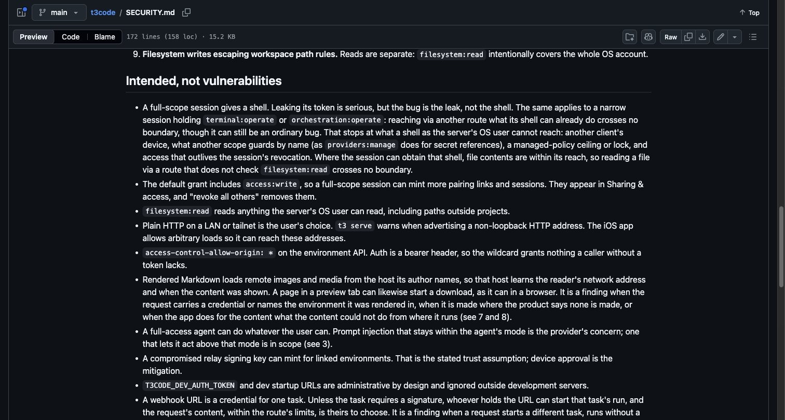

# Voordat u T3 Code installeert

<p align="center">
  <strong>Officiële talen van de Verenigde Naties:</strong>
  <a href="../../README.md">English</a> ·
  <a href="./README.zh-CN.md">简体中文</a> ·
  <a href="./README.fr.md">Français</a> ·
  <a href="./README.es.md">Español</a> ·
  <a href="./README.ru.md">Русский</a> ·
  <a href="./README.ar.md">العربية</a>
</p>
<p align="center">
  <strong>Wereldwijde community-edities:</strong>
  <a href="./README.zh-TW.md">繁體中文</a> ·
  <a href="./README.ja.md">日本語</a> ·
  <a href="./README.ko.md">한국어</a> ·
  <a href="./README.de.md">Deutsch</a> ·
  <a href="./README.pt-BR.md">Português</a> ·
  <a href="./README.it.md">Italiano</a> ·
  <a href="./README.nl.md"><strong>Nederlands</strong></a> ·
  <a href="./README.pl.md">Polski</a> ·
  <a href="./README.tr.md">Türkçe</a> ·
  <a href="./README.vi.md">Tiếng Việt</a> ·
  <a href="./README.id.md">Bahasa Indonesia</a> ·
  <a href="./README.hi.md">हिन्दी</a>
</p>


> **Reikwijdte & verificatiebeleid**  
> Deze repository vormt een onafhankelijke audit op het gebied van beveiliging, telemetrie, governance en openbare archieven van `pingdotgg/t3code` (T3 Code). Het dossier bundelt de 2 oorspronkelijke berichten en **18 gedocumenteerde auditdelen** die op 24–25 november 2026 zijn gepubliceerd, samen met **meer dan 180 canonieke primaire bron-URL's** (GitHub-commits, pull requests, issues, letterlijke bronbestanden, officiële documentatie, USPTO TSDR-registers en gearchiveerde openbare berichten), zes technische verdiepingsdossiers ([`docs/dossiers/`](../dossiers/01-telemetry-and-gdpr-timeline.md)) en een kwantitatieve dataset van **1.151 opeenvolgende X-posts van `@theo`** (7–24 november 2026). Er zijn geen verkorte doorverwijs-URL's en geen privécontactgegevens opgenomen. Feitelijke updates, later samengevoegde fixes of aanvullende vertalingen zijn welkom via een Pull Request met primaire bronvermelding — zie [`CONTRIBUTING.md`](../../CONTRIBUTING.md) en [`docs/COMPLETE-SOURCE-INDEX.md`](../COMPLETE-SOURCE-INDEX.md).

---

## Inhoudsopgave

- [Gestructureerde bevindingen & risicomatrix](#gestructureerde-bevindingen--risicomatrix)
- [Chronologische tijdlijn (2023–2026)](#chronologische-tijdlijn-20232026)
- [1. Oorsprongsconflict: "Steal Our Code", naamgevingsdreiging rond forks & dubbele standaard](#1-oorsprongsconflict-steal-our-code-naamgevingsdreiging-rond-forks--dubbele-standaard)
- [2. Telemetrie, uitlezen van inloggegevens tussen tools & de nachtelijke AVG/GDPR-noodsprint (Delen 1, 7, 11, 12)](#2-telemetrie-uitlezen-van-inloggegevens-tussen-tools--de-nachtelijke-avggdpr-noodsprint-delen-1-7-11-12)
- [3. Lokale opslag, procesbewaking, omzeilen van beveiligingsgrenzen & stille beveiligingspatches (Delen 2, 3, 13)](#3-lokale-opslag-procesbewaking-omzeilen-van-beveiligingsgrenzen--stille-beveiligingspatches-delen-2-3-13)
- [4. Risico's rond Google Antigravity-voorwaarden & onversleutelde T3 Connect-relay (Delen 4, 5)](#4-risicos-rond-google-antigravity-voorwaarden--onversleutelde-t3-connect-relay-delen-4-5)
- [5. Financiële balans, investeerdersconflicten, sponsors & de 77.000-sterrenfuik (Delen 6, 8, 17, 18)](#5-financiële-balans-investeerdersconflicten-sponsors--de-77000-sterrenfuik-delen-6-8-17-18)
- [6. Governance, fork-scrapende bots, merkenregister, dataset van 1.151 tweets & voorgeschiedenis (Delen 9, 10, 14, 15, 16)](#6-governance-fork-scrapende-bots-merkenregister-dataset-van-1151-tweets--voorgeschiedenis-delen-9-10-14-15-16)
- [7. Praktisch draaiboek voor mitigatie & herstel](#7-praktisch-draaiboek-voor-mitigatie--herstel)
- [8. Primaire bronnen & volledige index van de 18 oorspronkelijke posts](#8-primaire-bronnen--volledige-index-van-de-18-oorspronkelijke-posts)

---

## Gestructureerde bevindingen & risicomatrix

| Domein & auditdelen | Risico / Impact | Belangrijkste gedocumenteerde bevindingen & bronbewijzen | Status (25 nov. 2026) | Verdiepingsdossier |
|---|---|---|---|---|
| **Telemetrie & post-AVG/GDPR-privacy**<br>*(Delen 1, 7, 11, 12)* | **Kritiek** | Standaard geactiveerde PostHog-analyse (`PR #174`) terwijl de homepage `"No telemetry / Unless you opt in. Full stop."` beloofde (`3bdaa6e1` verwijderde dit op 18 juni); opslag van ruwe events via closed-source `ingest.t3.codes` (`PR #15028`); ongezouten SHA-256-hashing tussen tools van `~/.codex/auth.json` & `~/.claude.json` (`Identify.ts`, `telemetryId.ts`); 4 afgewezen opt-out-PR's (`#13458`, `#16763`, `#21248`, `#27077`); hiaten in Managed Policy (`docs/user/telemetry.md`); nachtelijke AVG/GDPR-PR's die **2,2M/uur aan IP- + UA-spans** toegeven met 30 dagen retentie in Axiom (`#42380`), `git.cwd`-padlekken (`#42450`), genegeerde Win/Mac-opt-outs (`#42376`, `#42464`), gebrekkige accountverwijdering (`#42285`) en gemengde anonieme batches (`#42466`). | Gedeeltelijke nachtelijke patches; `AnalyticsService.ts` maakt nog steeds bij opstarten een schijfidentiteit aan; gehoste web-app heeft nog steeds geen schakelaar; `ingest.t3.codes` blijft closed-source | [**Dossier 01**](../dossiers/01-telemetry-and-gdpr-timeline.md) |
| **Lokale veiligheid & stille advisories**<br>*(Delen 2, 3, 13)* | **Kritiek** | "Permanent verwijderen" in de zijbalk voegt enkel `"thread.deleted"` toe in `statev2.sqlite` (25,9–41,6 GB databasegroei, `#17845`); `t3-resource-monitor` scant alle OS-processen inclusief commandoregelargumenten (`ProcessesToUpdate::All`, `#11222`, `PR #41889`); Claude Auto-modus keurt `git push --force` bij de 3e poging stilzwijgend goed (`#15353`, 52–53+ dagen open); verwijdering binnen 21 uur van filter op privémodellen voor `slopalytics.com` (`#41237`); **0 GitHub Security Advisories** ondanks stille fixes (`#39483`, `#41757`, `#42386`, `#42504`); open Windows Base64 PowerShell AV-issue (`#30997`); `SECURITY.md` verklaart OS-breed `filesystem:read` en iOS HTTP als opzettelijk ontwerp. | `#17845`, `#15353`, `#26489`, `#30997` blijven onopgelost / open; `0` gepubliceerde Security Advisories | [**Dossier 02**](../dossiers/02-local-safety-and-security-audit.md) |
| **Antigravity-ToS & T3 Connect-relay**<br>*(Delen 4, 5)* | **Hoog** | `docs/user/faq.md` garandeert naleving van Google Antigravity-voorwaarden terwijl `antigravityUsageLimits.ts` tokens uitleest uit de OS-sleutelhanger / Windows `CredReadW`, zich voordoet als `antigravity/hub/2.24.0` en private `v1internal`-endpoints aanroept; `antigravityAuthSupport.ts` injecteert een vervalst `SSH_CONNECTION` wat leidt tot routering tussen accounts (`#41973`); gloednieuw $20-account binnen 3 minuten geblokkeerd (`#41536`); `PR #33800` koppelt vervalste `claude`/`xai`/`antigravity`-CLIProxyAPI-hubpolling; T3 Connect heeft **geen E2E-versleuteling**, standaard uitgeschakelde `requireConnectDeviceApproval` (`#36419`) en een open OVH Caddy-gateway met TLS-terminatie (`PR #32945`). | Antigravity-spoofingcode blijft actief; E2E-versleuteling voor T3 Connect expliciet afgewezen (`#32098`, reactie 25 nov.) | [**Dossier 03**](../dossiers/03-antigravity-tos-and-t3connect-relay.md) |
| **Financiële balans, sponsors & 77k sterren**<br>*(Delen 6, 8, 17, 18)* | **Hoog** | $800k+ uitgaven aan gratis client (`162` T3-vermeldingen tegenover `0` voor betaalde producten); rekenkrachtradar van **31,7T tokens/dag** ($10,19M/dag) ingeruild voor $300k+ aan gratis OpenAI early-access-tokens & VC-contacten; belangenverstrengeling via angel-investeringen in Vibe Kanban & Daytona; sponsorstack (Clerk, Axiom, Vercel-exclusiviteit); Codex 0%-exploit (`Endless` / `codex#45444`); 10-account `CLIProxyAPI`-Gist (`555%` quotum) versus ban-waarschuwing in FAQ; melding na 5 prompts / 30s inactiviteit die via host-inloggegevens `PUT user/starred/...` afvuurt (`#27832`, `#29922`, `#29987`), Macroscope omzeilt en `driver.ts#L60-L99` zonder vastgepinnde repo 19 dagen ongerepareerd laat. | Ongepinnd sterren geven in `driver.ts` & review van `zhilsinger` na 19 dagen nog open; repo op 77k+ sterren vs. ~129 watchers | [**Dossier 04**](../dossiers/04-business-ledger-sponsors-and-77k-stars.md) |
| **Governance, merken & historie**<br>*(Oorsprong 1–2, Delen 9, 10, 15, 16)* | **Gemiddeld–Hoog** | 500 commits/dag / 700 agents / `yolo merges` tegenover `CONTRIBUTING.md` (`"here's my advice: Don't"`), publieke schandpaal-bans in `.github/VOUCHED.td`, `174` `unwanted`-labels, verwijdering van Plan-modus (`#5551`, `#9190`, `#33131`) en beledigingen in `#33639`; openbaar `@bot`-scrapen van forks (`@MiaAI_lab`), oproep tot demonetisering via Community Notes en auto-blocker; **0 USPTO-merkregistraties** voor `T3 Code`/`T3 Tools`/`T3 Connect` (`PING LABS` `97294243` vervallen; EquipmentShare `7795672` geregistreerd) tijdens GitHub-takedowndreiging; retroactieve `PR #41898` `TRADEMARK.md` 17 uur later; patroon 2024–2026 (`vsc-material-but-i-wont-sue-you`, hetze tegen Indiase ontwikkelaars, $20k FFmpeg-premie, verwijderde closed-source-dreiging van 25 nov. 04:00 uur). | `CONTRIBUTING.md` / `.github/VOUCHED.td` & `TRADEMARK.md` blijven actief op `main` | [**Dossier 05**](../dossiers/05-governance-trademark-and-history.md) |
| **Kwantitatieve dataset van 1.151 tweets**<br>*(Deel 14)* | **Audit-basislinie** | Volledig corpus 7–24 nov. (`n = 1.151`, 17,24 dagen, 66,8 posts/dag, 75,6% reacties, 2,7m mediaaninterval): **0,0% grofheden/beledigingen** richting 20 big-tech-bestuurders/medewerkers/KOL's (`0/43` strikt primair-`@`, `32,6%` dankbaarheid) tegenover **8,0% vijandigheid** richting gewone ontwikkelaars (`61/766`) en een **4,0x stijging naar 14,4%** (`19/132`) aan directe persoonlijke beledigingen tijdens het 25-uurs venster van de Chinese fork-crisis. | Reproduceerbare regex-audit met 4 forensische grafieken | [**Dossier 06**](../dossiers/06-tweet-forensic-dataset-1151.md) |
| **Volledige catalogus van primaire URL's** | **Referentie** | Volledig gekruisrefereerde catalogus van elke canonieke `https://`-URL verspreid over dit portaal, `canonical_refs.txt`, `tco_resolved.json`, `all_18_posts.txt` en `missing_posts_full.json`. | 100% gekanoniseerd (nul `t.co`-links) | [**Bronnenindex**](../COMPLETE-SOURCE-INDEX.md) |

---

## Chronologische tijdlijn (2023–2026)

| Datum / Tijd | Mijlpaal | Verifieerbaar bewijs / Bron |
|---|---|---|
| **2023-05-14** | `@theo` publiceert zijn YouTube-sponsorlijst (`@vercel`, `@clerk`, `@upstash`, `@axiomhq`, `@PlanetScale`). Clerk en Axiom vormen later de kerninfrastructuur voor authenticatie en logging in T3 Code. | [`1657488850472804353`](https://x.com/theo/status/1657488850472804353) |
| **2024-04 / 2024-09** | De CEO van Vercel bevestigt slechts één YouTuber (`Theo`) te sponsoren; `@theo` erkent dat sponsorcontracten exclusiviteitsclausules bevatten die promotie van concurrenten verboden. | [`1776260839965863965`](https://x.com/rauchg/status/1776260839965863965) · [Video](https://www.youtube.com/watch?v=uv179CTAK-w) |
| **2024** *(2 jaar eerder)* | `@theo` forkt een VS Code-thema als `vsc-material-but-i-wont-sue-you` en bespot het temperament van de oorspronkelijke auteur; nadat zijn video over Indiase tutorialkanalen tot intimidatie leidt, publiceert hij los daarvan een excuusvideo (`I screwed up.`) waarin hij aanvallen op basis van nationaliteit veroordeelt. | [`vsc-material-but-i-wont-sue-you`](https://github.com/t3dotgg/vsc-material-but-i-wont-sue-you) · [`I screwed up.`](https://www.youtube.com/watch?v=o2CSJYXJBpc) |
| **2025-02 – 2025-05** | Het USPTO weigert de enige merkaanvraag van T3 Tools Inc. (`PING LABS`, Serial `97294243`) definitief en markeert deze op 19 mei 2025 als `ABANDONED`. EquipmentShare registreert `T3` in software-/SaaS-klassen 9 & 42 (`Reg. 7795672`, 13 mei 2025). | [TSDR `97294243`](https://tsdr.uspto.gov/statusview/sn97294243) · [TSDR `90644500`](https://tsdr.uspto.gov/#caseNumber=90644500&caseSearchType=US_APPLICATION&caseType=DEFAULT&searchType=statusSearch) |
| **2025-10** | `@theo` botst op X met FFmpeg en looft een **premie van $20.000** uit om een FFmpeg-maintainer weg te werken; Windscribe biedt $21.000 tegen, de oprichter van VLC maakt bezwaar, FFmpeg-ontwikkelaars documenteren publieke intimidatie en `@theo` verwijdert video/tweets en trekt de premie in. | [FFmpeg-dossier](https://www.youtube.com/watch?v=1oQ3KMeaH04) |
| **2026-03-06** | **PR #174** wordt samengevoegd in `pingdotgg/t3code` en schakelt PostHog-telemetrie standaard in zonder toestemmingsdialoog, zonder instellingenschakelaar en zonder telemetriedocumentatie. | [PR #174](https://github.com/pingdotgg/t3code/pull/174) |
| **2026-04-26** | `@theo` publiceert *"Github has a fake star problem"* en schrijft dat GitHub-sterren `"mostly a way for companies to trick VCs into investing"` zijn. | [`2048122499834036340`](https://x.com/theo/status/2048122499834036340) |
| **2026-06-18** | **Commit `3bdaa6e1`** verwijdert stilzwijgend `No telemetry / Unless you opt in. Full stop.` van de T3 Code-homepage na ruim 3 maanden standaard telemetrieverzameling. | [Commit `3bdaa6e1`](https://github.com/pingdotgg/t3code/commit/3bdaa6e10046945ccc08264d2d6f3b81775efcb3) |
| **2026-06-23** | Maintainer Julius sluit **Issue #1397** (`not planned`): *"We will not make this easier to opt out of, it is crucial for us to know how many users we have"*. | [Issue #1397](https://github.com/pingdotgg/t3code/issues/1397) |
| **2026-07 – 2026-11-17** | **Issue #4123** (gearchiveerde screenshots van `"No telemetry"`) wordt op 4 nov. stilzwijgend gesloten; 4 community-PR's voor opt-out (`#13458`, `#16763`, `#21248`, `#27077`) worden afgewezen (`#27077` gesloten als `unwanted` ondanks 147 geslaagde tests). | [Issue #4123](https://github.com/pingdotgg/t3code/issues/4123) · [PR #27077](https://github.com/pingdotgg/t3code/pull/27077) |
| **2026-08-06 – 2026-09-02** | **PR #5551** verstopt de Build/Plan-schakelaar (`Reality check for those upset`, 10 downvotes); **PR #9190** verbergt de contextmeter (16 downvotes, hoogste aantal in de repo). | [PR #5551](https://github.com/pingdotgg/t3code/pull/5551) · [PR #9190](https://github.com/pingdotgg/t3code/pull/9190) |
| **2026-08-19 – 2026-08-22** | `@theo` schept op dat hij **$800+** voorbij de 0%-limiet van Codex heeft gehaald terwijl `@maria_rcks` *Endless* uitbrengt; beiden verwijderen hun berichten na kritiek (`2090972426876129658`); OpenAI scherpt de 0%-afkapgrens aan (`openai/codex#45444`). | [`2090972426876129658`](https://x.com/maria_rcks/status/2090972426876129658) · [`codex#45444`](https://github.com/openai/codex/issues/45444) |
| **2026-10-03 – 2026-10-10** | **Issue #15353** (stille `git push --force` in Claude Auto-modus, 3 okt.), `privacy-policy.astro` (`2026-10-06`) en **Issue #17845** (schijnverwijdering in `statev2.sqlite`, 10 okt.) worden vastgelegd. | [Issue #15353](https://github.com/pingdotgg/t3code/issues/15353) · [Issue #17845](https://github.com/pingdotgg/t3code/issues/17845) |
| **2026-10 – 2026-10-19** | **PR #15028** leidt telemetrie via het closed-source `ingest.t3.codes`; **PR #21506** voegt ongezouten SHA-256-hashing tussen tools toe in `Identify.ts`; `@theo` publiceert zijn 10-account `CLIProxyAPI`-Gist (`555%` quotum). | [PR #15028](https://github.com/pingdotgg/t3code/pull/15028) · [PR #21506](https://github.com/pingdotgg/t3code/pull/21506) · [Gist](https://gist.github.com/t3dotgg/59a521d2ee8d70aaf90e280c175072af) |
| **2026-10-30 – 2026-11-06** | **PR #27832**, **#29922** en **#29987** leveren de sterrenmelding na 5 prompts / 30s inactiviteit uit die met host-inloggegevens `PUT user/starred/...` aanroept; `zhilsinger` dient op 6 nov. `Request changes` in (19 dagen onbeantwoord). | [PR #27832](https://github.com/pingdotgg/t3code/pull/27832) · [PR #29922](https://github.com/pingdotgg/t3code/pull/29922) |
| **2026-11-08 – 2026-11-22** | Fork-scrapen met `@bot` (`@MiaAI_lab`), verwijdering Plan-modus (`#33131`), bekendmaking `$800k+` uitgaven & `31.7T/day` / `$10.19M/day`-radar, `$300k+` gratis OpenAI-tokens, herschrijving `CONTRIBUTING.md`, overlap met Vibe Kanban/Daytona, `PR #41237` verwijdert modelfilter binnen 21 uur. | [PR #33131](https://github.com/pingdotgg/t3code/pull/33131) · [`2122860770329608290`](https://x.com/theo/status/2122860770329608290) · [PR #41237](https://github.com/pingdotgg/t3code/pull/41237) |
| **2026-11-23 19:11–19:54 CST** | `@theo` plaatst `"Chinese knockoff"` en `"Temu3 Code"` en dreigt met verwijdering van het GitHub-account (`2124829315657576890`); de auteur van de MIT-fork hernoemt binnen 30m naar `Stardust`; privé-excuses via DM volgen, openbare berichten blijven staan. | [`2124829315657576890`](https://x.com/theo/status/2124829315657576890) · [Oorsprong 2](https://x.com/realchendahuang/status/2125062675147448475) |
| **2026-11-24 06:06–12:23 CST** | `@theo` verwelkomt Amerikaanse biljoenenbedrijven die MIT-code kopiëren (`2124989435154726982`), drijft de spot met juridische naleving (`"get a better lawyer"`), Oorsprong 1–2 worden gepubliceerd en om **12:21 CST** (`04:21Z`, 17 uur na het bandreigement) voegt `@theo` **PR #41898** samen waarmee met terugwerkende kracht `TRADEMARK.md` wordt toegevoegd. | [`2124989435154726982`](https://x.com/theo/status/2124989435154726982) · [PR #41898](https://github.com/pingdotgg/t3code/pull/41898) |
| **2026-11-24 17:04–21:21 CST** | Audit **Delen 1–5** verschijnen (Deel 1 bereikt **1,81M+ weergaven**, 6.640 bladwijzers). Om `18:39 CST` noemt `@theo` Chinees tech-Twitter `"the biggest fucking cesspit"` (`2125177503526588877`); om `19:13–19:36 CST` beweert hij dat Managed Policy alle telemetrie uitschakelt (`2125186071357251715`). | [Deel 1](https://x.com/realchendahuang/status/2125153472450527440) → [Deel 5](https://x.com/realchendahuang/status/2125218189596676555) |
| **2026-11-24 Nacht – 2026-11-25 ~07:00 CST** | Formele EU AVG/GDPR-klacht ingediend; **6-uurs nachtelijke sprint** voegt `#42380` (2,2M/uur IP-spans), `#42285`/`#42430` (accountverwijdering), `#42376`/`#42464` (genegeerde Win/Mac-opt-outs), `#42450` (`git.cwd`-padlekken, 90m nadat Theo padverzameling ontkende), `#42459`/`#41859` (push-lekken), `#42466` (anonieme batching) en `#41757`/`#42386`/`#42504` (stille beveiligingsfixes) samen. Voor zonsopgang plaatst en verwijdert `@theo` een dreigement om closed-source te gaan. | [Deel 11](https://x.com/realchendahuang/status/2125394810559426993) · [Deel 12](https://x.com/realchendahuang/status/2125395501663281198) · [Deel 13](https://x.com/realchendahuang/status/2125395980354994414) |
| **2026-11-25 08:27–10:28 CST** | Audit **Delen 6–18** verschijnen over de financiële balans, hiaten in Managed Policy, `yolo merges`, `@bot`-scrapen, onthullingen na de AVG-klacht, dataset van 1.151 tweets, USPTO-register, sponsorbanden en de 77k-sterrenmotor. | [Deel 6](https://x.com/realchendahuang/status/2125385742243520653) → [Deel 18](https://x.com/realchendahuang/status/2125416210120765799) |

---

## 1. Oorsprongsconflict: "Steal Our Code", naamgevingsdreiging rond forks & dubbele standaard

In de 48 uur tussen 23 en 25 november 2026 escaleerde een naamgevingsgeschil over een community-MIT-fork van T3 Code tot een volledige broncode-audit, een Europese AVG/GDPR-klacht en bijna twintig nachtelijke noodpatches.

Tussen de avond van 23 november en de ochtend van 24 november 2026 (Peking-tijd) klaagde een gebruiker online over de gebruikersinterface van een gratis open-source MIT-fork van een Chinese ontwikkelaar (`@DDdxx666`), waarbij hij deze aanzag voor de officiële app. Zonder te controleren of de repository een legitieme MIT-fork was, plaatste `@theo` binnen 11 minuten twee berichten waarin hij het project een `"Chinese knockoff"` en `"Temu3 Code"` noemde, het werk van de auteur rechtstreeks bespotte en dreigde contact op te nemen met GitHub om diens account te laten blokkeren (`"Do it right now or I'm going to contact GitHub and have your account taken down"`). Rond dezelfde tijd labelde de website van T3 Code ([`https://t3.codes/`](https://t3.codes/)) de link naar zijn eigen GitHub-repository als `"Steal our code (legally)"` (`"steal our code"`) ([Oorsprong 1](https://x.com/realchendahuang/status/2125059292919394654), [Oorsprong 2](https://x.com/realchendahuang/status/2125062675147448475)).

De auteur van de fork gaf onmiddellijk gehoor, hernoemde de repository binnen 30 minuten naar `Stardust` en verwijderde alle T3-merkuitingen. `@theo` bood privé zijn excuses aan via DM, maar liet beide openbare berichten — samen goed voor meer dan 200.000 weergaven — online staan zonder verwijdering of rectificatie. Minder dan 11 uur later, om `06:12 BJ` op 24 november (`2124989435154726982`), nam hij op de vraag of het te ver ging als Amerikaanse labs met een waardering van duizend miljard dollar functies uit T3 Code zouden kopiëren precies het tegenovergestelde standpunt in: `"Nah. Open source is open source, even if a trillion dollar company uses it!"` Ondertussen beheerde T3-medewerkster `@maria_rcks` zelf een openbare fork genaamd `maria-rcks/t3libre` (*"T3 Code, liberated"*), en opereerden Engelstalige repo's zoals `t3code-quota-ui`, `t3code-atlas` en `t3code-bar` zonder enige publieke bedreiging.


Vanaf 17:04 Peking-tijd op 24 november heb ik de commit-historie, bronbestanden, PR's, Issues, officiële documentatie, USPTO TSDR-registers en `@theo`'s openbare X-tijdlijn van `pingdotgg/t3code` onderzocht. Binnen 24 uur publiceerde ik **18 gedocumenteerde delen**, onderbouwd met directe links en schermafbeeldingen. Alleen al Deel 1 passeerde de **1,81 miljoen weergaven** en **6.640 bladwijzers**, wat leidde tot een AVG/GDPR-melding in Europa en een zes uur durende nachtelijke patchmarathon door het T3-team.

---

## 2. Telemetrie, uitlezen van inloggegevens tussen tools & de nachtelijke AVG/GDPR-noodsprint (Delen 1, 7, 11, 12)

> **Diepgaande technische audit:** Volledige verwijzingen naar broncoderegels, actielijsten uit `FeatureUsage.ts`, hiaten in `DesktopShellEnvironment.ts` en logboeken van minuut tot minuut voor 23–25 november staan in [**Dossier 01: Telemetrie-architectuur, identiteitskoppeling tussen tools & de AVG/GDPR-nachtsprint van 24–25 november**](../dossiers/01-telemetry-and-gdpr-timeline.md).

### 2.1 Standaardtelemetrie, verwijderde homepagebelofte & cross-tool hashing van inloggegevens (`Deel 1`)

Op **6 maart 2026** voegde `pingdotgg/t3code` **PR #174** samen, waarmee PostHog-telemetrie standaard werd ingeschakeld zonder enige telemetriedocumentatie in de repository, zonder toestemmingsdialoog bij de eerste start en zonder schakelaar in het instellingenmenu. De omgevingsvariabele om uit te schakelen bleef verborgen in de code terwijl standaardinstallaties onmiddellijk events begonnen te verzenden ([Deel 1](https://x.com/realchendahuang/status/2125153472450527440)).

Ruim drie maanden lang tijdens deze standaardverzameling stonden op de homepage van T3 Code prominent twee regels: `No telemetry / Unless you opt in. Full stop.` Op **18 juni 2026** verwijderde `@theo` beide regels stilzwijgend tijdens een herontwerp van de homepage ([`commit 3bdaa6e1`](https://github.com/pingdotgg/t3code/commit/3bdaa6e10046945ccc08264d2d6f3b81775efcb3)) zonder aankondiging of bericht aan bestaande gebruikers.


In oktober 2026 voegde `@theo` **PR #15028** samen, die gebundelde telemetrie-uploads per 10 seconden (`FLUSH_INTERVAL_MS = 10_000`) via T3's closed-source gateway [`https://ingest.t3.codes/`](https://ingest.t3.codes/) stuurde. Regel 1 van [`apps/server/src/telemetry/AnalyticsService.ts`](https://github.com/pingdotgg/t3code/blob/main/apps/server/src/telemetry/AnalyticsService.ts) vermeldt uitdrukkelijk dat het ingest-endpoint een kopie van elk ruw event bewaart voordat het naar PostHog wordt doorgestuurd:

```ts
// apps/server/src/telemetry/AnalyticsService.ts (lines 1, 71–74, 149)
// T3 ingest retains events and forwards to PostHog; UUIDs deduplicate retries there.
...
  posthogHost: Config.String("T3CODE_POSTHOG_HOST").pipe(
    Config.withDefault("https://ingest.t3.codes"),
  ),
  enabled: Config.Boolean("T3CODE_TELEMETRY_ENABLED").pipe(Config.withDefault(true)),
...
  const { distinctId, installId } = yield* getTelemetryIdentity;
```

De verzamelde velden in [`ProviderUsageAnalytics.ts`](https://github.com/pingdotgg/t3code/blob/main/apps/server/src/telemetry/ProviderUsageAnalytics.ts) en `FeatureUsage.ts` omvatten provider, modelkeuze (waarbij niet-gecatalogiseerde eigen model-/endpoint-ID's via `ProviderDimensions.ts` letterlijk werden meegestuurd), reasoning-effort, machtigingsmodus, doorlooptijden, invoer-/uitvoer-/gecachete/reasoning-tokentellingen, tokens van sub-agents, lokale project-/threadaantallen, **35 afzonderlijke UI-/commando-acties** (`18` `COMMAND_FEATURES` + `17` `METHOD_FEATURES`), OS-gegevens, WSL-distro en architectuur.

Op **19 oktober 2026** volgde `@theo` met **PR #21506** om te tellen hoeveel machines tot één enkel individu behoorden. [`apps/server/src/telemetry/Identify.ts`](https://github.com/pingdotgg/t3code/blob/main/apps/server/src/telemetry/Identify.ts) begon stilletjes inlogbestanden van afzonderlijke AI-tools in de thuismap van de gebruiker te lezen — `~/.codex/auth.json` en `~/.claude.json` — de OpenAI `user_id` JWT-claim en Claude `oauthAccount.accountUuid` te decoderen en die samen met de gekoppelde T3 Connect-gebruikers-ID en apparaat-ID te hashen:

```ts
// apps/server/src/telemetry/Identify.ts (lines 257–269, 321–338)
  const codexTokens = yield* readJsonIdentityFile(
    "codex",
    path.join(homeDirectory, ".codex", "auth.json"),
    decodeCodexAuthJson,
  )...
  const claudeJson = yield* readJsonIdentityFile(
    "claude",
    path.join(homeDirectory, ".claude.json"),
    decodeClaudeJson,
  )...
  const raw: ReadonlyArray<readonly [TelemetryOwnerSource, Option.Option<string>]> = [
    ["connect", connectUser],
    ["openai", Option.flatMap(codexTokens, (tokens) => Option.flatMap(Option.fromUndefinedOr(tokens.id_token), openAiUserId))],
    ["claude", Option.flatMap(claudeJson, (json) => Option.fromUndefinedOr(json.oauthAccount?.accountUuid))],
  ];
  return raw.flatMap(([source, value]) =>
    Option.isSome(value) && value.value.trim() !== "" ? [{ source, ownerId: hashTelemetryId(value.value) }] : [],
  );
```

En in [`packages/shared/src/telemetryId.ts`](https://github.com/pingdotgg/t3code/blob/main/packages/shared/src/telemetryId.ts) (regels 8–9) berekent `hashTelemetryId` een **ongezouten SHA-256-digest** (`Hex.encode(sha256(new TextEncoder().encode(value)))`). Omdat de server reeds over leesbare T3 Connect-account-ID's vanuit Clerk beschikt, herleidt het hashen van leesbare waarden op de backend een ongezouten digest rechtstreeks naar een bekend persoon; gelekte OpenAI- of Claude-ID's van derden koppelen deterministisch aan exact dezelfde hash.


Weerstand vanuit de community werd herhaaldelijk afgekapt. Op **23 juni** opende een ontwikkelaar **Issue #1397** met een verzoek om een instellingenschakelaar; kern-maintainer Julius sloot het als `not planned`: `We will not make this easier to opt out of, it is crucial for us to know how many users we have` (*"We gaan dit niet makkelijker maken om uit te schakelen, het is voor ons cruciaal om te weten hoeveel gebruikers we hebben"*). In juli plaatste een gebruiker gearchiveerde homepage-screenshots in **Issue #4123** over de verbroken belofte (`"No telemetry"`), dat door `@theo`'s account op 21 oktober via een ongerelateerde commit werd gesloten, na ophef heropend en op 4 november opnieuw stilzwijgend gesloten. Tussen september en november dienden bijdragers **vier afzonderlijke opt-out-PR's** in (`#13458`, `#16763`, `#21248`, `#27077`). Zelfs `#27077` — geverifieerd op echte hardware met **147 geslaagde tests** en goedgekeurd door Macroscope — werd op **17 november** gesloten met het label `unwanted`.


### 2.2 De tegenstrijdigheid tussen Managed Policy en officiële documentatie (`Deel 7`)

Op 24 november, terwijl de kritiek aanzwol, beweerde `@theo` op X dat T3 Code het beste zakelijke Managed Policy-systeem in de sector bood (`"trivial to set up and turn off all telemetry"`) en dat gespreksgegevens op schijf blijven en `"never touches any of our servers"` (*"nooit enige van onze servers aanraken"*) ([`2125186071357251715`](https://x.com/theo/status/2125186071357251715), [`2125191784859115766`](https://x.com/theo/status/2125191784859115766), [Deel 7](https://x.com/realchendahuang/status/2125391659492081947)).

Directe inspectie van [`docs/user/managed-policy.md`](https://github.com/pingdotgg/t3code/blob/main/docs/user/managed-policy.md) en [`docs/user/telemetry.md`](https://github.com/pingdotgg/t3code/blob/main/docs/user/telemetry.md) toont het tegendeel:
1. **Alleen door beheerders te configureren:** Desktopgebruikers hebben nog steeds nul schakelaars in het instellingenmenu. Telemetrie uitschakelen via Managed Policy vereist MDM/Groepsbeleid of het plaatsen van `policy.json` in door beheerders beschermde mappen (`/Library/Application Support/T3Code/policy.json` op macOS, `C:\Program Files\T3Code\policy.json` of `HKLM\SOFTWARE\Policies\T3Tools\T3Code` op Windows, `/etc/t3code/policy.json` op Linux).
2. **Blinde vlek in gehoste web-app (`app.t3.codes`):** `docs/user/telemetry.md` erkent expliciet dat de browser-app geen serveromgevingsvariabelen leest, Managed Policy negeert, verbindingstraces verstuurt wanneer gebouwd met tracing en `"has no relay tracing toggle"` heeft.
3. **Mobiele apps buiten serverbeleid:** Serveromgevingsvariabelen en Managed Policy `"do not disable mobile tracing"`.
4. **`Publish agent activity` negeert opt-outs:** Wanneer ingeschakeld op een host, gaan projecttitels, threadtitels, modelnamen en live activiteitsstatus naar de T3 Connect-relay — en `"The telemetry opt-out does not disable it."` (Bovendien kunnen mislukte Axiom-spans en mobiele crashlogs `"can quote a value the app was handling"` bevatten, terwijl `Agent feedback` tot 16 KB aan gespreksberichten kan meesturen.)


### 2.3 Verklaring van 25 november binnen 2 uur ontkracht (`Deel 11`)

Op de ochtend van 25 november plaatste `@theo` een uitgebreide toelichting ([`2125332390239494211`](https://x.com/theo/status/2125332390239494211)) naast een openbare telemetrie-export ([`t3code-telemetry-events-jsonl-a4896cdc.gz`](https://files.tslop.org/2026/11/t3code-telemetry-events-jsonl-a4896cdc.gz)) met drie stellige garanties — gevolgd door een reactie waarin hij lokale tracking-schrijfoperaties bij opt-out ontkende ([`2125370330244128924`](https://x.com/theo/status/2125370330244128924)) ([Deel 11](https://x.com/realchendahuang/status/2125394810559426993)):

- **"Nooit bestandspaden verzameld":** 90 minuten later voegde Julius **PR #42450** samen, waarin werd erkend dat via de relay geactiveerde webhook-runs volledige uitvoeringsspans exporteerden naar Axiom — inclusief Git-spans met `git.cwd` (**absoluut workspace-pad, OS-gebruikersnaam en repositorynaam**).
- **"Omgevingsvariabelen schakelden telemetrie altijd netjes uit":** **PR #42376** bevestigde dat de Windows-desktopversie opgeslagen gebruikersvariabelen `T3CODE_TELEMETRY_ENABLED=false` negeerde bij start vanuit reeds draaiende processen, terwijl **PR #42464** bevestigde dat macOS/Linux-relaytracing bij de eerste start vóór shell-detectie werd geëvalueerd en `~/.zshrc`-opt-outs gedurende de gehele sessie negeerde. (`DesktopShellEnvironment.ts` stuurt `T3CODE_OTEL_SDK_DISABLED` nog steeds niet door.)
- **"Geen trackingbestanden geschreven bij opt-out" & "Claude-hashes waren stuk":** [`AnalyticsService.ts#L152`](https://github.com/pingdotgg/t3code/blob/main/apps/server/src/telemetry/AnalyticsService.ts#L152) (regel 149) roept `getTelemetryIdentity` nog altijd onvoorwaardelijk aan bij opstarten, schrijft de lokale installatie-ID weg en leest/hasht `~/.codex/auth.json` en `~/.claude.json`. Ondertussen toonde inspectie van de gzip-header van `@theo`'s ~100MB-export (`6.056.594` bytes gecomprimeerd, `95.789` events) een oorspronkelijke bestandsnaam `events.clean.jsonl` aan, gegenereerd 20 minuten vóór zijn tweet — maar het bestand bevatte op 20 oktober nog steeds **264 actieve Claude-accountrecords** die **4 afzonderlijke machines** (`installId`s) aan exact dezelfde SHA-256-hash koppelden, naast letterlijke namen van privé proxy-modellen (`vibeproxy/gpt-6-luna`, `muse-proxy-wonder-full`).


### 2.4 Zes uur durende nachtelijke noodsprint na AVG/GDPR-klacht (`Deel 12`)

Nadat in de nacht van 24 november een formele EU AVG/GDPR-klacht was ingediend, brachten nachtelijke nood-PR's vier diepere privacy-onthullingen aan het licht ([Deel 12](https://x.com/realchendahuang/status/2125395501663281198)):

1. **2,2M/uur aan IP-gekoppelde relay-spans (`PR #42380`):** Erkende dat elke naar Axiom geëxporteerde relay-aanvraagspan — ruwweg **2,2 miljoen spans per uur, 30 dagen bewaard** — `client.address` (IP-adres van de aanvrager uit `cf-connecting-ip`) en `user_agent.original` direct naast `user.id` logde (terwijl Cloudflare's 1% Workers-aanroeplogs afzonderlijk bleven). Drieënhalf uur na het samenvoegen beweerde `@theo` in reacties nog steeds dat IP-adressen al waren gestript.
2. **Gebrekkige accountverwijdering (`PR #42285` & `PR #42430`):** Erkende dat het verwijderen van een gebruiker in Clerk voorheen PlanetScale-relayrijen en actieve Cloudflare-tunnels intact liet, totdat een binnenkomend privacy-verwijderingsverzoek **handgeschreven SQL en handmatige afbraak van tunnels** vereiste.
3. **Lekken bij mobiele pushmeldingen (`PR #42459` & `PR #41859`):** Android FCM-meldingen stuurden bij elke push onversleutelde Clerk `user_id`-waarden naar Google; iOS-pushrequestspans/-fouten logden volledige apparaat-push-URL's inclusief tokens.
4. **Gemengde "anonieme" feedback (`PR #42466`):** Erkende dat zogenaamd anonieme `agent.feedback`-events in dezelfde HTTP POST werden gebundeld als geïdentificeerde `installId`-events en volledige host-vingerafdrukken (OS, architectuur, ruwe WSL-distro), in strijd met `docs/user/telemetry.md`. Ondertussen bleef `privacy-policy.astro` sinds 6 oktober ongewijzigd.


---

## 3. Lokale opslag, procesbewaking, omzeilen van beveiligingsgrenzen & stille beveiligingspatches (Delen 2, 3, 13)

> **Diepgaande technische audit:** Letterlijke SQLite-opruimqueries, Rust `sysinfo`-aanroepen, machtigingsregels in `ClaudeAdapterV2.ts` en de volledige grensanalyse van `SECURITY.md` staan in [**Dossier 02: Lokale veiligheid, stille omzeilingen van code-uitvoering en niet-openbaargemaakte beveiligingsaudit**](../dossiers/02-local-safety-and-security-audit.md).

### 3.1 Schijnverwijdering in SQLite & scannen van alle machineprocessen (`Deel 2`)

Wanneer een gebruiker een thread in de zijbalk verwijdert, belooft het bevestigingsvenster (`useThreadActionMenu.ts`): `"This permanently clears conversation history for this thread."` In werkelijkheid voegt `ThreadDeletion.ts` slechts een `"thread.deleted"`-event toe aan `statev2.sqlite`, en zondert `ProjectionMaintenance.ts` `thread.created` en de nieuwste stream-events (`MAX(newer.sequence)`) uit terwijl eerdere events behouden blijven. Gebruikers meldden dat `statev2.sqlite` opzwol tot **25,9 GB** in drie weken (90% "verwijderde" threads), **41,6 GB** in zes weken en **33 GB** in zeven weken — waardoor **Issue #17845** (en **#28903**) sinds 10 oktober onopgelost bleef ([Deel 2](https://x.com/realchendahuang/status/2125160473176023486)).


Een achtergrondhulpprogramma in Rust, `t3-resource-monitor` (**Issue #11222**, `native/resource-monitor/src/main.rs` met aanroep `ProcessesToUpdate::All` en `with_cmd(UpdateKind::Always)`), scande elke 5 seconden alle processen op de machine, zelfs met diagnostiek gesloten — en opende ~280–300 persistente handles naar 440+ ongerelateerde apps en games op Windows zonder enige opt-out, terwijl documentatie beweerde dat sampling alleen met actieve abonnees draaide. Pas op **24 november** bevestigde **PR #41889** dat procesdiagnostiek **volledige commandoregelargumenten van processen** — waarin vaak API-sleutels, databasewachtwoorden en auth-tokens in platte tekst staan — had vastgelegd in live telemetrie en geschiedenissnapshots.


Aanvullende geverifieerde lokale gebreken in Deel 2 zijn onder meer:
- **Lekken van interne hostnamen via favicons:** Frontend-verzoeken lekten interne hostnamen (zoals `devbox.localdomain`) naar Google's favicon-API (`PR #16950`, `PR #32657`).
- **Verplichte netwerkaanroep bij opstarten:** Zelfs met uitgeschakelde telemetrie haalt de serverstart onvoorwaardelijk compatibiliteitsmanifesten op bij [`https://raw.githubusercontent.com/`](https://raw.githubusercontent.com/) zonder opt-out (**Issue #36479**).
- **Omzeiling van goedkeuring & beleid:** Fixes voor goedkeurings- en beleidsomzeilingen bij full-access en WSL/Tailscale (`PR #21806`, `PR #27322`).
- **1,7x Claude-quotumverbruik & 136x energieverbruik:** Het aansturen van Claude via de Agent SDK verbrandde 5-uursquota op **1,7x** normale snelheid tot begin november (`Issue #7338`, `Issue #24649`, 81 reacties); GPU-/stroombugs bereikten **136x** het verbruik van vergelijkbare Electron-apps — waaronder een 19-core MacBook-GPU die vastzat op **60W** en de accu in 78 minuten leegtrok, plus **18W** na sluiten van het webtabblad (`Issue #3143`, `Issue #40581`).

### 3.2 52 dagen stille `git push --force` vs. verwijdering binnen 21 uur van filter voor modelprivacy (`Deel 3`)

Vanaf **3 oktober** — ruim **52–53 dagen** in **Issue #15353** ([reactie](https://github.com/pingdotgg/t3code/issues/15353#issuecomment-6889019695)) — voerde de Claude Auto-modus stilzwijgend gevaarlijke opdrachten uit (`ClaudeAdapterV2.ts` sluit kort naar `"allow"` wanneer `requiresClaudeApproval` onwaar oplevert). Zelfs zonder aangepaste regels keurde T3 Code, nadat Claude's classifier `git push --force origin main` tweemaal had geblokkeerd en de derde poging opschaalde voor handmatige goedkeuring, de opdracht stilzwijgend zonder UI-dialoog goed en logde `"source": "user_temporary"`. Twee fix-PR's uit de community (`#15360`, `#35207`) bleven onbeoordeeld tot bots ze automatisch sloten, terwijl `#40692` bleef openstaan ([Deel 3](https://x.com/realchendahuang/status/2125201882687881378)).


Daarentegen signaleerde **Issue #40948** op **22 november** dat nieuwere modellen niet verschenen op `@theo`'s openbare telemetrieranglijst [`https://slopalytics.com/`](https://slopalytics.com/) ([`t3-usage.json`](https://slopalytics.com/data/t3-usage.json)) omdat `PR #29001` de rapportage tot een whitelist had beperkt. Binnen **21 uur** werd **PR #41237** onder `@theo`'s account samengevoegd met de expliciete vermelding dat Theo om verwijdering had gevraagd — waardoor sindsdien `ollama/acme-internal` en zakelijke `acme-azure-deployment`-namen letterlijk naar analytics worden verzonden.


### 3.3 Nul Security Advisories, stille kwetsbaarheidspatches & `SECURITY.md` (`Deel 13`)

Per 25 november staat het tabblad [GitHub Security Advisories](https://github.com/pingdotgg/t3code/security/advisories) van `pingdotgg/t3code` op **0 gepubliceerde advisories** ([Deel 13](https://x.com/realchendahuang/status/2125395980354994414)). Toch voegden maintainers stilzwijgend patches met hoge ernst samen zonder bestaande gebruikers te waarschuwen:
- **Stilzwijgend samengevoegde beveiligingsfixes:** `PR #39483` (`ServerSecretStore` path traversal via relay `jti`/`nonce` vóór apparaatgoedkeuring), `PR #41756` (domeinoverschrijdende lekken van zakelijke GitHub-/GitLab-tokens), `PR #41886`, `PR #22190`, `PR #37823`, `PR #39464`, `PR #39480`, `PR #40133`, `PR #41757` & `PR #42386` (niet-gesandboxte desktop-browserpreview & pop-upisolatie), en `PR #42504` (~3.000 regels tellende patch die eindelijk bevestigingsvragen toevoegt voor onbetrouwbare repo-configuraties die voorheen zonder goedkeuring lokale opdrachten uitvoerden).
- **Onopgeloste / open beveiligingspunten:** `Issue #26489` (externe path traversal-/symlinkrisico's), `PR #36216`, `PR #23428`, `PR #33144` en `PR #30997` (Windows-launcher `externalLauncher.ts` die `powershell.exe -ExecutionPolicy Bypass -EncodedCommand <base64>` start, door AVG/Avast gemarkeerd als `IDP.HELU.PSE96`).
- **Haastig opgestelde [`SECURITY.md`](https://github.com/pingdotgg/t3code/blob/main/SECURITY.md) (`PR #38812`, `PR #41942`):** Verklaart OS-breed `filesystem:read` buiten workspaces, onversleuteld HTTP-verkeer op iOS/LAN en volledige machine-overname via een gecompromitteerde relay-signeersleutel tot **beoogde ontwerpgrenzen** in plaats van kwetsbaarheden, terwijl [`https://ingest.t3.codes/`](https://ingest.t3.codes/) closed-source blijft (`2125370330244128924`).




---

## 4. Risico's rond Google Antigravity-voorwaarden & onversleutelde T3 Connect-relay (Delen 4, 5)

> **Diepgaande technische audit:** Volledige headeroverzichten van `cliproxyApi.ts` (`PR #33800`), `AntigravityAcpSupport.ts`, `contracts/src/settings.ts` en regelverwijzingen naar `ManagedEndpointProvider.ts` staan in [**Dossier 03: Google Antigravity-ToS-spoofing, `PR #33800` en T3 Connect-relayarchitectuur**](../dossiers/03-antigravity-tos-and-t3connect-relay.md).

### 4.1 Google Antigravity-headerspoofing, vervalst `SSH_CONNECTION` & blokkades na 3 minuten (`Deel 4`)

T3 Code's officiële [`docs/user/faq.md`](https://github.com/pingdotgg/t3code/blob/main/docs/user/faq.md#will-i-get-banned-for-using-my-subscription) verzekert betalende gebruikers: *"We work with all of the labs and T3 Code is within the TOS of Claude Code, Codex, and Google Antigravity... If it works in T3 Code, you can trust it is safe."* Toen gebruikers blokkades meldden in **Issue #40713**, ontkende een maintainer dat de backend van Antigravity werd aangeroepen of dat tokens werden hergebruikt, en beweerde dat alle verzoeken afkomstig waren van Google's officiële CLI — voordat ontwikkelaars (`schlessera`) die bewering weerlegden met T3 Code's eigen bronbestanden ([Deel 4](https://x.com/realchendahuang/status/2125213397507858657)):

1. **Vervalste User-Agent, uitlezing uit sleutelhanger & `v1internal`-aanroepen ([`antigravityUsageLimits.ts`](https://github.com/pingdotgg/t3code/blob/main/apps/server/src/provider/antigravityUsageLimits.ts#L20-L45)):** Haalt Google OAuth-inloggegevens uit lokale bestanden, `@napi-rs/keyring` of Windows Credential Manager (`CredReadW` via `ffi-rs` op `advapi32.dll`), codeert Google's interne clientstring hard in en stuurt `POST`-verzoeken rechtstreeks naar Google's ongedocumenteerde `v1internal`-backend ([regels 445–476](https://github.com/pingdotgg/t3code/blob/main/apps/server/src/provider/antigravityUsageLimits.ts#L445-L476)). Medewerkers van Google bevestigden op het [officiële ontwikkelaarsforum](https://discuss.ai.google.dev/t/185992) dat Artikel 6 van de [Google Antigravity ToS](https://antigravity.google/terms) het tools van derden verbiedt inloggegevens uit te lezen of te hergebruiken om de backend rechtstreeks te bevragen:

```ts
// apps/server/src/provider/antigravityUsageLimits.ts (lines 20–24, 450–454)
export function antigravityUserAgent(platform: NodeJS.Platform, architecture: NodeJS.Architecture) {
  return `antigravity/hub/2.24.0 (aidev_client; os_type=${platform}; arch=${architecture}; cl=963137146)`;
}
const DAILY_ENDPOINT = "https://daily-cloudcode-pa.googleapis.com";
...
HttpClientRequest.post(`${endpoint}/v1internal:${operation}`).pipe(
  HttpClientRequest.setHeaders({
    Authorization: `Bearer ${accessToken}`,
    "User-Agent": antigravityUserAgent(platform, architecture),
  }),
```

2. **Injectie van vervalst `SSH_CONNECTION` & accountverwisseling ([`antigravityAuthSupport.ts#L230-L236`](https://github.com/pingdotgg/t3code/blob/main/apps/server/src/provider/antigravityAuthSupport.ts#L230-L236)):** Omdat Google's CLI één sessie isoleert binnen de OS-sleutelhanger, injecteert T3 een vervalste `SSH_CONNECTION`-omgevingsvariabele om de CLI ertoe te bewegen lokale tokenbestanden in platte tekst weg te schrijven. Toen Google zijn CLI op 24 november bijwerkte en die terugvaloptie verwijderde, bevestigde **Issue #41973** dat prompts van Account A stilzwijgend naar Account B werden gerouteerd:

```ts
// apps/server/src/provider/antigravityAuthSupport.ts (lines 230–236)
// The 1.5 CLI ignores AGY_ACP_FORCE_FILE_STORAGE and keeps Google sign-ins in one OS keyring
// entry for every profile, unless it believes it runs over SSH. Sign-in then uses `--login`.
...(auth.authMethod === "oauth-personal"
  ? { SSH_CONNECTION: baseEnv.SSH_CONNECTION || "127.0.0.1 0 127.0.0.1 0" }
  : {}),
GEMINI_HOME: profile.geminiHome,
AGY_ACP_FORCE_FILE_STORAGE: "1",
```

3. **Blokkade binnen 3 minuten op nieuw account (`Issue #41536`) & client-spoofing (`PR #26876`):** Op 23 november documenteerde **Issue #41536** een vers aangeschaft `$20` Google AI-abonnement zonder **enige proxy** — uitsluitend met beheerd Antigravity binnen T3 Code — dat geblokkeerd werd bij het **allereerste bericht, 3 minuten na configuratie** (Google geeft persoonlijke accounts één bezwaarmogelijkheid; maintainers sloten het issue als duplicaat zonder waarschuwing toe te voegen). Eerder had `@theo` persoonlijk **PR #26876** samengevoegd waarmee T3 Code zich vermomde als `"zed"` (`AntigravityAcpSupport.ts`) om model-whitelists te omzeilen. En hoewel `@theo` op 23 november `T3 Code -> Antigravity binary ✅` tekende ([`2124665075638411641`](https://x.com/theo/status/2124665075638411641)) en CLIProxy de schuld gaf toen het tweede Google AI Ultra-account van gebruiker `@Only_21Mil` werd uitgeschakeld ([`2124703048140517397`](https://x.com/theo/status/2124703048140517397)), koppelt de samengevoegde [**PR #33800**](https://github.com/pingdotgg/t3code/pull/33800) rechtstreeks [`cliproxyApi.ts`](https://github.com/pingdotgg/t3code/blob/main/apps/server/src/usage/cliproxyApi.ts)-hubpolling met vervalste `claude-code/2.1.273`-, `grok-cli/1.0.77`- en `antigravityUserAgent`-headers.


### 4.2 T3 Connect: geen end-to-end-versleuteling & OVH-gateway met TLS-terminatie (`Deel 5`)

**T3 Connect heeft nul end-to-end-versleuteling — elke prompt, elk bronbestand en elke terminaluitvoer is technisch gezien in platte tekst zichtbaar voor T3** ([Deel 5](https://x.com/realchendahuang/status/2125218189596676555)). Momenteel richt [`ManagedEndpointProvider.ts`](https://github.com/pingdotgg/t3code/blob/main/infra/relay/src/environments/ManagedEndpointProvider.ts) Cloudflare Tunnels en DNS-records in binnen T3's eigen Cloudflare-account (`06_t3-connect.md`). TLS eindigt aan de edge van Cloudflare zonder payload-versleuteling; het koppelen van een Workers Route onderschept al het verkeer zonder codewijzigingen en zonder melding bij de client.

Goedkeuring voor nieuwe apparaten (`requireConnectDeviceApproval` toegevoegd in [`PR #36419`](https://github.com/pingdotgg/t3code/pull/36419)) staat standaard op **`false`**. Zoals [`SECURITY.md`](https://github.com/pingdotgg/t3code/blob/main/SECURITY.md) erkent, kan een gelekte relay-signeersleutel of een gecompromitteerd cloudaccount rechtstreeks sessies aanmaken op een gekoppelde machine — gelijkwaardig aan een lokale shell. Toen **Issue #32098** om wederzijdse authenticatie en E2E-versleuteling vroeg, sloot een maintainer het verzoek met de mededeling dat volledige E2E een te grote wijziging was; discussies `#21286` en `#37831` blijven onbeantwoord, en op 25 november verklaarde `@theo` dat E2E-versleuteling onmogelijk is (`2125370330244128924`).

Omdat de kosten voor Cloudflare Tunnels opliepen tot **$25.000 per maand**, opende `@theo` **PR #32945** om verkeer te verhuizen naar een door T3 gehuurde OVH Hillsboro-gateway (`gw.t3coderelay.com`), waar T3's eigen Caddy TLS termineert en platte tekst via een Unix-socket doorstuurt naar een Go `yamux`-proxy — nog steeds met nul E2E-versleuteling. Ondertussen belooft [`privacy-policy.astro`](https://github.com/pingdotgg/t3code/blob/main/apps/marketing/src/pages/privacy-policy.astro) (`effectiveDate="2026-10-06"`) `"encrypted network transport"` zonder de ontbrekende E2E-versleuteling te vermelden of garanties tegen gegevensretentie te geven.


---
## 5. Financiële balans, investeerdersconflicten, sponsors & de 77.000-sterrenfuik (Delen 6, 8, 17, 18)

> **Diepgaande technische audit:** Volledige omzet-/radarcitaten, `infra/relay/src/observability.ts` Axiom-configuratie en de volledige analyse van `GitHubStarPrompt.tsx` staan in [**Dossier 04: De financiële balans, investeerdersconflicten, sponsorstack & de 77k-sterrenmotor**](../dossiers/04-business-ledger-sponsors-and-77k-stars.md).

### 5.1 $800.000+ uitgaven & de 31,7T-token/dag ($10,19M/dag) rekenkrachtradar (`Deel 8`)

Verspreid over 1.151 tweets in 17,24 dagen noemde `@theo` T3 Code **162 keer (14,1%)**, terwijl hij zijn drie oudere betaalde producten — `T3 Chat`, `UploadThing` en [`https://ping.gg/`](https://ping.gg/) — **0 keer** noemde. Op 12 november bevestigde hij meer dan **$800k+** uit eigen zak te hebben besteed aan de gratis MIT-client ([`2120729779511124267`](https://x.com/theo/status/2120729779511124267), [Deel 8](https://x.com/realchendahuang/status/2125392410763239723)).

In ruil daarvoor bouwde de telemetrie die samenkwam in `ingest.t3.codes` een realtime rekenkrachtradar die **31,7 biljoen tokens/dag** volgde — goed voor **$10,19 miljoen/dag** aan equivalente API-uitgaven op 18 november (met pieken rond **$10,2M/dag**) — naast exacte marktverhoudingen (`99%` op abonnementen, `~98,5%` verdeeld over Codex/Claude/Antigravity, aandeel van open-weight-tests gedaald van `15%` naar `6%` met minder dan 0,5% van de prompts). Toen een reageerder op 23 november aandelen gokte, bespotte `@theo` hem omdat hij geen toegang had tot zijn statistieken (`2124682906132181482`).

Die radar vertaalde zich direct in onderhandelingsmacht: **$300k+ aan onbeperkte gratis OpenAI early-access-tokens** verbrand op één enkele GPT-6.2 Astra-benchmark (`2122760447103484410`), bare-metal benchmarking bij Google & contacten met DeepMind (al staat `@theo`'s bewering dat `@PatrickToulme` van DeepMind `"many PRs"` zou hebben bijgedragen haaks op het git-log van `pingdotgg/t3code`, dat **1 commit** toont, `PR #31158`), en interesse van investeerders (`"multiple investors have asked me about this"`, [`2123885732330885417`](https://x.com/theo/status/2123885732330885417)).


### 5.2 Conflicten als angel-investeerder (`Deel 6`) & hypocrisie rond sponsors/quota (`Deel 17`)

- **Overlap met Vibe Kanban & Daytona ([Deel 6](https://x.com/realchendahuang/status/2125385742243520653)):** Op 16 november (`2122201981167251877`) onthulde `@theo` dat hij investeerder en bijdrager was bij **Vibe Kanban** — dat voor sluiting naar de UI van T3 Code overstapte — en bespotte die UI vervolgens als geweldig `"for running out of runway and killing your business"`. Op 18 november (`2123011578090127499`) bevestigde hij te hebben geïnvesteerd in cloud-sandboxbedrijf **Daytona** naast concurrenten, amper negen dagen nadat hij betaalde cloud-sandboxes binnen T3 Code had geopperd (`2119705561679933806`).
- **Sponsorstack verweven in de relay ([Deel 17](https://x.com/realchendahuang/status/2125411353393553744)):** Twee sponsors uit `@theo`'s YouTube-sponsorlijst van mei 2023 (`1657488850472804353`) — **Clerk** en **Axiom** — drijven T3 Code's cloud-authenticatie en 30-daagse IP-gelogde relay-logging aan. In april 2024 bevestigde Vercel-CEO `@rauchg` dat Vercel alleen Theo sponsorde (`1776260839965863965`), en Theo erkende later dat sponsorcontracten exclusiviteitsclausules bevatten (`uv179CTAK-w`). Hij is tevens angel-investeerder in Cursor en Cline.
- **Tegenstrijdigheid rond Codex 0%-exploit & 10-account CLIProxyAPI:** Op 21 augustus 2026 pochte `@theo` over het aftappen van **$800+** voorbij Codex' coulanceruimte op 0% quotum terwijl T3-medewerkster `@maria_rcks` *Endless* uitbracht om beurten voorbij nul door te lussen; na ophef op 22 augustus verwijderden beiden hun berichten en hoopte Maria dat Codex accounts zou blokkeren (`2090972426876129658`), voorafgaand aan OpenAI's harde afkapgrens (`openai/codex#45444`). In oktober publiceerde `@theo` een Gist met 452 sterren (`59a521d2ee8d70aaf90e280c175072af`) waarin **7 Claude- + 3 Codex-accounts** werden gebundeld (`555%` quotum over 12+ machines; hij pochte tevens over `$14.662` / `$15k` Ultra-opbrengst over 1,1M geproxyde verzoeken en schreef een Grok Bot + `$100` Claude setup-handleiding) — precies waar T3 Code's eigen `docs/user/faq.md` direct naar verwijst nadat ingebouwd wisselen wegens ban-risico's wordt geweigerd (`"Early apologies if it gets you banned 💀"`).


### 5.3 Hoe T3 Code in 25 dagen van 30k naar 77k sterren sprong (129 watchers) (`Deel 18`)

Zes maanden na het publiceren van *"Github has a fake star problem"* (`2048122499834036340`, met de waarschuwing dat sterren een middel waren geworden `"to trick VCs into investing"`), schreef en mergede `@theo` eigenhandig drie PR's ([Deel 18](https://x.com/realchendahuang/status/2125416210120765799)):
1. **30 okt. (`PR #27832`):** Voegde rechtsboven een ster-verzoek toe na 5 verstuurde prompts (`PROMPTS_BEFORE_ASKING = 5`, geactiveerd bij de 6e prompt in [`GitHubStarPrompt.tsx`](https://github.com/pingdotgg/t3code/blob/main/apps/web/src/components/GitHubStarPrompt.tsx)), wat het dagelijkse aantal sterren direct **vertienvoudigde** (`2117065834267136469`) en **+3.094 sterren/dag** haalde op GitHub Trending (`2117172614158508400`).
2. **3 nov. (`PR #29922` & `PR #29987`):** Voerde een **inactiviteitsdetectie van 30 seconden** in (`IDLE_MS = 30_000`) terwijl gebruikers op agentbeurten wachten, en verving de browseromleiding door de RPC `sourceControl.star` — waarmee `PUT user/starred/pingdotgg/t3code` rechtstreeks werd uitgevoerd via de **GitHub-inloggegevens van de hostserver**, gevolgd door 160 confettideeltjes.
3. **Omzeilde review & bug voor sterren op willekeurige repo's:** Macroscope markeerde `PR #29922` als `Needs Human Approval`; `@theo` voegde hem toch zelf samen. Op 6 november diende `zhilsinger` `Request changes` in vanwege ondoorzichtigheid van gedeelde host-inloggegevens (toegegeven in `GitHubStarPrompt.tsx#L115`) en het feit dat [`packages/source-control-github/src/server/driver.ts#L60-L99`](https://github.com/pingdotgg/t3code/blob/main/packages/source-control-github/src/server/driver.ts#L60-L99) `pingdotgg/t3code` nooit vastpint:

```ts
// packages/source-control-github/src/server/driver.ts (lines 60–66, 90–96)
const starredPath = (repository: string) => {
  const segments = repository.split("/");
  // "." and ".." survive encoding and would normalize the URL out of user/starred.
  return segments.length === 2 && segments.every((segment) => !["", ".", ".."].includes(segment))
    ? `user/starred/${segments.map(encodeURIComponent).join("/")}`
    : undefined;
};
...
  return Effect.fn("GitHubDriver.starRepository")(
    function* (host: string, repository: string) {
      const path = starredPath(repository);
      if (path === undefined) return false;
      const response = yield* api.rest({ host, operation: "starRepository", method: "PUT", path });
```

Elke client met `source-control:write` kan via de inloggegevens van de host sterren uitdelen aan willekeurige repositories. De review van `zhilsinger` bleef **19 dagen** onbeantwoord liggen terwijl de repo van 30k naar 77k sterren klom (129 watchers).


---

## 6. Governance, fork-scrapende bots, merkenregister, dataset van 1.151 tweets & voorgeschiedenis (Delen 9, 10, 14, 15, 16)

> **Diepgaande technische audit:** Volledige automatiseringscode voor governance (`.github/scripts/pr-limits.cjs`), USPTO TSDR-audit en de volledige methodologie & lexicale tabellen voor `n = 1.151` staan in [**Dossier 05: Repository-governance, fork-scrapende bots, merkrechtmisbruik & historisch overzicht**](../dossiers/05-governance-trademark-and-history.md) en [**Dossier 06: De kwantitatieve forensische dataset van 1.151 tweets (7–24 nov. 2026)**](../dossiers/06-tweet-forensic-dataset-1151.md).

### 6.1 Interne snelheid vs. externe vijandigheid (`Deel 9`) & fork-scrapen (`Deel 10`)

- **500 commits/dag & `yolo merges` vs. `CONTRIBUTING.md` ([Deel 9](https://x.com/realchendahuang/status/2125392916369871309)):** `@theo` beschreef het pushen van **500 commits/dag** (`2120741101250515322`), draaien van **700 agents**, Julius die in een agentlus PR's in bulk samenvoegde, `"my yolo merges breaking shit sometimes"` (`2119951615679672513`) en het riskeren van een gewiste machine voor `"free content"` (`2119993037971730879`). Voor externe gebruikers daarentegen begroef **PR #5551** de Plan-modus (`"Reality check for those upset"`, 10 downvotes), verborg **PR #9190** de contextring (16 downvotes, hoogste in de repo), verwijderde **PR #33131** de Plan-modus met een absurde AI-samenvatting, ontving **Issue #33639** een klagende gebruiker met `"uninstall our software"` / `"ungrateful prick"` (en **PR #41572** werd de volgende ochtend afgewezen), begon `CONTRIBUTING.md` met `"here's my advice: Don't"` naast modelverboden en publieke schandpaal-bans in `.github/VOUCHED.td` (174 `unwanted`-labels in de repo), en werden X-bijdragers uitgekafferd omdat ze hem niet volgden (`2120821423438778667`), bedreigd met verwijdering van `/btw` (`2120853340078874923`) of te horen kregen dat geannoteerde screenshots beter zijn dan PR's (`2123754193530053110`).
- **Openbaar `@bot`-scrapen vs. bespotten van concurrenten ([Deel 10](https://x.com/realchendahuang/status/2125393641665671593)):** Op 8 november antwoordde `@theo` `"Okay I'm stealing this"` op een fork-feature van `@MiaAI_lab` en zette 30 seconden later in openbare reacties `@bot` aan het werk om haar fork via Opus 5.5 naar `beebox` te scrapen (`2119240810202034645`); op 13 november stuurde hij `@bot` opnieuw op pad om geprezen functies van concurrerende tools te klonen (`2121017649652269120`). Toch bespotte hij op 24 november Claude Code Desktop voor het toevoegen van zijbalktabbladen (`2124987957803446311`). Tegen critici riep hij volgers op Community Notes in te zetten om `"demonetize them"` te bereiken (`2120238923884696025`) en bevestigde hij een X auto-blocker-bot te draaien (~100 geblokkeerde accounts op 24 nov., `2125077510941802509`).


### 6.2 Merkenaudit: 0 USPTO-registraties & retroactieve `PR #41898` (`Deel 15`)

Op basis van een tip van `@vildanden_ai` (`2125275487404761555`) toont controle van de USPTO TSDR-database **0 registraties** voor `T3 Code`, `T3 Tools` of `T3 Connect` ([Deel 15](https://x.com/realchendahuang/status/2125408163273080950)). De enige USPTO-aanvraag van T3 Tools Inc. (`PING LABS`, Serial [`97294243`](https://tsdr.uspto.gov/statusview/sn97294243)) werd in februari 2025 definitief geweigerd en op 19 mei 2025 gemarkeerd als `ABANDONED`, terwijl derden reeds `T3`-software-/SaaS-registraties bezitten in klassen 42 en 9 (`EquipmentShare` Reg. `7795672` / Serial [`90644500`](https://tsdr.uspto.gov/#caseNumber=90644500&caseSearchType=US_APPLICATION&caseType=DEFAULT&searchType=statusSearch); `ESG Operations` Reg. `3324707`).

Volgens [GitHub's Trademark Policy](https://docs.github.com/en/site-policy/content-removal-policies/github-trademark-policy) moeten commerciële bedrijven die een merkenrecht-takedown indienen op straffe van meineed een federaal of internationaal registratienummer opgeven (uitzonderingen voor niet-geregistreerde merken gelden alleen voor overheden en non-profitorganisaties). Op het moment dat `@theo` dreigde het GitHub-account van `@DDdxx666` te laten verwijderen, kon hij het GitHub-formulier niet eens invullen. Pas **17 uur later** (`12:21 BJ` op 24 november) voegde `@theo` **PR #41898** samen waarmee retroactief `TRADEMARK.md` werd ingevoegd (`"whether registered or unregistered"`) om er 94 seconden later naar te verwijzen (`2125082769395220688`) — ondanks dat hij in september 2024 WordPress bespotte vanwege een `"unenforceable trademark dispute"` (`1839261574005141945`) en ontwikkelaars drie uur eerder op 24 november `"get a better lawyer"` toebeet (`2125026423769555308`).


### 6.3 Kwantitatieve dataset van 1.151 tweets (`Deel 14`) & tweejarige voorgeschiedenis (`Deel 16`)

Analyse van alle **1.151 opeenvolgende X-posts van `@theo`** van 7 tot 24 november 2026 (`17,24` dagen; `66,8/dag`; `75,6%` reacties; `2,7m` mediaaninterval) kwantificeert een extreme machtsasymmetrie ([Deel 14](https://x.com/realchendahuang/status/2125404517697290438)):
- **Big-Tech-bestuurders, lab-medewerkers & top-KOL's (`n = 43` strikt primair-`@` / `n = 60`–`62` breder):** **0,0%** gerichte scheldwoorden of persoonlijke beledigingen (`30,0%`–`32,6%` beleefde dankzeggingen). Stevige kritiek op Gemini 4 Carbon en GPT-6.2 Astra werd verzacht of gevolgd door openbare excuses (`2123255588570501585`, `2123995323123343869`).
- **Gewone ontwikkelaars & critici (`n = 766` strikt primair-`@` / `n = 749` breder):** Vijandigheid/grofheden sprongen naar **8,0%** (`61/766`), inclusief `"Engineers deserve the mass unemployment they have coming"` (`2124470530590011704`), `"dance on the graves of the 'local ai' community"` (`2120733839832273025`), `"Linux larpers"` (`2124298216271499605`), herhaalde `stupid bitch`-berichten (`2120599310211703274`) en gevangenis-/RSD-spot (`2122865897375400066`).
- **25-uurs venster van de Chinese fork-crisis (`n = 132`):** Directe persoonlijke beledigingen stegen **4,0x** vanaf het basisniveau van `3,6%` naar **14,4%** (`19/132`), waaronder `"chinese tech twitter is the biggest fucking cesspit"` en het uitmaken van Chinese lezers van de audit voor `"fucking braindead"` (`2125177503526588877`) — nog geen 24 uur nadat hij een andere gebruiker de les had gelezen over het niet verspelen van vertrouwen (`2124449493513068862`).


Een stap terug naar de afgelopen twee jaar bevestigt een terugkerend patroon ([Deel 16](https://x.com/realchendahuang/status/2125408843152953693)):
- **2024 bespotting van fork:** Noemde zijn eigen fork van het VS Code-thema van een andere ontwikkelaar [`vsc-material-but-i-wont-sue-you`](https://github.com/t3dotgg/vsc-material-but-i-wont-sue-you) terwijl hij het temperament van de oorspronkelijke maker belachelijk maakte.
- **2024 intimidatie van Indiase ontwikkelaars & excuses:** Nadat zijn video tegen Indiase tutorialkanalen tot intimidatie leidde, plaatste hij [`I screwed up.`](https://www.youtube.com/watch?v=o2CSJYXJBpc) waarin hij aanvallen op nationaliteit veroordeelde — twee jaar vóór zijn uitval tegen Chinees tech-Twitter.
- **Oktober 2025 FFmpeg-premie:** Vloekte voor de camera en loofde een **premie van $20.000** uit om een FFmpeg-maintainer weg te werken ([dossier](https://www.youtube.com/watch?v=1oQ3KMeaH04)), waarna hij zich terugtrok en alles verwijderde na Windscribe's tegenbod van $21k, publiek verzet van VLC en veroordeling op de FFmpeg-mailinglijst.
- **25 november 2026 (~04:00 uur) verwijderde closed-source-dreiging:** Dreigde die nacht T3 Code closed-source te maken omdat gebruikers geen open source verdienden; verwijderde de tweet stilzwijgend voor zonsopgang nadat deze meer dan 3.000 likes had overschreden.

---

## 7. Praktisch draaiboek voor mitigatie & herstel

Als T3 Code op een persoonlijke of zakelijke machine is geïnstalleerd, pas dan gelaagde verdediging (defense-in-depth) toe over omgevingsvlaggen, netwerkblokkering op OS-niveau, Managed Policy, opschoning van lokale SQLite/inloggegevens en intrekking van cloudtokens.

### 7.1 Omgevingsvariabelen + netwerkblokkering op OS-niveau (lokale / desktopgebruikers)

Vertrouw **niet** uitsluitend op omgevingsvariabelen (`PR #42376`, `PR #42464` en `DesktopShellEnvironment.ts` laten het doorgeven van `T3CODE_OTEL_SDK_DISABLED` achterwege, terwijl `AnalyticsService.ts:149` bij opstarten nog steeds een identiteit op schijf initialiseert). Combineer shell-/gebruikersvariabelen met een blokkade in `/etc/hosts` op OS-niveau:

```bash
# 1. macOS / Linux: add to ~/.zshrc (or ~/.bashrc), reload shell, and restart T3 Code completely
export T3CODE_TELEMETRY_ENABLED=false
export T3CODE_OTEL_SDK_DISABLED=true
export OTEL_SDK_DISABLED=true

# 2. Block the closed-source ingestion gateway at the OS boundary (/etc/hosts)
#    (Windows path: C:\Windows\System32\drivers\etc\hosts)
127.0.0.1 ingest.t3.codes
::1 ingest.t3.codes
```

Stel onder Windows tevens `T3CODE_TELEMETRY_ENABLED=false`, `T3CODE_OTEL_SDK_DISABLED=true` en `OTEL_SDK_DISABLED=true` in bij **Systeemeigenschappen → Omgevingsvariabelen** (Gebruiker & Systeem) en herstart de computer of achtergrondservices. Houd er rekening mee dat volgens `Issue #36479` de serverstart nog altijd een uitgaande controle naar `raw.githubusercontent.com` uitvoert tenzij dit door firewall- of proxyregels wordt geblokkeerd.

### 7.2 Managed Policy voor beheerders (`macOS`, `Linux`, `Windows`)

Om telemetrie, T3 Connect-tunnels, webhook-taken, browsercookie-import en preview-tunnels dicht te zetten conform [`docs/user/managed-policy.md`](https://github.com/pingdotgg/t3code/blob/main/docs/user/managed-policy.md), implementeert u een door de beheerder beheerde `policy.json` (of MDM/GPO-equivalent):

| OS | Systeemeigen beleid / Register | Bestandspad (`chmod 644` / root- of Admin-eigendom) |
|---|---|---|
| **macOS** | Apparaatconfiguratieprofiel voor `com.t3tools.t3code` *(gebruikersprofielen worden genegeerd)* | `/Library/Application Support/T3Code/policy.json` |
| **Linux / WSL** | — *(afzonderlijk uitrollen binnen elke WSL-distro)* | `/etc/t3code/policy.json` |
| **Windows** | GPO (`t3code.admx`) of `REG_SZ` `Policy` onder `HKLM\SOFTWARE\Policies\T3Tools\T3Code` | `C:\Program Files\T3Code\policy.json` |

```json
{
  "schemaVersion": 1,
  "organization": "Local Hardening Policy",
  "limits": {
    "maxRuntimeMode": "auto-accept-edits",
    "clients": ["desktop"],
    "connect": false,
    "webhookTasks": false,
    "browserCookieImport": false,
    "previewTunnel": false,
    "telemetry": false
  }
}
```

Valideer en controleer handhaving met `t3 policy check policy.json`, herstart T3 Code volledig en voer `t3 policy show` uit. **Onthoud de gedocumenteerde blinde vlekken in `docs/user/telemetry.md`:** Managed Policy schakelt relay-tracing op gehost `app.t3.codes` **niet** uit, beheert mobiele app-tracing **niet** en schakelt een eerder geactiveerde `Publish agent activity` **niet** uit.

### 7.3 Inspectie van `statev2.sqlite` & opschonen van lokale status

Omdat het verwijderen van threads in de UI eerdere events bewaart in `~/.t3/userdata/statev2.sqlite` (`Issue #17845`):

```bash
# Inspect local T3 state directory size and database bloat (macOS / Linux)
ls -lh ~/.t3/userdata/statev2.sqlite*

# Optional read-only check of retained deletion markers (quit T3 Code first)
sqlite3 -readonly ~/.t3/userdata/statev2.sqlite \
  "SELECT COUNT(*) FROM orchestration_events WHERE event_type = 'thread.deleted';"

# If uninstalling completely, remove ~/.t3 after backing up any needed custom data
rm -rf ~/.t3
```

*(Inspecteer en verwijder onder Windows `%USERPROFILE%\.t3\userdata\` inclusief `statev2.sqlite`, `anonymous-id` en `secrets`.)*

### 7.4 Intrekking voor Google Antigravity, T3 Connect, Clerk/Cloudflare & GitHub

1. **Google Antigravity:** Stop per direct met het draaien van persoonlijke Google AI- / Antigravity-abonnementen via T3-beheerd Antigravity of CLIProxyAPI om de eenmalige bezwaarmogelijkheid van uw account te beschermen. Verwijder `~/.t3/userdata/providers/antigravity/` en `~/.t3/tools/antigravity-acp/`.
2. **T3 Connect & verwijdering van cloudgegevens:** Schakel **Publish agent activity** uit onder **Settings → Sharing & access**, ontkoppel alle lokale machines (`t3` logout / unlink) en zet `requireConnectDeviceApproval` aan als u ooit weer externe toegang inschakelt. Vraag volledige account- en relayverwijdering aan via Clerk en het officiële privacycontact van T3 Tools zoals vermeld in `privacy-policy.astro` (zodat de Clerk-verwijderwebhook van `PR #42285` PlanetScale-relayrijen en Cloudflare-tunnels opruimt).
3. **Rotatie van GitHub-tokens & geheimen:** Trek de GitHub OAuth-/App-autorisatie van T3 Code in via **GitHub Settings → Applications / Authorized GitHub Apps** (`driver.ts` beschikt over sterren-machtigingen op hostniveau). Roteer alle API-sleutels, database-URL's of tokens die mogelijk in procescommandoregels zijn vastgelegd door `t3-resource-monitor` vóór `PR #41889`, of via webhook-/relayfouten naar Axiom zijn verzonden.

### 7.5 Alternatieve clients

In reacties vanuit de community noemden ontwikkelaars geregeld **Mirasim** (`@Mirasim_ADE`), **Paseo** (`@paseo_sh`), **Paradev** (`@ParadevAI`) en **Cloudroom** ([Alternatievendraadje](https://x.com/realchendahuang/status/2125244977878036713)). Controleer vóór overstap naar een vervangende client zelf: (1) standaard uitgeschakelde telemetrie en schone netwerkpakketten, (2) daadwerkelijke `DELETE` + `VACUUM` of bestandsverwijdering bij het wissen van threads, (3) strikte delegatie aan de officiële CLI zonder uitlezing van inloggegevens of headerspoofing, en (4) echte client-side end-to-end-versleuteling voor externe tunnels.

---

## 8. Primaire bronnen & volledige index van de 18 oorspronkelijke posts

> Zie [`docs/COMPLETE-SOURCE-INDEX.md`](../COMPLETE-SOURCE-INDEX.md) voor het volledige referentieoverzicht in tabelvorm dat elke bronvermelding `SRC-001` tot en met `SRC-206+` koppelt aan de afzonderlijke delen en schermafbeeldingen.

### Oorspronkelijke posts en volledige 18-delige X-index (chronologisch)

- Oorsprong 1 (GitHub-link op homepage gelabeld als `"steal our code"`): https://x.com/realchendahuang/status/2125059292919394654
- Oorsprong 2 (Naamconflict MIT-fork, Temu-beledigingen en dubbele standaard): https://x.com/realchendahuang/status/2125062675147448475
- Deel 1 (Standaardtelemetrie, verbroken `"No telemetry"`-belofte, ongezouten cross-tool hashing): https://x.com/realchendahuang/status/2125153472450527440
- Deel 2 (SQLite-schijnverwijdering, 5-seconden processcanner, verwijdering Plan-modus, `CONTRIBUTING.md`-bans): https://x.com/realchendahuang/status/2125160473176023486
- Deel 3 (Stille `git push --force` in Auto-modus, verwijdering privacyfilter in 21 uur, 0 advisories, beledigen van gebruikers): https://x.com/realchendahuang/status/2125201882687881378
- Deel 4 (Google Antigravity-headerspoofing, vervalst `SSH_CONNECTION`, blokkade in 3 minuten op nieuw account): https://x.com/realchendahuang/status/2125213397507858657
- Deel 5 (Ontbrekende E2E-versleuteling in T3 Connect, Cloudflare Tunnel, zelfgehoste OVH-klaretekstgateway): https://x.com/realchendahuang/status/2125218189596676555
- Deel 6 (Conflicten als angel-investeerder: bespotting sluiting Vibe Kanban en overlap met Daytona-sandboxes): https://x.com/realchendahuang/status/2125385742243520653
- Deel 7 (Bewering Managed Policy `"turn off all telemetry"` versus drie blinde vlekken in officiële documentatie): https://x.com/realchendahuang/status/2125391659492081947
- Deel 8 (De $800k+-balans van de gratis client en de dagelijkse 31,7T-token- / $10,19M-radar): https://x.com/realchendahuang/status/2125392410763239723
- Deel 9 (500 commits/dag, 700 agents, `yolo merges` tegenover ontmoedigen van PR's en volgers-gatekeeping): https://x.com/realchendahuang/status/2125392916369871309
- Deel 10 (`@bot` aansturen om forks en concurrenten te scrapen, auto-blocker-bot, Community Notes-demonetisering): https://x.com/realchendahuang/status/2125393641665671593
- Deel 11 (Verklaring van 25 nov. binnen 2 uur ontkracht door nachtelijke PR's en 264 Claude-records in de 100MB-dump): https://x.com/realchendahuang/status/2125394810559426993
- Deel 12 (Post-AVG/GDPR-nachtfixes onthullen 2,2M/uur IP-logs, gebrekkige accountverwijdering, push-lekken, gemengde anonieme batches): https://x.com/realchendahuang/status/2125395501663281198
- Deel 13 (Chinees tech-Twitter een beerput noemen terwijl stilzwijgend ongesandboxte previews en ongevraagde opdrachtuitvoering worden gepatcht): https://x.com/realchendahuang/status/2125395980354994414
- Deel 14 (Kwantitatieve splitsing over 1.151 tweets: 0% grofheden richting big-tech-bestuurders versus 8% vijandigheid richting gewone ontwikkelaars): https://x.com/realchendahuang/status/2125404517697290438
- Deel 15 (Nul USPTO-registraties voor T3 Code en vereisten van GitHub's Trademark Policy): https://x.com/realchendahuang/status/2125408163273080950
- Deel 16 (Terugkerend patroon: `vsc-material-but-i-wont-sue-you`, hetze tegen Indiase ontwikkelaars, $20k FFmpeg-premie, verwijderde closed-source-dreiging): https://x.com/realchendahuang/status/2125408843152953693
- Deel 17 (Sponsorstack Clerk/Axiom, Codex 0%-quotumexploit & verwijdering, 10-account `CLIProxyAPI`-Gist): https://x.com/realchendahuang/status/2125411353393553744
- Deel 18 (Hoe 77k GitHub-sterren ontstonden: melding na 30 seconden inactiviteit die API-sterren afvuurt met host-inloggegevens & ongefixte sterren op willekeurige repo's): https://x.com/realchendahuang/status/2125416210120765799
- Overzicht van alternatieven uit de community: https://x.com/realchendahuang/status/2125244977878036713

### Broncode, PR's, Issues, beleid en primaire bewijzen

**Telemetrie, privacy en nachtelijke post-AVG/GDPR-patches (Delen 1, 7, 11, 12)**

- Officiële landingspagina: https://t3.codes/
- Standaard PostHog-telemetrie (PR #174): https://github.com/pingdotgg/t3code/pull/174
- Stille verwijdering van `"No telemetry"`-belofte op homepage (`commit 3bdaa6e1`): https://github.com/pingdotgg/t3code/commit/3bdaa6e10046945ccc08264d2d6f3b81775efcb3
- Weigering om opt-out te vereenvoudigen (Issue #1397) en vraag over verbroken belofte (Issue #4123): https://github.com/pingdotgg/t3code/issues/1397 ; https://github.com/pingdotgg/t3code/issues/4123
- Zelfgehoste kopie van ruwe events op `ingest.t3.codes` (PR #15028) en cross-tool ongezouten hashing (PR #21506): https://github.com/pingdotgg/t3code/pull/15028 ; https://github.com/pingdotgg/t3code/pull/21506 ; https://ingest.t3.codes/
- Vier afgewezen community-PR's voor een opt-out-schakelaar (`#13458` / `#16763` / `#21248` / `#27077`): https://github.com/pingdotgg/t3code/pull/13458 ; https://github.com/pingdotgg/t3code/pull/16763 ; https://github.com/pingdotgg/t3code/pull/21248 ; https://github.com/pingdotgg/t3code/pull/27077
- Bronbestanden voor telemetrie & identificatie (`AnalyticsService.ts` / `Identify.ts` / `ProviderUsageAnalytics.ts` / `telemetryId.ts`): https://github.com/pingdotgg/t3code/blob/main/apps/server/src/telemetry/AnalyticsService.ts ; https://github.com/pingdotgg/t3code/blob/main/apps/server/src/telemetry/AnalyticsService.ts#L152 ; https://github.com/pingdotgg/t3code/blob/main/apps/server/src/telemetry/Identify.ts ; https://github.com/pingdotgg/t3code/blob/main/apps/server/src/telemetry/ProviderUsageAnalytics.ts ; https://github.com/pingdotgg/t3code/blob/main/packages/shared/src/telemetryId.ts
- Officiële documentatie voor telemetrie & Managed Policy: https://github.com/pingdotgg/t3code/blob/main/docs/user/telemetry.md ; https://github.com/pingdotgg/t3code/blob/main/docs/user/managed-policy.md
- Theo's uitspraken over Managed Policy, verduidelijking en geen-trackingbestanden + openbare `events.clean.jsonl`-export: https://x.com/theo/status/2125186071357251715 ; https://x.com/theo/status/2125191784859115766 ; https://x.com/theo/status/2125332390239494211 ; https://x.com/theo/status/2125370330244128924 ; https://files.tslop.org/2026/11/t3code-telemetry-events-jsonl-a4896cdc.gz
- Lek van absoluut workspace-pad (PR #42450) en genegeerde opt-outs op Win/Mac (PR #42376 / #42464): https://github.com/pingdotgg/t3code/pull/42450 ; https://github.com/pingdotgg/t3code/pull/42376 ; https://github.com/pingdotgg/t3code/pull/42464
- IP-logs van 2,2M/uur 30 dagen bewaard (PR #42380), onvolledige accountverwijdering (PR #42285 / #42430), mobiele push-lekken (PR #42459 / #41859) en batching van anonieme feedback (PR #42466): https://github.com/pingdotgg/t3code/pull/42380 ; https://github.com/pingdotgg/t3code/pull/42285 ; https://github.com/pingdotgg/t3code/pull/42430 ; https://github.com/pingdotgg/t3code/pull/42459 ; https://github.com/pingdotgg/t3code/pull/41859 ; https://github.com/pingdotgg/t3code/pull/42466

**Lokale veiligheid, stille beveiligingspatches, Antigravity en T3 Connect (Delen 2, 3, 4, 5, 13)**

- Schijnverwijdering in SQLite (Issue #17845 / #28903), 5-seconden procesmonitor (Issue #11222) en fix voor commandoregel-vastlegging (PR #41889): https://github.com/pingdotgg/t3code/issues/17845 ; https://github.com/pingdotgg/t3code/issues/28903 ; https://github.com/pingdotgg/t3code/issues/11222 ; https://github.com/pingdotgg/t3code/pull/41889
- Interne hostnamen verstuurd naar Google favicon (PR #16950 / #32657), verplichte uitgaande controle (Issue #36479 / `raw.githubusercontent.com`), omzeiling van machtigingen/beleid (PR #21806 / #27322), 1,7x Claude-quotumverbruik (Issue #7338 / #24649) en stroomverbruikbugs (Issue #3143 / #40581): https://github.com/pingdotgg/t3code/pull/16950 ; https://github.com/pingdotgg/t3code/pull/32657 ; https://github.com/pingdotgg/t3code/issues/36479 ; https://raw.githubusercontent.com/ ; https://github.com/pingdotgg/t3code/pull/21806 ; https://github.com/pingdotgg/t3code/pull/27322 ; https://github.com/pingdotgg/t3code/issues/7338 ; https://github.com/pingdotgg/t3code/issues/24649 ; https://github.com/pingdotgg/t3code/issues/3143 ; https://github.com/pingdotgg/t3code/issues/40581
- Stille `git push --force` in Claude Auto-modus (Issue #15353 & reproductie-opmerking) en community-fix-PR's (`#15360` / `#35207` / `#40692`): https://github.com/pingdotgg/t3code/issues/15353 ; https://github.com/pingdotgg/t3code/issues/15353#issuecomment-6889019695 ; https://github.com/pingdotgg/t3code/pull/15360 ; https://github.com/pingdotgg/t3code/pull/35207 ; https://github.com/pingdotgg/t3code/pull/40692
- Verwijdering binnen 21 uur van filter op privémodellen voor `slopalytics.com` (PR #29001 / Issue #40948 / PR #41237): https://github.com/pingdotgg/t3code/pull/29001 ; https://github.com/pingdotgg/t3code/issues/40948 ; https://github.com/pingdotgg/t3code/pull/41237 ; https://slopalytics.com/ ; https://slopalytics.com/data/t3-usage.json
- Leeg tabblad Security Advisories, `SECURITY.md` (`PR #38812` / `#41942`), stilzwijgend samengevoegde beveiligingsfixes (`#22190` / `#37823` / `#39464` / `#39480` / `#39483` / `#40133` / `#41756` / `#41757` / `#41886` / `#42386` / `#42504`) en open beveiligings-/launcher-issues (`Issue #26489` / `PR #23428` / `PR #30997` / `PR #33144` / `PR #36216`): https://github.com/pingdotgg/t3code/security/advisories ; https://github.com/pingdotgg/t3code/blob/main/SECURITY.md ; https://github.com/pingdotgg/t3code/pull/38812 ; https://github.com/pingdotgg/t3code/pull/41942 ; https://github.com/pingdotgg/t3code/pull/22190 ; https://github.com/pingdotgg/t3code/pull/37823 ; https://github.com/pingdotgg/t3code/pull/39464 ; https://github.com/pingdotgg/t3code/pull/39480 ; https://github.com/pingdotgg/t3code/pull/39483 ; https://github.com/pingdotgg/t3code/pull/40133 ; https://github.com/pingdotgg/t3code/pull/41756 ; https://github.com/pingdotgg/t3code/pull/41757 ; https://github.com/pingdotgg/t3code/pull/41886 ; https://github.com/pingdotgg/t3code/pull/42386 ; https://github.com/pingdotgg/t3code/pull/42504 ; https://github.com/pingdotgg/t3code/issues/26489 ; https://github.com/pingdotgg/t3code/pull/23428 ; https://github.com/pingdotgg/t3code/pull/30997 ; https://github.com/pingdotgg/t3code/pull/33144 ; https://github.com/pingdotgg/t3code/pull/36216
- Antigravity FAQ-garantie, weerlegging met broncode in Issue #40713, ban na 3 minuten (Issue #41536), accountverwisseling (Issue #41973), spoofing van gewhiteliste editor (PR #26876), CLIProxyAPI-hub PR #33800, Theo's berichten over nul risico/diagram/afschuiven op CLIProxy en broncode: https://github.com/pingdotgg/t3code/blob/main/docs/user/faq.md ; https://github.com/pingdotgg/t3code/blob/main/docs/user/faq.md#will-i-get-banned-for-using-my-subscription ; https://github.com/pingdotgg/t3code/issues/40713 ; https://github.com/pingdotgg/t3code/issues/41536 ; https://github.com/pingdotgg/t3code/issues/41973 ; https://github.com/pingdotgg/t3code/pull/26876 ; https://github.com/pingdotgg/t3code/pull/33800 ; https://github.com/pingdotgg/t3code/blob/main/apps/server/src/usage/cliproxyApi.ts ; https://github.com/pingdotgg/t3code/blob/main/apps/server/src/provider/antigravityUsageLimits.ts#L20-L45 ; https://github.com/pingdotgg/t3code/blob/main/apps/server/src/provider/antigravityUsageLimits.ts#L445-L476 ; https://github.com/pingdotgg/t3code/blob/main/apps/server/src/provider/antigravityAuthSupport.ts#L230-L236 ; https://x.com/theo/status/2124264935505199294 ; https://x.com/theo/status/2124665075638411641 ; https://x.com/theo/status/2124703048140517397
- Servicevoorwaarden van Google Antigravity en verbod op het officiële forum: https://antigravity.google/terms ; https://discuss.ai.google.dev/t/185992
- Afwijzing van E2E voor T3 Connect (Issue #32098), standaard uitgeschakelde `requireConnectDeviceApproval` (PR #36419), zelfgehoste OVH Caddy-gateway (PR #32945), relaycode, privacybeleid en onbeantwoorde discussies: https://github.com/pingdotgg/t3code/issues/32098#issuecomment-6869049926 ; https://github.com/pingdotgg/t3code/pull/36419 ; https://github.com/pingdotgg/t3code/pull/32945 ; https://github.com/pingdotgg/t3code/blob/main/docs/internals/06_t3-connect.md ; https://github.com/pingdotgg/t3code/blob/main/infra/relay/src/environments/ManagedEndpointProvider.ts ; https://github.com/pingdotgg/t3code/blob/main/apps/marketing/src/pages/privacy-policy.astro ; https://github.com/pingdotgg/t3code/discussions/21286 ; https://github.com/pingdotgg/t3code/discussions/37831

**Financiële balans, investeerdersconflicten, sponsors en 77k sterren (Delen 6, 8, 17, 18)**

- $800k+ uitgaven, dagelijks dashboard van 31,7T tokens / $10,19M, 98,5% aandeel van drie labs, weerwoord op analytics, $300k+ gratis OpenAI early-access-tokens, Patricks 1-commit PR #31158, investeerderscontacten en `Ping.gg`: https://x.com/theo/status/2120729779511124267 ; https://x.com/theo/status/2122860770329608290 ; https://x.com/theo/status/2123965784888377541 ; https://x.com/theo/status/2124682906132181482 ; https://x.com/theo/status/2122760447103484410 ; https://github.com/pingdotgg/t3code/pull/31158 ; https://x.com/theo/status/2123885732330885417 ; https://ping.gg/
- Bespotting van Vibe Kanban, bekendmaking Daytona-investering en plan voor betaalde cloud-sandboxes: https://x.com/theo/status/2122201981167251877 ; https://x.com/theo/status/2123011578090127499 ; https://x.com/theo/status/2119705561679933806
- YouTube-sponsorlijst, bevestiging door Vercel-CEO, video over exclusiviteit, Maria's verwijderbericht, `openai/codex#45444`, CLIProxyAPI ClickHouse/Ultra/GrokBot-tweets, CLIProxyAPI-Gist en FAQ: https://x.com/theo/status/1657488850472804353 ; https://x.com/rauchg/status/1776260839965863965 ; https://www.youtube.com/watch?v=uv179CTAK-w ; https://x.com/maria_rcks/status/2090972426876129658 ; https://github.com/openai/codex/issues/45444 ; https://x.com/theo/status/2119193502852755520 ; https://x.com/theo/status/2119960608816988596 ; https://x.com/theo/status/2119994608516276256 ; https://gist.github.com/t3dotgg/59a521d2ee8d70aaf90e280c175072af ; https://github.com/pingdotgg/t3code/blob/main/docs/user/faq.md#can-i-add-a-bunch-of-accounts-for-one-provider
- "Fake star" VC-video, 10x sterrenpiek, +3.094 Trending-post, "missed 70k"-post, PR #27832 / #29922 / #29987, `GitHubStarPrompt.tsx` en code voor sterren op willekeurige repo's in `driver.ts`: https://x.com/theo/status/2048122499834036340 ; https://x.com/theo/status/2117065834267136469 ; https://x.com/theo/status/2117172614158508400 ; https://x.com/theo/status/2124992724223029538 ; https://github.com/pingdotgg/t3code/pull/27832 ; https://github.com/pingdotgg/t3code/pull/29922 ; https://github.com/pingdotgg/t3code/pull/29987 ; https://github.com/pingdotgg/t3code/blob/main/apps/web/src/components/GitHubStarPrompt.tsx ; https://github.com/pingdotgg/t3code/blob/main/packages/source-control-github/src/server/driver.ts#L60-L99

**Governance, merken, selectieve beleefdheid en eerdere incidenten (Delen 9, 10, 14, 15, 16)**

- Verwijdering van Plan-modus (PR #5551 / #33131), verborgen voortgangsring (PR #9190), beledigingen in Issue #33639, afgewezen PR #41572, `CONTRIBUTING.md` en `.github/VOUCHED.td`: https://github.com/pingdotgg/t3code/pull/5551 ; https://github.com/pingdotgg/t3code/pull/9190 ; https://github.com/pingdotgg/t3code/pull/33131 ; https://github.com/pingdotgg/t3code/issues/33639#issuecomment-6765462545 ; https://github.com/pingdotgg/t3code/pull/41572 ; https://github.com/pingdotgg/t3code/blob/main/CONTRIBUTING.md ; https://github.com/pingdotgg/t3code/blob/main/.github/VOUCHED.td
- 500 commits/dag, `yolo merges`, `"nukes my machine = free content"`, volgers-gatekeeping bij PR's, dreiging met `/btw` en berichten over screenshots boven PR's: https://x.com/theo/status/2119993037971730879 ; https://x.com/theo/status/2119951615679672513 ; https://x.com/theo/status/2120741101250515322 ; https://x.com/theo/status/2119958282022568059 ; https://x.com/theo/status/2120821423438778667 ; https://x.com/theo/status/2120853340078874923 ; https://x.com/theo/status/2123754193530053110
- Fork-scrapende `@bot`-opdrachten, bespotting van Claude Desktop, oproep tot Community Notes-demonetisering en bevestiging auto-blocker: https://x.com/theo/status/2119240810202034645 ; https://x.com/theo/status/2121017649652269120 ; https://x.com/theo/status/2124987957803446311 ; https://x.com/theo/status/2120238923884696025 ; https://x.com/theo/status/2125077510941802509
- USPTO TSDR-registers (`PING LABS` 97294243 vervallen; EquipmentShare `T3` Reg. 7795672), GitHub Trademark Policy, retroactieve `PR #41898`, bandreigement, open-source-reactie richting biljoenenbedrijven, `"aware of the legality"`, `"get a better lawyer"` en eerdere merkentweets: https://tsdr.uspto.gov/statusview/sn97294243 ; https://tsdr.uspto.gov/#caseNumber=90644500&caseSearchType=US_APPLICATION&caseType=DEFAULT&searchType=statusSearch ; https://docs.github.com/en/site-policy/content-removal-policies/github-trademark-policy ; https://github.com/pingdotgg/t3code/pull/41898 ; https://github.com/pingdotgg/t3code/blob/main/TRADEMARK.md ; https://x.com/theo/status/2124829315657576890 ; https://x.com/theo/status/2124989435154726982 ; https://x.com/theo/status/2125082769395220688 ; https://x.com/theo/status/2125026423769555308 ; https://x.com/vildanden_ai/status/2125275487404761555 ; https://x.com/theo/status/1839261574005141945
- Bewijzen rond selectieve beleefdheid (excuses en bruggen naar Google Neon, werkloosheid van ingenieurs, graven van lokale AI, Linux-larpers, gevangenis-/RSD-dreigement, `stupid bitch`-posts, beerput Chinees tech-Twitter, geen excuses, preek over vertrouwen verbranden): https://x.com/theo/status/2123255588570501585 ; https://x.com/theo/status/2123995323123343869 ; https://x.com/theo/status/2124470530590011704 ; https://x.com/theo/status/2120733839832273025 ; https://x.com/theo/status/2124298216271499605 ; https://x.com/theo/status/2122865897375400066 ; https://x.com/theo/status/2120599310211703274 ; https://x.com/theo/status/2125177503526588877 ; https://x.com/theo/status/2125193393450226024 ; https://x.com/theo/status/2124449493513068862
- Historische bewijzen (`vsc-material-but-i-wont-sue-you`, excuusvideo Indiase ontwikkelaars, dossier $20k FFmpeg-premie): https://github.com/t3dotgg/vsc-material-but-i-wont-sue-you ; https://www.youtube.com/watch?v=o2CSJYXJBpc ; https://www.youtube.com/watch?v=1oQ3KMeaH04
