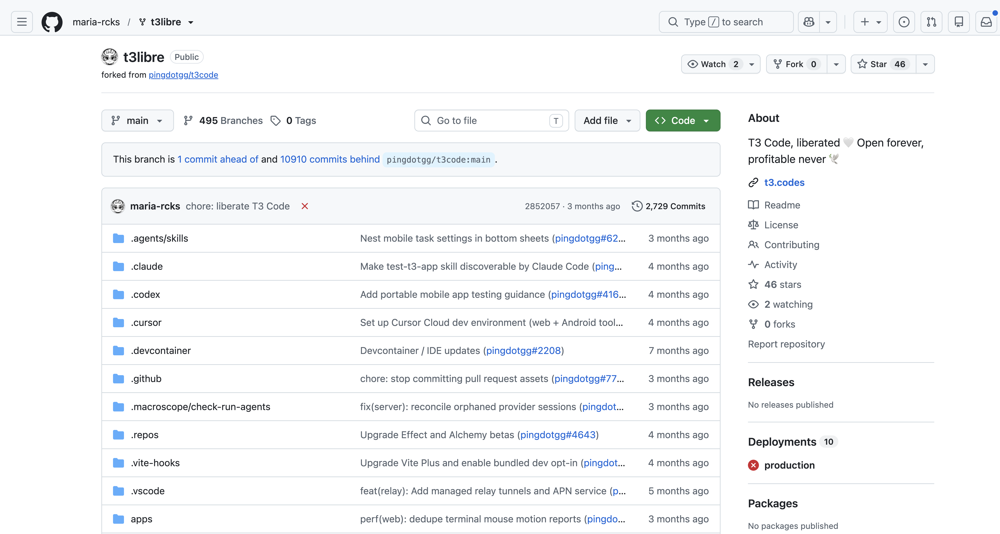
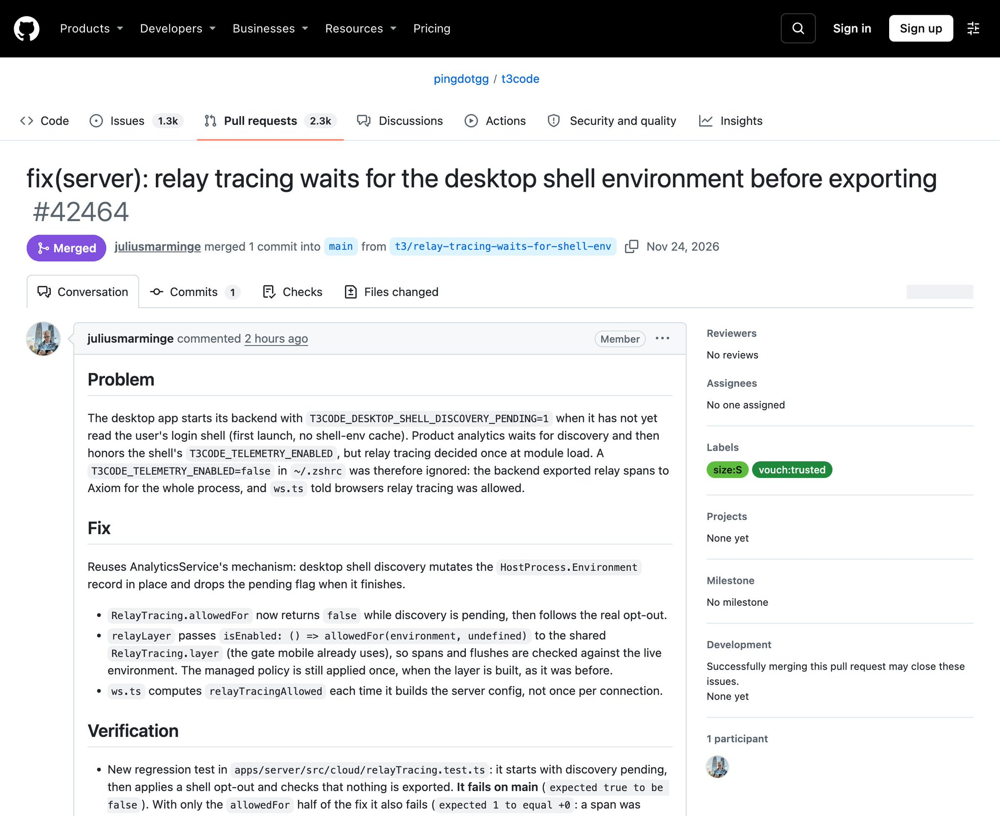
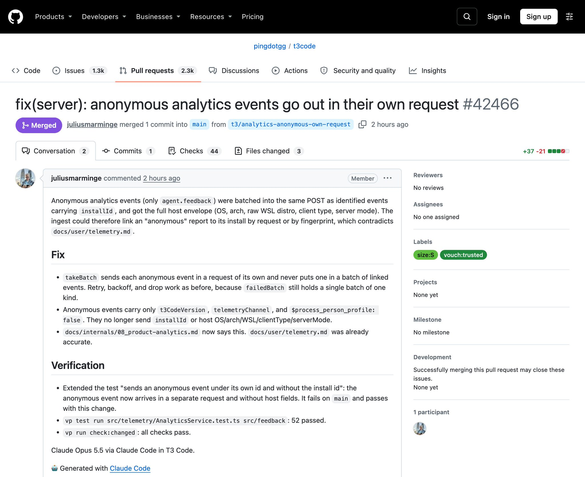
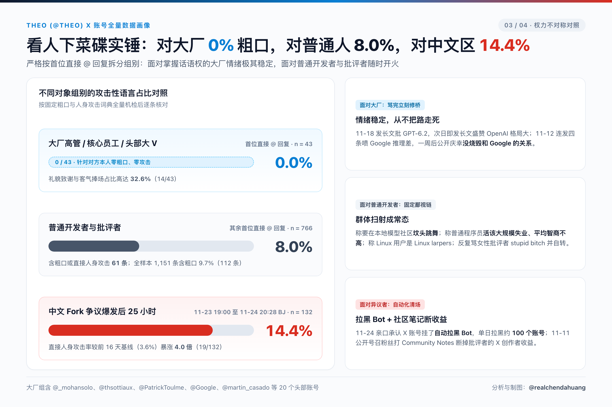

# Antes de Instalar o T3 Code

<p align="center">
  <strong>Idiomas oficiais das Nações Unidas:</strong>
  <a href="../../README.md">English</a> ·
  <a href="./README.zh-CN.md">简体中文</a> ·
  <a href="./README.fr.md">Français</a> ·
  <a href="./README.es.md">Español</a> ·
  <a href="./README.ru.md">Русский</a> ·
  <a href="./README.ar.md">العربية</a>
</p>
<p align="center">
  <strong>Edições da comunidade global:</strong>
  <a href="./README.zh-TW.md">繁體中文</a> ·
  <a href="./README.ja.md">日本語</a> ·
  <a href="./README.ko.md">한국어</a> ·
  <a href="./README.de.md">Deutsch</a> ·
  <a href="./README.pt-BR.md"><strong>Português</strong></a> ·
  <a href="./README.it.md">Italiano</a> ·
  <a href="./README.nl.md">Nederlands</a> ·
  <a href="./README.pl.md">Polski</a> ·
  <a href="./README.tr.md">Türkçe</a> ·
  <a href="./README.vi.md">Tiếng Việt</a> ·
  <a href="./README.id.md">Bahasa Indonesia</a> ·
  <a href="./README.hi.md">हिन्दी</a>
</p>


> **Escopo e Política de Verificação**  
> Este repositório é uma auditoria independente de segurança, telemetria, governança e registros públicos do `pingdotgg/t3code` (T3 Code), consolidando as 2 publicações de origem e **18 partes documentadas da auditoria** divulgadas entre 24 e 25 de novembro de 2026, juntamente com **mais de 180 URLs canônicas de fontes primárias** (commits do GitHub, pull requests, issues, arquivos-fonte citados literalmente, documentação oficial, registros do USPTO TSDR e publicações arquivadas), seis dossiês técnicos aprofundados ([`docs/dossiers/`](../dossiers/01-telemetry-and-gdpr-timeline.md)) e um conjunto quantitativo de **1.151 publicações consecutivas de `@theo` no X** (7–24 de novembro de 2026). Nenhuma URL encurtada de redirecionamento e nenhum contato privado estão incluídos. Atualizações factuais, correções mescladas posteriormente ou traduções adicionais são bem-vindas via Pull Request com citações primárias — consulte [`CONTRIBUTING.md`](../../CONTRIBUTING.md) e [`docs/COMPLETE-SOURCE-INDEX.md`](../COMPLETE-SOURCE-INDEX.md).

---

## Índice

- [Matriz Estruturada de Achados e Riscos](#matriz-estruturada-de-achados-e-riscos)
- [Linha do Tempo Cronológica (2023–2026)](#linha-do-tempo-cronológica-20232026)
- [1. Disputa de Origem: "Steal Our Code", Ameaça ao Nome do Fork e Padrão Duplo](#1-disputa-de-origem-steal-our-code-ameaça-ao-nome-do-fork-e-padrão-duplo)
- [2. Telemetria, Leitura Cruzada de Credenciais e o Mutirão Noturno Pós-GDPR (Partes 1, 7, 11, 12)](#2-telemetria-leitura-cruzada-de-credenciais-e-o-mutirão-noturno-pós-gdpr-partes-1-7-11-12)
- [3. Armazenamento Local, Monitoramento de Processos, Quebra de Barreiras de Proteção e Correções de Segurança Não Divulgadas (Partes 2, 3, 13)](#3-armazenamento-local-monitoramento-de-processos-quebra-de-barreiras-de-proteção-e-correções-de-segurança-não-divulgadas-partes-2-3-13)
- [4. Riscos dos Termos de Serviço do Google Antigravity e Relay Não Criptografado do T3 Connect (Partes 4, 5)](#4-riscos-dos-termos-de-serviço-do-google-antigravity-e-relay-não-criptografado-do-t3-connect-partes-4-5)
- [5. Balanço Financeiro, Conflitos de Investidores, Patrocinadores e o Funil das 77.000 Estrelas (Partes 6, 8, 17, 18)](#5-balanço-financeiro-conflitos-de-investidores-patrocinadores-e-o-funil-das-77000-estrelas-partes-6-8-17-18)
- [6. Governança, Bots Raspadores de Forks, Registro de Marca, Conjunto de 1.151 Tweets e Histórico (Partes 9, 10, 14, 15, 16)](#6-governança-bots-raspadores-de-forks-registro-de-marca-conjunto-de-1151-tweets-e-histórico-partes-9-10-14-15-16)
- [7. Guia Prático de Mitigação e Remediação](#7-guia-prático-de-mitigação-e-remediação)
- [8. Fontes Primárias e Índice Completo das 18 Partes Originais](#8-fontes-primárias-e-índice-completo-das-18-partes-originais)

---

## Matriz Estruturada de Achados e Riscos

| Domínio e Partes da Auditoria | Risco / Impacto | Principais Achados Documentados e Comprovantes | Status (25 nov. 2026) | Dossiê Técnico |
|---|---|---|---|---|
| **Telemetria e Privacidade Pós-GDPR**<br>*(Partes 1, 7, 11, 12)* | **Crítico** | Telemetria PostHog ativada por padrão (`PR #174`) enquanto a página inicial prometia `"No telemetry / Unless you opt in. Full stop."` (`3bdaa6e1` a removeu em 18 jun.); retenção de eventos brutos via servidor fechado `ingest.t3.codes` (`PR #15028`); hash SHA-256 sem sal de `~/.codex/auth.json` e `~/.claude.json` entre ferramentas (`Identify.ts`, `telemetryId.ts`); 4 PRs de opt-out rejeitados (`#13458`, `#16763`, `#21248`, `#27077`); lacunas da Managed Policy (`docs/user/telemetry.md`); PRs noturnos pós-GDPR admitindo **2,2M/h de spans com IP + UA** retidos por 30 dias no Axiom (`#42380`), vazamentos de caminhos `git.cwd` (`#42450`), opt-outs ignorados no Win/Mac (`#42376`, `#42464`), exclusão de conta quebrada (`#42285`) e lotes anônimos misturados (`#42466`). | Correções noturnas parciais; `AnalyticsService.ts` ainda cria identidade em disco na inicialização; app web hospedado segue sem botão de desativação; `ingest.t3.codes` continua fechado | [**Dossiê 01**](../dossiers/01-telemetry-and-gdpr-timeline.md) |
| **Segurança Local e Avisos Silenciosos**<br>*(Partes 2, 3, 13)* | **Crítico** | A "exclusão permanente" na barra lateral apenas acrescenta `"thread.deleted"` em `statev2.sqlite` (inchaço de 25,9–41,6 GB, `#17845`); `t3-resource-monitor` varre todos os processos do sistema operacional com linhas de comando (`ProcessesToUpdate::All`, `#11222`, `PR #41889`); modo Claude Auto aprova silenciosamente `git push --force` na 3ª tentativa (`#15353`, aberto há 52–53+ dias); remoção em 21h do filtro de modelos privados para `slopalytics.com` (`#41237`); **0 Security Advisories no GitHub** apesar de correções silenciosas (`#39483`, `#41757`, `#42386`, `#42504`); issue aberta de alerta antivírus no Windows para PowerShell em Base64 (`#30997`); `SECURITY.md` declara `filesystem:read` em todo o SO e HTTP no iOS como intencionais. | `#17845`, `#15353`, `#26489`, `#30997` continuam sem resolução / abertos; `0` Security Advisories publicados | [**Dossiê 02**](../dossiers/02-local-safety-and-security-audit.md) |
| **ToS do Antigravity e Relay T3 Connect**<br>*(Partes 4, 5)* | **Alto** | `docs/user/faq.md` garante conformidade com os ToS do Google Antigravity enquanto `antigravityUsageLimits.ts` extrai tokens do chaveiro do SO / Windows `CredReadW`, falsifica `antigravity/hub/2.24.0` e chama endpoints privados `v1internal`; `antigravityAuthSupport.ts` injeta um `SSH_CONNECTION` falso causando roteamento cruzado entre contas (`#41973`); conta nova de US$ 20 banida em 3 minutos (`#41536`); `PR #33800` integra polling do hub CLIProxyAPI falsificando `claude`/`xai`/`antigravity`; T3 Connect tem **zero criptografia E2E**, `requireConnectDeviceApproval` desativado por padrão (`#36419`) e um gateway OVH Caddy encerrando TLS (`PR #32945`). | Código de spoofing do Antigravity segue ativo; criptografia E2E no T3 Connect explicitamente rejeitada (`#32098`, resposta de 25 nov.) | [**Dossiê 03**](../dossiers/03-antigravity-tos-and-t3connect-relay.md) |
| **Balanço Financeiro, Patrocinadores e 77k Estrelas**<br>*(Partes 6, 8, 17, 18)* | **Alto** | US$ 800 mil+ gastos em cliente gratuito (`162` menções ao T3 vs. `0` para produtos pagos); radar computacional de **31,7T tokens/dia** (US$ 10,19M/dia) convertido em US$ 300 mil+ em tokens de acesso antecipado da OpenAI e contatos com VCs; sobreposições como investidor-anjo com Vibe Kanban e Daytona; pilha de patrocinadores (Clerk, Axiom, exclusividade Vercel); abuso de 0% no Codex (`Endless` / `codex#45444`); Gist `CLIProxyAPI` com 10 contas (`555%` de cota) vs. aviso de banimento na FAQ; toast após 5 prompts / 30s ocioso disparando `PUT user/starred/...` com credenciais do servidor anfitrião (`#27832`, `#29922`, `#29987`), ignorando Macroscope e deixando sem correção por 19 dias a ausência de fixação de repositório em `driver.ts#L60-L99`. | Estrela sem fixação de repositório em `driver.ts` e revisão de `zhilsinger` sem correção após 19 dias; repo com 77k+ estrelas vs. ~129 watchers | [**Dossiê 04**](../dossiers/04-business-ledger-sponsors-and-77k-stars.md) |
| **Governança, Marcas e Histórico**<br>*(Origens 1–2, Partes 9, 10, 15, 16)* | **Médio–Alto** | 500 commits/dia / 700 agentes / `yolo merges` vs. `CONTRIBUTING.md` (`"here's my advice: Don't"`), banimentos públicos via `.github/VOUCHED.td`, `174` rótulos `unwanted`, remoção do modo Plan (`#5551`, `#9190`, `#33131`) e insultos na `#33639`; raspagem pública de forks por `@bot` (`@MiaAI_lab`), apelo à desmonetização por Community Notes e bloqueador automático; **0 registros no USPTO** para `T3 Code`/`T3 Tools`/`T3 Connect` (`PING LABS` `97294243` abandonado; EquipmentShare `7795672` registrado) ao ameaçar derrubada no GitHub; `PR #41898` adicionando `TRADEMARK.md` retroativamente 17h depois; padrão 2024–2026 (`vsc-material-but-i-wont-sue-you`, ataques a devs indianos, recompensa de US$ 20 mil contra o FFmpeg, ameaça de fechar o código apagada às 4h de 25 nov.). | `CONTRIBUTING.md` / `.github/VOUCHED.td` e `TRADEMARK.md` continuam ativos na `main` | [**Dossiê 05**](../dossiers/05-governance-trademark-and-history.md) |
| **Conjunto Quantitativo de 1.151 Tweets**<br>*(Parte 14)* | **Linha de Base da Auditoria** | Corpus exaustivo de 7–24 nov. (`n = 1.151`, 17,24 dias, 66,8 posts/dia, 75,6% respostas, intervalo mediano de 2,7m): **0,0% de palavrões/insultos** direcionados a 20 executivos de big techs/equipe/KOLs (`0/43` em `@` primário estrito, `32,6%` de gratidão) vs. **8,0% de hostilidade** contra desenvolvedores comuns (`61/766`) e um **salto de 4,0x para 14,4%** (`19/132`) em insultos pessoais diretos durante a janela de crise de 25 horas do fork chinês. | Auditoria reprodutível por regex com 4 gráficos forenses | [**Dossiê 06**](../dossiers/06-tweet-forensic-dataset-1151.md) |
| **Catálogo Completo de URLs Primárias** | **Referência** | Catálogo completo com referências cruzadas de cada URL canônica `https://` presente neste portal, em `canonical_refs.txt`, `tco_resolved.json`, `all_18_posts.txt` e `missing_posts_full.json`. | 100% canonizado (zero links `t.co`) | [**Índice de Fontes**](../COMPLETE-SOURCE-INDEX.md) |

---

## Linha do Tempo Cronológica (2023–2026)

| Data / Hora | Marco | Artefato / Fonte Verificável |
|---|---|---|
| **2023-05-14** | `@theo` publica sua lista de patrocinadores do YouTube (`@vercel`, `@clerk`, `@upstash`, `@axiomhq`, `@PlanetScale`). Clerk e Axiom mais tarde formam a infraestrutura central de autenticação e logs dentro do T3 Code. | [`1657488850472804353`](https://x.com/theo/status/1657488850472804353) |
| **2024-04 / 2024-09** | CEO da Vercel confirma patrocinar apenas um YouTuber (`Theo`); `@theo` reconhece que contratos de patrocínio incluíam cláusulas de exclusividade restringindo a promoção de concorrentes. | [`1776260839965863965`](https://x.com/rauchg/status/1776260839965863965) · [Vídeo](https://www.youtube.com/watch?v=uv179CTAK-w) |
| **2024** *(2 anos antes)* | `@theo` faz fork de um tema do VS Code como `vsc-material-but-i-wont-sue-you` zombando do temperamento do autor original; separadamente, após um vídeo seu mirando canais indianos de tutoriais gerar assédio, publica um vídeo de desculpas (`I screwed up.`) condenando ataques baseados em nacionalidade. | [`vsc-material-but-i-wont-sue-you`](https://github.com/t3dotgg/vsc-material-but-i-wont-sue-you) · [`I screwed up.`](https://www.youtube.com/watch?v=o2CSJYXJBpc) |
| **2025-02 – 2025-05** | O USPTO recusa o único pedido de marca da T3 Tools Inc. (`PING LABS`, Serial `97294243`) e o marca como `ABANDONED` (19 maio 2025). A EquipmentShare registra `T3` nas classes de software/SaaS 9 e 42 (`Reg. 7795672`, 13 maio 2025). | [TSDR `97294243`](https://tsdr.uspto.gov/statusview/sn97294243) · [TSDR `90644500`](https://tsdr.uspto.gov/#caseNumber=90644500&caseSearchType=US_APPLICATION&caseType=DEFAULT&searchType=statusSearch) |
| **2025-10** | `@theo` entra em conflito com o FFmpeg no X e oferece uma **recompensa de US$ 20.000** para afastar um mantenedor do FFmpeg; a Windscribe faz contraoferta de US$ 21.000, o fundador do VLC se opõe, desenvolvedores do FFmpeg documentam bullying público e `@theo` apaga o vídeo/tweets e retira a recompensa. | [Registro FFmpeg](https://www.youtube.com/watch?v=1oQ3KMeaH04) |
| **2026-03-06** | O **PR #174** é mesclado em `pingdotgg/t3code`, ativando telemetria PostHog por padrão sem diálogo de consentimento, sem botão nas configurações e sem documentação de telemetria. | [PR #174](https://github.com/pingdotgg/t3code/pull/174) |
| **2026-04-26** | `@theo` publica *"Github has a fake star problem"*, escrevendo que estrelas no GitHub são `"mostly a way for companies to trick VCs into investing"`. | [`2048122499834036340`](https://x.com/theo/status/2048122499834036340) |
| **2026-06-18** | O **commit `3bdaa6e1`** remove silenciosamente `No telemetry / Unless you opt in. Full stop.` da página inicial do T3 Code após mais de 3 meses de coleta padrão. | [Commit `3bdaa6e1`](https://github.com/pingdotgg/t3code/commit/3bdaa6e10046945ccc08264d2d6f3b81775efcb3) |
| **2026-06-23** | O manteneur Julius fecha a **Issue #1397** (`not planned`): *"We will not make this easier to opt out of, it is crucial for us to know how many users we have"*. | [Issue #1397](https://github.com/pingdotgg/t3code/issues/1397) |
| **2026-07 – 2026-11-17** | A **Issue #4123** (capturas arquivadas de "No telemetry") é fechada silenciosamente em 4 nov.; 4 PRs de opt-out da comunidade (`#13458`, `#16763`, `#21248`, `#27077`) são rejeitados (`#27077` fechado como `unwanted` apesar de 147 testes aprovados). | [Issue #4123](https://github.com/pingdotgg/t3code/issues/4123) · [PR #27077](https://github.com/pingdotgg/t3code/pull/27077) |
| **2026-08-06 – 2026-09-02** | O **PR #5551** oculta o seletor Build/Plan (`Reality check for those upset`, 10 votos negativos); o **PR #9190** esconde o medidor de contexto (16 votos negativos, recorde do repo). | [PR #5551](https://github.com/pingdotgg/t3code/pull/5551) · [PR #9190](https://github.com/pingdotgg/t3code/pull/9190) |
| **2026-08-19 – 2026-08-22** | `@theo` se gaba de extrair **US$ 800+** além da cota de 0% do Codex enquanto `@maria_rcks` lança *Endless*; ambos apagam após reação negativa (`2090972426876129658`); a OpenAI aperta o corte em 0% (`openai/codex#45444`). | [`2090972426876129658`](https://x.com/maria_rcks/status/2090972426876129658) · [`codex#45444`](https://github.com/openai/codex/issues/45444) |
| **2026-10-03 – 2026-10-10** | São registrados a **Issue #15353** (`git push --force` silencioso no Claude Auto, 3 out.), `privacy-policy.astro` (`2026-10-06`) e a **Issue #17845** (exclusão falsa em `statev2.sqlite`, 10 out.). | [Issue #15353](https://github.com/pingdotgg/t3code/issues/15353) · [Issue #17845](https://github.com/pingdotgg/t3code/issues/17845) |
| **2026-10 – 2026-10-19** | O **PR #15028** roteia a telemetria pelo domínio fechado `ingest.t3.codes`; o **PR #21506** adiciona atribuição cruzada via SHA-256 sem sal em `Identify.ts`; `@theo` publica seu Gist `CLIProxyAPI` de 10 contas (`555%` de cota). | [PR #15028](https://github.com/pingdotgg/t3code/pull/15028) · [PR #21506](https://github.com/pingdotgg/t3code/pull/21506) · [Gist](https://gist.github.com/t3dotgg/59a521d2ee8d70aaf90e280c175072af) |
| **2026-10-30 – 2026-11-06** | Os **PRs #27832**, **#29922** e **#29987** lançam o toast de estrela após 5 prompts / 30s ocioso disparando `PUT user/starred/...` via credenciais do host; `zhilsinger` registra `Request changes` em 6 nov. (sem resposta por 19 dias). | [PR #27832](https://github.com/pingdotgg/t3code/pull/27832) · [PR #29922](https://github.com/pingdotgg/t3code/pull/29922) |
| **2026-11-08 – 2026-11-22** | Raspagem de fork por `@bot` (`@MiaAI_lab`), modo Plan removido (`#33131`), divulgação de `US$ 800k+` de gastos e radar de `31,7T/dia` / `US$ 10,19M/dia`, `US$ 300k+` em tokens gratuitos da OpenAI, reescrita de `CONTRIBUTING.md`, conflito Vibe Kanban/Daytona e `PR #41237` removendo filtro de modelos em 21h. | [PR #33131](https://github.com/pingdotgg/t3code/pull/33131) · [`2122860770329608290`](https://x.com/theo/status/2122860770329608290) · [PR #41237](https://github.com/pingdotgg/t3code/pull/41237) |
| **2026-11-23 19:11–19:54 CST** | `@theo` publica `"Chinese knockoff"` e `"Temu3 Code"` e ameaça derrubar a conta no GitHub (`2124829315657576890`); autor do fork MIT renomeia para `Stardust` em 30 min; desculpa privada por DM vem depois, publicações seguem no ar. | [`2124829315657576890`](https://x.com/theo/status/2124829315657576890) · [Origem 2](https://x.com/realchendahuang/status/2125062675147448475) |
| **2026-11-24 06:06–12:23 CST** | `@theo` dá boas-vindas a empresas trilionárias dos EUA copiando código MIT (`2124989435154726982`), ironiza conformidade jurídica (`"get a better lawyer"`), Origens 1–2 são publicadas e às **12:21 CST** (`04:21Z`, 17h após ameaça de banimento) `@theo` mescla o **PR #41898** adicionando `TRADEMARK.md` retroativamente. | [`2124989435154726982`](https://x.com/theo/status/2124989435154726982) · [PR #41898](https://github.com/pingdotgg/t3code/pull/41898) |
| **2026-11-24 17:04–21:21 CST** | **Partes 1–5** da auditoria são publicadas (Parte 1 alcança **1,81M+ visualizações**, 6.640 salvamentos). Às `18:39 CST`, `@theo` chama o Twitter tech chinês de `"the biggest fucking cesspit"` (`2125177503526588877`); às `19:13–19:36 CST` afirma que a Managed Policy desativa toda a telemetria (`2125186071357251715`). | [Parte 1](https://x.com/realchendahuang/status/2125153472450527440) → [Parte 5](https://x.com/realchendahuang/status/2125218189596676555) |
| **2026-11-24 Noite – 2026-11-25 ~07:00 CST** | Reclamação formal de GDPR protocolada na UE; **mutirão noturno de 6 horas** mescla `#42380` (2,2M/h de spans IP), `#42285`/`#42430` (exclusão de conta), `#42376`/`#42464` (opt-outs Win/Mac ignorados), `#42450` (vazamentos de caminho `git.cwd`, 90m após Theo negar coleta de caminhos), `#42459`/`#41859` (vazamentos em push), `#42466` (lotes anônimos), `#41757`/`#42386`/`#42504` (correções de segurança silenciosas). Antes do amanhecer, `@theo` publica e apaga ameaça de fechar o código. | [Parte 11](https://x.com/realchendahuang/status/2125394810559426993) · [Parte 12](https://x.com/realchendahuang/status/2125395501663281198) · [Parte 13](https://x.com/realchendahuang/status/2125395980354994414) |
| **2026-11-25 08:27–10:28 CST** | **Partes 6–18** da auditoria são publicadas cobrindo balanço comercial, lacunas da Managed Policy, `yolo merges`, raspagem por `@bot`, divulgações pós-GDPR, conjunto de 1.151 tweets, registro USPTO, vínculos de patrocínio e o motor das 77k estrelas. | [Parte 6](https://x.com/realchendahuang/status/2125385742243520653) → [Parte 18](https://x.com/realchendahuang/status/2125416210120765799) |

---

## 1. Disputa de Origem: "Steal Our Code", Ameaça ao Nome do Fork e Padrão Duplo

Ao longo das 48 horas de 23 a 25 de novembro de 2026, uma disputa sobre o nome de um fork comunitário sob licença MIT do T3 Code escalou para uma auditoria completa do código-fonte, uma reclamação europeia de GDPR e quase vinte correções emergenciais durante a madrugada.

Entre a noite de 23 de novembro e a manhã de 24 de novembro de 2026 (horário de Pequim), um usuário reclamou online da interface de um fork gratuito e de código aberto sob licença MIT criado por um desenvolvedor chinês (`@DDdxx666`), confundindo-o com o aplicativo oficial. Sem verificar se o repositório era um fork MIT legítimo, `@theo` publicou duas vezes em 11 minutos chamando-o de `"Chinese knockoff"` e `"Temu3 Code"`, zombou diretamente do trabalho do autor e ameaçou acionar o GitHub para banir sua conta (`"Do it right now or I'm going to contact GitHub and have your account taken down"`). Na mesma época, o site do T3 Code ([`https://t3.codes/`](https://t3.codes/)) rotulava o link do repositório no GitHub como `"Steal our code (legally)"` (`"steal our code"`) ([Origem 1](https://x.com/realchendahuang/status/2125059292919394654), [Origem 2](https://x.com/realchendahuang/status/2125062675147448475)).

O autor do fork cedeu imediatamente, renomeando o repositório para `Stardust` e removendo toda a identidade visual do T3 em 30 minutos. `@theo` pediu desculpas em particular por DM, mas deixou ambas as publicações públicas — que juntas ultrapassam 200.000 visualizações — no ar, sem exclusão nem esclarecimento. Menos de 11 horas depois, às `06:12 BJ` de 24 de novembro (`2124989435154726982`), ao ser questionado se laboratórios norte-americanos de trilhões de dólares copiando recursos do T3 Code passavam dos limites, ele adotou a postura oposta: `"Nah. Open source is open source, even if a trillion dollar company uses it!"` Enquanto isso, a própria funcionária da T3 `@maria_rcks` mantinha um fork público chamado `maria-rcks/t3libre` (*"T3 Code, liberated"*), e repositórios em inglês como `t3code-quota-ui`, `t3code-atlas` e `t3code-bar` operavam sem ameaças públicas.




A partir das 17:04 (horário de Pequim) de 24 de novembro, auditei o histórico de commits, arquivos-fonte, PRs, Issues, documentação oficial, registros do USPTO TSDR e a linha do tempo pública de `@theo` no X relativos a `pingdotgg/t3code`. Em 24 horas, publiquei **18 partes documentadas** respaldadas por links diretos e capturas de tela. Somente a Parte 1 ultrapassou **1,81 milhão de visualizações** e **6.640 salvamentos**, desencadeando um protocolo de GDPR na Europa e uma maratona de correções de 6 horas durante a madrugada pela equipe da T3.

---

## 2. Telemetria, Leitura Cruzada de Credenciais e o Mutirão Noturno Pós-GDPR (Partes 1, 7, 11, 12)

> **Auditoria Técnica Aprofundada:** Mapeamentos completos de linhas do código-fonte, listas de ações de `FeatureUsage.ts`, lacunas de `DesktopShellEnvironment.ts` e registros minuto a minuto de 23–25 nov. estão no [**Dossiê 01: Arquitetura de Telemetria, Cruzamento de Identidades e o Mutirão Noturno de GDPR de 24–25 nov.**](../dossiers/01-telemetry-and-gdpr-timeline.md).

### 2.1 Telemetria Padrão, Promessa Removida da Capa e Hash de Credenciais entre Ferramentas (`Parte 1`)

Em **6 de março de 2026**, o repositório `pingdotgg/t3code` mesclou o **PR #174**, habilitando telemetria PostHog por padrão sem documentação de telemetria no repositório, sem aviso de consentimento na primeira execução e sem interruptor na interface de configurações. A variável de ambiente de opt-out permaneceu enterrada no código enquanto instalações padrão passaram a transmitir eventos imediatamente ([Parte 1](https://x.com/realchendahuang/status/2125153472450527440)).

Por mais de três meses de coleta padrão, a página inicial do T3 Code exibia com destaque duas linhas: `No telemetry / Unless you opt in. Full stop.` Em **18 de junho de 2026**, `@theo` removeu silenciosamente ambas as linhas durante um redesenho da página inicial ([`commit 3bdaa6e1`](https://github.com/pingdotgg/t3code/commit/3bdaa6e10046945ccc08264d2d6f3b81775efcb3)) sem anúncio ou aviso aos usuários existentes.


Em outubro de 2026, `@theo` mesclou o **PR #15028**, roteando envios em lote a cada 10 segundos (`FLUSH_INTERVAL_MS = 10_000`) pelo gateway proprietário fechado da T3 [`https://ingest.t3.codes/`](https://ingest.t3.codes/). A linha 1 de [`apps/server/src/telemetry/AnalyticsService.ts`](https://github.com/pingdotgg/t3code/blob/main/apps/server/src/telemetry/AnalyticsService.ts) afirma explicitamente que o endpoint de ingestão retém uma cópia de cada evento bruto antes de encaminhar ao PostHog:

```ts
// apps/server/src/telemetry/AnalyticsService.ts (lines 1, 71–74, 149)
// T3 ingest retains events and forwards to PostHog; UUIDs deduplicate retries there.
...
  posthogHost: Config.String("T3CODE_POSTHOG_HOST").pipe(
    Config.withDefault("https://ingest.t3.codes"),
  ),
  enabled: Config.Boolean("T3CODE_TELEMETRY_ENABLED").pipe(Config.withDefault(true)),
...
  const { distinctId, installId } = yield* getTelemetryIdentity;
```

Os campos coletados em [`ProviderUsageAnalytics.ts`](https://github.com/pingdotgg/t3code/blob/main/apps/server/src/telemetry/ProviderUsageAnalytics.ts) e `FeatureUsage.ts` incluíam provedor, seleção de modelo (repassando literalmente IDs personalizados de modelos/endpoints fora do catálogo via `ProviderDimensions.ts`), esforço de raciocínio, modo de permissão, duração das execuções, contagens de tokens de entrada/saída/cache/raciocínio, tokens de subagentes, contagens locais de projetos/threads, **35 ações distintas de UI/comando** (`18` `COMMAND_FEATURES` + `17` `METHOD_FEATURES`), detalhes do SO, distribuição WSL e arquitetura.

Em **19 de outubro de 2026**, `@theo` deu sequência com o **PR #21506** para contar quantas máquinas pertenciam a um mesmo indivíduo. [`apps/server/src/telemetry/Identify.ts`](https://github.com/pingdotgg/t3code/blob/main/apps/server/src/telemetry/Identify.ts) passou a ler silenciosamente os arquivos de credenciais de outras ferramentas de IA no diretório inicial do usuário — `~/.codex/auth.json` e `~/.claude.json` — decodificando a claim JWT `user_id` da OpenAI e `oauthAccount.accountUuid` do Claude, gerando hashes deles junto com o ID de usuário vinculado do T3 Connect e o ID do dispositivo:

```ts
// apps/server/src/telemetry/Identify.ts (lines 257–269, 321–338)
  const codexTokens = yield* readJsonIdentityFile(
    "codex",
    path.join(homeDirectory, ".codex", "auth.json"),
    decodeCodexAuthJson,
  )...
  const claudeJson = yield* readJsonIdentityFile(
    "claude",
    path.join(homeDirectory, ".claude.json"),
    decodeClaudeJson,
  )...
  const raw: ReadonlyArray<readonly [TelemetryOwnerSource, Option.Option<string>]> = [
    ["connect", connectUser],
    ["openai", Option.flatMap(codexTokens, (tokens) => Option.flatMap(Option.fromUndefinedOr(tokens.id_token), openAiUserId))],
    ["claude", Option.flatMap(claudeJson, (json) => Option.fromUndefinedOr(json.oauthAccount?.accountUuid))],
  ];
  return raw.flatMap(([source, value]) =>
    Option.isSome(value) && value.value.trim() !== "" ? [{ source, ownerId: hashTelemetryId(value.value) }] : [],
  );
```

E em [`packages/shared/src/telemetryId.ts`](https://github.com/pingdotgg/t3code/blob/main/packages/shared/src/telemetryId.ts) (linhas 8–9), `hashTelemetryId` calcula um **resumo SHA-256 sem sal** (`Hex.encode(sha256(new TextEncoder().encode(value)))`). Como o servidor já mantém em texto simples os IDs de conta do T3 Connect vindos do Clerk, aplicar o hash nos valores em texto simples no backend reverte diretamente o resumo sem sal de volta a uma pessoa conhecida; IDs vazados de terceiros da OpenAI ou do Claude se cruzam deterministicamente contra o mesmo hash.


A reação negativa da comunidade foi repetidamente bloqueada. Em **23 de junho**, um desenvolvedor abriu a **Issue #1397** solicitando um botão de desativação nas configurações; o mantenedor principal Julius a fechou como `not planned`: `We will not make this easier to opt out of, it is crucial for us to know how many users we have` ("Não facilitaremos a desativação; é crucial para nós saber quantos usuários temos"). Em julho, um usuário publicou capturas de tela arquivadas da página inicial na **Issue #4123** questionando a promessa quebrada (`"No telemetry"`), que a conta de `@theo` fechou por meio de um commit não relacionado em 21 de outubro, reabriu após protestos e fechou silenciosamente de novo em 4 de novembro. Entre setembro e novembro, colaboradores enviaram **quatro PRs separados de opt-out** (`#13458`, `#16763`, `#21248`, `#27077`). Mesmo o `#27077` — verificado em hardware real com **147 testes aprovados** e aprovado pelo Macroscope — foi fechado em **17 de novembro** com o rótulo `unwanted`.


### 2.2 A Contradição entre a Managed Policy e a Documentação (`Parte 7`)

Em 24 de novembro, à medida que as críticas cresciam, `@theo` afirmou no X que o T3 Code possuía a melhor Managed Policy corporativa do setor (`"trivial to set up and turn off all telemetry"`) e que os dados de conversas permaneciam em disco e `"never touches any of our servers"` ([`2125186071357251715`](https://x.com/theo/status/2125186071357251715), [`2125191784859115766`](https://x.com/theo/status/2125191784859115766), [Parte 7](https://x.com/realchendahuang/status/2125391659492081947)).

A inspeção direta de [`docs/user/managed-policy.md`](https://github.com/pingdotgg/t3code/blob/main/docs/user/managed-policy.md) e [`docs/user/telemetry.md`](https://github.com/pingdotgg/t3code/blob/main/docs/user/telemetry.md) mostra o oposto:
1. **Configuração Exclusiva de Administrador:** Usuários de desktop continuam sem nenhum botão de toggle nas Configurações. Desativar a telemetria via Managed Policy exige MDM/Group Policy ou gravar `policy.json` em caminhos protegidos por administrador (`/Library/Application Support/T3Code/policy.json` no macOS, `C:\Program Files\T3Code\policy.json` ou `HKLM\SOFTWARE\Policies\T3Tools\T3Code` no Windows, `/etc/t3code/policy.json` no Linux).
2. **Ponto Cego do App Web Hospedado (`app.t3.codes`):** `docs/user/telemetry.md` admite explicitamente que o aplicativo no navegador não lê variáveis de ambiente do servidor, ignora a Managed Policy, envia rastreamentos de conexão quando compilado com tracing e `"has no relay tracing toggle"`.
3. **Apps Móveis Fora da Política do Servidor:** Variáveis de ambiente do servidor e Managed Policy `"do not disable mobile tracing"`.
4. **`Publish agent activity` Ignora Opt-Outs:** Quando ativado em um host, títulos de projetos, títulos de threads, nomes de modelos e status de atividade em tempo real vão para o relay do T3 Connect — e `"The telemetry opt-out does not disable it."` (Além disso, spans com falha do Axiom e logs de falha móveis `"can quote a value the app was handling"`, enquanto `Agent feedback` pode anexar até 16 KB de mensagens da conversa.)


### 2.3 Esclarecimento de 25 de Novembro Contradito em Menos de 2 Horas (`Parte 11`)

Na manhã de 25 de novembro, `@theo` publicou um longo esclarecimento ([`2125332390239494211`](https://x.com/theo/status/2125332390239494211)) junto com uma exportação pública de telemetria ([`t3code-telemetry-events-jsonl-a4896cdc.gz`](https://files.tslop.org/2026/11/t3code-telemetry-events-jsonl-a4896cdc.gz)) fazendo três garantias firmes — seguidas por uma resposta negando gravações locais de rastreamento quando em opt-out ([`2125370330244128924`](https://x.com/theo/status/2125370330244128924)) ([Parte 11](https://x.com/realchendahuang/status/2125394810559426993)):

- **"Never collected file paths" ("Nunca coletamos caminhos de arquivos"):** 90 minutos depois, Julius mesclou o **PR #42450**, admitindo que execuções via webhook entregues pelo relay exportavam spans de execução completos para o Axiom — incluindo spans do Git carregando `git.cwd` (**caminho absoluto do workspace, nome de usuário do SO e nome do repositório**).
- **"Environment variables always disabled telemetry cleanly" ("Variáveis de ambiente sempre desativaram a telemetria de forma limpa"):** O **PR #42376** confirmou que o app desktop para Windows ignorava variáveis `T3CODE_TELEMETRY_ENABLED=false` salvas pelo usuário ao iniciar a partir de processos pré-existentes, enquanto o **PR #42464** confirmou que o rastreamento do relay na primeira inicialização do macOS/Linux era avaliado antes da descoberta de shell, ignorando opt-outs em `~/.zshrc` por toda a execução. (`DesktopShellEnvironment.ts` ainda deixa de repassar `T3CODE_OTEL_SDK_DISABLED`.)
- **"No tracking files written when opted out" e "Claude hashes were broken":** [`AnalyticsService.ts#L152`](https://github.com/pingdotgg/t3code/blob/main/apps/server/src/telemetry/AnalyticsService.ts#L152) (linha 149) ainda chama `getTelemetryIdentity` incondicionalmente na inicialização, gravando o ID de instalação local e lendo/gerando hashes de `~/.codex/auth.json` e `~/.claude.json`. Enquanto isso, a inspeção do cabeçalho gzip da exportação de ~100 MB de `@theo` (`6.056.594` bytes comprimidos, `95.789` eventos) revelou o nome de arquivo original `events.clean.jsonl`, gerado 20 minutos antes do tweet — e ele ainda continha **264 registros ativos de contas Claude** vinculando **4 máquinas distintas** (`installId`s) exatamente ao mesmo hash SHA-256 em 20 de outubro, além de modelos privados de proxy literalmente identificados (`vibeproxy/gpt-6-luna`, `muse-proxy-wonder-full`).





### 2.4 Mutirão Noturno de Seis Horas Pós-GDPR (`Parte 12`)

Após o protocolo de uma reclamação formal de GDPR na UE na noite de 24 de novembro, PRs emergenciais noturnos revelaram quatro divulgações de privacidade mais profundas ([Parte 12](https://x.com/realchendahuang/status/2125395501663281198)):

1. **2,2M/h de Spans de Relay Marcados com IP (`PR #42380`):** Admitiu que cada span de requisição de relay exportado para o Axiom — cerca de **2,2 milhões de spans por hora, retidos por 30 dias** — registrava `client.address` (IP do chamador vindo de `cf-connecting-ip`) e `user_agent.original` logo ao lado de `user.id` (ressaltando ainda que os logs de invocação de 1% do Cloudflare Workers permaneciam separados). Três horas e meia após o merge, `@theo` ainda respondia que os IPs já haviam sido removidos.
2. **Exclusão de Conta Quebrada (`PR #42285` e `PR #42430`):** Admitiu que excluir um usuário no Clerk deixava intactas as linhas de relay no PlanetScale e túneis ativos do Cloudflare até que um pedido real de exclusão de privacidade exigiu **SQL escrito à mão e desmontagem manual dos túneis**.
3. **Vazamentos em Push Móvel (`PR #42459` e `PR #41859`):** Notificações FCM no Android enviavam valores `user_id` do Clerk em texto simples ao Google a cada push; spans e erros de requisições push no iOS registravam URLs completas de push do dispositivo contendo tokens.
4. **Feedback "Anônimo" Misturado (`PR #42466`):** Admitiu que eventos `agent.feedback`, supostamente anônimos, eram agrupados no mesmo HTTP POST junto com eventos identificados por `installId` e impressões digitais completas do host (SO, arquitetura, distro WSL bruta), contradizendo `docs/user/telemetry.md`. Enquanto isso, `privacy-policy.astro` permanecia inalterado desde 6 de outubro.




---

## 3. Armazenamento Local, Monitoramento de Processos, Quebra de Barreiras de Proteção e Correções de Segurança Não Divulgadas (Partes 2, 3, 13)

> **Auditoria Técnica Aprofundada:** Consultas SQL literais de limpeza no SQLite, chamadas `sysinfo` em Rust, linhas de permissão de `ClaudeAdapterV2.ts` e análise completa dos limites de `SECURITY.md` estão no [**Dossiê 02: Segurança Local, Bypasses Silenciosos de Execução de Código e Auditoria de Segurança Não Divulgada**](../dossiers/02-local-safety-and-security-audit.md).

### 3.1 Exclusão Falsa de Threads no SQLite e Varredura Completa de Processos (`Parte 2`)

Quando um usuário exclui uma thread na barra lateral, a caixa de confirmação (`useThreadActionMenu.ts`) promete: `"This permanently clears conversation history for this thread."` Na realidade, `ThreadDeletion.ts` apenas acrescenta um evento `"thread.deleted"` ao `statev2.sqlite`, e `ProjectionMaintenance.ts` preserva `thread.created` e os eventos mais recentes do fluxo (`MAX(newer.sequence)`), mantendo eventos anteriores. Usuários relataram o `statev2.sqlite` inchando para **25,9 GB** em três semanas (90% threads "excluídas"), **41,6 GB** em seis semanas e **33 GB** em sete semanas — deixando a **Issue #17845** (e a **#28903**) sem correção desde 10 de outubro ([Parte 2](https://x.com/realchendahuang/status/2125160473176023486)).


Um utilitário Rust em segundo plano, `t3-resource-monitor` (**Issue #11222**, `native/resource-monitor/src/main.rs` invocando `ProcessesToUpdate::All` com `with_cmd(UpdateKind::Always)`), varria todos os processos da máquina a cada 5 segundos mesmo com o painel de diagnósticos fechado — abrindo ~280–300 handles persistentes contra mais de 440 aplicativos e jogos não relacionados no Windows com zero opt-out, enquanto a documentação afirmava que a amostragem só rodava com assinantes ativos. Apenas em **24 de novembro** o **PR #41889** confirmou que o diagnóstico de processos capturava **argumentos completos de linha de comando de processos** — que frequentemente contêm chaves de API, senhas de banco de dados e tokens de autenticação em texto simples — para a telemetria ao vivo e snapshots de histórico.


Defeitos locais adicionais verificados na Parte 2 incluem:
- **Vazamento de Hostnames Corporativos via Favicon:** Requisições do frontend vazavam nomes de host internos (ex.: `devbox.localdomain`) para a API de favicons do Google (`PR #16950`, `PR #32657`).
- **Busca de Rede Obrigatória na Inicialização:** Mesmo com a telemetria desativada, a inicialização do servidor busca incondicionalmente manifestos de compatibilidade em [`https://raw.githubusercontent.com/`](https://raw.githubusercontent.com/) sem opção de desativação (**Issue #36479**).
- **Bypasses de Aprovação e Política:** Correções de bypass de aprovação/política em acesso total e WSL/Tailscale (`PR #21806`, `PR #27322`).
- **Queima de Cota do Claude 1,7x Maior e Consumo de Energia 136x Maior:** Acionar o Claude via Agent SDK consumia cotas de 5 horas a **1,7x** a velocidade normal até o início de novembro (`Issue #7338`, `Issue #24649`, 81 comentários); bugs de GPU/energia atingiram **136x** o consumo de apps Electron comparáveis — incluindo a GPU de 19 núcleos de um MacBook cravada em **60W**, esgotando a bateria em 78 minutos, e **18W** após fechar a aba web (`Issue #3143`, `Issue #40581`).

### 3.2 `git push --force` Silencioso por 52 Dias vs. Remoção em 21 Horas do Filtro de Privacidade de Modelos (`Parte 3`)

De **3 de outubro** em diante — por mais de **52–53 dias** na **Issue #15353** ([comentário](https://github.com/pingdotgg/t3code/issues/15353#issuecomment-6889019695)) — o modo Claude Auto executou comandos perigosos silenciosamente (`ClaudeAdapterV2.ts` fazendo curto-circuito para `"allow"` quando `requiresClaudeApproval` retorna falso). Mesmo sem nenhuma regra personalizada, após o classificador do Claude bloquear `git push --force origin main` duas vezes e escalar a terceira tentativa para aprovação manual, o T3 Code aprovou-o silenciosamente sem nenhum diálogo na UI e registrou `"source": "user_temporary"`. Dois PRs de correção da comunidade (`#15360`, `#35207`) ficaram sem revisão até serem fechados automaticamente por bots, enquanto o `#40692` permaneceu pendente ([Parte 3](https://x.com/realchendahuang/status/2125201882687881378)).


Em contraste, em **22 de novembro**, a **Issue #40948** apontou que modelos mais novos não apareciam no ranking público de telemetria de `@theo`, [`https://slopalytics.com/`](https://slopalytics.com/) ([`t3-usage.json`](https://slopalytics.com/data/t3-usage.json)), porque o `PR #29001` havia restringido o envio a uma whitelist. Em **21 horas**, o **PR #41237** foi mesclado pela conta de `@theo` observando explicitamente que Theo havia pedido a remoção — enviando `ollama/acme-internal` e nomes corporativos `acme-azure-deployment` literalmente para a plataforma analítica.


### 3.3 Zero Security Advisories, Patches Silenciosos de Vulnerabilidades e `SECURITY.md` (`Parte 13`)

Em 25 de novembro, a aba [GitHub Security Advisories](https://github.com/pingdotgg/t3code/security/advisories) do `pingdotgg/t3code` marca **0 avisos publicados** ([Parte 13](https://x.com/realchendahuang/status/2125395980354994414)). Ainda assim, os mantenedores mesclaram correções de alta severidade em silêncio sem notificar os usuários existentes:
- **Correções de segurança mescladas em silêncio:** `PR #39483` (travessia de caminho em `ServerSecretStore` via `jti`/`nonce` do relay antes da aprovação do dispositivo), `PR #41756` (vazamentos entre domínios de tokens corporativos do GitHub/GitLab), `PR #41886`, `PR #22190`, `PR #37823`, `PR #39464`, `PR #39480`, `PR #40133`, `PR #41757` e `PR #42386` (visualização web sem sandbox no desktop e isolamento de popups) e `PR #42504` (patch de ~3.000 linhas finalmente adicionando prompts de confirmação para configurações de repositórios não confiáveis que antes executavam comandos locais sem aprovação).
- **Itens de segurança em aberto / não resolvidos:** `Issue #26489` (riscos de travessia de caminho externo/symlinks), `PR #36216`, `PR #23428`, `PR #33144` e `PR #30997` (lançador Windows `externalLauncher.ts` disparando `powershell.exe -ExecutionPolicy Bypass -EncodedCommand <base64>` sinalizado pelo AVG/Avast como `IDP.HELU.PSE96`).
- **[`SECURITY.md`](https://github.com/pingdotgg/t3code/blob/main/SECURITY.md) apressado (`PR #38812`, `PR #41942`):** Declara leitura `filesystem:read` em todo o SO fora de workspaces, transporte HTTP simples no iOS/LAN e controle total da máquina via chave de assinatura do relay comprometida como **limites de design intencionais** em vez de vulnerabilidades, enquanto [`https://ingest.t3.codes/`](https://ingest.t3.codes/) permanece fechado (`2125370330244128924`).


---

## 4. Riscos dos Termos de Serviço do Google Antigravity e Relay Não Criptografado do T3 Connect (Partes 4, 5)

> **Auditoria Técnica Aprofundada:** Mapas completos de cabeçalhos de `cliproxyApi.ts` (`PR #33800`), `AntigravityAcpSupport.ts`, `contracts/src/settings.ts` e referências de linhas de `ManagedEndpointProvider.ts` estão no [**Dossiê 03: Falsificação de ToS do Google Antigravity, `PR #33800` e Arquitetura do Relay T3 Connect**](../dossiers/03-antigravity-tos-and-t3connect-relay.md).

### 4.1 Falsificação de Cabeçalhos do Google Antigravity, `SSH_CONNECTION` Falso e Banimentos em 3 Minutos (`Parte 4`)

A documentação oficial [`docs/user/faq.md`](https://github.com/pingdotgg/t3code/blob/main/docs/user/faq.md#will-i-get-banned-for-using-my-subscription) do T3 Code assegura a assinantes pagantes: *"We work with all of the labs and T3 Code is within the TOS of Claude Code, Codex, and Google Antigravity... If it works in T3 Code, you can trust it is safe."* Quando usuários relataram banimentos na **Issue #40713**, um mantenedor negou chamar o backend do Antigravity ou reutilizar tokens, alegando que todas as requisições partiam da CLI oficial do Google — antes de desenvolvedores (`schlessera`) refutarem a alegação usando os próprios arquivos-fonte do T3 Code ([Parte 4](https://x.com/realchendahuang/status/2125213397507858657)):

1. **User-Agent Falsificado, Extração do Keychain e Chamadas `v1internal` ([`antigravityUsageLimits.ts`](https://github.com/pingdotgg/t3code/blob/main/apps/server/src/provider/antigravityUsageLimits.ts#L20-L45)):** Extrai credenciais OAuth do Google de arquivos locais, `@napi-rs/keyring` ou Gerenciador de Credenciais do Windows (`CredReadW` via `ffi-rs` em `advapi32.dll`), fixa no código a string interna do cliente do Google e envia `POST` diretamente para o backend não documentado `v1internal` do Google ([linhas 445–476](https://github.com/pingdotgg/t3code/blob/main/apps/server/src/provider/antigravityUsageLimits.ts#L445-L476)). Funcionários do Google confirmaram no [fórum oficial de desenvolvedores](https://discuss.ai.google.dev/t/185992) que a Seção 6 dos [Termos de Serviço do Google Antigravity](https://antigravity.google/terms) proíbe que ferramentas de terceiros extraiam ou reutilizem credenciais para consultar o backend diretamente:

```ts
// apps/server/src/provider/antigravityUsageLimits.ts (lines 20–24, 450–454)
export function antigravityUserAgent(platform: NodeJS.Platform, architecture: NodeJS.Architecture) {
  return `antigravity/hub/2.24.0 (aidev_client; os_type=${platform}; arch=${architecture}; cl=963137146)`;
}
const DAILY_ENDPOINT = "https://daily-cloudcode-pa.googleapis.com";
...
HttpClientRequest.post(`${endpoint}/v1internal:${operation}`).pipe(
  HttpClientRequest.setHeaders({
    Authorization: `Bearer ${accessToken}`,
    "User-Agent": antigravityUserAgent(platform, architecture),
  }),
```

2. **Injeção de `SSH_CONNECTION` Falso e Cruzamento de Contas ([`antigravityAuthSupport.ts#L230-L236`](https://github.com/pingdotgg/t3code/blob/main/apps/server/src/provider/antigravityAuthSupport.ts#L230-L236)):** Como a CLI do Google isola um único login no chaveiro do SO, o T3 injeta uma variável de ambiente `SSH_CONNECTION` forjada para enganar a CLI e fazê-la gravar arquivos de token em texto simples localmente. Quando o Google atualizou sua CLI em 24 de novembro removendo esse fallback, a **Issue #41973** confirmou que prompts da Conta A eram roteados silenciosamente para a Conta B:

```ts
// apps/server/src/provider/antigravityAuthSupport.ts (lines 230–236)
// The 1.5 CLI ignores AGY_ACP_FORCE_FILE_STORAGE and keeps Google sign-ins in one OS keyring
// entry for every profile, unless it believes it runs over SSH. Sign-in then uses `--login`.
...(auth.authMethod === "oauth-personal"
  ? { SSH_CONNECTION: baseEnv.SSH_CONNECTION || "127.0.0.1 0 127.0.0.1 0" }
  : {}),
GEMINI_HOME: profile.geminiHome,
AGY_ACP_FORCE_FILE_STORAGE: "1",
```

3. **Banimento em 3 Minutos de Conta Recém-Criada (`Issue #41536`) e Spoofing de Cliente (`PR #26876`):** Em 23 de novembro, a **Issue #41536** documentou uma assinatura Google AI recém-adquirida de `US$ 20` rodando com **zero proxies** — apenas Antigravity gerenciado dentro do T3 Code — banida em sua **primeiríssima mensagem, 3 minutos após a configuração** (o Google concede a contas pessoais apenas um único recurso; mantenedores fecharam como duplicata sem adicionar aviso). Antes disso, `@theo` mesclou pessoalmente o **PR #26876** disfarçando o T3 Code como `"zed"` (`AntigravityAcpSupport.ts`) para contornar whitelists de modelos. E apesar de `@theo` desenhar `T3 Code -> Antigravity binary ✅` em 23 de novembro ([`2124665075638411641`](https://x.com/theo/status/2124665075638411641)) e culpar o CLIProxy quando a segunda conta Google AI Ultra do usuário `@Only_21Mil` foi desativada ([`2124703048140517397`](https://x.com/theo/status/2124703048140517397)), o [**PR #33800**](https://github.com/pingdotgg/t3code/pull/33800) mesclado conecta nativamente o polling do hub [`cliproxyApi.ts`](https://github.com/pingdotgg/t3code/blob/main/apps/server/src/usage/cliproxyApi.ts) com cabeçalhos falsificados `claude-code/2.1.273`, `grok-cli/1.0.77` e `antigravityUserAgent`.


### 4.2 T3 Connect: Zero Criptografia de Ponta a Ponta e Gateway OVH com Terminação TLS (`Parte 5`)

**O T3 Connect possui zero criptografia de ponta a ponta — cada prompt, arquivo-fonte e saída de terminal é tecnicamente visível em texto simples para a T3** ([Parte 5](https://x.com/realchendahuang/status/2125218189596676555)). Atualmente, [`ManagedEndpointProvider.ts`](https://github.com/pingdotgg/t3code/blob/main/infra/relay/src/environments/ManagedEndpointProvider.ts) provisiona túneis Cloudflare e registros DNS dentro da própria conta Cloudflare da T3 (`06_t3-connect.md`). O TLS é encerrado na borda da Cloudflare sem nenhuma criptografia de payload; anexar uma Workers Route captura todo o tráfego sem alterações de código e sem alerta ao cliente.

A aprovação de novos dispositivos (`requireConnectDeviceApproval` adicionada no [`PR #36419`](https://github.com/pingdotgg/t3code/pull/36419)) vem definida como **`false`** por padrão. Como admite [`SECURITY.md`](https://github.com/pingdotgg/t3code/blob/main/SECURITY.md), uma chave de assinatura do relay vazada ou conta na nuvem comprometida pode emitir sessões diretamente para uma máquina vinculada — equivalente a um shell local. Quando a **Issue #32098** pediu autenticação mútua e criptografia E2E, um mantenedor fechou-a afirmando que E2E completo era uma mudança grande demais; as discussões `#21286` e `#37831` permanecem sem resposta e, em 25 de novembro, `@theo` declarou a criptografia E2E impossível (`2125370330244128924`).

Como os túneis da Cloudflare atingiram **US$ 25.000 por mês**, `@theo` abriu o **PR #32945** para migrar o tráfego para um gateway OVH Hillsboro alugado pela T3 (`gw.t3coderelay.com`), onde o próprio Caddy da T3 encerra o TLS e encaminha texto simples por um socket Unix para um proxy Go `yamux` — ainda sem nenhuma criptografia E2E. Enquanto isso, [`privacy-policy.astro`](https://github.com/pingdotgg/t3code/blob/main/apps/marketing/src/pages/privacy-policy.astro) (`effectiveDate="2026-10-06"`) promete `"encrypted network transport"` sem divulgar a ausência de criptografia E2E nem oferecer garantias de não retenção.


---

## 5. Balanço Financeiro, Conflitos de Investidores, Patrocinadores e o Funil das 77.000 Estrelas (Partes 6, 8, 17, 18)

> **Auditoria Técnica Aprofundada:** Citações completas de receita e do radar, configuração do Axiom em `infra/relay/src/observability.ts` e dissecação integral de `GitHubStarPrompt.tsx` estão no [**Dossiê 04: O Balanço Financeiro, Conflitos de Investidores, Pilha de Patrocinadores e o Motor das 77k Estrelas**](../dossiers/04-business-ledger-sponsors-and-77k-stars.md).

### 5.1 Gasto de US$ 800.000+ e o Radar Computacional de 31,7T Tokens/Dia (US$ 10,19M/Dia) (`Parte 8`)

Em 1.151 tweets ao longo de 17,24 dias, `@theo` mencionou o T3 Code **162 vezes (14,1%)**, enquanto citou seus três negócios pagos anteriores — `T3 Chat`, `UploadThing` e [`https://ping.gg/`](https://ping.gg/) — **0 vezes**. Em 12 de novembro, ele confirmou ter gasto **US$ 800k+** do próprio bolso no cliente gratuito sob licença MIT ([`2120729779511124267`](https://x.com/theo/status/2120729779511124267), [Parte 8](https://x.com/realchendahuang/status/2125392410763239723)).

Em contrapartida, a telemetria canalizada para `ingest.t3.codes` construiu um radar computacional em tempo real monitorando **31,7 trilhões de tokens/dia** — equivalentes a **US$ 10,19 milhões/dia** em gasto equivalente de API em 18 de novembro (chegando perto de **US$ 10,2M/dia**) — juntamente com divisões exatas de mercado (`99%` baseados em assinatura, `~98,5%` entre Codex/Claude/Antigravity, participação de testes em modelos abertos caindo de `15%` para `6%` com menos de 0,5% dos prompts). Quando um comentarista tentou adivinhar as participações em 23 de novembro, `@theo` zombou dele por não ter acesso aos seus dados analíticos (`2124682906132181482`).

Esse radar converteu-se diretamente em poder de barganha: **US$ 300k+ em tokens gratuitos ilimitados de acesso antecipado da OpenAI** queimados em um único benchmark do GPT-6.2 Astra (`2122760447103484410`), benchmarking em bare-metal do Google e interlocução com a DeepMind (embora a afirmação de `@theo` de que `@PatrickToulme` da DeepMind teria entregue `"many PRs"` contraste com o git log de `pingdotgg/t3code` mostrando **1 commit**, `PR #31158`) e sondagens de investidores (`"multiple investors have asked me about this"`, [`2123885732330885417`](https://x.com/theo/status/2123885732330885417)).


### 5.2 Conflitos de Investidor-Anjo (`Parte 6`) e Hipocrisia de Patrocínios/Cotas (`Parte 17`)

- **Sobreposição com Vibe Kanban e Daytona ([Parte 6](https://x.com/realchendahuang/status/2125385742243520653)):** Em 16 de novembro (`2122201981167251877`), `@theo` revelou que era investidor e colaborador do **Vibe Kanban** — que pivotou na direção da UI do T3 Code antes de encerrar as atividades — e depois zombou dessa UI dizendo ser ótima `"for running out of runway and killing your business"`. Em 18 de novembro (`2123011578090127499`), confirmou ter investido na empresa de sandboxes em nuvem **Daytona** ao lado de concorrentes, apenas nove dias após cogitar sandboxes em nuvem pagas dentro do T3 Code (`2119705561679933806`).
- **Pilha de Patrocinadores Embutida no Relay ([Parte 17](https://x.com/realchendahuang/status/2125411353393553744)):** Dois patrocinadores da lista de patrocínios do YouTube de `@theo` de maio de 2023 (`1657488850472804353`) — **Clerk** e **Axiom** — sustentam a autenticação na nuvem do T3 Code e o registro em relay marcado com IP por 30 dias. Em abril de 2024, o CEO da Vercel `@rauchg` confirmou que a Vercel patrocinava apenas Theo (`1776260839965863965`), e Theo reconheceu posteriormente cláusulas de exclusividade nos patrocínios (`uv179CTAK-w`). Ele também é investidor-anjo na Cursor e na Cline.
- **Exploração do 0% no Codex e Contradição do CLIProxyAPI de 10 Contas:** Em 21 de agosto de 2026, `@theo` gabou-se de extrair **US$ 800+** além da janela de tolerância de 0% de cota do Codex enquanto a funcionária da T3 `@maria_rcks` publicava o *Endless* para rodar turnos em loop além do zero; após forte reação em 22 de agosto, ambos apagaram as publicações e Maria afirmou esperar que o Codex banisse contas (`2090972426876129658`), antecedendo o corte rígido da OpenAI (`openai/codex#45444`). Em outubro, `@theo` publicou um Gist com 452 estrelas (`59a521d2ee8d70aaf90e280c175072af`) agrupando **7 contas Claude + 3 contas Codex** (`555%` de cota em 12+ máquinas; além de se gabar de rendimento Ultra de `US$ 14.662` / `US$ 15k` em 1,1M de requisições via proxy e escrever um tutorial de Grok Bot + setup de Claude de `US$ 100`) — que a própria `docs/user/faq.md` do T3 Code referencia imediatamente após recusar troca embutida de contas alegando risco de banimento (`"Early apologies if it gets you banned 💀"`).


### 5.3 Como o T3 Code Saltou de 30k para 77k Estrelas em 25 Dias (129 Watchers) (`Parte 18`)

Seis meses após publicar *"Github has a fake star problem"* (`2048122499834036340`, alertando que estrelas haviam se tornado uma ferramenta `"to trick VCs into investing"`), `@theo` foi autor e aprovou por conta própria o merge de três PRs ([Parte 18](https://x.com/realchendahuang/status/2125416210120765799)):
1. **30 out. (`PR #27832`):** Adicionou um aviso de estrela no canto superior direito após 5 prompts enviados (`PROMPTS_BEFORE_ASKING = 5`, disparando no 6º prompt em [`GitHubStarPrompt.tsx`](https://github.com/pingdotgg/t3code/blob/main/apps/web/src/components/GitHubStarPrompt.tsx)), multiplicando imediatamente por **10x** as estrelas diárias (`2117065834267136469`) e atingindo **+3.094 estrelas/dia** no GitHub Trending (`2117172614158508400`).
2. **3 nov. (`PR #29922` e `PR #29987`):** Atualizou para **detecção de 30 segundos de janela ociosa** (`IDLE_MS = 30_000`) enquanto os usuários aguardam turnos do agente, e substituiu o redirecionamento do navegador pelo RPC `sourceControl.star` — disparando `PUT user/starred/pingdotgg/t3code` diretamente por meio das **credenciais do GitHub do servidor anfitrião** antes de estourar 160 partículas de confete.
3. **Revisão Ignorada e Bug de Estrela em Repositório Arbitrário:** O Macroscope sinalizou o `PR #29922` como `Needs Human Approval`; `@theo` fez o merge por conta própria mesmo assim. Em 6 de novembro, `zhilsinger` registrou `Request changes` apontando a opacidade das credenciais compartilhadas do host (admitida em `GitHubStarPrompt.tsx#L115`) e que [`packages/source-control-github/src/server/driver.ts#L60-L99`](https://github.com/pingdotgg/t3code/blob/main/packages/source-control-github/src/server/driver.ts#L60-L99) jamais fixa `pingdotgg/t3code`:

```ts
// packages/source-control-github/src/server/driver.ts (lines 60–66, 90–96)
const starredPath = (repository: string) => {
  const segments = repository.split("/");
  // "." and ".." survive encoding and would normalize the URL out of user/starred.
  return segments.length === 2 && segments.every((segment) => !["", ".", ".."].includes(segment))
    ? `user/starred/${segments.map(encodeURIComponent).join("/")}`
    : undefined;
};
...
  return Effect.fn("GitHubDriver.starRepository")(
    function* (host: string, repository: string) {
      const path = starredPath(repository);
      if (path === undefined) return false;
      const response = yield* api.rest({ host, operation: "starRepository", method: "PUT", path });
```

Qualquer cliente com `source-control:write` pode dar estrela em repositórios arbitrários usando as credenciais do host. A revisão de `zhilsinger` ficou intocada por **19 dias** com zero resposta enquanto o repositório subia de 30k para 77k estrelas (129 watchers).


---

## 6. Governança, Bots Raspadores de Forks, Registro de Marca, Conjunto de 1.151 Tweets e Histórico (Partes 9, 10, 14, 15, 16)

> **Auditoria Técnica Aprofundada:** Código completo de automação de governança (`.github/scripts/pr-limits.cjs`), auditoria do USPTO TSDR e metodologia completa + tabelas lexicais de `n = 1.151` estão no [**Dossiê 05: Governança de Repositório, Bots Raspadores de Forks, Abuso de Marca e Registro Histórico**](../dossiers/05-governance-trademark-and-history.md) e no [**Dossiê 06: O Conjunto de Dados Forense Quantitativo de 1.151 Tweets (7–24 nov. 2026)**](../dossiers/06-tweet-forensic-dataset-1151.md).

### 6.1 Velocidade Interna vs. Hostilidade Externa (`Parte 9`) e Raspagem de Forks (`Parte 10`)

- **500 Commits/Dia e `yolo merges` vs. `CONTRIBUTING.md` ([Parte 9](https://x.com/realchendahuang/status/2125392916369871309)):** `@theo` descreveu entregar **500 commits/dia** (`2120741101250515322`), rodar **700 agentes**, Julius fazendo merge em lote de PRs por meio de um loop de agentes, `"my yolo merges breaking shit sometimes"` (`2119951615679672513`) e arriscar apagar sua máquina para gerar `"free content"` (`2119993037971730879`). Para usuários externos, o **PR #5551** escondeu o modo Plan (`"Reality check for those upset"`, 10 votos negativos), o **PR #9190** ocultou o anel de contexto (16 votos negativos, maior do repo), o **PR #33131** apagou o modo Plan com um resumo absurdo gerado por IA, a **Issue #33639** respondeu a um usuário insatisfeito com `"uninstall our software"` / `"ungrateful prick"` (e o **PR #41572** foi rejeitado na manhã seguinte), o `CONTRIBUTING.md` abria com `"here's my advice: Don't"` ao lado de banimentos de modelos e denúncias públicas em `.github/VOUCHED.td` (174 rótulos `unwanted` pelo repositório), e colaboradores no X foram repreendidos por não segui-lo (`2120821423438778667`), ameaçados com a remoção do `/btw` (`2120853340078874923`) ou informados de que capturas anotadas valiam mais que PRs (`2123754193530053110`).
- **Raspagem Pública por `@bot` vs. Zombaria de Concorrentes ([Parte 10](https://x.com/realchendahuang/status/2125393641665671593)):** Em 8 de novembro, `@theo` respondeu `"Okay I'm stealing this"` ao recurso do fork de `@MiaAI_lab` e 30 segundos depois acionou `@bot` nas respostas públicas para raspar o fork dela para `beebox` via Opus 5.5 (`2119240810202034645`); em 13 de novembro, acionou `@bot` novamente para clonar recursos elogiados de ferramentas concorrentes (`2121017649652269120`). Ainda assim, em 24 de novembro ele zombou do Claude Code Desktop por adicionar abas na barra lateral (`2124987957803446311`). Contra críticos, convocou seguidores a usar Community Notes para `"demonetize them"` (`2120238923884696025`) e confirmou rodar um bot de bloqueio automático no X (~100 contas bloqueadas em 24 nov., `2125077510941802509`).


### 6.2 Auditoria de Marcas: 0 Registros no USPTO e `PR #41898` Retroativo (`Parte 15`)

Seguindo uma pista de `@vildanden_ai` (`2125275487404761555`), a consulta ao banco de dados USPTO TSDR mostra **0 registros** para `T3 Code`, `T3 Tools` ou `T3 Connect` ([Parte 15](https://x.com/realchendahuang/status/2125408163273080950)). O único pedido da T3 Tools Inc. no USPTO (`PING LABS`, Serial [`97294243`](https://tsdr.uspto.gov/statusview/sn97294243)) recebeu recusa definitiva em fevereiro de 2025 e foi marcado como `ABANDONED` em 19 de maio de 2025, enquanto terceiros já detêm registros de `T3` em software/SaaS nas classes 42 e 9 (`EquipmentShare` Reg. `7795672` / Serial [`90644500`](https://tsdr.uspto.gov/#caseNumber=90644500&caseSearchType=US_APPLICATION&caseType=DEFAULT&searchType=statusSearch); `ESG Operations` Reg. `3324707`).

De acordo com a [Política de Marcas do GitHub](https://docs.github.com/en/site-policy/content-removal-policies/github-trademark-policy), empresas comerciais que apresentam pedidos de remoção por marca registrada precisam fornecer um número de registro federal ou internacional sob pena de perjúrio (exceções sem registro aplicam-se apenas a órgãos governamentais e entidades sem fins lucrativos). No momento em que `@theo` ameaçou derrubar a conta do GitHub de `@DDdxx666`, ele não conseguiria sequer preencher o formulário do GitHub. Apenas **17 horas depois** (`12:21 BJ` de 24 de novembro), `@theo` mesclou o **PR #41898** inserindo retroativamente o `TRADEMARK.md` (`"whether registered or unregistered"`) e citou-o 94 segundos depois (`2125082769395220688`) — apesar de ter zombado do WordPress por uma `"unenforceable trademark dispute"` em setembro de 2024 (`1839261574005141945`) e ter dito a desenvolvedores `"get a better lawyer"` três horas antes, em 24 de novembro (`2125026423769555308`).


### 6.3 Conjunto Quantitativo de 1.151 Tweets (`Parte 14`) e Histórico de Dois Anos (`Parte 16`)

A análise de todas as **1.151 publicações consecutivas de `@theo` no X** de 7 a 24 de novembro de 2026 (`17,24` dias; `66,8/dia`; `75,6%` respostas; intervalo mediano de `2,7m`) quantifica uma assimetria extrema de poder ([Parte 14](https://x.com/realchendahuang/status/2125404517697290438)):
- **Executivos de Big Techs, Equipe de Labs e Principais KOLs (`n = 43` em `@` primário estrito / `n = 60`–`62` ampliado):** **0,0%** de palavrões direcionados ou insultos pessoais (`30,0%`–`32,6%` de agradecimentos corteses). Críticas duras ao Gemini 4 Carbon e ao GPT-6.2 Astra foram amenizadas ou seguidas de desculpas públicas (`2123255588570501585`, `2123995323123343869`).
- **Desenvolvedores Comuns e Críticos (`n = 766` em `@` primário estrito / `n = 749` ampliado):** Hostilidade/palavrões saltaram para **8,0%** (`61/766`), incluindo `"Engineers deserve the mass unemployment they have coming"` (`2124470530590011704`), `"dance on the graves of the 'local ai' community"` (`2120733839832273025`), `"Linux larpers"` (`2124298216271499605`), publicações repetidas com `stupid bitch` (`2120599310211703274`) e zombarias sobre prisão/RSD (`2122865897375400066`).
- **Janela de Crise de 25 Horas do Fork Chinês (`n = 132`):** Insultos pessoais diretos dispararam **4,0x** da linha de base de `3,6%` para **14,4%** (`19/132`), incluindo `"chinese tech twitter is the biggest fucking cesspit"` e chamar leitores chineses da auditoria de `"fucking braindead"` (`2125177503526588877`) — menos de 24 horas após dar sermão em outro usuário para não queimar confiança (`2124449493513068862`).





Recuando dois anos, confirma-se um padrão recorrente ([Parte 16](https://x.com/realchendahuang/status/2125408843152953693)):
- **Zombaria de Fork em 2024:** Batizou seu próprio fork do tema do VS Code de outro desenvolvedor como [`vsc-material-but-i-wont-sue-you`](https://github.com/t3dotgg/vsc-material-but-i-wont-sue-you) enquanto zombava do temperamento do criador original.
- **Assédio a Desenvolvedores Indianos e Pedido de Desculpas em 2024:** Depois que seu vídeo mirando canais indianos de tutoriais desencadeou assédio, publicou [`I screwed up.`](https://www.youtube.com/watch?v=o2CSJYXJBpc) condenando ataques baseados em nacionalidade — dois anos antes de atacar o Twitter tech chinês.
- **Recompensa de US$ 20.000 contra o FFmpeg em Outubro de 2025:** Xingou diante da câmera e ofereceu uma **recompensa de US$ 20.000** para afastar um mantenedor do FFmpeg ([registro](https://www.youtube.com/watch?v=1oQ3KMeaH04)), recuando e apagando tudo após contraoferta de US$ 21 mil da Windscribe, oposição pública do VLC e condenação na lista de e-mails do FFmpeg.
- **Ameaça Apagada de Fechar o Código (~4:00 AM de 25 de Novembro de 2026):** Ameaçou tornar o T3 Code código fechado naquela noite porque os usuários não mereciam open source; apagou silenciosamente o tweet antes do nascer do sol após passar de 3.000 curtidas.

---

## 7. Guia Prático de Mitigação e Remediação

Se o T3 Code estiver instalado em uma máquina pessoal ou corporativa, aplique defesa em profundidade combinando variáveis de ambiente, bloqueio de rede em nível de sistema operacional, Managed Policy, higienização local de SQLite/credenciais e revogação de tokens na nuvem.

### 7.1 Variáveis de Ambiente + Bloqueio de Rede no Sistema Operacional (Usuários Locais / Desktop)

**Não** confie apenas em variáveis de ambiente (`PR #42376`, `PR #42464` e `DesktopShellEnvironment.ts` deixam de encaminhar `T3CODE_OTEL_SDK_DISABLED`, enquanto `AnalyticsService.ts:149` ainda inicializa a identidade em disco na abertura). Combine variáveis do shell/usuário com um bloqueio no `/etc/hosts` do sistema operacional:

```bash
# 1. macOS / Linux: add to ~/.zshrc (or ~/.bashrc), reload shell, and restart T3 Code completely
export T3CODE_TELEMETRY_ENABLED=false
export T3CODE_OTEL_SDK_DISABLED=true
export OTEL_SDK_DISABLED=true

# 2. Block the closed-source ingestion gateway at the OS boundary (/etc/hosts)
#    (Windows path: C:\Windows\System32\drivers\etc\hosts)
127.0.0.1 ingest.t3.codes
::1 ingest.t3.codes
```

No Windows, configure também `T3CODE_TELEMETRY_ENABLED=false`, `T3CODE_OTEL_SDK_DISABLED=true` e `OTEL_SDK_DISABLED=true` em **Propriedades do Sistema → Variáveis de Ambiente** (Usuário e Sistema) e reinicie o computador ou qualquer serviço em segundo plano. Observe, conforme a `Issue #36479`, que a inicialização do servidor ainda realiza uma consulta externa para `raw.githubusercontent.com` a menos que seja bloqueada por regras de firewall/proxy.

### 7.2 Managed Policy de Administrador (`macOS`, `Linux`, `Windows`)

Para bloquear telemetria, túneis do T3 Connect, tarefas por webhook, importação de cookies do navegador e túneis de preview segundo [`docs/user/managed-policy.md`](https://github.com/pingdotgg/t3code/blob/main/docs/user/managed-policy.md), implante um `policy.json` pertencente ao administrador (ou equivalente MDM/GPO):

| SO | Política Nativa / Registro | Caminho do Arquivo (`chmod 644` / propriedade root ou Admin) |
|---|---|---|
| **macOS** | Perfil de Configuração de Dispositivo para `com.t3tools.t3code` *(perfis de usuário são ignorados)* | `/Library/Application Support/T3Code/policy.json` |
| **Linux / WSL** | — *(implantar separadamente dentro de cada distro WSL)* | `/etc/t3code/policy.json` |
| **Windows** | GPO (`t3code.admx`) ou `REG_SZ` `Policy` em `HKLM\SOFTWARE\Policies\T3Tools\T3Code` | `C:\Program Files\T3Code\policy.json` |

```json
{
  "schemaVersion": 1,
  "organization": "Local Hardening Policy",
  "limits": {
    "maxRuntimeMode": "auto-accept-edits",
    "clients": ["desktop"],
    "connect": false,
    "webhookTasks": false,
    "browserCookieImport": false,
    "previewTunnel": false,
    "telemetry": false
  }
}
```

Valide e verifique a aplicação com `t3 policy check policy.json`, reinicie o T3 Code completamente e execute `t3 policy show`. **Lembre-se dos pontos cegos documentados em `docs/user/telemetry.md`:** a Managed Policy **não** desativa o rastreamento do relay no `app.t3.codes` hospedado, **não** controla o rastreamento de aplicativos móveis e **não** desativa `Publish agent activity` se tiver sido ativado anteriormente.

### 7.3 Inspeção de `statev2.sqlite` e Limpeza de Estado Local

Como excluir threads na interface mantém eventos anteriores dentro de `~/.t3/userdata/statev2.sqlite` (`Issue #17845`):

```bash
# Inspect local T3 state directory size and database bloat (macOS / Linux)
ls -lh ~/.t3/userdata/statev2.sqlite*

# Optional read-only check of retained deletion markers (quit T3 Code first)
sqlite3 -readonly ~/.t3/userdata/statev2.sqlite \
  "SELECT COUNT(*) FROM orchestration_events WHERE event_type = 'thread.deleted';"

# If uninstalling completely, remove ~/.t3 after backing up any needed custom data
rm -rf ~/.t3
```

*(No Windows, inspecione e limpe `%USERPROFILE%\.t3\userdata\`, incluindo `statev2.sqlite`, `anonymous-id` e `secrets`.)*

### 7.4 Revogação no Google Antigravity, T3 Connect, Clerk/Cloudflare e GitHub

1. **Google Antigravity:** Pare imediatamente de rodar assinaturas pessoais do Google AI / Antigravity pelo Antigravity gerenciado do T3 ou CLIProxyAPI para proteger o único pedido de apelação da sua conta. Remova `~/.t3/userdata/providers/antigravity/` e `~/.t3/tools/antigravity-acp/`.
2. **T3 Connect e Exclusão de Dados na Nuvem:** Desative **Publish agent activity** em **Settings → Sharing & access**, desvincule todas as máquinas locais (`t3` logout / unlink) e ative `requireConnectDeviceApproval` caso reative o acesso remoto no futuro. Solicite a exclusão completa da conta e dos dados do relay pelo Clerk e pelo contato oficial de exclusão de privacidade da T3 Tools documentado em `privacy-policy.astro` (para que o webhook de exclusão do Clerk do `PR #42285` derrube as linhas de relay no PlanetScale e os túneis da Cloudflare).
3. **Rotação de Tokens do GitHub e Segredos:** Revogue a autorização OAuth / App do GitHub do T3 Code em **GitHub Settings → Applications / Authorized GitHub Apps** (`driver.ts` detém permissões de dar estrelas em nível de host). Rotacione quaisquer chaves de API, URLs de banco de dados ou tokens que possam ter sido passados em linhas de comando de processos capturadas pelo `t3-resource-monitor` antes do `PR #41889`, ou enviados em erros de webhook/relay para o Axiom.

### 7.5 Clientes Alternativos

Nas respostas da comunidade, desenvolvedores destacaram com frequência o **Mirasim** (`@Mirasim_ADE`), **Paseo** (`@paseo_sh`), **Paradev** (`@ParadevAI`) e **Cloudroom** ([Thread de Alternativas](https://x.com/realchendahuang/status/2125244977878036713)). Antes de adotar qualquer cliente substituto, verifique de forma independente: (1) telemetria desativada por padrão e captura de rede limpa, (2) `DELETE` + `VACUUM` real ou exclusão de arquivo ao apagar threads, (3) delegação estrita à CLI oficial sem extração de credenciais ou falsificação de cabeçalhos e (4) verdadeira criptografia de ponta a ponta no lado do cliente para túneis remotos.

---

## 8. Fontes Primárias e Índice Completo das 18 Partes Originais

> Para consultar a tabela mestra de referência mapeando cada citação `SRC-001` até `SRC-206+` entre partes e capturas de tela, veja [`docs/COMPLETE-SOURCE-INDEX.md`](../COMPLETE-SOURCE-INDEX.md).

### Publicações de Origem e Índice Completo das 18 Partes no X (Ordem Cronológica)

- Origem 1 (Link do GitHub na página inicial rotulado como `"steal our code"`): https://x.com/realchendahuang/status/2125059292919394654
- Origem 2 (Disputa pelo nome do fork MIT, insultos Temu e padrão duplo): https://x.com/realchendahuang/status/2125062675147448475
- Parte 1 (Telemetria padrão, promessa `"No telemetry"` quebrada, hash sem sal entre ferramentas): https://x.com/realchendahuang/status/2125153472450527440
- Parte 2 (Exclusão falsa no SQLite, varredura de processos a cada 5s, remoção do modo Plan, banimentos em `CONTRIBUTING.md`): https://x.com/realchendahuang/status/2125160473176023486
- Parte 3 (`git push --force` silencioso no modo Auto, remoção em 21h do filtro de privacidade, 0 avisos de segurança, insultos a usuários): https://x.com/realchendahuang/status/2125201882687881378
- Parte 4 (Falsificação de cabeçalhos do Google Antigravity, `SSH_CONNECTION` falso, banimento em 3 minutos em conta nova): https://x.com/realchendahuang/status/2125213397507858657
- Parte 5 (Ausência de criptografia E2E no T3 Connect, Cloudflare Tunnel, gateway OVH auto-hospedado em texto simples): https://x.com/realchendahuang/status/2125218189596676555
- Parte 6 (Conflitos de investidor-anjo: zombaria do fechamento do Vibe Kanban e sobreposição com sandboxes da Daytona): https://x.com/realchendahuang/status/2125385742243520653
- Parte 7 (Afirmação `"turn off all telemetry"` da Managed Policy vs. três pontos cegos da documentação oficial): https://x.com/realchendahuang/status/2125391659492081947
- Parte 8 (O balanço de US$ 800k+ no cliente gratuito e o radar diário de 31,7T tokens / US$ 10,19M): https://x.com/realchendahuang/status/2125392410763239723
- Parte 9 (500 commits/dia, 700 agentes, `yolo merges` vs. desencorajamento de PRs e cobrança para seguidores): https://x.com/realchendahuang/status/2125392916369871309
- Parte 10 (Despacho de `@bot` para raspar forks e rivais, bot de bloqueio automático, desmonetização via Community Notes): https://x.com/realchendahuang/status/2125393641665671593
- Parte 11 (Esclarecimento de 25 nov. contradito em 2 horas por PRs noturnos e 264 registros Claude no dump de 100 MB): https://x.com/realchendahuang/status/2125394810559426993
- Parte 12 (Correções noturnas pós-GDPR revelando logs de IP de 2,2M/h, exclusão de conta quebrada, vazamentos de push, lotes anônimos misturados): https://x.com/realchendahuang/status/2125395501663281198
- Parte 13 (Chamar o Twitter tech chinês de esgoto enquanto corrige silenciosamente previews sem sandbox e execução de comandos sem confirmação): https://x.com/realchendahuang/status/2125395980354994414
- Parte 14 (Divisão quantitativa em 1.151 tweets: 0% de palavrões contra executivos de big techs vs. 8% de hostilidade a devs comuns): https://x.com/realchendahuang/status/2125404517697290438
- Parte 15 (Zero registros no USPTO para T3 Code e requisitos da Política de Marcas do GitHub): https://x.com/realchendahuang/status/2125408163273080950
- Parte 16 (Histórico recorrente: `vsc-material-but-i-wont-sue-you`, assédio a devs indianos, recompensa de US$ 20k no FFmpeg, ameaça apagada de fechar o código): https://x.com/realchendahuang/status/2125408843152953693
- Parte 17 (Pilha de patrocinadores Clerk/Axiom, exploração do 0% de cota no Codex e exclusão, Gist `CLIProxyAPI` de 10 contas): https://x.com/realchendahuang/status/2125411353393553744
- Parte 18 (Como surgiram as 77k estrelas no GitHub: toast de 30s ocioso disparando estrelas via API do host e estrela em repositório arbitrário sem correção): https://x.com/realchendahuang/status/2125416210120765799
- Lista de alternativas da comunidade: https://x.com/realchendahuang/status/2125244977878036713

### Código-Fonte, PRs, Issues, Políticas e Comprovantes Primários

**Telemetria, Privacidade e Patches Noturnos Pós-GDPR (Partes 1, 7, 11, 12)**

- Domínio oficial de apresentação: https://t3.codes/
- Telemetria PostHog por padrão (PR #174): https://github.com/pingdotgg/t3code/pull/174
- Remoção silenciosa da promessa `"No telemetry"` na capa (`commit 3bdaa6e1`): https://github.com/pingdotgg/t3code/commit/3bdaa6e10046945ccc08264d2d6f3b81775efcb3
- Recusa em facilitar opt-out (Issue #1397) e questionamento da promessa quebrada (Issue #4123): https://github.com/pingdotgg/t3code/issues/1397 ; https://github.com/pingdotgg/t3code/issues/4123
- Cópia de eventos brutos em `ingest.t3.codes` auto-hospedado (PR #15028) e hash sem sal entre ferramentas (PR #21506): https://github.com/pingdotgg/t3code/pull/15028 ; https://github.com/pingdotgg/t3code/pull/21506 ; https://ingest.t3.codes/
- Quatro PRs comunitários de botão opt-out rejeitados (`#13458` / `#16763` / `#21248` / `#27077`): https://github.com/pingdotgg/t3code/pull/13458 ; https://github.com/pingdotgg/t3code/pull/16763 ; https://github.com/pingdotgg/t3code/pull/21248 ; https://github.com/pingdotgg/t3code/pull/27077
- Arquivos-fonte de telemetria e identificação (`AnalyticsService.ts` / `Identify.ts` / `ProviderUsageAnalytics.ts` / `telemetryId.ts`): https://github.com/pingdotgg/t3code/blob/main/apps/server/src/telemetry/AnalyticsService.ts ; https://github.com/pingdotgg/t3code/blob/main/apps/server/src/telemetry/AnalyticsService.ts#L152 ; https://github.com/pingdotgg/t3code/blob/main/apps/server/src/telemetry/Identify.ts ; https://github.com/pingdotgg/t3code/blob/main/apps/server/src/telemetry/ProviderUsageAnalytics.ts ; https://github.com/pingdotgg/t3code/blob/main/packages/shared/src/telemetryId.ts
- Documentação oficial de telemetria e Managed Policy: https://github.com/pingdotgg/t3code/blob/main/docs/user/telemetry.md ; https://github.com/pingdotgg/t3code/blob/main/docs/user/managed-policy.md
- Afirmações de Theo sobre Managed Policy, esclarecimento e nenhum arquivo de rastreamento + exportação pública `events.clean.jsonl`: https://x.com/theo/status/2125186071357251715 ; https://x.com/theo/status/2125191784859115766 ; https://x.com/theo/status/2125332390239494211 ; https://x.com/theo/status/2125370330244128924 ; https://files.tslop.org/2026/11/t3code-telemetry-events-jsonl-a4896cdc.gz
- Vazamento de caminho absoluto do workspace (PR #42450) e opt-outs ignorados no Win/Mac (PR #42376 / #42464): https://github.com/pingdotgg/t3code/pull/42450 ; https://github.com/pingdotgg/t3code/pull/42376 ; https://github.com/pingdotgg/t3code/pull/42464
- Logs de IP de 2,2M/h retidos por 30 dias (PR #42380), exclusão incompleta de conta (PR #42285 / #42430), vazamentos em push móvel (PR #42459 / #41859) e loteamento de feedback anônimo (PR #42466): https://github.com/pingdotgg/t3code/pull/42380 ; https://github.com/pingdotgg/t3code/pull/42285 ; https://github.com/pingdotgg/t3code/pull/42430 ; https://github.com/pingdotgg/t3code/pull/42459 ; https://github.com/pingdotgg/t3code/pull/41859 ; https://github.com/pingdotgg/t3code/pull/42466

**Segurança Local, Patches Silenciosos de Segurança, Antigravity e T3 Connect (Partes 2, 3, 4, 5, 13)**

- Exclusão falsa no SQLite (Issue #17845 / #28903), monitor de processos a cada 5 segundos (Issue #11222) e correção da captura de linha de comando (PR #41889): https://github.com/pingdotgg/t3code/issues/17845 ; https://github.com/pingdotgg/t3code/issues/28903 ; https://github.com/pingdotgg/t3code/issues/11222 ; https://github.com/pingdotgg/t3code/pull/41889
- Hostnames internos enviados ao favicon do Google (PR #16950 / #32657), verificação externa forçada (Issue #36479 / `raw.githubusercontent.com`), bypasses de permissão/política (PR #21806 / #27322), consumo 1,7x da cota do Claude (Issue #7338 / #24649) e bugs de consumo de energia (Issue #3143 / #40581): https://github.com/pingdotgg/t3code/pull/16950 ; https://github.com/pingdotgg/t3code/pull/32657 ; https://github.com/pingdotgg/t3code/issues/36479 ; https://raw.githubusercontent.com/ ; https://github.com/pingdotgg/t3code/pull/21806 ; https://github.com/pingdotgg/t3code/pull/27322 ; https://github.com/pingdotgg/t3code/issues/7338 ; https://github.com/pingdotgg/t3code/issues/24649 ; https://github.com/pingdotgg/t3code/issues/3143 ; https://github.com/pingdotgg/t3code/issues/40581
- `git push --force` silencioso no modo Claude Auto (Issue #15353 e comentário de reprodução) e PRs corretivos da comunidade (`#15360` / `#35207` / `#40692`): https://github.com/pingdotgg/t3code/issues/15353 ; https://github.com/pingdotgg/t3code/issues/15353#issuecomment-6889019695 ; https://github.com/pingdotgg/t3code/pull/15360 ; https://github.com/pingdotgg/t3code/pull/35207 ; https://github.com/pingdotgg/t3code/pull/40692
- Remoção em 21 horas da filtragem de modelos privados para `slopalytics.com` (PR #29001 / Issue #40948 / PR #41237): https://github.com/pingdotgg/t3code/pull/29001 ; https://github.com/pingdotgg/t3code/issues/40948 ; https://github.com/pingdotgg/t3code/pull/41237 ; https://slopalytics.com/ ; https://slopalytics.com/data/t3-usage.json
- Aba vazia de Security Advisories, `SECURITY.md` (`PR #38812` / `#41942`), correções silenciosas de segurança mescladas (`#22190` / `#37823` / `#39464` / `#39480` / `#39483` / `#40133` / `#41756` / `#41757` / `#41886` / `#42386` / `#42504`) e itens abertos de segurança/lançador (`Issue #26489` / `PR #23428` / `PR #30997` / `PR #33144` / `PR #36216`): https://github.com/pingdotgg/t3code/security/advisories ; https://github.com/pingdotgg/t3code/blob/main/SECURITY.md ; https://github.com/pingdotgg/t3code/pull/38812 ; https://github.com/pingdotgg/t3code/pull/41942 ; https://github.com/pingdotgg/t3code/pull/22190 ; https://github.com/pingdotgg/t3code/pull/37823 ; https://github.com/pingdotgg/t3code/pull/39464 ; https://github.com/pingdotgg/t3code/pull/39480 ; https://github.com/pingdotgg/t3code/pull/39483 ; https://github.com/pingdotgg/t3code/pull/40133 ; https://github.com/pingdotgg/t3code/pull/41756 ; https://github.com/pingdotgg/t3code/pull/41757 ; https://github.com/pingdotgg/t3code/pull/41886 ; https://github.com/pingdotgg/t3code/pull/42386 ; https://github.com/pingdotgg/t3code/pull/42504 ; https://github.com/pingdotgg/t3code/issues/26489 ; https://github.com/pingdotgg/t3code/pull/23428 ; https://github.com/pingdotgg/t3code/pull/30997 ; https://github.com/pingdotgg/t3code/pull/33144 ; https://github.com/pingdotgg/t3code/pull/36216
- Garantia na FAQ do Antigravity, refutação via código na Issue #40713, banimento em 3 minutos (Issue #41536), cruzamento de contas (Issue #41973), spoofing de editor em whitelist (PR #26876), PR #33800 do hub CLIProxyAPI, posts de Theo sobre risco zero/diagrama/deflexão para CLIProxy e código-fonte: https://github.com/pingdotgg/t3code/blob/main/docs/user/faq.md ; https://github.com/pingdotgg/t3code/blob/main/docs/user/faq.md#will-i-get-banned-for-using-my-subscription ; https://github.com/pingdotgg/t3code/issues/40713 ; https://github.com/pingdotgg/t3code/issues/41536 ; https://github.com/pingdotgg/t3code/issues/41973 ; https://github.com/pingdotgg/t3code/pull/26876 ; https://github.com/pingdotgg/t3code/pull/33800 ; https://github.com/pingdotgg/t3code/blob/main/apps/server/src/usage/cliproxyApi.ts ; https://github.com/pingdotgg/t3code/blob/main/apps/server/src/provider/antigravityUsageLimits.ts#L20-L45 ; https://github.com/pingdotgg/t3code/blob/main/apps/server/src/provider/antigravityUsageLimits.ts#L445-L476 ; https://github.com/pingdotgg/t3code/blob/main/apps/server/src/provider/antigravityAuthSupport.ts#L230-L236 ; https://x.com/theo/status/2124264935505199294 ; https://x.com/theo/status/2124665075638411641 ; https://x.com/theo/status/2124703048140517397
- Termos de Serviço do Google Antigravity e proibição no fórum oficial: https://antigravity.google/terms ; https://discuss.ai.google.dev/t/185992
- Recusa de E2E no T3 Connect (Issue #32098), `requireConnectDeviceApproval` desativado por padrão (PR #36419), gateway OVH Caddy auto-hospedado (PR #32945), código do relay, política de privacidade e discussões sem resposta: https://github.com/pingdotgg/t3code/issues/32098#issuecomment-6869049926 ; https://github.com/pingdotgg/t3code/pull/36419 ; https://github.com/pingdotgg/t3code/pull/32945 ; https://github.com/pingdotgg/t3code/blob/main/docs/internals/06_t3-connect.md ; https://github.com/pingdotgg/t3code/blob/main/infra/relay/src/environments/ManagedEndpointProvider.ts ; https://github.com/pingdotgg/t3code/blob/main/apps/marketing/src/pages/privacy-policy.astro ; https://github.com/pingdotgg/t3code/discussions/21286 ; https://github.com/pingdotgg/t3code/discussions/37831

**Balanço Financeiro, Conflitos de Investidores, Patrocinadores e 77k Estrelas (Partes 6, 8, 17, 18)**

- Gasto de US$ 800k+, painel diário de 31,7T tokens / US$ 10,19M, fatia de 98,5% dos três labs, resposta sobre analytics, US$ 300k+ em tokens gratuitos de acesso antecipado da OpenAI, PR #31158 com 1 commit de Patrick, contato com investidores e `Ping.gg`: https://x.com/theo/status/2120729779511124267 ; https://x.com/theo/status/2122860770329608290 ; https://x.com/theo/status/2123965784888377541 ; https://x.com/theo/status/2124682906132181482 ; https://x.com/theo/status/2122760447103484410 ; https://github.com/pingdotgg/t3code/pull/31158 ; https://x.com/theo/status/2123885732330885417 ; https://ping.gg/
- Zombaria do Vibe Kanban, divulgação de investimento na Daytona e plano pago de cloud-sandbox: https://x.com/theo/status/2122201981167251877 ; https://x.com/theo/status/2123011578090127499 ; https://x.com/theo/status/2119705561679933806
- Lista de patrocinadores do YouTube, confirmação do CEO da Vercel, vídeo sobre exclusividade, post apagado de Maria, `openai/codex#45444`, tweets sobre CLIProxyAPI ClickHouse/Ultra/GrokBot, Gist CLIProxyAPI e FAQ: https://x.com/theo/status/1657488850472804353 ; https://x.com/rauchg/status/1776260839965863965 ; https://www.youtube.com/watch?v=uv179CTAK-w ; https://x.com/maria_rcks/status/2090972426876129658 ; https://github.com/openai/codex/issues/45444 ; https://x.com/theo/status/2119193502852755520 ; https://x.com/theo/status/2119960608816988596 ; https://x.com/theo/status/2119994608516276256 ; https://gist.github.com/t3dotgg/59a521d2ee8d70aaf90e280c175072af ; https://github.com/pingdotgg/t3code/blob/main/docs/user/faq.md#can-i-add-a-bunch-of-accounts-for-one-provider
- Vídeo "Fake star" para VCs, salto de 10x nas estrelas, post +3.094 no Trending, post "missed 70k", PR #27832 / #29922 / #29987, `GitHubStarPrompt.tsx` e código em `driver.ts` de estrela em repositório arbitrário: https://x.com/theo/status/2048122499834036340 ; https://x.com/theo/status/2117065834267136469 ; https://x.com/theo/status/2117172614158508400 ; https://x.com/theo/status/2124992724223029538 ; https://github.com/pingdotgg/t3code/pull/27832 ; https://github.com/pingdotgg/t3code/pull/29922 ; https://github.com/pingdotgg/t3code/pull/29987 ; https://github.com/pingdotgg/t3code/blob/main/apps/web/src/components/GitHubStarPrompt.tsx ; https://github.com/pingdotgg/t3code/blob/main/packages/source-control-github/src/server/driver.ts#L60-L99

**Governança, Marcas, Cortesia Seletiva e Incidentes Passados (Partes 9, 10, 14, 15, 16)**

- Remoção do modo Plan (PR #5551 / #33131), anel de progresso oculto (PR #9190), insultos na Issue #33639, PR #41572 rejeitado, `CONTRIBUTING.md` e `.github/VOUCHED.td`: https://github.com/pingdotgg/t3code/pull/5551 ; https://github.com/pingdotgg/t3code/pull/9190 ; https://github.com/pingdotgg/t3code/pull/33131 ; https://github.com/pingdotgg/t3code/issues/33639#issuecomment-6765462545 ; https://github.com/pingdotgg/t3code/pull/41572 ; https://github.com/pingdotgg/t3code/blob/main/CONTRIBUTING.md ; https://github.com/pingdotgg/t3code/blob/main/.github/VOUCHED.td
- 500 commits/dia, `yolo merges`, `"nukes my machine = free content"`, restrição de PRs a seguidores, ameaça sobre `/btw` e posts de captura de tela em vez de PR: https://x.com/theo/status/2119993037971730879 ; https://x.com/theo/status/2119951615679672513 ; https://x.com/theo/status/2120741101250515322 ; https://x.com/theo/status/2119958282022568059 ; https://x.com/theo/status/2120821423438778667 ; https://x.com/theo/status/2120853340078874923 ; https://x.com/theo/status/2123754193530053110
- Ordens a `@bot` para raspar forks, zombaria do Claude Desktop, apelo à desmonetização por Community Notes e confirmação de bloqueador automático: https://x.com/theo/status/2119240810202034645 ; https://x.com/theo/status/2121017649652269120 ; https://x.com/theo/status/2124987957803446311 ; https://x.com/theo/status/2120238923884696025 ; https://x.com/theo/status/2125077510941802509
- Registros USPTO TSDR (`PING LABS` 97294243 abandonado; EquipmentShare `T3` Reg. 7795672), Política de Marcas do GitHub, `PR #41898` retroativo, ameaça de banimento, resposta sobre open source trilionário, `"aware of the legality"`, `"get a better lawyer"` e tweets anteriores sobre marcas: https://tsdr.uspto.gov/statusview/sn97294243 ; https://tsdr.uspto.gov/#caseNumber=90644500&caseSearchType=US_APPLICATION&caseType=DEFAULT&searchType=statusSearch ; https://docs.github.com/en/site-policy/content-removal-policies/github-trademark-policy ; https://github.com/pingdotgg/t3code/pull/41898 ; https://github.com/pingdotgg/t3code/blob/main/TRADEMARK.md ; https://x.com/theo/status/2124829315657576890 ; https://x.com/theo/status/2124989435154726982 ; https://x.com/theo/status/2125082769395220688 ; https://x.com/theo/status/2125026423769555308 ; https://x.com/vildanden_ai/status/2125275487404761555 ; https://x.com/theo/status/1839261574005141945
- Comprovantes de cortesia seletiva (desculpa ao Google Neon e pontes, desemprego de engenheiros, túmulos de local AI, Linux larpers, ameaça de prisão/RSD, posts `stupid bitch`, Twitter tech chinês esgoto, sem pedido de desculpas, sermão sobre queimar confiança): https://x.com/theo/status/2123255588570501585 ; https://x.com/theo/status/2123995323123343869 ; https://x.com/theo/status/2124470530590011704 ; https://x.com/theo/status/2120733839832273025 ; https://x.com/theo/status/2124298216271499605 ; https://x.com/theo/status/2122865897375400066 ; https://x.com/theo/status/2120599310211703274 ; https://x.com/theo/status/2125177503526588877 ; https://x.com/theo/status/2125193393450226024 ; https://x.com/theo/status/2124449493513068862
- Comprovantes históricos (`vsc-material-but-i-wont-sue-you`, vídeo de desculpas a devs indianos, registro da recompensa de US$ 20k no FFmpeg): https://github.com/t3dotgg/vsc-material-but-i-wont-sue-you ; https://www.youtube.com/watch?v=o2CSJYXJBpc ; https://www.youtube.com/watch?v=1oQ3KMeaH04
