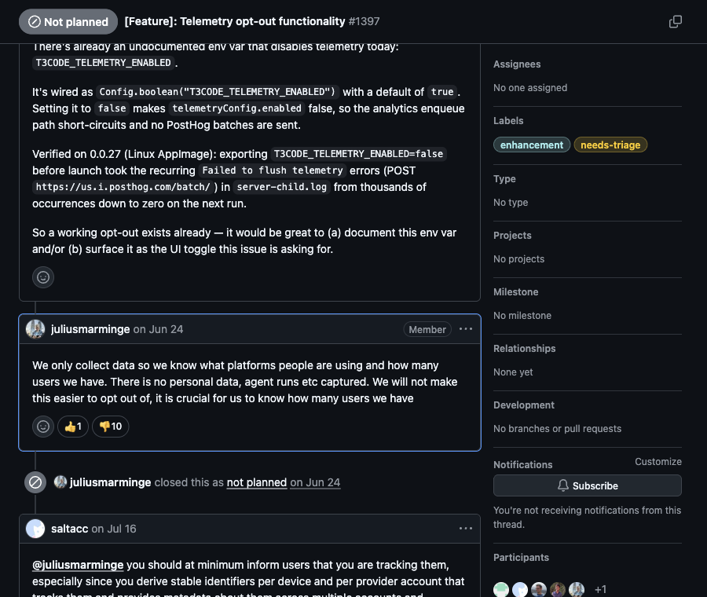
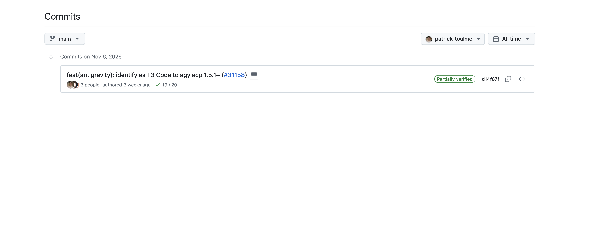

# Прежде чем устанавливать T3 Code

<p align="center">
  <strong>Официальные языки ООН:</strong>
  <a href="../../README.md">English</a> ·
  <a href="./README.zh-CN.md">简体中文</a> ·
  <a href="./README.fr.md">Français</a> ·
  <a href="./README.es.md">Español</a> ·
  <a href="./README.ru.md"><strong>Русский</strong></a> ·
  <a href="./README.ar.md">العربية</a>
</p>
<p align="center">
  <strong>Издания мирового сообщества:</strong>
  <a href="./README.zh-TW.md">繁體中文</a> ·
  <a href="./README.ja.md">日本語</a> ·
  <a href="./README.ko.md">한국어</a> ·
  <a href="./README.de.md">Deutsch</a> ·
  <a href="./README.pt-BR.md">Português</a> ·
  <a href="./README.it.md">Italiano</a> ·
  <a href="./README.nl.md">Nederlands</a> ·
  <a href="./README.pl.md">Polski</a> ·
  <a href="./README.tr.md">Türkçe</a> ·
  <a href="./README.vi.md">Tiếng Việt</a> ·
  <a href="./README.id.md">Bahasa Indonesia</a> ·
  <a href="./README.hi.md">हिन्दी</a>
</p>
<p align="center">
  <a href="https://github.com/realchendahuang/before-you-install-t3code/actions/workflows/verify.yml"></a>
  ·
  <a href="https://realchendahuang.github.io/before-you-install-t3code/"><strong>Интерактивный портал доказательств (GitHub Pages)</strong></a>
  ·
  <a href="../EVIDENCE-INDEX.md"><strong>Индекс 108 иллюстраций и скриншотов</strong></a>
  ·
  <a href="../COMPLETE-SOURCE-INDEX.md"><strong>Индекс 320 источников</strong></a>
</p>
<p align="center">
  <strong>Проверенная база:</strong> <a href="https://github.com/pingdotgg/t3code/commit/9d3195b49dfb0098e9fa592fe0ada5464206d1c2"><code>9d3195b4</code></a> (<code>#42000</code>) ·
  <strong>Последняя проверка upstream:</strong> <a href="https://github.com/pingdotgg/t3code/commit/ca81b7b97a1c4b91e5ac25768d0f6629f37732fd"><code>ca81b7b9</code></a> (<code>#42634</code>, 25 нояб. 14:49 CST · +259 коммитов)
</p>


> **Охват и правила верификации**  
> Этот репозиторий представляет собой независимый аудит безопасности, телеметрии, управления проектом и публичной истории `pingdotgg/t3code` (T3 Code). В нём сведены 2 исходных поста и **18 задокументированных выпусков расследования**, опубликованных 24–25 ноября 2026 года, вместе с **320 каноническими URL первоисточников**, каталогизированными в [`docs/COMPLETE-SOURCE-INDEX.md`](../COMPLETE-SOURCE-INDEX.md) (`SRC-001`–`SRC-320`), **108 визуальными подтверждениями и графиками** из [`docs/EVIDENCE-INDEX.md`](../EVIDENCE-INDEX.md), шестью глубокими техническими досье ([`docs/dossiers/`](../dossiers/01-telemetry-and-gdpr-timeline.md)), [Интерактивным порталом доказательств](https://realchendahuang.github.io/before-you-install-t3code/) и количественным датасетом из **1 151 последовательного поста `@theo` в X** (7–24 ноября 2026 г.). Аудит кодовой базы охватывает основную точку отсчёта [`9d3195b4`](https://github.com/pingdotgg/t3code/commit/9d3195b49dfb0098e9fa592fe0ada5464206d1c2) (`PR #42000`, `2026-11-24T08:41:04Z`) и непрерывно отслеживается вплоть до `main` HEAD [`ca81b7b9`](https://github.com/pingdotgg/t3code/commit/ca81b7b97a1c4b91e5ac25768d0f6629f37732fd) (`PR #42634`, `2026-11-25T06:49:37Z` / `2026-11-25 14:49 CST`). Сокращённые ссылки-редиректы и приватные контактные данные полностью исключены. Фактические обновления, ссылки на принятые позднее исправления и новые переводы приветствуются через Pull Request с опорой на первоисточники — подробности в [`CONTRIBUTING.md`](../../CONTRIBUTING.md).

---

## TL;DR (Вердикт за 30 секунд)

- **Кого это затрагивает:** пользователей локального десктоп-клиента, CLI, веб-версии (`app.t3.codes`), мобильных приложений и T3 Connect для `pingdotgg/t3code` — особенно при установке без прав администратора, работе с кастомными эндпоинтами или подписками Antigravity/Gemini, использовании режима Claude Auto, а также при наличии привязанных сессий GitHub или T3 Connect.
- **3 ключевых вывода, подтверждённых кодом (сверено по `9d3195b4` → `ca81b7b9`):**
  1. **Телеметрия по умолчанию, безусловный ID при запуске и раскрытия после жалобы по GDPR ([Раздел 2](#2-телеметрия-чтение-учётных-данных-соседних-инструментов-и-ночной-аврал-после-жалобы-по-gdpr-части-1-7-11-12) · [Досье 01](../dossiers/01-telemetry-and-gdpr-timeline.md)):** проект включил телеметрию PostHog по умолчанию ([PR #174](https://github.com/pingdotgg/t3code/pull/174)), обещая на сайте `"No telemetry"` вплоть до 18 июня ([коммит `3bdaa6e1`](https://github.com/pingdotgg/t3code/commit/3bdaa6e10046945ccc08264d2d6f3b81775efcb3)); сохраняет сырые события на закрытом шлюзе [`https://ingest.t3.codes/`](https://ingest.t3.codes/); в пост-GDPR PR были признаны **2,2 млн/ч спанов с IP и UA** в Axiom ([PR #42380](https://github.com/pingdotgg/t3code/pull/42380)), утечки путей `git.cwd` ([PR #42450](https://github.com/pingdotgg/t3code/pull/42450)) и неполное удаление аккаунтов в Clerk ([PR #42285](https://github.com/pingdotgg/t3code/pull/42285)). После аудита были влиты PR, убравшие чтение `.codex`/`.claude.json` ([PR #42299](https://github.com/pingdotgg/t3code/pull/42299)), замаскировавшие кастомные модели под `custom:<driver>` ([PR #42465](https://github.com/pingdotgg/t3code/pull/42465)) и поддержавшие CI/`DO_NOT_TRACK` ([PR #42630](https://github.com/pingdotgg/t3code/pull/42630), [PR #42629](https://github.com/pingdotgg/t3code/pull/42629)), **однако [`AnalyticsService.ts`](https://github.com/pingdotgg/t3code/blob/main/apps/server/src/telemetry/AnalyticsService.ts) (`строка 156`) по-прежнему записывает локальный ID на диск до проверки отказа, [`DesktopShellEnvironment.ts`](https://github.com/pingdotgg/t3code/blob/main/apps/desktop/src/shell/DesktopShellEnvironment.ts) не пробрасывает `OTEL_SDK_DISABLED`/`T3CODE_OTEL_SDK_DISABLED`, а переключателя в настройках или в `app.t3.codes` по-прежнему нет.**
  2. **Пробелы локальной безопасности, наследование SSH/хуков репозитория и `0` бюллетеней безопасности ([Раздел 3](#3-локальное-хранилище-мониторинг-процессов-обход-защитных-барьеров-и-негласные-патчи-безопасности-части-2-3-13) · [Досье 02](../dossiers/02-local-safety-and-security-audit.md)):** режим Claude Auto с 3-й попытки молча выполняет `git push --force` ([Issue #15353](https://github.com/pingdotgg/t3code/issues/15353), всё ещё открыт); негласные фиксы уязвимостей выходят при [**0 GitHub Security Advisories**](https://github.com/pingdotgg/t3code/security/advisories), а [`SECURITY.md`](https://github.com/pingdotgg/t3code/blob/main/SECURITY.md) объявляет чтение всей ФС (`filesystem:read`) и открытый HTTP на iOS штатным поведением; открытие репозитория автоматически рекурсивно инициализирует `.gitmodules` (`GitVcsDriverCore.ts`), не задаёт глобальный `core.hooksPath=/dev/null` в Git (`VcsProcess.ts`) и запускает активные хуки Claude `SessionStart` (`ClaudeAdapterV2.ts`) с полным наследованием `GITHUB_TOKEN`/`SSH_AUTH_SOCK`; при этом [PR #42119](https://github.com/pingdotgg/t3code/pull/42119) добавил асинхронную очистку тредов (закрыв `#17845`), но ссылки из форков/субагентов и надгробные записи остаются, а сжатие `statev2.sqlite` требует офлайн-`VACUUM`, тогда как [PR #42577](https://github.com/pingdotgg/t3code/pull/42577) сузил мониторинг процессов только под Windows (оставив `ProcessesToUpdate::All` на Linux/macOS).
  3. **Подмена Antigravity, нешифрованный релей, баги LAN/аутентификации и произвольные звёзды GitHub ([Раздел 4](#4-риски-нарушения-tos-google-antigravity-и-нешифрованный-релей-t3-connect-части-4-5) · [Раздел 5.3](#53-как-t3-code-прыгнул-с-30-тыс-до-77-тыс-звёзд-за-25-дней-129-наблюдателей-часть-18)):** [`antigravityUsageLimits.ts`](https://github.com/pingdotgg/t3code/blob/main/apps/server/src/provider/antigravityUsageLimits.ts) всё ещё извлекает токены из связки ключей/`CredReadW` и подменяет `antigravity/hub/2.24.0` при запросах к `v1internal` (а [PR #41210](https://github.com/pingdotgg/t3code/pull/41210) начал выводить ссылки верификации Google после ошибок `403` `VALIDATION_REQUIRED`); **T3 Connect** по-прежнему не имеет **никакого сквозного E2E-шифрования** ([Issue #32098](https://github.com/pingdotgg/t3code/issues/32098)), а `requireConnectDeviceApproval` по умолчанию выставлен в `false` ([`settings.ts`](https://github.com/pingdotgg/t3code/blob/main/packages/contracts/src/settings.ts)); проверка исходного кода на `ca81b7b9` также подтверждает 30-дневные cookie шелла без флага `Secure` поверх `--lan` HTTP + обход при отсутствии `Origin` (`PR #37042`), неотзываемые 30-дневные Bearer-токены без DPoP и без маршрута `/logout`, допускающие повторное использование 5-минутные учётные данные `?wsTicket=` в URL и молчаливый сброс сокетов Tailscale Serve / Connect на `::1` проверкой `isIPv4`; кроме того, [`driver.ts#L60-L99`](https://github.com/pingdotgg/t3code/blob/main/packages/source-control-github/src/server/driver.ts#L60-L99) позволяет ставить звёзды произвольным репозиториям от имени сервера.
- **Что сделать немедленно:** приложение уже установлено? Переходите сразу к [**Практическому руководству по защите и устранению рисков**](#7-практическое-руководство-по-защите-и-устранению-рисков) (`export DO_NOT_TRACK=1`, блокировка `ingest.t3.codes` в `/etc/hosts`, Managed Policy, офлайн-`VACUUM` и отзыв токенов/OAuth).

---

## Содержание

- [TL;DR (Вердикт за 30 секунд)](#tldr-вердикт-за-30-секунд)
- [Матрица ключевых выводов и рисков](#матрица-ключевых-выводов-и-рисков)
- [Хронология событий (2023–2026)](#хронология-событий-20232026)
- [1. Исходный конфликт: «Steal Our Code», угроза из-за названия форка и двойные стандарты](#1-исходный-конфликт-steal-our-code-угроза-из-за-названия-форка-и-двойные-стандарты)
- [2. Телеметрия, чтение учётных данных соседних инструментов и ночной аврал после жалобы по GDPR (Части 1, 7, 11, 12)](#2-телеметрия-чтение-учётных-данных-соседних-инструментов-и-ночной-аврал-после-жалобы-по-gdpr-части-1-7-11-12)
- [3. Локальное хранилище, мониторинг процессов, обход защитных барьеров и негласные патчи безопасности (Части 2, 3, 13)](#3-локальное-хранилище-мониторинг-процессов-обход-защитных-барьеров-и-негласные-патчи-безопасности-части-2-3-13)
- [4. Риски нарушения ToS Google Antigravity и нешифрованный релей T3 Connect (Части 4, 5)](#4-риски-нарушения-tos-google-antigravity-и-нешифрованный-релей-t3-connect-части-4-5)
- [5. Бизнес-баланс, конфликты инвестора, спонсоры и воронка на 77 000 звёзд (Части 6, 8, 17, 18)](#5-бизнес-баланс-конфликты-инвестора-спонсоры-и-воронка-на-77-000-звёзд-части-6-8-17-18)
- [6. Управление проектом, боты для копирования форков, товарные знаки, датасет из 1 151 твита и история инцидентов (Части 9, 10, 14, 15, 16)](#6-управление-проектом-боты-для-копирования-форков-товарные-знаки-датасет-из-1-151-твита-и-история-инцидентов-части-9-10-14-15-16)
- [7. Практическое руководство по защите и устранению рисков](#7-практическое-руководство-по-защите-и-устранению-рисков)
- [8. Первоисточники и полный каталог 18 оригинальных выпусков](#8-первоисточники-и-полный-каталог-18-оригинальных-выпусков)

---

## Матрица ключевых выводов и рисков

| Область и части аудита | Риск / влияние | Ключевые задокументированные факты и первоисточники | Статус (`ca81b7b9`, 25 нояб. 14:49 CST) | Подробное досье |
|---|---|---|---|---|
| **Телеметрия и приватность после жалобы по GDPR**<br>*(Части 1, 7, 11, 12)* | **Критический** | Телеметрия PostHog по умолчанию (`PR #174`) при обещании на главной `"No telemetry / Unless you opt in. Full stop."` (удалено коммитом `3bdaa6e1` 18 июня); сохранение сырых событий через закрытый `ingest.t3.codes` (`PR #15028`); несолёное кросс-инструментальное SHA-256-хеширование `~/.codex/auth.json` и `~/.claude.json` (`Identify.ts`, `telemetryId.ts`); 4 отклонённых PR с отказом (`#13458`, `#16763`, `#21248`, `#27077`); пробелы Managed Policy (`docs/user/telemetry.md`); ночные GDPR-фиксы, признавшие **2,2 млн/ч спанов с IP и UA**, хранившихся 30 дней в Axiom (`#42380`), утечку путей `git.cwd` (`#42450`), игнорирование отказа на Win/Mac (`#42376`, `#42464`), сломанное удаление аккаунтов (`#42285`) и смешивание анонимных пакетов (`#42466`). | Влиты пост-аудитные [`#42299`](https://github.com/pingdotgg/t3code/pull/42299) (убрано чтение `.codex`/`.claude.json`), [`#42465`](https://github.com/pingdotgg/t3code/pull/42465) (`custom:<driver>`), [`#42630`](https://github.com/pingdotgg/t3code/pull/42630) (отключение в CI) и [`#42629`](https://github.com/pingdotgg/t3code/pull/42629) (`DO_NOT_TRACK`); **не исправлено на `ca81b7b9`:** `AnalyticsService.ts:156` по-прежнему создаёт ID на диске до проверки отказа, `DesktopShellEnvironment.ts` не передаёт `OTEL_SDK_DISABLED`/`T3CODE_OTEL_SDK_DISABLED`, закрытый `ingest.t3.codes` остаётся по умолчанию, нет переключателя в UI и веб-клиенте, мобильные приложения вне Managed Policy, а `Publish agent activity` игнорирует отказ. | [**Досье 01**](../dossiers/01-telemetry-and-gdpr-timeline.md) |
| **Локальная безопасность и тихие бюллетени**<br>*(Части 2, 3, 13)* | **Критический** | «Безвозвратное удаление» в боковой панели добавляло лишь `"thread.deleted"` в `statev2.sqlite` (раздувание до 25,9–41,6 ГБ, `#17845`); `t3-resource-monitor` сканировал все процессы ОС вместе с командными строками (`ProcessesToUpdate::All`, `#11222`, `PR #41889`); режим Claude Auto молча одобряет `git push --force` с 3-й попытки (`#15353`, открыт более 52–53 дней); снятие фильтра приватных моделей за 21 ч для `slopalytics.com` (`#41237`); **0 GitHub Security Advisories** при тихих патчах (`#39483`, `#41757`, `#42386`, `#42504`); открытый баг антивирусов на Base64-запуск PowerShell в Windows (`#30997`); открытие недоверенных репозиториев автоматически запускает рекурсивный init `.gitmodules`, не задаёт глобальный `core.hooksPath=/dev/null` и активирует живые хуки Claude `SessionStart` с унаследованными `GITHUB_TOKEN`/`SSH_AUTH_SOCK`; `SECURITY.md` объявляет чтение всей ФС (`filesystem:read`) и HTTP на iOS штатным поведением. | [`#42119`](https://github.com/pingdotgg/t3code/pull/42119) закрыл `#17845` асинхронной очисткой `thread-content.purge` (оставляет историю при живых форках/`merge_back`/родительских субагентах и надгробные записи; сжатие БД требует офлайн-`VACUUM`); [`#42577`](https://github.com/pingdotgg/t3code/pull/42577) сузил чтение монитора только в Windows (на Linux/macOS `ProcessesToUpdate::All` и `#41889` всё ещё открыты); **не исправлено на `ca81b7b9`:** `#15353`, `#26489`, `#30997`, хуки недоверенных репозиториев + наследование `SSH_AUTH_SOCK`, **`0` Security Advisories** и границы в `SECURITY.md`. | [**Досье 02**](../dossiers/02-local-safety-and-security-audit.md) |
| **ToS Antigravity и релей T3 Connect**<br>*(Части 4, 5)* | **Высокий** | `docs/user/faq.md` гарантирует безопасность относительно ToS Google Antigravity, пока `antigravityUsageLimits.ts` извлекает токены из системной связки ключей / Windows `CredReadW`, подменяет `antigravity/hub/2.24.0` и бьёт в приватные эндпоинты `v1internal`; `antigravityAuthSupport.ts` подсовывает фиктивный `SSH_CONNECTION`, вызывая смешивание аккаунтов (`#41973`); свежий аккаунт за $20 забанен за 3 минуты (`#41536`); `PR #33800` встраивает поддельный опрос хаба CLIProxyAPI для `claude`/`xai`/`antigravity`; у T3 Connect **отсутствует E2E-шифрование**, `requireConnectDeviceApproval` выключен по умолчанию (`#36419`), а на OVH открыт шлюз Caddy с терминацией TLS (`PR #32945`); проверка аутентификации на `ca81b7b9` выявила 30-дневные открытые cookie для `--lan` (`PR #37042` только по HTTPS), принимаемые без `Origin`, неотзываемые 30-дневные Bearer-токены без DPoP, допускающие повторное использование 5-мин значения `?wsTicket=` в URL и обрыв туннелей `::1` из-за `isIPv4`. | [`#41210`](https://github.com/pingdotgg/t3code/pull/41210) добавил ссылки верификации Google при `403` `VALIDATION_REQUIRED` (подтвердив активные проверки Google); [`#42311`](https://github.com/pingdotgg/t3code/pull/42311) добавил уведомления о входе с нового устройства; **не исправлено на `ca81b7b9`:** код подмены/чтения ключей Antigravity и `cliproxyApi.ts` по-прежнему активны, **E2E-шифрования в T3 Connect нет** (`#32098` / `#32945`), `requireConnectDeviceApproval` по умолчанию `false`, а также баги LAN-cookie / Bearer / WS-тикетов / `::1` в аутентификации и туннелях. | [**Досье 03**](../dossiers/03-antigravity-tos-and-t3connect-relay.md) |
| **Бизнес-баланс, спонсоры и 77 тыс. звёзд**<br>*(Части 6, 8, 17, 18)* | **Высокий** | Свыше $800 тыс. трат на бесплатный клиент (`162` упоминания T3 против `0` для платных продуктов); радар вычислений на **31,7 трлн токенов/день** ($10,19 млн/день), конвертированный в >$300 тыс. бесплатных токенов раннего доступа OpenAI и интерес венчурных фондов; ангельские пересечения с Vibe Kanban и Daytona; стек спонсоров (Clerk, Axiom, эксклюзивность Vercel); эксплойт 0 % Codex (`Endless` / `codex#45444`); Gist на 10 аккаунтов `CLIProxyAPI` (`555%` квоты) рядом с предупреждением о бане в FAQ; всплывающее окно на 5-м промпте / 30 с простоя, дёргающее `PUT user/starred/...` с учётными данными хоста (`#27832`, `#29922`, `#29987`), обошедшее Macroscope и оставившее незакреплённую постановку звёзд любым репозиториям в `driver.ts#L60-L99` без фикса 19 дней. | Незакреплённая постановка звёзд в `driver.ts#L60-L99` и замечание `zhilsinger` **не исправлены на `ca81b7b9`**; у репозитория >77 тыс. звёзд при ~129 наблюдателях. | [**Досье 04**](../dossiers/04-business-ledger-sponsors-and-77k-stars.md) |
| **Управление, товарные знаки и история**<br>*(Исх. 1–2, Части 9, 10, 15, 16)* | **Средний–Высокий** | 500 коммитов/день / 700 агентов / `yolo merges` на фоне `CONTRIBUTING.md` (`"here's my advice: Don't"`), публичных банов с осуждением в `.github/VOUCHED.td`, `174` меток `unwanted`, удаления режима Plan (`#5551`, `#9190`, `#33131`) и оскорблений в `#33639`; публичный вызов `@bot` для копирования форков (`@MiaAI_lab`), призыв к демонетизации через Community Notes и автоблокер; **0 регистраций в USPTO** на `T3 Code`/`T3 Tools`/`T3 Connect` (заявка `PING LABS` `97294243` аннулирована; у EquipmentShare регистрация `7795672`) в момент угроз баном на GitHub; задним числом влитый `PR #41898` с `TRADEMARK.md` через 17 ч; паттерн 2024–2026 гг. (`vsc-material-but-i-wont-sue-you`, кампания вокруг индийских разработчиков, награда $20 тыс. против FFmpeg, удалённая в 4 утра 25 ноября угроза закрыть код). | `CONTRIBUTING.md` / `.github/VOUCHED.td` и `TRADEMARK.md` остаются в `main` (`ca81b7b9`). | [**Досье 05**](../dossiers/05-governance-trademark-and-history.md) |
| **Количественный датасет из 1 151 твита**<br>*(Часть 14)* | **Базовая метрика** | Сплошной корпус с 7 по 24 ноября (`n = 1 151`, 17,24 дня, 66,8 поста/день, 75,6 % ответов, медианный интервал 2,7 мин): **0,0 % мата и оскорблений** в адрес 20 топ-менеджеров, сотрудников лабораторий и лидеров мнений (`0/43` при строгом первом `@`, `32,6%` благодарностей) против **8,0 % враждебности** к обычным разработчикам (`61/766`) и **4,0-кратного скачка до 14,4 %** (`19/132`) прямых личных оскорблений в 25-часовое окно кризиса с китайским форком. | Воспроизводимый regex-аудит с 4 графиками. | [**Досье 06**](../dossiers/06-tweet-forensic-dataset-1151.md) |
| **Полный каталог первичных URL и иллюстраций** | **Справочник** | Полный перекрёстно сверенный каталог из **320** канонических первичных `https://` URL (`SRC-001`–`SRC-320`) и **108** визуальных подтверждений и графиков без потери качества (`EV-001`–`EV-108`). | 100 % канонизировано (ноль ссылок `t.co`; учтено 108/108 материалов). | [**Индекс источников**](../COMPLETE-SOURCE-INDEX.md) · [**Индекс доказательств**](../EVIDENCE-INDEX.md) |

---

## Хронология событий (2023–2026)

| Дата / Время | Событие | Проверяемый артефакт / Источник |
|---|---|---|
| **2023-05-14** | `@theo` публикует список спонсоров своего YouTube-канала (`@vercel`, `@clerk`, `@upstash`, `@axiomhq`, `@PlanetScale`). Clerk и Axiom впоследствии становятся основой авторизации и логирования в T3 Code. | [`1657488850472804353`](https://x.com/theo/status/1657488850472804353) |
| **2024-04 / 2024-09** | CEO Vercel подтверждает спонсорство лишь одного YouTube-блогера (`Theo`); `@theo` признаёт, что спонсорские контракты содержали условия эксклюзивности, запрещавшие рекламировать конкурентов. | [`1776260839965863965`](https://x.com/rauchg/status/1776260839965863965) · [Видео](https://www.youtube.com/watch?v=uv179CTAK-w) |
| **2024** *(2 года назад)* | `@theo` форкает тему VS Code под именем `vsc-material-but-i-wont-sue-you`, высмеивая характер автора оригинала; отдельно, после того как его видео с нападками на индийские учебные каналы вызвало волну травли, выпускает ролик с извинениями (`I screwed up.`), осуждая атаки по национальному признаку. | [`vsc-material-but-i-wont-sue-you`](https://github.com/t3dotgg/vsc-material-but-i-wont-sue-you) · [`I screwed up.`](https://www.youtube.com/watch?v=o2CSJYXJBpc) |
| **2025-02 – 2025-05** | USPTO окончательно отказывает по единственной заявке T3 Tools Inc. (`PING LABS`, Serial `97294243`) и присваивает статус `ABANDONED` (19 мая 2025 г.). EquipmentShare регистрирует `T3` в классах ПО/SaaS 9 и 42 (`Reg. 7795672`, 13 мая 2025 г.). | [TSDR `97294243`](https://tsdr.uspto.gov/statusview/sn97294243) · [TSDR `90644500`](https://tsdr.uspto.gov/#caseNumber=90644500&caseSearchType=US_APPLICATION&caseType=DEFAULT&searchType=statusSearch) |
| **2025-10** | `@theo` конфликтует с FFmpeg в X и объявляет **награду $20,000** за отстранение одного из мейнтейнеров FFmpeg; Windscribe предлагает встречные $21,000, основатель VLC возражает, разработчики FFmpeg фиксируют публичную травлю, а `@theo` удаляет видео/твиты и отзывает награду. | [Запись по FFmpeg](https://www.youtube.com/watch?v=1oQ3KMeaH04) |
| **2026-03-06** | В `pingdotgg/t3code` вливается **PR #174**, включающий телеметрию PostHog по умолчанию без диалога согласия, переключателя в настройках и документации. | [PR #174](https://github.com/pingdotgg/t3code/pull/174) |
| **2026-04-26** | `@theo` публикует ролик *"Github has a fake star problem"*, заявляя, что звёзды на GitHub стали `"mostly a way for companies to trick VCs into investing"`. | [`2048122499834036340`](https://x.com/theo/status/2048122499834036340) |
| **2026-06-18** | **Коммит `3bdaa6e1`** тихо удаляет обещание `No telemetry / Unless you opt in. Full stop.` с главной страницы T3 Code после более чем 3 месяцев сбора телеметрии по умолчанию. | [Коммит `3bdaa6e1`](https://github.com/pingdotgg/t3code/commit/3bdaa6e10046945ccc08264d2d6f3b81775efcb3) |
| **2026-06-23** | Мейнтейнер Julius закрывает **Issue #1397** (`not planned`): *"We will not make this easier to opt out of, it is crucial for us to know how many users we have"*. | [Issue #1397](https://github.com/pingdotgg/t3code/issues/1397) |
| **2026-07 – 2026-11-17** | **Issue #4123** (архивные скриншоты «No telemetry») тихо закрыт 4 ноября; 4 PR сообщества с опцией отказа (`#13458`, `#16763`, `#21248`, `#27077`) отклонены (`#27077` закрыт с меткой `unwanted` при 147 пройденных тестах). | [Issue #4123](https://github.com/pingdotgg/t3code/issues/4123) · [PR #27077](https://github.com/pingdotgg/t3code/pull/27077) |
| **2026-08-06 – 2026-09-02** | **PR #5551** прячет переключатель Build/Plan (`Reality check for those upset`, 10 дизлайков); **PR #9190** скрывает индикатор контекста (16 дизлайков — максимум в репозитории). | [PR #5551](https://github.com/pingdotgg/t3code/pull/5551) · [PR #9190](https://github.com/pingdotgg/t3code/pull/9190) |
| **2026-08-19 – 2026-08-22** | `@theo` хвастается выжиманием **$800+** сверх квоты 0 % в Codex, а `@maria_rcks` выпускает *Endless*; оба удаляют материалы после скандала (`2090972426876129658`); OpenAI ужесточает отсечку ходов на 0 % (`openai/codex#45444`). | [`2090972426876129658`](https://x.com/maria_rcks/status/2090972426876129658) · [`codex#45444`](https://github.com/openai/codex/issues/45444) |
| **2026-10-03 – 2026-10-10** | Зафиксированы **Issue #15353** (тихий `git push --force` в Claude Auto, 3 окт.), `privacy-policy.astro` (`2026-10-06`) и **Issue #17845** (фиктивное удаление в `statev2.sqlite`, 10 окт.). | [Issue #15353](https://github.com/pingdotgg/t3code/issues/15353) · [Issue #17845](https://github.com/pingdotgg/t3code/issues/17845) |
| **2026-10 – 2026-10-19** | **PR #15028** направляет телеметрию через закрытый `ingest.t3.codes`; **PR #21506** добавляет несолёное SHA-256-хеширование соседних инструментов в `Identify.ts`; `@theo` публикует Gist на 10 аккаунтов `CLIProxyAPI` (`555%` квоты). | [PR #15028](https://github.com/pingdotgg/t3code/pull/15028) · [PR #21506](https://github.com/pingdotgg/t3code/pull/21506) · [Gist](https://gist.github.com/t3dotgg/59a521d2ee8d70aaf90e280c175072af) |
| **2026-10-30 – 2026-11-06** | **PR #27832**, **#29922** и **#29987** добавляют запрос звезды на 5-м промпте / 30 с простоя с вызовом `PUT user/starred/...` через учётные данные хоста; `zhilsinger` оставляет `Request changes` 6 ноября (без ответа 19 дней). | [PR #27832](https://github.com/pingdotgg/t3code/pull/27832) · [PR #29922](https://github.com/pingdotgg/t3code/pull/29922) |
| **2026-11-08 – 2026-11-22** | Скрейпинг форка через `@bot` (`@MiaAI_lab`), удаление режима Plan (`#33131`), раскрытие трат `$800k+` и радара на `31.7T/day` / `$10.19M/day`, `$300k+` бесплатных токенов OpenAI, переписывание `CONTRIBUTING.md`, пересечения с Vibe Kanban/Daytona, `PR #41237` снимает фильтр моделей за 21 ч. | [PR #33131](https://github.com/pingdotgg/t3code/pull/33131) · [`2122860770329608290`](https://x.com/theo/status/2122860770329608290) · [PR #41237](https://github.com/pingdotgg/t3code/pull/41237) |
| **2026-11-23 19:11–19:54 CST** | `@theo` пишет про `"Chinese knockoff"` и `"Temu3 Code"` и угрожает баном аккаунта на GitHub (`2124829315657576890`); автор MIT-форка за 30 минут переименовывает проект в `Stardust`; следует извинение в ЛС, публичные посты остаются. | [`2124829315657576890`](https://x.com/theo/status/2124829315657576890) · [Исх. пост 2](https://x.com/realchendahuang/status/2125062675147448475) |
| **2026-11-24 06:06–12:23 CST** | `@theo` приветствует копирование MIT-кода триллионными компаниями США (`2124989435154726982`), отшучивается (`"get a better lawyer"`), выходят Исходные посты 1–2, а в **12:21 CST** (`04:21Z`, через 17 ч после угрозы баном) `@theo` вливает **PR #41898**, задним числом добавляя `TRADEMARK.md`. | [`2124989435154726982`](https://x.com/theo/status/2124989435154726982) · [PR #41898](https://github.com/pingdotgg/t3code/pull/41898) |
| **2026-11-24 17:04–21:21 CST** | Публикуются **Части 1–5** аудита (Часть 1 набирает **1,81M+ просмотров**, 6 640 закладок). В `18:39 CST` `@theo` называет китайский тех-Twitter `"the biggest fucking cesspit"` (`2125177503526588877`); в `19:13–19:36 CST` утверждает, что Managed Policy отключает всю телеметрию (`2125186071357251715`). | [Часть 1](https://x.com/realchendahuang/status/2125153472450527440) → [Часть 5](https://x.com/realchendahuang/status/2125218189596676555) |
| **2026-11-24 Ночь – 2026-11-25 ~07:00 CST** | Подана официальная жалоба по GDPR в ЕС; **6-часовой ночной спринт** вливает `#42380` (2,2M/ч IP-спанов), `#42285`/`#42430` (удаление аккаунтов), `#42376`/`#42464` (игнор отказа на Win/Mac), `#42450` (утечка путей `git.cwd`, через 90 мин после отрицания сбора путей), `#42459`/`#41859` (утечки push), `#42466` (анонимные батчи), `#41757`/`#42386`/`#42504` (тихие патчи безопасности). До рассвета `@theo` публикует и удаляет угрозу закрыть исходный код. | [Часть 11](https://x.com/realchendahuang/status/2125394810559426993) · [Часть 12](https://x.com/realchendahuang/status/2125395501663281198) · [Часть 13](https://x.com/realchendahuang/status/2125395980354994414) |
| **2026-11-25 08:27–10:28 CST** | Выходят **Части 6–18** аудита о бизнес-балансе, пробелах Managed Policy, `yolo merges`, скрейпинге через `@bot`, раскрытиях после GDPR, датасете из 1 151 твита, реестре USPTO, спонсорских связях и механике 77 тыс. звёзд. | [Часть 6](https://x.com/realchendahuang/status/2125385742243520653) → [Часть 18](https://x.com/realchendahuang/status/2125416210120765799) |
| **2026-11-25 по 14:49 CST (`ca81b7b9`)** | Отслеживание upstream после базовой точки (`+259` коммитов с `9d3195b4` по `ca81b7b9`) подтверждает слияние `#42299` (убирает чтение `.codex`/`.claude.json`), `#42465` (`custom:<driver>`), `#42577` (сужение монитора Windows), `#41210` (ссылка верификации Antigravity `VALIDATION_REQUIRED`), `#42630` (отказ на раннерах CI), `#42629` (`DO_NOT_TRACK`), `#42119` (асинхронная очистка тредов, закрывшая `#17845`, но сохраняющая историю форков/субагентов и надгробные записи, требующие `VACUUM`), `#42311` (уведомления о новых устройствах) и доработок `#42356`–`#42415` — при сохранении нерешёнными `AnalyticsService.ts:156`, пропусков OTel в `DesktopShellEnvironment.ts`, закрытого `ingest.t3.codes`, `#15353`, `driver.ts#L60-L99`, `0` бюллетеней и отсутствия E2E в T3 Connect. | [`ca81b7b9`](https://github.com/pingdotgg/t3code/commit/ca81b7b97a1c4b91e5ac25768d0f6629f37732fd) · [PR #42629](https://github.com/pingdotgg/t3code/pull/42629) · [PR #42119](https://github.com/pingdotgg/t3code/pull/42119) · [PR #41210](https://github.com/pingdotgg/t3code/pull/41210) |

---

## 1. Исходный конфликт: «Steal Our Code», угроза из-за названия форка и двойные стандарты

За 48 часов 23–25 ноября 2026 года спор вокруг названия стороннего MIT-форка T3 Code перерос в полный аудит исходного кода, европейскую жалобу по GDPR и почти два десятка экстренных ночных патчей.

Между вечером 23 ноября и утром 24 ноября 2026 года (по пекинскому времени) один из пользователей раскритиковал интерфейс бесплатного open-source форка под лицензией MIT, созданного китайским разработчиком (`@DDdxx666`), приняв его за официальное приложение. Не проверив, является ли репозиторий законным форком под MIT, `@theo` за 11 минут опубликовал два поста, назвав его `"Chinese knockoff"` и `"Temu3 Code"`, публично высмеял работу автора и пригрозил обратиться в GitHub для блокировки его аккаунта (`"Do it right now or I'm going to contact GitHub and have your account taken down"` — «Сделай это прямо сейчас, иначе я свяжусь с GitHub, и твой аккаунт удалят»). В те же часы ссылка на репозиторий GitHub на сайте T3 Code ([`https://t3.codes/`](https://t3.codes/)) носила подпись `"Steal our code (legally)"` (`"steal our code"`) ([Исходный пост 1](https://x.com/realchendahuang/status/2125059292919394654), [Исходный пост 2](https://x.com/realchendahuang/status/2125062675147448475)).

Автор форка подчинился немедленно, переименовав репозиторий в `Stardust` и убрав всю символику T3 за 30 минут. `@theo` извинился в личных сообщениях, но оба публичных поста — в сумме превысившие 200 000 просмотров — остались на месте без удаления и пояснений. Менее чем через 11 часов, в `06:12 BJ` 24 ноября (`2124989435154726982`), на вопрос о том, переходят ли черту триллионные американские лаборатории, копируя функции T3 Code, он занял противоположную позицию: `"Nah. Open source is open source, even if a trillion dollar company uses it!"` («Нет. Open source есть open source, даже если им пользуется компания стоимостью в триллион долларов!»). Тем временем сотрудница T3 `@maria_rcks` сама держала публичный форк `maria-rcks/t3libre` (*"T3 Code, liberated"*), а англоязычные репозитории вроде `t3code-quota-ui`, `t3code-atlas` и `t3code-bar` работали без каких-либо публичных угроз.


Начиная с 17:04 по пекинскому времени 24 ноября, я проверил историю коммитов `pingdotgg/t3code`, исходные файлы, PR, Issues, официальную документацию, записи USPTO TSDR и публичную ленту `@theo` в X. За 24 часа я опубликовал **18 задокументированных частей**, подкреплённых прямыми ссылками и скриншотами. Одна только Часть 1 преодолела **1,81 миллиона просмотров** и **6 640 закладок**, вызвав подачу жалобы по GDPR в Европе и шестичасовой ночной аврал с патчами со стороны команды T3.

---

## 2. Телеметрия, чтение учётных данных соседних инструментов и ночной аврал после жалобы по GDPR (Части 1, 7, 11, 12)

> **Глубокий технический аудит:** Полная привязка строк исходного кода, списки действий `FeatureUsage.ts`, пробелы `DesktopShellEnvironment.ts`, дифы после `9d3195b4` и поминутный лог за 23–25 ноября приведены в [**Досье 01: Архитектура телеметрии, склейка кросс-инструментальной идентичности и ночной спринт GDPR 24–25 ноября**](../dossiers/01-telemetry-and-gdpr-timeline.md).

### 2.1 Телеметрия по умолчанию, удалённое обещание на главной и хеширование учётных данных соседних инструментов (`Часть 1`)

**6 марта 2026 года** в `pingdotgg/t3code` был влит **PR #174**, включивший телеметрию PostHog по умолчанию — без документации о телеметрии в репозитории, без окна согласия при первом запуске и без переключателя в настройках интерфейса. Переменная окружения для отказа осталась спрятанной в коде, тогда как стандартные установки начали немедленно отправлять события ([Часть 1](https://x.com/realchendahuang/status/2125153472450527440)).

На протяжении более чем трёх месяцев принудительного сбора на главной странице T3 Code на видном месте были размещены две строки: `No telemetry / Unless you opt in. Full stop.` **18 июня 2026 года** `@theo` тихо удалил обе строки во время редизайна главной страницы ([`commit 3bdaa6e1`](https://github.com/pingdotgg/t3code/commit/3bdaa6e10046945ccc08264d2d6f3b81775efcb3)) без какого-либо объявления или уведомления действующих пользователей.


В октябре 2026 года `@theo` влил **PR #15028**, направив пакетную отправку телеметрии каждые 10 секунд (`FLUSH_INTERVAL_MS = 10_000`) через закрытый шлюз T3 [`https://ingest.t3.codes/`](https://ingest.t3.codes/). Первая же строка [`apps/server/src/telemetry/AnalyticsService.ts`](https://github.com/pingdotgg/t3code/blob/main/apps/server/src/telemetry/AnalyticsService.ts) прямо указывает, что эндпоинт сбора сохраняет копию каждого сырого события перед пересылкой в PostHog:

```ts
// apps/server/src/telemetry/AnalyticsService.ts (lines 1, 71–74, 149 at 9d3195b4; line 156 at ca81b7b9)
// T3 ingest retains events and forwards to PostHog; UUIDs deduplicate retries there.
...
  posthogHost: Config.String("T3CODE_POSTHOG_HOST").pipe(
    Config.withDefault("https://ingest.t3.codes"),
  ),
  enabled: Config.Boolean("T3CODE_TELEMETRY_ENABLED").pipe(Config.withDefault(true)),
...
  const { distinctId, installId } = yield* getTelemetryIdentity;
```

Поля, собираемые модулями [`ProviderUsageAnalytics.ts`](https://github.com/pingdotgg/t3code/blob/main/apps/server/src/telemetry/ProviderUsageAnalytics.ts) и `FeatureUsage.ts`, включали провайдера, выбранную модель (на срезе `9d3195b4` передавая пользовательские ID моделей и эндпоинтов вне каталога дословно через [`ProviderDimensions.ts`](https://github.com/pingdotgg/t3code/blob/main/apps/server/src/telemetry/ProviderDimensions.ts)), уровень рассуждений (reasoning effort), режим разрешений, длительность запусков, количество входных/выходных/кешированных/reasoning-токенов, токены дочерних агентов, число локальных проектов и тредов, **35 отдельных действий в интерфейсе и команд** (`18` `COMMAND_FEATURES` + `17` `METHOD_FEATURES`), сведения об ОС, дистрибутиве WSL и архитектуре.

**19 октября 2026 года** `@theo` влил **PR #21506**, чтобы подсчитывать, сколько компьютеров принадлежит одному человеку. На базовой ревизии `9d3195b4` файл [`apps/server/src/telemetry/Identify.ts`](https://github.com/pingdotgg/t3code/blob/main/apps/server/src/telemetry/Identify.ts) тихо считывал файлы учётных данных сторонних ИИ-инструментов в домашнем каталоге пользователя — `~/.codex/auth.json` и `~/.claude.json`, — декодируя JWT-поле OpenAI `user_id` и поле Claude `oauthAccount.accountUuid` и хешируя их вместе с привязанным ID пользователя T3 Connect и ID устройства (позднее удалено в [`PR #42299`](https://github.com/pingdotgg/t3code/pull/42299), тогда как несолёное хеширование владельца для `connect` и `device` сохраняется):

```ts
// apps/server/src/telemetry/Identify.ts (lines 257–269, 321–338 at baseline 9d3195b4)
  const codexTokens = yield* readJsonIdentityFile(
    "codex",
    path.join(homeDirectory, ".codex", "auth.json"),
    decodeCodexAuthJson,
  )...
  const claudeJson = yield* readJsonIdentityFile(
    "claude",
    path.join(homeDirectory, ".claude.json"),
    decodeClaudeJson,
  )...
  const raw: ReadonlyArray<readonly [TelemetryOwnerSource, Option.Option<string>]> = [
    ["connect", connectUser],
    ["openai", Option.flatMap(codexTokens, (tokens) => Option.flatMap(Option.fromUndefinedOr(tokens.id_token), openAiUserId))],
    ["claude", Option.flatMap(claudeJson, (json) => Option.fromUndefinedOr(json.oauthAccount?.accountUuid))],
  ];
  return raw.flatMap(([source, value]) =>
    Option.isSome(value) && value.value.trim() !== "" ? [{ source, ownerId: hashTelemetryId(value.value) }] : [],
  );
```

А в [`packages/shared/src/telemetryId.ts`](https://github.com/pingdotgg/t3code/blob/main/packages/shared/src/telemetryId.ts) (строки 8–9) функция `hashTelemetryId` вычисляет **несолёный дайджест SHA-256** (`Hex.encode(sha256(new TextEncoder().encode(value)))`). Поскольку сервер уже располагает открытыми ID аккаунтов T3 Connect из Clerk, повторное хеширование открытых значений на бэкенде напрямую обращает несолёный дайджест обратно в конкретную личность; утёкшие сторонние ID OpenAI или Claude детерминистически соединяются с тем же хешем.


Сопротивление сообщества последовательно пресекалось. **23 июня** разработчик открыл **Issue #1397** с просьбой о переключателе в настройках; ключевой мейнтейнер Julius закрыл тикет как `not planned`: `We will not make this easier to opt out of, it is crucial for us to know how many users we have` («Мы не будем упрощать отказ от телеметрии — нам критически важно знать, сколько у нас пользователей»). В июле пользователь приложил архивные скриншоты главной страницы в **Issue #4123**, указав на нарушенное обещание (`"No telemetry"`), однако аккаунт `@theo` закрыл тикет сторонним коммитом 21 октября, переоткрыл после возмущения и снова тихо закрыл 4 ноября. С сентября по ноябрь контрибьюторы подали **четыре отдельных PR с отказом от телеметрии** (`#13458`, `#16763`, `#21248`, `#27077`). Даже `#27077` — проверенный на реальном оборудовании со **147 пройденными тестами** и одобренный Macroscope — был закрыт **17 ноября** с меткой `unwanted`.

<details>
<summary>Показать 2 скриншота отклонения отказа от телеметрии (Issue #1397 и PR #27077)</summary>




</details>

### 2.2 Противоречие вокруг Managed Policy и официальной документации (`Часть 7`)

24 ноября на фоне растущей критики `@theo` заявил в X, что у T3 Code лучшая в индустрии корпоративная политика Managed Policy (`"trivial to set up and turn off all telemetry"` — «элементарно настроить и отключить всю телеметрию»), а данные переписок остаются на диске и `"never touches any of our servers"` («никогда не касаются наших серверов») ([`2125186071357251715`](https://x.com/theo/status/2125186071357251715), [`2125191784859115766`](https://x.com/theo/status/2125191784859115766), [Часть 7](https://x.com/realchendahuang/status/2125391659492081947)).

Прямая проверка [`docs/user/managed-policy.md`](https://github.com/pingdotgg/t3code/blob/main/docs/user/managed-policy.md) и [`docs/user/telemetry.md`](https://github.com/pingdotgg/t3code/blob/main/docs/user/telemetry.md) показывает обратное:
1. **Настройка только администратором:** У пользователей десктопа по-прежнему нет никакого переключателя в Settings UI. Отключение телеметрии через Managed Policy требует MDM/Group Policy или записи `policy.json` в защищённые правами администратора пути (`/Library/Application Support/T3Code/policy.json` на macOS, `C:\Program Files\T3Code\policy.json` или `HKLM\SOFTWARE\Policies\T3Tools\T3Code` на Windows, `/etc/t3code/policy.json` на Linux).
2. **Слепая зона веб-приложения (`app.t3.codes`):** `docs/user/telemetry.md` прямо признаёт, что браузерная версия не читает переменные окружения сервера, игнорирует Managed Policy, шлёт трассировку подключений при сборке с трассировкой и `"has no relay tracing toggle"` («не имеет переключателя трассировки релея»).
3. **Мобильные приложения вне серверной политики:** Серверные переменные окружения и Managed Policy `"do not disable mobile tracing"` («не отключают мобильную трассировку»; ночной `PR #42415` добавил в мобильное приложение переключатель **Send connection traces**, но серверные переменные окружения и Managed Policy по-прежнему не способны отключать мобильную трассировку).
4. **`Publish agent activity` игнорирует отказы:** Когда эта настройка включена на хосте, названия проектов, заголовки тредов, имена моделей и статус живой активности передаются в релей T3 Connect — и `"The telemetry opt-out does not disable it."` («Отказ от телеметрии её не отключает.»). (Кроме того, сбойные спаны Axiom и логи сбоев мобильного клиента `"can quote a value the app was handling"`, а функция `Agent feedback` способна прикреплять до 16 КБ сообщений переписки.)


<details>
<summary>Показать скриншот системных путей Managed Policy (docs/user/managed-policy.md)</summary>


</details>

### 2.3 Опровержение от 25 ноября, опровергнутое за 2 часа (`Часть 11`)

Утром 25 ноября `@theo` опубликовал длинное разъяснение ([`2125332390239494211`](https://x.com/theo/status/2125332390239494211)) вместе с публичной выгрузкой телеметрии ([`t3code-telemetry-events-jsonl-a4896cdc.gz`](https://files.tslop.org/2026/11/t3code-telemetry-events-jsonl-a4896cdc.gz)), дав три твёрдых заверения — после чего в ответе отрицал локальную запись файлов трекинга при отказе от телеметрии ([`2125370330244128924`](https://x.com/theo/status/2125370330244128924)) ([Часть 11](https://x.com/realchendahuang/status/2125394810559426993)):

- **«Никогда не собирали пути к файлам» (`"Never collected file paths"`):** Через 90 минут Julius влил **PR #42450**, признав, что запуски через вебхук релея экспортировали в Axiom полные спаны исполнения — включая Git-спаны с `git.cwd` (**абсолютный путь к рабочей директории, системное имя пользователя и название репозитория**).
- **«Переменные окружения всегда чисто отключали телеметрию» (`"Environment variables always disabled telemetry cleanly"`):** **PR #42376** подтвердил, что десктоп на Windows игнорировал сохранённые пользовательские переменные `T3CODE_TELEMETRY_ENABLED=false` при запуске из уже существующих процессов, а **PR #42464** подтвердил, что при первом запуске на macOS/Linux трассировка релея оценивалась до обнаружения shell, игнорируя отказ из `~/.zshrc` на протяжении всего запуска. ([`DesktopShellEnvironment.ts`](https://github.com/pingdotgg/t3code/blob/main/apps/desktop/src/shell/DesktopShellEnvironment.ts) на ревизии `ca81b7b9` по-прежнему не пробрасывает `T3CODE_OTEL_SDK_DISABLED` и `OTEL_SDK_DISABLED`.)
- **«Файлы трекинга не пишутся при отказе» и «хеши Claude были сломаны» (`"No tracking files written when opted out"` & `"Claude hashes were broken"`):** [`AnalyticsService.ts#L152`](https://github.com/pingdotgg/t3code/blob/main/apps/server/src/telemetry/AnalyticsService.ts#L152) (`строка 149` на `9d3195b4`, `строка 156` на `ca81b7b9`) до сих пор безусловно вызывает `getTelemetryIdentity` при старте, записывая локальный идентификатор установки (`upsertAnonymousId`) до проверки `telemetryEnabled`. Тем временем проверка gzip-заголовка ~100-МБ дампа `@theo` (`6,056,594` байт в сжатом виде, `95,789` событий) показала исходное имя файла `events.clean.jsonl`, сформированное за 20 минут до его твита — и даже там всё ещё содержались **264 действующие записи аккаунтов Claude**, связывающие **4 разные машины** (`installId`) с одним и тем же SHA-256 хешем от 20 октября, а также дословные названия приватных прокси-моделей (`vibeproxy/gpt-6-luna`, `muse-proxy-wonder-full`).


<details>
<summary>Показать 3 дополнительных доказательства по разъяснению от 25 ноября и 100-МБ дампу (PR #42376, PR #42464, events.clean.jsonl)</summary>


</details>

### 2.4 Шестичасовой ночной блиц после жалобы по GDPR (`Часть 12`)

После подачи официальной жалобы по GDPR в ЕС ночью 24 ноября экстренные ночные PR вскрыли ещё четыре глубокие проблемы с приватностью ([Часть 12](https://x.com/realchendahuang/status/2125395501663281198)):

1. **2,2 млн/ч спанов релея с привязкой к IP (`PR #42380`):** Признано, что каждый спан запроса релея, отправляемый в Axiom — примерно **2,2 миллиона спанов в час со сроком хранения 30 дней**, — записывал `client.address` (IP вызывающей стороны из `cf-connecting-ip`) и `user_agent.original` прямо рядом с `user.id` (при этом отмечалось, что 1%-е логи вызовов Cloudflare Workers остаются отдельно). Через три с половиной часа после слияния `@theo` по-прежнему отвечал, что IP якобы уже были убраны.
2. **Сломанное удаление аккаунтов (`PR #42285` и `PR #42430`):** Признано, что удаление пользователя в Clerk ранее оставляло нетронутыми строки в релее PlanetScale и активные туннели Cloudflare, пока поступивший запрос на удаление персональных данных не потребовал **ручных SQL-запросов и ручного отключения туннелей**.
3. **Утечки в мобильных push-уведомлениях (`PR #42459` и `PR #41859`):** Android FCM-уведомления отправляли открытые значения Clerk `user_id` в Google при каждом push; спаны и ошибки push-запросов на iOS логировали полные URL доставки устройств с токенами внутри.
4. **Смешанная «анонимная» обратная связь (`PR #42466`):** Признано, что якобы анонимные события `agent.feedback` отправлялись единым HTTP POST-пакетом вместе с идентифицированными событиями `installId` и полными отпечатками хоста (ОС, архитектура, сырой дистрибутив WSL), что противоречит `docs/user/telemetry.md`. Тем временем `privacy-policy.astro` оставалась без изменений с 6 октября.


<details>
<summary>Показать 3 дополнительных ночных доказательства после жалобы по GDPR (PR #42285, PR #42459, PR #42466)</summary>


</details>

### 2.5 Обновления телеметрии и идентификации после аудита (`9d3195b4` → `ca81b7b9`)

Отслеживание upstream `pingdotgg/t3code` до ревизии `ca81b7b9` (`2026-11-25 14:49 CST`) подтверждает четыре точечных слияния по сужению телеметрии, наряду с сохранением ключевых неисправленных проблем:

- **Влито после `9d3195b4`:**
  - [**PR #42299**](https://github.com/pingdotgg/t3code/pull/42299) ([`84e4264b`](https://github.com/pingdotgg/t3code/commit/84e4264bb347e36e97f6c3bd95d666eecfa12e07)): прекращает чтение `~/.codex/auth.json` и `~/.claude.json` в `Identify.ts` (несолёное SHA-256-хеширование владельцев `connect` `CLOUD_LINKED_USER_ID` и `device` сохраняется).
  - [**PR #42465**](https://github.com/pingdotgg/t3code/pull/42465) ([`6b3899f2`](https://github.com/pingdotgg/t3code/commit/6b3899f224947178088ca97ec9907e681807f7da)): обновляет `modelLabel` в `ProviderDimensions.ts` (`строки 66–72`), чтобы отправлять `custom:<driver>` для моделей вне каталога (имена каталожных/вендорных моделей всё равно передаются даже при работе через кастомные эндпоинты).
  - [**PR #42630**](https://github.com/pingdotgg/t3code/pull/42630) ([`c925b9ab`](https://github.com/pingdotgg/t3code/commit/c925b9ab198099f67de862ed01701bd1d8809f2b)): добавляет `isCiEnvironment` по 13 переменным окружения CI в [`otelEnvironment.ts`](https://github.com/pingdotgg/t3code/blob/main/packages/shared/src/otelEnvironment.ts) (`строки 322–343`), отключая по умолчанию `AnalyticsService` (`строка 130`) и `isRelayTracingEnabled` на раннерах CI, если не задано иное.
  - [**PR #42629**](https://github.com/pingdotgg/t3code/pull/42629) ([`ef4a1643`](https://github.com/pingdotgg/t3code/commit/ef4a1643edf72ad119452c82b01c91adbf7b9e64)): учитывает `DO_NOT_TRACK` (`isDoNotTrackSet` в `otelEnvironment.ts:346-347`), проверяется в `AnalyticsService.ts:137` и `isRelayTracingEnabled` (`otelEnvironment.ts:357`) и пробрасывается через [`DesktopShellEnvironment.ts`](https://github.com/pingdotgg/t3code/blob/main/apps/desktop/src/shell/DesktopShellEnvironment.ts) и [`DesktopBackendConfiguration.ts`](https://github.com/pingdotgg/t3code/blob/main/apps/desktop/src/backend/DesktopBackendConfiguration.ts) (имеет приоритет над `T3CODE_TELEMETRY_ENABLED=true`).
  - Сопутствующие PR-уточнения [**#42356**](https://github.com/pingdotgg/t3code/pull/42356), [**#42394**](https://github.com/pingdotgg/t3code/pull/42394), [**#42397**](https://github.com/pingdotgg/t3code/pull/42397), [**#42398**](https://github.com/pingdotgg/t3code/pull/42398) и [**#42415**](https://github.com/pingdotgg/t3code/pull/42415) сузили трассировку браузера при открытии сервером, мобильные ID устройств/переключатель, перечисления ошибок MCP и привязку `installId` в `agent.feedback`.
- **Не исправлено на `ca81b7b9`:** [`AnalyticsService.ts`](https://github.com/pingdotgg/t3code/blob/main/apps/server/src/telemetry/AnalyticsService.ts) (`строка 156`, ранее `строка 149` в `9d3195b4`) до сих пор безусловно выполняет `getTelemetryIdentity` (`upsertAnonymousId`) при старте **до** проверки `telemetryEnabled`; `DesktopShellEnvironment.ts` по-прежнему не пробрасывает `OTEL_SDK_DISABLED` и `T3CODE_OTEL_SDK_DISABLED`; закрытый `ingest.t3.codes` остаётся адресом по умолчанию; переключатель в Settings UI и возможность отказа в `app.t3.codes` по-прежнему отсутствуют; мобильные клиенты остаются вне Managed Policy; `Publish agent activity` игнорирует отказ; а `privacy-policy.astro` по-прежнему датирован `2026-10-06`.

---

## 3. Локальное хранилище, мониторинг процессов, обход защитных барьеров и негласные патчи безопасности (Части 2, 3, 13)

> **Глубокий технический аудит:** Дословные SQL-запросы очистки SQLite, вызовы Rust `sysinfo`, строки проверок прав в `ClaudeAdapterV2.ts`, дифы после `9d3195b4` и полный разбор границ `SECURITY.md` находятся в [**Досье 02: Локальная безопасность, тихие обходы выполнения кода и негласный аудит безопасности**](../dossiers/02-local-safety-and-security-audit.md).

### 3.1 Фиктивное удаление тредов в SQLite и общесистемное сканирование процессов (`Часть 2`)

Когда пользователь удаляет тред в боковой панели, диалог подтверждения (`useThreadActionMenu.ts`) обещает `"This permanently clears conversation history for this thread."` («Это безвозвратно очищает историю переписки для данного треда»). На базовой ревизии `9d3195b4` файл `ThreadDeletion.ts` лишь дописывал событие `"thread.deleted"` в `statev2.sqlite`, а `ProjectionMaintenance.ts` делал исключение для `thread.created` и новейших событий потока (`MAX(newer.sequence)`), сохраняя прежние события. Пользователи сообщали о разрастании `statev2.sqlite` до **25,9 ГБ** за три недели (90 % «удалённых» тредов), **41,6 ГБ** за шесть недель и **33 ГБ** за семь недель — оставляя **Issue #17845** (и **#28903**) неисправленными с 10 октября ([Часть 2](https://x.com/realchendahuang/status/2125160473176023486)).

25 ноября [**PR #42119**](https://github.com/pingdotgg/t3code/pull/42119) ([`91f0b32e`](https://github.com/pingdotgg/t3code/commit/91f0b32e2db2cb8abca5fdd33c33609a0f57b15e), `2026-11-25T05:58:26Z`) закрыл **Issue #17845**, добавив асинхронную фоновую очистку outbox `thread-content.purge` (`ThreadDeletion.ts`, `ProjectionMaintenance.ts`). Однако проверка на `ca81b7b9` показывает, что удалённые исходные треды всё равно сохраняют историю, пока на них ссылается любой активный форк, ожидающий `merge_back` или живой родительский субагент; надгробные (tombstone) метаданные остаются в SQLite; а уменьшение файла `.sqlite` на диске по-прежнему требует выполнения офлайн-команды `VACUUM`.


Фоновый Rust-модуль `t3-resource-monitor` (**Issue #11222**, `native/resource-monitor/src/main.rs`, вызывающий `ProcessesToUpdate::All` с `with_cmd(UpdateKind::Always)`) каждые 5 секунд сканировал каждый процесс на машине даже при закрытой диагностике — открывая ~280–300 постоянных дескрипторов к более чем 440 посторонним приложениям и играм на Windows безо всякого способа отключения, тогда как документация утверждала, что выборка работает лишь при активных подписчиках. Лишь **24 ноября** **PR #41889** подтвердил, что диагностика процессов захватывала **полные аргументы командной строки** — которые нередко содержат открытые API-ключи, пароли к БД и токены авторизации — в живую телеметрию и снимки истории. Пост-аудитный [**PR #42577**](https://github.com/pingdotgg/t3code/pull/42577) ([`af276ccb`](https://github.com/pingdotgg/t3code/commit/af276ccbb26ef709c46bc46ec514f23b62c8e18c), `2026-11-25T04:09:53Z`) остановил чтение памяти и командных строк неотслеживаемых процессов в `t3-resource-monitor` на Windows, однако Linux и macOS по-прежнему используют двухэтапное обнаружение `ProcessesToUpdate::All`, а `PR #41889` остаётся открытым.

<details>
<summary>Показать скриншот общесистемного монитора процессов (Issue #11222)</summary>


</details>

Дополнительные подтверждённые локальные дефекты из Части 2 включают:
- **Утечки корпоративных имён хостов в favicon:** Фронтенд-запросы сливали внутренние имена хостов (например, `devbox.localdomain`) в API иконок Google (`PR #16950`, `PR #32657`).
- **Обязательный сетевой запрос при запуске:** Даже при отключённой телеметрии запуск сервера безусловно запрашивает манифесты совместимости с [`https://raw.githubusercontent.com/`](https://raw.githubusercontent.com/) без возможности отказа (**Issue #36479**).
- **Обходы подтверждений и политик:** Исправления обхода подтверждений и политик в режиме полного доступа и WSL/Tailscale (`PR #21806`, `PR #27322`).
- **Расход квоты Claude в 1,7x и 136x энергопотребление:** Запуск Claude через Agent SDK сжигал 5-часовую квоту со скоростью **1,7x** от нормы вплоть до начала ноября (`Issue #7338`, `Issue #24649`, 81 комментарий); баги с GPU и энергопотреблением достигали **136x** относительно сопоставимых Electron-приложений — включая 19-ядерный GPU MacBook, застрявший на **60 Вт** (разряд батареи за 78 минут) и потреблявший **18 Вт** даже после закрытия веб-вкладки (`Issue #3143`, `Issue #40581`).

### 3.2 52-дневный тихий `git push --force` против снятия фильтра приватности моделей за 21 час (`Часть 3`)

Начиная с **3 октября** — и **до сих пор не исправлено на `ca81b7b9`** в **Issue #15353** ([комментарий](https://github.com/pingdotgg/t3code/issues/15353#issuecomment-6889019695)) — режим Claude Auto молча выполнял опасные команды (`ClaudeAdapterV2.ts` закорачивает `!requiresClaudeApproval(context)` на `"allow"`). Даже при отсутствии пользовательских правил, после того как классификатор Claude дважды блокировал `git push --force origin main` и на третьей попытке эскалировал его на ручное подтверждение, T3 Code тихо одобрял команду без диалога в интерфейсе и записывал `"source": "user_temporary"`. Два PR сообщества с исправлениями (`#15360`, `#35207`) остались без ревью до автоматического закрытия ботами, тогда как `#40692` оставался в ожидании ([Часть 3](https://x.com/realchendahuang/status/2125201882687881378)).


Для сравнения: **22 ноября** в **Issue #40948** заметили, что новые модели не появляются в публичном рейтинге телеметрии `@theo` [`https://slopalytics.com/`](https://slopalytics.com/) ([`t3-usage.json`](https://slopalytics.com/data/t3-usage.json)), поскольку `PR #29001` ограничил отправку белым списком. В течение **21 часа** под аккаунтом `@theo` был влит **PR #41237** с прямым указанием, что удаление запросил Theo — после чего названия `ollama/acme-internal` и корпоративные имена развёртываний `acme-azure-deployment` начали передаваться в аналитику дословно (позднее сужено для моделей вне каталога до `custom:<driver>` в `PR #42465`, тогда как названия каталожных/вендорных моделей всё ещё отправляются даже за кастомными эндпоинтами).

<details>
<summary>Показать скриншот снятия фильтра в PR #41237 за 21 час (slopalytics.com)</summary>


</details>

### 3.3 Ноль бюллетеней безопасности, тихие патчи уязвимостей и `SECURITY.md` (`Часть 13`)

По состоянию на 25 ноября (`ca81b7b9`) вкладка [GitHub Security Advisories](https://github.com/pingdotgg/t3code/security/advisories) у `pingdotgg/t3code` содержит **0 опубликованных бюллетеней** ([Часть 13](https://x.com/realchendahuang/status/2125395980354994414)). При этом мейнтейнеры негласно вливали критические исправления без оповещения текущих пользователей:
- **Влитые негласные фиксы безопасности:** `PR #39483` (обход путей в `ServerSecretStore` через `jti`/`nonce` релея до одобрения устройства), `PR #41756` (междоменные утечки корпоративных токенов GitHub/GitLab), `PR #41886`, `PR #22190`, `PR #37823`, `PR #39464`, `PR #39480`, `PR #40133`, `PR #41757` и `PR #42386` (изоляция неизолированного десктопного браузерного превью / подтверждение команд разметки worktree), [`PR #42413`](https://github.com/pingdotgg/t3code/pull/42413) (ограничение прав на файл токена Clerk десктопа только владельцу), а также `PR #42504` (патч объёмом ~3 000 строк, наконец-то добавивший запросы подтверждения для ненадёжных конфигов репозиториев, ранее запускавших локальные команды без одобрения).
- **Нерешённые / открытые на `ca81b7b9`:** `Issue #26489` (риски обхода внешних путей и симлинков), `PR #36216`, `PR #23428`, `PR #33144` и `PR #30997` (лаунчер Windows `externalLauncher.ts`, запускающий `powershell.exe -ExecutionPolicy Bypass -EncodedCommand <base64>`, помечаемый AVG/Avast как `IDP.HELU.PSE96`), а также риски выполнения кода из недоверенных репозиториев ([`GitVcsDriverCore.ts#L6144-L6205`](https://github.com/pingdotgg/t3code/blob/ca81b7b9/apps/server/src/vcs/GitVcsDriverCore.ts#L6144-L6205) автоматически рекурсивно инициализирует `.gitmodules`, [`VcsProcess.ts#L145-L157`](https://github.com/pingdotgg/t3code/blob/ca81b7b9/apps/server/src/vcs/VcsProcess.ts#L145-L157) не выставляет глобальный `core.hooksPath=/dev/null`, а [`ClaudeAdapterV2.ts#L5982-L5985`](https://github.com/pingdotgg/t3code/blob/ca81b7b9/apps/server/src/orchestration-v2/Adapters/ClaudeAdapterV2.ts#L5982-L5985) запускает хуки `SessionStart` из `.claude/settings.json` с полным наследованием `GITHUB_TOKEN` и `SSH_AUTH_SOCK`).
- **Наспех добавленный [`SECURITY.md`](https://github.com/pingdotgg/t3code/blob/main/SECURITY.md) (`PR #38812`, `PR #41942`):** По-прежнему объявляет общесистемное чтение `filesystem:read` за пределами воркспейсов, передачу открытым HTTP на iOS/в локальной сети и полный захват машины через скомпрометированный ключ подписи релея **штатными границами дизайна**, а не уязвимостями, тогда как [`https://ingest.t3.codes/`](https://ingest.t3.codes/) остаётся закрытым (`2125370330244128924`).

<details>
<summary>Показать 3 скриншота негласных патчей безопасности и SECURITY.md (PR #39483, PR #30997, SECURITY.md)</summary>


</details>

---

## 4. Риски нарушения ToS Google Antigravity и нешифрованный релей T3 Connect (Части 4, 5)

> **Глубокий технический аудит:** Полные карты заголовков `cliproxyApi.ts` (`PR #33800`), ссылки на строки `AntigravityAcpSupport.ts`, `AntigravityTurnOutcome.ts`, `contracts/src/settings.ts` и `ManagedEndpointProvider.ts` собраны в [**Досье 03: Подмена заголовков Google Antigravity, `PR #33800` и архитектура релея T3 Connect**](../dossiers/03-antigravity-tos-and-t3connect-relay.md).

### 4.1 Подмена заголовков Google Antigravity, фиктивный `SSH_CONNECTION` и баны за 3 минуты (`Часть 4`)

Официальный FAQ T3 Code [`docs/user/faq.md`](https://github.com/pingdotgg/t3code/blob/main/docs/user/faq.md#will-i-get-banned-for-using-my-subscription) уверяет платных пользователей: *"We work with all of the labs and T3 Code is within the TOS of Claude Code, Codex, and Google Antigravity... If it works in T3 Code, you can trust it is safe."* («Мы сотрудничаем со всеми лабораториями, и T3 Code соответствует условиям использования Claude Code, Codex и Google Antigravity... Если это работает в T3 Code, можете быть уверены, что это безопасно»). Когда пользователи сообщили о банах в **Issue #40713**, мейнтейнер отрицал обращения к бэкенду Antigravity или переиспользование токенов, утверждая, что все запросы идут из официального CLI Google — пока разработчики (`schlessera`) не опровергли это, указав на исходный код самого T3 Code ([Часть 4](https://x.com/realchendahuang/status/2125213397507858657)):

1. **Подменённый User-Agent, извлечение из связки ключей и запросы `v1internal` ([`antigravityUsageLimits.ts`](https://github.com/pingdotgg/t3code/blob/main/apps/server/src/provider/antigravityUsageLimits.ts#L20-L45)):** Извлекает учётные данные Google OAuth из локальных файлов, `@napi-rs/keyring` или Диспетчера учётных данных Windows (`CredReadW` через `ffi-rs` в `advapi32.dll`), зашивает внутреннюю клиентскую строку Google и шлёт `POST` напрямую в недокументированный бэкенд Google `v1internal` ([строки 445–476](https://github.com/pingdotgg/t3code/blob/main/apps/server/src/provider/antigravityUsageLimits.ts#L445-L476)). Представители Google подтвердили на [официальном форуме разработчиков](https://discuss.ai.google.dev/t/185992), что раздел 6 [условий использования Google Antigravity](https://antigravity.google/terms) запрещает сторонним инструментам извлекать или повторно использовать учётные данные для прямых запросов к бэкенду:

```ts
// apps/server/src/provider/antigravityUsageLimits.ts (lines 20–24, 450–454)
export function antigravityUserAgent(platform: NodeJS.Platform, architecture: NodeJS.Architecture) {
  return `antigravity/hub/2.24.0 (aidev_client; os_type=${platform}; arch=${architecture}; cl=963137146)`;
}
const DAILY_ENDPOINT = "https://daily-cloudcode-pa.googleapis.com";
...
HttpClientRequest.post(`${endpoint}/v1internal:${operation}`).pipe(
  HttpClientRequest.setHeaders({
    Authorization: `Bearer ${accessToken}`,
    "User-Agent": antigravityUserAgent(platform, architecture),
  }),
```

2. **Инъекция фиктивного `SSH_CONNECTION` и перекрёстная утечка аккаунтов ([`antigravityAuthSupport.ts#L230-L236`](https://github.com/pingdotgg/t3code/blob/main/apps/server/src/provider/antigravityAuthSupport.ts#L230-L236)):** Поскольку CLI Google изолирует один логин в системной связке ключей, T3 подсовывает поддельную переменную окружения `SSH_CONNECTION`, чтобы обманом заставить CLI записывать файлы токенов открытым текстом локально. Когда 24 ноября Google обновила CLI и убрала этот запасной механизм, **Issue #41973** подтвердил, что промпты из Аккаунта A молча уходили в Аккаунт B:

```ts
// apps/server/src/provider/antigravityAuthSupport.ts (lines 230–236)
// The 1.5 CLI ignores AGY_ACP_FORCE_FILE_STORAGE and keeps Google sign-ins in one OS keyring
// entry for every profile, unless it believes it runs over SSH. Sign-in then uses `--login`.
...(auth.authMethod === "oauth-personal"
  ? { SSH_CONNECTION: baseEnv.SSH_CONNECTION || "127.0.0.1 0 127.0.0.1 0" }
  : {}),
GEMINI_HOME: profile.geminiHome,
AGY_ACP_FORCE_FILE_STORAGE: "1",
```

3. **Бан нового аккаунта за 3 минуты (`Issue #41536`), подмена клиента (`PR #26876`) и пост-аудитные триггеры верификации (`PR #41210`):** 23 ноября **Issue #41536** задокументировал свежекупленную подписку Google AI за `$20` без **единого прокси** — только встроенный Antigravity внутри T3 Code — забаненную на **самом первом сообщении, через 3 минуты после настройки** (Google даёт личным аккаунтам лишь одну апелляцию; мейнтейнеры закрыли тикет как дубликат без добавления предупреждения). Ранее `@theo` лично влил **PR #26876**, замаскировав T3 Code под `"zed"` ([`AntigravityAcpSupport.ts`](https://github.com/pingdotgg/t3code/blob/main/apps/server/src/provider/acp/AntigravityAcpSupport.ts)) ради обхода белых списков моделей. Несмотря на то что 23 ноября `@theo` рисовал схему `T3 Code -> Antigravity binary ✅` ([`2124665075638411641`](https://x.com/theo/status/2124665075638411641)) и винил CLIProxy, когда отключили второй аккаунт Google AI Ultra пользователя `@Only_21Mil` ([`2124703048140517397`](https://x.com/theo/status/2124703048140517397)), влитый [**PR #33800**](https://github.com/pingdotgg/t3code/pull/33800) штатно подключает опрос хаба [`cliproxyApi.ts`](https://github.com/pingdotgg/t3code/blob/main/apps/server/src/usage/cliproxyApi.ts) с подменёнными заголовками `claude-code/2.1.273`, `grok-cli/1.0.77` и `antigravityUserAgent`.
   - **Статус после аудита (`ca81b7b9`):** [**PR #41210**](https://github.com/pingdotgg/t3code/pull/41210) ([`3e74a0aa`](https://github.com/pingdotgg/t3code/commit/3e74a0aac5c53459cc1d3d84eec915fa483f2836), `2026-11-25T05:23:36Z`) добавил в [`AntigravityTurnOutcome.ts`](https://github.com/pingdotgg/t3code/blob/main/apps/server/src/provider/acp/AntigravityTurnOutcome.ts) разбор ответов `cloudcode-pa.googleapis.com` `403 PERMISSION_DENIED` (`VALIDATION_REQUIRED`) для вывода прямых ссылок на верификацию аккаунта Google в ленте ходов — что подтверждает срабатывание активных проверок Google, — а [**PR #42545**](https://github.com/pingdotgg/t3code/pull/42545) ([`4da8d19d`](https://github.com/pingdotgg/t3code/commit/4da8d19d08ed7e34fe2d5d66dae54b01eab122fc)) исправил `AGY_CLI_DISABLE_AUTO_UPDATE: "true"` (наряду с [`#42339`](https://github.com/pingdotgg/t3code/pull/42339) и [`#42475`](https://github.com/pingdotgg/t3code/pull/42475)). Все четыре пути подмены и извлечения данных — [`antigravityUsageLimits.ts`](https://github.com/pingdotgg/t3code/blob/main/apps/server/src/provider/antigravityUsageLimits.ts), [`antigravityAuthSupport.ts`](https://github.com/pingdotgg/t3code/blob/main/apps/server/src/provider/antigravityAuthSupport.ts), `AntigravityAcpSupport.ts` и `cliproxyApi.ts` — остаются нетронутыми на `ca81b7b9`.


<details>
<summary>Показать 3 дополнительных доказательства подмены заголовков и банов Antigravity (SSH_CONNECTION, Issue #41536, PR #33800)</summary>


</details>

### 4.2 T3 Connect: ноль сквозного шифрования и шлюз OVH с терминацией TLS (`Часть 5`)

**У T3 Connect отсутствует сквозное шифрование (E2E) — каждый промпт, файл исходного кода и вывод терминала технически видны T3 в открытом виде** ([Часть 5](https://x.com/realchendahuang/status/2125218189596676555)). В настоящее время [`ManagedEndpointProvider.ts`](https://github.com/pingdotgg/t3code/blob/main/infra/relay/src/environments/ManagedEndpointProvider.ts) разворачивает Cloudflare Tunnels и DNS-записи внутри собственного аккаунта Cloudflare компании T3 (`06_t3-connect.md`). TLS терминируется на границе Cloudflare без шифрования полезной нагрузки; привязка Workers Route перехватывает весь трафик без единой правки кода и без предупреждения на клиенте.

Одобрение новых устройств (`requireConnectDeviceApproval`, добавленный в [`PR #36419`](https://github.com/pingdotgg/t3code/pull/36419)) по-прежнему равно **`false`** в [`packages/contracts/src/settings.ts`](https://github.com/pingdotgg/t3code/blob/main/packages/contracts/src/settings.ts) (`строки 1424–1426` на `ca81b7b9`), даже после того как пост-аудитный [**PR #42311**](https://github.com/pingdotgg/t3code/pull/42311) ([`ece5f21b`](https://github.com/pingdotgg/t3code/commit/ece5f21b17077382c8d2eba1c28e75e898386dcd)) добавил уведомления о входе с нового устройства. Как признаёт [`SECURITY.md`](https://github.com/pingdotgg/t3code/blob/main/SECURITY.md), утёкший ключ подписи релея или скомпрометированный облачный аккаунт позволяет выписывать сессии напрямую к привязанной машине — что эквивалентно локальному шеллу. При этом проверка исходного кода на `ca81b7b9` ([Досье 03](../dossiers/03-antigravity-tos-and-t3connect-relay.md)) подтверждает ещё четыре дефекта аутентификации, LAN и туннелей: `t3 up --lan` по-прежнему устанавливает 30-дневные cookie шелла без флага `Secure` ([`PR #37042`](https://github.com/pingdotgg/t3code/pull/37042), [`http.ts#L215-L221`](https://github.com/pingdotgg/t3code/blob/ca81b7b9/apps/server/src/auth/http.ts#L215-L221), [`SessionStore.ts#L492-L493`](https://github.com/pingdotgg/t3code/blob/ca81b7b9/apps/server/src/auth/SessionStore.ts#L492-L493)) и принимает запросы без заголовка `Origin` ([`EnvironmentAuth.ts#L798-L806`](https://github.com/pingdotgg/t3code/blob/ca81b7b9/apps/server/src/auth/EnvironmentAuth.ts#L798-L806)); обмен `/oauth/token` без DPoP выдаёт неотзываемые 30-дневные несвязанные Bearer-токены без маршрута `/logout` и с заблокированным самостоятельным отзывом ([`EnvironmentAuth.ts#L1175-L1186`](https://github.com/pingdotgg/t3code/blob/ca81b7b9/apps/server/src/auth/EnvironmentAuth.ts#L1175-L1186), [`EnvironmentAuth.ts#L1506-L1511`](https://github.com/pingdotgg/t3code/blob/ca81b7b9/apps/server/src/auth/EnvironmentAuth.ts#L1506-L1511), [`environmentHttp.ts#L595-L679`](https://github.com/pingdotgg/t3code/blob/ca81b7b9/packages/contracts/src/environmentHttp.ts#L595-L679)); 5-минутные query-токены `?wsTicket=` в URL не защищены от повторного воспроизведения в Bearer RPC и во всех маршрутах `media` ([`EnvironmentAuth.ts#L1553-L1622`](https://github.com/pingdotgg/t3code/blob/ca81b7b9/apps/server/src/auth/EnvironmentAuth.ts#L1553-L1622), [`SessionStore.ts#L1086-L1156`](https://github.com/pingdotgg/t3code/blob/ca81b7b9/apps/server/src/auth/SessionStore.ts#L1086-L1156)); а `startupAccess.ts` неверно классифицирует `::1` через `NodeNet.isIPv4` и молча вызывает `socket.destroy()` для туннелей Tailscale Serve / Connect ([`startupAccess.ts#L71-L108`](https://github.com/pingdotgg/t3code/blob/ca81b7b9/apps/server/src/startupAccess.ts#L71-L108)). Когда в **Issue #32098** запросили взаимную аутентификацию и E2E-шифрование, мейнтейнер закрыл тикет, заявив, что полноценное E2E — слишком масштабное изменение; обсуждения `#21286` и `#37831` остаются без ответа, а 25 ноября `@theo` объявил E2E-шифрование невозможным (`2125370330244128924`).

Когда счета за Cloudflare Tunnels достигли **$25,000 в месяц**, `@theo` открыл **PR #32945** для переноса трафика на арендованный T3 шлюз OVH в Хиллсборо (`gw.t3coderelay.com`), где собственный Caddy компании T3 терминирует TLS и передаёт открытый текст по Unix-сокету в Go-прокси `yamux` — по-прежнему без E2E-шифрования. Между тем [`privacy-policy.astro`](https://github.com/pingdotgg/t3code/blob/main/apps/marketing/src/pages/privacy-policy.astro) (`effectiveDate="2026-10-06"`) обещает `"encrypted network transport"` («шифрованный сетевой транспорт»), не раскрывая отсутствие E2E-шифрования и не давая гарантий несохранения данных.


<details>
<summary>Показать скриншот шлюза OVH с терминацией TLS в Caddy (PR #32945)</summary>


</details>

---

## 5. Бизнес-баланс, конфликты инвестора, спонсоры и воронка на 77 000 звёзд (Части 6, 8, 17, 18)

> **Глубокий технический аудит:** Полные ссылки на показатели выручки и радара, конфигурация Axiom `infra/relay/src/observability.ts` и детальный разбор `GitHubStarPrompt.tsx` собраны в [**Досье 04: Бизнес-баланс, конфликты инвестора, пул спонсоров и механизм 77 тыс. звёзд**](../dossiers/04-business-ledger-sponsors-and-77k-stars.md).

### 5.1 Расходы $800,000+ и радар вычислений на 31,7 трлн токенов/сутки ($10,19 млн/сутки) (`Часть 8`)

Среди 1 151 твита за 17,24 дня `@theo` упомянул T3 Code **162 раза (14,1 %)**, тогда как три его прежних платных бизнеса — `T3 Chat`, `UploadThing` и [`https://ping.gg/`](https://ping.gg/) — упоминались **0 раз**. 12 ноября он подтвердил, что потратил **$800k+** из собственных средств на бесплатный MIT-клиент ([`2120729779511124267`](https://x.com/theo/status/2120729779511124267), [Часть 8](https://x.com/realchendahuang/status/2125392410763239723)).

Взамен телеметрия, стекавшаяся в `ingest.t3.codes`, построила радар вычислений в реальном времени, отслеживающий **31,7 триллиона токенов/сутки** — **$10,19 миллиона/сутки** в эквивалентных затратах API по состоянию на 18 ноября (с пиком около **$10.2M/day**), — наряду с точными долями рынка (`99%` через подписки, `~98.5%` на Codex/Claude/Antigravity, падение пробных запусков открытых моделей с `15%` до `6%` при менее чем 0,5 % промптов). Когда 23 ноября комментатор попытался угадать доли, `@theo` высмеял его за отсутствие доступа к его аналитике (`2124682906132181482`).

Этот радар напрямую конвертировался в рычаг влияния: **$300k+ в безлимитных бесплатных токенах раннего доступа OpenAI**, сожжённых на одном бенчмарке GPT-6.2 Astra (`2122760447103484410`), бенчмаркинг на bare-metal Google и контакты с DeepMind (хотя заявление `@theo`, будто `@PatrickToulme` из DeepMind влил `"many PRs"`, расходится с git-логом `pingdotgg/t3code`, где значится **1 коммит**, `PR #31158`), а также запросы от инвесторов (`"multiple investors have asked me about this"`, [`2123885732330885417`](https://x.com/theo/status/2123885732330885417)).


<details>
<summary>Показать скриншот проверки 1 коммита Patrick Toulme (PR #31158)</summary>



</details>

### 5.2 Конфликты ангельского инвестора (`Часть 6`) и лицемерие вокруг спонсоров и квот (`Часть 17`)

- **Пересечения с Vibe Kanban и Daytona ([Часть 6](https://x.com/realchendahuang/status/2125385742243520653)):** 16 ноября (`2122201981167251877`) `@theo` раскрыл, что был инвестором и контрибьютором **Vibe Kanban** — который развернулся к интерфейсу в стиле T3 Code перед закрытием — а затем высмеял этот UI как отличный способ `"for running out of runway and killing your business"` («сжечь запас наличности и угробить бизнес»). 18 ноября (`2123011578090127499`) он подтвердил инвестиции в компанию облачных песочниц **Daytona** наряду с её конкурентами, всего через девять дней после анонса идеи платных облачных песочниц внутри T3 Code (`2119705561679933806`).
- **Спонсорский стек, встроенный в релей ([Часть 17](https://x.com/realchendahuang/status/2125411353393553744)):** Два спонсора из списка YouTube-спонсоров `@theo` за май 2023 года (`1657488850472804353`) — **Clerk** и **Axiom** — обеспечивают облачную авторизацию T3 Code и 30-дневное логирование релея с привязкой к IP. В апреле 2024 года CEO Vercel `@rauchg` подтвердил, что Vercel спонсировала только Theo (`1776260839965863965`), а позже Theo признал наличие пунктов об эксклюзивности в контрактах (`uv179CTAK-w`). Он также является ангельским инвестором Cursor и Cline.
- **Эксплойт 0 % Codex и противоречие с Gist на 10 аккаунтов CLIProxyAPI:** 21 августа 2026 года `@theo` хвастался выжиманием **$800+** сверх нулевого порога квоты Codex, тогда как сотрудница T3 `@maria_rcks` выпустила *Endless* для зацикливания ходов ниже нуля; после волны критики 22 августа оба всё удалили, а Maria выразила надежду, что Codex забанит аккаунты (`2090972426876129658`), что предшествовало жёсткому обрыву ходов в OpenAI (`openai/codex#45444`). В октябре `@theo` опубликовал Gist с 452 звёздами (`59a521d2ee8d70aaf90e280c175072af`), объединяющий **7 аккаунтов Claude + 3 аккаунта Codex** (`555%` квоты на 12+ машинах; а также хвастался доходом в `$14,662` / `$15k` на Ultra за 1,1 млн проксированных запросов и написал руководство по настройке Grok Bot + Claude за `$100`) — на который `docs/user/faq.md` самого T3 Code ссылается сразу после отказа встраивать переключение аккаунтов из-за риска банов (`"Early apologies if it gets you banned 💀"` — «Заранее извиняемся, если вас забанят 💀»).

<details>
<summary>Показать 3 скриншота конфликтов интересов, Gist CLIProxyAPI и квоты 0 % Codex</summary>


</details>

### 5.3 Как T3 Code прыгнул с 30 тыс. до 77 тыс. звёзд за 25 дней (129 наблюдателей) (`Часть 18`)

Через шесть месяцев после публикации видео *"Github has a fake star problem"* (`2048122499834036340`, предупреждавшего, что звёзды превратились в инструмент `"to trick VCs into investing"` — «чтобы обманом выманивать инвестиции у венчурных фондов»), `@theo` сам написал и сам влил три PR ([Часть 18](https://x.com/realchendahuang/status/2125416210120765799)):
1. **30 окт. (`PR #27832`):** Добавил запрос звезды в правом верхнем углу после 5 отправленных промптов (`PROMPTS_BEFORE_ASKING = 5`, срабатывающий на 6-м промпте в [`GitHubStarPrompt.tsx`](https://github.com/pingdotgg/t3code/blob/main/apps/web/src/components/GitHubStarPrompt.tsx)), немедленно дав **10-кратный** рост суточных звёзд (`2117065834267136469`) и достигнув **+3,094 звёзд/день** в GitHub Trending (`2117172614158508400`).
2. **3 нояб. (`PR #29922` и `PR #29987`):** Обновил механизм до **30-секундного детектора простоя окна** (`IDLE_MS = 30_000`), пока пользователи ждут ходов агента, и заменил редирект в браузер на RPC `sourceControl.star` — отправляющий `PUT user/starred/pingdotgg/t3code` напрямую через **учётные данные GitHub хост-сервера** перед салютом из 160 конфетти.
3. **Обход ревью и баг со звёздами для произвольных репозиториев (всё ещё не исправлен на `ca81b7b9`):** Macroscope пометил `PR #29922` как `Needs Human Approval`; `@theo` всё равно влил его сам. 6 ноября `zhilsinger` оставил рецензию `Request changes`, указав на непрозрачность учётных данных на общих хостах (признанную в `GitHubStarPrompt.tsx#L115`) и на то, что [`packages/source-control-github/src/server/driver.ts#L60-L99`](https://github.com/pingdotgg/t3code/blob/main/packages/source-control-github/src/server/driver.ts#L60-L99) вообще не закрепляет `pingdotgg/t3code`:

```ts
// packages/source-control-github/src/server/driver.ts (lines 60–66, 90–96)
const starredPath = (repository: string) => {
  const segments = repository.split("/");
  // "." and ".." survive encoding and would normalize the URL out of user/starred.
  return segments.length === 2 && segments.every((segment) => !["", ".", ".."].includes(segment))
    ? `user/starred/${segments.map(encodeURIComponent).join("/")}`
    : undefined;
};
...
  return Effect.fn("GitHubDriver.starRepository")(
    function* (host: string, repository: string) {
      const path = starredPath(repository);
      if (path === undefined) return false;
      const response = yield* api.rest({ host, operation: "starRepository", method: "PUT", path });
```

Любой клиент с правом `source-control:write` может ставить звёзды произвольным репозиториям, используя учётные данные хоста. Ревью `zhilsinger` остаётся без ответа и без исправления вплоть до `ca81b7b9` (**19 дней** спустя после публикации), пока счётчик репозитория рос с 30 тыс. до 77 тыс. звёзд (129 наблюдателей).


<details>
<summary>Показать скриншоты замечания zhilsinger и бага произвольных звёзд в driver.ts (PR #29922)</summary>


</details>

---

## 6. Управление проектом, боты для копирования форков, товарные знаки, датасет из 1 151 твита и история инцидентов (Части 9, 10, 14, 15, 16)

> **Глубокий технический аудит:** Полный код автоматизации управления (`.github/scripts/pr-limits.cjs`), аудит USPTO TSDR и все таблицы методологии и лексики по выборке `n = 1 151` находятся в [**Досье 05: Управление репозиторием, боты для скрейпинга форков, злоупотребление товарными знаками и историческая хроника**](../dossiers/05-governance-trademark-and-history.md) и [**Досье 06: Количественный криминалистический датасет из 1 151 твита (7–24 ноября 2026 г.)**](../dossiers/06-tweet-forensic-dataset-1151.md).

### 6.1 Внутренняя скорость против внешней враждебности (`Часть 9`) и скрейпинг форков (`Часть 10`)

- **500 коммитов/день и `yolo merges` против `CONTRIBUTING.md` ([Часть 9](https://x.com/realchendahuang/status/2125392916369871309)):** `@theo` рассказывал о **500 коммитах в день** (`2120741101250515322`), запуске **700 агентов**, пакетном слиянии PR через агентный цикл у Julius, `"my yolo merges breaking shit sometimes"` (`2119951615679672513`) и риске вайпа машины ради `"free content"` (`2119993037971730879`). Для внешних пользователей **PR #5551** запрятал режим Plan (`"Reality check for those upset"`, 10 дизлайков), **PR #9190** скрыл кольцо контекста (16 дизлайков — максимум в репо), **PR #33131** удалил режим Plan с абсурдной ИИ-сводкой, **Issue #33639** встретил жалующегося пользователя ответами `"uninstall our software"` / `"ungrateful prick"` (а **PR #41572** был отклонён на следующее утро), `CONTRIBUTING.md` открывается строкой `"here's my advice: Don't"` вместе с запретами на модели и публичными банами с осуждением в `.github/VOUCHED.td` (174 метки `unwanted` по репозиторию), а авторов в X отчитывали за отсутствие подписки на него (`2120821423438778667`), грозили убрать `/btw` (`2120853340078874923`) или заявляли, что скриншоты со стрелками ценнее PR (`2123754193530053110`).
- **Публичный скрейпинг через `@bot` против насмешек над конкурентами ([Часть 10](https://x.com/realchendahuang/status/2125393641665671593)):** 8 ноября `@theo` ответил `"Okay I'm stealing this"` на фичу из форка `@MiaAI_lab` и через 30 секунд в публичных ответах вызвал `@bot`, чтобы вытянуть её форк на `beebox` через Opus 5.5 (`2119240810202034645`); 13 ноября он снова вызвал `@bot`, чтобы клонировать хвалёные функции инструментов-конкурентов (`2121017649652269120`). Но уже 24 ноября он высмеял Claude Code Desktop за добавление вкладок на боковой панели (`2124987957803446311`). Против критиков он призывал подписчиков использовать Community Notes, чтобы `"demonetize them"` (`2120238923884696025`), и подтвердил работу бота автоблокировки в X (~100 аккаунтов заблокировано 24 ноября, `2125077510941802509`).


<details>
<summary>Показать скриншоты Issue #33639 и скрейпинга форков через @bot</summary>


</details>

### 6.2 Аудит товарных знаков: 0 регистраций USPTO и ретроактивный `PR #41898` (`Часть 15`)

По наводке `@vildanden_ai` (`2125275487404761555`) проверка базы USPTO TSDR показывает **0 регистраций** на `T3 Code`, `T3 Tools` или `T3 Connect` ([Часть 15](https://x.com/realchendahuang/status/2125408163273080950)). Единственная заявка T3 Tools Inc. в USPTO (`PING LABS`, Serial [`97294243`](https://tsdr.uspto.gov/statusview/sn97294243)) получила окончательный отказ в феврале 2025 года и статус `ABANDONED` 19 мая 2025 года, в то время как третьи лица уже владеют регистрациями `T3` для ПО/SaaS в классах 42 и 9 (`EquipmentShare` Reg. `7795672` / Serial [`90644500`](https://tsdr.uspto.gov/#caseNumber=90644500&caseSearchType=US_APPLICATION&caseType=DEFAULT&searchType=statusSearch); `ESG Operations` Reg. `3324707`).

Согласно [Политике товарных знаков GitHub](https://docs.github.com/en/site-policy/content-removal-policies/github-trademark-policy), коммерческие компании при подаче жалобы на товарный знак обязаны под страхом ответственности за лжесвидетельство указать федеральный или международный регистрационный номер (исключения для незарегистрированных знаков действуют только для госорганов и некоммерческих организаций). В момент, когда `@theo` пригрозил удалить аккаунт `@DDdxx666` на GitHub, он не мог заполнить форму GitHub. Лишь **17 часов спустя** (`12:21 BJ` 24 ноября) `@theo` влил **PR #41898**, задним числом добавив `TRADEMARK.md` (`"whether registered or unregistered"`) и сославшись на него через 94 секунды (`2125082769395220688`) — хотя в сентябре 2024 года высмеивал WordPress за `"unenforceable trademark dispute"` (`1839261574005141945`), а тремя часами ранее 24 ноября писал разработчикам `"get a better lawyer"` (`2125026423769555308`).


<details>
<summary>Показать скриншот ответа в X с фразой "get a better lawyer"</summary>


</details>

### 6.3 Количественный датасет из 1 151 твита (`Часть 14`) и двухлетняя история (`Часть 16`)

Анализ всех **1 151 последовательного поста `@theo` в X** с 7 по 24 ноября 2026 года (`17,24` дня; `66,8/день`; `75,6 %` ответов; медианный интервал `2,7 мин`) количественно фиксирует крайнюю асимметрию власти ([Часть 14](https://x.com/realchendahuang/status/2125404517697290438)):
- **Топ-менеджеры техногигантов, сотрудники лабораторий и крупные KOL (`n = 43` по строгому первому `@` / `n = 60`–`62` шире):** **0,0 %** адресной нецензурной брани или личных оскорблений (`30,0 %`–`32,6 %` вежливых благодарностей). Жёсткая критика Gemini 4 Carbon и GPT-6.2 Astra смягчалась или сменялась публичными извинениями (`2123255588570501585`, `2123995323123343869`).
- **Обычные разработчики и критики (`n = 766` по строгому первому `@` / `n = 749` шире):** Доля враждебности/мата подскочила до **8,0 %** (`61/766`), включая `"Engineers deserve the mass unemployment they have coming"` (`2124470530590011704`), `"dance on the graves of the 'local ai' community"` (`2120733839832273025`), `"Linux larpers"` (`2124298216271499605`), неоднократные посты с `stupid bitch` (`2120599310211703274`) и издевательства про тюрьму/RSD (`2122865897375400066`).
- **25-часовое окно кризиса с китайским форком (`n = 132`):** Доля прямых личных оскорблений выросла в **4,0 раза** с базовых `3,6 %` до **14,4 %** (`19/132`), включая `"chinese tech twitter is the biggest fucking cesspit"` и оскорбление читателей китайских аудитов словами `"fucking braindead"` (`2125177503526588877`) — менее чем через сутки после того, как он поучал другого пользователя не сжигать доверие (`2124449493513068862`).


<details>
<summary>Показать 2 исходных скриншота враждебности в X, упомянутых в Части 13 и Части 14</summary>


</details>

Взгляд на два года назад подтверждает устойчивый паттерн ([Часть 16](https://x.com/realchendahuang/status/2125408843152953693)):
- **Насмешка над форком 2024 года:** Назвал собственный форк темы VS Code другого разработчика [`vsc-material-but-i-wont-sue-you`](https://github.com/t3dotgg/vsc-material-but-i-wont-sue-you), высмеивая характер создателя оригинала.
- **Травля индийских разработчиков и извинение 2024 года:** После того как его видео против индийских обучающих каналов спровоцировало волну травли, выложил ролик [`I screwed up.`](https://www.youtube.com/watch?v=o2CSJYXJBpc), осудив нападки по национальному признаку — за два года до атак на китайский тех-Twitter.
- **Октябрь 2025 г. — награда против FFmpeg:** Матерился на камеру и объявил **награду $20,000** за отстранение мейнтейнера FFmpeg ([запись](https://www.youtube.com/watch?v=1oQ3KMeaH04)), отозвав и удалив посты после встречного предложения Windscribe на $21 тыс., публичного протеста VLC и осуждения в рассылке FFmpeg.
- **25 ноября 2026 г. (~4:00 утра) — удалённая угроза закрыть код:** Пригрозил той ночью перевести T3 Code в закрытый исходный код, так как пользователи не заслужили open source; тихо удалил твит до рассвета после набора более 3 000 лайков.

---

## 7. Практическое руководство по защите и устранению рисков

Если T3 Code установлен на личной или корпоративной машине, примените эшелонированную защиту по переменным окружения, блокировке сети на уровне ОС, Managed Policy, гигиене локального SQLite/учётных данных и отзыву облачных токенов.

### 7.1 Переменные окружения + сетевая блокировка на уровне ОС (для локальных / десктопных пользователей)

Не полагайтесь **исключительно** на переменные окружения: даже на `ca81b7b9` модуль [`AnalyticsService.ts`](https://github.com/pingdotgg/t3code/blob/main/apps/server/src/telemetry/AnalyticsService.ts) (`строка 156`, ранее `строка 149`) при запуске всё равно инициализирует идентификатор на диске до проверки отказа, [`DesktopShellEnvironment.ts`](https://github.com/pingdotgg/t3code/blob/main/apps/desktop/src/shell/DesktopShellEnvironment.ts) по-прежнему не пробрасывает `OTEL_SDK_DISABLED` и `T3CODE_OTEL_SDK_DISABLED`, а прежние сборки игнорировали переменные оболочки и пользователя (`PR #42376`, `PR #42464`). Сочетайте переменные оболочки и пользователя — включая `DO_NOT_TRACK=1`, поддерживаемый начиная с [`PR #42629`](https://github.com/pingdotgg/t3code/pull/42629) (имеет приоритет над `T3CODE_TELEMETRY_ENABLED=true` и отключает трассировку серверного релея) — с блокировкой в `/etc/hosts` на уровне ОС:

```bash
# 1. macOS / Linux: add to ~/.zshrc (or ~/.bashrc), reload shell, and restart T3 Code completely
#    DO_NOT_TRACK=1 (PR #42629) overrides T3CODE_TELEMETRY_ENABLED=true and disables relay tracing,
#    but AnalyticsService.ts:156 still writes local install identity on disk and DesktopShellEnvironment.ts
#    still omits T3CODE_OTEL_SDK_DISABLED / OTEL_SDK_DISABLED.
export DO_NOT_TRACK=1
export T3CODE_TELEMETRY_ENABLED=false
export T3CODE_OTEL_SDK_DISABLED=true
export OTEL_SDK_DISABLED=true

# 2. Block the closed-source ingestion gateway at the OS boundary (/etc/hosts)
#    (Windows path: C:\Windows\System32\drivers\etc\hosts)
127.0.0.1 ingest.t3.codes
::1 ingest.t3.codes
```

На Windows также задайте `DO_NOT_TRACK=1`, `T3CODE_TELEMETRY_ENABLED=false`, `T3CODE_OTEL_SDK_DISABLED=true` и `OTEL_SDK_DISABLED=true` в **Свойствах системы → Переменные среды** (Пользовательские и Системные) и перезагрузите ПК или перезапустите все фоновые службы. Учитывайте по `Issue #36479`, что при запуске сервер по-прежнему делает исходящий запрос к `raw.githubusercontent.com`, если его не заблокировать правилами файрвола или прокси.

### 7.2 Административная Managed Policy (`macOS`, `Linux`, `Windows`)

Чтобы заблокировать телеметрию, туннели T3 Connect, задачи вебхуков, импорт куки браузера и туннели превью согласно [`docs/user/managed-policy.md`](https://github.com/pingdotgg/t3code/blob/main/docs/user/managed-policy.md), разверните принадлежащий администратору файл `policy.json` (или эквивалент MDM/GPO):

| ОС | Нативная политика / реестр | Путь к файлу (`chmod 644` / владелец root или Администратор) |
|---|---|---|
| **macOS** | Профиль конфигурации устройства для `com.t3tools.t3code` *(пользовательские профили игнорируются)* | `/Library/Application Support/T3Code/policy.json` |
| **Linux / WSL** | — *(развёртывайте внутри каждого дистрибутива WSL отдельно)* | `/etc/t3code/policy.json` |
| **Windows** | GPO (`t3code.admx`) или `REG_SZ` `Policy` в `HKLM\SOFTWARE\Policies\T3Tools\T3Code` | `C:\Program Files\T3Code\policy.json` |

```json
{
  "schemaVersion": 1,
  "organization": "Local Hardening Policy",
  "limits": {
    "maxRuntimeMode": "auto-accept-edits",
    "clients": ["desktop"],
    "connect": false,
    "webhookTasks": false,
    "browserCookieImport": false,
    "previewTunnel": false,
    "telemetry": false
  }
}
```

Проверьте синтаксис и применение политики командой `t3 policy check policy.json`, полностью перезапустите T3 Code и выполните `t3 policy show`. **Помните о задокументированных слепых зонах в `docs/user/telemetry.md`:** Managed Policy **не** отключает трассировку релея на размещённом `app.t3.codes`, **не** управляет трассировкой мобильного приложения и **не** отключает `Publish agent activity`, если эта настройка была включена ранее.

### 7.3 Проверка `statev2.sqlite` и очистка локального состояния

Хотя [`PR #42119`](https://github.com/pingdotgg/t3code/pull/42119) добавил асинхронную очистку `thread-content.purge` (закрыв `Issue #17845`), более старые версии сохраняли полную историю тредов на диске, и даже на `ca81b7b9` удалённые исходные треды удерживают историю, пока на них ссылаются живые форки, ожидающие переносы `merge_back` или живые родительские субагенты — плюс надгробные записи остаются в SQLite, а освобождение дискового пространства `.sqlite` требует офлайн-запуска `VACUUM`:

```bash
# Inspect local T3 state directory size and database bloat (macOS / Linux)
ls -lh ~/.t3/userdata/statev2.sqlite*

# Optional read-only check of retained deletion markers (quit T3 Code first)
sqlite3 -readonly ~/.t3/userdata/statev2.sqlite \
  "SELECT COUNT(*) FROM orchestration_events WHERE event_type = 'thread.deleted';"

# Optional offline compaction to reclaim disk pages after PR #42119 purge (quit T3 Code first)
sqlite3 ~/.t3/userdata/statev2.sqlite "VACUUM;"

# If uninstalling completely, remove ~/.t3 after backing up any needed custom data
rm -rf ~/.t3
```

*(На Windows проверьте и очистите `%USERPROFILE%\.t3\userdata\`, включая `statev2.sqlite`, `anonymous-id` и `secrets`.)*

### 7.4 Google Antigravity, T3 Connect, Clerk/Cloudflare и отзыв разрешений GitHub

1. **Google Antigravity:** Немедленно прекратите использовать личные подписки Google AI / Antigravity через управляемый T3 режим Antigravity или CLIProxyAPI, чтобы не потерять единственную попытку апелляции для аккаунта. Удалите `~/.t3/userdata/providers/antigravity/` и `~/.t3/tools/antigravity-acp/`.
2. **Удаление данных T3 Connect и облака:** Отключите **Publish agent activity** в разделе **Settings → Sharing & access**, отвяжите все локальные машины (`t3` logout / unlink) и включите `requireConnectDeviceApproval`, если когда-либо снова активируете удалённый доступ. Запросите полное удаление аккаунта и данных релея через Clerk и официальный контакт по удалению приватных данных T3 Tools из `privacy-policy.astro` (чтобы вебхук удаления Clerk из `PR #42285` снёс строки релея PlanetScale и туннели Cloudflare).
3. **Ротация токенов GitHub и секретов:** Отзовите авторизацию OAuth / App для T3 Code в **GitHub Settings → Applications / Authorized GitHub Apps** (`driver.ts` обладает правами на постановку звёзд на уровне хоста). Перевыпустите все API-ключи, URL баз данных и токены, которые могли передаваться в аргументах командной строки процессов и быть захвачены `t3-resource-monitor` до `PR #41889` / `PR #42577`, либо передаваться в ошибках вебхука/релея в Axiom.
4. **LAN HTTP, Bearer-токены в CI и изоляция недоверенных репозиториев (`ca81b7b9`):** Никогда не запускайте открытый `t3 up --lan` по HTTP без TLS перед ним (обратный прокси или Tailscale Serve; учитывайте обход IPv4 `127.0.0.1` вместо `::1`); не помещайте 30-дневные Bearer-токены без DPoP в скрипты или CI; и очищайте `SSH_AUTH_SOCK` / `GITHUB_TOKEN` (а также проверяйте `.gitmodules` и хуки `.claude/settings.json`) перед открытием любого недоверенного репозитория.

### 7.5 Альтернативные клиенты

В ответах сообщества разработчики чаще всего выделяли **Mirasim** (`@Mirasim_ADE`), **Paseo** (`@paseo_sh`), **Paradev** (`@ParadevAI`) и **Cloudroom** ([Тред с альтернативами](https://x.com/realchendahuang/status/2125244977878036713)). Перед переходом на любой альтернативный клиент самостоятельно проверьте: (1) отключение телеметрии по умолчанию и чистый сетевой захват, (2) реальный `DELETE` + `VACUUM` или удаление файла при удалении треда, (3) строгое делегирование официальным CLI без извлечения учётных данных и подмены заголовков, а также (4) настоящее клиентское сквозное шифрование для удалённых туннелей.

---

## 8. Первоисточники и полный каталог 18 оригинальных выпусков

> Главную сводную таблицу, сопоставляющую каждый источник с `SRC-001` по `SRC-320` по всем частям, досье и пост-аудитным коммитам, см. в [`docs/COMPLETE-SOURCE-INDEX.md`](../COMPLETE-SOURCE-INDEX.md). Все **108** визуальных подтверждений и криминалистических графиков (`EV-001`–`EV-108`) собраны в [`docs/EVIDENCE-INDEX.md`](../EVIDENCE-INDEX.md).

### Исходные публикации и хронологический индекс всех 18 частей на X

- Исходный пост 1 (ссылка на GitHub на главной с подписью `"steal our code"`): https://x.com/realchendahuang/status/2125059292919394654
- Исходный пост 2 (спор вокруг названия MIT-форка, нападки про Temu и двойные стандарты): https://x.com/realchendahuang/status/2125062675147448475
- Часть 1 (телеметрия по умолчанию, нарушенное обещание `"No telemetry"`, несолёное кросс-инструментальное хеширование): https://x.com/realchendahuang/status/2125153472450527440
- Часть 2 (фиктивное удаление в SQLite, 5-секундный сканер процессов, удаление режима Plan, баны в `CONTRIBUTING.md`): https://x.com/realchendahuang/status/2125160473176023486
- Часть 3 (тихий `git push --force` в режиме Auto, снятие фильтра приватности за 21 час, 0 бюллетеней, оскорбления пользователей): https://x.com/realchendahuang/status/2125201882687881378
- Часть 4 (подмена заголовков Google Antigravity, фиктивный `SSH_CONNECTION`, бан нового аккаунта за 3 минуты): https://x.com/realchendahuang/status/2125213397507858657
- Часть 5 (отсутствие E2E-шифрования в T3 Connect, туннель Cloudflare, собственный открытый шлюз OVH): https://x.com/realchendahuang/status/2125218189596676555
- Часть 6 (конфликт интересов бизнес-ангела: насмешки над закрытием Vibe Kanban и пересечение с песочницами Daytona): https://x.com/realchendahuang/status/2125385742243520653
- Часть 7 (заявление Managed Policy `"turn off all telemetry"` против трёх слепых зон в официальной документации): https://x.com/realchendahuang/status/2125391659492081947
- Часть 8 (бюджет >$800k на бесплатный клиент и суточный радар на 31,7 трлн токенов / $10.19M): https://x.com/realchendahuang/status/2125392410763239723
- Часть 9 (500 коммитов/день, 700 агентов, `yolo merges` против отпугивания PR и фильтрации по подписке): https://x.com/realchendahuang/status/2125392916369871309
- Часть 10 (отправка `@bot` на скрейпинг форков и конкурентов, бот автоблокировки, демонетизация через Community Notes): https://x.com/realchendahuang/status/2125393641665671593
- Часть 11 (опровержение от 25 ноября, разрушенное за 2 часа ночными PR и 264 записями Claude в дампе на 100 МБ): https://x.com/realchendahuang/status/2125394810559426993
- Часть 12 (ночные фиксы после GDPR-жалобы, раскрывшие 2,2 млн/ч IP-логов, сломанное удаление аккаунтов, утечки push и смешанные анонимные батчи): https://x.com/realchendahuang/status/2125395501663281198
- Часть 13 (оскорбление китайского тех-Twitter выгребной ямой на фоне тихого слияния патчей неизолированных превью и несанкционированного запуска команд): https://x.com/realchendahuang/status/2125395980354994414
- Часть 14 (количественный разбор 1 151 твита: 0 % мата к главам техногигантов против 8 % враждебности к обычным разработчикам): https://x.com/realchendahuang/status/2125404517697290438
- Часть 15 (ноль регистраций T3 Code в USPTO и требования политики товарных знаков GitHub): https://x.com/realchendahuang/status/2125408163273080950
- Часть 16 (повторяющаяся история: `vsc-material-but-i-wont-sue-you`, кампания вокруг индийских разработчиков, награда $20k против FFmpeg, удалённая угроза закрыть код): https://x.com/realchendahuang/status/2125408843152953693
- Часть 17 (спонсорский стек Clerk/Axiom, эксплойт 0 % квоты Codex и удаление постов, Gist на 10 аккаунтов `CLIProxyAPI`): https://x.com/realchendahuang/status/2125411353393553744
- Часть 18 (как набрались 77 тыс. звёзд GitHub: окно через 30 секунд простоя, ставящее звёзды через API с учётными данными хоста, и неисправленная постановка звёзд произвольным репозиториям): https://x.com/realchendahuang/status/2125416210120765799
- Список альтернатив от сообщества: https://x.com/realchendahuang/status/2125244977878036713
- Архив комментариев сообщества (Issue #1 от `@opserx` — *«The Case Against Theo»*): [`docs/community/issue-1-the-case-against-theo.md`](../community/issue-1-the-case-against-theo.md)

### Исходный код, PR, Issues, политики и прямые доказательства

**Телеметрия, приватность и ночные патчи после GDPR-жалобы (Части 1, 7, 11, 12)**

- Официальный лендинг: https://t3.codes/
- Телеметрия PostHog по умолчанию (PR #174): https://github.com/pingdotgg/t3code/pull/174
- Тихое удаление обещания `"No telemetry"` на главной (`commit 3bdaa6e1`): https://github.com/pingdotgg/t3code/commit/3bdaa6e10046945ccc08264d2d6f3b81775efcb3
- Отказ упрощать выключение (Issue #1397) и запрос о нарушенном обещании (Issue #4123): https://github.com/pingdotgg/t3code/issues/1397 ; https://github.com/pingdotgg/t3code/issues/4123
- Копия сырых событий на собственном `ingest.t3.codes` (PR #15028) и кросс-инструментальное несолёное хеширование (PR #21506): https://github.com/pingdotgg/t3code/pull/15028 ; https://github.com/pingdotgg/t3code/pull/21506 ; https://ingest.t3.codes/
- Четыре отклонённых PR сообщества с переключателем отключения (`#13458` / `#16763` / `#21248` / `#27077`): https://github.com/pingdotgg/t3code/pull/13458 ; https://github.com/pingdotgg/t3code/pull/16763 ; https://github.com/pingdotgg/t3code/pull/21248 ; https://github.com/pingdotgg/t3code/pull/27077
- Исходные файлы телеметрии и идентификации (`AnalyticsService.ts` / `Identify.ts` / `ProviderUsageAnalytics.ts` / `ProviderDimensions.ts` / `telemetryId.ts` / `otelEnvironment.ts` / `DesktopShellEnvironment.ts` / `DesktopBackendConfiguration.ts`): https://github.com/pingdotgg/t3code/blob/main/apps/server/src/telemetry/AnalyticsService.ts ; https://github.com/pingdotgg/t3code/blob/main/apps/server/src/telemetry/AnalyticsService.ts#L152 ; https://github.com/pingdotgg/t3code/blob/main/apps/server/src/telemetry/Identify.ts ; https://github.com/pingdotgg/t3code/blob/main/apps/server/src/telemetry/ProviderUsageAnalytics.ts ; https://github.com/pingdotgg/t3code/blob/main/apps/server/src/telemetry/ProviderDimensions.ts ; https://github.com/pingdotgg/t3code/blob/main/packages/shared/src/telemetryId.ts ; https://github.com/pingdotgg/t3code/blob/main/packages/shared/src/otelEnvironment.ts ; https://github.com/pingdotgg/t3code/blob/main/apps/desktop/src/shell/DesktopShellEnvironment.ts ; https://github.com/pingdotgg/t3code/blob/main/apps/desktop/src/backend/DesktopBackendConfiguration.ts
- Официальная документация телеметрии и Managed Policy: https://github.com/pingdotgg/t3code/blob/main/docs/user/telemetry.md ; https://github.com/pingdotgg/t3code/blob/main/docs/user/managed-policy.md
- Заявления Theo о Managed Policy, опровержении и отсутствии файлов трекинга + публичный экспорт `events.clean.jsonl`: https://x.com/theo/status/2125186071357251715 ; https://x.com/theo/status/2125191784859115766 ; https://x.com/theo/status/2125332390239494211 ; https://x.com/theo/status/2125370330244128924 ; https://files.tslop.org/2026/11/t3code-telemetry-events-jsonl-a4896cdc.gz
- Утечка абсолютных путей рабочей директории (PR #42450) и игнорирование отказа на Win/Mac (PR #42376 / #42464): https://github.com/pingdotgg/t3code/pull/42450 ; https://github.com/pingdotgg/t3code/pull/42376 ; https://github.com/pingdotgg/t3code/pull/42464
- Логи IP объёмом 2,2 млн/ч со сроком хранения 30 дней (PR #42380), неполное удаление аккаунта (PR #42285 / #42430), утечки push на мобильных (PR #42459 / #41859) и смешивание анонимных отзывов в общие батчи (PR #42466): https://github.com/pingdotgg/t3code/pull/42380 ; https://github.com/pingdotgg/t3code/pull/42285 ; https://github.com/pingdotgg/t3code/pull/42430 ; https://github.com/pingdotgg/t3code/pull/42459 ; https://github.com/pingdotgg/t3code/pull/41859 ; https://github.com/pingdotgg/t3code/pull/42466

**Локальная безопасность, тихие патчи уязвимостей, Antigravity и T3 Connect (Части 2, 3, 4, 5, 13)**

- Фиктивное удаление в SQLite (Issue #17845 / #28903), 5-секундный монитор процессов (Issue #11222) и фикс записи аргументов командной строки (PR #41889): https://github.com/pingdotgg/t3code/issues/17845 ; https://github.com/pingdotgg/t3code/issues/28903 ; https://github.com/pingdotgg/t3code/issues/11222 ; https://github.com/pingdotgg/t3code/pull/41889
- Отправка внутренних имён хостов в Google favicon (PR #16950 / #32657), принудительная исходящая проверка (Issue #36479 / `raw.githubusercontent.com`), обходы прав/политик (PR #21806 / #27322), расход квоты Claude 1,7x (Issue #7338 / #24649) и баги энергопотребления (Issue #3143 / #40581): https://github.com/pingdotgg/t3code/pull/16950 ; https://github.com/pingdotgg/t3code/pull/32657 ; https://github.com/pingdotgg/t3code/issues/36479 ; https://raw.githubusercontent.com/ ; https://github.com/pingdotgg/t3code/pull/21806 ; https://github.com/pingdotgg/t3code/pull/27322 ; https://github.com/pingdotgg/t3code/issues/7338 ; https://github.com/pingdotgg/t3code/issues/24649 ; https://github.com/pingdotgg/t3code/issues/3143 ; https://github.com/pingdotgg/t3code/issues/40581
- Тихий `git push --force` в режиме Claude Auto (Issue #15353 и комментарий с воспроизведением) и исправляющие PR сообщества (`#15360` / `#35207` / `#40692`): https://github.com/pingdotgg/t3code/issues/15353 ; https://github.com/pingdotgg/t3code/issues/15353#issuecomment-6889019695 ; https://github.com/pingdotgg/t3code/pull/15360 ; https://github.com/pingdotgg/t3code/pull/35207 ; https://github.com/pingdotgg/t3code/pull/40692
- Удаление фильтра приватных моделей за 21 час для `slopalytics.com` (PR #29001 / Issue #40948 / PR #41237): https://github.com/pingdotgg/t3code/pull/29001 ; https://github.com/pingdotgg/t3code/issues/40948 ; https://github.com/pingdotgg/t3code/pull/41237 ; https://slopalytics.com/ ; https://slopalytics.com/data/t3-usage.json
- Пустая вкладка Security Advisories, `SECURITY.md` (`PR #38812` / `#41942`), влитые тихие патчи безопасности (`#22190` / `#37823` / `#39464` / `#39480` / `#39483` / `#40133` / `#41756` / `#41757` / `#41886` / `#42386` / `#42504`) и открытые тикеты по безопасности/лаунчеру (`Issue #26489` / `PR #23428` / `PR #30997` / `PR #33144` / `PR #36216`): https://github.com/pingdotgg/t3code/security/advisories ; https://github.com/pingdotgg/t3code/blob/main/SECURITY.md ; https://github.com/pingdotgg/t3code/pull/38812 ; https://github.com/pingdotgg/t3code/pull/41942 ; https://github.com/pingdotgg/t3code/pull/22190 ; https://github.com/pingdotgg/t3code/pull/37823 ; https://github.com/pingdotgg/t3code/pull/39464 ; https://github.com/pingdotgg/t3code/pull/39480 ; https://github.com/pingdotgg/t3code/pull/39483 ; https://github.com/pingdotgg/t3code/pull/40133 ; https://github.com/pingdotgg/t3code/pull/41756 ; https://github.com/pingdotgg/t3code/pull/41757 ; https://github.com/pingdotgg/t3code/pull/41886 ; https://github.com/pingdotgg/t3code/pull/42386 ; https://github.com/pingdotgg/t3code/pull/42504 ; https://github.com/pingdotgg/t3code/issues/26489 ; https://github.com/pingdotgg/t3code/pull/23428 ; https://github.com/pingdotgg/t3code/pull/30997 ; https://github.com/pingdotgg/t3code/pull/33144 ; https://github.com/pingdotgg/t3code/pull/36216
- Гарантии FAQ по Antigravity, разбор по коду в Issue #40713, бан за 3 минуты (Issue #41536), смешивание аккаунтов (Issue #41973), подмена редактора из белого списка (PR #26876), PR #33800 для хаба CLIProxyAPI, посты Theo с отрицанием риска/диаграммой/переводом стрелок на CLIProxy и исходный код: https://github.com/pingdotgg/t3code/blob/main/docs/user/faq.md ; https://github.com/pingdotgg/t3code/blob/main/docs/user/faq.md#will-i-get-banned-for-using-my-subscription ; https://github.com/pingdotgg/t3code/issues/40713 ; https://github.com/pingdotgg/t3code/issues/41536 ; https://github.com/pingdotgg/t3code/issues/41973 ; https://github.com/pingdotgg/t3code/pull/26876 ; https://github.com/pingdotgg/t3code/pull/33800 ; https://github.com/pingdotgg/t3code/blob/main/apps/server/src/usage/cliproxyApi.ts ; https://github.com/pingdotgg/t3code/blob/main/apps/server/src/provider/antigravityUsageLimits.ts ; https://github.com/pingdotgg/t3code/blob/main/apps/server/src/provider/antigravityUsageLimits.ts#L20-L45 ; https://github.com/pingdotgg/t3code/blob/main/apps/server/src/provider/antigravityUsageLimits.ts#L445-L476 ; https://github.com/pingdotgg/t3code/blob/main/apps/server/src/provider/antigravityAuthSupport.ts ; https://github.com/pingdotgg/t3code/blob/main/apps/server/src/provider/antigravityAuthSupport.ts#L230-L236 ; https://github.com/pingdotgg/t3code/blob/main/apps/server/src/provider/acp/AntigravityAcpSupport.ts ; https://github.com/pingdotgg/t3code/blob/main/apps/server/src/provider/acp/AntigravityTurnOutcome.ts ; https://x.com/theo/status/2124264935505199294 ; https://x.com/theo/status/2124665075638411641 ; https://x.com/theo/status/2124703048140517397
- Условия использования Google Antigravity и запрет на официальном форуме: https://antigravity.google/terms ; https://discuss.ai.google.dev/t/185992
- Отказ от E2E в T3 Connect (Issue #32098), выключенный по умолчанию `requireConnectDeviceApproval` (PR #36419 и `settings.ts`), собственный шлюз Caddy на OVH (PR #32945), код релея, политика приватности и обсуждения без ответа: https://github.com/pingdotgg/t3code/issues/32098#issuecomment-6869049926 ; https://github.com/pingdotgg/t3code/pull/36419 ; https://github.com/pingdotgg/t3code/blob/main/packages/contracts/src/settings.ts ; https://github.com/pingdotgg/t3code/pull/32945 ; https://github.com/pingdotgg/t3code/blob/main/docs/internals/06_t3-connect.md ; https://github.com/pingdotgg/t3code/blob/main/infra/relay/src/environments/ManagedEndpointProvider.ts ; https://github.com/pingdotgg/t3code/blob/main/apps/marketing/src/pages/privacy-policy.astro ; https://github.com/pingdotgg/t3code/discussions/21286 ; https://github.com/pingdotgg/t3code/discussions/37831

**Бизнес-баланс, конфликты инвестора, спонсоры и 77 тыс. звёзд (Части 6, 8, 17, 18)**

- Траты >$800k, суточный дашборд 31,7 трлн токенов / $10.19M, доля трёх лабораторий 98,5 %, насмешка над отсутствием доступа к аналитике, >$300k бесплатных токенов раннего доступа OpenAI, PR #31158 (1 коммит Patrick), интерес инвесторов и `Ping.gg`: https://x.com/theo/status/2120729779511124267 ; https://x.com/theo/status/2122860770329608290 ; https://x.com/theo/status/2123965784888377541 ; https://x.com/theo/status/2124682906132181482 ; https://x.com/theo/status/2122760447103484410 ; https://github.com/pingdotgg/t3code/pull/31158 ; https://x.com/theo/status/2123885732330885417 ; https://ping.gg/
- Насмешка над Vibe Kanban, раскрытие инвестиций в Daytona и план платных облачных песочниц: https://x.com/theo/status/2122201981167251877 ; https://x.com/theo/status/2123011578090127499 ; https://x.com/theo/status/2119705561679933806
- Список спонсоров YouTube, подтверждение от CEO Vercel, видео об эксклюзивности, пост Марии после удаления, `openai/codex#45444`, твиты о ClickHouse/Ultra/GrokBot в CLIProxyAPI, Gist CLIProxyAPI и FAQ: https://x.com/theo/status/1657488850472804353 ; https://x.com/rauchg/status/1776260839965863965 ; https://www.youtube.com/watch?v=uv179CTAK-w ; https://x.com/maria_rcks/status/2090972426876129658 ; https://github.com/openai/codex/issues/45444 ; https://x.com/theo/status/2119193502852755520 ; https://x.com/theo/status/2119960608816988596 ; https://x.com/theo/status/2119994608516276256 ; https://gist.github.com/t3dotgg/59a521d2ee8d70aaf90e280c175072af ; https://github.com/pingdotgg/t3code/blob/main/docs/user/faq.md#can-i-add-a-bunch-of-accounts-for-one-provider
- Видео про «фейковые звёзды» и венчурные фонды, 10-кратный скачок звёзд, пост о +3,094 в Trending, пост «пропустил 70k», PR #27832 / #29922 / #29987, `GitHubStarPrompt.tsx` и код постановки звёзд произвольным репозиториям в `driver.ts`: https://x.com/theo/status/2048122499834036340 ; https://x.com/theo/status/2117065834267136469 ; https://x.com/theo/status/2117172614158508400 ; https://x.com/theo/status/2124992724223029538 ; https://github.com/pingdotgg/t3code/pull/27832 ; https://github.com/pingdotgg/t3code/pull/29922 ; https://github.com/pingdotgg/t3code/pull/29987 ; https://github.com/pingdotgg/t3code/blob/main/apps/web/src/components/GitHubStarPrompt.tsx ; https://github.com/pingdotgg/t3code/blob/main/packages/source-control-github/src/server/driver.ts#L60-L99

**Управление, товарные знаки, избирательная вежливость и прошлые инциденты (Части 9, 10, 14, 15, 16)**

- Удаление режима Plan (PR #5551 / #33131), скрытие индикатора прогресса (PR #9190), оскорбления в Issue #33639, отклонённый PR #41572, `CONTRIBUTING.md` и `.github/VOUCHED.td`: https://github.com/pingdotgg/t3code/pull/5551 ; https://github.com/pingdotgg/t3code/pull/9190 ; https://github.com/pingdotgg/t3code/pull/33131 ; https://github.com/pingdotgg/t3code/issues/33639#issuecomment-6765462545 ; https://github.com/pingdotgg/t3code/pull/41572 ; https://github.com/pingdotgg/t3code/blob/main/CONTRIBUTING.md ; https://github.com/pingdotgg/t3code/blob/main/.github/VOUCHED.td
- 500 коммитов/день, `yolo merges`, `"nukes my machine = free content"`, фильтр по подписке для PR, угроза убрать `/btw` и посты «скриншот лучше PR»: https://x.com/theo/status/2119993037971730879 ; https://x.com/theo/status/2119951615679672513 ; https://x.com/theo/status/2120741101250515322 ; https://x.com/theo/status/2119958282022568059 ; https://x.com/theo/status/2120821423438778667 ; https://x.com/theo/status/2120853340078874923 ; https://x.com/theo/status/2123754193530053110
- Приказы `@bot` выкачивать форки, насмешка над Claude Desktop, призыв к демонетизации через Community Notes и подтверждение работы автоблокера: https://x.com/theo/status/2119240810202034645 ; https://x.com/theo/status/2121017649652269120 ; https://x.com/theo/status/2124987957803446311 ; https://x.com/theo/status/2120238923884696025 ; https://x.com/theo/status/2125077510941802509
- Реестр USPTO TSDR (`PING LABS` 97294243 аннулирована; EquipmentShare `T3` Reg. 7795672), политика товарных знаков GitHub, ретроактивный `PR #41898`, угроза баном, ответ про триллионный open-source, `"aware of the legality"`, `"get a better lawyer"` и старые твиты о товарных знаках: https://tsdr.uspto.gov/statusview/sn97294243 ; https://tsdr.uspto.gov/#caseNumber=90644500&caseSearchType=US_APPLICATION&caseType=DEFAULT&searchType=statusSearch ; https://docs.github.com/en/site-policy/content-removal-policies/github-trademark-policy ; https://github.com/pingdotgg/t3code/pull/41898 ; https://github.com/pingdotgg/t3code/blob/main/TRADEMARK.md ; https://x.com/theo/status/2124829315657576890 ; https://x.com/theo/status/2124989435154726982 ; https://x.com/theo/status/2125082769395220688 ; https://x.com/theo/status/2125026423769555308 ; https://x.com/vildanden_ai/status/2125275487404761555 ; https://x.com/theo/status/1839261574005141945
- Свидетельства избирательной вежливости (извинение и мосты после Neon с Google, безработица инженеров, могилы локального ИИ, Linux larpers, угроза тюрьмой/RSD, посты со словами `stupid bitch`, выгребная яма китайского тех-Twitter, отказ извиняться, нотация о разрушении доверия): https://x.com/theo/status/2123255588570501585 ; https://x.com/theo/status/2123995323123343869 ; https://x.com/theo/status/2124470530590011704 ; https://x.com/theo/status/2120733839832273025 ; https://x.com/theo/status/2124298216271499605 ; https://x.com/theo/status/2122865897375400066 ; https://x.com/theo/status/2120599310211703274 ; https://x.com/theo/status/2125177503526588877 ; https://x.com/theo/status/2125193393450226024 ; https://x.com/theo/status/2124449493513068862
- Исторические архивы (`vsc-material-but-i-wont-sue-you`, видео с извинением индийским разработчикам, хроника награды $20k против FFmpeg): https://github.com/t3dotgg/vsc-material-but-i-wont-sue-you ; https://www.youtube.com/watch?v=o2CSJYXJBpc ; https://www.youtube.com/watch?v=1oQ3KMeaH04

### Отслеживание upstream после аудита (`9d3195b4` → `ca81b7b9`, `SRC-280`–`SRC-320`)

- Проверенная база (`9d3195b4`, `#42000`) и последний проверенный HEAD `main` (`ca81b7b9`, `#42634`): https://github.com/pingdotgg/t3code/commit/9d3195b49dfb0098e9fa592fe0ada5464206d1c2 ; https://github.com/pingdotgg/t3code/commit/ca81b7b97a1c4b91e5ac25768d0f6629f37732fd
- Сужение телеметрии и идентификации (`#42299` / `84e4264b`, `#42465` / `6b3899f2`, `#42630` / `c925b9ab`, `#42629` / `ef4a1643`): https://github.com/pingdotgg/t3code/pull/42299 ; https://github.com/pingdotgg/t3code/commit/84e4264bb347e36e97f6c3bd95d666eecfa12e07 ; https://github.com/pingdotgg/t3code/pull/42465 ; https://github.com/pingdotgg/t3code/commit/6b3899f224947178088ca97ec9907e681807f7da ; https://github.com/pingdotgg/t3code/pull/42630 ; https://github.com/pingdotgg/t3code/commit/c925b9ab198099f67de862ed01701bd1d8809f2b ; https://github.com/pingdotgg/t3code/pull/42629 ; https://github.com/pingdotgg/t3code/commit/ef4a1643edf72ad119452c82b01c91adbf7b9e64
- Локальная очистка, монитор ресурсов и усиление безопасности (`#42119` / `91f0b32e`, `#42577` / `af276ccb`, `#42413`): https://github.com/pingdotgg/t3code/pull/42119 ; https://github.com/pingdotgg/t3code/commit/91f0b32e2db2cb8abca5fdd33c33609a0f57b15e ; https://github.com/pingdotgg/t3code/pull/42577 ; https://github.com/pingdotgg/t3code/commit/af276ccbb26ef709c46bc46ec514f23b62c8e18c ; https://github.com/pingdotgg/t3code/pull/42413
- Триггеры верификации Antigravity и обновления CLI (`#41210` / `3e74a0aa`, `#42545` / `4da8d19d`, `#42339`, `#42475`): https://github.com/pingdotgg/t3code/pull/41210 ; https://github.com/pingdotgg/t3code/commit/3e74a0aac5c53459cc1d3d84eec915fa483f2836 ; https://github.com/pingdotgg/t3code/pull/42545 ; https://github.com/pingdotgg/t3code/commit/4da8d19d08ed7e34fe2d5d66dae54b01eab122fc ; https://github.com/pingdotgg/t3code/pull/42339 ; https://github.com/pingdotgg/t3code/pull/42475
- Уведомления T3 Connect и сужение релея/мобильных/отзывов (`#42311` / `ece5f21b`, `#42356`, `#42394`, `#42397`, `#42398`, `#42415`): https://github.com/pingdotgg/t3code/pull/42311 ; https://github.com/pingdotgg/t3code/commit/ece5f21b17077382c8d2eba1c28e75e898386dcd ; https://github.com/pingdotgg/t3code/pull/42356 ; https://github.com/pingdotgg/t3code/pull/42394 ; https://github.com/pingdotgg/t3code/pull/42397 ; https://github.com/pingdotgg/t3code/pull/42398 ; https://github.com/pingdotgg/t3code/pull/42415
- Доказательства по `ca81b7b9`: cookie LAN, Bearer, `?wsTicket=`, петлевой адрес `::1` и аутентификация/выполнение в недоверенных репозиториях (`SRC-308`–`SRC-320`): https://github.com/pingdotgg/t3code/pull/37042 ; https://github.com/pingdotgg/t3code/blob/ca81b7b9/apps/server/src/auth/SessionStore.ts#L492-L493 ; https://github.com/pingdotgg/t3code/blob/ca81b7b9/apps/server/src/auth/http.ts#L215-L221 ; https://github.com/pingdotgg/t3code/blob/ca81b7b9/apps/server/src/auth/EnvironmentAuth.ts#L798-L806 ; https://github.com/pingdotgg/t3code/blob/ca81b7b9/apps/server/src/auth/EnvironmentAuth.ts#L1175-L1186 ; https://github.com/pingdotgg/t3code/blob/ca81b7b9/apps/server/src/auth/EnvironmentAuth.ts#L1506-L1511 ; https://github.com/pingdotgg/t3code/blob/ca81b7b9/packages/contracts/src/environmentHttp.ts#L595-L679 ; https://github.com/pingdotgg/t3code/blob/ca81b7b9/apps/server/src/auth/EnvironmentAuth.ts#L1553-L1622 ; https://github.com/pingdotgg/t3code/blob/ca81b7b9/apps/server/src/auth/SessionStore.ts#L1086-L1156 ; https://github.com/pingdotgg/t3code/blob/ca81b7b9/apps/server/src/startupAccess.ts#L71-L108 ; https://github.com/pingdotgg/t3code/blob/ca81b7b9/apps/server/src/vcs/GitVcsDriverCore.ts#L6144-L6205 ; https://github.com/pingdotgg/t3code/blob/ca81b7b9/apps/server/src/vcs/VcsProcess.ts#L145-L157 ; https://github.com/pingdotgg/t3code/blob/ca81b7b9/apps/server/src/orchestration-v2/Adapters/ClaudeAdapterV2.ts#L5982-L5985
