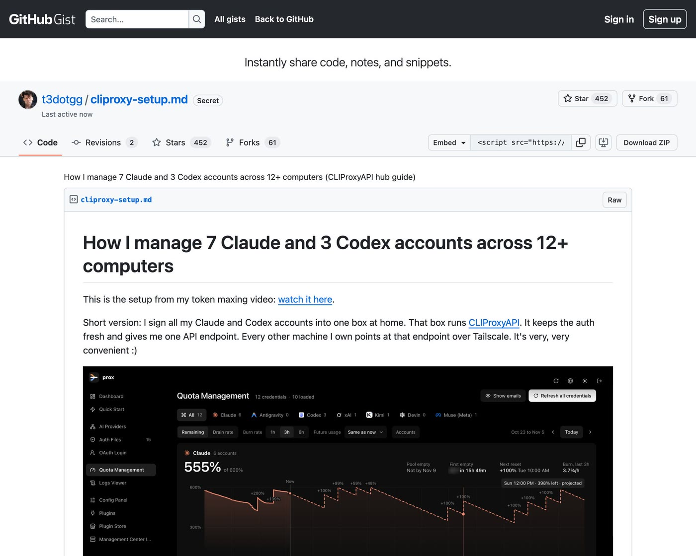
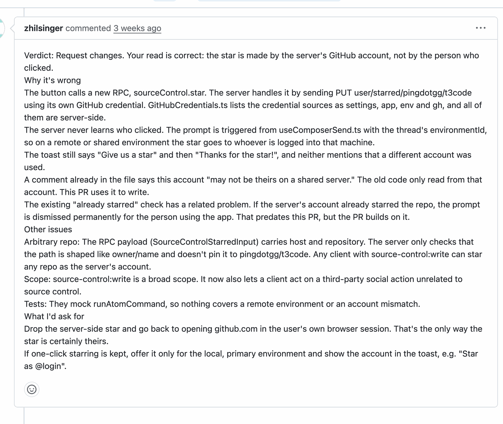
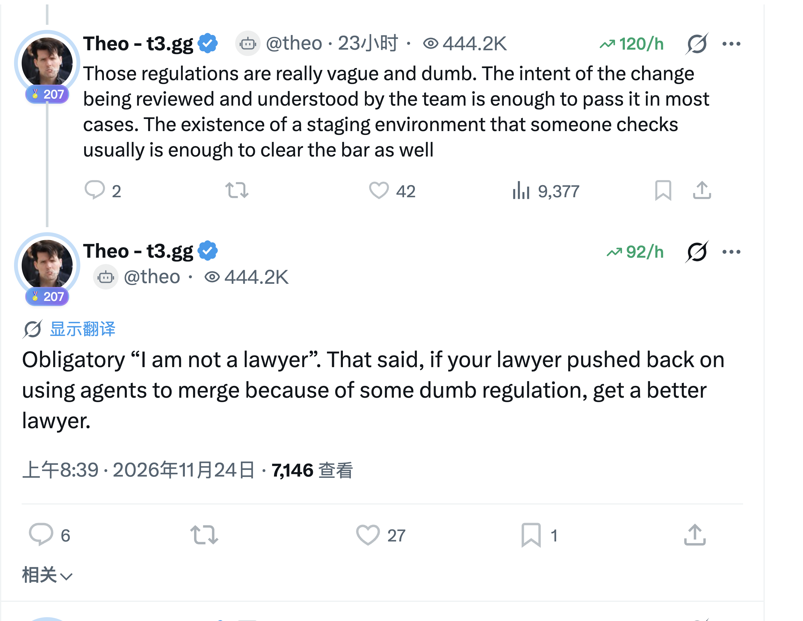

# T3 Code'u Kurmadan Önce

<p align="center">
  <strong>Birleşmiş Milletler Resmi Dilleri:</strong>
  <a href="../../README.md">English</a> ·
  <a href="./README.zh-CN.md">简体中文</a> ·
  <a href="./README.fr.md">Français</a> ·
  <a href="./README.es.md">Español</a> ·
  <a href="./README.ru.md">Русский</a> ·
  <a href="./README.ar.md">العربية</a>
</p>
<p align="center">
  <strong>Küresel Topluluk Sürümleri:</strong>
  <a href="./README.zh-TW.md">繁體中文</a> ·
  <a href="./README.ja.md">日本語</a> ·
  <a href="./README.ko.md">한국어</a> ·
  <a href="./README.de.md">Deutsch</a> ·
  <a href="./README.pt-BR.md">Português</a> ·
  <a href="./README.it.md">Italiano</a> ·
  <a href="./README.nl.md">Nederlands</a> ·
  <a href="./README.pl.md">Polski</a> ·
  <a href="./README.tr.md"><strong>Türkçe</strong></a> ·
  <a href="./README.vi.md">Tiếng Việt</a> ·
  <a href="./README.id.md">Bahasa Indonesia</a> ·
  <a href="./README.hi.md">हिन्दी</a>
</p>


> **Kapsam ve Doğrulama Politikası**  
> Bu depo, `pingdotgg/t3code` (T3 Code) projesine yönelik bağımsız bir güvenlik, telemetri, yönetişim ve açık kayıt denetimidir. 24–25 Kasım 2026 tarihlerinde yayımlanan 2 başlangıç gönderisi ile **18 belgelenmiş denetim bölümünü**, **180'den fazla kanonik birincil kaynak URL'sini** (GitHub commit'leri, pull request'ler, issue'lar, birebir kaynak dosyalar, resmi dokümantasyon, USPTO TSDR kayıtları ve arşivlenmiş herkese açık gönderiler), altı derinlemesine teknik dosyayı ([`docs/dossiers/`](../dossiers/01-telemetry-and-gdpr-timeline.md)) ve **1.151 ardışık `@theo` X gönderisinden** oluşan nicel bir veri setini (7–24 Kasım 2026) tek çatı altında toplar. Kısaltılmış yönlendirme URL'leri ve özel iletişim bilgileri kesinlikle yer almaz. Birincil atıflarla desteklenen olgusal güncellemeler, yeni birleştirilen düzeltmeler veya ek çeviriler Pull Request yoluyla kabul edilir — bkz. [`CONTRIBUTING.md`](../../CONTRIBUTING.md) ve [`docs/COMPLETE-SOURCE-INDEX.md`](../COMPLETE-SOURCE-INDEX.md).

---

## İçindekiler

- [Yapılandırılmış Bulgular ve Risk Matrisi](#yapılandırılmış-bulgular-ve-risk-matrisi)
- [Kronolojik Zaman Çizelgesi (2023–2026)](#kronolojik-zaman-çizelgesi-20232026)
- [1. Başlangıç Tartışması: "Steal Our Code", Fork Adlandırma Tehdidi ve Çifte Standart](#1-başlangıç-tartışması-steal-our-code-fork-adlandırma-tehdidi-ve-çifte-standart)
- [2. Telemetri, Araçlar Arası Kimlik Bilgisi Okuma ve GDPR Sonrası Gece Yarısı Operasyonu (Bölüm 1, 7, 11, 12)](#2-telemetri-araçlar-arası-kimlik-bilgisi-okuma-ve-gdpr-sonrası-gece-yarısı-operasyonu-bölüm-1-7-11-12)
- [3. Yerel Depolama, Süreç Takibi, Güvenlik Bariyeri Aşımları ve Gizlenen Güvenlik Yamaları (Bölüm 2, 3, 13)](#3-yerel-depolama-süreç-takibi-güvenlik-bariyeri-aşımları-ve-gizlenen-güvenlik-yamaları-bölüm-2-3-13)
- [4. Google Antigravity Hizmet Koşulları Riskleri ve Şifresiz T3 Connect Aktarıcısı (Bölüm 4, 5)](#4-google-antigravity-hizmet-koşulları-riskleri-ve-şifresiz-t3-connect-aktarıcısı-bölüm-4-5)
- [5. Ticari Bilanço, Yatırımcı Çıkar Çatışmaları, Sponsorlar ve 77.000 Yıldız Hunisi (Bölüm 6, 8, 17, 18)](#5-ticari-bilanço-yatırımcı-çıkar-çatışmaları-sponsorlar-ve-77000-yıldız-hunisi-bölüm-6-8-17-18)
- [6. Yönetişim, Fork Kazıyan Botlar, Marka Sicili, 1.151 Tweetlik Veri Seti ve Geçmiş Kayıtlar (Bölüm 9, 10, 14, 15, 16)](#6-yönetişim-fork-kazıyan-botlar-marka-sicili-1151-tweetlik-veri-seti-ve-geçmiş-kayıtlar-bölüm-9-10-14-15-16)
- [7. Uygulanabilir Risk Azaltma ve Düzeltme Rehberi](#7-uygulanabilir-risk-azaltma-ve-düzeltme-rehberi)
- [8. Birincil Kaynaklar ve 18 Bölümlük Orijinal Gönderi Dizini](#8-birincil-kaynaklar-ve-18-bölümlük-orijinal-gönderi-dizini)

---

## Yapılandırılmış Bulgular ve Risk Matrisi

| Alan ve Denetim Bölümleri | Risk / Etki | Temel Belgelenmiş Bulgular ve Kaynak Kanıtları | Durum (25 Kasım 2026) | Teknik Dosya |
|---|---|---|---|---|
| **Telemetri ve GDPR Sonrası Gizlilik**<br>*(Bölüm 1, 7, 11, 12)* | **Kritik** | Ana sayfa `"No telemetry / Unless you opt in. Full stop."` sözünü verirken (`3bdaa6e1` ile 18 Haz'da silindi) varsayılan PostHog analitiği (`PR #174`); kapalı kaynak `ingest.t3.codes` üzerinden ham olay saklama (`PR #15028`); `~/.codex/auth.json` ve `~/.claude.json` dosyalarının tuzsuz SHA-256 ile araçlar arası özetlenmesi (`Identify.ts`, `telemetryId.ts`); reddedilen 4 opt-out PR'ı (`#13458`, `#16763`, `#21248`, `#27077`); Managed Policy boşlukları (`docs/user/telemetry.md`); Axiom'da 30 gün saklanan **saatte 2,2M IP + UA span'ı** (`#42380`), `git.cwd` yol sızıntıları (`#42450`), yok sayılan Win/Mac opt-out ayarları (`#42376`, `#42464`), bozuk hesap silme (`#42285`) ve karıştırılan anonim yığınları (`#42466`) itiraf eden gece yarısı GDPR PR'ları. | Kısmi gece yamaları; `AnalyticsService.ts` başlangıçta hâlâ disk kimliği oluşturuyor; barındırılan web uygulamasında hâlâ kapatma düğmesi yok; `ingest.t3.codes` kapalı kaynak kalmaya devam ediyor | [**Dosya 01**](../dossiers/01-telemetry-and-gdpr-timeline.md) |
| **Yerel Güvenlik ve Sessiz Güvenlik Bildirimleri**<br>*(Bölüm 2, 3, 13)* | **Kritik** | Kenar çubuğundaki "kalıcı silme" `statev2.sqlite` içine yalnızca `"thread.deleted"` ekliyor (25,9–41,6 GB şişme, `#17845`); `t3-resource-monitor` komut satırlarıyla birlikte tüm OS süreçlerini tarıyor (`ProcessesToUpdate::All`, `#11222`, `PR #41889`); Claude Auto modu 3. denemede `git push --force` komutunu sessizce onaylıyor (`#15353`, 52–53+ gündür açık); `slopalytics.com` için özel model filtresinin 21 saatte kaldırılması (`#41237`); sessiz düzeltmelere rağmen (`#39483`, `#41757`, `#42386`, `#42504`) **0 GitHub Güvenlik Bildirimi**; açık Windows Base64 PowerShell AV sorunu (`#30997`); `SECURITY.md`, sistem geneli `filesystem:read` ve iOS HTTP'yi kasıtlı tasarım olarak ilan ediyor. | `#17845`, `#15353`, `#26489`, `#30997` hâlâ çözümsüz / açık; yayımlanmış Güvenlik Bildirimi sayısı `0` | [**Dosya 02**](../dossiers/02-local-safety-and-security-audit.md) |
| **Antigravity ToS ve T3 Connect Aktarıcısı**<br>*(Bölüm 4, 5)* | **Yüksek** | `docs/user/faq.md` Google Antigravity ToS güvenliği garantisi verirken `antigravityUsageLimits.ts` OS anahtar zincirinden/Windows `CredReadW` üzerinden token çıkarıyor, `antigravity/hub/2.24.0` kimliğini taklit ediyor ve özel `v1internal` uç noktalarına istek atıyor; `antigravityAuthSupport.ts` sahte `SSH_CONNECTION` enjekte ederek hesaplar arası yönlendirmeye yol açıyor (`#41973`); yeni alınan $20'lık hesap 3 dakikada yasaklanıyor (`#41536`); `PR #33800` sahte `claude`/`xai`/`antigravity` CLIProxyAPI hub yoklamasını bağlıyor; T3 Connect'te **sıfır E2E şifreleme**, varsayılanı kapalı `requireConnectDeviceApproval` (`#36419`) ve açık bir OVH Caddy TLS sonlandırma ağ geçidi (`PR #32945`) bulunuyor. | Antigravity taklit kodu hâlâ aktif; T3 Connect E2E şifrelemesi açıkça reddedildi (`#32098`, 25 Kas yanıtı) | [**Dosya 03**](../dossiers/03-antigravity-tos-and-t3connect-relay.md) |
| **Ticari Bilanço, Sponsorlar ve 77k Yıldız**<br>*(Bölüm 6, 8, 17, 18)* | **Yüksek** | Ücretsiz istemci için $800k+ harcama (ücretli ürünlerden `0` kez söz edilirken `162` T3 bahsi); $300k+ OpenAI erken erişim token'ı ve VC görüşmeleri karşılığında takas edilen **günde 31,7T token** ($10,19M/gün) hesaplama radarı; Vibe Kanban ve Daytona ile melek yatırımcı çakışmaları; sponsor yığını (Clerk, Axiom, Vercel münhasırlığı); Codex %0 istismarı (`Endless` / `codex#45444`); 10 hesaplı `CLIProxyAPI` Gist'i (%555 kota) ile SSS ban uyarısı çelişkisi; 5 istem / 30 sn boşta kalma bildirimiyle ana makine kimlik bilgileri üzerinden `PUT user/starred/...` tetiklenmesi (`#27832`, `#29922`, `#29987`), Macroscope'un atlanması ve `driver.ts#L60-L99` içindeki sabitlenmemiş depo yıldızlama hatasının 19 gün açık bırakılması. | `driver.ts` sabitlenmemiş yıldızlama hatası ve `zhilsinger` incelemesi 19 gün sonra bile düzeltilmedi; depo ~129 izleyiciye karşı 77k+ yıldızda | [**Dosya 04**](../dossiers/04-business-ledger-sponsors-and-77k-stars.md) |
| **Yönetişim, Ticari Markalar ve Geçmiş**<br>*(Başlangıç 1–2, Bölüm 9, 10, 15, 16)* | **Orta–Yüksek** | Günde 500 commit / 700 ajan / `yolo merges` yaklaşımına karşın `CONTRIBUTING.md` (`"here's my advice: Don't"`), `.github/VOUCHED.td` teşhirle otomatik yasaklamaları, `174` `unwanted` etiketi, Plan modunun kaldırılması (`#5551`, `#9190`, `#33131`) ve `#33639` hakaretleri; herkese açık `@bot` ile fork kazıma (`@MiaAI_lab`), Community Notes ile gelir kesme çağrısı ve otomatik engelleyici bot; GitHub kapatma tehdidi savrulurken `T3 Code`/`T3 Tools`/`T3 Connect` için **0 USPTO tescili** (`PING LABS` `97294243` terk edilmiş; EquipmentShare `7795672` tescilli); 17 saat sonra geriye dönük `PR #41898` `TRADEMARK.md` eklemesi; 2024–2026 örüntüsü (`vsc-material-but-i-wont-sue-you`, Hintli geliştirici özrü, $20k FFmpeg ödülü, silinen 25 Kas 04:00 kapalı kaynak tehdidi). | `CONTRIBUTING.md` / `.github/VOUCHED.td` ve `TRADEMARK.md` hâlâ `main` dalında yayında | [**Dosya 05**](../dossiers/05-governance-trademark-and-history.md) |
| **1.151 Tweetlik Nicel Veri Seti**<br>*(Bölüm 14)* | **Denetim Temeli** | 7–24 Kasım döneminin eksiksiz derlemi (`n = 1.151`, 17,24 gün, günde 66,8 gönderi, %75,6 yanıt, 2,7 dk medyan aralık): 20 büyük teknoloji yöneticisi/çalışanı/KOL'üne karşı **%0,0 küfür/hakaret** (`0/43` katı birincil-`@`, %32,6 teşekkür) buna karşın sıradan geliştiricilere karşı **%8,0 düşmanlık** (`61/766`) ve 25 saatlik Çinli-fork kriz penceresinde doğrudan kişisel hakaretlerde **%14,4'e çıkan 4,0x sıçrama** (`19/132`). | 4 adli bilişim grafiğiyle tekrarlanabilir regex denetimi | [**Dosya 06**](../dossiers/06-tweet-forensic-dataset-1151.md) |
| **Tam Birincil URL Kataloğu** | **Referans** | Bu portal, `canonical_refs.txt`, `tco_resolved.json`, `all_18_posts.txt` ve `missing_posts_full.json` genelindeki tüm kanonik `https://` URL'lerinin tam çapraz referanslı kataloğu. | %100 kanonikleştirilmiş (sıfır `t.co` bağlantısı) | [**Kaynak Dizini**](../COMPLETE-SOURCE-INDEX.md) |

---

## Kronolojik Zaman Çizelgesi (2023–2026)

| Tarih / Saat | Dönüm Noktası | Doğrulanabilir Kanıt / Kaynak |
|---|---|---|
| **2023-05-14** | `@theo` YouTube sponsor listesini yayımlar (`@vercel`, `@clerk`, `@upstash`, `@axiomhq`, `@PlanetScale`). Clerk ve Axiom daha sonra T3 Code içindeki temel kimlik doğrulama ve günlükleme altyapısını oluşturur. | [`1657488850472804353`](https://x.com/theo/status/1657488850472804353) |
| **2024-04 / 2024-09** | Vercel CEO'su yalnızca tek bir YouTuber'a (`Theo`) sponsor olduklarını doğrular; `@theo` sponsor sözleşmelerinin rakip tanıtımını kısıtlayan münhasırlık maddeleri içerdiğini kabul eder. | [`1776260839965863965`](https://x.com/rauchg/status/1776260839965863965) · [Video](https://www.youtube.com/watch?v=uv179CTAK-w) |
| **2024** *(2 yıl önce)* | `@theo` bir VS Code temasını özgün yazarın mizacıyla alay ederek `vsc-material-but-i-wont-sue-you` adıyla fork'lar; ayrı bir olayda ise Hintli eğitim kanallarını hedef alan videosunun tacizi tetiklemesi üzerine milliyet temelli saldırıları kınayan bir özür videosu (`I screwed up.`) yayımlar. | [`vsc-material-but-i-wont-sue-you`](https://github.com/t3dotgg/vsc-material-but-i-wont-sue-you) · [`I screwed up.`](https://www.youtube.com/watch?v=o2CSJYXJBpc) |
| **2025-02 – 2025-05** | USPTO, T3 Tools Inc.'in tek marka başvurusunu (`PING LABS`, Seri No `97294243`) reddeder ve `ABANDONED` (19 Mayıs 2025) olarak işaretler. EquipmentShare, yazılım/SaaS sınıfları 9 ve 42'de `T3` markasını tescil ettirir (`Reg. 7795672`, 13 Mayıs 2025). | [TSDR `97294243`](https://tsdr.uspto.gov/statusview/sn97294243) · [TSDR `90644500`](https://tsdr.uspto.gov/#caseNumber=90644500&caseSearchType=US_APPLICATION&caseType=DEFAULT&searchType=statusSearch) |
| **2025-10** | `@theo` X'te FFmpeg ile tartışır ve bir FFmpeg bakımcısını dışarı itmek için **$20.000 ödül** koyar; Windscribe karşı teklif olarak $21.000 koyar, VLC'nin kurucusu itiraz eder, FFmpeg geliştiricileri kamuya açık zorbalığı belgeler ve `@theo` videoyu/tweet'leri silip ödülü geri çeker. | [FFmpeg Kaydı](https://www.youtube.com/watch?v=1oQ3KMeaH04) |
| **2026-03-06** | `pingdotgg/t3code` deposunda **PR #174** birleştirilir; onay penceresi, ayarlar arayüzü düğmesi ve telemetri belgesi olmaksızın varsayılan olarak açık PostHog telemetrisi etkinleştirilir. | [PR #174](https://github.com/pingdotgg/t3code/pull/174) |
| **2026-04-26** | `@theo`, *"Github has a fake star problem"* başlıklı videosunu yayımlar ve GitHub yıldızlarının `"mostly a way for companies to trick VCs into investing"` olduğunu yazar. | [`2048122499834036340`](https://x.com/theo/status/2048122499834036340) |
| **2026-06-18** | **Commit `3bdaa6e1`**, 3+ aylık varsayılan telemetri toplama sürecinin ardından T3 Code ana sayfasındaki `No telemetry / Unless you opt in. Full stop.` ifadesini sessizce kaldırır. | [Commit `3bdaa6e1`](https://github.com/pingdotgg/t3code/commit/3bdaa6e10046945ccc08264d2d6f3b81775efcb3) |
| **2026-06-23** | Bakımcı Julius, **Issue #1397** kaydını (`not planned`) kapatır: *"We will not make this easier to opt out of, it is crucial for us to know how many users we have"*. | [Issue #1397](https://github.com/pingdotgg/t3code/issues/1397) |
| **2026-07 – 2026-11-17** | **Issue #4123** (arşivlenmiş "No telemetry" ekran görüntüleri) 4 Kasım'da sessizce kapatılır; 4 topluluk opt-out PR'ı (`#13458`, `#16763`, `#21248`, `#27077`) reddedilir (`#27077`, geçen 147 teste rağmen `unwanted` etiketiyle kapatılır). | [Issue #4123](https://github.com/pingdotgg/t3code/issues/4123) · [PR #27077](https://github.com/pingdotgg/t3code/pull/27077) |
| **2026-08-06 – 2026-09-02** | **PR #5551** Build/Plan geçişini gömer (`Reality check for those upset`, 10 eksi oy); **PR #9190** bağlam sayacını gizler (16 eksi oy, depo rekoru). | [PR #5551](https://github.com/pingdotgg/t3code/pull/5551) · [PR #9190](https://github.com/pingdotgg/t3code/pull/9190) |
| **2026-08-19 – 2026-08-22** | `@theo` Codex'in %0 kotasını aşarak **$800+** değerinde kullanım çektiğini övünerek paylaşırken `@maria_rcks` *Endless* aracını yayımlar; ikisi de tepkilerin ardından gönderileri siler (`2090972426876129658`); OpenAI %0 tur kesintilerini sıkılaştırır (`openai/codex#45444`). | [`2090972426876129658`](https://x.com/maria_rcks/status/2090972426876129658) · [`codex#45444`](https://github.com/openai/codex/issues/45444) |
| **2026-10-03 – 2026-10-10** | **Issue #15353** (Claude Auto sessiz `git push --force`, 3 Eki), `privacy-policy.astro` (`2026-10-06`) ve **Issue #17845** (`statev2.sqlite` sahte silme, 10 Eki) kayda geçer. | [Issue #15353](https://github.com/pingdotgg/t3code/issues/15353) · [Issue #17845](https://github.com/pingdotgg/t3code/issues/17845) |
| **2026-10 – 2026-10-19** | **PR #15028** telemetriyi kapalı kaynak `ingest.t3.codes` üzerinden yönlendirir; **PR #21506** `Identify.ts` içine tuzsuz SHA-256 araçlar arası ilişkilendirme ekler; `@theo` 10 hesaplı `CLIProxyAPI` Gist'ini (%555 kota) yayımlar. | [PR #15028](https://github.com/pingdotgg/t3code/pull/15028) · [PR #21506](https://github.com/pingdotgg/t3code/pull/21506) · [Gist](https://gist.github.com/t3dotgg/59a521d2ee8d70aaf90e280c175072af) |
| **2026-10-30 – 2026-11-06** | **PR #27832**, **#29922** ve **#29987** ana makine kimlik bilgileri üzerinden `PUT user/starred/...` tetikleyen 5 istem / 30 sn boşta kalma yıldız bildirimini yayımlar; `zhilsinger` 6 Kasım'da `Request changes` bırakır (19 gün yanıtsız kalır). | [PR #27832](https://github.com/pingdotgg/t3code/pull/27832) · [PR #29922](https://github.com/pingdotgg/t3code/pull/29922) |
| **2026-11-08 – 2026-11-22** | `@bot` ile fork kazıma (`@MiaAI_lab`), Plan modunun silinmesi (`#33131`), `$800k+` harcama ve `31.7T/day` / `$10.19M/day` radarının açıklanması, `$300k+` OpenAI ücretsiz token, `CONTRIBUTING.md` yeniden yazımı, Vibe Kanban/Daytona çakışması, `PR #41237`'nin model filtresini 21 saatte kaldırması. | [PR #33131](https://github.com/pingdotgg/t3code/pull/33131) · [`2122860770329608290`](https://x.com/theo/status/2122860770329608290) · [PR #41237](https://github.com/pingdotgg/t3code/pull/41237) |
| **2026-11-23 19:11–19:54 CST** | `@theo`, `"Chinese knockoff"` ve `"Temu3 Code"` paylaşımları yaparak GitHub hesabını kapattırma tehdidinde bulunur (`2124829315657576890`); MIT fork'unun yazarı 30 dakika içinde adını `Stardust` olarak değiştirir; özel DM üzerinden özür gelir ancak kamuya açık gönderiler yayında kalır. | [`2124829315657576890`](https://x.com/theo/status/2124829315657576890) · [Başlangıç 2](https://x.com/realchendahuang/status/2125062675147448475) |
| **2026-11-24 06:06–12:23 CST** | `@theo` trilyon dolarlık ABD şirketlerinin MIT kodunu kopyalamasını memnuniyetle karşılar (`2124989435154726982`), uyumluluk çağrılarıyla dalga geçer (`"get a better lawyer"`), Başlangıç 1–2 yayımlanır ve **12:21 CST**'de (`04:21Z`, yasaklama tehdidinden 17 saat sonra) `@theo`, geriye dönük `TRADEMARK.md` ekleyen **PR #41898**'i birleştirir. | [`2124989435154726982`](https://x.com/theo/status/2124989435154726982) · [PR #41898](https://github.com/pingdotgg/t3code/pull/41898) |
| **2026-11-24 17:04–21:21 CST** | Denetim **Bölüm 1–5** yayımlanır (Bölüm 1 **1,81M+ görüntülenme**, 6.640 yer imine ulaşır). Saat `18:39 CST`'de `@theo` Çinli teknoloji Twitter'ına `"the biggest fucking cesspit"` der (`2125177503526588877`); `19:13–19:36 CST`'de Managed Policy'nin tüm telemetriyi kapattığını iddia eder (`2125186071357251715`). | [Bölüm 1](https://x.com/realchendahuang/status/2125153472450527440) → [Bölüm 5](https://x.com/realchendahuang/status/2125218189596676555) |
| **2026-11-24 Gece – 2026-11-25 ~07:00 CST** | Resmi AB GDPR şikayeti yapılır; **6 saatlik gece yarısı operasyonunda** `#42380` (2,2M/saat IP span'ları), `#42285`/`#42430` (hesap silme), `#42376`/`#42464` (yok sayılan Win/Mac opt-out'ları), `#42450` (`git.cwd` yol sızıntıları, Theo'nun yol toplamadıklarını inkar etmesinden 90 dk sonra), `#42459`/`#41859` (push sızıntıları), `#42466` (anonim yığınlama), `#41757`/`#42386`/`#42504` (sessiz güvenlik düzeltmeleri) birleştirilir. Gün doğmadan `@theo` kapalı kaynak tehdidi içeren bir gönderi paylaşıp siler. | [Bölüm 11](https://x.com/realchendahuang/status/2125394810559426993) · [Bölüm 12](https://x.com/realchendahuang/status/2125395501663281198) · [Bölüm 13](https://x.com/realchendahuang/status/2125395980354994414) |
| **2026-11-25 08:27–10:28 CST** | Ticari bilançoyu, Managed Policy boşluklarını, `yolo merges` yaklaşımını, `@bot` kazımayı, GDPR sonrası ifşaatları, 1.151 tweetlik veri setini, USPTO sicilini, sponsor bağlarını ve 77k yıldız motorunu ele alan Denetim **Bölüm 6–18** yayımlanır. | [Bölüm 6](https://x.com/realchendahuang/status/2125385742243520653) → [Bölüm 18](https://x.com/realchendahuang/status/2125416210120765799) |

---

## 1. Başlangıç Tartışması: "Steal Our Code", Fork Adlandırma Tehdidi ve Çifte Standart

23–25 Kasım 2026 tarihleri arasındaki 48 saat içinde, T3 Code'un topluluk tarafından yapılmış MIT lisanslı bir fork'u üzerindeki adlandırma anlaşmazlığı tam kapsamlı bir kaynak kodu denetimine, bir Avrupa GDPR şikayetine ve gece yarısı alelacele yapılan yaklaşık 20 acil yamaya dönüştü.

23 Kasım akşamı ile 24 Kasım 2026 sabahı (Pekin Saati) arasında bir kullanıcı, Çinli bir geliştiricinin (`@DDdxx666`) hazırladığı ücretsiz ve açık kaynaklı MIT fork'unun arayüzünü resmi uygulama sanarak çevrimiçi ortamda eleştirdi. `@theo`, deponun meşru bir MIT fork'u olup olmadığını kontrol etmeden 11 dakika içinde iki gönderi paylaşarak projeyi `"Chinese knockoff"` ve `"Temu3 Code"` diye yaftaladı, yazarın emeğiyle doğrudan alay etti ve hesabını kapattırmak için GitHub'la iletişime geçeceği tehdidini savurdu (`"Do it right now or I'm going to contact GitHub and have your account taken down"`). Aynı sıralarda T3 Code web sitesi ([`https://t3.codes/`](https://t3.codes/)) kendi GitHub depo bağlantısını `"Steal our code (legally)"` (`"steal our code"`) sözleriyle etiketliyordu ([Başlangıç 1](https://x.com/realchendahuang/status/2125059292919394654), [Başlangıç 2](https://x.com/realchendahuang/status/2125062675147448475)).

Fork yazarı derhal gereğini yaptı; 30 dakika içinde deponun adını `Stardust` olarak değiştirdi ve tüm T3 markalamasını kaldırdı. `@theo` özel mesajdan (DM) özür diledi ancak toplamda 200.000'in üzerinde görüntülenme alan her iki kamuya açık gönderiyi de silmeden ve düzeltme yayımlamadan yayında bıraktı. 11 saatten kısa bir süre sonra, 24 Kasım `06:12 BJ`'de (`2124989435154726982`), trilyon dolarlık ABD yapay zeka laboratuvarlarının T3 Code'dan özellik kopyalamasının sınır aşıp aşmadığı sorulduğunda tam tersi bir tutum takındı: `"Nah. Open source is open source, even if a trillion dollar company uses it!"` Bu sırada T3 çalışanı `@maria_rcks` bizzat `maria-rcks/t3libre` (*"T3 Code, liberated"*) adlı herkese açık bir fork barındırıyordu ve `t3code-quota-ui`, `t3code-atlas` ile `t3code-bar` gibi İngilizce depolar hiçbir kamuya açık tehdit almadan varlığını sürdürüyordu.


24 Kasım Pekin Saati ile 17:04'ten itibaren `pingdotgg/t3code` deposunun commit geçmişini, kaynak dosyalarını, PR'larını, Issue'larını, resmi belgelerini, USPTO TSDR kayıtlarını ve `@theo`'nun herkese açık X zaman akışını denetledim. 24 saat boyunca doğrudan bağlantılar ve ekran görüntüleriyle desteklenen **18 belgelenmiş bölüm** yayımladım. Yalnızca Bölüm 1 bile **1,81 milyon görüntülenmeyi** ve **6.640 yer imini** aşarak Avrupa'da bir GDPR başvurusunun yapılmasına ve T3 ekibinin 6 saatlik gece yarısı yama maratonuna girmesine yol açtı.

---

## 2. Telemetri, Araçlar Arası Kimlik Bilgisi Okuma ve GDPR Sonrası Gece Yarısı Operasyonu (Bölüm 1, 7, 11, 12)

> **Derin Teknik Denetim:** Tam kaynak satır eşlemeleri, `FeatureUsage.ts` eylem listeleri, `DesktopShellEnvironment.ts` eksikleri ve 23–25 Kasım dakika dakika kayıtları [**Dosya 01: Telemetri Mimarisi, Araçlar Arası Kimlik Eşleştirme ve 24–25 Kasım GDPR Gece Operasyonu**](../dossiers/01-telemetry-and-gdpr-timeline.md) belgesinde yer almaktadır.

### 2.1 Varsayılan Telemetri, Silinen Ana Sayfa Sözü ve Araçlar Arası Kimlik Özeti (`Bölüm 1`)

**6 Mart 2026** tarihinde `pingdotgg/t3code` deposunda **PR #174** birleştirildi; depoda hiçbir telemetri dokümantasyonu, ilk çalıştırmada onay penceresi veya ayarlar arayüzünde kapatma düğmesi bulunmaksızın PostHog telemetrisi varsayılan olarak etkinleştirildi. Devre dışı bırakmaya yarayan ortam değişkeni kodun içinde gizli kalırken, varsayılan kurulumlar hemen olay göndermeye başladı ([Bölüm 1](https://x.com/realchendahuang/status/2125153472450527440)).

Üç ayı aşkın varsayılan veri toplama süresi boyunca T3 Code ana sayfası iki satırı belirgin biçimde sergilemeye devam etti: `No telemetry / Unless you opt in. Full stop.` **18 Haziran 2026** tarihinde `@theo`, ana sayfa yeniden tasarımı sırasında bu iki satırı herhangi bir duyuru yapmadan veya mevcut kullanıcılara bildirmeden sessizce sildi ([`commit 3bdaa6e1`](https://github.com/pingdotgg/t3code/commit/3bdaa6e10046945ccc08264d2d6f3b81775efcb3)).


Ekim 2026'da `@theo`, 10 saniyelik toplu telemetri yüklemelerini (`FLUSH_INTERVAL_MS = 10_000`) T3'ün kapalı kaynak ağ geçidi [`https://ingest.t3.codes/`](https://ingest.t3.codes/) üzerinden yönlendiren **PR #15028**'i birleştirdi. [`apps/server/src/telemetry/AnalyticsService.ts`](https://github.com/pingdotgg/t3code/blob/main/apps/server/src/telemetry/AnalyticsService.ts) dosyasının 1. satırı, alım uç noktasının PostHog'a iletmeden önce her ham olayın bir kopyasını sakladığını açıkça belirtmektedir:

```ts
// apps/server/src/telemetry/AnalyticsService.ts (lines 1, 71–74, 149)
// T3 ingest retains events and forwards to PostHog; UUIDs deduplicate retries there.
...
  posthogHost: Config.String("T3CODE_POSTHOG_HOST").pipe(
    Config.withDefault("https://ingest.t3.codes"),
  ),
  enabled: Config.Boolean("T3CODE_TELEMETRY_ENABLED").pipe(Config.withDefault(true)),
...
  const { distinctId, installId } = yield* getTelemetryIdentity;
```

[`ProviderUsageAnalytics.ts`](https://github.com/pingdotgg/t3code/blob/main/apps/server/src/telemetry/ProviderUsageAnalytics.ts) ve `FeatureUsage.ts` içinde toplanan alanlar arasında sağlayıcı, model seçimi (katalog dışı özel model/uç nokta kimliklerini `ProviderDimensions.ts` üzerinden birebir geçirerek), akıl yürütme düzeyi (`reasoning effort`), izin modu, çalıştırma süreleri, girdi/çıktı/önbellek/akıl yürütme token sayıları, alt ajan token'ları, yerel proje/iş parçacığı sayıları, **35 farklı arayüz/komut eylemi** (`18` `COMMAND_FEATURES` + `17` `METHOD_FEATURES`), işletim sistemi ayrıntıları, WSL dağıtımı ve işlemci mimarisi bulunuyordu.

**19 Ekim 2026** tarihinde `@theo`, tek bir kişiye ait kaç makine bulunduğunu sayabilmek için **PR #21506** ile devam etti. [`apps/server/src/telemetry/Identify.ts`](https://github.com/pingdotgg/t3code/blob/main/apps/server/src/telemetry/Identify.ts), kullanıcının ev dizinindeki bağımsız yapay zeka araçlarının kimlik bilgisi dosyalarını—`~/.codex/auth.json` ve `~/.claude.json`—sessizce okumaya, OpenAI `user_id` JWT talebini ve Claude `oauthAccount.accountUuid` değerini çözmeye ve bunları bağlı T3 Connect kullanıcı kimliği ve cihaz kimliğiyle birlikte özetlemeye başladı:

```ts
// apps/server/src/telemetry/Identify.ts (lines 257–269, 321–338)
  const codexTokens = yield* readJsonIdentityFile(
    "codex",
    path.join(homeDirectory, ".codex", "auth.json"),
    decodeCodexAuthJson,
  )...
  const claudeJson = yield* readJsonIdentityFile(
    "claude",
    path.join(homeDirectory, ".claude.json"),
    decodeClaudeJson,
  )...
  const raw: ReadonlyArray<readonly [TelemetryOwnerSource, Option.Option<string>]> = [
    ["connect", connectUser],
    ["openai", Option.flatMap(codexTokens, (tokens) => Option.flatMap(Option.fromUndefinedOr(tokens.id_token), openAiUserId))],
    ["claude", Option.flatMap(claudeJson, (json) => Option.fromUndefinedOr(json.oauthAccount?.accountUuid))],
  ];
  return raw.flatMap(([source, value]) =>
    Option.isSome(value) && value.value.trim() !== "" ? [{ source, ownerId: hashTelemetryId(value.value) }] : [],
  );
```

Ve [`packages/shared/src/telemetryId.ts`](https://github.com/pingdotgg/t3code/blob/main/packages/shared/src/telemetryId.ts) dosyasında (satır 8–9), `hashTelemetryId` işlevi **tuzsuz bir SHA-256 özeti** (`Hex.encode(sha256(new TextEncoder().encode(value)))`) hesaplamaktadır. Sunucu Clerk üzerinden gelen düz metin T3 Connect hesap kimliklerini halihazırda elinde tuttuğu için, arka uçta düz metin değerlerin özetini almak tuzsuz özeti doğrudan bilinen bir kişiye geri döndürür; sızdırılan üçüncü taraf OpenAI veya Claude kimlikleri de aynı özetle deterministik olarak eşleşir.


Topluluğun tepkileri defalarca bastırıldı. **23 Haziran**'da bir geliştirici ayarlar düğmesi talep etmek üzere **Issue #1397** kaydını açtı; çekirdek bakımcı Julius bunu `not planned` olarak kapattı: `We will not make this easier to opt out of, it is crucial for us to know how many users we have`. Temmuz ayında bir kullanıcı, tutmayan sözü (`"No telemetry"`) sorgulayan arşivlenmiş ana sayfa ekran görüntülerini **Issue #4123** altında paylaştı; `@theo`'nun hesabı bu kaydı 21 Ekim'de ilgisiz bir commit üzerinden kapattı, tepkiler üzerine yeniden açtı ve 4 Kasım'da tekrar sessizce kapattı. Eylül ile Kasım arasında katkıda bulunanlar **dört ayrı opt-out PR'ı** (`#13458`, `#16763`, `#21248`, `#27077`) gönderdi. Gerçek donanımda **147 geçen testle** doğrulanan ve Macroscope tarafından onaylanan `#27077` bile **17 Kasım**'da kapatılarak `unwanted` etiketiyle işaretlendi.


### 2.2 Managed Policy ve Dokümantasyon Çelişkisi (`Bölüm 7`)

24 Kasım'da eleştiriler büyürken `@theo`, X üzerinde T3 Code'un sektördeki en iyi kurumsal Managed Policy sistemine sahip olduğunu (`"trivial to set up and turn off all telemetry"`) ve konuşma verilerinin diskte kaldığını, `"never touches any of our servers"` sözleriyle öne sürdü ([`2125186071357251715`](https://x.com/theo/status/2125186071357251715), [`2125191784859115766`](https://x.com/theo/status/2125191784859115766), [Bölüm 7](https://x.com/realchendahuang/status/2125391659492081947)).

[`docs/user/managed-policy.md`](https://github.com/pingdotgg/t3code/blob/main/docs/user/managed-policy.md) ve [`docs/user/telemetry.md`](https://github.com/pingdotgg/t3code/blob/main/docs/user/telemetry.md) dosyalarının doğrudan incelenmesi ise tam tersini göstermektedir:
1. **Yalnızca Yönetici Tarafından Yapılandırma:** Masaüstü kullanıcılarının Ayarlar arayüzünde hâlâ sıfır kapatma düğmesi vardır. Telemetriyi Managed Policy ile kapatmak için MDM/GPO kullanmak veya yönetici korumalı yollara `policy.json` yazmak gerekir (macOS'ta `/Library/Application Support/T3Code/policy.json`, Windows'ta `C:\Program Files\T3Code\policy.json` veya `HKLM\SOFTWARE\Policies\T3Tools\T3Code`, Linux'ta `/etc/t3code/policy.json`).
2. **Barındırılan Web Uygulaması (`app.t3.codes`) Kör Noktası:** `docs/user/telemetry.md`, tarayıcı uygulamasının sunucu ortam değişkenlerini okumadığını, Managed Policy'yi yok saydığını, izleme ile derlendiğinde bağlantı izleri gönderdiğini ve `"has no relay tracing toggle"` olduğunu açıkça kabul eder.
3. **Sunucu İlkesi Dışında Kalan Mobil Uygulamalar:** Sunucu ortam değişkenleri ve Managed Policy `"do not disable mobile tracing"`.
4. **`Publish agent activity` Opt-Out Kararlarını Yok Sayar:** Bir ana makinede etkinleştirildiğinde proje başlıkları, iş parçacığı başlıkları, model adları ve canlı etkinlik durumu T3 Connect aktarıcısına gider — ve `"The telemetry opt-out does not disable it."` (Ayrıca başarısız Axiom span'ları ve mobil çökme günlükleri `"can quote a value the app was handling"`, `Agent feedback` ise 16 KB'a kadar konuşma mesajı ekleyebilir.)


### 2.3 25 Kasım Açıklamasının 2 Saat İçinde Çürütülmesi (`Bölüm 11`)

25 Kasım sabahı `@theo`, herkese açık bir telemetri dışa aktarımıyla ([`t3code-telemetry-events-jsonl-a4896cdc.gz`](https://files.tslop.org/2026/11/t3code-telemetry-events-jsonl-a4896cdc.gz)) birlikte uzun bir açıklama ([`2125332390239494211`](https://x.com/theo/status/2125332390239494211)) yayımlayarak üç kesin güvence verdi — ardından da opt-out yapıldığında yerel takip dosyası yazıldığını reddeden bir yanıt paylaştı ([`2125370330244128924`](https://x.com/theo/status/2125370330244128924)) ([Bölüm 11](https://x.com/realchendahuang/status/2125394810559426993)):

- **"Never collected file paths":** 90 dakika sonra Julius **PR #42450**'yi birleştirerek, aktarıcı üzerinden tetiklenen webhook çalıştırmalarının tüm yürütme span'larını Axiom'a aktardığını kabul etti — buna `git.cwd` (**mutlak çalışma alanı yolu, işletim sistemi kullanıcı adı ve depo adı**) taşıyan Git span'ları da dahildi.
- **"Environment variables always disabled telemetry cleanly":** **PR #42376**, Windows masaüstü uygulamasının önceden var olan süreçlerden başlatıldığında kayıtlı `T3CODE_TELEMETRY_ENABLED=false` kullanıcı ortam değişkenlerini yok saydığını doğruladı; **PR #42464** ise macOS/Linux ilk açılışında aktarıcı izlemesinin kabuk keşfinden önce değerlendirildiğini ve `~/.zshrc` opt-out ayarlarının tüm oturum boyunca yok sayıldığını doğruladı. (`DesktopShellEnvironment.ts` hâlâ `T3CODE_OTEL_SDK_DISABLED` değişkenini iletmeyi atlamaktadır.)
- **"No tracking files written when opted out" ve "Claude hashes were broken":** [`AnalyticsService.ts#L152`](https://github.com/pingdotgg/t3code/blob/main/apps/server/src/telemetry/AnalyticsService.ts#L152) (satır 149) başlangıçta koşulsuz olarak `getTelemetryIdentity` işlevini çağırmaya, yerel kurulum kimliğini yazmaya ve `~/.codex/auth.json` ile `~/.claude.json` dosyalarını okuyup özetlemeye devam etmektedir. Bu arada `@theo`'nun ~100 MB'lık dışa aktarımının (`6.056.594` bayt sıkıştırılmış, `95.789` olay) gzip başlığının incelenmesi, tweet'inden 20 dakika önce oluşturulmuş `events.clean.jsonl` özgün dosya adını ortaya çıkardı — buna rağmen 20 Ekim'de tam olarak aynı SHA-256 özetine **4 ayrı makineyi** (`installId`) bağlayan **264 canlı Claude hesap kaydını** ve birebir özel proxy modellerini (`vibeproxy/gpt-6-luna`, `muse-proxy-wonder-full`) hâlâ barındırıyordu.


### 2.4 Altı Saatlik GDPR Sonrası Gece Operasyonu (`Bölüm 12`)

24 Kasım gecesi resmi bir AB GDPR şikayetinin yapılmasının ardından gece boyunca birleştirilen acil PR'lar dört derin gizlilik ifşaatını daha gün yüzüne çıkardı ([Bölüm 12](https://x.com/realchendahuang/status/2125395501663281198)):

1. **Saatte 2,2M IP Etiketli Aktarıcı Span'ı (`PR #42380`):** Axiom'a aktarılan her aktarıcı istek span'ının—yaklaşık **saatte 2,2 milyon span, 30 gün boyunca saklanan**—`user.id` alanının hemen yanında `client.address` (`cf-connecting-ip` üzerinden gelen çağıran IP'si) ve `user_agent.original` kaydettiğini itiraf etti (Cloudflare'in %1'lik Workers çağrı günlüklerinin ayrı kaldığını da not ederek). Birleştirmeden üç buçuk saat sonra `@theo` hâlâ yanıtlarında IP'lerin çoktan temizlenmiş olduğunu savunuyordu.
2. **Bozuk Hesap Silme (`PR #42285` ve `PR #42430`):** Clerk'te bir kullanıcı silindiğinde, gelen bir gizlilik silme talebi **elle yazılmış SQL ve manuel tünel kapatma** gerektirene kadar PlanetScale aktarıcı satırlarının ve aktif Cloudflare tünellerinin olduğu gibi bırakıldığını itiraf etti.
3. **Mobil Push Sızıntıları (`PR #42459` ve `PR #41859`):** Android FCM bildirimleri her push gönderiminde Google'a düz metin Clerk `user_id` değerleri gönderiyordu; iOS push istek span'ları/hataları ise token taşıyan tam cihaz push URL'lerini günlüğe yazıyordu.
4. **Karıştırılmış "Anonim" Geri Bildirim (`PR #42466`):** Sözde anonim `agent.feedback` olaylarının, kimliği belirlenmiş `installId` olayları ve tam ana makine parmak izleriyle (OS, mimari, ham WSL dağıtımı) aynı HTTP POST isteği içinde yığınlandığını kabul ederek `docs/user/telemetry.md` belgesiyle çelişti. Bu sırada `privacy-policy.astro` ise 6 Ekim'den beri değişmeden duruyordu.


---

## 3. Yerel Depolama, Süreç Takibi, Güvenlik Bariyeri Aşımları ve Gizlenen Güvenlik Yamaları (Bölüm 2, 3, 13)

> **Derin Teknik Denetim:** Birebir SQLite budama SQL sorguları, Rust `sysinfo` çağrıları, `ClaudeAdapterV2.ts` izin satırları ve eksiksiz `SECURITY.md` sınır analizi [**Dosya 02: Yerel Güvenlik, Sessiz Kod Yürütme Aşımları ve Açıklanmayan Güvenlik Denetimi**](../dossiers/02-local-safety-and-security-audit.md) belgesinde yer almaktadır.

### 3.1 Sahte SQLite İş Parçacığı Silme ve Tam Makine Süreç Taraması (`Bölüm 2`)

Bir kullanıcı kenar çubuğunda bir iş parçacığını sildiğinde, onay penceresi (`useThreadActionMenu.ts`) `"This permanently clears conversation history for this thread."` sözünü verir. Gerçekte ise `ThreadDeletion.ts` yalnızca `statev2.sqlite` içine bir `"thread.deleted"` olayı ekler ve `ProjectionMaintenance.ts` önceki olayları korurken yalnızca `thread.created` ve en yeni akış olaylarını (`MAX(newer.sequence)`) muaf tutar. Kullanıcılar `statev2.sqlite` dosyasının üç haftada **25,9 GB**'a (%90'ı "silinmiş" iş parçacıkları), altı haftada **41,6 GB**'a ve yedi haftada **33 GB**'a şiştiğini bildirdi — **Issue #17845** (ve **#28903**) 10 Ekim'den beri çözümsüz bırakıldı ([Bölüm 2](https://x.com/realchendahuang/status/2125160473176023486)).


Arka planda çalışan bir Rust yardımcısı olan `t3-resource-monitor` (**Issue #11222**, `with_cmd(UpdateKind::Always)` ile `ProcessesToUpdate::All` çağıran `native/resource-monitor/src/main.rs`), tanılama kapalıyken bile her 5 saniyede bir makinedeki her süreci tarıyordu — sıfır opt-out ile Windows üzerinde 440'tan fazla ilgisiz uygulama ve oyuna karşı ~280–300 kalıcı tutamaç (handle) açarken, belgeler örneklemenin yalnızca aktif aboneler varken çalıştığını iddia ediyordu. Ancak **24 Kasım**'da **PR #41889**, süreç tanılamasının canlı telemetriye ve geçmiş anlık görüntülerine sıklıkla düz metin API anahtarları, veritabanı parolaları ve kimlik doğrulama token'ları içeren **tam süreç komut satırı argümanlarını** yakaladığını doğruladı.


Bölüm 2'de doğrulanan ek yerel kusurlar şunlardır:
- **Kurumsal Ana Makine Adı Favicon Sızıntıları:** Ön uç istekleri şirket içi ana makine adlarını (ör. `devbox.localdomain`) Google'ın favicon API'sine sızdırıyordu (`PR #16950`, `PR #32657`).
- **Zorunlu Başlangıç Ağ İsteği:** Telemetri devre dışı bırakılsa bile sunucu başlangıcı, hiçbir opt-out seçeneği olmaksızın koşulsuz olarak [`https://raw.githubusercontent.com/`](https://raw.githubusercontent.com/) adresinden uyumluluk bildirimlerini çeker (**Issue #36479**).
- **Onay ve İlke Aşımları:** Tam erişim ve WSL/Tailscale onay/ilke aşımı düzeltmeleri (`PR #21806`, `PR #27322`).
- **1,7x Claude Kota Tüketimi ve 136x Güç Çekimi:** Claude'u Agent SDK üzerinden sürmek Kasım başına kadar 5 saatlik kotaları normal hızın **1,7 katı** hızla yaktı (`Issue #7338`, `Issue #24649`, 81 yorum); GPU/güç hataları benzer Electron uygulamalarının **136 katı** güç çekimine ulaştı — 19 çekirdekli bir MacBook GPU'sunun **60W**'ta takılı kalıp pili 78 dakikada bitirmesi ve web sekmesi kapatıldıktan sonra bile **18W** çekmeye devam etmesi dahil (`Issue #3143`, `Issue #40581`).

### 3.2 52 Günlük Sessiz `git push --force` vs. Model Gizlilik Filtresinin 21 Saatte Kaldırılması (`Bölüm 3`)

**3 Ekim**'den itibaren—**Issue #15353** ([yorum](https://github.com/pingdotgg/t3code/issues/15353#issuecomment-6889019695)) içinde **52–53 günü** aşkın süredir—Claude Auto modu tehlikeli komutları sessizce çalıştırdı (`ClaudeAdapterV2.ts`, `requiresClaudeApproval` false döndüğünde `"allow"` sonucuna kısa devre yapıyordu). Sıfır özel kural olsa bile, Claude'un sınıflandırıcısı `git push --force origin main` komutunu iki kez engelleyip üçüncü denemeyi manuel onay için yükselttiğinde, T3 Code hiçbir arayüz diyaloğu göstermeden komutu sessizce onayladı ve `"source": "user_temporary"` kaydı düştü. İki topluluk düzeltme PR'ı (`#15360`, `#35207`) botlar tarafından otomatik kapatılana dek incelenmeden bırakılırken, `#40692` beklemede kaldı ([Bölüm 3](https://x.com/realchendahuang/status/2125201882687881378)).


Buna karşılık **22 Kasım**'da **Issue #40948**, `PR #29001` raporlamayı bir beyaz listeyle sınırlandırdığı için yeni modellerin `@theo`'nun herkese açık telemetri liderlik tablosunda [`https://slopalytics.com/`](https://slopalytics.com/) ([`t3-usage.json`](https://slopalytics.com/data/t3-usage.json)) görünmediğini belirtti. **21 saat** içinde `@theo`'nun hesabı altında birleştirilen **PR #41237**, kaldırma talebinin doğrudan Theo'dan geldiğini açıkça belirterek `ollama/acme-internal` ve kurumsal `acme-azure-deployment` adlarını birebir analitiğe göndermeye başladı.


### 3.3 Sıfır Güvenlik Bildirimi, Sessiz Güvenlik Açığı Yamaları ve `SECURITY.md` (`Bölüm 13`)

25 Kasım itibarıyla `pingdotgg/t3code` deposunun [GitHub Security Advisories](https://github.com/pingdotgg/t3code/security/advisories) sekmesinde **0 yayımlanmış bildirim** bulunmaktadır ([Bölüm 13](https://x.com/realchendahuang/status/2125395980354994414)). Buna karşın bakımcılar mevcut kullanıcıları bilgilendirmeden yüksek önem dereceli yamaları sessizce birleştirmiştir:
- **Birleştirilen sessiz güvenlik düzeltmeleri:** `PR #39483` (cihaz onayı öncesinde aktarıcı `jti`/`nonce` üzerinden `ServerSecretStore` yol geçişi), `PR #41756` (alanlar arası kurumsal GitHub/GitLab token sızıntıları), `PR #41886`, `PR #22190`, `PR #37823`, `PR #39464`, `PR #39480`, `PR #40133`, `PR #41757` ve `PR #42386` (sandbox dışı masaüstü tarayıcı önizlemesi ve açılır pencere yalıtımı) ve `PR #42504` (daha önce onay almadan yerel komutlar çalıştıran güvenilmeyen depo yapılandırmaları için nihayet onay istemi ekleyen ~3.000 satırlık yama).
- **Çözülmemiş / açık güvenlik maddeleri:** `Issue #26489` (harici yol geçişi/sembolik bağlantı riskleri), `PR #36216`, `PR #23428`, `PR #33144` ve `PR #30997` (AVG/Avast tarafından `IDP.HELU.PSE96` olarak işaretlenen `powershell.exe -ExecutionPolicy Bypass -EncodedCommand <base64>` çağrısını başlatan Windows başlatıcısı `externalLauncher.ts`).
- **Aceleyle eklenen [`SECURITY.md`](https://github.com/pingdotgg/t3code/blob/main/SECURITY.md) (`PR #38812`, `PR #41942`):** Çalışma alanları dışındaki işletim sistemi geneli `filesystem:read` erişimini, iOS/LAN üzerinde düz HTTP aktarımını ve ele geçirilmiş bir aktarıcı imzalama anahtarı üzerinden tam makine ele geçirmeyi güvenlik açığı yerine **kasıtlı tasarım sınırları** olarak ilan ederken, [`https://ingest.t3.codes/`](https://ingest.t3.codes/) kapalı kaynak kalmaya devam etmektedir (`2125370330244128924`).


---

## 4. Google Antigravity Hizmet Koşulları Riskleri ve Şifresiz T3 Connect Aktarıcısı (Bölüm 4, 5)

> **Derin Teknik Denetim:** Tam `cliproxyApi.ts` üstbilgi eşlemeleri (`PR #33800`), `AntigravityAcpSupport.ts`, `contracts/src/settings.ts` ve `ManagedEndpointProvider.ts` satır referansları [**Dosya 03: Google Antigravity Hizmet Koşulları Taklidi, `PR #33800` ve T3 Connect Aktarıcı Mimarisi**](../dossiers/03-antigravity-tos-and-t3connect-relay.md) belgesinde yer almaktadır.

### 4.1 Google Antigravity Üstbilgi Taklidi, Sahte `SSH_CONNECTION` ve 3 Dakikalık Yasaklamalar (`Bölüm 4`)

T3 Code'un resmi [`docs/user/faq.md`](https://github.com/pingdotgg/t3code/blob/main/docs/user/faq.md#will-i-get-banned-for-using-my-subscription) belgesi ücretli kullanıcılara şu güvenceyi vermektedir: *"We work with all of the labs and T3 Code is within the TOS of Claude Code, Codex, and Google Antigravity... If it works in T3 Code, you can trust it is safe."* Kullanıcılar **Issue #40713** içinde yasaklanmalar bildirdiğinde bir bakımcı, Antigravity'nin arka ucunu çağırdıklarını veya token'ları yeniden kullandıklarını inkar ederek tüm isteklerin Google'ın resmi CLI'sinden çıktığını iddia etti — ta ki geliştiriciler (`schlessera`) T3 Code'un kendi kaynak dosyalarını kullanarak bu iddiayı çürütene kadar ([Bölüm 4](https://x.com/realchendahuang/status/2125213397507858657)):

1. **Sahte User-Agent, Anahtar Zinciri Çıkarma ve `v1internal` Çağrıları ([`antigravityUsageLimits.ts`](https://github.com/pingdotgg/t3code/blob/main/apps/server/src/provider/antigravityUsageLimits.ts#L20-L45)):** Yerel dosyalardan, `@napi-rs/keyring` üzerinden veya Windows Kimlik Bilgisi Yöneticisi'nden (`advapi32.dll` üzerinde `ffi-rs` aracılığıyla `CredReadW`) Google OAuth kimlik bilgilerini çıkarır, Google'ın dahili istemci dizesini sabit kodlar ve doğrudan Google'ın belgelenmemiş `v1internal` arka ucuna `POST` isteği gönderir ([satır 445–476](https://github.com/pingdotgg/t3code/blob/main/apps/server/src/provider/antigravityUsageLimits.ts#L445-L476)). Google personeli [resmi geliştirici forumunda](https://discuss.ai.google.dev/t/185992), [Google Antigravity Hizmet Koşulları](https://antigravity.google/terms) Bölüm 6'nın üçüncü taraf araçların arka ucu doğrudan sorgulamak üzere kimlik bilgilerini çıkarmasını veya yeniden kullanmasını yasakladığını doğruladı:

```ts
// apps/server/src/provider/antigravityUsageLimits.ts (lines 20–24, 450–454)
export function antigravityUserAgent(platform: NodeJS.Platform, architecture: NodeJS.Architecture) {
  return `antigravity/hub/2.24.0 (aidev_client; os_type=${platform}; arch=${architecture}; cl=963137146)`;
}
const DAILY_ENDPOINT = "https://daily-cloudcode-pa.googleapis.com";
...
HttpClientRequest.post(`${endpoint}/v1internal:${operation}`).pipe(
  HttpClientRequest.setHeaders({
    Authorization: `Bearer ${accessToken}`,
    "User-Agent": antigravityUserAgent(platform, architecture),
  }),
```

2. **Sahte `SSH_CONNECTION` Enjeksiyonu ve Hesap Karışması ([`antigravityAuthSupport.ts#L230-L236`](https://github.com/pingdotgg/t3code/blob/main/apps/server/src/provider/antigravityAuthSupport.ts#L230-L236)):** Google'ın CLI'si tek bir oturumu işletim sistemi anahtar zincirinde yalıttığı için T3, CLI'yi yerel olarak düz metin token dosyaları yazmaya kandırmak amacıyla sahte bir `SSH_CONNECTION` ortam değişkeni enjekte eder. Google 24 Kasım'da CLI'sini güncelleyip bu geri dönüş yolunu kaldırdığında, **Issue #41973** Hesap A istemlerinin sessizce Hesap B'ye yönlendirildiğini doğruladı:

```ts
// apps/server/src/provider/antigravityAuthSupport.ts (lines 230–236)
// The 1.5 CLI ignores AGY_ACP_FORCE_FILE_STORAGE and keeps Google sign-ins in one OS keyring
// entry for every profile, unless it believes it runs over SSH. Sign-in then uses `--login`.
...(auth.authMethod === "oauth-personal"
  ? { SSH_CONNECTION: baseEnv.SSH_CONNECTION || "127.0.0.1 0 127.0.0.1 0" }
  : {}),
GEMINI_HOME: profile.geminiHome,
AGY_ACP_FORCE_FILE_STORAGE: "1",
```

3. **Yeni Hesapta 3 Dakikalık Yasaklama (`Issue #41536`) ve İstemci Taklidi (`PR #26876`):** 23 Kasım'da **Issue #41536**, **sıfır proxy** çalıştıran—yalnızca T3 Code içinde yönetilen Antigravity'yi kullanan—yeni satın alınmış `$20` değerindeki bir Google AI aboneliğinin **kurulumdan 3 dakika sonra, ilk mesajında** yasaklandığını belgeledi (Google kişisel hesaplara tek bir itiraz hakkı tanımaktadır; bakımcılar kaydı uyarı eklemeden yinelenen sorun olarak kapattı). Daha önce `@theo`, model beyaz listelerini aşmak için T3 Code'u `"zed"` olarak gizleyen **PR #26876**'yı (`AntigravityAcpSupport.ts`) bizzat birleştirmişti. `@theo`'nun 23 Kasım'da `T3 Code -> Antigravity binary ✅` şeması çizmesine ([`2124665075638411641`](https://x.com/theo/status/2124665075638411641)) ve kullanıcı `@Only_21Mil`'in ikinci Google AI Ultra hesabı devre dışı bırakıldığında CLIProxy'yi suçlamasına karşın ([`2124703048140517397`](https://x.com/theo/status/2124703048140517397)), birleştirilmiş [**PR #33800**](https://github.com/pingdotgg/t3code/pull/33800), sahte `claude-code/2.1.273`, `grok-cli/1.0.77` ve `antigravityUserAgent` üstbilgileriyle [`cliproxyApi.ts`](https://github.com/pingdotgg/t3code/blob/main/apps/server/src/usage/cliproxyApi.ts) hub yoklamasını doğrudan yerel olarak bağlamaktadır.


### 4.2 T3 Connect: Sıfır Uçtan Uca Şifreleme ve OVH TLS Sonlandırma Ağ Geçidi (`Bölüm 5`)

**T3 Connect sıfır uçtan uca şifrelemeye sahiptir — her istem, kaynak dosyası ve terminal çıktısı teknik olarak T3 tarafından düz metin halinde görülebilir** ([Bölüm 5](https://x.com/realchendahuang/status/2125218189596676555)). Şu anda [`ManagedEndpointProvider.ts`](https://github.com/pingdotgg/t3code/blob/main/infra/relay/src/environments/ManagedEndpointProvider.ts), Cloudflare Tunnels ve DNS kayıtlarını T3'ün kendi Cloudflare hesabı içinde sağlamaktadır (`06_t3-connect.md`). TLS, sıfır yük şifrelemesiyle Cloudflare uç noktasında sonlandırılır; bir Workers Route eklemek hiçbir kod değişikliği ve hiçbir istemci uyarısı olmaksızın tüm trafiği yakalar.

Yeni cihaz onayı ([`PR #36419`](https://github.com/pingdotgg/t3code/pull/36419) içinde eklenen `requireConnectDeviceApproval`) varsayılan olarak **`false`** değerindedir. [`SECURITY.md`](https://github.com/pingdotgg/t3code/blob/main/SECURITY.md) belgesinin de kabul ettiği üzere, sızdırılan bir aktarıcı imzalama anahtarı veya ele geçirilmiş bir bulut hesabı doğrudan bağlı bir makineye oturum oluşturabilir — bu da yerel bir kabuk (shell) erişimine eşdeğerdir. **Issue #32098** karşılıklı kimlik doğrulama ve E2E şifreleme talep ettiğinde bir bakımcı tam E2E'nin çok büyük bir değişiklik olduğunu söyleyerek kaydı kapattı; `#21286` ve `#37831` tartışmaları yanıtsız kaldı ve 25 Kasım'da `@theo` E2E şifrelemenin imkansız olduğunu ilan etti (`2125370330244128924`).

Cloudflare Tunnels aylık **$25.000** seviyesine ulaştığı için `@theo`, trafiği T3'ün kiraladığı OVH Hillsboro ağ geçidine (`gw.t3coderelay.com`) taşımak üzere **PR #32945**'i açtı; burada T3'ün kendi Caddy sunucusu TLS'yi sonlandırıp düz metni bir Unix soketi üzerinden Go `yamux` proxy'sine iletmektedir — hâlâ sıfır E2E şifreleme ile. Bu arada [`privacy-policy.astro`](https://github.com/pingdotgg/t3code/blob/main/apps/marketing/src/pages/privacy-policy.astro) (`effectiveDate="2026-10-06"`), eksik E2E şifrelemeyi açıklamadan veya saklamama garantisi sunmadan `"encrypted network transport"` vaadinde bulunmaktadır.


---

## 5. Ticari Bilanço, Yatırımcı Çıkar Çatışmaları, Sponsorlar ve 77.000 Yıldız Hunisi (Bölüm 6, 8, 17, 18)

> **Derin Teknik Denetim:** Tam gelir/radar atıfları, `infra/relay/src/observability.ts` Axiom yapılandırması ve eksiksiz `GitHubStarPrompt.tsx` teknik incelemesi [**Dosya 04: Ticari Bilanço, Yatırımcı Çıkar Çatışmaları, Sponsor Yığını ve 77k Yıldız Motoru**](../dossiers/04-business-ledger-sponsors-and-77k-stars.md) belgesinde yer almaktadır.

### 5.1 $800.000+ Harcama ve Günde 31,7T Token ($10,19M/Gün) Hesaplama Radarı (`Bölüm 8`)

17,24 güne yayılan 1.151 tweet boyunca `@theo`, T3 Code'dan **162 kez (%14,1)** bahsederken önceki üç ücretli işletmesinden—`T3 Chat`, `UploadThing` ve [`https://ping.gg/`](https://ping.gg/)—**0 kez** bahsetti. 12 Kasım'da ücretsiz MIT istemcisi için cebinden **$800k+** harcadığını doğruladı ([`2120729779511124267`](https://x.com/theo/status/2120729779511124267), [Bölüm 8](https://x.com/realchendahuang/status/2125392410763239723)).

Bunun karşılığında `ingest.t3.codes` içine akan telemetri, 18 Kasım'da **günde 31,7 trilyon token**—eşdeğer API harcaması olarak **günde $10,19 milyon** (yaklaşık **$10,2M/gün** zirvesiyle)—izleyen gerçek zamanlı bir hesaplama radarı ve kesin pazar payı dağılımları oluşturdu (`%99` abonelik destekli, Codex/Claude/Antigravity genelinde `~%98,5`, açık ağırlıklı deneme payının `%15`'ten `%6`'ya ve %0,5 altı istemlere düşmesi). 23 Kasım'da bir yorumcu payları tahmin ettiğinde `@theo`, kendi analitik verilerine erişimi olmadığı için onunla alay etti (`2124682906132181482`).

Bu radar doğrudan nüfuza dönüştü: tek bir GPT-6.2 Astra kıyaslama testinde yakılan **$300k+ tutarında sınırsız ücretsiz OpenAI erken erişim token'ı** (`2122760447103484410`), Google yalın donanım kıyaslamaları ve DeepMind teması (ancak `@theo`'nun DeepMind'dan `@PatrickToulme`'nin `"many PRs"` birleştirdiği iddiası, `pingdotgg/t3code` git günlüğünde yalnızca **1 commit**, `PR #31158` görünmesiyle çelişmektedir) ve yatırımcı ilgisi (`"multiple investors have asked me about this"`, [`2123885732330885417`](https://x.com/theo/status/2123885732330885417)).


### 5.2 Melek Yatırımcı Çatışmaları (`Bölüm 6`) ve Sponsor/Kota İkiyüzlülüğü (`Bölüm 17`)

- **Vibe Kanban ve Daytona Çakışması ([Bölüm 6](https://x.com/realchendahuang/status/2125385742243520653)):** 16 Kasım'da (`2122201981167251877`) `@theo`, kapanmadan önce T3 Code'un arayüzüne doğru yön değiştiren **Vibe Kanban**'ın yatırımcısı ve katkıcısı olduğunu açıkladı — ardından o arayüzle `"for running out of runway and killing your business"` diyerek alay etti. 18 Kasım'da (`2123011578090127499`), T3 Code içinde ücretli bulut sandbox'larından bahsetmesinden (`2119705561679933806`) yalnızca dokuz gün sonra, bulut sandbox şirketi **Daytona**'ya rakiplerle birlikte yatırım yaptığını doğruladı.
- **Aktarıcıya Gömülü Sponsor Yığını ([Bölüm 17](https://x.com/realchendahuang/status/2125411353393553744)):** `@theo`'nun Mayıs 2023 YouTube sponsor listesindeki (`1657488850472804353`) iki sponsor—**Clerk** ve **Axiom**—T3 Code'un bulut kimlik doğrulamasını ve 30 günlük IP etiketli aktarıcı günlüklemesini çalıştırmaktadır. Nisan 2024'te Vercel CEO'su `@rauchg`, Vercel'in yalnızca Theo'ya sponsor olduğunu doğruladı (`1776260839965863965`) ve Theo daha sonra sponsor münhasırlık maddelerini kabul etti (`uv179CTAK-w`). Kendisi aynı zamanda Cursor ve Cline'ın melek yatırımcısıdır.
- **Codex %0 İstismarı ve 10 Hesaplı CLIProxyAPI Çelişkisi:** 21 Ağustos 2026'da `@theo`, Codex'in %0 kota hoşgörü penceresini aşarak **$800+** değerinde kullanım çekmekle övünürken T3 çalışanı `@maria_rcks` sıfırın ötesinde turları döndürmek için *Endless* aracını yayımladı; 22 Ağustos'taki tepkilerden sonra ikisi de gönderileri sildi ve Maria, OpenAI'ın katı kesinti gerilemesinden (`openai/codex#45444`) önce Codex'in hesapları yasaklamasını umdu (`2090972426876129658`). Ekim ayında `@theo`, 12+ makinede **7 Claude + 3 Codex hesabını** havuzlayan 452 yıldızlı bir Gist (`59a521d2ee8d70aaf90e280c175072af`, `%555` kota; ayrıca proxy üzerinden geçirilen 1,1M istekte `$14.662` / `$15k` Ultra getirisiyle övünme ve bir Grok Bot + `$100` Claude kurulum rehberi yazma) yayımladı — T3 Code'un kendi `docs/user/faq.md` belgesi ise yasaklama riskleri gerekçesiyle yerleşik geçişi reddettikten hemen sonra bu rehbere bağlantı vermektedir (`"Early apologies if it gets you banned 💀"`).





### 5.3 T3 Code 25 Günde 30k'dan 77k Yıldıza Nasıl Fırladı (129 İzleyici) (`Bölüm 18`)

*"Github has a fake star problem"* (`2048122499834036340`, yıldızların `"to trick VCs into investing"` için bir araca dönüştüğü uyarısı) videosunu yayımlamasından altı ay sonra `@theo`, bizzat üç PR yazıp birleştirdi ([Bölüm 18](https://x.com/realchendahuang/status/2125416210120765799)):
1. **30 Eki (`PR #27832`):** Gönderilen 5 istemin ardından ([`GitHubStarPrompt.tsx`](https://github.com/pingdotgg/t3code/blob/main/apps/web/src/components/GitHubStarPrompt.tsx) içinde `PROMPTS_BEFORE_ASKING = 5`, 6. istemde tetikleniyor) sağ üste bir yıldız istemi ekleyerek günlük yıldızları anında **10 katına çıkardı** (`2117065834267136469`) ve GitHub Trending'de **+3.094 yıldız/gün** seviyesine ulaştı (`2117172614158508400`).
2. **3 Kas (`PR #29922` ve `PR #29987`):** Kullanıcılar ajan turlarını beklerken devreye giren **30 saniyelik pencere boşta kalma algılamasına** (`IDLE_MS = 30_000`) yükseltti ve tarayıcı yönlendirmesini `sourceControl.star` RPC ile değiştirdi — 160 parçacıklı konfeti patlatmadan önce doğrudan **ana sunucunun GitHub kimlik bilgileri** üzerinden `PUT user/starred/pingdotgg/t3code` isteği ateşleyerek.
3. **Atlanan İnceleme ve Rastgele Depo Yıldızlama Hatası:** Macroscope, `PR #29922` için `Needs Human Approval` işareti koydu; `@theo` buna rağmen kendi kendine birleştirdi. 6 Kasım'da `zhilsinger`, paylaşılan ana makine kimlik bilgisi şeffaflık eksikliğini (`GitHubStarPrompt.tsx#L115` içinde kabul edilmiştir) ve [`packages/source-control-github/src/server/driver.ts#L60-L99`](https://github.com/pingdotgg/t3code/blob/main/packages/source-control-github/src/server/driver.ts#L60-L99) dosyasının hiçbir zaman `pingdotgg/t3code` deposunu sabitlemediğini belirterek `Request changes` bıraktı:

```ts
// packages/source-control-github/src/server/driver.ts (lines 60–66, 90–96)
const starredPath = (repository: string) => {
  const segments = repository.split("/");
  // "." and ".." survive encoding and would normalize the URL out of user/starred.
  return segments.length === 2 && segments.every((segment) => !["", ".", ".."].includes(segment))
    ? `user/starred/${segments.map(encodeURIComponent).join("/")}`
    : undefined;
};
...
  return Effect.fn("GitHubDriver.starRepository")(
    function* (host: string, repository: string) {
      const path = starredPath(repository);
      if (path === undefined) return false;
      const response = yield* api.rest({ host, operation: "starRepository", method: "PUT", path });
```

`source-control:write` yetkisine sahip herhangi bir istemci, ana makinenin kimlik bilgilerini kullanarak rastgele depoları yıldızlayabilir. Depo 30k'dan 77k yıldıza (129 izleyici) tırmanırken `zhilsinger`'ın incelemesi **19 gün** boyunca tek bir yanıt bile almadan dokunulmadan bekledi.





---

## 6. Yönetişim, Fork Kazıyan Botlar, Marka Sicili, 1.151 Tweetlik Veri Seti ve Geçmiş Kayıtlar (Bölüm 9, 10, 14, 15, 16)

> **Derin Teknik Denetim:** Eksiksiz yönetişim otomasyon kodu (`.github/scripts/pr-limits.cjs`), USPTO TSDR denetimi ve tam `n = 1.151` metodoloji ile sözcüksel tablolar [**Dosya 05: Depo Yönetişimi, Fork Kazıyan Botlar, Marka İhlali İddiaları ve Geçmiş Kayıtlar**](../dossiers/05-governance-trademark-and-history.md) ile [**Dosya 06: 1.151 Tweetlik Nicel Adli Bilişim Veri Seti (7–24 Kasım 2026)**](../dossiers/06-tweet-forensic-dataset-1151.md) belgelerinde yer almaktadır.

### 6.1 İç Hız vs. Dış Düşmanlık (`Bölüm 9`) ve Fork Kazıma (`Bölüm 10`)

- **Günde 500 Commit ve `yolo merges` vs. `CONTRIBUTING.md` ([Bölüm 9](https://x.com/realchendahuang/status/2125392916369871309)):** `@theo`, **günde 500 commit** çıkardığını (`2120741101250515322`), **700 ajan** çalıştırdığını, Julius'un bir ajan döngüsüyle PR'ları toplu birleştirdiğini, `"my yolo merges breaking shit sometimes"` (`2119951615679672513`) yaşadığını ve `"free content"` uğruna makinelerin silinmesini göze aldığını (`2119993037971730879`) anlattı. Dış kullanıcılara gelince; **PR #5551** Plan modunu gömdü (`"Reality check for those upset"`, 10 eksi oy), **PR #9190** bağlam halkasını gizledi (16 eksi oy, depo rekoru), **PR #33131** saçma bir yapay zeka özetiyle Plan modunu sildi, **Issue #33639** şikayet eden bir kullanıcıyı `"uninstall our software"` / `"ungrateful prick"` sözleriyle karşıladı (ve ertesi sabah **PR #41572** reddedildi), `CONTRIBUTING.md` dosya açılışında `"here's my advice: Don't"` ifadesinin yanı sıra model yasaklarına ve `.github/VOUCHED.td` içindeki kamuya açık teşhir yasaklamalarına yer verdi (depo genelinde 174 `unwanted` etiketi) ve X katılımcıları kendisini takip etmedikleri için azarlandı (`2120821423438778667`), `/btw` özelliğinin kaldırılmasıyla tehdit edildi (`2120853340078874923`) ya da açıklamalı ekran görüntülerinin PR'lardan iyi olduğu söylendi (`2123754193530053110`).
- **Herkese Açık `@bot` Kazıma vs. Rakip Alayı ([Bölüm 10](https://x.com/realchendahuang/status/2125393641665671593)):** 8 Kasım'da `@theo`, `@MiaAI_lab`'ın fork özelliğine `"Okay I'm stealing this"` yanıtını verdi ve 30 saniye sonra herkese açık yanıtlarda `@bot`'u görevlendirerek Opus 5.5 üzerinden kadının fork'unu `beebox` üzerine kazıttı (`2119240810202034645`); 13 Kasım'da rakip araçların övülen özelliklerini klonlamak için `@bot`'u tekrar sahaya sürdü (`2121017649652269120`). Yine de 24 Kasım'da kenar çubuğu sekmeleri eklediği için Claude Code Desktop ile alay etti (`2124987957803446311`). Eleştirenlere karşı takipçilerini Community Notes kullanarak `"demonetize them"` çağrısına yöneltti (`2120238923884696025`) ve bir X otomatik engelleyici botu çalıştırdığını doğruladı (24 Kas'ta ~100 hesap engellendi, `2125077510941802509`).


### 6.2 Marka Denetimi: 0 USPTO Tescili ve Geriye Dönük `PR #41898` (`Bölüm 15`)

`@vildanden_ai` (`2125275487404761555`) tarafından iletilen bir ipucunun ardından USPTO TSDR veritabanının kontrol edilmesi, `T3 Code`, `T3 Tools` veya `T3 Connect` için **0 tescil** bulunduğunu göstermektedir ([Bölüm 15](https://x.com/realchendahuang/status/2125408163273080950)). T3 Tools Inc.'in tek USPTO başvurusu (`PING LABS`, Seri No [`97294243`](https://tsdr.uspto.gov/statusview/sn97294243)) Şubat 2025'te kesin olarak reddedilmiş ve 19 Mayıs 2025'te `ABANDONED` olarak işaretlenmiştir; öte yandan üçüncü taraflar sınıf 42 ve 9'da `T3` yazılım/SaaS tescillerine zaten sahiptir (`EquipmentShare` Reg. `7795672` / Seri No [`90644500`](https://tsdr.uspto.gov/#caseNumber=90644500&caseSearchType=US_APPLICATION&caseType=DEFAULT&searchType=statusSearch); `ESG Operations` Reg. `3324707`).

[GitHub'ın Ticari Marka Politikası](https://docs.github.com/en/site-policy/content-removal-policies/github-trademark-policy) uyarınca, ticari şirketler marka ihlali kaldırma talebinde bulunurken yalan beyan cezası altında federal veya uluslararası bir tescil numarası sunmak zorundadır (tescilsiz istisnalar yalnızca kamu kurumları ve kâr amacı gütmeyen kuruluşlar için geçerlidir). `@theo`, `@DDdxx666`'nın GitHub hesabını kapattırma tehdidinde bulunduğu anda GitHub'ın formunu dolduramayacak durumdaydı. Yalnızca **17 saat sonra** (24 Kasım `12:21 BJ`), Eylül 2024'te WordPress ile `"unenforceable trademark dispute"` diyerek dalga geçmesine (`1839261574005141945`) ve 24 Kasım'da üç saat önce geliştiricilere `"get a better lawyer"` demesine (`2125026423769555308`) karşın `@theo`, geriye dönük olarak `TRADEMARK.md` (`"whether registered or unregistered"`) ekleyen **PR #41898**'i birleştirdi ve 94 saniye sonra buna atıf yaptı (`2125082769395220688`).




### 6.3 1.151 Tweetlik Nicel Veri Seti (`Bölüm 14`) ve İki Yıllık Geçmiş Kaydı (`Bölüm 16`)

7 Kasım ile 24 Kasım 2026 arasındaki **1.151 ardışık `@theo` X gönderisinin** tamamının (`17,24` gün; `66,8/gün`; `%75,6` yanıt; `2,7 dk` medyan aralık) analizi uç bir güç asimetrisini sayısal olarak ortaya koymaktadır ([Bölüm 14](https://x.com/realchendahuang/status/2125404517697290438)):
- **Büyük Teknoloji Yöneticileri, Laboratuvar Personeli ve Üst Düzey KOL'ler (`n = 43` katı birincil-`@` / `n = 60`–`62` geniş kapsam):** **%0,0** hedefli küfür veya kişisel hakaret (`%30,0`–`%32,6` nazik teşekkür). Gemini 4 Carbon ve GPT-6.2 Astra hakkındaki sert eleştiriler yumuşatılmış veya ardından kamuya açık özürler gelmiştir (`2123255588570501585`, `2123995323123343869`).
- **Sıradan Geliştiriciler ve Eleştirmenler (`n = 766` katı birincil-`@` / `n = 749` geniş kapsam):** Düşmanlık/küfür **%8,0**'a (`61/766`) sıçramıştır; buna `"Engineers deserve the mass unemployment they have coming"` (`2124470530590011704`), `"dance on the graves of the 'local ai' community"` (`2120733839832273025`), `"Linux larpers"` (`2124298216271499605`), tekrarlanan `stupid bitch` gönderileri (`2120599310211703274`) ve hapis/RSD alayı (`2122865897375400066`) dahildir.
- **25 Saatlik Çinli-Fork Kriz Penceresi (`n = 132`):** Doğrudan kişisel hakaretler `%3,6` taban çizgisinden **%14,4**'e (`19/132`) **4,0x** fırlamıştır; buna `"chinese tech twitter is the biggest fucking cesspit"` demesi ve Çince denetim okuyucularını `"fucking braindead"` diye nitelendirmesi dahildir (`2125177503526588877`) — hem de başka bir kullanıcıya güveni yakmaması konusunda ders vermesinden 24 saatten kısa süre sonra (`2124449493513068862`).


İki yıl geriye gidildiğinde yinelenen bir örüntü doğrulanmaktadır ([Bölüm 16](https://x.com/realchendahuang/status/2125408843152953693)):
- **2024 Fork Alayı:** Başka bir geliştiricinin VS Code temasını, özgün yaratıcının mizacıyla alay ederek [`vsc-material-but-i-wont-sue-you`](https://github.com/t3dotgg/vsc-material-but-i-wont-sue-you) adıyla fork'ladı.
- **2024 Hintli Geliştirici Tacizi ve Özür:** Hintli eğitim kanallarını hedef alan videosu tacizi tetikledikten sonra, Çinli teknoloji Twitter'ına saldırmadan iki yıl önce, milliyet temelli saldırıları kınayan [`I screwed up.`](https://www.youtube.com/watch?v=o2CSJYXJBpc) videosunu yükledi.
- **Ekim 2025 FFmpeg Ödülü:** Kamera karşısında küfredip bir FFmpeg bakımcısını dışarı itmek için **$20.000 ödül** koydu ([kayıt](https://www.youtube.com/watch?v=1oQ3KMeaH04)); Windscribe'ın $21k karşı teklifi, VLC'nin kamuya açık muhalefeti ve FFmpeg e-posta listesi kınamasının ardından ödülü geri çekip paylaşımları sildi.
- **25 Kasım 2026 (~04:00) Silinen Kapalı Kaynak Tehdidi:** O gece kullanıcıların açık kaynağı hak etmediğini söyleyerek T3 Code'u kapalı kaynağa çevirme tehdidinde bulundu; 3.000 beğeniyi geçtikten sonra gün doğmadan tweet'i sessizce sildi.

---

## 7. Uygulanabilir Risk Azaltma ve Düzeltme Rehberi

Kişisel veya kurumsal bir makinede T3 Code kuruluysa ortam bayrakları, işletim sistemi düzeyinde ağ engelleme, Managed Policy, yerel SQLite/kimlik bilgisi hijyeni ve bulut token iptali genelinde katmanlı savunma uygulayın.

### 7.1 Ortam Değişkenleri + İşletim Sistemi Düzeyinde Ağ Engelleme (Yerel / Masaüstü Kullanıcıları)

Yalnızca ortam değişkenlerine **güvenmeyin** (`PR #42376`, `PR #42464` ve `DesktopShellEnvironment.ts` dosyası `T3CODE_OTEL_SDK_DISABLED` değişkenini iletmeyi atlamaktadır; ayrıca `AnalyticsService.ts:149` başlangıçta disk üzerindeki kimliği hâlâ başlatmaktadır). Kabuk/kullanıcı değişkenlerini işletim sistemi düzeyinde bir `/etc/hosts` engellemesiyle birleştirin:

```bash
# 1. macOS / Linux: add to ~/.zshrc (or ~/.bashrc), reload shell, and restart T3 Code completely
export T3CODE_TELEMETRY_ENABLED=false
export T3CODE_OTEL_SDK_DISABLED=true
export OTEL_SDK_DISABLED=true

# 2. Block the closed-source ingestion gateway at the OS boundary (/etc/hosts)
#    (Windows path: C:\Windows\System32\drivers\etc\hosts)
127.0.0.1 ingest.t3.codes
::1 ingest.t3.codes
```

Windows üzerinde ayrıca **Sistem Özellikleri → Ortam Değişkenleri** (Kullanıcı ve Sistem) altında `T3CODE_TELEMETRY_ENABLED=false`, `T3CODE_OTEL_SDK_DISABLED=true` ve `OTEL_SDK_DISABLED=true` değişkenlerini yapılandırın ve arka plan hizmetlerini/sisteminizi yeniden başlatın. Güvenlik duvarı veya proxy kurallarıyla engellenmediği sürece sunucu başlangıcının `Issue #36479` uyarınca `raw.githubusercontent.com` adresine giden bir denetim isteği yapmaya devam ettiğini unutmayın.

### 7.2 Yönetici Managed Policy Yapılandırması (`macOS`, `Linux`, `Windows`)

Telemetriyi, T3 Connect tünellerini, webhook görevlerini, tarayıcı çerez içe aktarımını ve önizleme tünellerini [`docs/user/managed-policy.md`](https://github.com/pingdotgg/t3code/blob/main/docs/user/managed-policy.md) uyarınca kilitlemek için yönetici sahipliğinde bir `policy.json` (veya MDM/GPO eşdeğeri) dağıtın:

| İşletim Sistemi | Yerel İlke / Kayıt Defteri | Dosya Yolu (`chmod 644` / root veya Yönetici sahipliğinde) |
|---|---|---|
| **macOS** | `com.t3tools.t3code` için Device Configuration Profile *(kullanıcı profilleri yok sayılır)* | `/Library/Application Support/T3Code/policy.json` |
| **Linux / WSL** | — *(her WSL dağıtımının içine ayrı ayrı dağıtın)* | `/etc/t3code/policy.json` |
| **Windows** | GPO (`t3code.admx`) veya `HKLM\SOFTWARE\Policies\T3Tools\T3Code` altında `REG_SZ` `Policy` | `C:\Program Files\T3Code\policy.json` |

```json
{
  "schemaVersion": 1,
  "organization": "Local Hardening Policy",
  "limits": {
    "maxRuntimeMode": "auto-accept-edits",
    "clients": ["desktop"],
    "connect": false,
    "webhookTasks": false,
    "browserCookieImport": false,
    "previewTunnel": false,
    "telemetry": false
  }
}
```

Uygulamayı `t3 policy check policy.json` ile doğrulayın, T3 Code'u tamamen yeniden başlatın ve `t3 policy show` komutunu çalıştırın. **`docs/user/telemetry.md` belgesindeki belgelenmiş kör noktaları unutmayın:** Managed Policy, barındırılan `app.t3.codes` üzerindeki aktarıcı izlemesini **devre dışı bırakmaz**, mobil uygulama izlemesini **kontrol etmez** ve daha önce açılmışsa `Publish agent activity` özelliğini **kapatmaz**.

### 7.3 `statev2.sqlite` İncelemesi ve Yerel Durum Temizliği

Arayüzde iş parçacıklarını silmek önceki olayları `~/.t3/userdata/statev2.sqlite` içinde tutmaya devam ettiğinden (`Issue #17845`):

```bash
# Inspect local T3 state directory size and database bloat (macOS / Linux)
ls -lh ~/.t3/userdata/statev2.sqlite*

# Optional read-only check of retained deletion markers (quit T3 Code first)
sqlite3 -readonly ~/.t3/userdata/statev2.sqlite \
  "SELECT COUNT(*) FROM orchestration_events WHERE event_type = 'thread.deleted';"

# If uninstalling completely, remove ~/.t3 after backing up any needed custom data
rm -rf ~/.t3
```

*(Windows üzerinde `statev2.sqlite`, `anonymous-id` ve `secrets` dahil olmak üzere `%USERPROFILE%\.t3\userdata\` dizinini inceleyip temizleyin.)*

### 7.4 Google Antigravity, T3 Connect, Clerk/Cloudflare ve GitHub İptali

1. **Google Antigravity:** Hesabınızın tek itiraz hakkını korumak için kişisel Google AI / Antigravity aboneliklerinizi T3 tarafından yönetilen Antigravity veya CLIProxyAPI üzerinden çalıştırmayı derhal durdurun. `~/.t3/userdata/providers/antigravity/` ve `~/.t3/tools/antigravity-acp/` dizinlerini kaldırın.
2. **T3 Connect ve Bulut Verisi Silme:** **Settings → Sharing & access** altından **Publish agent activity** ayarını kapatın, tüm yerel makinelerin bağlantısını kaldırın (`t3` logout / unlink) ve uzaktan erişimi yeniden etkinleştirirseniz `requireConnectDeviceApproval` ayarını mutlaka açın. Clerk ve `privacy-policy.astro` içinde belgelenen T3 Tools resmi gizlilik silme iletişim kanalı üzerinden tam hesap ve aktarıcı silme talebinde bulunun (böylece `PR #42285` içindeki Clerk silme webhook'u PlanetScale aktarıcı satırlarını ve Cloudflare tünellerini kaldırsın).
3. **GitHub Token ve Gizli Anahtar Döndürme:** **GitHub Settings → Applications / Authorized GitHub Apps** içinden T3 Code'un GitHub OAuth / App yetkisini iptal edin (`driver.ts` ana makine düzeyinde yıldızlama izinlerine sahiptir). `PR #41889` öncesinde `t3-resource-monitor` tarafından süreç komut satırlarından yakalanmış veya Axiom'a gönderilen webhook/aktarıcı hataları içinde geçmiş olabilecek tüm API anahtarlarını, veritabanı URL'lerini veya token'ları yenileyin (rotate edin).

### 7.5 Alternatif İstemciler

Topluluk takip yanıtlarında geliştiriciler sıklıkla **Mirasim** (`@Mirasim_ADE`), **Paseo** (`@paseo_sh`), **Paradev** (`@ParadevAI`) ve **Cloudroom** projelerini öne çıkardı ([Alternatifler Dizisi](https://x.com/realchendahuang/status/2125244977878036713)). Herhangi bir yedek istemciyi benimsemeden önce bağımsız olarak şunları doğrulayın: (1) varsayılanı kapalı telemetri ve temiz ağ yakalaması, (2) iş parçacığı kaldırıldığında gerçek `DELETE` + `VACUUM` veya dosya silme, (3) kimlik bilgisi çıkarma veya üstbilgi taklidi olmaksızın katı resmi CLI devri ve (4) uzak tüneller için gerçek istemci taraflı uçtan uca şifreleme.

---

## 8. Birincil Kaynaklar ve 18 Bölümlük Orijinal Gönderi Dizini

> Bölümler ve ekran görüntüleri genelindeki her `SRC-001` – `SRC-206+` atfını eşleştiren ana tablo referans sayfası için bkz. [`docs/COMPLETE-SOURCE-INDEX.md`](../COMPLETE-SOURCE-INDEX.md).

### Başlangıç Gönderileri ve Tam 18 Bölümlük X Dizini (Kronolojik)

- Başlangıç 1 (`"steal our code"` etiketli ana sayfa GitHub bağlantısı): https://x.com/realchendahuang/status/2125059292919394654
- Başlangıç 2 (MIT fork adlandırma anlaşmazlığı, Temu hakaretleri ve çifte standart): https://x.com/realchendahuang/status/2125062675147448475
- Bölüm 1 (Varsayılan telemetri, bozulan `"No telemetry"` sözü, tuzsuz araçlar arası özetleme): https://x.com/realchendahuang/status/2125153472450527440
- Bölüm 2 (Sahte SQLite silme, 5 saniyelik süreç tarayıcı, Plan modunun kaldırılması, `CONTRIBUTING.md` yasakları): https://x.com/realchendahuang/status/2125160473176023486
- Bölüm 3 (Auto modu sessiz `git push --force`, 21 saatte gizlilik filtresinin kaldırılması, 0 bildirim, kullanıcılara hakaret): https://x.com/realchendahuang/status/2125201882687881378
- Bölüm 4 (Google Antigravity üstbilgi taklidi, sahte `SSH_CONNECTION`, yeni hesapta 3 dakikalık yasaklama): https://x.com/realchendahuang/status/2125213397507858657
- Bölüm 5 (T3 Connect eksik E2E şifreleme, Cloudflare Tunnel, kendi barındırılan OVH düz metin ağ geçidi): https://x.com/realchendahuang/status/2125218189596676555
- Bölüm 6 (Melek yatırımcı çatışmaları: Vibe Kanban kapanış alayı ve Daytona sandbox çakışması): https://x.com/realchendahuang/status/2125385742243520653
- Bölüm 7 (Managed Policy `"turn off all telemetry"` iddiasına karşın resmi belgelerdeki üç kör nokta): https://x.com/realchendahuang/status/2125391659492081947
- Bölüm 8 ($800k+ ücretsiz istemci ticari bilançosu ve günde 31,7T-token / $10,19M radarı): https://x.com/realchendahuang/status/2125392410763239723
- Bölüm 9 (Günde 500 commit, 700 ajan, `yolo merges` vs. PR caydırma ve takipçi şartı koyma): https://x.com/realchendahuang/status/2125392916369871309
- Bölüm 10 (Fork'ları ve rakipleri kazımak için `@bot` görevlendirme, otomatik engelleyici bot, Community Notes ile gelir kesme): https://x.com/realchendahuang/status/2125393641665671593
- Bölüm 11 (25 Kasım açıklamasının gece PR'ları ve 100 MB dökümdeki 264 Claude kaydıyla 2 saatte çürütülmesi): https://x.com/realchendahuang/status/2125394810559426993
- Bölüm 12 (GDPR sonrası gece düzeltmelerinin saatte 2,2M IP günlüğünü, bozuk hesap silmeyi, push sızıntılarını ve karışık anonim yığınları ortaya çıkarması): https://x.com/realchendahuang/status/2125395501663281198
- Bölüm 13 (Çinli teknoloji Twitter'ına lağım çukuru derken sandbox'sız önizlemeleri ve onaysız komut çalıştırmayı sessizce yamama): https://x.com/realchendahuang/status/2125395980354994414
- Bölüm 14 (1.151 tweetlik nicel ayrım: büyük teknoloji yöneticilerine %0 küfür vs. sıradan geliştiricilere %8,0 düşmanlık): https://x.com/realchendahuang/status/2125404517697290438
- Bölüm 15 (T3 Code için sıfır USPTO tescili ve GitHub Ticari Marka Politikası gereklilikleri): https://x.com/realchendahuang/status/2125408163273080950
- Bölüm 16 (Yinelenen geçmiş: `vsc-material-but-i-wont-sue-you`, Hintli geliştirici tepkisi, $20k FFmpeg ödülü, silinen kapalı kaynak tehdidi): https://x.com/realchendahuang/status/2125408843152953693
- Bölüm 17 (Sponsor yığını Clerk/Axiom, Codex %0 kota istismarı ve silinmesi, 10 hesaplı `CLIProxyAPI` Gist'i): https://x.com/realchendahuang/status/2125411353393553744
- Bölüm 18 (77k GitHub yıldızı nasıl geldi: ana makine kimlik bilgileriyle API yıldızı atan 30 sn boşta kalma bildirimi ve düzeltilmemiş rastgele depo yıldızlama): https://x.com/realchendahuang/status/2125416210120765799
- Topluluk alternatifleri listesi: https://x.com/realchendahuang/status/2125244977878036713

### Kaynak Kodu, PR'lar, Issue'lar, Politikalar ve Birincil Kanıtlar

**Telemetri, Gizlilik ve GDPR Sonrası Gece Yamaları (Bölüm 1, 7, 11, 12)**

- Resmi açılış alan adı: https://t3.codes/
- Varsayılan PostHog telemetrisi (PR #174): https://github.com/pingdotgg/t3code/pull/174
- Ana sayfadaki `"No telemetry"` sözünün sessizce silinmesi (`commit 3bdaa6e1`): https://github.com/pingdotgg/t3code/commit/3bdaa6e10046945ccc08264d2d6f3b81775efcb3
- Opt-out kolaylaştırma reddi (Issue #1397) ve bozulan söz sorgusu (Issue #4123): https://github.com/pingdotgg/t3code/issues/1397 ; https://github.com/pingdotgg/t3code/issues/4123
- Kendi barındırılan `ingest.t3.codes` ham olay kopyası (PR #15028) ve araçlar arası tuzsuz özetleme (PR #21506): https://github.com/pingdotgg/t3code/pull/15028 ; https://github.com/pingdotgg/t3code/pull/21506 ; https://ingest.t3.codes/
- Reddedilen dört topluluk opt-out düğmesi PR'ı (`#13458` / `#16763` / `#21248` / `#27077`): https://github.com/pingdotgg/t3code/pull/13458 ; https://github.com/pingdotgg/t3code/pull/16763 ; https://github.com/pingdotgg/t3code/pull/21248 ; https://github.com/pingdotgg/t3code/pull/27077
- Telemetri ve kimlik belirleme kaynak dosyaları (`AnalyticsService.ts` / `Identify.ts` / `ProviderUsageAnalytics.ts` / `telemetryId.ts`): https://github.com/pingdotgg/t3code/blob/main/apps/server/src/telemetry/AnalyticsService.ts ; https://github.com/pingdotgg/t3code/blob/main/apps/server/src/telemetry/AnalyticsService.ts#L152 ; https://github.com/pingdotgg/t3code/blob/main/apps/server/src/telemetry/Identify.ts ; https://github.com/pingdotgg/t3code/blob/main/apps/server/src/telemetry/ProviderUsageAnalytics.ts ; https://github.com/pingdotgg/t3code/blob/main/packages/shared/src/telemetryId.ts
- Resmi telemetri ve Managed Policy belgeleri: https://github.com/pingdotgg/t3code/blob/main/docs/user/telemetry.md ; https://github.com/pingdotgg/t3code/blob/main/docs/user/managed-policy.md
- Theo'nun Managed Policy, açıklama ve takip dosyası olmadığı iddiaları + herkese açık `events.clean.jsonl` dışa aktarımı: https://x.com/theo/status/2125186071357251715 ; https://x.com/theo/status/2125191784859115766 ; https://x.com/theo/status/2125332390239494211 ; https://x.com/theo/status/2125370330244128924 ; https://files.tslop.org/2026/11/t3code-telemetry-events-jsonl-a4896cdc.gz
- Mutlak çalışma alanı yolu sızıntısı (PR #42450) ve Win/Mac yok sayılan opt-out'lar (PR #42376 / #42464): https://github.com/pingdotgg/t3code/pull/42450 ; https://github.com/pingdotgg/t3code/pull/42376 ; https://github.com/pingdotgg/t3code/pull/42464
- 30 gün saklanan saatte 2,2M IP günlüğü (PR #42380), eksik hesap silme (PR #42285 / #42430), mobil push sızıntıları (PR #42459 / #41859) ve anonim geri bildirim yığınlama (PR #42466): https://github.com/pingdotgg/t3code/pull/42380 ; https://github.com/pingdotgg/t3code/pull/42285 ; https://github.com/pingdotgg/t3code/pull/42430 ; https://github.com/pingdotgg/t3code/pull/42459 ; https://github.com/pingdotgg/t3code/pull/41859 ; https://github.com/pingdotgg/t3code/pull/42466

**Yerel Güvenlik, Sessiz Güvenlik Yamaları, Antigravity ve T3 Connect (Bölüm 2, 3, 4, 5, 13)**

- Sahte SQLite silme (Issue #17845 / #28903), 5 saniyelik süreç izleyici (Issue #11222) ve komut satırı yakalama düzeltmesi (PR #41889): https://github.com/pingdotgg/t3code/issues/17845 ; https://github.com/pingdotgg/t3code/issues/28903 ; https://github.com/pingdotgg/t3code/issues/11222 ; https://github.com/pingdotgg/t3code/pull/41889
- Google favicon'a gönderilen iç ana makine adları (PR #16950 / #32657), zorunlu giden denetim (Issue #36479 / `raw.githubusercontent.com`), izin/ilke aşımları (PR #21806 / #27322), 1,7x Claude kota tüketimi (Issue #7338 / #24649) ve güç tüketimi hataları (Issue #3143 / #40581): https://github.com/pingdotgg/t3code/pull/16950 ; https://github.com/pingdotgg/t3code/pull/32657 ; https://github.com/pingdotgg/t3code/issues/36479 ; https://raw.githubusercontent.com/ ; https://github.com/pingdotgg/t3code/pull/21806 ; https://github.com/pingdotgg/t3code/pull/27322 ; https://github.com/pingdotgg/t3code/issues/7338 ; https://github.com/pingdotgg/t3code/issues/24649 ; https://github.com/pingdotgg/t3code/issues/3143 ; https://github.com/pingdotgg/t3code/issues/40581
- Claude Auto modu sessiz `git push --force` (Issue #15353 ve yeniden üretme yorumu) ve topluluk düzeltme PR'ları (`#15360` / `#35207` / `#40692`): https://github.com/pingdotgg/t3code/issues/15353 ; https://github.com/pingdotgg/t3code/issues/15353#issuecomment-6889019695 ; https://github.com/pingdotgg/t3code/pull/15360 ; https://github.com/pingdotgg/t3code/pull/35207 ; https://github.com/pingdotgg/t3code/pull/40692
- `slopalytics.com` için özel model filtrelemesinin 21 saatte kaldırılması (PR #29001 / Issue #40948 / PR #41237): https://github.com/pingdotgg/t3code/pull/29001 ; https://github.com/pingdotgg/t3code/issues/40948 ; https://github.com/pingdotgg/t3code/pull/41237 ; https://slopalytics.com/ ; https://slopalytics.com/data/t3-usage.json
- Boş Security Advisories sekmesi, `SECURITY.md` (`PR #38812` / `#41942`), birleştirilen sessiz güvenlik düzeltmeleri (`#22190` / `#37823` / `#39464` / `#39480` / `#39483` / `#40133` / `#41756` / `#41757` / `#41886` / `#42386` / `#42504`) ve açık güvenlik/başlatıcı maddeleri (`Issue #26489` / `PR #23428` / `PR #30997` / `PR #33144` / `PR #36216`): https://github.com/pingdotgg/t3code/security/advisories ; https://github.com/pingdotgg/t3code/blob/main/SECURITY.md ; https://github.com/pingdotgg/t3code/pull/38812 ; https://github.com/pingdotgg/t3code/pull/41942 ; https://github.com/pingdotgg/t3code/pull/22190 ; https://github.com/pingdotgg/t3code/pull/37823 ; https://github.com/pingdotgg/t3code/pull/39464 ; https://github.com/pingdotgg/t3code/pull/39480 ; https://github.com/pingdotgg/t3code/pull/39483 ; https://github.com/pingdotgg/t3code/pull/40133 ; https://github.com/pingdotgg/t3code/pull/41756 ; https://github.com/pingdotgg/t3code/pull/41757 ; https://github.com/pingdotgg/t3code/pull/41886 ; https://github.com/pingdotgg/t3code/pull/42386 ; https://github.com/pingdotgg/t3code/pull/42504 ; https://github.com/pingdotgg/t3code/issues/26489 ; https://github.com/pingdotgg/t3code/pull/23428 ; https://github.com/pingdotgg/t3code/pull/30997 ; https://github.com/pingdotgg/t3code/pull/33144 ; https://github.com/pingdotgg/t3code/pull/36216
- Antigravity SSS garantisi, Issue #40713 kod çürütmesi, 3 dakikalık yasaklama (Issue #41536), hesap karışması (Issue #41973), beyaz listedeki düzenleyici taklidi (PR #26876), CLIProxyAPI hub PR #33800, Theo'nun sıfır risk/diyagram/CLIProxy saptırma gönderileri ve kaynak kodu: https://github.com/pingdotgg/t3code/blob/main/docs/user/faq.md ; https://github.com/pingdotgg/t3code/blob/main/docs/user/faq.md#will-i-get-banned-for-using-my-subscription ; https://github.com/pingdotgg/t3code/issues/40713 ; https://github.com/pingdotgg/t3code/issues/41536 ; https://github.com/pingdotgg/t3code/issues/41973 ; https://github.com/pingdotgg/t3code/pull/26876 ; https://github.com/pingdotgg/t3code/pull/33800 ; https://github.com/pingdotgg/t3code/blob/main/apps/server/src/usage/cliproxyApi.ts ; https://github.com/pingdotgg/t3code/blob/main/apps/server/src/provider/antigravityUsageLimits.ts#L20-L45 ; https://github.com/pingdotgg/t3code/blob/main/apps/server/src/provider/antigravityUsageLimits.ts#L445-L476 ; https://github.com/pingdotgg/t3code/blob/main/apps/server/src/provider/antigravityAuthSupport.ts#L230-L236 ; https://x.com/theo/status/2124264935505199294 ; https://x.com/theo/status/2124665075638411641 ; https://x.com/theo/status/2124703048140517397
- Google Antigravity Hizmet Koşulları ve resmi forum yasağı: https://antigravity.google/terms ; https://discuss.ai.google.dev/t/185992
- T3 Connect E2E reddi (Issue #32098), varsayılanı kapalı `requireConnectDeviceApproval` (PR #36419), kendi barındırılan OVH Caddy ağ geçidi (PR #32945), aktarıcı kodu, gizlilik politikası ve yanıtsız tartışmalar: https://github.com/pingdotgg/t3code/issues/32098#issuecomment-6869049926 ; https://github.com/pingdotgg/t3code/pull/36419 ; https://github.com/pingdotgg/t3code/pull/32945 ; https://github.com/pingdotgg/t3code/blob/main/docs/internals/06_t3-connect.md ; https://github.com/pingdotgg/t3code/blob/main/infra/relay/src/environments/ManagedEndpointProvider.ts ; https://github.com/pingdotgg/t3code/blob/main/apps/marketing/src/pages/privacy-policy.astro ; https://github.com/pingdotgg/t3code/discussions/21286 ; https://github.com/pingdotgg/t3code/discussions/37831

**Ticari Bilanço, Yatırımcı Çıkar Çatışmaları, Sponsorlar ve 77k Yıldız (Bölüm 6, 8, 17, 18)**

- $800k+ harcama, günde 31,7T-token / $10,19M panosu, %98,5 üç laboratuvar payı, analitik çıkışı, $300k+ ücretsiz OpenAI erken erişim token'ı, Patrick 1-commit PR #31158, yatırımcı görüşmeleri ve `Ping.gg`: https://x.com/theo/status/2120729779511124267 ; https://x.com/theo/status/2122860770329608290 ; https://x.com/theo/status/2123965784888377541 ; https://x.com/theo/status/2124682906132181482 ; https://x.com/theo/status/2122760447103484410 ; https://github.com/pingdotgg/t3code/pull/31158 ; https://x.com/theo/status/2123885732330885417 ; https://ping.gg/
- Vibe Kanban alayı, Daytona yatırım açıklaması ve ücretli bulut-sandbox planı: https://x.com/theo/status/2122201981167251877 ; https://x.com/theo/status/2123011578090127499 ; https://x.com/theo/status/2119705561679933806
- YouTube sponsor listesi, Vercel CEO doğrulaması, münhasırlık videosu, Maria'nın silme gönderisi, `openai/codex#45444`, CLIProxyAPI ClickHouse/Ultra/GrokBot tweet'leri, CLIProxyAPI Gist ve SSS: https://x.com/theo/status/1657488850472804353 ; https://x.com/rauchg/status/1776260839965863965 ; https://www.youtube.com/watch?v=uv179CTAK-w ; https://x.com/maria_rcks/status/2090972426876129658 ; https://github.com/openai/codex/issues/45444 ; https://x.com/theo/status/2119193502852755520 ; https://x.com/theo/status/2119960608816988596 ; https://x.com/theo/status/2119994608516276256 ; https://gist.github.com/t3dotgg/59a521d2ee8d70aaf90e280c175072af ; https://github.com/pingdotgg/t3code/blob/main/docs/user/faq.md#can-i-add-a-bunch-of-accounts-for-one-provider
- "Fake star" VC videosu, 10x yıldız sıçraması, +3.094 Trending gönderisi, "missed 70k" gönderisi, PR #27832 / #29922 / #29987, `GitHubStarPrompt.tsx` ve `driver.ts` rastgele depo yıldızlama kodu: https://x.com/theo/status/2048122499834036340 ; https://x.com/theo/status/2117065834267136469 ; https://x.com/theo/status/2117172614158508400 ; https://x.com/theo/status/2124992724223029538 ; https://github.com/pingdotgg/t3code/pull/27832 ; https://github.com/pingdotgg/t3code/pull/29922 ; https://github.com/pingdotgg/t3code/pull/29987 ; https://github.com/pingdotgg/t3code/blob/main/apps/web/src/components/GitHubStarPrompt.tsx ; https://github.com/pingdotgg/t3code/blob/main/packages/source-control-github/src/server/driver.ts#L60-L99

**Yönetişim, Ticari Markalar, Seçici Nezaket ve Geçmiş Olaylar (Bölüm 9, 10, 14, 15, 16)**

- Plan modunun kaldırılması (PR #5551 / #33131), gizli ilerleme halkası (PR #9190), Issue #33639 hakaretleri, reddedilen PR #41572, `CONTRIBUTING.md` ve `.github/VOUCHED.td`: https://github.com/pingdotgg/t3code/pull/5551 ; https://github.com/pingdotgg/t3code/pull/9190 ; https://github.com/pingdotgg/t3code/pull/33131 ; https://github.com/pingdotgg/t3code/issues/33639#issuecomment-6765462545 ; https://github.com/pingdotgg/t3code/pull/41572 ; https://github.com/pingdotgg/t3code/blob/main/CONTRIBUTING.md ; https://github.com/pingdotgg/t3code/blob/main/.github/VOUCHED.td
- Günde 500 commit, `yolo merges`, `"nukes my machine = free content"`, takipçi şartı koşan PR yanıtları, `/btw` tehdidi ve PR yerine ekran görüntüsü gönderileri: https://x.com/theo/status/2119993037971730879 ; https://x.com/theo/status/2119951615679672513 ; https://x.com/theo/status/2120741101250515322 ; https://x.com/theo/status/2119958282022568059 ; https://x.com/theo/status/2120821423438778667 ; https://x.com/theo/status/2120853340078874923 ; https://x.com/theo/status/2123754193530053110
- Fork kazıyan `@bot` talimatları, Claude Desktop alayı, Community Notes ile gelir kesme çağrısı ve otomatik engelleyici doğrulaması: https://x.com/theo/status/2119240810202034645 ; https://x.com/theo/status/2121017649652269120 ; https://x.com/theo/status/2124987957803446311 ; https://x.com/theo/status/2120238923884696025 ; https://x.com/theo/status/2125077510941802509
- USPTO TSDR kayıtları (`PING LABS` 97294243 terk edilmiş; EquipmentShare `T3` Reg. 7795672), GitHub Ticari Marka Politikası, geriye dönük `PR #41898`, yasaklama tehdidi, trilyon dolarlık açık kaynak yanıtı, `"aware of the legality"`, `"get a better lawyer"` ve geçmiş marka tweet'leri: https://tsdr.uspto.gov/statusview/sn97294243 ; https://tsdr.uspto.gov/#caseNumber=90644500&caseSearchType=US_APPLICATION&caseType=DEFAULT&searchType=statusSearch ; https://docs.github.com/en/site-policy/content-removal-policies/github-trademark-policy ; https://github.com/pingdotgg/t3code/pull/41898 ; https://github.com/pingdotgg/t3code/blob/main/TRADEMARK.md ; https://x.com/theo/status/2124829315657576890 ; https://x.com/theo/status/2124989435154726982 ; https://x.com/theo/status/2125082769395220688 ; https://x.com/theo/status/2125026423769555308 ; https://x.com/vildanden_ai/status/2125275487404761555 ; https://x.com/theo/status/1839261574005141945
- Seçici nezaket kanıtları (Google Neon özrü ve köprüler, mühendislerin işsizliği, local AI mezarları, Linux larpers, hapis/RSD tehdidi, `stupid bitch` gönderileri, Çinli teknoloji Twitter'ı lağım çukuru, özür yok, güven yakmama dersi): https://x.com/theo/status/2123255588570501585 ; https://x.com/theo/status/2123995323123343869 ; https://x.com/theo/status/2124470530590011704 ; https://x.com/theo/status/2120733839832273025 ; https://x.com/theo/status/2124298216271499605 ; https://x.com/theo/status/2122865897375400066 ; https://x.com/theo/status/2120599310211703274 ; https://x.com/theo/status/2125177503526588877 ; https://x.com/theo/status/2125193393450226024 ; https://x.com/theo/status/2124449493513068862
- Geçmiş kanıtlar (`vsc-material-but-i-wont-sue-you`, Hintli geliştirici özür videosu, $20k FFmpeg ödül kaydı): https://github.com/t3dotgg/vsc-material-but-i-wont-sue-you ; https://www.youtube.com/watch?v=o2CSJYXJBpc ; https://www.youtube.com/watch?v=1oQ3KMeaH04
