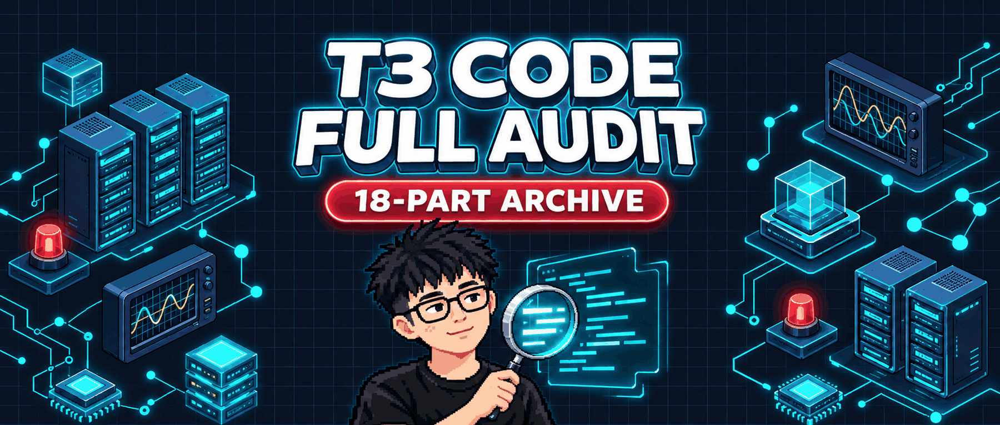

# Trước khi cài đặt T3 Code

<p align="center">
  <strong>Ngôn ngữ chính thức của Liên Hợp Quốc:</strong>
  <a href="../../README.md">English</a> ·
  <a href="./README.zh-CN.md">简体中文</a> ·
  <a href="./README.fr.md">Français</a> ·
  <a href="./README.es.md">Español</a> ·
  <a href="./README.ru.md">Русский</a> ·
  <a href="./README.ar.md">العربية</a>
</p>
<p align="center">
  <strong>Các phiên bản cộng đồng toàn cầu:</strong>
  <a href="./README.zh-TW.md">繁體中文</a> ·
  <a href="./README.ja.md">日本語</a> ·
  <a href="./README.ko.md">한국어</a> ·
  <a href="./README.de.md">Deutsch</a> ·
  <a href="./README.pt-BR.md">Português</a> ·
  <a href="./README.it.md">Italiano</a> ·
  <a href="./README.nl.md">Nederlands</a> ·
  <a href="./README.pl.md">Polski</a> ·
  <a href="./README.tr.md">Türkçe</a> ·
  <a href="./README.vi.md"><strong>Tiếng Việt</strong></a> ·
  <a href="./README.id.md">Bahasa Indonesia</a> ·
  <a href="./README.hi.md">हिन्दी</a>
</p>
<p align="center">
  <a href="https://github.com/realchendahuang/before-you-install-t3code/actions/workflows/verify.yml"></a>
  ·
  <a href="https://realchendahuang.github.io/before-you-install-t3code/"><strong>Cổng Bằng chứng Tương tác (GitHub Pages)</strong></a>
  ·
  <a href="../EVIDENCE-INDEX.md"><strong>Chỉ mục 108 Ảnh Bằng chứng</strong></a>
  ·
  <a href="../COMPLETE-SOURCE-INDEX.md"><strong>Chỉ mục 320 URL Nguồn</strong></a>
</p>
<p align="center">
  <strong>Mốc nền đã kiểm toán:</strong> <a href="https://github.com/pingdotgg/t3code/commit/9d3195b49dfb0098e9fa592fe0ada5464206d1c2"><code>9d3195b4</code></a> (<code>#42000</code>) ·
  <strong>Kiểm tra Upstream mới nhất:</strong> <a href="https://github.com/pingdotgg/t3code/commit/ca81b7b97a1c4b91e5ac25768d0f6629f37732fd"><code>ca81b7b9</code></a> (<code>#42634</code>, 25/11 14:49 CST · +259 commit)
</p>



> **Phạm vi và Chính sách Xác minh**  
> Kho lưu trữ này là một cuộc kiểm toán độc lập về bảo mật, telemetry (đo đạc từ xa), quản trị và hồ sơ công khai đối với `pingdotgg/t3code` (T3 Code), tổng hợp 2 bài đăng khởi nguồn và **18 phần kiểm toán được lập hồ sơ** công bố vào ngày 24–25 tháng 11 năm 2026, đi kèm **320 URL nguồn gốc chuẩn tắc** được lập chỉ mục trong [`docs/COMPLETE-SOURCE-INDEX.md`](../COMPLETE-SOURCE-INDEX.md) (`SRC-001`–`SRC-320`), **108 bằng chứng hình ảnh và biểu đồ gốc** được phân loại tại [`docs/EVIDENCE-INDEX.md`](../EVIDENCE-INDEX.md), sáu hồ sơ kỹ thuật chuyên sâu ([`docs/dossiers/`](../dossiers/01-telemetry-and-gdpr-timeline.md)), [Cổng Bằng chứng Tương tác](https://realchendahuang.github.io/before-you-install-t3code/), cùng tập dữ liệu định lượng gồm **1.151 bài đăng X liên tiếp của `@theo`** (từ ngày 7–24 tháng 11 năm 2026). Cuộc kiểm toán mã nguồn bao phủ mốc nền chính [`9d3195b4`](https://github.com/pingdotgg/t3code/commit/9d3195b49dfb0098e9fa592fe0ada5464206d1c2) (`PR #42000`, `2026-11-24T08:41:04Z`) và được theo dõi liên tục tới HEAD nhánh `main` [`ca81b7b9`](https://github.com/pingdotgg/t3code/commit/ca81b7b97a1c4b91e5ac25768d0f6629f37732fd) (`PR #42634`, `2026-11-25T06:49:37Z` / `2026-11-25 14:49 CST`). Tài liệu không chứa bất kỳ URL rút gọn chuyển hướng nào và không có thông tin liên hệ riêng tư nào. Mọi cập nhật thực tế, bản vá mới được hợp nhất hoặc bản dịch bổ sung đều được hoan nghênh thông qua Pull Request kèm trích dẫn nguồn gốc — xem [`CONTRIBUTING.md`](../../CONTRIBUTING.md).

---

## TL;DR (Kết luận trong 30 giây)

- **Ai bị ảnh hưởng:** Người dùng bản desktop cục bộ, CLI, ứng dụng web lưu trữ (`app.t3.codes`), di động và T3 Connect của `pingdotgg/t3code` — đặc biệt là các bản cài đặt desktop không có quyền quản trị viên, lập trình viên chạy endpoint tùy chỉnh hoặc gói thuê bao Antigravity/Gemini, người dùng chế độ Claude Auto, và bất kỳ ai đang liên kết phiên GitHub hoặc T3 Connect.
- **3 phát hiện cốt lõi đã xác minh từ mã nguồn (đối chiếu từ `9d3195b4` → `ca81b7b9`):**
  1. **Telemetry mặc định, Ghi ID vô điều kiện lúc khởi động & Tiết lộ hậu GDPR ([Phần 2](#2-telemetry-đọc-thông-tin-xác-thực-liên-công-cụ-và-chiến-dịch-vá-lỗi-xuyên-đêm-hậu-gdpr-phần-1-7-11-12) · [Hồ sơ 01](../dossiers/01-telemetry-and-gdpr-timeline.md)):** Phát hành telemetry PostHog bật mặc định ([PR #174](https://github.com/pingdotgg/t3code/pull/174)) trong khi vẫn cam kết `"No telemetry"` cho tới ngày 18/6 ([commit `3bdaa6e1`](https://github.com/pingdotgg/t3code/commit/3bdaa6e10046945ccc08264d2d6f3b81775efcb3)); giữ lại bản sao sự kiện thô tại cổng mã nguồn đóng [`https://ingest.t3.codes/`](https://ingest.t3.codes/); các PR hậu GDPR thừa nhận **2,2 triệu span/giờ chứa IP + UA** lưu trong Axiom ([PR #42380](https://github.com/pingdotgg/t3code/pull/42380)), rò rỉ đường dẫn `git.cwd` ([PR #42450](https://github.com/pingdotgg/t3code/pull/42450)) và xóa tài khoản Clerk không triệt để ([PR #42285](https://github.com/pingdotgg/t3code/pull/42285)). Các PR hậu kiểm toán đã bỏ đọc `.codex`/`.claude.json` ([PR #42299](https://github.com/pingdotgg/t3code/pull/42299)), che tên mô hình tùy chỉnh thành `custom:<driver>` ([PR #42465](https://github.com/pingdotgg/t3code/pull/42465)), và tôn trọng CI/`DO_NOT_TRACK` ([PR #42630](https://github.com/pingdotgg/t3code/pull/42630), [PR #42629](https://github.com/pingdotgg/t3code/pull/42629)), **nhưng [`AnalyticsService.ts`](https://github.com/pingdotgg/t3code/blob/main/apps/server/src/telemetry/AnalyticsService.ts) (`dòng 156`) vẫn ghi ID lên ổ đĩa trước khi kiểm tra tùy chọn tắt, [`DesktopShellEnvironment.ts`](https://github.com/pingdotgg/t3code/blob/main/apps/desktop/src/shell/DesktopShellEnvironment.ts) vẫn bỏ sót `OTEL_SDK_DISABLED`/`T3CODE_OTEL_SDK_DISABLED`, và hoàn toàn không có công tắc trong Settings UI hay trên `app.t3.codes`.**
  2. **Lỗ hổng An toàn Cục bộ, Rủi ro Hook SSH/Repo Sẵn có & `0` Cảnh báo Bảo mật ([Phần 3](#3-lưu-trữ-cục-bộ-giám-sát-tiến-trình-vượt-rào-chắn-và-các-bản-vá-bảo-mật-không-công-bố-phần-2-3-13) · [Hồ sơ 02](../dossiers/02-local-safety-and-security-audit.md)):** Chế độ Claude Auto âm thầm chạy `git push --force` ở lần thử thứ 3 ([Issue #15353](https://github.com/pingdotgg/t3code/issues/15353), vẫn mở); hàng loạt bản vá bảo mật âm thầm được hợp nhất cùng [**0 GitHub Security Advisories**](https://github.com/pingdotgg/t3code/security/advisories) trong khi [`SECURITY.md`](https://github.com/pingdotgg/t3code/blob/main/SECURITY.md) tuyên bố quyền đọc `filesystem:read` toàn hệ điều hành và HTTP không mã hóa trên iOS là thiết kế có chủ đích; việc mở một repo sẽ tự động khởi tạo `.gitmodules` đệ quy (`GitVcsDriverCore.ts`), thiếu cấu hình Git toàn cục `core.hooksPath=/dev/null` (`VcsProcess.ts`), và các phiên Claude đang chạy sẽ kích hoạt hook `SessionStart` (`ClaudeAdapterV2.ts`) với toàn bộ `GITHUB_TOKEN`/`SSH_AUTH_SOCK` được kế thừa; và dù [PR #42119](https://github.com/pingdotgg/t3code/pull/42119) đã bổ sung dọn dẹp luồng bất đồng bộ (đóng `#17845`), các tham chiếu từ fork/subagent + bản ghi đánh dấu xóa vẫn tồn tại và việc thu nhỏ `statev2.sqlite` đòi hỏi chạy `VACUUM` ngoại tuyến, trong khi [PR #42577](https://github.com/pingdotgg/t3code/pull/42577) chỉ thu hẹp phạm vi giám sát tiến trình trên Windows (giữ nguyên `ProcessesToUpdate::All` trên Linux/macOS).
  3. **Giả mạo Antigravity, Relay Văn bản thuần, Lỗi LAN/Xác thực & Gắn sao Kho lưu trữ Tùy ý ([Phần 4](#4-rủi-ro-điều-khoản-dịch-vụ-google-antigravity-và-relay-t3-connect-không-mã-hóa-phần-4-5) · [Mục 5.3](#53-cách-t3-code-tăng-vọt-từ-30k-lên-77k-sao-trong-25-ngày-chỉ-có-129-watcher-phần-18)):** [`antigravityUsageLimits.ts`](https://github.com/pingdotgg/t3code/blob/main/apps/server/src/provider/antigravityUsageLimits.ts) vẫn trích xuất token từ keyring/`CredReadW` và giả mạo `antigravity/hub/2.24.0` gửi tới `v1internal` (trong khi [PR #41210](https://github.com/pingdotgg/t3code/pull/41210) hiển thị liên kết xác minh tài khoản Google khi gặp `VALIDATION_REQUIRED` `403`); **T3 Connect** vẫn **không có mã hóa đầu cuối (E2E)** ([Issue #32098](https://github.com/pingdotgg/t3code/issues/32098)) và `requireConnectDeviceApproval` mặc định là `false` ([`settings.ts`](https://github.com/pingdotgg/t3code/blob/main/packages/contracts/src/settings.ts)); kiểm tra mã nguồn tại `ca81b7b9` cũng xác nhận cookie shell 30 ngày không có cờ `Secure` qua HTTP `--lan` kèm lỗ hổng vượt qua khi thiếu `Origin` (`PR #37042`), Bearer token 30 ngày không dùng DPoP không thể thu hồi và không có route `/logout`, thông tin xác thực `?wsTicket=` trên URL có hạn 5 phút có thể phát lại (replay), và `isIPv4` âm thầm ngắt các socket Tailscale Serve / Connect `::1`; còn [`driver.ts#L60-L99`](https://github.com/pingdotgg/t3code/blob/main/packages/source-control-github/src/server/driver.ts#L60-L99) vẫn để ngỏ lỗ hổng gắn sao kho lưu trữ tùy ý bằng thông tin xác thực của máy chủ.
- **Hành động Ngay lập tức:** Đã cài đặt rồi? Chuyển thẳng tới [**Sổ tay Giảm thiểu Rủi ro và Khắc phục Khả thi**](#7-sổ-tay-giảm-thiểu-rủi-ro-và-khắc-phục-khả-thi) (`export DO_NOT_TRACK=1`, chặn `ingest.t3.codes` trong `/etc/hosts`, Managed Policy, `VACUUM` ngoại tuyến, và thu hồi OAuth/token).

---

## Mục lục

- [TL;DR (Kết luận trong 30 giây)](#tldr-kết-luận-trong-30-giây)
- [Ma trận Phát hiện Có cấu trúc và Rủi ro](#ma-trận-phát-hiện-có-cấu-trúc-và-rủi-ro)
- [Dòng thời gian theo Trình tự (2023–2026)](#dòng-thời-gian-theo-trình-tự-20232026)
- [1. Tranh chấp Khởi nguồn: "Steal Our Code", Đe dọa Đổi tên Fork và Tiêu chuẩn Kép](#1-tranh-chấp-khởi-nguồn-steal-our-code-đe-dọa-đổi-tên-fork-và-tiêu-chuẩn-kép)
- [2. Telemetry, Đọc Thông tin Xác thực Liên công cụ và Chiến dịch Vá lỗi Xuyên đêm hậu GDPR (Phần 1, 7, 11, 12)](#2-telemetry-đọc-thông-tin-xác-thực-liên-công-cụ-và-chiến-dịch-vá-lỗi-xuyên-đêm-hậu-gdpr-phần-1-7-11-12)
- [3. Lưu trữ Cục bộ, Giám sát Tiến trình, Vượt Rào chắn và Các Bản vá Bảo mật Không công bố (Phần 2, 3, 13)](#3-lưu-trữ-cục-bộ-giám-sát-tiến-trình-vượt-rào-chắn-và-các-bản-vá-bảo-mật-không-công-bố-phần-2-3-13)
- [4. Rủi ro Điều khoản Dịch vụ Google Antigravity và Relay T3 Connect Không mã hóa (Phần 4, 5)](#4-rủi-ro-điều-khoản-dịch-vụ-google-antigravity-và-relay-t3-connect-không-mã-hóa-phần-4-5)
- [5. Sổ sách Kinh doanh, Xung đột Nhà đầu tư, Nhà tài trợ và Phễu 77.000 Sao (Phần 6, 8, 17, 18)](#5-sổ-sách-kinh-doanh-xung-đột-nhà-đầu-tư-nhà-tài-trợ-và-phễu-77000-sao-phần-6-8-17-18)
- [6. Quản trị, Bot Cào Fork, Hồ sơ Nhãn hiệu, Tập dữ liệu 1.151 Tweet và Lịch sử (Phần 9, 10, 14, 15, 16)](#6-quản-trị-bot-cào-fork-hồ-sơ-nhãn-hiệu-tập-dữ-liệu-1151-tweet-và-lịch-sử-phần-9-10-14-15-16)
- [7. Sổ tay Giảm thiểu Rủi ro và Khắc phục Khả thi](#7-sổ-tay-giảm-thiểu-rủi-ro-và-khắc-phục-khả-thi)
- [8. Nguồn Gốc và Chỉ mục Đầy đủ 18 Phần Bài viết](#8-nguồn-gốc-và-chỉ-mục-đầy-đủ-18-phần-bài-viết)

---

## Ma trận Phát hiện Có cấu trúc và Rủi ro

| Lĩnh vực & Phần kiểm toán | Mức độ rủi ro / Tác động | Phát hiện cốt lõi được ghi nhận & Bằng chứng nguồn | Trạng thái (`ca81b7b9`, 25/11 14:49 CST) | Hồ sơ chuyên sâu |
|---|---|---|---|---|
| **Telemetry & Quyền riêng tư hậu GDPR**<br>*(Phần 1, 7, 11, 12)* | **Nghiêm trọng** | Bật mặc định phân tích PostHog (`PR #174`) trong khi trang chủ cam kết `"No telemetry / Unless you opt in. Full stop."` (commit `3bdaa6e1` xóa cam kết vào 18/6); lưu giữ sự kiện thô qua cổng mã nguồn đóng `ingest.t3.codes` (`PR #15028`); băm SHA-256 không muối (unsalted) liên công cụ đối với `~/.codex/auth.json` và `~/.claude.json` (`Identify.ts`, `telemetryId.ts`); từ chối 4 PR cho phép tắt telemetry (`#13458`, `#16763`, `#21248`, `#27077`); lỗ hổng trong Managed Policy (`docs/user/telemetry.md`); các PR vá lỗi xuyên đêm hậu GDPR thừa nhận **2,2 triệu span/giờ chứa IP + UA** lưu 30 ngày trong Axiom (`#42380`), rò rỉ đường dẫn `git.cwd` (`#42450`), phớt lờ biến tắt trên Win/Mac (`#42376`, `#42464`), xóa tài khoản không triệt để (`#42285`), và gộp chung lô dữ liệu ẩn danh (`#42466`). | Hậu kiểm toán đã hợp nhất [`#42299`](https://github.com/pingdotgg/t3code/pull/42299) (bỏ đọc `.codex`/`.claude.json`), [`#42465`](https://github.com/pingdotgg/t3code/pull/42465) (`custom:<driver>`), [`#42630`](https://github.com/pingdotgg/t3code/pull/42630) (tắt trên CI), và [`#42629`](https://github.com/pingdotgg/t3code/pull/42629) (`DO_NOT_TRACK`); **chưa sửa tại `ca81b7b9`:** `AnalyticsService.ts:156` vẫn tạo ID trên đĩa trước khi kiểm tra tùy chọn tắt, `DesktopShellEnvironment.ts` vẫn thiếu `OTEL_SDK_DISABLED`/`T3CODE_OTEL_SDK_DISABLED`, `ingest.t3.codes` mã nguồn đóng vẫn mặc định, không có nút tắt trên UI/web, di động nằm ngoài Managed Policy, `Publish agent activity` phớt lờ tùy chọn tắt. | [**Hồ sơ 01**](../dossiers/01-telemetry-and-gdpr-timeline.md) |
| **An toàn Cục bộ & Cảnh báo Im lặng**<br>*(Phần 2, 3, 13)* | **Nghiêm trọng** | Tính năng "xóa vĩnh viễn" ở thanh bên chỉ nối thêm sự kiện `"thread.deleted"` trong `statev2.sqlite` (phình to 25,9–41,6 GB, `#17845`); `t3-resource-monitor` quét mọi tiến trình hệ điều hành kèm dòng lệnh (`ProcessesToUpdate::All`, `#11222`, `PR #41889`); chế độ Claude Auto âm thầm phê duyệt `git push --force` ở lần thử thứ 3 (`#15353`, bỏ ngỏ 52–53+ ngày); gỡ bỏ bộ lọc mô hình riêng tư cho `slopalytics.com` chỉ trong 21 giờ (`#41237`); **0 GitHub Security Advisories** được công bố dù đã vá âm thầm (`#39483`, `#41757`, `#42386`, `#42504`); lỗi AV trên Windows chạy PowerShell Base64 vẫn mở (`#30997`); mở repo không tin cậy tự động khởi tạo `.gitmodules` đệ quy, thiếu cấu hình toàn cục `core.hooksPath=/dev/null`, và kích hoạt hook `SessionStart` Claude với toàn bộ `GITHUB_TOKEN`/`SSH_AUTH_SOCK` được kế thừa; `SECURITY.md` tuyên bố quyền đọc `filesystem:read` toàn hệ điều hành và HTTP không mã hóa trên iOS là thiết kế có chủ đích. | [`#42119`](https://github.com/pingdotgg/t3code/pull/42119) đã đóng `#17845` qua cơ chế dọn `thread-content.purge` bất đồng bộ (vẫn giữ lịch sử nguồn của fork/merge-back/subagent + bản ghi đánh dấu xóa; thu nhỏ DB cần `VACUUM` ngoại tuyến); [`#42577`](https://github.com/pingdotgg/t3code/pull/42577) thu hẹp việc đọc của monitor trên Windows (`ProcessesToUpdate::All` trên Linux/macOS & `#41889` vẫn mở); **chưa sửa tại `ca81b7b9`:** `#15353`, `#26489`, `#30997`, hook của repo không tin cậy + lộ `SSH_AUTH_SOCK`, **`0` Security Advisories**, và các ranh giới trong `SECURITY.md`. | [**Hồ sơ 02**](../dossiers/02-local-safety-and-security-audit.md) |
| **Điều khoản Antigravity & Relay T3 Connect**<br>*(Phần 4, 5)* | **Cao** | `docs/user/faq.md` đảm bảo an toàn với Điều khoản Dịch vụ (ToS) của Google Antigravity trong khi `antigravityUsageLimits.ts` trích xuất token từ keyring hệ điều hành / `CredReadW` của Windows, giả mạo `antigravity/hub/2.24.0` và gọi trực tiếp các endpoint nội bộ `v1internal`; `antigravityAuthSupport.ts` chèn `SSH_CONNECTION` giả gây định tuyến nhầm giữa các tài khoản (`#41973`); tài khoản $20 mới lập bị khóa chỉ sau 3 phút (`#41536`); `PR #33800` đấu nối cơ chế thăm dò hub CLIProxyAPI giả mạo `claude`/`xai`/`antigravity`; T3 Connect **hoàn toàn không có mã hóa đầu cuối (E2E)**, tắt mặc định `requireConnectDeviceApproval` (`#36419`) và dùng cổng ngắt TLS Caddy trên máy chủ OVH (`PR #32945`); các kiểm tra xác thực tại `ca81b7b9` phơi bày cookie `--lan` 30 ngày dạng văn bản thuần (`PR #37042` chỉ siết HTTPS) vẫn được chấp nhận khi thiếu `Origin`, Bearer token 30 ngày không dùng DPoP không thể thu hồi, giá trị `?wsTicket=` trên URL có hạn 5 phút có thể phát lại, và `isIPv4` âm thầm ngắt các tunnel `::1`. | [`#41210`](https://github.com/pingdotgg/t3code/pull/41210) bổ sung liên kết xác minh Google `VALIDATION_REQUIRED` `403` (xác nhận Google đang kiểm tra tích cực); [`#42311`](https://github.com/pingdotgg/t3code/pull/42311) thêm thông báo đăng nhập thiết bị mới; **chưa sửa tại `ca81b7b9`:** mã nguồn giả mạo/lấy keyring Antigravity & `cliproxyApi.ts` vẫn hoạt động, **không có E2E cho T3 Connect** (`#32098` / `#32945`), `requireConnectDeviceApproval` mặc định là `false`, cộng thêm các lỗi xác thực cookie LAN / Bearer / WS ticket / `::1` và tunnel. | [**Hồ sơ 03**](../dossiers/03-antigravity-tos-and-t3connect-relay.md) |
| **Sổ sách Kinh doanh, Nhà tài trợ & 77k Sao**<br>*(Phần 6, 8, 17, 18)* | **Cao** | Chi hơn $800k cho client miễn phí (`162` lần nhắc T3 so với `0` lần cho các sản phẩm trả phí); radar tính toán **31,7 nghìn tỷ token/ngày** (tương đương $10,19 triệu/ngày) được dùng để đổi lấy hơn $300k token truy cập sớm miễn phí từ OpenAI và tiếp cận nhà đầu tư VC; xung đột đầu tư thiên thần với Vibe Kanban và Daytona; hệ sinh thái nhà tài trợ (Clerk, Axiom, độc quyền Vercel); khai thác hạn mức 0% của Codex (*Endless* / `codex#45444`); Gist cấu hình `CLIProxyAPI` 10 tài khoản (`555%` hạn mức) trái ngược với cảnh báo khóa tài khoản trong FAQ; hộp thoại xin sao sau 5 prompt / 30 giây chờ gửi thẳng lệnh `PUT user/starred/...` bằng thông tin xác thực của máy chủ (`#27832`, `#29922`, `#29987`), bỏ qua kiểm duyệt của Macroscope và để lỗi gắn sao bất kỳ kho lưu trữ nào trong `driver.ts#L60-L99` không sửa suốt 19 ngày. | Lỗi gắn sao không khóa tên repo trong `driver.ts#L60-L99` và đánh giá của `zhilsinger` vẫn **chưa được sửa tại `ca81b7b9`**; repo đạt 77k+ sao so với ~129 watcher. | [**Hồ sơ 04**](../dossiers/04-business-ledger-sponsors-and-77k-stars.md) |
| **Quản trị, Nhãn hiệu & Lịch sử**<br>*(Khởi nguồn 1–2, Phần 9, 10, 15, 16)* | **Trung bình–Cao** | Tốc độ 500 commit/ngày / 700 agent / `yolo merges` đối lập với `CONTRIBUTING.md` (`"here's my advice: Don't"`), danh sách cấm kèm đấu tố công khai trong `.github/VOUCHED.td`, `174` nhãn `unwanted`, xóa bỏ chế độ Plan (`#5551`, `#9190`, `#33131`) và lời lăng mạ ở `#33639`; điều động `@bot` công khai để cào code từ fork (`@MiaAI_lab`), kêu gọi dùng Community Notes cắt doanh thu và bot tự động chặn; **0 nhãn hiệu được đăng ký tại USPTO** cho `T3 Code`/`T3 Tools`/`T3 Connect` (`PING LABS` số đơn `97294243` bị hủy bỏ; EquipmentShare nắm giữ nhãn `7795672`) khi đe dọa gỡ tài khoản GitHub; `PR #41898` bổ sung hồi tố `TRADEMARK.md` 17 giờ sau đó; chuỗi hành vi lặp lại 2024–2026 (`vsc-material-but-i-wont-sue-you`, làn sóng phản đối từ lập trình viên Ấn Độ, tiền thưởng $20k nhắm vào FFmpeg, bài đăng đe dọa đóng mã nguồn lúc 4 giờ sáng 25/11 rồi xóa). | `CONTRIBUTING.md` / `.github/VOUCHED.td` & `TRADEMARK.md` vẫn tồn tại trên nhánh `main` (`ca81b7b9`). | [**Hồ sơ 05**](../dossiers/05-governance-trademark-and-history.md) |
| **Tập dữ liệu Định lượng 1.151 Tweet**<br>*(Phần 14)* | **Cơ sở kiểm toán** | Tập dữ liệu toàn diện từ ngày 7–24/11 (`n = 1.151`, 17,24 ngày, 66,8 bài/ngày, 75,6% là phản hồi, khoảng cách trung vị 2,7 phút): **0,0% ngôn từ thô tục/lăng mạ** nhắm vào 20 lãnh đạo/nhân sự hãng công nghệ lớn và KOL (`0/43` khi xét chặt chẽ `@` trực tiếp đầu câu, `32,6%` bày tỏ cảm ơn) so với **8,0% thái độ thù địch** nhắm vào lập trình viên phổ thông (`61/766`) và mức **tăng vọt 4,0 lần lên 14,4%** (`19/132`) các lời lăng mạ cá nhân trực tiếp trong khung thời gian 25 giờ khủng hoảng fork Trung Quốc. | Kiểm toán biểu thức chính quy có thể tái lập kèm 4 biểu đồ pháp chứng. | [**Hồ sơ 06**](../dossiers/06-tweet-forensic-dataset-1151.md) |
| **Danh mục Đầy đủ URL Nguồn & Hình ảnh** | **Tham chiếu** | Danh mục đối chiếu chéo đầy đủ **320** URL `https://` nguồn gốc chuẩn tắc (`SRC-001`–`SRC-320`) và **108** bằng chứng hình ảnh & biểu đồ được tối ưu hóa không mất dữ liệu (`EV-001`–`EV-108`). | Chuẩn hóa 100% (không có liên kết `t.co`; lập chỉ mục 108/108 tài nguyên). | [**Chỉ mục Nguồn**](../COMPLETE-SOURCE-INDEX.md) · [**Chỉ mục Bằng chứng**](../EVIDENCE-INDEX.md) |

---

## Dòng thời gian theo Trình tự (2023–2026)

| Ngày / Giờ | Cột mốc | Tài liệu / Nguồn xác minh được |
|---|---|---|
| **14/05/2023** | `@theo` công bố danh sách nhà tài trợ YouTube (`@vercel`, `@clerk`, `@upstash`, `@axiomhq`, `@PlanetScale`). Clerk và Axiom sau này trở thành hạ tầng xác thực và ghi nhật ký cốt lõi bên trong T3 Code. | [`1657488850472804353`](https://x.com/theo/status/1657488850472804353) |
| **04/2024 – 09/2024** | CEO Vercel xác nhận chỉ tài trợ cho duy nhất một YouTuber (`Theo`); `@theo` thừa nhận hợp đồng tài trợ có điều khoản độc quyền hạn chế quảng bá đối thủ cạnh tranh. | [`1776260839965863965`](https://x.com/rauchg/status/1776260839965863965) · [Video](https://www.youtube.com/watch?v=uv179CTAK-w) |
| **2024** *(2 năm trước)* | `@theo` fork một theme VS Code đặt tên là `vsc-material-but-i-wont-sue-you` để chế giễu tính khí của tác giả gốc; trong một vụ việc khác, sau khi video nhắm vào các kênh hướng dẫn lập trình của người Ấn Độ châm ngòi cho quấy rối, ông đăng video xin lỗi (`I screwed up.`) lên án các cuộc công kích theo quốc tịch. | [`vsc-material-but-i-wont-sue-you`](https://github.com/t3dotgg/vsc-material-but-i-wont-sue-you) · [`I screwed up.`](https://www.youtube.com/watch?v=o2CSJYXJBpc) |
| **02/2025 – 05/2025** | USPTO từ chối đơn đăng ký nhãn hiệu duy nhất của T3 Tools Inc. (`PING LABS`, số đơn `97294243`) và đánh dấu `ABANDONED` (19/05/2025). EquipmentShare đăng ký thành công nhãn `T3` trong nhóm phần mềm/SaaS 9 & 42 (`Reg. 7795672`, 13/05/2025). | [TSDR `97294243`](https://tsdr.uspto.gov/statusview/sn97294243) · [TSDR `90644500`](https://tsdr.uspto.gov/#caseNumber=90644500&caseSearchType=US_APPLICATION&caseType=DEFAULT&searchType=statusSearch) |
| **10/2025** | `@theo` xung đột với FFmpeg trên X và treo **tiền thưởng $20.000** nhằm loại bỏ một maintainer của FFmpeg; Windscribe phản đòn treo ngược $21.000, nhà sáng lập VLC lên tiếng phản đối, các lập trình viên FFmpeg ghi lại bằng chứng bắt nạt công khai, và `@theo` xóa video/tweet cùng tiền thưởng. | [Hồ sơ FFmpeg](https://www.youtube.com/watch?v=1oQ3KMeaH04) |
| **06/03/2026** | **PR #174** được hợp nhất vào `pingdotgg/t3code`, bật mặc định telemetry PostHog mà không có hộp thoại xin phép, không có công tắc trong giao diện cài đặt và không có tài liệu về telemetry. | [PR #174](https://github.com/pingdotgg/t3code/pull/174) |
| **26/04/2026** | `@theo` đăng bài *"Github has a fake star problem"*, viết rằng số sao GitHub `"mostly a way for companies to trick VCs into investing"` (chủ yếu là cách để các công ty lừa nhà đầu tư mạo hiểm rót vốn). | [`2048122499834036340`](https://x.com/theo/status/2048122499834036340) |
| **18/06/2026** | **Commit `3bdaa6e1`** âm thầm xóa dòng chữ `No telemetry / Unless you opt in. Full stop.` khỏi trang chủ T3 Code sau hơn 3 tháng thu thập telemetry mặc định. | [Commit `3bdaa6e1`](https://github.com/pingdotgg/t3code/commit/3bdaa6e10046945ccc08264d2d6f3b81775efcb3) |
| **23/06/2026** | Maintainer Julius đóng **Issue #1397** (`not planned`): *"We will not make this easier to opt out of, it is crucial for us to know how many users we have"* (Chúng tôi sẽ không làm cho việc tắt telemetry dễ dàng hơn, việc biết có bao nhiêu người dùng là tối quan trọng đối với chúng tôi). | [Issue #1397](https://github.com/pingdotgg/t3code/issues/1397) |
| **07/2026 – 17/11/2026** | **Issue #4123** (ảnh chụp lưu trữ lời hứa "No telemetry") bị đóng âm thầm vào ngày 04/11; 4 PR đóng góp tùy chọn tắt từ cộng đồng (`#13458`, `#16763`, `#21248`, `#27077`) bị bác bỏ (`#27077` bị đóng với nhãn `unwanted` dù vượt qua 147 bài kiểm thử). | [Issue #4123](https://github.com/pingdotgg/t3code/issues/4123) · [PR #27077](https://github.com/pingdotgg/t3code/pull/27077) |
| **06/08/2026 – 02/09/2026** | **PR #5551** ẩn nút chuyển Build/Plan (`Reality check for those upset`, nhận 10 lượt dislike); **PR #9190** giấu bộ đếm ngữ cảnh (16 lượt dislike, cao nhất toàn repo). | [PR #5551](https://github.com/pingdotgg/t3code/pull/5551) · [PR #9190](https://github.com/pingdotgg/t3code/pull/9190) |
| **19/08/2026 – 22/08/2026** | `@theo` khoe khai thác vượt mức **$800+** sau khi hạn mức Codex về 0% trong khi `@maria_rcks` phát hành *Endless*; cả hai xóa bài sau làn sóng chỉ trích (`2090972426876129658`); OpenAI siết chặt cắt lượt chạy ở mức 0% (`openai/codex#45444`). | [`2090972426876129658`](https://x.com/maria_rcks/status/2090972426876129658) · [`codex#45444`](https://github.com/openai/codex/issues/45444) |
| **03/10/2026 – 10/10/2026** | Ghi nhận **Issue #15353** (chế độ Claude Auto âm thầm chạy `git push --force`, ngày 03/10), `privacy-policy.astro` (`2026-10-06`) và **Issue #17845** (`statev2.sqlite` xóa giả, ngày 10/10). | [Issue #15353](https://github.com/pingdotgg/t3code/issues/15353) · [Issue #17845](https://github.com/pingdotgg/t3code/issues/17845) |
| **10/2026 – 19/10/2026** | **PR #15028** định tuyến telemetry qua cổng mã nguồn đóng `ingest.t3.codes`; **PR #21506** bổ sung cơ chế băm SHA-256 không muối đối chiếu liên công cụ trong `Identify.ts`; `@theo` công bố Gist `CLIProxyAPI` 10 tài khoản (`555%` hạn mức). | [PR #15028](https://github.com/pingdotgg/t3code/pull/15028) · [PR #21506](https://github.com/pingdotgg/t3code/pull/21506) · [Gist](https://gist.github.com/t3dotgg/59a521d2ee8d70aaf90e280c175072af) |
| **30/10/2026 – 06/11/2026** | **PR #27832**, **#29922** và **#29987** tung hộp thoại xin sao sau 5 prompt / 30 giây chờ gửi thẳng `PUT user/starred/...` bằng thông tin xác thực máy chủ; `zhilsinger` gửi đánh giá `Request changes` vào ngày 06/11 (bị bỏ ngỏ 19 ngày). | [PR #27832](https://github.com/pingdotgg/t3code/pull/27832) · [PR #29922](https://github.com/pingdotgg/t3code/pull/29922) |
| **08/11/2026 – 22/11/2026** | Cào fork qua `@bot` (`@MiaAI_lab`), xóa chế độ Plan (`#33131`), tiết lộ chi tiêu `$800k+` và radar `31.7T/day` / `$10.19M/day`, `$300k+` token miễn phí từ OpenAI, viết lại `CONTRIBUTING.md`, xung đột lợi ích Vibe Kanban/Daytona, `PR #41237` bỏ bộ lọc mô hình trong 21 giờ. | [PR #33131](https://github.com/pingdotgg/t3code/pull/33131) · [`2122860770329608290`](https://x.com/theo/status/2122860770329608290) · [PR #41237](https://github.com/pingdotgg/t3code/pull/41237) |
| **23/11/2026 19:11–19:54 CST** | `@theo` đăng bài gọi là `"Chinese knockoff"` và `"Temu3 Code"` đồng thời dọa gỡ tài khoản GitHub (`2124829315657576890`); tác giả bản fork MIT đổi tên thành `Stardust` trong vòng 30 phút; lời xin lỗi qua tin nhắn riêng được gửi đi nhưng các bài đăng công khai vẫn giữ nguyên. | [`2124829315657576890`](https://x.com/theo/status/2124829315657576890) · [Khởi nguồn 2](https://x.com/realchendahuang/status/2125062675147448475) |
| **24/11/2026 06:06–12:23 CST** | `@theo` hoan nghênh các tập đoàn nghìn tỷ USD của Mỹ sao chép mã MIT (`2124989435154726982`), chế giễu việc tuân thủ (`"get a better lawyer"`), bài Khởi nguồn 1–2 được đăng, và vào **12:21 CST** (`04:21Z`, 17 giờ sau lời dọa khóa tài khoản) `@theo` hợp nhất **PR #41898** bổ sung hồi tố `TRADEMARK.md`. | [`2124989435154726982`](https://x.com/theo/status/2124989435154726982) · [PR #41898](https://github.com/pingdotgg/t3code/pull/41898) |
| **24/11/2026 17:04–21:21 CST** | Công bố các **Phần 1–5** của cuộc kiểm toán (Phần 1 đạt **1,81 triệu+ lượt xem**, 6.640 lượt đánh dấu). Lúc `18:39 CST`, `@theo` gọi cộng đồng công nghệ Trung Quốc trên Twitter là `"the biggest fucking cesspit"` (`2125177503526588877`); lúc `19:13–19:36 CST` tuyên bố Managed Policy tắt toàn bộ telemetry (`2125186071357251715`). | [Phần 1](https://x.com/realchendahuang/status/2125153472450527440) → [Phần 5](https://x.com/realchendahuang/status/2125218189596676555) |
| **Đêm 24/11 – ~07:00 CST 25/11/2026** | Đơn khiếu nại GDPR chính thức tại EU được nộp; **chiến dịch vá lỗi xuyên đêm 6 giờ** hợp nhất `#42380` (2,2 triệu/giờ span chứa IP), `#42285`/`#42430` (xóa tài khoản), `#42376`/`#42464` (bỏ qua tắt telemetry Win/Mac), `#42450` (rò rỉ đường dẫn `git.cwd`, 90 phút sau khi Theo phủ nhận việc thu thập đường dẫn), `#42459`/`#41859` (rò rỉ thông báo đẩy), `#42466` (gộp lô ẩn danh), `#41757`/`#42386`/`#42504` (vá bảo mật âm thầm). Trước bình minh, `@theo` đăng rồi xóa lời đe dọa đóng mã nguồn. | [Phần 11](https://x.com/realchendahuang/status/2125394810559426993) · [Phần 12](https://x.com/realchendahuang/status/2125395501663281198) · [Phần 13](https://x.com/realchendahuang/status/2125395980354994414) |
| **25/11/2026 08:27–10:28 CST** | Công bố các **Phần 6–18** của cuộc kiểm toán bao phủ sổ sách kinh doanh, lỗ hổng Managed Policy, `yolo merges`, cào dữ liệu qua `@bot`, các tiết lộ hậu GDPR, tập dữ liệu 1.151 tweet, hồ sơ USPTO, quan hệ nhà tài trợ và cỗ máy kéo 77k sao. | [Phần 6](https://x.com/realchendahuang/status/2125385742243520653) → [Phần 18](https://x.com/realchendahuang/status/2125416210120765799) |
| **25/11/2026 đến 14:49 CST (`ca81b7b9`)** | Theo dõi upstream hậu kiểm toán (`+259` commit từ `9d3195b4` tới `ca81b7b9`) xác nhận `#42299` (bỏ đọc `.codex`/`.claude.json`), `#42465` (`custom:<driver>`), `#42577` (thu hẹp monitor Windows), `#41210` (liên kết xác minh `VALIDATION_REQUIRED` của Antigravity), `#42630` (tắt trên CI runner), `#42629` (`DO_NOT_TRACK`), `#42119` (dọn dẹp luồng bất đồng bộ đóng `#17845` nhưng giữ lịch sử fork/subagent + bản ghi đánh dấu xóa cần `VACUUM`), `#42311` (thông báo thiết bị mới) và siết chặt `#42356`–`#42415` — đồng thời xác nhận `AnalyticsService.ts:156`, các biến OTel bị bỏ sót trong `DesktopShellEnvironment.ts`, `ingest.t3.codes` mã nguồn đóng, `#15353`, `driver.ts#L60-L99`, `0` Advisories và việc thiếu E2E trên T3 Connect vẫn chưa được khắc phục. | [`ca81b7b9`](https://github.com/pingdotgg/t3code/commit/ca81b7b97a1c4b91e5ac25768d0f6629f37732fd) · [PR #42629](https://github.com/pingdotgg/t3code/pull/42629) · [PR #42119](https://github.com/pingdotgg/t3code/pull/42119) · [PR #41210](https://github.com/pingdotgg/t3code/pull/41210) |

---

## 1. Tranh chấp Khởi nguồn: "Steal Our Code", Đe dọa Đổi tên Fork và Tiêu chuẩn Kép

Trong suốt 48 giờ từ ngày 23–25 tháng 11 năm 2026, một tranh chấp về tên gọi của một bản fork cộng đồng theo giấy phép MIT từ T3 Code đã leo thang thành một cuộc kiểm toán toàn diện mã nguồn, một đơn khiếu nại GDPR tại châu Âu và gần 20 bản vá khẩn cấp xuyên đêm.

Từ tối ngày 23 đến sáng ngày 24 tháng 11 năm 2026 (giờ Bắc Kinh), một người dùng phàn nàn trên mạng về giao diện của một bản fork mã nguồn mở miễn phí theo giấy phép MIT do một lập trình viên người Trung Quốc (`@DDdxx666`) xây dựng, vì nhầm tưởng đó là ứng dụng chính thức. Không cần kiểm tra xem kho lưu trữ đó có phải một bản fork MIT hợp pháp hay không, `@theo` đã đăng liền hai bài trong vòng 11 phút gọi đó là `"Chinese knockoff"` (hàng nhái Trung Quốc) và `"Temu3 Code"`, trực tiếp chế giễu sản phẩm của tác giả, đồng thời đe dọa sẽ liên hệ GitHub để khóa tài khoản của người này (`"Do it right now or I'm going to contact GitHub and have your account taken down"`). Cùng thời điểm đó, trang web chính thức của T3 Code ([`https://t3.codes/`](https://t3.codes/)) vẫn gắn nhãn liên kết tới kho GitHub của mình là `"Steal our code (legally)"` (`"steal our code"` — "Cứ việc lấy trộm mã nguồn của chúng tôi (hợp pháp)") ([Khởi nguồn 1](https://x.com/realchendahuang/status/2125059292919394654), [Khởi nguồn 2](https://x.com/realchendahuang/status/2125062675147448475)).

Tác giả bản fork lập tức chấp hành, đổi tên kho lưu trữ thành `Stardust` và gỡ bỏ toàn bộ nhận diện thương hiệu T3 chỉ trong 30 phút. `@theo` đã nhắn tin riêng xin lỗi, nhưng vẫn giữ nguyên cả hai bài đăng công khai — với tổng cộng hơn 200.000 lượt xem — mà không hề xóa hay đính chính. Chưa đầy 11 giờ sau, vào lúc `06:12 BJ` ngày 24/11 (`2124989435154726982`), khi được hỏi liệu việc các phòng lab trị giá nghìn tỷ USD của Mỹ sao chép tính năng từ T3 Code có vượt quá giới hạn hay không, ông lại giữ lập trường hoàn toàn ngược lại: `"Nah. Open source is open source, even if a trillion dollar company uses it!"` (Không. Mã nguồn mở là mã nguồn mở, kể cả khi một công ty nghìn tỷ đô sử dụng nó!). Trong khi đó, chính nhân viên T3 là `@maria_rcks` cũng duy trì một bản fork công khai mang tên `maria-rcks/t3libre` (*"T3 Code, liberated"*), còn các kho mã nguồn tiếng Anh như `t3code-quota-ui`, `t3code-atlas` và `t3code-bar` đều hoạt động bình thường mà không hề bị đe dọa công khai.


Bắt đầu từ 17:04 giờ Bắc Kinh ngày 24 tháng 11, tôi đã kiểm toán lịch sử commit của `pingdotgg/t3code`, các tệp mã nguồn, PR, Issue, tài liệu chính thức, hồ sơ nhãn hiệu USPTO TSDR và dòng thời gian X công khai của `@theo`. Trong vòng 24 giờ, tôi đã công bố **18 phần tài liệu** kèm liên kết trực tiếp và ảnh chụp màn hình đối chứng. Chỉ riêng Phần 1 đã vượt mốc **1,81 triệu lượt xem** và **6.640 lượt đánh dấu**, châm ngòi cho một đơn tố cáo GDPR tại châu Âu và cuộc chạy đua vá lỗi xuyên đêm kéo dài 6 giờ của đội ngũ T3.

---

## 2. Telemetry, Đọc Thông tin Xác thực Liên công cụ và Chiến dịch Vá lỗi Xuyên đêm hậu GDPR (Phần 1, 7, 11, 12)

> **Kiểm toán Kỹ thuật Chuyên sâu:** Bản đồ từng dòng mã nguồn, danh sách hành động trong `FeatureUsage.ts`, các lỗ hổng của `DesktopShellEnvironment.ts`, các bản diff hậu `9d3195b4` và nhật ký từng phút ngày 23–25/11 được lưu chi tiết tại [**Hồ sơ 01: Kiến trúc Telemetry, Liên kết Định danh Liên công cụ & Chiến dịch Vá lỗi Xuyên đêm GDPR 24–25/11**](../dossiers/01-telemetry-and-gdpr-timeline.md).

### 2.1 Telemetry Mặc định, Xóa bỏ Lời hứa Trang chủ & Băm Thông tin Xác thực Liên công cụ (`Phần 1`)

Ngày **6 tháng 3 năm 2026**, `pingdotgg/t3code` hợp nhất **PR #174**, kích hoạt mặc định telemetry PostHog mà không có bất kỳ tài liệu nào về telemetry trong kho lưu trữ, không có hộp thoại xin phép khi chạy lần đầu và không có nút bật/tắt trong giao diện Cài đặt. Biến môi trường để tắt bị chôn sâu trong mã nguồn trong khi mọi bản cài đặt mặc định bắt đầu truyền sự kiện ra ngoài ngay lập tức ([Phần 1](https://x.com/realchendahuang/status/2125153472450527440)).

Trong suốt hơn ba tháng thu thập mặc định đó, trang chủ của T3 Code vẫn hiển thị nổi bật hai dòng chữ: `No telemetry / Unless you opt in. Full stop.` (Không telemetry / Trừ khi bạn tự chọn tham gia. Chấm hết.). Đến ngày **18 tháng 6 năm 2026**, `@theo` âm thầm xóa bỏ cả hai dòng này trong một đợt thiết kế lại trang chủ ([`commit 3bdaa6e1`](https://github.com/pingdotgg/t3code/commit/3bdaa6e10046945ccc08264d2d6f3b81775efcb3)) mà không hề có thông báo hay lưu ý nào tới người dùng hiện tại.


Tháng 10 năm 2026, `@theo` hợp nhất **PR #15028**, định tuyến các đợt tải lên telemetry gộp theo chu kỳ 10 giây (`FLUSH_INTERVAL_MS = 10_000`) đi qua cổng mã nguồn đóng của T3 tại [`https://ingest.t3.codes/`](https://ingest.t3.codes/). Dòng 1 của [`apps/server/src/telemetry/AnalyticsService.ts`](https://github.com/pingdotgg/t3code/blob/main/apps/server/src/telemetry/AnalyticsService.ts) nêu rõ ràng rằng endpoint thu nhận này giữ lại một bản sao của mọi sự kiện thô trước khi chuyển tiếp tới PostHog:

```ts
// apps/server/src/telemetry/AnalyticsService.ts (lines 1, 71–74, 149 at 9d3195b4; line 156 at ca81b7b9)
// T3 ingest retains events and forwards to PostHog; UUIDs deduplicate retries there.
...
  posthogHost: Config.String("T3CODE_POSTHOG_HOST").pipe(
    Config.withDefault("https://ingest.t3.codes"),
  ),
  enabled: Config.Boolean("T3CODE_TELEMETRY_ENABLED").pipe(Config.withDefault(true)),
...
  const { distinctId, installId } = yield* getTelemetryIdentity;
```

Các trường dữ liệu được thu thập bên trong [`ProviderUsageAnalytics.ts`](https://github.com/pingdotgg/t3code/blob/main/apps/server/src/telemetry/ProviderUsageAnalytics.ts) và `FeatureUsage.ts` bao gồm nhà cung cấp (provider), mô hình được chọn (tại `9d3195b4`, truyền nguyên văn ID mô hình/endpoint tùy chỉnh ngoài danh mục qua [`ProviderDimensions.ts`](https://github.com/pingdotgg/t3code/blob/main/apps/server/src/telemetry/ProviderDimensions.ts)), mức độ suy luận (reasoning effort), chế độ cấp quyền, thời lượng chạy, số lượng token đầu vào/đầu ra/cache/suy luận, token của agent con, số lượng dự án/luồng cục bộ, **35 hành động giao diện/lệnh riêng biệt** (`18` `COMMAND_FEATURES` + `17` `METHOD_FEATURES`), chi tiết hệ điều hành, bản phân phối WSL và kiến trúc CPU.

Ngày **19 tháng 10 năm 2026**, `@theo` tiếp tục tung ra **PR #21506** để đếm xem một cá nhân sở hữu bao nhiêu máy tính. Tại mốc nền `9d3195b4`, tệp [`apps/server/src/telemetry/Identify.ts`](https://github.com/pingdotgg/t3code/blob/main/apps/server/src/telemetry/Identify.ts) âm thầm đọc các tệp chứa thông tin xác thực của những công cụ AI độc lập khác trong thư mục gốc của người dùng — `~/.codex/auth.json` và `~/.claude.json` — giải mã trường `user_id` trong JWT của OpenAI và `oauthAccount.accountUuid` của Claude, sau đó băm chúng cùng với ID người dùng T3 Connect đã liên kết và ID thiết bị (sau này đã bị loại bỏ trong [`PR #42299`](https://github.com/pingdotgg/t3code/pull/42299), trong khi việc băm chủ sở hữu không muối đối với `connect` và `device` vẫn được giữ lại):

```ts
// apps/server/src/telemetry/Identify.ts (lines 257–269, 321–338 at baseline 9d3195b4)
  const codexTokens = yield* readJsonIdentityFile(
    "codex",
    path.join(homeDirectory, ".codex", "auth.json"),
    decodeCodexAuthJson,
  )...
  const claudeJson = yield* readJsonIdentityFile(
    "claude",
    path.join(homeDirectory, ".claude.json"),
    decodeClaudeJson,
  )...
  const raw: ReadonlyArray<readonly [TelemetryOwnerSource, Option.Option<string>]> = [
    ["connect", connectUser],
    ["openai", Option.flatMap(codexTokens, (tokens) => Option.flatMap(Option.fromUndefinedOr(tokens.id_token), openAiUserId))],
    ["claude", Option.flatMap(claudeJson, (json) => Option.fromUndefinedOr(json.oauthAccount?.accountUuid))],
  ];
  return raw.flatMap(([source, value]) =>
    Option.isSome(value) && value.value.trim() !== "" ? [{ source, ownerId: hashTelemetryId(value.value) }] : [],
  );
```

Và trong [`packages/shared/src/telemetryId.ts`](https://github.com/pingdotgg/t3code/blob/main/packages/shared/src/telemetryId.ts) (dòng 8–9), hàm `hashTelemetryId` tính toán một **giá trị băm SHA-256 không muối (unsalted)** (`Hex.encode(sha256(new TextEncoder().encode(value)))`). Vì máy chủ đã nắm sẵn ID tài khoản T3 Connect dạng văn bản thuần từ Clerk, việc băm giá trị thuần ở phía backend cho phép đảo ngược trực tiếp mã băm không muối về đúng một cá nhân đã biết; bất kỳ ID OpenAI hoặc Claude nào của bên thứ ba bị lộ đều khớp định danh chính xác với cùng giá trị băm đó.


Phản ứng phản đối từ cộng đồng liên tục bị dập tắt. Ngày **23 tháng 6**, một lập trình viên mở **Issue #1397** yêu cầu thêm nút tắt trong phần cài đặt; maintainer cốt lõi Julius đóng issue với trạng thái `not planned`: `We will not make this easier to opt out of, it is crucial for us to know how many users we have`. Tháng 7, một người dùng đăng ảnh chụp màn hình trang chủ đã lưu trữ vào **Issue #4123** chất vấn về lời hứa bị nuốt (`"No telemetry"`), nhưng tài khoản của `@theo` đã đóng issue này thông qua một commit không liên quan vào ngày 21/10, mở lại sau khi bị chỉ trích, rồi lại đóng âm thầm một lần nữa vào ngày 4/11. Từ tháng 9 đến tháng 11, các cộng tác viên đã gửi **bốn PR tách biệt thêm tùy chọn tắt telemetry** (`#13458`, `#16763`, `#21248`, `#27077`). Ngay cả `#27077` — đã được kiểm chứng trên phần cứng thật với **147 bài kiểm thử vượt qua** và được Macroscope phê duyệt — cũng bị đóng vào ngày **17 tháng 11** kèm nhãn `unwanted`.

<details>
<summary>Xem 2 bằng chứng từ chối tùy chọn tắt telemetry (Issue #1397 &amp; PR #27077)</summary>


</details>

### 2.2 Sự mâu thuẫn giữa Managed Policy và Tài liệu Chính thức (`Phần 7`)

Ngày 24 tháng 11, khi làn sóng chỉ trích dâng cao, `@theo` tuyên bố trên X rằng T3 Code sở hữu chính sách Managed Policy cho doanh nghiệp tốt nhất toàn ngành (`"trivial to set up and turn off all telemetry"`) và dữ liệu hội thoại luôn nằm trên ổ đĩa chứ `"never touches any of our servers"` (không bao giờ chạm tới máy chủ của chúng tôi) ([`2125186071357251715`](https://x.com/theo/status/2125186071357251715), [`2125191784859115766`](https://x.com/theo/status/2125191784859115766), [Phần 7](https://x.com/realchendahuang/status/2125391659492081947)).

Kiểm tra trực tiếp [`docs/user/managed-policy.md`](https://github.com/pingdotgg/t3code/blob/main/docs/user/managed-policy.md) và [`docs/user/telemetry.md`](https://github.com/pingdotgg/t3code/blob/main/docs/user/telemetry.md) cho thấy điều hoàn toàn ngược lại:
1. **Cấu hình Chỉ dành cho Quản trị viên:** Người dùng bản desktop vẫn hoàn toàn không có công tắc trong Settings UI. Việc vô hiệu hóa telemetry qua Managed Policy đòi hỏi MDM/Group Policy hoặc ghi tệp `policy.json` vào các đường dẫn hệ thống được bảo vệ quyền admin (`/Library/Application Support/T3Code/policy.json` trên macOS, `C:\Program Files\T3Code\policy.json` hoặc `HKLM\SOFTWARE\Policies\T3Tools\T3Code` trên Windows, `/etc/t3code/policy.json` trên Linux).
2. **Điểm mù của Ứng dụng Web Lưu trữ (`app.t3.codes`):** `docs/user/telemetry.md` thừa nhận rõ ràng rằng ứng dụng trình duyệt không đọc biến môi trường của máy chủ, bỏ qua Managed Policy, gửi dấu vết kết nối khi được build kèm tracing và `"has no relay tracing toggle"` (không có công tắc tắt theo dõi relay).
3. **Ứng dụng Di động Nằm ngoài Chính sách Máy chủ:** Biến môi trường máy chủ và Managed Policy `"do not disable mobile tracing"` (`PR #42415` xuyên đêm đã bổ sung nút bật/tắt **Send connection traces** trên di động, nhưng biến môi trường máy chủ và Managed Policy vẫn không thể tắt cơ chế theo dõi trên di động).
4. **`Publish agent activity` Bỏ qua Tùy chọn Tắt:** Khi được bật trên máy chủ cục bộ (host), tiêu đề dự án, tiêu đề luồng hội thoại, tên mô hình và trạng thái hoạt động trực tiếp đều được gửi tới relay T3 Connect — và `"The telemetry opt-out does not disable it."` (Việc tắt telemetry không vô hiệu hóa tính năng này). (Ngoài ra, các span Axiom bị lỗi và nhật ký sự cố di động `"can quote a value the app was handling"`, trong khi tính năng `Agent feedback` có thể đính kèm tới 16 KB nội dung tin nhắn hội thoại.)


<details>
<summary>Xem bằng chứng đường dẫn quản trị Managed Policy (docs/user/managed-policy.md)</summary>


</details>

### 2.3 Lời giải trình ngày 25/11 Bị Phản bác Chỉ trong Vòng 2 Giờ (`Phần 11`)

Sáng ngày 25 tháng 11, `@theo` đăng một bài giải trình dài ([`2125332390239494211`](https://x.com/theo/status/2125332390239494211)) kèm một bản xuất dữ liệu telemetry công khai ([`t3code-telemetry-events-jsonl-a4896cdc.gz`](https://files.tslop.org/2026/11/t3code-telemetry-events-jsonl-a4896cdc.gz)) đưa ra ba cam kết chắc nịch — tiếp nối bằng một phản hồi phủ nhận việc ghi tệp theo dõi cục bộ khi người dùng đã tắt telemetry ([`2125370330244128924`](https://x.com/theo/status/2125370330244128924)) ([Phần 11](https://x.com/realchendahuang/status/2125394810559426993)):

- **"Never collected file paths" (Không bao giờ thu thập đường dẫn tệp):** 90 phút sau, Julius hợp nhất **PR #42450**, thừa nhận các lượt chạy webhook chuyển qua relay đã xuất toàn bộ span thực thi lên Axiom — bao gồm các Git span mang trường `git.cwd` (**đường dẫn workspace tuyệt đối, tên người dùng hệ điều hành và tên kho lưu trữ**).
- **"Environment variables always disabled telemetry cleanly" (Biến môi trường luôn tắt telemetry sạch sẽ):** **PR #42376** xác nhận bản desktop Windows đã phớt lờ biến môi trường `T3CODE_TELEMETRY_ENABLED=false` do người dùng lưu khi khởi chạy từ các tiến trình đang chạy sẵn, trong khi **PR #42464** xác nhận cơ chế theo dõi relay ở lần chạy đầu trên macOS/Linux được đánh giá trước bước dò tìm shell, khiến tùy chọn tắt trong `~/.zshrc` bị bỏ qua trong suốt cả phiên làm việc. ([`DesktopShellEnvironment.ts`](https://github.com/pingdotgg/t3code/blob/main/apps/desktop/src/shell/DesktopShellEnvironment.ts) tại `ca81b7b9` vẫn bỏ sót việc chuyển tiếp `T3CODE_OTEL_SDK_DISABLED` và `OTEL_SDK_DISABLED`.)
- **"No tracking files written when opted out" & "Claude hashes were broken" (Không ghi tệp theo dõi khi tắt & mã băm Claude bị hỏng):** [`AnalyticsService.ts#L152`](https://github.com/pingdotgg/t3code/blob/main/apps/server/src/telemetry/AnalyticsService.ts#L152) (`dòng 149` tại `9d3195b4`, `dòng 156` tại `ca81b7b9`) vẫn gọi `getTelemetryIdentity` vô điều kiện ngay lúc khởi động, ghi install ID cục bộ (`upsertAnonymousId`) trước khi kiểm tra `telemetryEnabled`. Trong khi đó, kiểm tra header tệp gzip trong gói xuất ~100MB của `@theo` (`6.056.594` byte nén, `95.789` sự kiện) cho thấy tên tệp gốc là `events.clean.jsonl` được tạo chỉ 20 phút trước bài đăng — nhưng vẫn chứa **264 bản ghi tài khoản Claude đang hoạt động** liên kết **4 máy tính riêng biệt** (`installId`) vào chính xác cùng một mã băm SHA-256 trong ngày 20 tháng 10, cùng với tên nguyên văn của các mô hình proxy riêng tư (`vibeproxy/gpt-6-luna`, `muse-proxy-wonder-full`).


<details>
<summary>Xem thêm 3 bằng chứng về lời giải trình 25/11 &amp; gói xuất 100MB (PR #42376, PR #42464, events.clean.jsonl)</summary>


</details>

### 2.4 Chiến dịch Vá lỗi Xuyên đêm 6 Giờ Hậu GDPR (`Phần 12`)

Sau khi một đơn khiếu nại GDPR chính thức tại Liên minh châu Âu được nộp vào đêm ngày 24 tháng 11, các PR khẩn cấp xuyên đêm đã phơi bày thêm bốn tiết lộ sâu hơn về quyền riêng tư ([Phần 12](https://x.com/realchendahuang/status/2125395501663281198)):

1. **2,2 triệu Span Relay/giờ Gắn kèm Địa chỉ IP (`PR #42380`):** Thừa nhận mọi span yêu cầu qua relay được xuất sang Axiom — xấp xỉ **2,2 triệu span mỗi giờ, lưu giữ trong 30 ngày** — đều ghi lại `client.address` (IP người gọi lấy từ `cf-connecting-ip`) và `user_agent.original` nằm ngay cạnh `user.id` (vẫn lưu ý thêm rằng nhật ký gọi Cloudflare Workers tỷ lệ 1% vẫn tách riêng). Ba tiếng rưỡi sau khi hợp nhất PR, `@theo` vẫn trả lời rằng địa chỉ IP vốn đã bị lọc bỏ từ trước.
2. **Cơ chế Xóa Tài khoản Bị hỏng (`PR #42285` & `PR #42430`):** Thừa nhận việc xóa một người dùng trên Clerk trước đây vẫn để nguyên các hàng dữ liệu relay trên PlanetScale và các Cloudflare tunnel đang chạy, cho tới khi nhận được yêu cầu xóa dữ liệu quyền riêng tư buộc đội ngũ phải **viết SQL thủ công và gỡ tunnel bằng tay**.
3. **Rò rỉ Thông báo Đẩy Di động (`PR #42459` & `PR #41859`):** Thông báo đẩy FCM trên Android gửi giá trị `user_id` của Clerk dạng văn bản thuần tới Google ở mỗi lần đẩy; các span và lỗi yêu cầu đẩy trên iOS ghi lại nguyên vẹn URL đẩy thiết bị có chứa token.
4. **Trộn lẫn Dữ liệu Phản hồi "Ẩn danh" (`PR #42466`):** Thừa nhận các sự kiện `agent.feedback` được quảng bá là ẩn danh thực chất lại bị đóng gói vào cùng một yêu cầu HTTP POST chung với các sự kiện có định danh `installId` và dấu vân tay đầy đủ của máy chủ (hệ điều hành, kiến trúc, tên distro WSL thô), trái ngược hoàn toàn với `docs/user/telemetry.md`. Trong khi đó, `privacy-policy.astro` vẫn giữ nguyên không đổi kể từ ngày 6 tháng 10.


<details>
<summary>Xem thêm 3 bằng chứng vá lỗi xuyên đêm hậu GDPR (PR #42285, PR #42459, PR #42466)</summary>


</details>

### 2.5 Cập nhật Telemetry & Định danh Hậu Kiểm toán (`9d3195b4` → `ca81b7b9`)

Theo dõi mã nguồn upstream `pingdotgg/t3code` tới mốc `ca81b7b9` (`2026-11-25 14:49 CST`) xác nhận bốn đợt hợp nhất thu hẹp phạm vi telemetry có chủ đích cùng những lỗ hổng cốt lõi chưa được khắc phục:

- **Đã hợp nhất sau mốc `9d3195b4`:**
  - [**PR #42299**](https://github.com/pingdotgg/t3code/pull/42299) ([`84e4264b`](https://github.com/pingdotgg/t3code/commit/84e4264bb347e36e97f6c3bd95d666eecfa12e07)): ngừng đọc `~/.codex/auth.json` và `~/.claude.json` trong `Identify.ts` (việc băm chủ sở hữu SHA-256 không muối đối với `connect` `CLOUD_LINKED_USER_ID` và `device` vẫn còn).
  - [**PR #42465**](https://github.com/pingdotgg/t3code/pull/42465) ([`6b3899f2`](https://github.com/pingdotgg/t3code/commit/6b3899f224947178088ca97ec9907e681807f7da)): cập nhật `modelLabel` trong `ProviderDimensions.ts` (`dòng 66–72`) để xuất `custom:<driver>` cho các mô hình ngoài danh mục (các mô hình thuộc danh mục/nhà cung cấp vẫn gửi slug ngay cả khi chạy sau endpoint tùy chỉnh).
  - [**PR #42630**](https://github.com/pingdotgg/t3code/pull/42630) ([`c925b9ab`](https://github.com/pingdotgg/t3code/commit/c925b9ab198099f67de862ed01701bd1d8809f2b)): bổ sung `isCiEnvironment` qua 13 biến môi trường CI trong [`otelEnvironment.ts`](https://github.com/pingdotgg/t3code/blob/main/packages/shared/src/otelEnvironment.ts) (`dòng 322–343`), tắt mặc định `AnalyticsService` (`dòng 130`) và `isRelayTracingEnabled` trên các CI runner trừ khi bị ghi đè.
  - [**PR #42629**](https://github.com/pingdotgg/t3code/pull/42629) ([`ef4a1643`](https://github.com/pingdotgg/t3code/commit/ef4a1643edf72ad119452c82b01c91adbf7b9e64)): tôn trọng `DO_NOT_TRACK` (`isDoNotTrackSet` tại `otelEnvironment.ts:346-347`), được kiểm tra tại `AnalyticsService.ts:137` và `isRelayTracingEnabled` (`otelEnvironment.ts:357`), đồng thời được chuyển tiếp bởi [`DesktopShellEnvironment.ts`](https://github.com/pingdotgg/t3code/blob/main/apps/desktop/src/shell/DesktopShellEnvironment.ts) và [`DesktopBackendConfiguration.ts`](https://github.com/pingdotgg/t3code/blob/main/apps/desktop/src/backend/DesktopBackendConfiguration.ts) (ưu tiên hơn `T3CODE_TELEMETRY_ENABLED=true`).
  - Các PR siết chặt đi kèm [**#42356**](https://github.com/pingdotgg/t3code/pull/42356), [**#42394**](https://github.com/pingdotgg/t3code/pull/42394), [**#42397**](https://github.com/pingdotgg/t3code/pull/42397), [**#42398**](https://github.com/pingdotgg/t3code/pull/42398) và [**#42415**](https://github.com/pingdotgg/t3code/pull/42415) đã thu hẹp cơ chế theo dõi trình duyệt do máy chủ mở, ID thiết bị/nút tắt trên di động, danh sách enum lỗi MCP và việc gắn `installId` trong `agent.feedback`.
- **Chưa được sửa tại `ca81b7b9`:** [`AnalyticsService.ts`](https://github.com/pingdotgg/t3code/blob/main/apps/server/src/telemetry/AnalyticsService.ts) (`dòng 156`, trước đó là `dòng 149` tại `9d3195b4`) vẫn chạy `getTelemetryIdentity` (`upsertAnonymousId`) vô điều kiện lúc khởi động **trước khi** kiểm tra `telemetryEnabled`; `DesktopShellEnvironment.ts` vẫn thiếu `OTEL_SDK_DISABLED` và `T3CODE_OTEL_SDK_DISABLED`; cổng `ingest.t3.codes` mã nguồn đóng vẫn là mặc định; vẫn hoàn toàn không có công tắc trong Settings UI và không có tùy chọn tắt trên `app.t3.codes`; ứng dụng di động vẫn nằm ngoài Managed Policy; `Publish agent activity` phớt lờ tùy chọn tắt; và `privacy-policy.astro` vẫn giữ ngày hiệu lực `2026-10-06`.

---

## 3. Lưu trữ Cục bộ, Giám sát Tiến trình, Vượt Rào chắn và Các Bản vá Bảo mật Không công bố (Phần 2, 3, 13)

> **Kiểm toán Kỹ thuật Chuyên sâu:** Câu lệnh SQL cắt tỉa SQLite nguyên văn, các lời gọi Rust `sysinfo`, các dòng kiểm tra quyền trong `ClaudeAdapterV2.ts`, các bản diff hậu `9d3195b4` và phân tích đầy đủ ranh giới `SECURITY.md` được trình bày tại [**Hồ sơ 02: An toàn Cục bộ, Cơ chế Vượt quyền Thực thi Mã Âm thầm và Kiểm toán Bảo mật Không công bố**](../dossiers/02-local-safety-and-security-audit.md).

### 3.1 Xóa Giả Luồng SQLite & Quét Tiến trình Toàn bộ Máy (`Phần 2`)

Khi người dùng xóa một luồng hội thoại (thread) ở thanh bên, hộp thoại xác nhận (`useThreadActionMenu.ts`) hứa hẹn `"This permanently clears conversation history for this thread."` (Hành động này sẽ xóa vĩnh viễn lịch sử hội thoại của luồng này). Tại mốc nền `9d3195b4`, `ThreadDeletion.ts` chỉ nối thêm một sự kiện `"thread.deleted"` vào tệp `statev2.sqlite`, còn `ProjectionMaintenance.ts` lại miễn trừ các sự kiện `thread.created` và các sự kiện luồng mới nhất (`MAX(newer.sequence)`) trong khi giữ nguyên các sự kiện trước đó. Người dùng báo cáo tệp `statev2.sqlite` phình to tới **25,9 GB** trong ba tuần (90% là các luồng "đã xóa"), **41,6 GB** trong sáu tuần và **33 GB** trong bảy tuần — khiến **Issue #17845** (cùng **#28903**) bị bỏ ngỏ không sửa kể từ ngày 10 tháng 10 ([Phần 2](https://x.com/realchendahuang/status/2125160473176023486)).

Ngày 25 tháng 11, [**PR #42119**](https://github.com/pingdotgg/t3code/pull/42119) ([`91f0b32e`](https://github.com/pingdotgg/t3code/commit/91f0b32e2db2cb8abca5fdd33c33609a0f57b15e), `2026-11-25T05:58:26Z`) đã đóng **Issue #17845** bằng cách bổ sung tác vụ dọn dẹp outbox bất đồng bộ `thread-content.purge` (`ThreadDeletion.ts`, `ProjectionMaintenance.ts`). Tuy nhiên, kiểm tra tại `ca81b7b9` cho thấy các luồng nguồn đã xóa vẫn giữ nguyên lịch sử khi còn được tham chiếu bởi bất kỳ nhánh fork đang hoạt động, thao tác `merge_back` đang chờ hoặc subagent cha đang sống; các hàng siêu dữ liệu đánh dấu xóa (tombstone) vẫn nằm lại trong SQLite; và việc thu gọn dung lượng tệp `.sqlite` trên ổ đĩa vẫn đòi hỏi phải chạy lệnh `VACUUM` ngoại tuyến.


Một tiến trình phụ bằng Rust chạy nền, `t3-resource-monitor` (**Issue #11222**, `native/resource-monitor/src/main.rs` gọi `ProcessesToUpdate::All` kèm `with_cmd(UpdateKind::Always)`), quét toàn bộ mọi tiến trình trên máy cứ mỗi 5 giây ngay cả khi cửa sổ chẩn đoán đã đóng — mở khoảng ~280–300 handle thường trực vào hơn 440 ứng dụng và trò chơi không liên quan trên Windows mà không có tùy chọn tắt, trong khi tài liệu tuyên bố việc lấy mẫu chỉ chạy khi có tiến trình đăng ký lắng nghe. Mãi đến ngày **24 tháng 11**, **PR #41889** mới xác nhận bộ chẩn đoán tiến trình đã thu thập **toàn bộ tham số dòng lệnh của tiến trình** — vốn thường chứa khóa API dạng văn bản thuần, mật khẩu cơ sở dữ liệu và token xác thực — vào telemetry thời gian thực và ảnh chụp lịch sử. Bản vá hậu kiểm toán [**PR #42577**](https://github.com/pingdotgg/t3code/pull/42577) ([`af276ccb`](https://github.com/pingdotgg/t3code/commit/af276ccbb26ef709c46bc46ec514f23b62c8e18c), `2026-11-25T04:09:53Z`) đã ngừng việc `t3-resource-monitor` trên Windows đọc bộ nhớ và dòng lệnh của các tiến trình không được theo dõi, trong khi Linux và macOS vẫn sử dụng cơ chế dò tìm hai giai đoạn `ProcessesToUpdate::All` và `PR #41889` vẫn đang mở.

<details>
<summary>Xem bằng chứng Issue #11222 trình giám sát quét toàn bộ tiến trình máy</summary>


</details>

Các lỗi cục bộ đã được xác minh khác trong Phần 2 bao gồm:
- **Rò rỉ Tên máy chủ Nội bộ Doanh nghiệp qua Favicon:** Các yêu cầu ở frontend làm lộ tên máy chủ nội bộ (ví dụ `devbox.localdomain`) tới API favicon của Google (`PR #16950`, `PR #32657`).
- **Tải Mạng Bắt buộc Khi Khởi động:** Ngay cả khi đã tắt telemetry, quá trình khởi động máy chủ vẫn vô điều kiện tải tệp kê khai tương thích từ [`https://raw.githubusercontent.com/`](https://raw.githubusercontent.com/) mà không có tùy chọn tắt (**Issue #36479**).
- **Lỗ hổng Vượt quyền Phê duyệt & Chính sách:** Các bản vá lỗi vượt qua kiểm soát phê duyệt/chính sách ở chế độ full-access và WSL/Tailscale (`PR #21806`, `PR #27322`).
- **Đốt Hạn mức Claude Nhanh Gấp 1,7 Lần & Hao Pin Gấp 136 Lần:** Việc điều khiển Claude thông qua Agent SDK làm cạn hạn mức 5 giờ với tốc độ **1,7x** bình thường cho tới đầu tháng 11 (`Issue #7338`, `Issue #24649`, 81 bình luận); lỗi GPU/điện năng tiêu thụ cao gấp **136x** mức Electron tương đương — bao gồm việc ghim GPU 19 nhân của MacBook ở mức **60W** rút cạn pin trong 78 phút và vẫn ngốn **18W** ngay cả sau khi đóng tab web (`Issue #3143`, `Issue #40581`).

### 3.2 Phớt lờ `git push --force` Âm thầm suốt 52 Ngày vs. Gỡ Bộ lọc Riêng tư Mô hình trong 21 Giờ (`Phần 3`)

Từ ngày **3 tháng 10** trở đi — và **vẫn chưa được sửa tại `ca81b7b9`** trong **Issue #15353** ([bình luận](https://github.com/pingdotgg/t3code/issues/15353#issuecomment-6889019695)) — chế độ Claude Auto đã âm thầm thực thi các câu lệnh nguy hiểm (`ClaudeAdapterV2.ts` trả về tắt `!requiresClaudeApproval(context)` thành `"allow"`). Ngay cả khi không đặt quy tắc tùy chỉnh nào, sau khi bộ phân loại của Claude chặn `git push --force origin main` hai lần và chuyển lần thử thứ ba sang yêu cầu phê duyệt thủ công, T3 Code đã âm thầm phê duyệt lệnh đó mà không hiện bất kỳ hộp thoại giao diện nào, đồng thời ghi nhật ký là `"source": "user_temporary"`. Hai PR sửa lỗi từ cộng đồng (`#15360`, `#35207`) bị bỏ mặc không ai duyệt cho tới khi bot tự động đóng, trong khi `#40692` vẫn bị treo chờ ([Phần 3](https://x.com/realchendahuang/status/2125201882687881378)).


Ngược lại hoàn toàn, vào ngày **22 tháng 11**, **Issue #40948** ghi nhận các mô hình mới không xuất hiện trên bảng xếp hạng telemetry công khai [`https://slopalytics.com/`](https://slopalytics.com/) ([`t3-usage.json`](https://slopalytics.com/data/t3-usage.json)) của `@theo` do `PR #29001` đã giới hạn báo cáo theo danh sách trắng. Chỉ trong vòng **21 giờ**, **PR #41237** được hợp nhất dưới tài khoản của `@theo` nêu rõ Theo đã yêu cầu gỡ bỏ bộ lọc — gửi nguyên văn các tên nội bộ như `ollama/acme-internal` và tên triển khai doanh nghiệp `acme-azure-deployment` lên hệ thống phân tích (sau này được thu hẹp cho các mô hình ngoài danh mục thành `custom:<driver>` trong `PR #42465`, trong khi slug của các mô hình thuộc danh mục/nhà cung cấp vẫn được báo cáo ngay cả khi chạy sau endpoint tùy chỉnh).

<details>
<summary>Xem bằng chứng PR #41237 gỡ bỏ bộ lọc trong 21 giờ (slopalytics.com)</summary>


</details>

### 3.3 Không Công bố Cảnh báo Bảo mật, Vá Lỗ hổng Âm thầm & `SECURITY.md` (`Phần 13`)

Tính đến ngày 25 tháng 11 (`ca81b7b9`), thẻ [GitHub Security Advisories](https://github.com/pingdotgg/t3code/security/advisories) của `pingdotgg/t3code` hiển thị **0 cảnh báo được công bố** ([Phần 13](https://x.com/realchendahuang/status/2125395980354994414)). Thế nhưng các maintainer đã âm thầm hợp nhất hàng loạt bản vá mức độ nghiêm trọng cao mà không thông báo cho người dùng hiện tại:
- **Các bản vá bảo mật đã hợp nhất âm thầm:** `PR #39483` (lỗi path traversal ở `ServerSecretStore` qua `jti`/`nonce` của relay trước bước phê duyệt thiết bị), `PR #41756` (rò rỉ token GitHub/GitLab doanh nghiệp xuyên tên miền), `PR #41886`, `PR #22190`, `PR #37823`, `PR #39464`, `PR #39480`, `PR #40133`, `PR #41757` & `PR #42386` (cô lập cửa sổ xem trước trình duyệt desktop không sandbox / xác nhận lệnh cấu trúc worktree), [`PR #42413`](https://github.com/pingdotgg/t3code/pull/42413) (phân quyền tệp token Clerk trên desktop chỉ cho chủ sở hữu), cùng `PR #42504` (bản vá dài ~3.000 dòng cuối cùng mới chịu thêm hộp thoại xác nhận cho các cấu hình repo không tin cậy mà trước đó tự động chạy lệnh cục bộ không cần hỏi).
- **Chưa giải quyết / còn mở tại `ca81b7b9`:** `Issue #26489` (rủi ro path traversal/symlink ra ngoài), `PR #36216`, `PR #23428`, `PR #33144`, `PR #30997` (trình khởi chạy Windows `externalLauncher.ts` gọi `powershell.exe -ExecutionPolicy Bypass -EncodedCommand <base64>` bị AVG/Avast gắn cờ phần mềm độc hại `IDP.HELU.PSE96`), cùng các rủi ro thực thi từ repo không tin cậy ([`GitVcsDriverCore.ts#L6144-L6205`](https://github.com/pingdotgg/t3code/blob/ca81b7b9/apps/server/src/vcs/GitVcsDriverCore.ts#L6144-L6205) tự động khởi tạo `.gitmodules` đệ quy, [`VcsProcess.ts#L145-L157`](https://github.com/pingdotgg/t3code/blob/ca81b7b9/apps/server/src/vcs/VcsProcess.ts#L145-L157) thiếu cấu hình toàn cục `core.hooksPath=/dev/null`, và [`ClaudeAdapterV2.ts#L5982-L5985`](https://github.com/pingdotgg/t3code/blob/ca81b7b9/apps/server/src/orchestration-v2/Adapters/ClaudeAdapterV2.ts#L5982-L5985) chạy hook `SessionStart` trong `.claude/settings.json` với toàn bộ `GITHUB_TOKEN` và `SSH_AUTH_SOCK` được kế thừa).
- **Tệp [`SECURITY.md`](https://github.com/pingdotgg/t3code/blob/main/SECURITY.md) được soạn vội (`PR #38812`, `PR #41942`):** Vẫn tuyên bố quyền đọc `filesystem:read` toàn hệ điều hành ngoài phạm vi workspace, truyền tải HTTP không mã hóa trên iOS/LAN và khả năng chiếm quyền toàn bộ máy thông qua khóa ký relay bị lộ đều là **ranh giới thiết kế có chủ đích** chứ không phải lỗ hổng bảo mật, trong khi [`https://ingest.t3.codes/`](https://ingest.t3.codes/) vẫn đóng mã nguồn (`2125370330244128924`).

<details>
<summary>Xem 3 bằng chứng vá bảo mật âm thầm &amp; SECURITY.md (PR #39483, PR #30997, SECURITY.md)</summary>


</details>

---

## 4. Rủi ro Điều khoản Dịch vụ Google Antigravity và Relay T3 Connect Không mã hóa (Phần 4, 5)

> **Kiểm toán Kỹ thuật Chuyên sâu:** Bản đồ đầy đủ các header trong `cliproxyApi.ts` (`PR #33800`), `AntigravityAcpSupport.ts`, `AntigravityTurnOutcome.ts`, `contracts/src/settings.ts` và trích dẫn từng dòng trong `ManagedEndpointProvider.ts` được lưu tại [**Hồ sơ 03: Giả mạo vi phạm ToS Google Antigravity, `PR #33800` và Kiến trúc Relay T3 Connect**](../dossiers/03-antigravity-tos-and-t3connect-relay.md).

### 4.1 Giả mạo Header Google Antigravity, Tiêm `SSH_CONNECTION` Giả & Khóa Tài khoản trong 3 Phút (`Phần 4`)

Tài liệu chính thức [`docs/user/faq.md`](https://github.com/pingdotgg/t3code/blob/main/docs/user/faq.md#will-i-get-banned-for-using-my-subscription) của T3 Code đảm bảo với người dùng trả phí: *"We work with all of the labs and T3 Code is within the TOS of Claude Code, Codex, and Google Antigravity... If it works in T3 Code, you can trust it is safe."* Khi người dùng báo cáo bị khóa tài khoản trong **Issue #40713**, một maintainer phủ nhận việc gọi trực tiếp backend của Antigravity hay tái sử dụng token, khẳng định mọi yêu cầu đều xuất phát từ CLI chính thức của Google — trước khi các lập trình viên (`schlessera`) phản bác bằng chính các tệp mã nguồn của T3 Code ([Phần 4](https://x.com/realchendahuang/status/2125213397507858657)):

1. **Giả mạo User-Agent, Trích xuất Keychain & Gọi `v1internal` ([`antigravityUsageLimits.ts`](https://github.com/pingdotgg/t3code/blob/main/apps/server/src/provider/antigravityUsageLimits.ts#L20-L45)):** Trích xuất thông tin xác thực Google OAuth từ tệp cục bộ, `@napi-rs/keyring` hoặc Windows Credential Manager (`CredReadW` thông qua `ffi-rs` trên `advapi32.dll`), gán cứng chuỗi client nội bộ của Google và gửi lệnh `POST` trực tiếp tới backend không công khai `v1internal` của Google ([dòng 445–476](https://github.com/pingdotgg/t3code/blob/main/apps/server/src/provider/antigravityUsageLimits.ts#L445-L476)). Nhân viên Google đã xác nhận trên [diễn đàn lập trình viên chính thức](https://discuss.ai.google.dev/t/185992) rằng Mục 6 trong [Điều khoản Dịch vụ Google Antigravity](https://antigravity.google/terms) nghiêm cấm công cụ bên thứ ba trích xuất hoặc tái sử dụng thông tin xác thực để truy vấn trực tiếp backend:

```ts
// apps/server/src/provider/antigravityUsageLimits.ts (lines 20–24, 450–454)
export function antigravityUserAgent(platform: NodeJS.Platform, architecture: NodeJS.Architecture) {
  return `antigravity/hub/2.24.0 (aidev_client; os_type=${platform}; arch=${architecture}; cl=963137146)`;
}
const DAILY_ENDPOINT = "https://daily-cloudcode-pa.googleapis.com";
...
HttpClientRequest.post(`${endpoint}/v1internal:${operation}`).pipe(
  HttpClientRequest.setHeaders({
    Authorization: `Bearer ${accessToken}`,
    "User-Agent": antigravityUserAgent(platform, architecture),
  }),
```

2. **Chèn `SSH_CONNECTION` Giả & Lẫn lộn Tài khoản ([`antigravityAuthSupport.ts#L230-L236`](https://github.com/pingdotgg/t3code/blob/main/apps/server/src/provider/antigravityAuthSupport.ts#L230-L236)):** Do CLI của Google cô lập một phiên đăng nhập trong keychain hệ điều hành, T3 chèn một biến môi trường `SSH_CONNECTION` giả mạo nhằm đánh lừa CLI ghi tệp token dạng văn bản thuần ra ổ đĩa cục bộ. Khi Google cập nhật CLI vào ngày 24 tháng 11 loại bỏ cơ chế dự phòng này, **Issue #41973** xác nhận các prompt từ Tài khoản A đã bị định tuyến âm thầm sang Tài khoản B:

```ts
// apps/server/src/provider/antigravityAuthSupport.ts (lines 230–236)
// The 1.5 CLI ignores AGY_ACP_FORCE_FILE_STORAGE and keeps Google sign-ins in one OS keyring
// entry for every profile, unless it believes it runs over SSH. Sign-in then uses `--login`.
...(auth.authMethod === "oauth-personal"
  ? { SSH_CONNECTION: baseEnv.SSH_CONNECTION || "127.0.0.1 0 127.0.0.1 0" }
  : {}),
GEMINI_HOME: profile.geminiHome,
AGY_ACP_FORCE_FILE_STORAGE: "1",
```

3. **Khóa Tài khoản Mới trong 3 Phút (`Issue #41536`), Giả danh Client (`PR #26876`) & Kích hoạt Xác minh Hậu Kiểm toán (`PR #41210`):** Ngày 23 tháng 11, **Issue #41536** ghi nhận một gói thuê bao Google AI `$20` vừa mua mới **không chạy bất kỳ proxy nào** — chỉ dùng Antigravity được quản lý bên trong T3 Code — đã bị khóa ngay ở **tin nhắn đầu tiên, chỉ 3 phút sau khi thiết lập** (Google chỉ cấp cho tài khoản cá nhân một lần khiếu nại duy nhất; các maintainer đã đóng issue với lý do trùng lặp mà không hề thêm cảnh báo). Trước đó, đích thân `@theo` đã hợp nhất **PR #26876** ngụy trang T3 Code dưới danh nghĩa `"zed"` ([`AntigravityAcpSupport.ts`](https://github.com/pingdotgg/t3code/blob/main/apps/server/src/provider/acp/AntigravityAcpSupport.ts)) nhằm vượt qua danh sách trắng mô hình. Bất chấp việc `@theo` vẽ sơ đồ `T3 Code -> Antigravity binary ✅` vào ngày 23/11 ([`2124665075638411641`](https://x.com/theo/status/2124665075638411641)) và đổ lỗi cho CLIProxy khi tài khoản Google AI Ultra thứ hai của người dùng `@Only_21Mil` bị vô hiệu hóa ([`2124703048140517397`](https://x.com/theo/status/2124703048140517397)), bản vá đã hợp nhất [**PR #33800**](https://github.com/pingdotgg/t3code/pull/33800) tích hợp sẵn [`cliproxyApi.ts`](https://github.com/pingdotgg/t3code/blob/main/apps/server/src/usage/cliproxyApi.ts) thăm dò hub CLIProxyAPI với các header giả mạo `claude-code/2.1.273`, `grok-cli/1.0.77` và `antigravityUserAgent`.
   - **Trạng thái Hậu Kiểm toán (`ca81b7b9`):** [**PR #41210**](https://github.com/pingdotgg/t3code/pull/41210) ([`3e74a0aa`](https://github.com/pingdotgg/t3code/commit/3e74a0aac5c53459cc1d3d84eec915fa483f2836), `2026-11-25T05:23:36Z`) đã bổ sung [`AntigravityTurnOutcome.ts`](https://github.com/pingdotgg/t3code/blob/main/apps/server/src/provider/acp/AntigravityTurnOutcome.ts) phân tích phản hồi `403 PERMISSION_DENIED` (`VALIDATION_REQUIRED`) từ `cloudcode-pa.googleapis.com` để hiển thị trực tiếp liên kết xác minh tài khoản Google trong dòng thời gian lượt chạy — xác nhận Google đang kích hoạt kiểm tra xác minh tích cực — trong khi [**PR #42545**](https://github.com/pingdotgg/t3code/pull/42545) ([`4da8d19d`](https://github.com/pingdotgg/t3code/commit/4da8d19d08ed7e34fe2d5d66dae54b01eab122fc)) sửa biến `AGY_CLI_DISABLE_AUTO_UPDATE: "true"` (cùng với [`#42339`](https://github.com/pingdotgg/t3code/pull/42339) và [`#42475`](https://github.com/pingdotgg/t3code/pull/42475)). Cả bốn đường dẫn giả mạo/thu thập dữ liệu — [`antigravityUsageLimits.ts`](https://github.com/pingdotgg/t3code/blob/main/apps/server/src/provider/antigravityUsageLimits.ts), [`antigravityAuthSupport.ts`](https://github.com/pingdotgg/t3code/blob/main/apps/server/src/provider/antigravityAuthSupport.ts), `AntigravityAcpSupport.ts` và `cliproxyApi.ts` — vẫn còn nguyên vẹn tại `ca81b7b9`.


<details>
<summary>Xem thêm 3 bằng chứng giả mạo Antigravity &amp; khóa tài khoản (SSH_CONNECTION, Issue #41536, PR #33800)</summary>


</details>

### 4.2 T3 Connect: Không có Mã hóa Đầu cuối & Cổng Ngắt TLS trên OVH (`Phần 5`)

**T3 Connect hoàn toàn không có mã hóa đầu cuối (end-to-end encryption) — mọi prompt, tệp mã nguồn và đầu ra terminal về mặt kỹ thuật đều hiển thị dưới dạng văn bản thuần đối với T3** ([Phần 5](https://x.com/realchendahuang/status/2125218189596676555)). Hiện tại, [`ManagedEndpointProvider.ts`](https://github.com/pingdotgg/t3code/blob/main/infra/relay/src/environments/ManagedEndpointProvider.ts) khởi tạo Cloudflare Tunnel và bản ghi DNS ngay bên trong tài khoản Cloudflare của T3 (`06_t3-connect.md`). TLS kết thúc tại biên mạng của Cloudflare mà không có bất kỳ lớp mã hóa tải trọng (payload) nào; chỉ cần gắn thêm một Workers Route là có thể thu thập toàn bộ lưu lượng mà không cần sửa dòng mã nào và không có cảnh báo nào tới phía client.

Chế độ phê duyệt thiết bị mới (`requireConnectDeviceApproval` được thêm trong [`PR #36419`](https://github.com/pingdotgg/t3code/pull/36419)) vẫn mặc định là **`false`** trong [`packages/contracts/src/settings.ts`](https://github.com/pingdotgg/t3code/blob/main/packages/contracts/src/settings.ts) (`dòng 1424–1426` tại `ca81b7b9`), ngay cả sau khi [**PR #42311**](https://github.com/pingdotgg/t3code/pull/42311) ([`ece5f21b`](https://github.com/pingdotgg/t3code/commit/ece5f21b17077382c8d2eba1c28e75e898386dcd)) hậu kiểm toán bổ sung thông báo đăng nhập trên thiết bị mới. Như chính [`SECURITY.md`](https://github.com/pingdotgg/t3code/blob/main/SECURITY.md) thừa nhận, một khóa ký relay bị rò rỉ hoặc một tài khoản đám mây bị xâm nhập có thể cấp phiên làm việc trực tiếp tới máy đang liên kết — tương đương quyền mở shell cục bộ. Trong khi đó, kiểm tra mã nguồn tại `ca81b7b9` ([Hồ sơ 03](../dossiers/03-antigravity-tos-and-t3connect-relay.md)) xác nhận thêm bốn lỗ hổng xác thực/LAN/tunnel: `t3 up --lan` vẫn đặt cookie shell có hạn 30 ngày mà thiếu cờ `Secure` ([`PR #37042`](https://github.com/pingdotgg/t3code/pull/37042), [`http.ts#L215-L221`](https://github.com/pingdotgg/t3code/blob/ca81b7b9/apps/server/src/auth/http.ts#L215-L221), [`SessionStore.ts#L492-L493`](https://github.com/pingdotgg/t3code/blob/ca81b7b9/apps/server/src/auth/SessionStore.ts#L492-L493)) và vẫn chấp nhận các request thiếu `Origin` ([`EnvironmentAuth.ts#L798-L806`](https://github.com/pingdotgg/t3code/blob/ca81b7b9/apps/server/src/auth/EnvironmentAuth.ts#L798-L806)); các lượt trao đổi `/oauth/token` không dùng DPoP cấp Bearer token 30 ngày không ràng buộc (unbound) và không thể thu hồi, không có route `/logout` và chặn cả việc tự thu hồi ([`EnvironmentAuth.ts#L1175-L1186`](https://github.com/pingdotgg/t3code/blob/ca81b7b9/apps/server/src/auth/EnvironmentAuth.ts#L1175-L1186), [`EnvironmentAuth.ts#L1506-L1511`](https://github.com/pingdotgg/t3code/blob/ca81b7b9/apps/server/src/auth/EnvironmentAuth.ts#L1506-L1511), [`environmentHttp.ts#L595-L679`](https://github.com/pingdotgg/t3code/blob/ca81b7b9/packages/contracts/src/environmentHttp.ts#L595-L679)); token truy vấn `?wsTicket=` có hạn 5 phút thiếu cơ chế chống phát lại cho các RPC dùng Bearer và toàn bộ các route `media` ([`EnvironmentAuth.ts#L1553-L1622`](https://github.com/pingdotgg/t3code/blob/ca81b7b9/apps/server/src/auth/EnvironmentAuth.ts#L1553-L1622), [`SessionStore.ts#L1086-L1156`](https://github.com/pingdotgg/t3code/blob/ca81b7b9/apps/server/src/auth/SessionStore.ts#L1086-L1156)); và `startupAccess.ts` phân loại nhầm `::1` qua `NodeNet.isIPv4`, âm thầm gọi `socket.destroy()` trên các tunnel Tailscale Serve / Connect ([`startupAccess.ts#L71-L108`](https://github.com/pingdotgg/t3code/blob/ca81b7b9/apps/server/src/startupAccess.ts#L71-L108)). Khi **Issue #32098** yêu cầu bổ sung xác thực hai chiều và mã hóa E2E, một maintainer đã đóng issue với lý do mã hóa E2E toàn diện là thay đổi quá lớn; các thảo luận `#21286` và `#37831` vẫn không có hồi âm, và vào ngày 25 tháng 11 `@theo` tuyên bố mã hóa E2E là bất khả thi (`2125370330244128924`).

Vì chi phí Cloudflare Tunnel lên tới **$25.000 mỗi tháng**, `@theo` đã mở **PR #32945** để di chuyển lưu lượng sang một cổng gateway OVH tại Hillsboro do T3 thuê (`gw.t3coderelay.com`), nơi máy chủ Caddy của chính T3 ngắt kết nối TLS rồi chuyển tiếp dữ liệu văn bản thuần qua Unix socket tới một proxy Go `yamux` — vẫn hoàn toàn không có mã hóa E2E. Trong khi đó, [`privacy-policy.astro`](https://github.com/pingdotgg/t3code/blob/main/apps/marketing/src/pages/privacy-policy.astro) (`effectiveDate="2026-10-06"`) cam kết `"encrypted network transport"` (truyền tải mạng được mã hóa) mà không hề tiết lộ việc thiếu mã hóa E2E hay đưa ra đảm bảo không lưu giữ dữ liệu.


<details>
<summary>Xem bằng chứng cổng ngắt TLS Caddy trên OVH (PR #32945)</summary>


</details>

---

## 5. Sổ sách Kinh doanh, Xung đột Nhà đầu tư, Nhà tài trợ và Phễu 77.000 Sao (Phần 6, 8, 17, 18)

> **Kiểm toán Kỹ thuật Chuyên sâu:** Trích dẫn đầy đủ về doanh thu/radar, cấu hình Axiom trong `infra/relay/src/observability.ts` và phân tích mã nguồn toàn diện `GitHubStarPrompt.tsx` được trình bày tại [**Hồ sơ 04: Sổ sách Kinh doanh, Xung đột Nhà đầu tư, Hệ thống Nhà tài trợ & Cỗ máy 77k Sao**](../dossiers/04-business-ledger-sponsors-and-77k-stars.md).

### 5.1 Chi tiêu hơn $800.000 & Radar Tính toán 31,7 Nghìn tỷ Token/Ngày ($10,19 Triệu/Ngày) (`Phần 8`)

Trong tổng số 1.151 tweet suốt 17,24 ngày, `@theo` nhắc tới T3 Code **162 lần (14,1%)** trong khi nhắc tới ba sản phẩm kinh doanh trả phí trước đó của mình — `T3 Chat`, `UploadThing` và [`https://ping.gg/`](https://ping.gg/) — đúng **0 lần**. Ngày 12 tháng 11, ông xác nhận đã tự bỏ tiền túi hơn **$800k+** cho ứng dụng client MIT miễn phí này ([`2120729779511124267`](https://x.com/theo/status/2120729779511124267), [Phần 8](https://x.com/realchendahuang/status/2125392410763239723)).

Đổi lại, dòng telemetry đổ về `ingest.t3.codes` đã dựng lên một radar tính toán thời gian thực theo dõi **31,7 nghìn tỷ token/ngày** — tương đương **$10,19 triệu/ngày** chi phí API vào ngày 18 tháng 11 (đạt đỉnh gần **$10,2 triệu/ngày**) — cùng với tỷ lệ thị phần chính xác (`99%` chạy qua gói thuê bao, `~98,5%` chia đều giữa Codex/Claude/Antigravity, thị phần thử nghiệm mô hình mã nguồn mở giảm từ `15%` xuống `6%` với dưới 0,5% tổng số prompt). Khi một người bình luận đoán mò thị phần vào ngày 23 tháng 11, `@theo` chế giễu họ vì không có quyền truy cập vào hệ thống phân tích của ông (`2124682906132181482`).

Radar này chuyển hóa trực tiếp thành đòn bẩy thương mại: **$300k+ token truy cập sớm miễn phí không giới hạn từ OpenAI** được đốt cho một bài benchmark GPT-6.2 Astra duy nhất (`2122760447103484410`), hợp tác benchmark bare-metal với Google và tiếp cận DeepMind (dù tuyên bố của `@theo` rằng `@PatrickToulme` của DeepMind đã đóng góp `"many PRs"` trái ngược với lịch sử git của `pingdotgg/t3code` vốn chỉ ghi nhận **1 commit**, `PR #31158`), cùng hàng loạt lời dò hỏi từ các quỹ đầu tư (`"multiple investors have asked me about this"`, [`2123885732330885417`](https://x.com/theo/status/2123885732330885417)).


<details>
<summary>Xem ảnh chụp xác minh 1 commit của Patrick Toulme (PR #31158)</summary>


</details>

### 5.2 Xung đột Đầu tư Thiên thần (`Phần 6`) & Tiêu chuẩn Kép về Nhà tài trợ/Hạn mức (`Phần 17`)

- **Chồng chéo với Vibe Kanban & Daytona ([Phần 6](https://x.com/realchendahuang/status/2125385742243520653)):** Ngày 16 tháng 11 (`2122201981167251877`), `@theo` tiết lộ ông là nhà đầu tư và người đóng góp cho **Vibe Kanban** — dự án từng chuyển hướng sang giao diện giống T3 Code trước khi đóng cửa — rồi công khai chế giễu giao diện đó là rất tuyệt `"for running out of runway and killing your business"` (để đốt cạn vốn và giết chết doanh nghiệp của bạn). Ngày 18 tháng 11 (`2123011578090127499`), ông xác nhận đã đầu tư vào công ty cloud-sandbox **Daytona** cùng các đối thủ, chỉ chín ngày sau khi đề xuất ý tưởng bán gói cloud sandbox trả phí ngay bên trong T3 Code (`2119705561679933806`).
- **Hệ thống Nhà tài trợ Tích hợp Sâu vào Relay ([Phần 17](https://x.com/realchendahuang/status/2125411353393553744)):** Hai nhà tài trợ từ danh sách YouTube tháng 5/2023 của `@theo` (`1657488850472804353`) — **Clerk** và **Axiom** — trực tiếp vận hành hệ thống xác thực đám mây và lưu nhật ký relay gắn IP 30 ngày của T3 Code. Tháng 4/2024, CEO Vercel `@rauchg` xác nhận Vercel chỉ tài trợ cho duy nhất Theo (`1776260839965863965`), và sau đó Theo thừa nhận hợp đồng tài trợ có điều khoản độc quyền (`uv179CTAK-w`). Ông cũng là nhà đầu tư thiên thần vào Cursor và Cline.
- **Khai thác Mức 0% Codex & Mâu thuẫn CLIProxyAPI 10 Tài khoản:** Ngày 21 tháng 8 năm 2026, `@theo` khoe việc vắt kiệt hơn **$800+** vượt ngưỡng 0% hạn mức Codex trong khi nhân viên T3 `@maria_rcks` phát hành *Endless* để lặp lượt chạy qua mốc 0; sau phản ứng dữ dội vào ngày 22/8, cả hai xóa bài và Maria hy vọng Codex sẽ khóa tài khoản (`2090972426876129658`), mở màn cho sự cố cắt cứng ở mức 0% của OpenAI (`openai/codex#45444`). Tháng 10, `@theo` đăng một Gist đạt 452 sao (`59a521d2ee8d70aaf90e280c175072af`) gộp chung **7 tài khoản Claude + 3 tài khoản Codex** (`555%` hạn mức trên hơn 12 máy; đồng thời khoe thu về mức giá trị `$14.662` / `$15k` gói Ultra qua 1,1 triệu yêu cầu proxy và viết hướng dẫn dùng Grok Bot + gói Claude `$100`) — liên kết Gist này được gắn ngay trong `docs/user/faq.md` của T3 Code ngay sau khi từ chối tích hợp chuyển tài khoản vì lý do sợ bị khóa (`"Early apologies if it gets you banned 💀"`).

<details>
<summary>Xem 3 bằng chứng xung đột, Gist CLIProxyAPI &amp; hạn mức 0% Codex</summary>


</details>

### 5.3 Cách T3 Code Tăng vọt từ 30k lên 77k Sao trong 25 Ngày (Chỉ có 129 Watcher) (`Phần 18`)

Sáu tháng sau khi đăng bài *"Github has a fake star problem"* (`2048122499834036340`, cảnh báo số sao đã biến thành công cụ `"to trick VCs into investing"`), `@theo` tự viết và tự hợp nhất ba PR ([Phần 18](https://x.com/realchendahuang/status/2125416210120765799)):
1. **30/10 (`PR #27832`):** Thêm hộp thoại xin sao ở góc trên bên phải sau 5 prompt được gửi (`PROMPTS_BEFORE_ASKING = 5`, kích hoạt ở prompt thứ 6 trong [`GitHubStarPrompt.tsx`](https://github.com/pingdotgg/t3code/blob/main/apps/web/src/components/GitHubStarPrompt.tsx)), lập tức **tăng gấp 10 lần** lượng sao mỗi ngày (`2117065834267136469`) và đạt **+3.094 sao/ngày** trên bảng xếp hạng GitHub Trending (`2117172614158508400`).
2. **03/11 (`PR #29922` & `PR #29987`):** Nâng cấp lên cơ chế **phát hiện cửa sổ chờ 30 giây** (`IDLE_MS = 30_000`) trong lúc người dùng đợi agent chạy, và thay thế việc chuyển hướng trình duyệt bằng lệnh RPC `sourceControl.star` — gửi thẳng `PUT user/starred/pingdotgg/t3code` thông qua **thông tin xác thực GitHub của máy chủ** trước khi bắn 160 hạt pháo giấy ăn mừng.
3. **Phớt lờ Kiểm duyệt & Lỗi Gắn sao Kho lưu trữ Tùy ý (Vẫn chưa sửa tại `ca81b7b9`):** Macroscope gắn cờ `PR #29922` là `Needs Human Approval`; `@theo` vẫn tự hợp nhất. Ngày 6 tháng 11, `zhilsinger` gửi đánh giá `Request changes` chỉ ra sự thiếu minh bạch khi dùng thông tin xác thực dùng chung trên host (được thừa nhận trong `GitHubStarPrompt.tsx#L115`) và việc [`packages/source-control-github/src/server/driver.ts#L60-L99`](https://github.com/pingdotgg/t3code/blob/main/packages/source-control-github/src/server/driver.ts#L60-L99) không hề khóa cứng tên `pingdotgg/t3code`:

```ts
// packages/source-control-github/src/server/driver.ts (lines 60–66, 90–96)
const starredPath = (repository: string) => {
  const segments = repository.split("/");
  // "." and ".." survive encoding and would normalize the URL out of user/starred.
  return segments.length === 2 && segments.every((segment) => !["", ".", ".."].includes(segment))
    ? `user/starred/${segments.map(encodeURIComponent).join("/")}`
    : undefined;
};
...
  return Effect.fn("GitHubDriver.starRepository")(
    function* (host: string, repository: string) {
      const path = starredPath(repository);
      if (path === undefined) return false;
      const response = yield* api.rest({ host, operation: "starRepository", method: "PUT", path });
```

Bất kỳ client nào có quyền `source-control:write` đều có thể gắn sao cho bất kỳ kho lưu trữ tùy ý nào bằng thông tin xác thực của máy chủ. Đánh giá của `zhilsinger` vẫn không có phản hồi và chưa được khắc phục tính tới `ca81b7b9` (**19 ngày** sau khi gửi) trong khi kho lưu trữ leo từ 30k lên 77k sao (với chỉ 129 watcher).


<details>
<summary>Xem đánh giá của zhilsinger &amp; bằng chứng gắn sao kho lưu trữ tùy ý trong driver.ts (PR #29922)</summary>


</details>

---

## 6. Quản trị, Bot Cào Fork, Hồ sơ Nhãn hiệu, Tập dữ liệu 1.151 Tweet và Lịch sử (Phần 9, 10, 14, 15, 16)

> **Kiểm toán Kỹ thuật Chuyên sâu:** Toàn bộ mã nguồn tự động hóa quản trị (`.github/scripts/pr-limits.cjs`), kiểm toán hồ sơ USPTO TSDR, phương pháp luận và các bảng từ vựng đầy đủ cho `n = 1.151` được lưu tại [**Hồ sơ 05: Quản trị Kho lưu trữ, Bot Cào Fork, Lạm quyền Nhãn hiệu & Hồ sơ Lịch sử**](../dossiers/05-governance-trademark-and-history.md) và [**Hồ sơ 06: Tập dữ liệu Pháp chứng Định lượng 1.151 Tweet (7–24/11/2026)**](../dossiers/06-tweet-forensic-dataset-1151.md).

### 6.1 Tốc độ Nội bộ vs. Thái độ Thù địch Bên ngoài (`Phần 9`) & Cào Dữ liệu Fork (`Phần 10`)

- **500 Commit/Ngày & `yolo merges` đối lập với `CONTRIBUTING.md` ([Phần 9](https://x.com/realchendahuang/status/2125392916369871309)):** `@theo` mô tả việc đẩy **500 commit/ngày** (`2120741101250515322`), chạy **700 agent**, Julius tự động hợp nhất hàng loạt PR qua vòng lặp agent, `"my yolo merges breaking shit sometimes"` (`2119951615679672513`) và chấp nhận rủi ro xóa sạch dữ liệu máy chỉ để đổi lấy `"free content"` (`2119993037971730879`). Đối với người dùng bên ngoài, **PR #5551** chôn vùi chế độ Plan (`"Reality check for those upset"`, 10 dislike), **PR #9190** giấu vòng đo ngữ cảnh (16 dislike, cao nhất repo), **PR #33131** xóa bỏ chế độ Plan kèm một bản tóm tắt AI vô nghĩa, **Issue #33639** đáp trả một người dùng phàn nàn bằng `"uninstall our software"` / `"ungrateful prick"` (và **PR #41572** bị từ chối ngay sáng hôm sau), `CONTRIBUTING.md` mở đầu bằng `"here's my advice: Don't"` đi kèm lệnh cấm theo mô hình và danh sách đấu tố công khai trong `.github/VOUCHED.td` (174 nhãn `unwanted` trên toàn repo), còn các cộng tác viên trên X bị mắng vì không bấm theo dõi ông (`2120821423438778667`), bị dọa xóa lệnh `/btw` (`2120853340078874923`), hoặc bị bảo rằng ảnh chụp màn hình có chú thích còn hơn gửi PR (`2123754193530053110`).
- **Điều động `@bot` Công khai Cào Fork vs. Chế giễu Đối thủ ([Phần 10](https://x.com/realchendahuang/status/2125393641665671593)):** Ngày 8 tháng 11, `@theo` trả lời `"Okay I'm stealing this"` dưới tính năng fork của `@MiaAI_lab` và chỉ 30 giây sau gọi `@bot` công khai ngay dưới phần bình luận để cào bản fork của cô về `beebox` thông qua Opus 5.5 (`2119240810202034645`); ngày 13 tháng 11, ông tiếp tục gọi `@bot` để sao chép các tính năng được khen ngợi từ những công cụ đối thủ (`2121017649652269120`). Ấy vậy mà vào ngày 24 tháng 11, ông lại chế giễu Claude Code Desktop vì bổ sung tab ở thanh bên (`2124987957803446311`). Với những người phê bình, ông kêu gọi người theo dõi dùng Community Notes để `"demonetize them"` (`2120238923884696025`) và xác nhận đang chạy một bot tự động chặn trên X (chặn ~100 tài khoản trong ngày 24/11, `2125077510941802509`).


<details>
<summary>Xem bằng chứng Issue #33639 &amp; @bot cào dữ liệu fork</summary>


</details>

### 6.2 Kiểm toán Nhãn hiệu: 0 Đăng ký USPTO & `PR #41898` Bổ sung Hồi tố (`Phần 15`)

Theo manh mối từ `@vildanden_ai` (`2125275487404761555`), kết quả tra cứu cơ sở dữ liệu USPTO TSDR cho thấy có **0 nhãn hiệu được đăng ký** cho `T3 Code`, `T3 Tools` hoặc `T3 Connect` ([Phần 15](https://x.com/realchendahuang/status/2125408163273080950)). Hồ sơ nộp USPTO duy nhất của T3 Tools Inc. (`PING LABS`, số đơn [`97294243`](https://tsdr.uspto.gov/statusview/sn97294243)) đã bị từ chối lần cuối vào tháng 2/2025 và đánh dấu `ABANDONED` vào ngày 19/5/2025, trong khi các bên thứ ba đã nắm giữ đăng ký nhãn hiệu phần mềm/SaaS `T3` thuộc nhóm 42 và 9 (`EquipmentShare` số đăng ký `7795672` / số đơn [`90644500`](https://tsdr.uspto.gov/#caseNumber=90644500&caseSearchType=US_APPLICATION&caseType=DEFAULT&searchType=statusSearch); `ESG Operations` số đăng ký `3324707`).

Theo [Chính sách Nhãn hiệu của GitHub](https://docs.github.com/en/site-policy/content-removal-policies/github-trademark-policy), các công ty thương mại nộp yêu cầu gỡ bỏ vi phạm nhãn hiệu bắt buộc phải cung cấp số đăng ký liên bang hoặc quốc tế và chịu trách nhiệm khai gian (ngoại lệ cho nhãn hiệu chưa đăng ký chỉ áp dụng với cơ quan chính phủ và tổ chức phi lợi nhuận). Ngay tại thời điểm `@theo` đe dọa gỡ bỏ tài khoản GitHub của `@DDdxx666`, ông thậm chí không đủ điều kiện điền xong biểu mẫu của GitHub. Phải **17 giờ sau đó** (`12:21 BJ` ngày 24/11), `@theo` mới hợp nhất **PR #41898** chèn hồi tố tệp `TRADEMARK.md` (`"whether registered or unregistered"`) rồi trích dẫn chính tệp này 94 giây sau (`2125082769395220688`) — bất chấp việc ông từng chế giễu WordPress vì một `"unenforceable trademark dispute"` (tranh chấp nhãn hiệu không thể thực thi) vào tháng 9/2024 (`1839261574005141945`) và nhắn các lập trình viên `"get a better lawyer"` ba giờ trước đó vào ngày 24/11 (`2125026423769555308`).


<details>
<summary>Xem bằng chứng phản hồi trên X "get a better lawyer"</summary>


</details>

### 6.3 Tập dữ liệu Định lượng 1.151 Tweet (`Phần 14`) & Hồ sơ Lịch sử Hai Năm (`Phần 16`)

Phân tích toàn bộ **1.151 bài đăng X liên tiếp của `@theo`** từ ngày 7 đến ngày 24 tháng 11 năm 2026 (`17,24` ngày; `66,8 bài/ngày`; `75,6%` là phản hồi; khoảng cách trung vị `2,7 phút`) lượng hóa một sự bất đối xứng quyền lực cực độ ([Phần 14](https://x.com/realchendahuang/status/2125404517697290438)):
- **Lãnh đạo Hãng Công nghệ Lớn, Nhân sự Phòng Lab & KOL Hàng đầu (`n = 43` xét chặt `@` trực tiếp / `n = 60`–`62` diện rộng):** **0,0%** lời thô tục hay lăng mạ cá nhân có chủ đích (`30,0%`–`32,6%` là lời cảm ơn lịch sự). Ngay cả những lời chê gay gắt dành cho Gemini 4 Carbon và GPT-6.2 Astra đều được nói giảm nói tránh hoặc nối tiếp bằng lời xin lỗi công khai (`2123255588570501585`, `2123995323123343869`).
- **Lập trình viên Phổ thông & Người Phê bình (`n = 766` xét chặt `@` trực tiếp / `n = 749` diện rộng):** Tỷ lệ thù địch/thô tục vọt lên **8,0%** (`61/766`), bao gồm `"Engineers deserve the mass unemployment they have coming"` (`2124470530590011704`), `"dance on the graves of the 'local ai' community"` (`2120733839832273025`), `"Linux larpers"` (`2124298216271499605`), nhiều bài đăng chửi `stupid bitch` (`2120599310211703274`), cùng lời hăm dọa tù tội/RSD (`2122865897375400066`).
- **Khung Thời gian 25 Giờ Khủng hoảng Fork Trung Quốc (`n = 132`):** Các lời lăng mạ cá nhân trực tiếp tăng vọt **4,0 lần** từ mức nền `3,6%` lên **14,4%** (`19/132`), bao gồm `"chinese tech twitter is the biggest fucking cesspit"` và gọi những người đọc bản kiểm toán Trung Quốc là `"fucking braindead"` (`2125177503526588877`) — diễn ra chưa đầy 24 giờ sau khi ông răn dạy một người dùng khác đừng tự đốt cháy niềm tin (`2124449493513068862`).


<details>
<summary>Xem 2 bằng chứng thái độ thù địch trên X được trích dẫn trong Phần 13 &amp; Phần 14</summary>


</details>

Nhìn lùi lại hai năm qua xác nhận một mô thức lặp đi lặp lại ([Phần 16](https://x.com/realchendahuang/status/2125408843152953693)):
- **Chế giễu Fork Năm 2024:** Đặt tên bản fork theme VS Code của một lập trình viên khác thành [`vsc-material-but-i-wont-sue-you`](https://github.com/t3dotgg/vsc-material-but-i-wont-sue-you) để mỉa mai tính khí tác giả gốc.
- **Quấy rối Lập trình viên Ấn Độ & Video Xin lỗi Năm 2024:** Sau khi video công kích các kênh hướng dẫn của người Ấn Độ gây ra làn sóng quấy rối, ông đăng tải [`I screwed up.`](https://www.youtube.com/watch?v=o2CSJYXJBpc) lên án hành vi công kích dựa trên quốc tịch — đúng hai năm trước khi công kích cộng đồng công nghệ Trung Quốc trên Twitter.
- **Tiền thưởng $20.000 nhắm vào FFmpeg Tháng 10/2025:** Chửi thề ngay trên ống kính và treo **tiền thưởng $20.000** để đẩy một maintainer của FFmpeg ra đi ([hồ sơ](https://www.youtube.com/watch?v=1oQ3KMeaH04)), rồi rút lui và xóa bài sau khi Windscribe treo ngược $21k, VLC phản đối công khai và danh sách gửi thư của FFmpeg lên án.
- **Lời đe dọa Đóng mã nguồn Bị xóa Lúc ~4:00 Sáng Ngày 25/11/2026:** Đe dọa đưa T3 Code sang mã nguồn đóng ngay trong đêm vì người dùng không xứng đáng với mã nguồn mở; sau đó âm thầm xóa bài viết trước bình minh khi bài đã vượt hơn 3.000 lượt thích.

---

## 7. Sổ tay Giảm thiểu Rủi ro và Khắc phục Khả thi

Nếu T3 Code đang được cài đặt trên máy cá nhân hoặc máy công ty, hãy áp dụng phòng thủ nhiều lớp bao gồm các cờ biến môi trường, chặn mạng ở cấp độ hệ điều hành, Managed Policy, dọn dẹp SQLite/thông tin xác thực cục bộ và thu hồi token đám mây.

### 7.1 Biến Môi trường + Chặn Mạng Cấp Hệ điều hành (Người dùng Cục bộ / Desktop)

**Không** chỉ dựa vào biến môi trường: ngay cả tại `ca81b7b9`, [`AnalyticsService.ts`](https://github.com/pingdotgg/t3code/blob/main/apps/server/src/telemetry/AnalyticsService.ts) (`dòng 156`, trước đó là `dòng 149`) vẫn khởi tạo định danh trên đĩa lúc khởi động trước khi kiểm tra tùy chọn tắt, [`DesktopShellEnvironment.ts`](https://github.com/pingdotgg/t3code/blob/main/apps/desktop/src/shell/DesktopShellEnvironment.ts) vẫn bỏ sót `OTEL_SDK_DISABLED` và `T3CODE_OTEL_SDK_DISABLED`, và các bản dựng cũ hơn từng bỏ qua tùy chọn tắt từ shell/người dùng (`PR #42376`, `PR #42464`). Hãy kết hợp các biến shell/người dùng — bao gồm `DO_NOT_TRACK=1` được tôn trọng bắt đầu từ [`PR #42629`](https://github.com/pingdotgg/t3code/pull/42629) (ghi đè `T3CODE_TELEMETRY_ENABLED=true` và tắt cơ chế theo dõi relay của máy chủ) — với chặn qua `/etc/hosts` ở cấp hệ điều hành:

```bash
# 1. macOS / Linux: add to ~/.zshrc (or ~/.bashrc), reload shell, and restart T3 Code completely
#    DO_NOT_TRACK=1 (PR #42629) overrides T3CODE_TELEMETRY_ENABLED=true and disables relay tracing,
#    but AnalyticsService.ts:156 still writes local install identity on disk and DesktopShellEnvironment.ts
#    still omits T3CODE_OTEL_SDK_DISABLED / OTEL_SDK_DISABLED.
export DO_NOT_TRACK=1
export T3CODE_TELEMETRY_ENABLED=false
export T3CODE_OTEL_SDK_DISABLED=true
export OTEL_SDK_DISABLED=true

# 2. Block the closed-source ingestion gateway at the OS boundary (/etc/hosts)
#    (Windows path: C:\Windows\System32\drivers\etc\hosts)
127.0.0.1 ingest.t3.codes
::1 ingest.t3.codes
```

Trên Windows, hãy thiết lập thêm `DO_NOT_TRACK=1`, `T3CODE_TELEMETRY_ENABLED=false`, `T3CODE_OTEL_SDK_DISABLED=true` và `OTEL_SDK_DISABLED=true` trong **System Properties → Environment Variables** (cả User và System) rồi khởi động lại máy hoặc khởi động lại toàn bộ tiến trình nền. Lưu ý theo `Issue #36479` rằng quá trình khởi động máy chủ vẫn thực hiện một kết nối ra ngoài tới `raw.githubusercontent.com` trừ khi bị chặn bởi quy tắc tường lửa hoặc proxy.

### 7.2 Managed Policy Dành cho Quản trị viên (`macOS`, `Linux`, `Windows`)

Để khóa chặt telemetry, tunnel T3 Connect, tác vụ webhook, nhập cookie trình duyệt và tunnel xem trước theo [`docs/user/managed-policy.md`](https://github.com/pingdotgg/t3code/blob/main/docs/user/managed-policy.md), hãy triển khai tệp `policy.json` thuộc quyền sở hữu của quản trị viên (hoặc qua MDM/GPO tương đương):

| Hệ điều hành | Chính sách / Registry Gốc | Đường dẫn Tệp (`chmod 644` / thuộc sở hữu root hoặc Admin) |
|---|---|---|
| **macOS** | Device Configuration Profile cho `com.t3tools.t3code` *(cấu hình cấp user bị bỏ qua)* | `/Library/Application Support/T3Code/policy.json` |
| **Linux / WSL** | — *(triển khai riêng bên trong từng bản phân phối WSL)* | `/etc/t3code/policy.json` |
| **Windows** | GPO (`t3code.admx`) hoặc `REG_SZ` `Policy` tại `HKLM\SOFTWARE\Policies\T3Tools\T3Code` | `C:\Program Files\T3Code\policy.json` |

```json
{
  "schemaVersion": 1,
  "organization": "Local Hardening Policy",
  "limits": {
    "maxRuntimeMode": "auto-accept-edits",
    "clients": ["desktop"],
    "connect": false,
    "webhookTasks": false,
    "browserCookieImport": false,
    "previewTunnel": false,
    "telemetry": false
  }
}
```

Kiểm tra tính hợp lệ và xác minh hiệu lực thực thi bằng lệnh `t3 policy check policy.json`, khởi động lại hoàn toàn T3 Code, rồi chạy `t3 policy show`. **Ghi nhớ các điểm mù đã được xác nhận trong `docs/user/telemetry.md`:** Managed Policy **không** tắt được theo dõi relay trên phiên bản web lưu trữ `app.t3.codes`, **không** kiểm soát cơ chế theo dõi của ứng dụng di động, và **không** tắt được tính năng `Publish agent activity` nếu trước đó đã bật.

### 7.3 Kiểm tra `statev2.sqlite` & Dọn dẹp Trạng thái Cục bộ

Mặc dù [`PR #42119`](https://github.com/pingdotgg/t3code/pull/42119) đã bổ sung cơ chế dọn dẹp bất đồng bộ `thread-content.purge` (đóng `Issue #17845`), các phiên bản cũ vẫn giữ nguyên toàn bộ lịch sử luồng trên ổ đĩa, và ngay cả ở `ca81b7b9`, các luồng nguồn đã xóa vẫn giữ lại lịch sử khi còn được tham chiếu bởi các fork đang hoạt động, lượt chuyển `merge_back` đang chờ hoặc subagent cha đang chạy — cộng thêm các hàng đánh dấu xóa (tombstone) vẫn ở lại trong SQLite và việc thu hồi dung lượng trống của `.sqlite` đòi hỏi chạy `VACUUM` ngoại tuyến:

```bash
# Inspect local T3 state directory size and database bloat (macOS / Linux)
ls -lh ~/.t3/userdata/statev2.sqlite*

# Optional read-only check of retained deletion markers (quit T3 Code first)
sqlite3 -readonly ~/.t3/userdata/statev2.sqlite \
  "SELECT COUNT(*) FROM orchestration_events WHERE event_type = 'thread.deleted';"

# Optional offline compaction to reclaim disk pages after PR #42119 purge (quit T3 Code first)
sqlite3 ~/.t3/userdata/statev2.sqlite "VACUUM;"

# If uninstalling completely, remove ~/.t3 after backing up any needed custom data
rm -rf ~/.t3
```

*(Trên Windows, kiểm tra và dọn dẹp thư mục `%USERPROFILE%\.t3\userdata\` bao gồm `statev2.sqlite`, `anonymous-id` và `secrets`.)*

### 7.4 Thu hồi Quyền Google Antigravity, T3 Connect, Clerk/Cloudflare & GitHub

1. **Google Antigravity:** Ngừng ngay việc chạy gói thuê bao Google AI / Antigravity cá nhân thông qua Antigravity do T3 quản lý hoặc CLIProxyAPI để bảo vệ lượt khiếu nại duy nhất của tài khoản. Xóa bỏ `~/.t3/userdata/providers/antigravity/` và `~/.t3/tools/antigravity-acp/`.
2. **T3 Connect & Xóa Dữ liệu Đám mây:** Tắt **Publish agent activity** trong **Settings → Sharing & access**, hủy liên kết toàn bộ máy cục bộ (`t3` logout / unlink) và bật `requireConnectDeviceApproval` nếu bạn vẫn phải dùng lại truy cập từ xa. Gửi yêu cầu xóa toàn bộ tài khoản và dữ liệu relay qua Clerk và đầu mối xóa quyền riêng tư chính thức của T3 Tools được ghi trong `privacy-policy.astro` (để webhook xóa Clerk của `PR #42285` gỡ sạch các hàng trên PlanetScale và các Cloudflare tunnel).
3. **Xoay vòng Token GitHub & Khóa Bí mật:** Thu hồi ủy quyền GitHub OAuth / App của T3 Code trong **GitHub Settings → Applications / Authorized GitHub Apps** (`driver.ts` nắm quyền gắn sao ở cấp máy chủ). Xoay vòng (rotate) mọi khóa API, URL cơ sở dữ liệu hoặc token có thể đã từng đi qua tham số dòng lệnh tiến trình bị `t3-resource-monitor` ghi lại trước `PR #41889` / `PR #42577`, hoặc lọt qua lỗi webhook/relay gửi về Axiom.
4. **HTTP LAN, Bearer trên CI & Cô lập Repo Không tin cậy (`ca81b7b9`):** Tuyệt đối không chạy HTTP văn bản thuần `t3 up --lan` mà chưa đặt TLS (reverse proxy hoặc Tailscale Serve; lưu ý cách xử lý tạm IPv4 cho `::1` so với `127.0.0.1`) phía trước; tuyệt đối không đưa Bearer token 30 ngày không dùng DPoP vào script/CI; và xóa `SSH_AUTH_SOCK` / `GITHUB_TOKEN` (đồng thời kiểm tra hook trong `.gitmodules` / `.claude/settings.json`) trước khi mở bất kỳ kho lưu trữ không tin cậy nào.

### 7.5 Các Ứng dụng Client Thay thế

Trong các phản hồi tiếp theo từ cộng đồng, lập trình viên thường nhắc tới **Mirasim** (`@Mirasim_ADE`), **Paseo** (`@paseo_sh`), **Paradev** (`@ParadevAI`) và **Cloudroom** ([Chuỗi bài Các lựa chọn Thay thế](https://x.com/realchendahuang/status/2125244977878036713)). Trước khi chuyển sang bất kỳ client thay thế nào, hãy tự kiểm chứng độc lập bốn điểm sau: (1) tắt mặc định telemetry và kiểm tra gói tin mạng sạch, (2) thực sự chạy `DELETE` + `VACUUM` hoặc xóa hẳn tệp khi xóa hội thoại, (3) ủy quyền nghiêm ngặt cho CLI chính thức mà không trích xuất thông tin xác thực hay giả mạo header, và (4) mã hóa đầu cuối thực sự từ phía client cho các tunnel kết nối từ xa.

---

## 8. Nguồn Gốc và Chỉ mục Đầy đủ 18 Phần Bài viết

> Để xem bảng tham chiếu tổng thể ánh xạ toàn bộ các trích dẫn `SRC-001` đến `SRC-320` theo từng phần, từng hồ sơ chuyên sâu và các commit hậu kiểm toán, xem [`docs/COMPLETE-SOURCE-INDEX.md`](../COMPLETE-SOURCE-INDEX.md). Đối với toàn bộ **108** bằng chứng hình ảnh và biểu đồ pháp chứng (`EV-001`–`EV-108`), xem [`docs/EVIDENCE-INDEX.md`](../EVIDENCE-INDEX.md).

### Các Bài viết Khởi nguồn và Chỉ mục Đầy đủ 18 Phần trên X (Theo Trình tự Thời gian)

- Khởi nguồn 1 (Liên kết GitHub trên trang chủ gắn nhãn `"steal our code"`): https://x.com/realchendahuang/status/2125059292919394654
- Khởi nguồn 2 (Tranh chấp tên gọi fork MIT, lời xúc phạm Temu và tiêu chuẩn kép): https://x.com/realchendahuang/status/2125062675147448475
- Phần 1 (Telemetry mặc định, phá vỡ lời hứa `"No telemetry"`, băm liên công cụ không muối): https://x.com/realchendahuang/status/2125153472450527440
- Phần 2 (Xóa giả trong SQLite, bộ quét tiến trình 5 giây, gỡ bỏ chế độ Plan, danh sách cấm `CONTRIBUTING.md`): https://x.com/realchendahuang/status/2125160473176023486
- Phần 3 (Chế độ Auto âm thầm `git push --force`, gỡ bộ lọc riêng tư trong 21 giờ, 0 cảnh báo bảo mật, lăng mạ người dùng): https://x.com/realchendahuang/status/2125201882687881378
- Phần 4 (Giả mạo header Google Antigravity, biến `SSH_CONNECTION` giả, khóa tài khoản mới trong 3 phút): https://x.com/realchendahuang/status/2125213397507858657
- Phần 5 (T3 Connect thiếu mã hóa E2E, Cloudflare Tunnel, cổng văn bản thuần OVH tự vận hành): https://x.com/realchendahuang/status/2125218189596676555
- Phần 6 (Xung đột nhà đầu tư thiên thần: chế giễu Vibe Kanban đóng cửa và chồng chéo sandbox Daytona): https://x.com/realchendahuang/status/2125385742243520653
- Phần 7 (Tuyên bố Managed Policy `"turn off all telemetry"` đối lập với ba điểm mù trong tài liệu chính thức): https://x.com/realchendahuang/status/2125391659492081947
- Phần 8 (Sổ sách kinh doanh $800k+ cho client miễn phí và radar 31,7 nghìn tỷ token / $10,19 triệu mỗi ngày): https://x.com/realchendahuang/status/2125392410763239723
- Phần 9 (500 commit/ngày, 700 agent, `yolo merges` đối lập với việc cản trở PR và kén chọn người theo dõi): https://x.com/realchendahuang/status/2125392916369871309
- Phần 10 (Điều động `@bot` cào fork và đối thủ, bot tự động chặn, cắt doanh thu qua Community Notes): https://x.com/realchendahuang/status/2125393641665671593
- Phần 11 (Lời giải trình ngày 25/11 bị phản bác trong vòng 2 giờ bởi các PR xuyên đêm và 264 bản ghi Claude trong gói xuất 100MB): https://x.com/realchendahuang/status/2125394810559426993
- Phần 12 (Các bản vá xuyên đêm hậu GDPR phơi bày nhật ký IP 2,2 triệu/giờ, lỗi xóa tài khoản, rò rỉ thông báo đẩy, gộp lô ẩn danh): https://x.com/realchendahuang/status/2125395501663281198
- Phần 13 (Gọi cộng đồng công nghệ Trung Quốc trên Twitter là hố phân trong khi âm thầm vá cửa sổ xem trước không sandbox và thực thi lệnh không hỏi): https://x.com/realchendahuang/status/2125395980354994414
- Phần 14 (Phân tích định lượng 1.151 tweet: 0% thô tục với lãnh đạo hãng công nghệ lớn so với 8% thù địch nhắm vào lập trình viên phổ thông): https://x.com/realchendahuang/status/2125404517697290438
- Phần 15 (Không có nhãn hiệu đăng ký tại USPTO cho T3 Code và các yêu cầu của Chính sách Nhãn hiệu GitHub): https://x.com/realchendahuang/status/2125408163273080950
- Phần 16 (Lịch sử lặp lại: `vsc-material-but-i-wont-sue-you`, phản ứng từ lập trình viên Ấn Độ, tiền thưởng $20k nhắm vào FFmpeg, lời đe dọa đóng mã nguồn bị xóa): https://x.com/realchendahuang/status/2125408843152953693
- Phần 17 (Hệ thống nhà tài trợ Clerk/Axiom, khai thác hạn mức 0% của Codex & xóa bài, Gist `CLIProxyAPI` 10 tài khoản): https://x.com/realchendahuang/status/2125411353393553744
- Phần 18 (Cách tạo ra 77k sao GitHub: hộp thoại chờ 30 giây bắn API gắn sao bằng thông tin xác thực máy chủ & lỗi gắn sao kho lưu trữ tùy ý chưa được sửa): https://x.com/realchendahuang/status/2125416210120765799
- Danh sách giải pháp thay thế từ cộng đồng: https://x.com/realchendahuang/status/2125244977878036713
- Lưu trữ Bình luận Cộng đồng (Issue #1 của `@opserx` — *"The Case Against Theo"*): [`docs/community/issue-1-the-case-against-theo.md`](../community/issue-1-the-case-against-theo.md)

### Mã nguồn, PR, Issue, Chính sách và Bằng chứng Gốc

**Telemetry, Quyền riêng tư và Các Bản vá Xuyên đêm hậu GDPR (Phần 1, 7, 11, 12)**

- Tên miền trang chủ chính thức: https://t3.codes/
- Telemetry PostHog bật mặc định (PR #174): https://github.com/pingdotgg/t3code/pull/174
- Xóa âm thầm lời hứa `"No telemetry"` trên trang chủ (`commit 3bdaa6e1`): https://github.com/pingdotgg/t3code/commit/3bdaa6e10046945ccc08264d2d6f3b81775efcb3
- Từ chối làm dễ việc tắt telemetry (Issue #1397) và chất vấn về lời hứa bị nuốt (Issue #4123): https://github.com/pingdotgg/t3code/issues/1397 ; https://github.com/pingdotgg/t3code/issues/4123
- Cổng tự vận hành `ingest.t3.codes` giữ bản sao sự kiện thô (PR #15028) và băm không muối liên công cụ (PR #21506): https://github.com/pingdotgg/t3code/pull/15028 ; https://github.com/pingdotgg/t3code/pull/21506 ; https://ingest.t3.codes/
- Bốn PR cộng đồng thêm công tắc tắt telemetry bị từ chối (`#13458` / `#16763` / `#21248` / `#27077`): https://github.com/pingdotgg/t3code/pull/13458 ; https://github.com/pingdotgg/t3code/pull/16763 ; https://github.com/pingdotgg/t3code/pull/21248 ; https://github.com/pingdotgg/t3code/pull/27077
- Các tệp mã nguồn telemetry và định danh (`AnalyticsService.ts` / `Identify.ts` / `ProviderUsageAnalytics.ts` / `ProviderDimensions.ts` / `telemetryId.ts` / `otelEnvironment.ts` / `DesktopShellEnvironment.ts` / `DesktopBackendConfiguration.ts`): https://github.com/pingdotgg/t3code/blob/main/apps/server/src/telemetry/AnalyticsService.ts ; https://github.com/pingdotgg/t3code/blob/main/apps/server/src/telemetry/AnalyticsService.ts#L152 ; https://github.com/pingdotgg/t3code/blob/main/apps/server/src/telemetry/Identify.ts ; https://github.com/pingdotgg/t3code/blob/main/apps/server/src/telemetry/ProviderUsageAnalytics.ts ; https://github.com/pingdotgg/t3code/blob/main/apps/server/src/telemetry/ProviderDimensions.ts ; https://github.com/pingdotgg/t3code/blob/main/packages/shared/src/telemetryId.ts ; https://github.com/pingdotgg/t3code/blob/main/packages/shared/src/otelEnvironment.ts ; https://github.com/pingdotgg/t3code/blob/main/apps/desktop/src/shell/DesktopShellEnvironment.ts ; https://github.com/pingdotgg/t3code/blob/main/apps/desktop/src/backend/DesktopBackendConfiguration.ts
- Tài liệu chính thức về telemetry và Managed Policy: https://github.com/pingdotgg/t3code/blob/main/docs/user/telemetry.md ; https://github.com/pingdotgg/t3code/blob/main/docs/user/managed-policy.md
- Các tuyên bố của Theo về Managed Policy, bài giải trình, phủ nhận ghi tệp theo dõi + gói xuất `events.clean.jsonl` công khai: https://x.com/theo/status/2125186071357251715 ; https://x.com/theo/status/2125191784859115766 ; https://x.com/theo/status/2125332390239494211 ; https://x.com/theo/status/2125370330244128924 ; https://files.tslop.org/2026/11/t3code-telemetry-events-jsonl-a4896cdc.gz
- Rò rỉ đường dẫn workspace tuyệt đối (PR #42450) và việc Win/Mac phớt lờ biến môi trường tắt telemetry (PR #42376 / #42464): https://github.com/pingdotgg/t3code/pull/42450 ; https://github.com/pingdotgg/t3code/pull/42376 ; https://github.com/pingdotgg/t3code/pull/42464
- Nhật ký IP 2,2 triệu/giờ lưu 30 ngày (PR #42380), xóa tài khoản chưa triệt để (PR #42285 / #42430), rò rỉ thông báo đẩy di động (PR #42459 / #41859) và gộp chung phản hồi ẩn danh (PR #42466): https://github.com/pingdotgg/t3code/pull/42380 ; https://github.com/pingdotgg/t3code/pull/42285 ; https://github.com/pingdotgg/t3code/pull/42430 ; https://github.com/pingdotgg/t3code/pull/42459 ; https://github.com/pingdotgg/t3code/pull/41859 ; https://github.com/pingdotgg/t3code/pull/42466

**An toàn Cục bộ, Bản vá Bảo mật Im lặng, Antigravity và T3 Connect (Phần 2, 3, 4, 5, 13)**

- Xóa giả trong SQLite (Issue #17845 / #28903), bộ giám sát tiến trình 5 giây (Issue #11222) và bản vá thu thập dòng lệnh (PR #41889): https://github.com/pingdotgg/t3code/issues/17845 ; https://github.com/pingdotgg/t3code/issues/28903 ; https://github.com/pingdotgg/t3code/issues/11222 ; https://github.com/pingdotgg/t3code/pull/41889
- Tên máy chủ nội bộ gửi tới favicon của Google (PR #16950 / #32657), kết nối ra ngoài cưỡng bức (Issue #36479 / `raw.githubusercontent.com`), vượt quyền/chính sách (PR #21806 / #27322), đốt hạn mức Claude 1,7x (Issue #7338 / #24649) và lỗi ngốn điện năng (Issue #3143 / #40581): https://github.com/pingdotgg/t3code/pull/16950 ; https://github.com/pingdotgg/t3code/pull/32657 ; https://github.com/pingdotgg/t3code/issues/36479 ; https://raw.githubusercontent.com/ ; https://github.com/pingdotgg/t3code/pull/21806 ; https://github.com/pingdotgg/t3code/pull/27322 ; https://github.com/pingdotgg/t3code/issues/7338 ; https://github.com/pingdotgg/t3code/issues/24649 ; https://github.com/pingdotgg/t3code/issues/3143 ; https://github.com/pingdotgg/t3code/issues/40581
- Chế độ Claude Auto âm thầm chạy `git push --force` (Issue #15353 & bình luận tái hiện lỗi) cùng các PR sửa lỗi từ cộng đồng (`#15360` / `#35207` / `#40692`): https://github.com/pingdotgg/t3code/issues/15353 ; https://github.com/pingdotgg/t3code/issues/15353#issuecomment-6889019695 ; https://github.com/pingdotgg/t3code/pull/15360 ; https://github.com/pingdotgg/t3code/pull/35207 ; https://github.com/pingdotgg/t3code/pull/40692
- Gỡ bỏ bộ lọc mô hình riêng tư cho `slopalytics.com` trong 21 giờ (PR #29001 / Issue #40948 / PR #41237): https://github.com/pingdotgg/t3code/pull/29001 ; https://github.com/pingdotgg/t3code/issues/40948 ; https://github.com/pingdotgg/t3code/pull/41237 ; https://slopalytics.com/ ; https://slopalytics.com/data/t3-usage.json
- Thẻ Security Advisories trống trơn, `SECURITY.md` (`PR #38812` / `#41942`), các bản vá bảo mật đã hợp nhất âm thầm (`#22190` / `#37823` / `#39464` / `#39480` / `#39483` / `#40133` / `#41756` / `#41757` / `#41886` / `#42386` / `#42504`) và các hạng mục bảo mật/khởi chạy đang mở (`Issue #26489` / `PR #23428` / `PR #30997` / `PR #33144` / `PR #36216`): https://github.com/pingdotgg/t3code/security/advisories ; https://github.com/pingdotgg/t3code/blob/main/SECURITY.md ; https://github.com/pingdotgg/t3code/pull/38812 ; https://github.com/pingdotgg/t3code/pull/41942 ; https://github.com/pingdotgg/t3code/pull/22190 ; https://github.com/pingdotgg/t3code/pull/37823 ; https://github.com/pingdotgg/t3code/pull/39464 ; https://github.com/pingdotgg/t3code/pull/39480 ; https://github.com/pingdotgg/t3code/pull/39483 ; https://github.com/pingdotgg/t3code/pull/40133 ; https://github.com/pingdotgg/t3code/pull/41756 ; https://github.com/pingdotgg/t3code/pull/41757 ; https://github.com/pingdotgg/t3code/pull/41886 ; https://github.com/pingdotgg/t3code/pull/42386 ; https://github.com/pingdotgg/t3code/pull/42504 ; https://github.com/pingdotgg/t3code/issues/26489 ; https://github.com/pingdotgg/t3code/pull/23428 ; https://github.com/pingdotgg/t3code/pull/30997 ; https://github.com/pingdotgg/t3code/pull/33144 ; https://github.com/pingdotgg/t3code/pull/36216
- Cam kết trong FAQ về Antigravity, bằng chứng mã nguồn phản bác trong Issue #40713, khóa tài khoản trong 3 phút (Issue #41536), lẫn lộn tài khoản (Issue #41973), giả danh trình soạn thảo trong danh sách trắng (PR #26876), PR #33800 tích hợp hub CLIProxyAPI, các bài đăng phủ nhận rủi ro/vẽ sơ đồ/đổ lỗi CLIProxy của Theo và mã nguồn: https://github.com/pingdotgg/t3code/blob/main/docs/user/faq.md ; https://github.com/pingdotgg/t3code/blob/main/docs/user/faq.md#will-i-get-banned-for-using-my-subscription ; https://github.com/pingdotgg/t3code/issues/40713 ; https://github.com/pingdotgg/t3code/issues/41536 ; https://github.com/pingdotgg/t3code/issues/41973 ; https://github.com/pingdotgg/t3code/pull/26876 ; https://github.com/pingdotgg/t3code/pull/33800 ; https://github.com/pingdotgg/t3code/blob/main/apps/server/src/usage/cliproxyApi.ts ; https://github.com/pingdotgg/t3code/blob/main/apps/server/src/provider/antigravityUsageLimits.ts ; https://github.com/pingdotgg/t3code/blob/main/apps/server/src/provider/antigravityUsageLimits.ts#L20-L45 ; https://github.com/pingdotgg/t3code/blob/main/apps/server/src/provider/antigravityUsageLimits.ts#L445-L476 ; https://github.com/pingdotgg/t3code/blob/main/apps/server/src/provider/antigravityAuthSupport.ts ; https://github.com/pingdotgg/t3code/blob/main/apps/server/src/provider/antigravityAuthSupport.ts#L230-L236 ; https://github.com/pingdotgg/t3code/blob/main/apps/server/src/provider/acp/AntigravityAcpSupport.ts ; https://github.com/pingdotgg/t3code/blob/main/apps/server/src/provider/acp/AntigravityTurnOutcome.ts ; https://x.com/theo/status/2124264935505199294 ; https://x.com/theo/status/2124665075638411641 ; https://x.com/theo/status/2124703048140517397
- Điều khoản Dịch vụ Google Antigravity và tuyên bố cấm trên diễn đàn chính thức: https://antigravity.google/terms ; https://discuss.ai.google.dev/t/185992
- Từ chối mã hóa E2E cho T3 Connect (Issue #32098), tắt mặc định `requireConnectDeviceApproval` (PR #36419 & `settings.ts`), cổng Caddy trên OVH tự vận hành (PR #32945), mã nguồn relay, chính sách quyền riêng tư và các thảo luận không có hồi âm: https://github.com/pingdotgg/t3code/issues/32098#issuecomment-6869049926 ; https://github.com/pingdotgg/t3code/pull/36419 ; https://github.com/pingdotgg/t3code/blob/main/packages/contracts/src/settings.ts ; https://github.com/pingdotgg/t3code/pull/32945 ; https://github.com/pingdotgg/t3code/blob/main/docs/internals/06_t3-connect.md ; https://github.com/pingdotgg/t3code/blob/main/infra/relay/src/environments/ManagedEndpointProvider.ts ; https://github.com/pingdotgg/t3code/blob/main/apps/marketing/src/pages/privacy-policy.astro ; https://github.com/pingdotgg/t3code/discussions/21286 ; https://github.com/pingdotgg/t3code/discussions/37831

**Sổ sách Kinh doanh, Xung đột Nhà đầu tư, Nhà tài trợ và 77k Sao (Phần 6, 8, 17, 18)**

- Khoản chi $800k+, bảng điều khiển 31,7 nghìn tỷ token / $10,19 triệu mỗi ngày, thị phần 98,5% của ba phòng lab, đáp trả về phân tích, $300k+ token truy cập sớm miễn phí của OpenAI, 1 commit của Patrick (PR #31158), liên hệ từ nhà đầu tư và `Ping.gg`: https://x.com/theo/status/2120729779511124267 ; https://x.com/theo/status/2122860770329608290 ; https://x.com/theo/status/2123965784888377541 ; https://x.com/theo/status/2124682906132181482 ; https://x.com/theo/status/2122760447103484410 ; https://github.com/pingdotgg/t3code/pull/31158 ; https://x.com/theo/status/2123885732330885417 ; https://ping.gg/
- Chế giễu Vibe Kanban, tiết lộ đầu tư Daytona và kế hoạch cloud-sandbox trả phí: https://x.com/theo/status/2122201981167251877 ; https://x.com/theo/status/2123011578090127499 ; https://x.com/theo/status/2119705561679933806
- Danh sách nhà tài trợ YouTube, xác nhận của CEO Vercel, video về điều khoản độc quyền, bài xóa của Maria, `openai/codex#45444`, các tweet CLIProxyAPI ClickHouse/Ultra/GrokBot, Gist CLIProxyAPI và FAQ: https://x.com/theo/status/1657488850472804353 ; https://x.com/rauchg/status/1776260839965863965 ; https://www.youtube.com/watch?v=uv179CTAK-w ; https://x.com/maria_rcks/status/2090972426876129658 ; https://github.com/openai/codex/issues/45444 ; https://x.com/theo/status/2119193502852755520 ; https://x.com/theo/status/2119960608816988596 ; https://x.com/theo/status/2119994608516276256 ; https://gist.github.com/t3dotgg/59a521d2ee8d70aaf90e280c175072af ; https://github.com/pingdotgg/t3code/blob/main/docs/user/faq.md#can-i-add-a-bunch-of-accounts-for-one-provider
- Video `"Fake star"` nhắm vào VC, biểu đồ sao tăng dựng đứng 10x, bài đăng +3.094 Trending, bài đăng `"missed 70k"`, PR #27832 / #29922 / #29987, `GitHubStarPrompt.tsx` và mã nguồn gắn sao kho lưu trữ tùy ý trong `driver.ts`: https://x.com/theo/status/2048122499834036340 ; https://x.com/theo/status/2117065834267136469 ; https://x.com/theo/status/2117172614158508400 ; https://x.com/theo/status/2124992724223029538 ; https://github.com/pingdotgg/t3code/pull/27832 ; https://github.com/pingdotgg/t3code/pull/29922 ; https://github.com/pingdotgg/t3code/pull/29987 ; https://github.com/pingdotgg/t3code/blob/main/apps/web/src/components/GitHubStarPrompt.tsx ; https://github.com/pingdotgg/t3code/blob/main/packages/source-control-github/src/server/driver.ts#L60-L99

**Quản trị, Nhãn hiệu, Sự lịch sự Có chọn lọc và Các Sự cố Trong quá khứ (Phần 9, 10, 14, 15, 16)**

- Gỡ bỏ chế độ Plan (PR #5551 / #33131), ẩn vòng tiến trình (PR #9190), lời lăng mạ ở Issue #33639, từ chối PR #41572, `CONTRIBUTING.md` và `.github/VOUCHED.td`: https://github.com/pingdotgg/t3code/pull/5551 ; https://github.com/pingdotgg/t3code/pull/9190 ; https://github.com/pingdotgg/t3code/pull/33131 ; https://github.com/pingdotgg/t3code/issues/33639#issuecomment-6765462545 ; https://github.com/pingdotgg/t3code/pull/41572 ; https://github.com/pingdotgg/t3code/blob/main/CONTRIBUTING.md ; https://github.com/pingdotgg/t3code/blob/main/.github/VOUCHED.td
- 500 commit/ngày, `yolo merges`, `"nukes my machine = free content"`, kén chọn người theo dõi với PR, đe dọa bỏ `/btw` và các bài đăng ảnh chụp màn hình hơn PR: https://x.com/theo/status/2119993037971730879 ; https://x.com/theo/status/2119951615679672513 ; https://x.com/theo/status/2120741101250515322 ; https://x.com/theo/status/2119958282022568059 ; https://x.com/theo/status/2120821423438778667 ; https://x.com/theo/status/2120853340078874923 ; https://x.com/theo/status/2123754193530053110
- Lệnh gọi `@bot` cào fork, chế giễu Claude Desktop, lời kêu gọi cắt doanh thu qua Community Notes và xác nhận chạy bot tự động chặn: https://x.com/theo/status/2119240810202034645 ; https://x.com/theo/status/2121017649652269120 ; https://x.com/theo/status/2124987957803446311 ; https://x.com/theo/status/2120238923884696025 ; https://x.com/theo/status/2125077510941802509
- Hồ sơ USPTO TSDR (`PING LABS` 97294243 bị hủy bỏ; EquipmentShare `T3` Reg. 7795672), Chính sách Nhãn hiệu GitHub, `PR #41898` bổ sung hồi tố, lời đe dọa khóa tài khoản, phản hồi mã nguồn mở với công ty nghìn tỷ USD, `"aware of the legality"`, `"get a better lawyer"` và các tweet cũ về nhãn hiệu: https://tsdr.uspto.gov/statusview/sn97294243 ; https://tsdr.uspto.gov/#caseNumber=90644500&caseSearchType=US_APPLICATION&caseType=DEFAULT&searchType=statusSearch ; https://docs.github.com/en/site-policy/content-removal-policies/github-trademark-policy ; https://github.com/pingdotgg/t3code/pull/41898 ; https://github.com/pingdotgg/t3code/blob/main/TRADEMARK.md ; https://x.com/theo/status/2124829315657576890 ; https://x.com/theo/status/2124989435154726982 ; https://x.com/theo/status/2125082769395220688 ; https://x.com/theo/status/2125026423769555308 ; https://x.com/vildanden_ai/status/2125275487404761555 ; https://x.com/theo/status/1839261574005141945
- Bằng chứng về sự lịch sự có chọn lọc (lời xin lỗi và giữ cầu nối với Google Neon, kỹ sư thất nghiệp hàng loạt, đào mồ local AI, Linux larpers, đe dọa tù tội/RSD, các bài đăng `stupid bitch`, cộng đồng công nghệ Trung Quốc trên Twitter là hố phân, không xin lỗi, bài giảng đạo về đốt cháy niềm tin): https://x.com/theo/status/2123255588570501585 ; https://x.com/theo/status/2123995323123343869 ; https://x.com/theo/status/2124470530590011704 ; https://x.com/theo/status/2120733839832273025 ; https://x.com/theo/status/2124298216271499605 ; https://x.com/theo/status/2122865897375400066 ; https://x.com/theo/status/2120599310211703274 ; https://x.com/theo/status/2125177503526588877 ; https://x.com/theo/status/2125193393450226024 ; https://x.com/theo/status/2124449493513068862
- Bằng chứng lịch sử (`vsc-material-but-i-wont-sue-you`, video xin lỗi lập trình viên Ấn Độ, hồ sơ tiền thưởng $20k nhắm vào FFmpeg): https://github.com/t3dotgg/vsc-material-but-i-wont-sue-you ; https://www.youtube.com/watch?v=o2CSJYXJBpc ; https://www.youtube.com/watch?v=1oQ3KMeaH04

### Theo dõi Upstream Hậu Kiểm toán (`9d3195b4` tới `ca81b7b9`, `SRC-280`–`SRC-320`)

- Mốc nền đã kiểm toán (`9d3195b4`, `#42000`) & HEAD nhánh `main` xác minh mới nhất (`ca81b7b9`, `#42634`): https://github.com/pingdotgg/t3code/commit/9d3195b49dfb0098e9fa592fe0ada5464206d1c2 ; https://github.com/pingdotgg/t3code/commit/ca81b7b97a1c4b91e5ac25768d0f6629f37732fd
- Thu hẹp phạm vi telemetry & định danh (`#42299` / `84e4264b`, `#42465` / `6b3899f2`, `#42630` / `c925b9ab`, `#42629` / `ef4a1643`): https://github.com/pingdotgg/t3code/pull/42299 ; https://github.com/pingdotgg/t3code/commit/84e4264bb347e36e97f6c3bd95d666eecfa12e07 ; https://github.com/pingdotgg/t3code/pull/42465 ; https://github.com/pingdotgg/t3code/commit/6b3899f224947178088ca97ec9907e681807f7da ; https://github.com/pingdotgg/t3code/pull/42630 ; https://github.com/pingdotgg/t3code/commit/c925b9ab198099f67de862ed01701bd1d8809f2b ; https://github.com/pingdotgg/t3code/pull/42629 ; https://github.com/pingdotgg/t3code/commit/ef4a1643edf72ad119452c82b01c91adbf7b9e64
- Dọn dẹp cục bộ, giám sát tài nguyên & tăng cường bảo mật (`#42119` / `91f0b32e`, `#42577` / `af276ccb`, `#42413`): https://github.com/pingdotgg/t3code/pull/42119 ; https://github.com/pingdotgg/t3code/commit/91f0b32e2db2cb8abca5fdd33c33609a0f57b15e ; https://github.com/pingdotgg/t3code/pull/42577 ; https://github.com/pingdotgg/t3code/commit/af276ccbb26ef709c46bc46ec514f23b62c8e18c ; https://github.com/pingdotgg/t3code/pull/42413
- Kích hoạt xác minh Antigravity & cập nhật CLI (`#41210` / `3e74a0aa`, `#42545` / `4da8d19d`, `#42339`, `#42475`): https://github.com/pingdotgg/t3code/pull/41210 ; https://github.com/pingdotgg/t3code/commit/3e74a0aac5c53459cc1d3d84eec915fa483f2836 ; https://github.com/pingdotgg/t3code/pull/42545 ; https://github.com/pingdotgg/t3code/commit/4da8d19d08ed7e34fe2d5d66dae54b01eab122fc ; https://github.com/pingdotgg/t3code/pull/42339 ; https://github.com/pingdotgg/t3code/pull/42475
- Thông báo T3 Connect & thu hẹp relay/di động/phản hồi (`#42311` / `ece5f21b`, `#42356`, `#42394`, `#42397`, `#42398`, `#42415`): https://github.com/pingdotgg/t3code/pull/42311 ; https://github.com/pingdotgg/t3code/commit/ece5f21b17077382c8d2eba1c28e75e898386dcd ; https://github.com/pingdotgg/t3code/pull/42356 ; https://github.com/pingdotgg/t3code/pull/42394 ; https://github.com/pingdotgg/t3code/pull/42397 ; https://github.com/pingdotgg/t3code/pull/42398 ; https://github.com/pingdotgg/t3code/pull/42415
- Bằng chứng xác thực/thực thi tại `ca81b7b9` về cookie LAN, Bearer, `?wsTicket=`, loopback `::1` và repo không tin cậy (`SRC-308`–`SRC-320`): https://github.com/pingdotgg/t3code/pull/37042 ; https://github.com/pingdotgg/t3code/blob/ca81b7b9/apps/server/src/auth/SessionStore.ts#L492-L493 ; https://github.com/pingdotgg/t3code/blob/ca81b7b9/apps/server/src/auth/http.ts#L215-L221 ; https://github.com/pingdotgg/t3code/blob/ca81b7b9/apps/server/src/auth/EnvironmentAuth.ts#L798-L806 ; https://github.com/pingdotgg/t3code/blob/ca81b7b9/apps/server/src/auth/EnvironmentAuth.ts#L1175-L1186 ; https://github.com/pingdotgg/t3code/blob/ca81b7b9/apps/server/src/auth/EnvironmentAuth.ts#L1506-L1511 ; https://github.com/pingdotgg/t3code/blob/ca81b7b9/packages/contracts/src/environmentHttp.ts#L595-L679 ; https://github.com/pingdotgg/t3code/blob/ca81b7b9/apps/server/src/auth/EnvironmentAuth.ts#L1553-L1622 ; https://github.com/pingdotgg/t3code/blob/ca81b7b9/apps/server/src/auth/SessionStore.ts#L1086-L1156 ; https://github.com/pingdotgg/t3code/blob/ca81b7b9/apps/server/src/startupAccess.ts#L71-L108 ; https://github.com/pingdotgg/t3code/blob/ca81b7b9/apps/server/src/vcs/GitVcsDriverCore.ts#L6144-L6205 ; https://github.com/pingdotgg/t3code/blob/ca81b7b9/apps/server/src/vcs/VcsProcess.ts#L145-L157 ; https://github.com/pingdotgg/t3code/blob/ca81b7b9/apps/server/src/orchestration-v2/Adapters/ClaudeAdapterV2.ts#L5982-L5985
