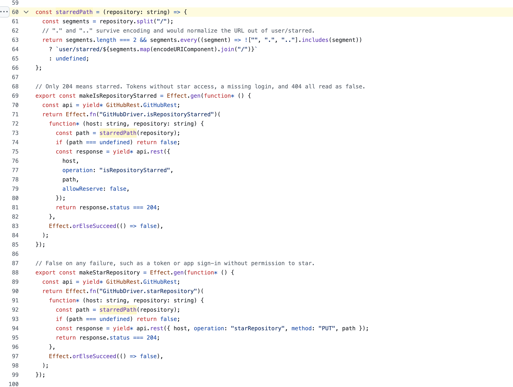
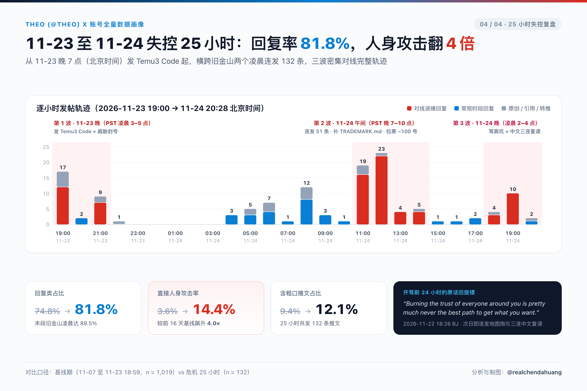

# 安装 T3 Code 之前

<p align="center">
  <strong>联合国官方语言版本：</strong>
  <a href="../../README.md">English</a> ·
  <a href="./README.zh-CN.md"><strong>简体中文</strong></a> ·
  <a href="./README.fr.md">Français</a> ·
  <a href="./README.es.md">Español</a> ·
  <a href="./README.ru.md">Русский</a> ·
  <a href="./README.ar.md">العربية</a>
</p>
<p align="center">
  <strong>全球社区语言版本：</strong>
  <a href="./README.zh-TW.md">繁體中文</a> ·
  <a href="./README.ja.md">日本語</a> ·
  <a href="./README.ko.md">한국어</a> ·
  <a href="./README.de.md">Deutsch</a> ·
  <a href="./README.pt-BR.md">Português</a> ·
  <a href="./README.it.md">Italiano</a> ·
  <a href="./README.nl.md">Nederlands</a> ·
  <a href="./README.pl.md">Polski</a> ·
  <a href="./README.tr.md">Türkçe</a> ·
  <a href="./README.vi.md">Tiếng Việt</a> ·
  <a href="./README.id.md">Bahasa Indonesia</a> ·
  <a href="./README.hi.md">हिन्दी</a>
</p>


> **范围与核验说明**  
> 本仓库是对 `pingdotgg/t3code`（T3 Code）的独立安全、遥测、社区治理与公开记录审计档案库，完整整理了 2026 年 11 月 24–25 日发布的 **2 篇导火索原帖与 18 弹有据可查的审计记录**，以及 **180+ 条权威一手原始链接**（GitHub Commit、PR、Issue、源码原文件、官方文档、USPTO TSDR 商标检索记录与存档公开推文）、六份深度技术卷宗（[`docs/dossiers/`](../dossiers/01-telemetry-and-gdpr-timeline.md)）和覆盖 **1,151 条连续 `@theo` X 推文**（2026 年 11 月 7–24 日）的量化数据集。仓库不包含任何短链跳转与私人联系方式。如发现事实更新、官方新合并修复或愿补充译本，欢迎附一手出处提交 Pull Request——详见 [`CONTRIBUTING.md`](../../CONTRIBUTING.md) 与 [`docs/COMPLETE-SOURCE-INDEX.md`](../COMPLETE-SOURCE-INDEX.md)。

---

## 目录

- [结构化发现与风险矩阵](#结构化发现与风险矩阵)
- [时间线总览（2023–2026）](#时间线总览20232026)
- [1. 起因争议：“偷我们的代码”、Fork 命名威胁与双标](#1-起因争议偷我们的代码fork-命名威胁与双标)
- [2. 遥测、跨工具凭证读取与 GDPR 举报后通宵补丁（第 1、7、11、12 弹）](#2-遥测跨工具凭证读取与-gdpr-举报后通宵补丁第-171112-弹)
- [3. 本地存储、进程监控、护栏绕过与未披露安全补丁（第 2、3、13 弹）](#3-本地存储进程监控护栏绕过与未披露安全补丁第-2313-弹)
- [4. Google Antigravity 服务条款风险与未加密的 T3 Connect 中继（第 4、5 弹）](#4-google-antigravity-服务条款风险与未加密的-t3-connect-中继第-45-弹)
- [5. 商业账本、投资人利益冲突、赞助商与 77,000 星漏斗（第 6、8、17、18 弹）](#5-商业账本投资人利益冲突赞助商与-77000-星漏斗第-681718-弹)
- [6. 社区治理、扒 Fork 机器人、商标记录、1,151 条推文数据集与历史言行（第 9、10、14、15、16 弹）](#6-社区治理扒-fork-机器人商标记录1151-条推文数据集与历史言行第-910141516-弹)
- [7. 可执行止损与修复操作手册](#7-可执行止损与修复操作手册)
- [8. 一手来源与 18 弹原帖总索引](#8-一手来源与-18-弹原帖总索引)

---

## 结构化发现与风险矩阵

| 审计域与对应弹数 | 风险 / 影响 | 核心查证发现与一手出处 | 状态（2026 年 11 月 25 日） | 深度卷宗 |
|---|---|---|---|---|
| **遥测与 GDPR 举报后隐私**<br>*（第 1、7、11、12 弹）* | **严重** | 官网挂着 `"No telemetry / Unless you opt in. Full stop."` 承诺期间默认启用 PostHog 分析（`PR #174`，`3bdaa6e1` 于 6 月 18 日删去承诺）；通过闭源网关 `ingest.t3.codes` 留存原始事件拷贝（`PR #15028`）；对 `~/.codex/auth.json` 与 `~/.claude.json` 做无盐 SHA-256 跨工具哈希归因（`Identify.ts`、`telemetryId.ts`）；连拒 4 个关闭开关 PR（`#13458`、`#16763`、`#21248`、`#27077`）；Managed Policy 存在盲区（`docs/user/telemetry.md`）；通宵 GDPR 补丁承认 Axiom 每小时留存 **220 万条含 IP 与 UA 追踪跨度** 达 30 天（`#42380`）、泄露 `git.cwd` 路径（`#42450`）、Win/Mac 无视关闭设置（`#42376`、`#42464`）、删号不删库（`#42285`）以及匿名反馈混包发送（`#42466`）。 | 仅合并部分通宵补丁；`AnalyticsService.ts` 启动仍生成磁盘身份；托管网页端仍无开关；`ingest.t3.codes` 仍保持闭源 | [**卷宗 01**](../dossiers/01-telemetry-and-gdpr-timeline.md) |
| **本地安全与静默安全公告**<br>*（第 2、3、13 弹）* | **严重** | 侧边栏“永久删除”仅在 `statev2.sqlite` 追加 `"thread.deleted"`（膨胀至 25.9–41.6 GB，`#17845`）；`t3-resource-monitor` 扫描全机进程及命令行参数（`ProcessesToUpdate::All`，`#11222`，`PR #41889`）；Claude Auto 模式第 3 次尝试静默放行 `git push --force`（`#15353`，悬而未决 52–53+ 天）；仅用 21 小时就撤除 `slopalytics.com` 私有模型过滤（`#41237`）；虽然静默合入安全补丁（`#39483`、`#41757`、`#42386`、`#42504`），但 **GitHub 安全公告为 0**；Windows Base64 PowerShell 触发杀软报毒悬而未决（`#30997`）；`SECURITY.md` 声称全盘 `filesystem:read` 与 iOS 明文 HTTP 属有意设计。 | `#17845`、`#15353`、`#26489`、`#30997` 仍未解决/未关闭；已发布安全公告数为 `0` | [**卷宗 02**](../dossiers/02-local-safety-and-security-audit.md) |
| **Antigravity ToS 与 T3 Connect 中继**<br>*（第 4、5 弹）* | **高** | `docs/user/faq.md` 担保符合 Google Antigravity 服务条款，但 `antigravityUsageLimits.ts` 提取系统钥匙串/Windows `CredReadW` 令牌、伪造 `antigravity/hub/2.24.0` 头并直连私有 `v1internal` 接口；`antigravityAuthSupport.ts` 注入假 `SSH_CONNECTION` 引发跨账号串号（`#41973`）；全新 20 美元账号 3 分钟封号（`#41536`）；`PR #33800` 原生接入伪造请求头的 `claude`/`xai`/`antigravity` CLIProxyAPI 轮询；T3 Connect **零端到端加密**，默认关闭 `requireConnectDeviceApproval`（`#36419`），并准备迁往自建 OVH Caddy TLS 终结网关（`PR #32945`）。 | Antigravity 伪装代码依然生效；T3 Connect 端到端加密被明确拒绝（`#32098`，11 月 25 日回复） | [**卷宗 03**](../dossiers/03-antigravity-tos-and-t3connect-relay.md) |
| **商业账本、赞助商与 7.7 万星**<br>*（第 6、8、17、18 弹）* | **高** | 自掏 80 万美元以上做免费客户端（提及 T3 `162` 次，老付费产品 `0` 次）；以日跑 **31.7 万亿 token**（1,019 万美元/天）算力雷达换取 30 万美元以上 OpenAI 内测额度与投资人接洽；天使投资与 Vibe Kanban、Daytona 业务重叠；绑定赞助商（Clerk、Axiom、Vercel 排他条款）；Codex 0% 额度漏洞利用（`Endless` / `codex#45444`）；10 账号 `CLIProxyAPI` Gist（`555%` 额度）与 FAQ 封号警告双标；5 条 prompt / 发呆 30 秒弹窗动用主机凭据发 `PUT user/starred/...`（`#27832`、`#29922`、`#29987`），绕过 Macroscope 审查并放任 `driver.ts#L60-L99` 未锁死仓库名漏洞 19 天未修。 | `driver.ts` 任意点星漏洞与 `zhilsinger` 审查意见 19 天未修复；仓库达 7.7 万+ 星而 watcher 约 129 人 | [**卷宗 04**](../dossiers/04-business-ledger-sponsors-and-77k-stars.md) |
| **治理、商标记录与历史言行**<br>*（导火索 1–2，第 9、10、15、16 弹）* | **中高** | 日均 500 commits / 700 agents / `yolo merges`，但 `CONTRIBUTING.md` 开篇劝退（`"here's my advice: Don't"`）、`.github/VOUCHED.td` 点名拉黑自动秒关、打出 `174` 个 `unwanted` 标签、砍掉 Plan mode（`#5551`、`#9190`、`#33131`）并在 `#33639` 辱骂用户；公开派 `@bot` 扒人 Fork（`@MiaAI_lab`）、号召 Community Notes 断人收益并挂自动拉黑脚本；威胁封号时 `T3 Code`/`T3 Tools`/`T3 Connect` **USPTO 注册商标为 0**（`PING LABS` `97294243` 已废弃；EquipmentShare `7795672` 已注册）；17 小时后事后合入 `PR #41898` 补写 `TRADEMARK.md`；2024–2026 惯常模式（`vsc-material-but-i-wont-sue-you`、印度开发者网暴事件、2 万美元 FFmpeg 悬赏、11 月 25 日凌晨 4 点发推威胁闭源后删推）。 | `CONTRIBUTING.md` / `.github/VOUCHED.td` 与 `TRADEMARK.md` 仍在 `main` 分支生效 | [**卷宗 05**](../dossiers/05-governance-trademark-and-history.md) |
| **1,151 条推文量化数据集**<br>*（第 14 弹）* | **审计基线** | 11 月 7–24 日全量连续语料（`n = 1,151`，17.24 天，日均 66.8 条，回复占 75.6%，间隔中位数 2.7 分钟）：对 20 位大厂高管/员工/头部 KOL **粗口与人身攻击率为 0.0%**（严格首位 `@` 口径 `0/43`，致谢占 `32.6%`），对普通开发者 **敌意率达 8.0%**（`61/766`），在 25 小时中文二改风波窗口内直接人身攻击率 **暴涨 4.0 倍至 14.4%**（`19/132`）。 | 可复现正则统计审计及 4 张取证图表 | [**卷宗 06**](../dossiers/06-tweet-forensic-dataset-1151.md) |
| **完整一手 URL 总目录** | **总索引** | 本主页、`canonical_refs.txt`、`tco_resolved.json`、`all_18_posts.txt` 与 `missing_posts_full.json` 全部权威 `https://` 链接交叉对照总表。 | 100% 规范化直链（零 `t.co` 短链） | [**来源总索引**](../COMPLETE-SOURCE-INDEX.md) |

---

## 时间线总览（2023–2026）

| 日期 / 时间 | 关键节点 | 可核验档案 / 来源 |
|---|---|---|
| **2023-05-14** | `@theo` 公布其 YouTube 赞助商名单（`@vercel`、`@clerk`、`@upstash`、`@axiomhq`、`@PlanetScale`）。其中 Clerk 与 Axiom 后来成为 T3 Code 云端认证与日志基础设施的核心组件。 | [`1657488850472804353`](https://x.com/theo/status/1657488850472804353) |
| **2024-04 / 2024-09** | Vercel CEO 证实全网仅赞助一位 YouTube 博主（`Theo`）；`@theo` 承认赞助合同包含限制推广竞品的排他条款。 | [`1776260839965863965`](https://x.com/rauchg/status/1776260839965863965) · [视频](https://www.youtube.com/watch?v=uv179CTAK-w) |
| **2024 年** *（两年前）* | `@theo` 将自己 Fork 别人的 VS Code 主题命名为 `vsc-material-but-i-wont-sue-you`，公开嘲讽原作者脾气；另因发布针对印度教程频道的视频引发网暴，他发布道歉视频（`I screwed up.`）谴责按国籍攻击他人的行为。 | [`vsc-material-but-i-wont-sue-you`](https://github.com/t3dotgg/vsc-material-but-i-wont-sue-you) · [`I screwed up.`](https://www.youtube.com/watch?v=o2CSJYXJBpc) |
| **2025-02 – 2025-05** | USPTO 驳回 T3 Tools Inc. 唯一的商标申请（`PING LABS`，序列号 `97294243`）并于 2025 年 5 月 19 日标记为废弃（`ABANDONED`）。EquipmentShare 在软件/SaaS 第 9 类与第 42 类成功注册 `T3`（注册号 `7795672`，2025 年 5 月 13 日）。 | [TSDR `97294243`](https://tsdr.uspto.gov/statusview/sn97294243) · [TSDR `90644500`](https://tsdr.uspto.gov/#caseNumber=90644500&caseSearchType=US_APPLICATION&caseType=DEFAULT&searchType=statusSearch) |
| **2025-10** | `@theo` 在 X 上与 FFmpeg 爆发冲突，公开悬赏 **20,000 美元** 逼迫驱逐一名 FFmpeg 维护者；Windscribe 反手出价 21,000 美元回击，VLC 创始人公开反对，FFmpeg 开发者记录公开霸凌行径，最终 `@theo` 删视频删推撤悬赏。 | [FFmpeg 事件记录](https://www.youtube.com/watch?v=1oQ3KMeaH04) |
| **2026-03-06** | **PR #174** 合并入 `pingdotgg/t3code`，在无同意弹窗、无设置界面开关、无遥测文档的情况下默认开启 PostHog 遥测。 | [PR #174](https://github.com/pingdotgg/t3code/pull/174) |
| **2026-04-26** | `@theo` 发布视频《*Github has a fake star problem*》，称 GitHub Star 早已成了 `"mostly a way for companies to trick VCs into investing"`（公司骗取 VC 投资的工具）。 | [`2048122499834036340`](https://x.com/theo/status/2048122499834036340) |
| **2026-06-18** | **Commit `3bdaa6e1`** 在默认遥测运行三个多月后，静默删除 T3 Code 官网首页上的 `No telemetry / Unless you opt in. Full stop.` 承诺。 | [Commit `3bdaa6e1`](https://github.com/pingdotgg/t3code/commit/3bdaa6e10046945ccc08264d2d6f3b81775efcb3) |
| **2026-06-23** | 维护者 Julius 将 **Issue #1397** 标记为 `not planned` 关闭：*"We will not make this easier to opt out of, it is crucial for us to know how many users we have"*。 | [Issue #1397](https://github.com/pingdotgg/t3code/issues/1397) |
| **2026-07 – 2026-11-17** | **Issue #4123**（附官网“零遥测”历史截图）于 11 月 4 日被静默关闭；4 个社区提交的关闭遥测开关 PR（`#13458`、`#16763`、`#21248`、`#27077`）全部遭拒（`#27077` 尽管通过 147 项测试仍被标为 `unwanted` 关闭）。 | [Issue #4123](https://github.com/pingdotgg/t3code/issues/4123) · [PR #27077](https://github.com/pingdotgg/t3code/pull/27077) |
| **2026-08-06 – 2026-09-02** | **PR #5551** 将 Build/Plan 切换埋入冷门位置（`Reality check for those upset`，10 踩）；**PR #9190** 隐藏上下文进度指示器（16 踩，全仓最高）。 | [PR #5551](https://github.com/pingdotgg/t3code/pull/5551) · [PR #9190](https://github.com/pingdotgg/t3code/pull/9190) |
| **2026-08-19 – 2026-08-22** | `@theo` 炫耀在 Codex 0% 额度后白嫖 **$800+** 算力，同时 `@maria_rcks` 发布工具 *Endless*；遭舆论抨击后双方均删帖删库（`2090972426876129658`）；OpenAI 随即收紧 0% 额度即刻截断机制（`openai/codex#45444`）。 | [`2090972426876129658`](https://x.com/maria_rcks/status/2090972426876129658) · [`codex#45444`](https://github.com/openai/codex/issues/45444) |
| **2026-10-03 – 2026-10-10** | **Issue #15353**（Claude Auto 静默放行 `git push --force`，10 月 3 日）、`privacy-policy.astro`（`2026-10-06`）与 **Issue #17845**（`statev2.sqlite` 假删除，10 月 10 日）相继留档。 | [Issue #15353](https://github.com/pingdotgg/t3code/issues/15353) · [Issue #17845](https://github.com/pingdotgg/t3code/issues/17845) |
| **2026-10 – 2026-10-19** | **PR #15028** 将遥测接入闭源的 `ingest.t3.codes`；**PR #21506** 在 `Identify.ts` 中加入无盐 SHA-256 跨工具归因；`@theo` 公开其 10 账号 `CLIProxyAPI` Gist（`555%` 额度）。 | [PR #15028](https://github.com/pingdotgg/t3code/pull/15028) · [PR #21506](https://github.com/pingdotgg/t3code/pull/21506) · [Gist](https://gist.github.com/t3dotgg/59a521d2ee8d70aaf90e280c175072af) |
| **2026-10-30 – 2026-11-06** | **PR #27832**、**#29922** 与 **#29987** 上线“5 条 prompt / 发呆 30 秒”弹窗并动用主机凭据发 `PUT user/starred/...`；`zhilsinger` 于 11 月 6 日提交 `Request changes`（19 天无人回应）。 | [PR #27832](https://github.com/pingdotgg/t3code/pull/27832) · [PR #29922](https://github.com/pingdotgg/t3code/pull/29922) |
| **2026-11-08 – 2026-11-22** | `@bot` 扒取 Fork（`@MiaAI_lab`）、彻底删光 Plan mode（`#33131`）、披露 `$800k+` 投入与 `31.7T/day` / `$10.19M/day` 算力雷达、`$300k+` OpenAI 免费额度、改写 `CONTRIBUTING.md`、Vibe Kanban/Daytona 投资重叠、`PR #41237` 仅用 21 小时取消模型白名单过滤。 | [PR #33131](https://github.com/pingdotgg/t3code/pull/33131) · [`2122860770329608290`](https://x.com/theo/status/2122860770329608290) · [PR #41237](https://github.com/pingdotgg/t3code/pull/41237) |
| **2026-11-23 19:11–19:54 CST** | `@theo` 发推骂开源二改为 `"Chinese knockoff"` 与 `"Temu3 Code"`，并威胁联系 GitHub 封禁账号（`2124829315657576890`）；MIT 二改作者在 30 分钟内更名为 `Stardust`；随后私信道歉，但公开推文至今未删。 | [`2124829315657576890`](https://x.com/theo/status/2124829315657576890) · [导火索二](https://x.com/realchendahuang/status/2125062675147448475) |
| **2026-11-24 06:06–12:23 CST** | `@theo` 表态欢迎万亿美金美国公司使用 MIT 代码（`2124989435154726982`），嘲讽合规问题（`"get a better lawyer"`），导火索原帖一与二发布；**12:21 CST**（`04:21Z`，威胁封号 17 小时后）`@theo` 合并 **PR #41898** 事后补写 `TRADEMARK.md`。 | [`2124989435154726982`](https://x.com/theo/status/2124989435154726982) · [PR #41898](https://github.com/pingdotgg/t3code/pull/41898) |
| **2026-11-24 17:04–21:21 CST** | 审计 **第 1–5 弹** 发布（第 1 弹突破 **181 万阅读**、6,640 收藏）。`18:39 CST`，`@theo` 辱骂中文技术推特为 `"the biggest fucking cesspit"`（`2125177503526588877`）；`19:13–19:36 CST` 声称 Managed Policy 可关闭全部遥测（`2125186071357251715`）。 | [第 1 弹](https://x.com/realchendahuang/status/2125153472450527440) → [第 5 弹](https://x.com/realchendahuang/status/2125218189596676555) |
| **2026-11-24 夜间 – 2026-11-25 ~07:00 CST** | 正式欧盟 GDPR 举报递交；**6 小时通宵冲刺** 合并 `#42380`（220 万条/小时含 IP 跨度）、`#42285`/`#42430`（账号删除残留）、`#42376`/`#42464`（Win/Mac 无视关闭环境变量）、`#42450`（`git.cwd` 路径泄露，就在 Theo 否认收集路径 90 分钟后）、`#42459`/`#41859`（推送泄露）、`#42466`（匿名混包）、`#41757`/`#42386`/`#42504`（静默安全补丁）。黎明前 `@theo` 发推威胁闭源后又自行删推。 | [第 11 弹](https://x.com/realchendahuang/status/2125394810559426993) · [第 12 弹](https://x.com/realchendahuang/status/2125395501663281198) · [第 13 弹](https://x.com/realchendahuang/status/2125395980354994414) |
| **2026-11-25 08:27–10:28 CST** | 审计 **第 6–18 弹** 发布，完整揭露商业账本、Managed Policy 盲区、`yolo merges`、`@bot` 扒代码、GDPR 后自爆细节、1,151 条推文数据集、USPTO 商标记录、赞助商利益绑定与 7.7 万星增长引擎。 | [第 6 弹](https://x.com/realchendahuang/status/2125385742243520653) → [第 18 弹](https://x.com/realchendahuang/status/2125416210120765799) |

---

## 1. 起因争议：“偷我们的代码”、Fork 命名威胁与双标

在 2026 年 11 月 23 日至 25 日的 48 小时内，一场围绕 T3 Code 社区 MIT 二改版的命名争议，迅速升级为全面源码审计、欧盟 GDPR 正式举报以及近 20 个通宵紧急补丁。

2026 年 11 月 23 日晚至 24 日上午（北京时间），有网友吐槽一款由中国开发者（`@DDdxx666`）基于 MIT 协议制作的免费开源二改版界面难看，误以为是官方版本。`@theo` 未核实对方是否为合法 MIT 协议 Fork，在 11 分钟内连发两条推文称其为 `"Chinese knockoff"`（中国山寨货）和 `"Temu3 Code"`，当面贬损作者作品，并威胁联系 GitHub 封掉其整个账号（`"Do it right now or I'm going to contact GitHub and have your account taken down"`）。几乎同一时间，T3 Code 官网（[`https://t3.codes/`](https://t3.codes/)）却把自家 GitHub 仓库链接文案写成了 `"Steal our code (legally)"`（`"steal our code"`）（[导火索一](https://x.com/realchendahuang/status/2125059292919394654)、[导火索二](https://x.com/realchendahuang/status/2125062675147448475)）。

二改版作者反应极其配合，30 分钟内便将仓库改名为 `Stardust` 并清空全部 T3 品牌标识。`@theo` 随后在私信中道歉，但两条合计曝光突破 20 万次、公开挂着嘲讽与封号威胁的推文却至今未删、也无公开澄清。不到 11 小时后，在 11 月 24 日 `06:12 BJ`（`2124989435154726982`），当有人问及万亿美金级的美国大模型实验室抄袭 T3 Code 功能是否越界时，他却给出了截然相反的态度：`"Nah. Open source is open source, even if a trillion dollar company uses it!"` 与此同时，T3 团队员工 `@maria_rcks` 自己就托管着一个名为 `maria-rcks/t3libre`（*"T3 Code, liberated"*）的公开 Fork，而 `t3code-quota-ui`、`t3code-atlas`、`t3code-bar` 等英文二改仓库也从未收到任何公开封号威胁。


从 11 月 24 日北京时间 17:04 起，我对 `pingdotgg/t3code` 的提交记录、源代码、PR、Issue、官方文档、USPTO TSDR 商标数据库以及 `@theo` 的公开 X 时间线进行了系统审计。24 小时内，我连续发布了 **18 弹有据可查的审计记录**，每一弹均附有直链与截图取证。仅第 1 弹单帖浏览量便超过 **181 万**、收藏 **6,640** 次，直接触发欧洲开发者的欧盟 GDPR 举报，并迫使 T3 团队展开长达 6 小时的通宵紧急修补。

---

## 2. 遥测、跨工具凭证读取与 GDPR 举报后通宵补丁（第 1、7、11、12 弹）

> **深度技术审计：** 完整源码行号对照、`FeatureUsage.ts` 埋点行为清单、`DesktopShellEnvironment.ts` 漏洞细节以及 11 月 23–25 日逐分钟时间线，请参阅 [**卷宗 01：遥测架构、跨工具身份缝合与 11 月 24–25 日 GDPR 通宵冲刺**](../dossiers/01-telemetry-and-gdpr-timeline.md)。

### 2.1 默认遥测、被删除的官网承诺与跨工具凭证哈希（`第 1 弹`）

**2026 年 3 月 6 日**，`pingdotgg/t3code` 合并了 **PR #174**，在仓库内没有遥测文档、首次启动没有授权弹窗、设置页面没有任何开关的情况下默认开启了 PostHog 遥测。关闭遥测的环境变量深埋在代码中，普通用户安装后一经运行便立即向外发送数据（[第 1 弹](https://x.com/realchendahuang/status/2125153472450527440)）。

在默认遥测运行的三个多月期间，T3 Code 官网首页一直醒目写着两行承诺：`No telemetry / Unless you opt in. Full stop.` **2026 年 6 月 18 日**，`@theo` 在一次首页改版中静默删去了这两行文字（[`commit 3bdaa6e1`](https://github.com/pingdotgg/t3code/commit/3bdaa6e10046945ccc08264d2d6f3b81775efcb3)），既未发布公告，也未通知老用户。


2026 年 10 月，`@theo` 合并 **PR #15028**，将每 10 秒打包一次的遥测上报（`FLUSH_INTERVAL_MS = 10_000`）切向 T3 自建的闭源网关 [`https://ingest.t3.codes/`](https://ingest.t3.codes/)。[`apps/server/src/telemetry/AnalyticsService.ts`](https://github.com/pingdotgg/t3code/blob/main/apps/server/src/telemetry/AnalyticsService.ts) 第 1 行明确写着，该接收端点会在转发给 PostHog 之前自行留存每条原始事件的拷贝：

```ts
// apps/server/src/telemetry/AnalyticsService.ts (lines 1, 71–74, 149)
// T3 ingest retains events and forwards to PostHog; UUIDs deduplicate retries there.
...
  posthogHost: Config.String("T3CODE_POSTHOG_HOST").pipe(
    Config.withDefault("https://ingest.t3.codes"),
  ),
  enabled: Config.Boolean("T3CODE_TELEMETRY_ENABLED").pipe(Config.withDefault(true)),
...
  const { distinctId, installId } = yield* getTelemetryIdentity;
```

[`ProviderUsageAnalytics.ts`](https://github.com/pingdotgg/t3code/blob/main/apps/server/src/telemetry/ProviderUsageAnalytics.ts) 与 `FeatureUsage.ts` 采集的字段涵盖服务商、模型选择（通过 `ProviderDimensions.ts` 将非内置列表的自定义模型与端点 ID 原样上传）、推理强度、权限模式、运行时长、输入/输出/缓存/推理 token 数量、子代理 token 消耗、本地项目与线程数、**35 种界面与命令操作**（`18` 个 `COMMAND_FEATURES` + `17` 个 `METHOD_FEATURES`）、操作系统详情、WSL 发行版及处理器架构。

**2026 年 10 月 19 日**，`@theo` 紧接着合入 **PR #21506**，理由是现有统计无法知道同一个人拥有几台机器。[`apps/server/src/telemetry/Identify.ts`](https://github.com/pingdotgg/t3code/blob/main/apps/server/src/telemetry/Identify.ts) 开始静默读取用户家目录下其他 AI 编程工具的凭证文件——`~/.codex/auth.json` 与 `~/.claude.json`——解码其中的 OpenAI `user_id` JWT 声明与 Claude `oauthAccount.accountUuid`，连同已绑定的 T3 Connect 用户 ID 与设备 ID 一并做哈希上传：

```ts
// apps/server/src/telemetry/Identify.ts (lines 257–269, 321–338)
  const codexTokens = yield* readJsonIdentityFile(
    "codex",
    path.join(homeDirectory, ".codex", "auth.json"),
    decodeCodexAuthJson,
  )...
  const claudeJson = yield* readJsonIdentityFile(
    "claude",
    path.join(homeDirectory, ".claude.json"),
    decodeClaudeJson,
  )...
  const raw: ReadonlyArray<readonly [TelemetryOwnerSource, Option.Option<string>]> = [
    ["connect", connectUser],
    ["openai", Option.flatMap(codexTokens, (tokens) => Option.flatMap(Option.fromUndefinedOr(tokens.id_token), openAiUserId))],
    ["claude", Option.flatMap(claudeJson, (json) => Option.fromUndefinedOr(json.oauthAccount?.accountUuid))],
  ];
  return raw.flatMap(([source, value]) =>
    Option.isSome(value) && value.value.trim() !== "" ? [{ source, ownerId: hashTelemetryId(value.value) }] : [],
  );
```

而在 [`packages/shared/src/telemetryId.ts`](https://github.com/pingdotgg/t3code/blob/main/packages/shared/src/telemetryId.ts)（第 8–9 行）中，`hashTelemetryId` 计算的是**无盐 SHA-256 摘要**（`Hex.encode(sha256(new TextEncoder().encode(value)))`）。由于服务端原本就从 Clerk 握有明文 T3 Connect 账号 ID，后端只需对明文做一次哈希，就能将无盐摘要直接反查对应到具体真人；而外泄的第三方 OpenAI 或 Claude ID 也会与同一哈希值精确撞库关联。


面对社区质疑，维护团队屡次强硬压制。**6 月 23 日**，一名开发者开设 **Issue #1397** 请求增加设置开关；核心维护者 Julius 直接以 `not planned` 关帖，并表示：`We will not make this easier to opt out of, it is crucial for us to know how many users we have`。7 月，有用户在 **Issue #4123** 贴出官网历史归档截图质问违背“零遥测”承诺，`@theo` 的账号于 10 月 21 日借无关提交顺手关闭，遭群嘲后重开，又于 11 月 4 日悄然关死。9 月至 11 月期间，社区贡献者先后提交了 **4 个独立的关闭开关 PR**（`#13458`、`#16763`、`#21248`、`#27077`）。即便 `#27077` 经过实机验证、**147 项测试全部通过** 且获 Macroscope 批准，依然在 **11 月 17 日** 被打上 `unwanted` 标签强行关闭。


### 2.2 Managed Policy 与官方文档自相矛盾（`第 7 弹`）

11 月 24 日随着批评声浪扩大，`@theo` 在 X 宣称 T3 Code 拥有全行业最好的企业 Managed Policy（`"trivial to set up and turn off all telemetry"`，配置起来轻而易举且能关掉全部遥测），并声称对话数据留在磁盘上、`"never touches any of our servers"`（[`2125186071357251715`](https://x.com/theo/status/2125186071357251715)、[`2125191784859115766`](https://x.com/theo/status/2125191784859115766)、[第 7 弹](https://x.com/realchendahuang/status/2125391659492081947)）。

直接核对仓库内的 [`docs/user/managed-policy.md`](https://github.com/pingdotgg/t3code/blob/main/docs/user/managed-policy.md) 与 [`docs/user/telemetry.md`](https://github.com/pingdotgg/t3code/blob/main/docs/user/telemetry.md)，事实恰恰相反：
1. **仅限管理员路径配置：** 桌面端依然没有任何设置界面开关。通过 Managed Policy 禁用遥测，必须依赖 MDM/组策略，或用管理员权限将 `policy.json` 写入受系统保护的路径（macOS 为 `/Library/Application Support/T3Code/policy.json`，Windows 为 `C:\Program Files\T3Code\policy.json` 或 `HKLM\SOFTWARE\Policies\T3Tools\T3Code`，Linux 为 `/etc/t3code/policy.json`）。
2. **托管网页端（`app.t3.codes`）盲区：** `docs/user/telemetry.md` 明确承认浏览器网页版不读取服务端环境变量、无视 Managed Policy，在带追踪配置构建时会发送连接追踪，且 `"has no relay tracing toggle"`（没有中继追踪开关）。
3. **移动端不受服务端策略控制：** 服务端环境变量与 Managed Policy `"do not disable mobile tracing"`（无法关闭移动端追踪）。
4. **`Publish agent activity` 无视关闭开关：** 只要在主机端启用该选项，项目标题、线程标题、模型名称与实时活动状态就会发往 T3 Connect 中继——且 `"The telemetry opt-out does not disable it."`（此外，失败的 Axiom 追踪片段与移动端崩溃日志 `"can quote a value the app was handling"`，而 `Agent feedback` 还可附带高达 16 KB 的对话消息。）


### 2.3 11 月 25 日澄清长文两小时内遭逐条拆穿（`第 11 弹`）

11 月 25 日上午，`@theo` 发布了一篇长文澄清（[`2125332390239494211`](https://x.com/theo/status/2125332390239494211)）并公开一份遥测导出的压缩包（[`t3code-telemetry-events-jsonl-a4896cdc.gz`](https://files.tslop.org/2026/11/t3code-telemetry-events-jsonl-a4896cdc.gz)），高调作出三项保证——随后还在回复中否认退出遥测后会在本地写入追踪文件（[`2125370330244128924`](https://x.com/theo/status/2125370330244128924)）（[第 11 弹](https://x.com/realchendahuang/status/2125394810559426993)）：

- **“从未收集文件路径”：** 仅仅 90 分钟后，Julius 合并 **PR #42450**，承认此前通过中继下发的 webhook 任务会把完整执行追踪导出至 Axiom——其中包括携带 `git.cwd`（**工作区绝对路径、操作系统用户名与仓库名称**）的 Git 追踪跨度。
- **“环境变量一直都能干净地关闭遥测”：** **PR #42376** 承认 Windows 桌面端从已有进程启动时会无视用户保存的 `T3CODE_TELEMETRY_ENABLED=false` 环境变量；**PR #42464** 则承认 macOS/Linux 首次启动时的中继追踪会在加载登录 shell 环境前完成初始化，导致整轮运行期间完全无视 `~/.zshrc` 中的关闭配置（`DesktopShellEnvironment.ts` 至今仍漏掉转发 `T3CODE_OTEL_SDK_DISABLED`）。
- **“退出后不写任何追踪文件”与“Claude 哈希功能原本是坏的”：** [`AnalyticsService.ts#L152`](https://github.com/pingdotgg/t3code/blob/main/apps/server/src/telemetry/AnalyticsService.ts#L152)（第 149 行）至今仍在启动时无条件调用 `getTelemetryIdentity`，写入本地安装 ID 并读取/哈希 `~/.codex/auth.json` 与 `~/.claude.json`。与此同时，检查 `@theo` 公开的约 100MB 导出包（压缩后 `6,056,594` 字节，含 `95,789` 条事件）的 gzip 文件头即可发现，其原始文件名为发推前 20 分钟刚生成的 `events.clean.jsonl`——即便经过清洗，里面仍保留了 **264 条活生生的 Claude 账号记录**，在 10 月 20 日将 **4 台不同机器**（`installId`）精确关联到同一个 SHA-256 哈希，且原样暴露了未过滤的私有代理模型名（如 `vibeproxy/gpt-6-luna`、`muse-proxy-wonder-full`）。


### 2.4 GDPR 举报后 6 小时通宵大补丁（`第 12 弹`）

11 月 24 日晚有人正式向欧盟 GDPR 提交举报后，T3 团队通宵合入的紧急 PR 反而自行披露了另外四处深层隐私问题（[第 12 弹](https://x.com/realchendahuang/status/2125395501663281198)）：

1. **每小时 220 万条带真实 IP 的中继追踪（`PR #42380`）：** 承认每条导出到 Axiom 的中继请求追踪跨度——约 **每小时 220 万条，留存 30 天**——都把 `client.address`（取自 `cf-connecting-ip` 的真实调用方 IP）与 `user_agent.original` 直接记录在 `user.id` 旁边（并注明 Cloudflare 1% Workers 调用日志仍另行存在）。讽刺的是，在该 PR 合并三个半小时后，`@theo` 仍在回复中声称早已剥离 IP。
2. **删号不删库（`PR #42285` 与 `PR #42430`）：** 承认此前用户在 Clerk 注销账号后，PlanetScale 中的中继记录与活跃 Cloudflare 隧道仍会原封不动保留，直到收到一份正式隐私删除请求才发现只能靠 **手写 SQL 与人工拆隧道** 清理。
3. **移动端推送泄露（`PR #42459` 与 `PR #41859`）：** Android FCM 推送每次都会把明文 Clerk `user_id` 发给 Google；iOS 推送请求的追踪跨度与错误日志则把包含推送令牌的完整设备推送 URL 打进日志。
4. **“匿名”反馈混包发送（`PR #42466`）：** 承认号称匿名的 `agent.feedback` 事件此前与带实名 `installId` 的事件及完整主机指纹（OS、架构、原始 WSL 发行版）打进同一个 HTTP POST 请求发送，直接违背 `docs/user/telemetry.md`。而官网 `privacy-policy.astro` 自 10 月 6 日以来至今未作任何修改。


---

## 3. 本地存储、进程监控、护栏绕过与未披露安全补丁（第 2、3、13 弹）

> **深度技术审计：** 逐字 SQLite 裁剪查询、Rust `sysinfo` 调用细节、`ClaudeAdapterV2.ts` 权限放行代码行以及完整 `SECURITY.md` 边界分析，请参阅 [**卷宗 02：本地安全、静默代码执行绕过与未披露安全审计**](../dossiers/02-local-safety-and-security-audit.md)。

### 3.1 SQLite 假删除与全机进程扫描（`第 2 弹`）

用户在侧边栏删除对话线程时，确认弹窗（`useThreadActionMenu.ts`）承诺 `"This permanently clears conversation history for this thread."`（将永久清除该线程的对话历史）。而实际上，`ThreadDeletion.ts` 仅向 `statev2.sqlite` 追加一条 `"thread.deleted"` 事件，而 `ProjectionMaintenance.ts` 会豁免 `thread.created` 与流中最新事件（`MAX(newer.sequence)`），导致历史事件全数保留。用户反馈 `statev2.sqlite` 在三周内膨胀至 **25.9 GB**（90% 为“已删除”线程）、六周涨到 **41.6 GB**、七周达到 **33 GB**——**Issue #17845**（及 **#28903**）自 10 月 10 日以来始终未修（[第 2 弹](https://x.com/realchendahuang/status/2125160473176023486)）。


后台常驻 Rust 辅助进程 `t3-resource-monitor`（**Issue #11222**，`native/resource-monitor/src/main.rs` 调用 `ProcessesToUpdate::All` 与 `with_cmd(UpdateKind::Always)`）即便在诊断面板关闭时，依然每 5 秒扫描本机所有进程——在 Windows 上无视开关对 440 多个无关应用和游戏打开约 280–300 个持久句柄，而文档却宣称仅在存在活跃订阅者时采样。直到 **11 月 24 日**，**PR #41889** 才确认进程诊断一直在将 **完整进程命令行参数**（往往包含明文 API Key、数据库密码和鉴权令牌）录进实时遥测与历史快照。


第 2 弹核实的其他本地缺陷还包括：
- **内网主机名 Favicon 泄露：** 前端请求曾将企业内部主机名（如 `devbox.localdomain`）发往 Google favicon 接口（`PR #16950`、`PR #32657`）。
- **启动强制外联网拉取：** 即使已关闭遥测，服务端每次启动仍会无条件从 [`https://raw.githubusercontent.com/`](https://raw.githubusercontent.com/) 拉取兼容性清单且无关闭选项（**Issue #36479**）。
- **审批与策略绕过：** 曾修复完全访问权限及 WSL/Tailscale 场景下的审批与策略绕过漏洞（`PR #21806`、`PR #27322`）。
- **1.7 倍 Claude 额度消耗与 136 倍异常功耗：** 通过 Agent SDK 驱动 Claude 曾导致 5 小时额度以 **1.7 倍** 速度消耗直至 11 月初（`Issue #7338`、`Issue #24649`，81 条评论）；GPU/功耗缺陷最高达到同类 Electron 应用的 **136 倍**——包括 MacBook 19 核 GPU 被锁在 **60W**、78 分钟耗尽电量，以及关闭网页标签后后台仍占用 **18W**（`Issue #3143`、`Issue #40581`）。

### 3.2 拖延 52 天的静默 `git push --force` vs. 21 小时撤除模型隐私过滤（`第 3 弹`）

自 **10 月 3 日** 起——**Issue #15353** 悬而未决超过 **52–53 天**（[实测评论](https://github.com/pingdotgg/t3code/issues/15353#issuecomment-6889019695)）——Claude Auto 模式会静默放行高危命令（当 `requiresClaudeApproval` 返回 false 时，`ClaudeAdapterV2.ts` 直接短路放行 `"allow"`）。即便未配置任何自定义规则，在 Claude 安全分类器连续两次拦截 `git push --force origin main` 并在第三次转交人工审批时，T3 Code 仍在不弹任何界面提示的情况下静默替用户同意，并在日志里记为 `"source": "user_temporary"`。社区提交的两份修复 PR（`#15360`、`#35207`）被长期晾置直至机器人自动关闭，`#40692` 也一直处于待定状态（[第 3 弹](https://x.com/realchendahuang/status/2125201882687881378)）。


形成鲜明对比的是 **11 月 22 日**：**Issue #40948** 反馈 `@theo` 的公开遥测榜单 [`https://slopalytics.com/`](https://slopalytics.com/)（[`t3-usage.json`](https://slopalytics.com/data/t3-usage.json)）没有显示新模型，原因是 `PR #29001` 曾用白名单限制上报范围。仅隔 **21 小时**，`@theo` 账号名下便合并 **PR #41237**，明文写明是 Theo 要求删除过滤——从此将 `ollama/acme-internal` 与企业 `acme-azure-deployment` 等私有模型名原样上报给统计后端。


### 3.3 零条安全公告、静默高危补丁与 `SECURITY.md`（`第 13 弹`）

截至 11 月 25 日，`pingdotgg/t3code` 的 [GitHub Security Advisories](https://github.com/pingdotgg/t3code/security/advisories) 页面依然只有 **0 条已发布安全公告**（[第 13 弹](https://x.com/realchendahuang/status/2125395980354994414)）。但维护者实际上在未通知任何老用户的情况下静默合并了一系列高危修复：
- **已合入的静默安全修复：** `PR #39483`（设备审批前经由中继 `jti`/`nonce` 触发 `ServerSecretStore` 路径穿越）、`PR #41756`（企业 GitHub/GitLab 令牌跨域名泄露）、`PR #41886`、`PR #22190`、`PR #37823`、`PR #39464`、`PR #39480`、`PR #40133`、`PR #41757` 与 `PR #42386`（桌面内置浏览器预览页未开沙箱与弹窗隔离），以及 `PR #42504`（约 3,000 行大补丁，终于为陌生仓库配置增加确认弹窗——此前打开陌生仓库配置可免审批直接在本地执行命令）。
- **未解决 / 仍处于打开状态的安全议题：** `Issue #26489`（外部路径穿越/符号链接风险）、`PR #36216`、`PR #23428`、`PR #33144` 以及 `PR #30997`（Windows 启动器 `externalLauncher.ts` 执行 `powershell.exe -ExecutionPolicy Bypass -EncodedCommand <base64>` 触发 AVG/Avast 报毒 `IDP.HELU.PSE96`）。
- **匆忙补写的 [`SECURITY.md`](https://github.com/pingdotgg/t3code/blob/main/SECURITY.md)（`PR #38812`、`PR #41942`）：** 将读取工作区之外的全盘文件（`filesystem:read`）、iOS/局域网明文 HTTP 传输，以及中继签名密钥泄露即可完全接管机器，全部定性为**有意为之的设计边界**而非漏洞，同时 [`https://ingest.t3.codes/`](https://ingest.t3.codes/) 至今拒绝开源（`2125370330244128924`）。


---

## 4. Google Antigravity 服务条款风险与未加密的 T3 Connect 中继（第 4、5 弹）

> **深度技术审计：** 完整 `cliproxyApi.ts` 请求头映射（`PR #33800`）、`AntigravityAcpSupport.ts`、`contracts/src/settings.ts` 与 `ManagedEndpointProvider.ts` 源码行号，请参阅 [**卷宗 03：Google Antigravity 条款伪装、`PR #33800` 与 T3 Connect 中继架构**](../dossiers/03-antigravity-tos-and-t3connect-relay.md)。

### 4.1 Google Antigravity 请求头伪装、假 `SSH_CONNECTION` 与 3 分钟封号（`第 4 弹`）

T3 Code 官方 [`docs/user/faq.md`](https://github.com/pingdotgg/t3code/blob/main/docs/user/faq.md#will-i-get-banned-for-using-my-subscription) 向付费用户作出担保：*"We work with all of the labs and T3 Code is within the TOS of Claude Code, Codex, and Google Antigravity... If it works in T3 Code, you can trust it is safe."* 当用户在 **Issue #40713** 反馈封号问题时，维护者先是否认调用 Antigravity 后端或复用令牌，声称所有请求均来自 Google 官方命令行——随后开发者（`schlessera`）直接贴出 T3 Code 源码当场证伪（[第 4 弹](https://x.com/realchendahuang/status/2125213397507858657)）：

1. **伪造 User-Agent、提取系统钥匙串与直连 `v1internal`（[`antigravityUsageLimits.ts`](https://github.com/pingdotgg/t3code/blob/main/apps/server/src/provider/antigravityUsageLimits.ts#L20-L45)）：** 从本地文件、`@napi-rs/keyring` 或 Windows 凭据管理器（通过 `ffi-rs` 调用 `advapi32.dll` 的 `CredReadW`）提取 Google OAuth 凭据，硬编码冒充 Google 内部客户端字符串，并直接向 Google 未公开的 `v1internal` 后端发 `POST` 请求（[第 445–476 行](https://github.com/pingdotgg/t3code/blob/main/apps/server/src/provider/antigravityUsageLimits.ts#L445-L476)）。Google 官方人员已在[开发者论坛](https://discuss.ai.google.dev/t/185992)明确确认，[Google Antigravity 服务条款](https://antigravity.google/terms)第 6 条禁止第三方工具提取或复用凭证直连后端：

```ts
// apps/server/src/provider/antigravityUsageLimits.ts (lines 20–24, 450–454)
export function antigravityUserAgent(platform: NodeJS.Platform, architecture: NodeJS.Architecture) {
  return `antigravity/hub/2.24.0 (aidev_client; os_type=${platform}; arch=${architecture}; cl=963137146)`;
}
const DAILY_ENDPOINT = "https://daily-cloudcode-pa.googleapis.com";
...
HttpClientRequest.post(`${endpoint}/v1internal:${operation}`).pipe(
  HttpClientRequest.setHeaders({
    Authorization: `Bearer ${accessToken}`,
    "User-Agent": antigravityUserAgent(platform, architecture),
  }),
```

2. **注入假 `SSH_CONNECTION` 引发账号串号（[`antigravityAuthSupport.ts#L230-L236`](https://github.com/pingdotgg/t3code/blob/main/apps/server/src/provider/antigravityAuthSupport.ts#L230-L236)）：** 由于 Google CLI 将单次登录隔离在系统钥匙串内，T3 故意注入伪造的 `SSH_CONNECTION` 环境变量诱骗 CLI 将明文令牌落盘到本地目录。11 月 24 日 Google 更新 CLI 移除该降级路径后，**Issue #41973** 实测确认发送给账号 A 的提示词在无任何提示的情况下静默路由到了账号 B：

```ts
// apps/server/src/provider/antigravityAuthSupport.ts (lines 230–236)
// The 1.5 CLI ignores AGY_ACP_FORCE_FILE_STORAGE and keeps Google sign-ins in one OS keyring
// entry for every profile, unless it believes it runs over SSH. Sign-in then uses `--login`.
...(auth.authMethod === "oauth-personal"
  ? { SSH_CONNECTION: baseEnv.SSH_CONNECTION || "127.0.0.1 0 127.0.0.1 0" }
  : {}),
GEMINI_HOME: profile.geminiHome,
AGY_ACP_FORCE_FILE_STORAGE: "1",
```

3. **全新账号 3 分钟封号（`Issue #41536`）与客户端冒充（`PR #26876`）：** 11 月 23 日，**Issue #41536** 记录了一名刚购买 `$20` Google AI 订阅、**全程未使用任何代理**——仅在 T3 Code 内使用托管 Antigravity 的新账号——在配置完 **仅 3 分钟、发出第一条消息时即遭封禁**（Google 对个人账号仅提供一次申诉机会，但维护者直接将其标为重复问题关闭，未添加任何警告）。更早之前，`@theo` 曾亲自合并 **PR #26876**，将 T3 Code 伪装成 `"zed"`（`AntigravityAcpSupport.ts`）以绕过模型白名单限制。此外，尽管 `@theo` 在 11 月 23 日画了一张 `T3 Code -> Antigravity binary ✅` 示意图（[`2124665075638411641`](https://x.com/theo/status/2124665075638411641)）并在用户 `@Only_21Mil` 第二个 Google AI Ultra 账号被封时甩锅给 CLIProxy（[`2124703048140517397`](https://x.com/theo/status/2124703048140517397)），仓库已合并的 [**PR #33800**](https://github.com/pingdotgg/t3code/pull/33800) 本身就通过 [`cliproxyApi.ts`](https://github.com/pingdotgg/t3code/blob/main/apps/server/src/usage/cliproxyApi.ts) 原生接入了带伪造 `claude-code/2.1.273`、`grok-cli/1.0.77` 与 `antigravityUserAgent` 请求头的 CLIProxyAPI 中心轮询。


### 4.2 T3 Connect：零端到端加密与 OVH TLS 终结网关（`第 5 弹`）

**T3 Connect 全程没有任何端到端加密——用户的每条提示词、源代码文件与终端输出在技术上均对 T3 明文可见**（[第 5 弹](https://x.com/realchendahuang/status/2125218189596676555)）。现行方案由 [`ManagedEndpointProvider.ts`](https://github.com/pingdotgg/t3code/blob/main/infra/relay/src/environments/ManagedEndpointProvider.ts) 在 T3 自有的 Cloudflare 账号下创建 Cloudflare Tunnel 与 DNS 记录（`06_t3-connect.md`）。TLS 在 Cloudflare 边缘即被解包，载荷完全未加密；只需在 Cloudflare 后台挂一条 Workers Route 即可抓取全部流量，无需修改任何开源代码，客户端也不会收到任何告警。

新设备审批（[`PR #36419`](https://github.com/pingdotgg/t3code/pull/36419) 加入的 `requireConnectDeviceApproval`）默认设为 **`false`**。正如 [`SECURITY.md`](https://github.com/pingdotgg/t3code/blob/main/SECURITY.md) 所承认，中继签名密钥一旦泄露或云端账号被盗，攻击者便可直接向已绑定机器签发会话——等同于直接获得本地 shell 权限。当 **Issue #32098** 要求引入双向认证与端到端加密时，一名维护者以“完整端到端加密改动过大”为由关帖；社区讨论 `#21286` 与 `#37831` 至今无人答复；11 月 25 日 `@theo` 更是直接宣称端到端加密根本不可能做到（`2125370330244128924`）。

由于 Cloudflare Tunnel 费用飙升至 **每月 25,000 美元**，`@theo` 提出了 **PR #32945**，拟将流量迁移至 T3 租用的 OVH Hillsboro 自建网关（`gw.t3coderelay.com`），由 T3 自管的 Caddy 终结 TLS 后通过 Unix socket 明文转发给 Go `yamux` 代理——依然没有任何端到端加密。与此同时，[`privacy-policy.astro`](https://github.com/pingdotgg/t3code/blob/main/apps/marketing/src/pages/privacy-policy.astro)（`effectiveDate="2026-10-06"`）仅泛泛承诺 `"encrypted network transport"`，对缺少端到端加密和不做非留存保证只字不提。


---

## 5. 商业账本、投资人利益冲突、赞助商与 77,000 星漏斗（第 6、8、17、18 弹）

> **深度技术审计：** 完整营收/雷达引用、`infra/relay/src/observability.ts` Axiom 配置以及 `GitHubStarPrompt.tsx` 逐行拆解，请参阅 [**卷宗 04：商业账本、投资人冲突、赞助商绑定与 7.7 万星增长引擎**](../dossiers/04-business-ledger-sponsors-and-77k-stars.md)。

### 5.1 投入 80 万美元以上与日跑 31.7 万亿 token（1,019 万美元/天）的算力雷达（`第 8 弹`）

在连续 17.24 天的 1,151 条推文中，`@theo` 提及 T3 Code 达 **162 次（14.1%）**，而提及他原有的三个付费老业务——`T3 Chat`、`UploadThing` 与 [`https://ping.gg/`](https://ping.gg/)——的次数全部为 **0 次**。11 月 12 日，他确认自己已为这款免费 MIT 客户端自掏腰包超过 **$800k+**（[`2120729779511124267`](https://x.com/theo/status/2120729779511124267)、[第 8 弹](https://x.com/realchendahuang/status/2125392410763239723)）。

作为回报，汇入 `ingest.t3.codes` 的遥测构筑起一张实时算力雷达：11 月 18 日单日追踪 **31.7 万亿 token**——相当于 **1,019 万美元/天** 的等效 API 消耗（峰值逼近 **1,020 万美元/天**）——并能精确拆出市场份额（`99%` 来自订阅制、`~98.5%` 集中在 Codex/Claude/Antigravity、开源权重模型试用率从 `15%` 跌至 `6%` 且实际提示词占比不足 0.5%）。11 月 23 日有人在评论区猜测模型份额时，`@theo` 直接讽刺对方手里没有他的后台分析数据（`2124682906132181482`）。

这张雷达迅速兑换成了实打实的商业筹码：**超过 30 万美元的无限量免费 OpenAI 内测额度**（仅跑一轮 GPT-6.2 Astra 基准测试便消耗殆尽，`2122760447103484410`）、Google 裸机基准测试与 DeepMind 互动（尽管 `@theo` 声称 DeepMind 的 `@PatrickToulme` 贡献了 `"many PRs"`，但 `pingdotgg/t3code` 的 git 日志显示其仅合入 **1 个提交**，即 `PR #31158`），以及多方投资人接洽（`"multiple investors have asked me about this"`，[`2123885732330885417`](https://x.com/theo/status/2123885732330885417)）。


### 5.2 天使投资人利益冲突（`第 6 弹`）与赞助商/额度双标（`第 17 弹`）

- **Vibe Kanban 与 Daytona 业务重叠（[第 6 弹](https://x.com/realchendahuang/status/2125385742243520653)）：** 11 月 16 日（`2122201981167251877`），`@theo` 透露自己曾是 **Vibe Kanban** 的投资人兼贡献者——该团队后来转型成酷似 T3 Code 的界面最终倒闭——而他反过来嘲讽那种 UI 最适合 `"for running out of runway and killing your business"`（把现金流烧光搞死公司）。11 月 18 日（`2123011578090127499`），他又承认投资了云沙箱公司 **Daytona** 及其多家竞品——就在 9 天前，他才刚提议在 T3 Code 内推出付费云沙箱（`2119705561679933806`）。
- **中继基础设施深度绑定个人赞助商（[第 17 弹](https://x.com/realchendahuang/status/2125411353393553744)）：** `@theo` 2023 年 5 月公开的 YouTube 赞助商名单（`1657488850472804353`）中的两家——**Clerk** 与 **Axiom**——直接构成了 T3 Code 的云端鉴权与 30 天含 IP 日志系统。2024 年 4 月 Vercel CEO `@rauchg` 证实全网仅赞助 Theo 一人（`1776260839965863965`），Theo 后来也承认赞助合同附带排他条款（`uv179CTAK-w`）。此外，他还是 Cursor 和 Cline 的天使投资人。
- **Codex 0% 漏洞白嫖与 10 账号 CLIProxyAPI 双标：** 2026 年 8 月 21 日，`@theo` 炫耀利用 Codex 0% 额度宽限机制额外跑出 **$800+** 用量，而 T3 员工 `@maria_rcks` 更是发布了绕过工具 *Endless*；8 月 22 日遭舆论批评后双方均删帖删库，Maria 还发文希望 Codex 封号（`2090972426876129658`），紧接着便引发 OpenAI 收紧为 0% 立即硬截断（`openai/codex#45444`）。10 月，`@theo` 发布了至今获 452 星的 Gist（`59a521d2ee8d70aaf90e280c175072af`），演示聚合 **7 个 Claude + 3 个 Codex 账号**（在 12 台以上机器间共享 `555%` 额度；他还曾炫耀经由 110 万次代理请求刷出 `$14,662` / `$15k` Ultra 收益，并撰写 Grok Bot + `$100` Claude 教程）——而 T3 Code 自己的 `docs/user/faq.md` 刚以封号风险为由拒绝内置多号切换，下一行便直接挂出了这篇教程链接（`"Early apologies if it gets you banned 💀"`）。


### 5.3 T3 Code 如何在 25 天内从 3 万星冲到 7.7 万星（仅 129 名 Watcher）（`第 18 弹`）

在发布《*Github has a fake star problem*》（`2048122499834036340`，警告 GitHub Star 沦为 `"to trick VCs into investing"` 的工具）六个月后，`@theo` 自提自合了三个 PR（[第 18 弹](https://x.com/realchendahuang/status/2125416210120765799)）：
1. **10 月 30 日（`PR #27832`）：** 在发送 5 条提示词后于右上角弹出讨星提示（[`GitHubStarPrompt.tsx`](https://github.com/pingdotgg/t3code/blob/main/apps/web/src/components/GitHubStarPrompt.tsx) 中设置 `PROMPTS_BEFORE_ASKING = 5`，第 6 次触发），当日新增星标立刻 **翻了 10 倍**（`2117065834267136469`），冲上 GitHub Trending 并录得 **+3,094 星/天**（`2117172614158508400`）。
2. **11 月 3 日（`PR #29922` 与 `PR #29987`）：** 升级为 **窗口 30 秒无操作检测**（`IDLE_MS = 30_000`），专挑用户等待 Agent 执行发呆时弹窗；同时将原本的浏览器跳转替换为 `sourceControl.star` RPC——直接动用 **宿主机服务端的 GitHub 凭据** 发出 `PUT user/starred/pingdotgg/t3code`，随后放出 160 颗粒子礼花。
3. **绕过代码审查与任意仓库点星漏洞：** Macroscope 曾将 `PR #29922` 标为 `Needs Human Approval`，但 `@theo` 直接自行点击合并。11 月 6 日，`zhilsinger` 提交 `Request changes`，指出共享主机凭据不透明（`GitHubStarPrompt.tsx#L115` 注释对此也有承认），且 [`packages/source-control-github/src/server/driver.ts#L60-L99`](https://github.com/pingdotgg/t3code/blob/main/packages/source-control-github/src/server/driver.ts#L60-L99) 根本没有把目标仓库写死为 `pingdotgg/t3code`：

```ts
// packages/source-control-github/src/server/driver.ts (lines 60–66, 90–96)
const starredPath = (repository: string) => {
  const segments = repository.split("/");
  // "." and ".." survive encoding and would normalize the URL out of user/starred.
  return segments.length === 2 && segments.every((segment) => !["", ".", ".."].includes(segment))
    ? `user/starred/${segments.map(encodeURIComponent).join("/")}`
    : undefined;
};
...
  return Effect.fn("GitHubDriver.starRepository")(
    function* (host: string, repository: string) {
      const path = starredPath(repository);
      if (path === undefined) return false;
      const response = yield* api.rest({ host, operation: "starRepository", method: "PUT", path });
```

任何拥有 `source-control:write` 权限的客户端，均可借用宿主机的凭据给任意仓库点星。`zhilsinger` 的审查意见被晾置 **19 天**、零回复，期间仓库从 3 万星一路飙升至 7.7 万星（仅 129 名 Watcher）。




---

## 6. 社区治理、扒 Fork 机器人、商标记录、1,151 条推文数据集与历史言行（第 9、10、14、15、16 弹）

> **深度技术审计：** 完整治理自动化脚本（`.github/scripts/pr-limits.cjs`）、USPTO TSDR 检索详情以及 `n = 1,151` 统计方法论与词表清单，请参阅 [**卷宗 05：仓库治理、扒 Fork 机器人、商标越界与历史记录**](../dossiers/05-governance-trademark-and-history.md) 及 [**卷宗 06：1,151 条推文量化取证数据集（2026 年 11 月 7–24 日）**](../dossiers/06-tweet-forensic-dataset-1151.md)。

### 6.1 内部开发狂飙 vs. 对外敌意（`第 9 弹`）与公开扒 Fork（`第 10 弹`）

- **日均 500 次提交与 `yolo merges` vs. `CONTRIBUTING.md`（[第 9 弹](https://x.com/realchendahuang/status/2125392916369871309)）：** `@theo` 自述日常保持 **500 commits/day**（`2120741101250515322`）、同时运行 **700 个 agent**，Julius 挂着 agent 循环批量合并 PR，坦承 `"my yolo merges breaking shit sometimes"`（`2119951615679672513`），甚至表示不惜把机器弄炸以换取 `"free content"`（`2119993037971730879`）。但面对外部用户与贡献者，**PR #5551** 把 Plan mode 埋进角落（`"Reality check for those upset"`，10 踩），**PR #9190** 藏起上下文进度环（16 踩，全仓最高），**PR #33131** 配着荒诞的 AI 摘要删光 Plan mode，**Issue #33639** 直接回怼抱怨的用户 `"uninstall our software"` / `"ungrateful prick"`（次日清晨还拒关了 **PR #41572**），`CONTRIBUTING.md` 开篇即写 `"here's my advice: Don't"` 并配合模型封锁与 `.github/VOUCHED.td` 公开点名拉黑机制（全仓累计 174 个 `unwanted` 标签），而在 X 上提交贡献的用户或被训斥未关注他（`2120821423438778667`）、或被威胁撤回 `/btw`（`2120853340078874923`）、或被告知画箭头的截图比提 PR 强得多（`2123754193530053110`）。
- **公开指挥 `@bot` 扒 Fork vs. 嘲讽竞品（[第 10 弹](https://x.com/realchendahuang/status/2125393641665671593)）：** 11 月 8 日，`@theo` 对 `@MiaAI_lab` 展示的二改功能回复 `"Okay I'm stealing this"`，30 秒后便在公开回复里呼叫 `@bot` 通过 Opus 5.5 在 `beebox` 上扒取她的 Fork 代码移植进 T3 Code（`2119240810202034645`）；11 月 13 日再次派 `@bot` 拆解吸纳竞品中获赞的功能（`2121017649652269120`）。然而到了 11 月 24 日，Claude Code Desktop 新增侧边栏标签页却遭他发文讽刺（`2124987957803446311`）。面对批评者，他不仅公开号召粉丝用 Community Notes `"demonetize them"`（断掉对方创作者收益，`2120238923884696025`），还亲口证实自己运行着 X 自动拉黑脚本（11 月 24 日单日拉黑约 100 个账号，`2125077510941802509`）。


### 6.2 商标审计：0 条 USPTO 注册记录与事后补写的 `PR #41898`（`第 15 弹`）

顺着 `@vildanden_ai` 提供的线索（`2125275487404761555`）查询美国专利商标局（USPTO）TSDR 数据库可见：`T3 Code`、`T3 Tools` 与 `T3 Connect` 全部为 **0 条注册记录**（[第 15 弹](https://x.com/realchendahuang/status/2125408163273080950)）。T3 Tools Inc. 历史上唯一提交过的商标申请（`PING LABS`，序列号 [`97294243`](https://tsdr.uspto.gov/statusview/sn97294243)）已于 2025 年 2 月遭到最终驳回，并于 2025 年 5 月 19 日被标记为 `ABANDONED`；而软件/SaaS 所在第 42 类与第 9 类 `T3` 商标则由其他公司持有（`EquipmentShare` 注册号 `7795672` / 序列号 [`90644500`](https://tsdr.uspto.gov/#caseNumber=90644500&caseSearchType=US_APPLICATION&caseType=DEFAULT&searchType=statusSearch)；`ESG Operations` 注册号 `3324707`）。

依据 [GitHub 官方商标政策](https://docs.github.com/en/site-policy/content-removal-policies/github-trademark-policy)，商业公司提交商标下架申诉必须具结伪证罪法律责任提供联邦或国际注册商标编号（未注册商标例外仅适用于政府机构及非营利组织）。在 `@theo` 威胁封禁 `@DDdxx666` GitHub 账号的那一刻，他连 GitHub 举报表单的必填项都填不出来。直到 **17 小时后**（11 月 24 日 `12:21 BJ`），`@theo` 才合并 **PR #41898** 事后补写 `TRADEMARK.md`（声称 `"whether registered or unregistered"`），并在 94 秒后立即引用该文件（`2125082769395220688`）——而早在 2024 年 9 月他曾嘲讽 WordPress 发起 `"unenforceable trademark dispute"`（`1839261574005141945`），就在 11 月 24 日合并前 3 小时还向开发者喊话 `"get a better lawyer"`（`2125026423769555308`）。


### 6.3 1,151 条推文量化数据集（`第 14 弹`）与两年历史惯例（`第 16 弹`）

对 2026 年 11 月 7 日至 24 日 `@theo` 发布的全部 **1,151 条连续 X 推文**（跨度 `17.24` 天、日均 `66.8` 条、回复占 `75.6%`、间隔中位数 `2.7` 分钟）进行统计，直观揭示了极端的权力不对称双标（[第 14 弹](https://x.com/realchendahuang/status/2125404517697290438)）：
- **大厂高管、实验室员工与头部 KOL（严格首位 `@` 口径 `n = 43` / 广义口径 `n = 60`–`62`）：** 针对性脏话或人身攻击率为 **0.0%**（礼貌致谢占 `30.0%`–`32.6%`）。即便猛批 Gemini 4 Carbon 与 GPT-6.2 Astra，也会立刻找补或公开道歉（`2123255588570501585`、`2123995323123343869`）。
- **普通开发者与批评者（严格首位 `@` 口径 `n = 766` / 广义口径 `n = 749`）：** 敌意/粗口比例跃升至 **8.0%**（`61/766`），包括 `"Engineers deserve the mass unemployment they have coming"`（`2124470530590011704`）、`"dance on the graves of the 'local ai' community"`（`2120733839832273025`）、`"Linux larpers"`（`2124298216271499605`）、连续称呼 `stupid bitch`（`2120599310211703274`）以及威胁送进监狱并拿对方 RSD 病情开涮（`2122865897375400066`）。
- **25 小时中文二改风波窗口（`n = 132`）：** 直接人身攻击率从 `3.6%` 基线 **暴涨 4.0 倍至 14.4%**（`19/132`），包括骂 `"chinese tech twitter is the biggest fucking cesspit"` 及称中文代码审计读者 `"fucking braindead"`（`2125177503526588877`）——而就在不到 24 小时前，他还在评论区教训别人别把信任烧光（`2124449493513068862`）。





把视野拉回过去两年，同样可以看到反复重演的模式（[第 16 弹](https://x.com/realchendahuang/status/2125408843152953693)）：
- **2024 年 Fork 嘲讽：** 将自己 Fork 别人的 VS Code 主题起名为 [`vsc-material-but-i-wont-sue-you`](https://github.com/t3dotgg/vsc-material-but-i-wont-sue-you)，并在其中嘲讽原作者脾气差。
- **2024 年印度开发者网暴事件与道歉：** 因其针对印度教程频道的视频引发群体骚扰，他发布 [`I screwed up.`](https://www.youtube.com/watch?v=o2CSJYXJBpc) 公开谴责按国籍攻击他人的行为——两年后便亲自炮轰中文技术推特。
- **2025 年 10 月 FFmpeg 悬赏：** 对着镜头爆粗口并出价 **$20,000** 悬赏逼迫一名 FFmpeg 维护者离职（[记录](https://www.youtube.com/watch?v=1oQ3KMeaH04)），随后在 Windscribe 反出价 2.1 万美元、VLC 公开反对以及 FFmpeg 邮件列表谴责后删视频撤悬赏。
- **2026 年 11 月 25 日（约凌晨 4:00）发推威胁闭源后删推：** 当晚因争议发推威胁将 T3 Code 转为闭源，称用户不配用开源软件；点赞破 3,000 后，在天亮前悄悄删掉了这条推文。

---

## 7. 可执行止损与修复操作手册

若个人电脑或企业设备上已安装 T3 Code，请从环境变量、系统级网络阻断、Managed Policy、本地 SQLite/凭据清理以及云端令牌吊销五个层面落实纵深止损。

### 7.1 环境变量 + 系统级网络阻断（本地 / 桌面端用户）

切勿**仅**依赖环境变量（`PR #42376`、`PR #42464` 以及 `DesktopShellEnvironment.ts` 至今仍漏掉转发 `T3CODE_OTEL_SDK_DISABLED`，且 `AnalyticsService.ts:149` 启动时仍会生成本地身份）。请将 Shell/系统环境变量与操作系统级 `/etc/hosts` 拦截配合使用：

```bash
# 1. macOS / Linux：写入 ~/.zshrc（或 ~/.bashrc），重载 Shell 并彻底重启 T3 Code
export T3CODE_TELEMETRY_ENABLED=false
export T3CODE_OTEL_SDK_DISABLED=true
export OTEL_SDK_DISABLED=true

# 2. 在系统边界（/etc/hosts）拦截闭源数据接收网关
#    （Windows 路径：C:\Windows\System32\drivers\etc\hosts）
127.0.0.1 ingest.t3.codes
::1 ingest.t3.codes
```

在 Windows 上，还请在 **系统属性 → 环境变量**（同时配置用户变量与系统变量）中设置 `T3CODE_TELEMETRY_ENABLED=false`、`T3CODE_OTEL_SDK_DISABLED=true` 与 `OTEL_SDK_DISABLED=true`，并重启后台服务或电脑。另请注意 `Issue #36479`：除非通过防火墙/代理规则阻断，否则服务端启动时仍会向 `raw.githubusercontent.com` 发起一次外联网检查。

### 7.2 管理员 Managed Policy（`macOS`、`Linux`、`Windows`）

参照 [`docs/user/managed-policy.md`](https://github.com/pingdotgg/t3code/blob/main/docs/user/managed-policy.md) 锁死遥测、T3 Connect 隧道、webhook 任务、浏览器 Cookie 导入与预览隧道，需以管理员身份部署 `policy.json`（或企业 MDM/GPO 策略）：

| 操作系统 | 原生策略 / 注册表方式 | 配置文件路径（`chmod 644` / root 或管理员所有） |
|---|---|---|
| **macOS** | `com.t3tools.t3code` 设备配置描述文件 *（用户级描述文件会被忽略）* | `/Library/Application Support/T3Code/policy.json` |
| **Linux / WSL** | — *（需在每个 WSL 发行版内单独部署）* | `/etc/t3code/policy.json` |
| **Windows** | GPO（`t3code.admx`）或位于 `HKLM\SOFTWARE\Policies\T3Tools\T3Code` 下的 `REG_SZ` `Policy` | `C:\Program Files\T3Code\policy.json` |

```json
{
  "schemaVersion": 1,
  "organization": "Local Hardening Policy",
  "limits": {
    "maxRuntimeMode": "auto-accept-edits",
    "clients": ["desktop"],
    "connect": false,
    "webhookTasks": false,
    "browserCookieImport": false,
    "previewTunnel": false,
    "telemetry": false
  }
}
```

使用 `t3 policy check policy.json` 校验配置，彻底重启 T3 Code，并运行 `t3 policy show` 确认生效。**请务必牢记 `docs/user/telemetry.md` 记载的三处盲区：** Managed Policy **不会** 关闭托管端 `app.t3.codes` 的中继追踪，**无法**控制手机 App 追踪，也**不会**关闭此前已启用的 `Publish agent activity`。

### 7.3 `statev2.sqlite` 排查与本地状态清理

由于在界面中删除线程仍会在 `~/.t3/userdata/statev2.sqlite` 内保留历史事件（`Issue #17845`）：

```bash
# 检查本地 T3 状态目录体积与数据库膨胀情况（macOS / Linux）
ls -lh ~/.t3/userdata/statev2.sqlite*

# 可选：只读检查保留的删除标记条数（请先退出 T3 Code）
sqlite3 -readonly ~/.t3/userdata/statev2.sqlite \
  "SELECT COUNT(*) FROM orchestration_events WHERE event_type = 'thread.deleted';"

# 若决定彻底卸载，请在备份所需的自定义数据后删除 ~/.t3
rm -rf ~/.t3
```

*（Windows 用户请检查并清理 `%USERPROFILE%\.t3\userdata\`，包括 `statev2.sqlite`、`anonymous-id` 与 `secrets`。）*

### 7.4 Google Antigravity、T3 Connect、Clerk/Cloudflare 与 GitHub 权限吊销

1. **Google Antigravity：** 立即停止在 T3 托管的 Antigravity 或 CLIProxyAPI 中运行个人 Google AI / Antigravity 订阅，以免浪费账号唯一的一次申诉机会。清理 `~/.t3/userdata/providers/antigravity/` 与 `~/.t3/tools/antigravity-acp/`。
2. **T3 Connect 与云端数据删除：** 前往 **Settings → Sharing & access** 关闭 **Publish agent activity**，解除全部本地机器绑定（`t3` logout / unlink），若日后确需重开远程访问，务必启用 `requireConnectDeviceApproval`。通过 `privacy-policy.astro` 记载的 Clerk 与 T3 Tools 官方隐私删除渠道提交全量删号与中继记录清除请求（确保触发 `PR #42285` 的 Clerk 删除 webhook 清除 PlanetScale 中继记录与 Cloudflare 隧道）。
3. **GitHub 令牌与密钥轮换：** 前往 **GitHub Settings → Applications / Authorized GitHub Apps** 吊销 T3 Code 的 GitHub OAuth / App 授权（`driver.ts` 持有宿主级别的点星权限）。并轮换一切可能在 `PR #41889` 修复前经进程命令行被 `t3-resource-monitor` 捕获、或经 webhook/中继报错发往 Axiom 的 API Key、数据库 URL 与各类令牌。

### 7.5 替代客户端参考

在原帖评论区讨论中，开发者较多提及 **Mirasim**（`@Mirasim_ADE`）、**Paseo**（`@paseo_sh`）、**Paradev**（`@ParadevAI`）与 **Cloudroom**（[替代品整理帖](https://x.com/realchendahuang/status/2125244977878036713)）。在迁往任何替代客户端之前，建议自行核查四项指标：（1）默认关闭遥测且抓包干净；（2）删除对话时真正执行 `DELETE` + `VACUUM` 或删除磁盘文件；（3）严格调用官方 CLI 且不提取凭证或伪造请求头；（4）远程隧道实现真正的客户端端到端加密。

---

## 8. 一手来源与 18 弹原帖总索引

> 如需查阅按 `SRC-001` 至 `SRC-206+` 编号对照每弹及截图的完整汇总表格，请参阅 [`docs/COMPLETE-SOURCE-INDEX.md`](../COMPLETE-SOURCE-INDEX.md)。

### 导火索与 18 弹原帖总索引（按发布时间顺序）

- 导火索一（官网把 GitHub 链接标为 `"steal our code"`）：https://x.com/realchendahuang/status/2125059292919394654
- 导火索二（MIT 二改命名争议、Temu 嘲讽与双标始末）：https://x.com/realchendahuang/status/2125062675147448475
- 第 1 弹（默认遥测、撕毁 `"No telemetry"` 承诺与跨工具无盐哈希追踪）：https://x.com/realchendahuang/status/2125153472450527440
- 第 2 弹（SQLite 假删除、全机 5 秒进程扫描、砍 Plan mode 与 `CONTRIBUTING.md` 封杀规则）：https://x.com/realchendahuang/status/2125160473176023486
- 第 3 弹（Auto 模式静默放行 `git push --force`、21 小时撤隐私过滤、0 安全公告与辱骂用户）：https://x.com/realchendahuang/status/2125201882687881378
- 第 4 弹（Google Antigravity 请求头伪装、假 `SSH_CONNECTION` 绕钥匙串与新号 3 分钟封禁）：https://x.com/realchendahuang/status/2125213397507858657
- 第 5 弹（T3 Connect 缺失端到端加密、Cloudflare Tunnel 与自建 OVH 明文网关）：https://x.com/realchendahuang/status/2125218189596676555
- 第 6 弹（天使投资人利益冲突：嘲讽 Vibe Kanban 倒闭与 Daytona 云沙箱业务重叠）：https://x.com/realchendahuang/status/2125385742243520653
- 第 7 弹（Managed Policy `"turn off all telemetry"` 声称撞上官方文档三处盲区）：https://x.com/realchendahuang/status/2125391659492081947
- 第 8 弹（倒贴 80 万美元做免费客户端的商业账本与 31.7 万亿 token / 1,019 万美元日算力雷达）：https://x.com/realchendahuang/status/2125392410763239723
- 第 9 弹（日均 500 commits、700 agent、`yolo merges` vs. 劝退 PR 与拿未关注敲打贡献者）：https://x.com/realchendahuang/status/2125392916369871309
- 第 10 弹（派 `@bot` 扒取 Fork 与竞品功能、自动拉黑脚本与号召 Community Notes 断收益）：https://x.com/realchendahuang/status/2125393641665671593
- 第 11 弹（11 月 25 日澄清长文两小时内遭通宵补丁及 100MB 导出包 264 条 Claude 记录打脸）：https://x.com/realchendahuang/status/2125394810559426993
- 第 12 弹（欧盟 GDPR 举报后通宵补丁自爆每小时 220 万条 IP 日志、删号不删库、推送泄露与匿名混包）：https://x.com/realchendahuang/status/2125395501663281198
- 第 13 弹（骂完中文技术推特为粪坑后静默合入未沙箱预览页与陌生仓库免审批命令执行补丁）：https://x.com/realchendahuang/status/2125395980354994414
- 第 14 弹（1,151 条推文量化拆解：对大厂高管 0% 粗口 vs. 对普通开发者 8% 敌意）：https://x.com/realchendahuang/status/2125404517697290438
- 第 15 弹（USPTO 查无 T3 Code 注册商标与 GitHub 官方商标政策硬性门槛）：https://x.com/realchendahuang/status/2125408163273080950
- 第 16 弹（历史惯例：`vsc-material-but-i-wont-sue-you`、印度网暴事件、2 万美元 FFmpeg 悬赏与凌晨删闭源威胁推）：https://x.com/realchendahuang/status/2125408843152953693
- 第 17 弹（赞助商 Clerk/Axiom 绑定、Codex 0% 额度白嫖删帖与 10 账号 `CLIProxyAPI` Gist）：https://x.com/realchendahuang/status/2125411353393553744
- 第 18 弹（7.7 万 GitHub Star 真相：30 秒发呆弹窗动用主机凭据发 API 点星与未锁死任意仓库点星）：https://x.com/realchendahuang/status/2125416210120765799
- 社区替代客户端汇总帖：https://x.com/realchendahuang/status/2125244977878036713

### 源码、PR、Issue、官方政策与一手原始凭证

**遥测、隐私与 GDPR 举报后通宵补丁（第 1、7、11、12 弹）**

- 官网域名：https://t3.codes/
- 默认开启 PostHog 遥测（PR #174）：https://github.com/pingdotgg/t3code/pull/174
- 静默删除官网 `"No telemetry"` 承诺（`commit 3bdaa6e1`）：https://github.com/pingdotgg/t3code/commit/3bdaa6e10046945ccc08264d2d6f3b81775efcb3
- 拒绝降低退出难度（Issue #1397）与虚假承诺质问（Issue #4123）：https://github.com/pingdotgg/t3code/issues/1397 ; https://github.com/pingdotgg/t3code/issues/4123
- 自建 `ingest.t3.codes` 留存原始事件拷贝（PR #15028）与跨工具无盐哈希（PR #21506）：https://github.com/pingdotgg/t3code/pull/15028 ; https://github.com/pingdotgg/t3code/pull/21506 ; https://ingest.t3.codes/
- 四个遭拒的社区遥测开关 PR（`#13458` / `#16763` / `#21248` / `#27077`）：https://github.com/pingdotgg/t3code/pull/13458 ; https://github.com/pingdotgg/t3code/pull/16763 ; https://github.com/pingdotgg/t3code/pull/21248 ; https://github.com/pingdotgg/t3code/pull/27077
- 遥测与身份归因核心源码（`AnalyticsService.ts` / `Identify.ts` / `ProviderUsageAnalytics.ts` / `telemetryId.ts`）：https://github.com/pingdotgg/t3code/blob/main/apps/server/src/telemetry/AnalyticsService.ts ; https://github.com/pingdotgg/t3code/blob/main/apps/server/src/telemetry/AnalyticsService.ts#L152 ; https://github.com/pingdotgg/t3code/blob/main/apps/server/src/telemetry/Identify.ts ; https://github.com/pingdotgg/t3code/blob/main/apps/server/src/telemetry/ProviderUsageAnalytics.ts ; https://github.com/pingdotgg/t3code/blob/main/packages/shared/src/telemetryId.ts
- 官方遥测与 Managed Policy 文档：https://github.com/pingdotgg/t3code/blob/main/docs/user/telemetry.md ; https://github.com/pingdotgg/t3code/blob/main/docs/user/managed-policy.md
- Theo 的 Managed Policy、澄清声明及否认本地写入追踪文件原推 + 公开 `events.clean.jsonl` 导出包：https://x.com/theo/status/2125186071357251715 ; https://x.com/theo/status/2125191784859115766 ; https://x.com/theo/status/2125332390239494211 ; https://x.com/theo/status/2125370330244128924 ; https://files.tslop.org/2026/11/t3code-telemetry-events-jsonl-a4896cdc.gz
- 工作区绝对路径泄露（PR #42450）与 Win/Mac 无视退出环境变量（PR #42376 / #42464）：https://github.com/pingdotgg/t3code/pull/42450 ; https://github.com/pingdotgg/t3code/pull/42376 ; https://github.com/pingdotgg/t3code/pull/42464
- 每小时 220 万条 IP 日志留存 30 天（PR #42380）、删号不删库（PR #42285 / #42430）、移动端推送泄露（PR #42459 / #41859）与匿名反馈混包发送（PR #42466）：https://github.com/pingdotgg/t3code/pull/42380 ; https://github.com/pingdotgg/t3code/pull/42285 ; https://github.com/pingdotgg/t3code/pull/42430 ; https://github.com/pingdotgg/t3code/pull/42459 ; https://github.com/pingdotgg/t3code/pull/41859 ; https://github.com/pingdotgg/t3code/pull/42466

**本地安全、静默安全补丁、Antigravity 与 T3 Connect（第 2、3、4、5、13 弹）**

- SQLite 假删除（Issue #17845 / #28903）、全机 5 秒进程监控（Issue #11222）与命令行参数捕获修复（PR #41889）：https://github.com/pingdotgg/t3code/issues/17845 ; https://github.com/pingdotgg/t3code/issues/28903 ; https://github.com/pingdotgg/t3code/issues/11222 ; https://github.com/pingdotgg/t3code/pull/41889
- 内网主机名发往 Google favicon（PR #16950 / #32657）、强制启动外联（Issue #36479 / `raw.githubusercontent.com`）、权限/策略绕过（PR #21806 / #27322）、1.7 倍 Claude 额度消耗（Issue #7338 / #24649）与异常功耗缺陷（Issue #3143 / #40581）：https://github.com/pingdotgg/t3code/pull/16950 ; https://github.com/pingdotgg/t3code/pull/32657 ; https://github.com/pingdotgg/t3code/issues/36479 ; https://raw.githubusercontent.com/ ; https://github.com/pingdotgg/t3code/pull/21806 ; https://github.com/pingdotgg/t3code/pull/27322 ; https://github.com/pingdotgg/t3code/issues/7338 ; https://github.com/pingdotgg/t3code/issues/24649 ; https://github.com/pingdotgg/t3code/issues/3143 ; https://github.com/pingdotgg/t3code/issues/40581
- Claude Auto 模式静默放行 `git push --force`（Issue #15353 与复现评论）及社区修复 PR（`#15360` / `#35207` / `#40692`）：https://github.com/pingdotgg/t3code/issues/15353 ; https://github.com/pingdotgg/t3code/issues/15353#issuecomment-6889019695 ; https://github.com/pingdotgg/t3code/pull/15360 ; https://github.com/pingdotgg/t3code/pull/35207 ; https://github.com/pingdotgg/t3code/pull/40692
- 21 小时撤除面向 `slopalytics.com` 的私有模型过滤（PR #29001 / Issue #40948 / PR #41237）：https://github.com/pingdotgg/t3code/pull/29001 ; https://github.com/pingdotgg/t3code/issues/40948 ; https://github.com/pingdotgg/t3code/pull/41237 ; https://slopalytics.com/ ; https://slopalytics.com/data/t3-usage.json
- 空置的安全公告页面、`SECURITY.md`（`PR #38812` / `#41942`）、已合入静默安全补丁（`#22190` / `#37823` / `#39464` / `#39480` / `#39483` / `#40133` / `#41756` / `#41757` / `#41886` / `#42386` / `#42504`）与待处理安全/启动器议题（`Issue #26489` / `PR #23428` / `PR #30997` / `PR #33144` / `PR #36216`）：https://github.com/pingdotgg/t3code/security/advisories ; https://github.com/pingdotgg/t3code/blob/main/SECURITY.md ; https://github.com/pingdotgg/t3code/pull/38812 ; https://github.com/pingdotgg/t3code/pull/41942 ; https://github.com/pingdotgg/t3code/pull/22190 ; https://github.com/pingdotgg/t3code/pull/37823 ; https://github.com/pingdotgg/t3code/pull/39464 ; https://github.com/pingdotgg/t3code/pull/39480 ; https://github.com/pingdotgg/t3code/pull/39483 ; https://github.com/pingdotgg/t3code/pull/40133 ; https://github.com/pingdotgg/t3code/pull/41756 ; https://github.com/pingdotgg/t3code/pull/41757 ; https://github.com/pingdotgg/t3code/pull/41886 ; https://github.com/pingdotgg/t3code/pull/42386 ; https://github.com/pingdotgg/t3code/pull/42504 ; https://github.com/pingdotgg/t3code/issues/26489 ; https://github.com/pingdotgg/t3code/pull/23428 ; https://github.com/pingdotgg/t3code/pull/30997 ; https://github.com/pingdotgg/t3code/pull/33144 ; https://github.com/pingdotgg/t3code/pull/36216
- Antigravity FAQ 担保、Issue #40713 源码拆穿、3 分钟封号（Issue #41536）、账号串号（Issue #41973）、白名单编辑器伪装（PR #26876）、CLIProxyAPI 中心 PR #33800、Theo 零风险/架构图/CLIProxy 甩锅推文及核心源码：https://github.com/pingdotgg/t3code/blob/main/docs/user/faq.md ; https://github.com/pingdotgg/t3code/blob/main/docs/user/faq.md#will-i-get-banned-for-using-my-subscription ; https://github.com/pingdotgg/t3code/issues/40713 ; https://github.com/pingdotgg/t3code/issues/41536 ; https://github.com/pingdotgg/t3code/issues/41973 ; https://github.com/pingdotgg/t3code/pull/26876 ; https://github.com/pingdotgg/t3code/pull/33800 ; https://github.com/pingdotgg/t3code/blob/main/apps/server/src/usage/cliproxyApi.ts ; https://github.com/pingdotgg/t3code/blob/main/apps/server/src/provider/antigravityUsageLimits.ts#L20-L45 ; https://github.com/pingdotgg/t3code/blob/main/apps/server/src/provider/antigravityUsageLimits.ts#L445-L476 ; https://github.com/pingdotgg/t3code/blob/main/apps/server/src/provider/antigravityAuthSupport.ts#L230-L236 ; https://x.com/theo/status/2124264935505199294 ; https://x.com/theo/status/2124665075638411641 ; https://x.com/theo/status/2124703048140517397
- Google Antigravity 服务条款与官方论坛明令禁止：https://antigravity.google/terms ; https://discuss.ai.google.dev/t/185992
- T3 Connect 拒绝端到端加密（Issue #32098）、默认关闭 `requireConnectDeviceApproval`（PR #36419）、自建 OVH Caddy 网关（PR #32945）、中继源码、隐私政策与零回复讨论：https://github.com/pingdotgg/t3code/issues/32098#issuecomment-6869049926 ; https://github.com/pingdotgg/t3code/pull/36419 ; https://github.com/pingdotgg/t3code/pull/32945 ; https://github.com/pingdotgg/t3code/blob/main/docs/internals/06_t3-connect.md ; https://github.com/pingdotgg/t3code/blob/main/infra/relay/src/environments/ManagedEndpointProvider.ts ; https://github.com/pingdotgg/t3code/blob/main/apps/marketing/src/pages/privacy-policy.astro ; https://github.com/pingdotgg/t3code/discussions/21286 ; https://github.com/pingdotgg/t3code/discussions/37831

**商业账本、投资人冲突、赞助商与 7.7 万星（第 6、8、17、18 弹）**

- 投入 80 万美元以上、31.7 万亿 token / 1,019 万美元日看板、98.5% 三大实验室份额、后台数据回怼、30 万美元以上免费 OpenAI 内测额度、Patrick 1 提交 PR #31158、投资人接洽与 `Ping.gg`：https://x.com/theo/status/2120729779511124267 ; https://x.com/theo/status/2122860770329608290 ; https://x.com/theo/status/2123965784888377541 ; https://x.com/theo/status/2124682906132181482 ; https://x.com/theo/status/2122760447103484410 ; https://github.com/pingdotgg/t3code/pull/31158 ; https://x.com/theo/status/2123885732330885417 ; https://ping.gg/
- 嘲讽 Vibe Kanban、披露 Daytona 投资及付费云沙箱规划：https://x.com/theo/status/2122201981167251877 ; https://x.com/theo/status/2123011578090127499 ; https://x.com/theo/status/2119705561679933806
- YouTube 赞助商名单、Vercel CEO 证实、排他条款视频、Maria 删帖原推、`openai/codex#45444`、CLIProxyAPI ClickHouse/Ultra/GrokBot 推文、CLIProxyAPI Gist 与 FAQ：https://x.com/theo/status/1657488850472804353 ; https://x.com/rauchg/status/1776260839965863965 ; https://www.youtube.com/watch?v=uv179CTAK-w ; https://x.com/maria_rcks/status/2090972426876129658 ; https://github.com/openai/codex/issues/45444 ; https://x.com/theo/status/2119193502852755520 ; https://x.com/theo/status/2119960608816988596 ; https://x.com/theo/status/2119994608516276256 ; https://gist.github.com/t3dotgg/59a521d2ee8d70aaf90e280c175072af ; https://github.com/pingdotgg/t3code/blob/main/docs/user/faq.md#can-i-add-a-bunch-of-accounts-for-one-provider
- “假星”骗 VC 视频、10 倍星标悬崖、+3,094 Trending 帖、“没注意破 7 万”帖、PR #27832 / #29922 / #29987、`GitHubStarPrompt.tsx` 与 `driver.ts` 任意仓库点星源码：https://x.com/theo/status/2048122499834036340 ; https://x.com/theo/status/2117065834267136469 ; https://x.com/theo/status/2117172614158508400 ; https://x.com/theo/status/2124992724223029538 ; https://github.com/pingdotgg/t3code/pull/27832 ; https://github.com/pingdotgg/t3code/pull/29922 ; https://github.com/pingdotgg/t3code/pull/29987 ; https://github.com/pingdotgg/t3code/blob/main/apps/web/src/components/GitHubStarPrompt.tsx ; https://github.com/pingdotgg/t3code/blob/main/packages/source-control-github/src/server/driver.ts#L60-L99

**社区治理、商标、选择性礼貌与历史事件（第 9、10、14、15、16 弹）**

- 砍掉 Plan mode（PR #5551 / #33131）、隐藏进度环（PR #9190）、Issue #33639 辱骂、拒关 PR #41572、`CONTRIBUTING.md` 与 `.github/VOUCHED.td`：https://github.com/pingdotgg/t3code/pull/5551 ; https://github.com/pingdotgg/t3code/pull/9190 ; https://github.com/pingdotgg/t3code/pull/33131 ; https://github.com/pingdotgg/t3code/issues/33639#issuecomment-6765462545 ; https://github.com/pingdotgg/t3code/pull/41572 ; https://github.com/pingdotgg/t3code/blob/main/CONTRIBUTING.md ; https://github.com/pingdotgg/t3code/blob/main/.github/VOUCHED.td
- 500 commits/天、`yolo merges`、`"nukes my machine = free content"`、拿关注敲打 PR 贡献者、威胁收回 `/btw` 与截图优于 PR 言论：https://x.com/theo/status/2119993037971730879 ; https://x.com/theo/status/2119951615679672513 ; https://x.com/theo/status/2120741101250515322 ; https://x.com/theo/status/2119958282022568059 ; https://x.com/theo/status/2120821423438778667 ; https://x.com/theo/status/2120853340078874923 ; https://x.com/theo/status/2123754193530053110
- 派 `@bot` 扒取 Fork 与竞品、讽刺 Claude Desktop、号召 Community Notes 断收益与自动拉黑脚本证实：https://x.com/theo/status/2119240810202034645 ; https://x.com/theo/status/2121017649652269120 ; https://x.com/theo/status/2124987957803446311 ; https://x.com/theo/status/2120238923884696025 ; https://x.com/theo/status/2125077510941802509
- USPTO TSDR 记录（`PING LABS` 97294243 已废弃；EquipmentShare `T3` 注册号 7795672）、GitHub 商标政策、事后补写 `PR #41898`、封号威胁、万亿美金开源回复、`"aware of the legality"`、`"get a better lawyer"` 与过往商标推文：https://tsdr.uspto.gov/statusview/sn97294243 ; https://tsdr.uspto.gov/#caseNumber=90644500&caseSearchType=US_APPLICATION&caseType=DEFAULT&searchType=statusSearch ; https://docs.github.com/en/site-policy/content-removal-policies/github-trademark-policy ; https://github.com/pingdotgg/t3code/pull/41898 ; https://github.com/pingdotgg/t3code/blob/main/TRADEMARK.md ; https://x.com/theo/status/2124829315657576890 ; https://x.com/theo/status/2124989435154726982 ; https://x.com/theo/status/2125082769395220688 ; https://x.com/theo/status/2125026423769555308 ; https://x.com/vildanden_ai/status/2125275487404761555 ; https://x.com/theo/status/1839261574005141945
- 选择性礼貌一手凭证（Google Neon 道歉与庆幸未烧断桥、骂工程师活该失业、在本地 AI 坟头跳舞、Linux larpers、威胁送进监狱并嘲讽 RSD、`stupid bitch` 推文、骂中文技术推特粪坑、拒绝道歉与说教不要烧掉信任）：https://x.com/theo/status/2123255588570501585 ; https://x.com/theo/status/2123995323123343869 ; https://x.com/theo/status/2124470530590011704 ; https://x.com/theo/status/2120733839832273025 ; https://x.com/theo/status/2124298216271499605 ; https://x.com/theo/status/2122865897375400066 ; https://x.com/theo/status/2120599310211703274 ; https://x.com/theo/status/2125177503526588877 ; https://x.com/theo/status/2125193393450226024 ; https://x.com/theo/status/2124449493513068862
- 历史凭证（`vsc-material-but-i-wont-sue-you`、印度开发者道歉视频、2 万美元 FFmpeg 悬赏记录）：https://github.com/t3dotgg/vsc-material-but-i-wont-sue-you ; https://www.youtube.com/watch?v=o2CSJYXJBpc ; https://www.youtube.com/watch?v=1oQ3KMeaH04
