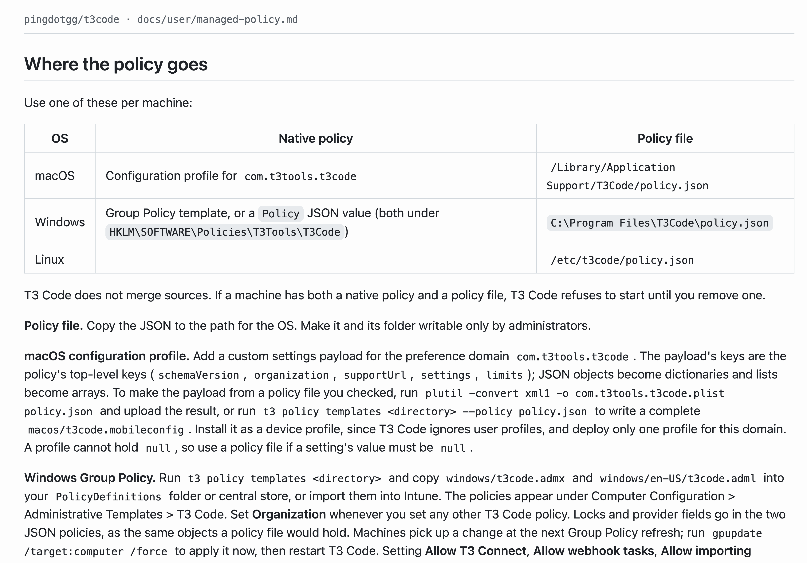
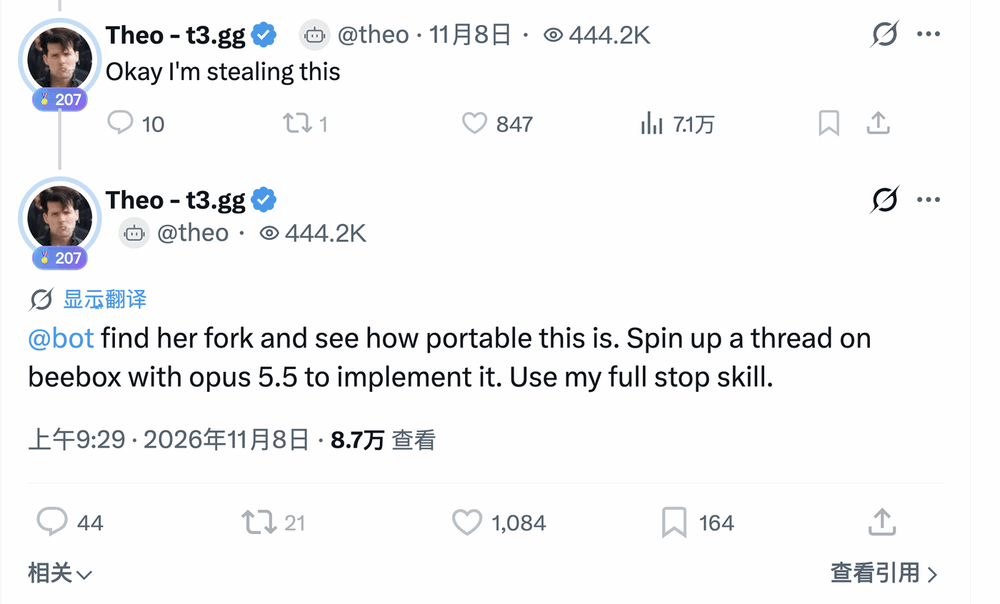
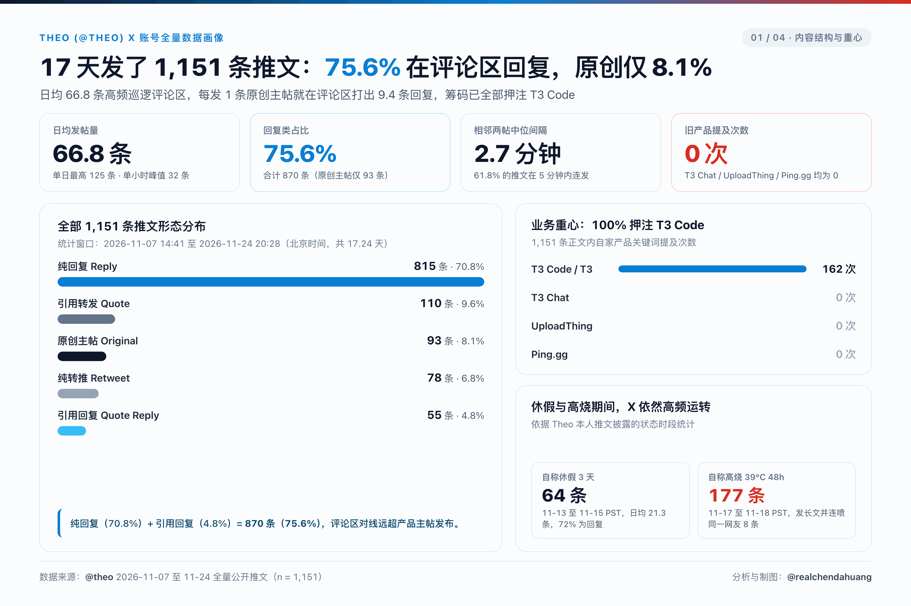
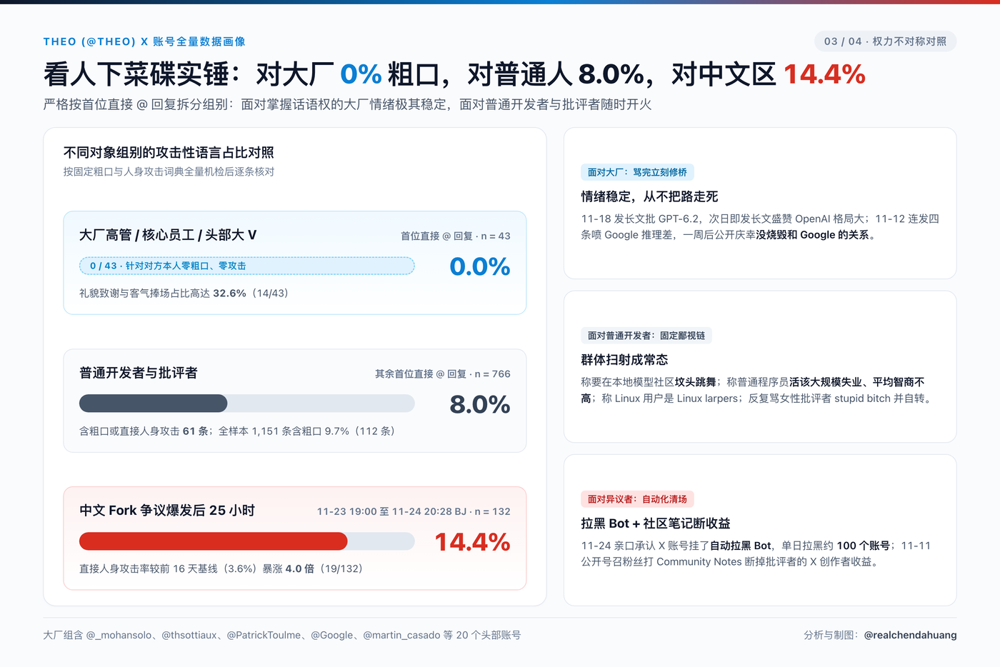

# 安装 T3 Code 之前

<p align="center">
  <em>面向 <code>pingdotgg/t3code</code> 的独立源码、遥测、安全、治理与公开记录审计档案 —— 附 320 条一手原始链接、108 张实证截图与 1,151 条连续推文量化分析。</em>
</p>

<p align="center">
  <a href="https://realchendahuang.github.io/before-you-install-t3code/"><strong>🌐 打开交互式证据门户（GitHub Pages）</strong></a>
  ·
  <a href="https://github.com/realchendahuang/before-you-install-t3code/actions/workflows/verify.yml"></a>
  ·
  <a href="../EVIDENCE-INDEX.md"><strong>108 张证据图总索引</strong></a>
  ·
  <a href="../COMPLETE-SOURCE-INDEX.md"><strong>320 条一手来源总索引</strong></a>
</p>

<p align="center">
  <strong>联合国官方语言版本：</strong>
  <a href="../../README.md">English</a> ·
  <a href="./README.zh-CN.md"><strong>简体中文</strong></a> ·
  <a href="./README.fr.md">Français</a> ·
  <a href="./README.es.md">Español</a> ·
  <a href="./README.ru.md">Русский</a> ·
  <a href="./README.ar.md">العربية</a>
</p>
<p align="center">
  <strong>全球社区语言版本：</strong>
  <a href="./README.zh-TW.md">繁體中文</a> ·
  <a href="./README.ja.md">日本語</a> ·
  <a href="./README.ko.md">한국어</a> ·
  <a href="./README.de.md">Deutsch</a> ·
  <a href="./README.pt-BR.md">Português</a> ·
  <a href="./README.it.md">Italiano</a> ·
  <a href="./README.nl.md">Nederlands</a> ·
  <a href="./README.pl.md">Polski</a> ·
  <a href="./README.tr.md">Türkçe</a> ·
  <a href="./README.vi.md">Tiếng Việt</a> ·
  <a href="./README.id.md">Bahasa Indonesia</a> ·
  <a href="./README.hi.md">हिन्दी</a>
</p>
<p align="center">
  <strong>审计基线：</strong> <a href="https://github.com/pingdotgg/t3code/commit/9d3195b49dfb0098e9fa592fe0ada5464206d1c2"><code>9d3195b4</code></a>（<code>#42000</code>）·
  <strong>最新上游复核：</strong> <a href="https://github.com/pingdotgg/t3code/commit/ca81b7b97a1c4b91e5ac25768d0f6629f37732fd"><code>ca81b7b9</code></a>（<code>#42634</code>，11 月 25 日 14:49 CST · 新增 +259 个提交）
</p>


> [!NOTE]
> **范围与核验原则**
> - **档案覆盖：** 汇总 2026 年 11 月 24–25 日发布的 2 篇导火索原帖与 **18 弹独立审计**、**6 份深度技术卷宗**（[`docs/dossiers/`](../dossiers/01-telemetry-and-gdpr-timeline.md)）、**320 条规范化一手链接**（[`SRC-001`–`SRC-320`](../COMPLETE-SOURCE-INDEX.md)）、**108 张实证截图与图表**（[`EV-001`–`EV-108`](../EVIDENCE-INDEX.md)）、[**交互式证据门户**](https://realchendahuang.github.io/before-you-install-t3code/)，以及 **1,151 条连续 `@theo` X 推文**（11 月 7–24 日）量化数据集。
> - **代码追踪区间：** 主基线 [`9d3195b4`](https://github.com/pingdotgg/t3code/commit/9d3195b49dfb0098e9fa592fe0ada5464206d1c2)（`PR #42000`，`2026-11-24T08:41:04Z`），持续复核至 `main` HEAD [`ca81b7b9`](https://github.com/pingdotgg/t3code/commit/ca81b7b97a1c4b91e5ac25768d0f6629f37732fd)（`PR #42634`，`2026-11-25 14:49 CST`）。
> - **编辑纪律：** 零短链跳转、零私人联系方式。欢迎附一手出处通过 PR 补充事实更新、官方修复进展或新语种译本——详见 [`CONTRIBUTING.md`](../../CONTRIBUTING.md)。

---

## TL;DR（30 秒结论速览）

> [!IMPORTANT]
> **一句话结论：** `pingdotgg/t3code` 在官网宣称 `"No telemetry"` 期间默认开启遥测并经闭源网关（`ingest.t3.codes`）留存原始事件，在 **0 条 GitHub 安全公告** 的情况下静默修复多个高危漏洞，伪装 Google Antigravity 内部请求头触碰封号红线，且 T3 Connect 至今 **零端到端加密**。虽然 `ca81b7b9` 之前补上了部分舆论焦点漏洞，**核心架构风险目前依然存在**。
>
> **最受影响人群：** 非管理员权限的桌面安装用户、本地带有内网模型端点或 `SSH_AUTH_SOCK`/`GITHUB_TOKEN` 环境变量的开发者、Google Antigravity/Gemini 订阅用户、Claude Auto 模式使用者，以及使用 T3 Connect、`--lan` 或绑定 GitHub 账号的用户。

### 按需直达（选择你的阅读路径）

| 你现在的处境 | 建议直接看这里 |
|---|---|
| **正在评估要不要装 T3 Code** | 先扫一眼下方 **已修复 vs. 仍未修复** 速览表与 [风险矩阵](#结构化发现与风险矩阵)。 |
| **电脑上已经装了 T3 Code** | 直接跳到 [**2 分钟止损与清理清单**](#7-可执行止损与修复操作手册)（配置 `DO_NOT_TRACK=1`、屏蔽 `ingest.t3.codes`、执行 `VACUUM`、吊销令牌）。 |
| **想翻原图、跑图表、核对源码** | 直接访问 [**交互式证据门户**](https://realchendahuang.github.io/before-you-install-t3code/)（支持搜索 108 张原图、交互查看 4 张图表、一键复制止损命令）或打开 [6 份深度卷宗](../dossiers/01-telemetry-and-gdpr-timeline.md)。 |

### 一眼看清：审计基线（`9d3195b4`） vs. 上游现状（`ca81b7b9`）

| 审计领域 | 基线查证事实（`9d3195b4`） | 上游最新复核（`ca81b7b9`，11 月 25 日 14:49 CST） | 深入阅读 |
|---|---|---|---|
| **遥测与隐私** | 官网挂着 `"No telemetry"` 时默认启用 PostHog（`PR #174`）；原始事件经闭源 [`ingest.t3.codes`](https://ingest.t3.codes/) 留存；无盐 SHA-256 读取 `.codex`/`.claude.json`；GDPR 后通宵 PR 自承 Axiom 每小时记录 **220 万条 IP + UA**（`#42380`）与 `git.cwd` 路径泄露（`#42450`）。 | **部分修补：** [`#42299`](https://github.com/pingdotgg/t3code/pull/42299) 停止读取 `.codex`/`.claude.json`，[`#42465`](https://github.com/pingdotgg/t3code/pull/42465) 将非目录自定义模型脱敏为 `custom:<driver>`，[`#42630`](https://github.com/pingdotgg/t3code/pull/42630)/[`#42629`](https://github.com/pingdotgg/t3code/pull/42629) 响应 CI 与 `DO_NOT_TRACK`。<br>**仍未修复：** [`AnalyticsService.ts:156`](https://github.com/pingdotgg/t3code/blob/main/apps/server/src/telemetry/AnalyticsService.ts) 启动仍先落盘本地 ID 再查开关；[`DesktopShellEnvironment.ts`](https://github.com/pingdotgg/t3code/blob/main/apps/desktop/src/shell/DesktopShellEnvironment.ts) 仍漏传 `OTEL_SDK_DISABLED`/`T3CODE_OTEL_SDK_DISABLED`；**软件内与 `app.t3.codes` 仍无任何关闭按钮**。 | [第 2 节](#2-遥测跨工具凭证读取与-gdpr-举报后通宵补丁第-171112-弹) · [卷宗 01](../dossiers/01-telemetry-and-gdpr-timeline.md) |
| **本地安全与静默公告** | 侧边栏“永久删除”使 `statev2.sqlite` 膨胀至 41.6 GB（`#17845`）；`t3-resource-monitor` 全盘扫描进程及命令行（`#11222`）；Claude Auto 静默放行 `git push --force`（`#15353`）；高危补丁静默合入且 **0 条 GitHub 安全公告**。 | **部分修补：** [`#42119`](https://github.com/pingdotgg/t3code/pull/42119) 新增异步清理（但分支/子代理关联历史与墓碑行仍留存，瘦身需离线 `VACUUM`）；[`#42577`](https://github.com/pingdotgg/t3code/pull/42577) 仅收窄 Windows 进程监控（macOS/Linux 维持 `ProcessesToUpdate::All`）。<br>**仍未修复：** [`#15353`](https://github.com/pingdotgg/t3code/issues/15353)、打开仓库自动递归初始化 `.gitmodules` + 缺 `core.hooksPath=/dev/null` + 带 `SSH_AUTH_SOCK`/`GITHUB_TOKEN` 执行 `SessionStart` 钩子、**0 条安全公告**。 | [第 3 节](#3-本地存储进程监控护栏绕过与未披露安全补丁第-2313-弹) · [卷宗 02](../dossiers/02-local-safety-and-security-audit.md) |
| **Antigravity 封号风险** | [`antigravityUsageLimits.ts`](https://github.com/pingdotgg/t3code/blob/main/apps/server/src/provider/antigravityUsageLimits.ts) 提取系统钥匙串/`CredReadW` 令牌、伪造 `antigravity/hub/2.24.0` 直连 `v1internal`；假 `SSH_CONNECTION` 引发跨账号串号（`#41973`）；全新 $20 账号 3 分钟封号（`#41536`）。 | **仍在生效：** [`#41210`](https://github.com/pingdotgg/t3code/pull/41210) 新增 Google `VALIDATION_REQUIRED` `403` 验证链接解析（反证已触发风控），四条伪装/提权路径全部保留。 | [第 4.1 节](#41-google-antigravity-请求头伪装假-ssh_connection-与-3-分钟封号第-4-弹) · [卷宗 03](../dossiers/03-antigravity-tos-and-t3connect-relay.md) |
| **T3 Connect 与局域网鉴权** | **零端到端加密**（[`#32098`](https://github.com/pingdotgg/t3code/issues/32098)）；`requireConnectDeviceApproval` 默认 `false`（[`settings.ts`](https://github.com/pingdotgg/t3code/blob/main/packages/contracts/src/settings.ts)）；OVH Caddy 网关明文终结 TLS（`PR #32945`）。 | **仍未修复：** 无端到端加密；`ca81b7b9` 进一步证实 `--lan` 明文 30 天 Cookie（`PR #37042`）+ 放行缺失 `Origin`、无 `/logout` 的不可吊销 30 天 Bearer 令牌、可重放 5 分钟 `?wsTicket=`，以及 `isIPv4` 掐断 `::1` 隧道。 | [第 4.2 节](#42-t3-connect零端到端加密与-ovh-tls-终结网关第-5-弹) · [卷宗 03](../dossiers/03-antigravity-tos-and-t3connect-relay.md) |
| **7.7 万星与商业账本** | 自掏 $800k+ 打造日跑 **31.7 万亿 token（$10.19M/天）** 的算力雷达；5 轮对话/发呆 30 秒弹窗动用主机凭据发 `PUT user/starred/...` 且未锁死仓库名（[`driver.ts#L60-L99`](https://github.com/pingdotgg/t3code/blob/main/packages/source-control-github/src/server/driver.ts#L60-L99)）。 | **仍未修复：** `driver.ts#L60-L99` 任意仓库点星与 `zhilsinger` 审查意见拖延 19 天仍未解决（7.7 万+ 星 vs. ~129 名 watcher）。 | [第 5 节](#5-商业账本投资人利益冲突赞助商与-77000-星漏斗第-681718-弹) · [卷宗 04](../dossiers/04-business-ledger-sponsors-and-77k-stars.md) |
| **治理、商标与推文语料** | 威胁封号时 `T3 Code` **USPTO 注册商标为 0**（17 小时后补写 `TRADEMARK.md`）；`n = 1,151` 条推文显示对大厂 VIP **0.0%** 粗口 vs. 普通开发者 **8.0%** 敌意与危机期 **14.4%** 人身攻击。 | **基线事实留存：** `CONTRIBUTING.md`、`.github/VOUCHED.td` 与 `TRADEMARK.md` 仍在 `main` 生效；4 张可复现取证图表已归档。 | [第 6 节](#6-社区治理扒-fork-机器人商标记录1151-条推文数据集与历史言行第-910141516-弹) · [卷宗 05–06](../dossiers/05-governance-trademark-and-history.md) |

---

## 目录

**总览与快速导航**
- [TL;DR（30 秒结论速览）](#tldr30-秒结论速览)
- [结构化发现与风险矩阵](#结构化发现与风险矩阵)
- [时间线总览（2023–2026）](#时间线总览20232026)

**完整审计报告与止损手册**
- [1. 起因争议：“偷我们的代码”、Fork 命名威胁与双标](#1-起因争议偷我们的代码fork-命名威胁与双标)
- [2. 遥测、跨工具凭证读取与 GDPR 举报后通宵补丁（第 1、7、11、12 弹）](#2-遥测跨工具凭证读取与-gdpr-举报后通宵补丁第-171112-弹)
- [3. 本地存储、进程监控、护栏绕过与未披露安全补丁（第 2、3、13 弹）](#3-本地存储进程监控护栏绕过与未披露安全补丁第-2313-弹)
- [4. Google Antigravity 服务条款风险与未加密的 T3 Connect 中继（第 4、5 弹）](#4-google-antigravity-服务条款风险与未加密的-t3-connect-中继第-45-弹)
- [5. 商业账本、投资人利益冲突、赞助商与 77,000 星漏斗（第 6、8、17、18 弹）](#5-商业账本投资人利益冲突赞助商与-77000-星漏斗第-681718-弹)
- [6. 社区治理、扒 Fork 机器人、商标记录、1,151 条推文数据集与历史言行（第 9、10、14、15、16 弹）](#6-社区治理扒-fork-机器人商标记录1151-条推文数据集与历史言行第-910141516-弹)
- [7. 可执行止损与修复操作手册](#7-可执行止损与修复操作手册)
- [8. 一手来源与 18 弹原帖总索引](#8-一手来源与-18-弹原帖总索引)

---

## 结构化发现与风险矩阵

| 审计域与对应弹数 | 风险等级 | 核心查证发现 | 上游最新状态（`ca81b7b9`） | 深度卷宗 |
|---|---|---|---|---|
| **遥测与 GDPR 后隐私**<br>*（第 1、7、11、12 弹）* | **严重** | 官网挂 `"No telemetry"` 期间默认开启 PostHog（`#174`，`3bdaa6e1` 静默删承诺）；闭源 `ingest.t3.codes` 留存原始拷贝（`#15028`）；无盐 SHA-256 跨工具读取 `.codex`/`.claude.json`；连拒 4 个开关 PR（`#27077`）；GDPR 后通宵 PR 自承 **220 万条/小时 IP + UA** 留存 30 天（`#42380`）、`git.cwd` 泄露（`#42450`）、Win/Mac 退出失效（`#42376`/`#42464`）、删号不删库（`#42285`）与匿名反馈混包（`#42466`）。 | [`#42299`](https://github.com/pingdotgg/t3code/pull/42299)、[`#42465`](https://github.com/pingdotgg/t3code/pull/42465)、[`#42630`](https://github.com/pingdotgg/t3code/pull/42630) 与 [`#42629`](https://github.com/pingdotgg/t3code/pull/42629) 已合入；**仍未修：** `AnalyticsService.ts:156` 启动先写本地 ID、漏传 `OTEL_SDK_DISABLED`、闭源 `ingest.t3.codes`、无 UI/网页端开关、移动端与 `Publish agent activity` 盲区。 | [**卷宗 01**](../dossiers/01-telemetry-and-gdpr-timeline.md) |
| **本地安全与静默公告**<br>*（第 2、3、13 弹）* | **严重** | 侧边栏假删除使 `statev2.sqlite` 膨至 41.6 GB（`#17845`）；`t3-resource-monitor` 全机扫进程与命令行（`#11222`、`#41889`）；Claude Auto 静默放行 `git push --force`（`#15353`）；21 小时撤除模型隐私过滤（`#41237`）；**0 条安全公告** 却静默合入高危修复（`#39483`、`#42504`）；未受信任仓库自动初始化 `.gitmodules`、缺 `core.hooksPath=/dev/null` 并带 `GITHUB_TOKEN`/`SSH_AUTH_SOCK` 执行 `SessionStart` 钩子。 | [`#42119`](https://github.com/pingdotgg/t3code/pull/42119) 新增异步清理（保留活跃分支/子代理关联历史与墓碑行，瘦身需离线 `VACUUM`）；[`#42577`](https://github.com/pingdotgg/t3code/pull/42577) 仅收窄 Windows；**仍未修：** `#15353`、`#26489`、`#30997`、仓库钩子风险、**0 条安全公告**与 `SECURITY.md` 边界声明。 | [**卷宗 02**](../dossiers/02-local-safety-and-security-audit.md) |
| **Antigravity 与 T3 Connect**<br>*（第 4、5 弹）* | **高** | `antigravityUsageLimits.ts` 提取系统钥匙串/`CredReadW` 并伪造 `antigravity/hub/2.24.0` 调 `v1internal`；假 `SSH_CONNECTION` 引发跨号串流（`#41973`）；新 $20 号 3 分钟封号（`#41536`）；**T3 Connect 零端到端加密**（`#32098`）+ OVH Caddy 明文网关（`#32945`）；`ca81b7b9` 暴露 `--lan` 明文 Cookie、不可吊销 30 天 Bearer、可重放 `?wsTicket=` 与 `::1` 断连。 | [`#41210`](https://github.com/pingdotgg/t3code/pull/41210) 新增 Google `VALIDATION_REQUIRED` 验证链接；[`#42311`](https://github.com/pingdotgg/t3code/pull/42311) 新增新设备提醒；**仍未修：** 全部 Antigravity 伪装路径、**无端到端加密**、默认关闭 `requireConnectDeviceApproval` 以及局域网/Bearer/WS/`::1` 缺陷。 | [**卷宗 03**](../dossiers/03-antigravity-tos-and-t3connect-relay.md) |
| **商业账本与 7.7 万星**<br>*（第 6、8、17、18 弹）* | **高** | 自掏 $800k+ 做免费客户端（提 T3 `162` 次 vs. 老付费产品 `0` 次）；日跑 **31.7 万亿 token（$10.19M/天）** 算力雷达换取 $300k+ OpenAI 内测额度与 VC 接洽；Vibe Kanban 与 Daytona 利益重叠；Clerk/Axiom 赞助绑定；Codex 0% 漏洞与 10 号 `CLIProxyAPI` Gist（`555%`）；发呆 30 秒弹窗动用主机凭据发 `PUT user/starred/...`（`#29922`）。 | `driver.ts#L60-L99` 未锁死任意点星漏洞与 `zhilsinger` 审查在 **`ca81b7b9` 仍未修**；7.7 万+ 星 vs. ~129 名 watcher。 | [**卷宗 04**](../dossiers/04-business-ledger-sponsors-and-77k-stars.md) |
| **治理、商标与历史言行**<br>*（导火索 1–2，第 9、10、15、16 弹）* | **中高** | 日均 500 commits / `yolo merges` vs. `CONTRIBUTING.md`（`"here's my advice: Don't"`）、`.github/VOUCHED.td` 拉黑秒关、174 个 `unwanted` 标签、删 Plan mode（`#33131`）与 `#33639` 辱骂用户；公开派 `@bot` 扒人 Fork；威胁封号时 **USPTO 注册商标为 0**，17 小时后补合 `TRADEMARK.md`（`#41898`）；2024–2026 惯常模式。 | `CONTRIBUTING.md`、`.github/VOUCHED.td` 与 `TRADEMARK.md` 仍在 `main`（`ca81b7b9`）生效。 | [**卷宗 05**](../dossiers/05-governance-trademark-and-history.md) |
| **1,151 条推文量化数据集**<br>*（第 14 弹）* | **审计基线** | 11 月 7–24 日连续语料（`n = 1,151`，日均 66.8 条，回复占 75.6%，间隔中位数 2.7 分钟）：对 20 位大厂高管/员工/头部 KOL **0.0%** 粗口（`0/43`） vs. 对普通开发者 **8.0%** 敌意（`61/766`），中文二改 25 小时窗口人身攻击 **暴涨 4.0 倍至 14.4%**（`19/132`）。 | 可复现正则统计审计及 4 张交互/静态取证图表。 | [**卷宗 06**](../dossiers/06-tweet-forensic-dataset-1151.md) |
| **一手 URL 与视觉总目** | **总索引** | 交叉索引 **320** 条规范化 `https://` 链接（`SRC-001`–`SRC-320`）与 **108** 张实证截图及图表（`EV-001`–`EV-108`）。 | 100% 规范化直链（零 `t.co` 短链；108/108 资产编目就绪）。 | [**来源总表**](../COMPLETE-SOURCE-INDEX.md) · [**证据总表**](../EVIDENCE-INDEX.md) |

---

## 时间线总览（2023–2026）

### 六个核心转折点

| 日期 / 时间窗 | 关键转折 | 一手档案 |
|---|---|---|
| **2026-03-06 → 06-18** | **PR #174** 无开关默认开启 PostHog 遥测；三个多月后，**commit `3bdaa6e1`** 静默删除官网首页 `"No telemetry / Unless you opt in. Full stop."` 承诺。 | [PR #174](https://github.com/pingdotgg/t3code/pull/174) · [Commit `3bdaa6e1`](https://github.com/pingdotgg/t3code/commit/3bdaa6e10046945ccc08264d2d6f3b81775efcb3) |
| **2026-10 – 2026-11-06** | **PR #15028** 将原始事件导入闭源 `ingest.t3.codes`；**PR #21506** 加入 `.codex`/`.claude.json` 无盐 SHA-256 跨工具归因；**PR #29922** 上线发呆 30 秒动用宿主机凭据点星（`driver.ts#L60-L99` 未锁死）。 | [PR #15028](https://github.com/pingdotgg/t3code/pull/15028) · [PR #21506](https://github.com/pingdotgg/t3code/pull/21506) · [PR #29922](https://github.com/pingdotgg/t3code/pull/29922) |
| **2026-11-23 – 11-24** | `@theo` 在 **USPTO 注册商标为 0** 的情况下威胁封杀 MIT Fork 作者 GitHub 账号（`2124829315657576890`），17 小时后补合 `TRADEMARK.md`（**PR #41898**），却同时表态欢迎万亿美元美国大厂照抄 MIT 代码。 | [`2124829315657576890`](https://x.com/theo/status/2124829315657576890) · [PR #41898](https://github.com/pingdotgg/t3code/pull/41898) |
| **2026-11-24 晚 – 11-25 07:00 CST** | 第 1–5 弹发布（第 1 弹超 **181 万次阅读**），引发欧盟 GDPR 正式举报与 **6 小时通宵补丁战**，自爆 Axiom 每小时 220 万条 IP 日志（`#42380`）、`git.cwd` 路径泄露（`#42450`）、删号不删库（`#42285`）与 Win/Mac 退出失效（`#42376`/`#42464`）。 | [第 1 弹](https://x.com/realchendahuang/status/2125153472450527440) · [第 11 弹](https://x.com/realchendahuang/status/2125394810559426993) · [第 12 弹](https://x.com/realchendahuang/status/2125395501663281198) |
| **2026-11-25 08:27 – 10:28 CST** | 第 **6–18 弹** 密集上线，完整披露 Managed Policy 盲区、$800k+ / 31.7 万亿 token 算力雷达、`yolo merges`、`@bot` 扒 Fork、1,151 条推文量化统计、USPTO 记录、赞助商关系与 7.7 万星漏斗。 | [第 6 弹](https://x.com/realchendahuang/status/2125385742243520653) → [第 18 弹](https://x.com/realchendahuang/status/2125416210120765799) |
| **2026-11-25 至 14:49 CST（`ca81b7b9`）** | 审计后追踪（`+259` 提交）核实 `#42299`、`#42465`、`#42577`、`#41210`、`#42630`、`#42629`（`DO_NOT_TRACK`）与 `#42119`（异步清理），同时确认 `AnalyticsService.ts:156`、闭源 `ingest.t3.codes`、`#15353`、`driver.ts#L60-L99`、`0` 条安全公告与未加密 T3 Connect 仍未解决。 | [`ca81b7b9`](https://github.com/pingdotgg/t3code/commit/ca81b7b97a1c4b91e5ac25768d0f6629f37732fd) · [PR #42629](https://github.com/pingdotgg/t3code/pull/42629) · [PR #42119](https://github.com/pingdotgg/t3code/pull/42119) |

<details>
<summary>展开完整 20 项历史时间线（2023–2026）</summary>

| 日期 / 时间 | 关键节点 | 可核验档案 / 来源 |
|---|---|---|
| **2023-05-14** | `@theo` 公布其 YouTube 赞助商名单（`@vercel`、`@clerk`、`@upstash`、`@axiomhq`、`@PlanetScale`），其中 Clerk 与 Axiom 后来成为 T3 Code 云端认证与日志核心组件。 | [`1657488850472804353`](https://x.com/theo/status/1657488850472804353) |
| **2024-04 / 2024-09** | Vercel CEO 证实全网仅赞助一位 YouTube 博主（`Theo`）；`@theo` 承认赞助合同含限制推广竞品的排他条款。 | [`1776260839965863965`](https://x.com/rauchg/status/1776260839965863965) · [视频](https://www.youtube.com/watch?v=uv179CTAK-w) |
| **2024 年** *（两年前）* | `@theo` 将自己 Fork 别人的 VS Code 主题命名为 `vsc-material-but-i-wont-sue-you` 嘲讽原作者；另因针对印度教程频道引发网暴发布道歉视频（`I screwed up.`）谴责按国籍攻击。 | [`vsc-material-but-i-wont-sue-you`](https://github.com/t3dotgg/vsc-material-but-i-wont-sue-you) · [`I screwed up.`](https://www.youtube.com/watch?v=o2CSJYXJBpc) |
| **2025-02 – 2025-05** | USPTO 驳回 T3 Tools Inc. 唯一商标申请（`PING LABS`，序列号 `97294243`）并于 2025 年 5 月 19 日标为 `ABANDONED`；EquipmentShare 在第 9/42 类注册 `T3`（注册号 `7795672`）。 | [TSDR `97294243`](https://tsdr.uspto.gov/statusview/sn97294243) · [TSDR `90644500`](https://tsdr.uspto.gov/#caseNumber=90644500&caseSearchType=US_APPLICATION&caseType=DEFAULT&searchType=statusSearch) |
| **2025-10** | `@theo` 与 FFmpeg 冲突并公开悬赏 **$20,000** 驱逐一名 FFmpeg 维护者；Windscribe 反手出价 $21,000、VLC 创始人反对，最终 `@theo` 删视频删推撤悬赏。 | [FFmpeg 事件记录](https://www.youtube.com/watch?v=1oQ3KMeaH04) |
| **2026-03-06** | **PR #174** 合并入 `pingdotgg/t3code`，无弹窗、无 UI 开关、无文档默认启用 PostHog 遥测。 | [PR #174](https://github.com/pingdotgg/t3code/pull/174) |
| **2026-04-26** | `@theo` 发视频《*Github has a fake star problem*》，称 GitHub Star 是 `"mostly a way for companies to trick VCs into investing"`。 | [`2048122499834036340`](https://x.com/theo/status/2048122499834036340) |
| **2026-06-18** | **Commit `3bdaa6e1`** 在默认遥测跑满三个多月后，静默删除首页 `No telemetry / Unless you opt in. Full stop.` 承诺。 | [Commit `3bdaa6e1`](https://github.com/pingdotgg/t3code/commit/3bdaa6e10046945ccc08264d2d6f3b81775efcb3) |
| **2026-06-23** | 维护者 Julius 将 **Issue #1397** 标为 `not planned` 关闭：*"We will not make this easier to opt out of, it is crucial for us to know how many users we have"*。 | [Issue #1397](https://github.com/pingdotgg/t3code/issues/1397) |
| **2026-07 – 2026-11-17** | **Issue #4123**（质疑违背承诺）于 11 月 4 日静默关闭；4 个社区关闭开关 PR（`#13458`、`#16763`、`#21248`、`#27077`）全部被拒（`#27077` 通过 147 项测试仍被打 `unwanted`）。 | [Issue #4123](https://github.com/pingdotgg/t3code/issues/4123) · [PR #27077](https://github.com/pingdotgg/t3code/pull/27077) |
| **2026-08-06 – 2026-09-02** | **PR #5551** 藏起 Build/Plan 切换（10 踩）；**PR #9190** 藏起上下文用量环（16 踩，全仓最高）。 | [PR #5551](https://github.com/pingdotgg/t3code/pull/5551) · [PR #9190](https://github.com/pingdotgg/t3code/pull/9190) |
| **2026-08-19 – 2026-08-22** | `@theo` 炫耀白嫖 Codex 0% 额度超 **$800+**，员工 `@maria_rcks` 发布 *Endless*；遭群嘲后删推（`2090972426876129658`），随后 OpenAI 切紧 0% 断流（`openai/codex#45444`）。 | [`2090972426876129658`](https://x.com/maria_rcks/status/2090972426876129658) · [`codex#45444`](https://github.com/openai/codex/issues/45444) |
| **2026-10-03 – 2026-10-10** | **Issue #15353**（Claude Auto 静默 `git push --force`）、`privacy-policy.astro`（`2026-10-06`）与 **Issue #17845**（`statev2.sqlite` 假删除）相继入档。 | [Issue #15353](https://github.com/pingdotgg/t3code/issues/15353) · [Issue #17845](https://github.com/pingdotgg/t3code/issues/17845) |
| **2026-10 – 2026-10-19** | **PR #15028** 将遥测经闭源 `ingest.t3.codes` 留存拷贝；**PR #21506** 在 `Identify.ts` 加入无盐 SHA-256 跨工具归因；`@theo` 发布 10 账号 `CLIProxyAPI` Gist（`555%` 额度）。 | [PR #15028](https://github.com/pingdotgg/t3code/pull/15028) · [PR #21506](https://github.com/pingdotgg/t3code/pull/21506) · [Gist](https://gist.github.com/t3dotgg/59a521d2ee8d70aaf90e280c175072af) |
| **2026-10-30 – 2026-11-06** | **PR #27832**、**#29922**、**#29987** 上线 5 条 prompt / 发呆 30 秒弹窗动用宿主机凭据发 `PUT user/starred/...`；`zhilsinger` 提出 `Request changes` 后 19 天无人理睬。 | [PR #27832](https://github.com/pingdotgg/t3code/pull/27832) · [PR #29922](https://github.com/pingdotgg/t3code/pull/29922) |
| **2026-11-08 – 2026-11-22** | `@bot` 公开扒 Fork（`@MiaAI_lab`）、彻底删 Plan mode（`#33131`）、自曝 $800k+ 投入与日跑 31.7T / $10.19M 雷达、$300k+ OpenAI 免费额度、改写 `CONTRIBUTING.md`、Vibe Kanban/Daytona 冲突、`PR #41237` 21 小时撤除模型过滤。 | [PR #33131](https://github.com/pingdotgg/t3code/pull/33131) · [`2122860770329608290`](https://x.com/theo/status/2122860770329608290) · [PR #41237](https://github.com/pingdotgg/t3code/pull/41237) |
| **2026-11-23 19:11–19:54 CST** | `@theo` 怒骂 `"Chinese knockoff"`、`"Temu3 Code"` 并威胁找 GitHub 封杀 MIT Fork 作者账号（`2124829315657576890`）；作者 30 分钟内改名 `Stardust`；私信道歉但两条公开发帖纹丝不动。 | [`2124829315657576890`](https://x.com/theo/status/2124829315657576890) · [导火索 2](https://x.com/realchendahuang/status/2125062675147448475) |
| **2026-11-24 06:06–12:23 CST** | `@theo` 称欢迎万亿美元美国大厂照抄 MIT 代码（`2124989435154726982`），嘲讽 `"get a better lawyer"`；导火索 1–2 发布；17 小时后的 **12:21 CST** 补合 **PR #41898** 写入 `TRADEMARK.md`。 | [`2124989435154726982`](https://x.com/theo/status/2124989435154726982) · [PR #41898](https://github.com/pingdotgg/t3code/pull/41898) |
| **2026-11-24 17:04 – 11-25 10:28 CST** | 第 **1–18 弹** 陆续发布（第 1 弹超 **181 万阅读**、6,640 收藏），引爆欧盟 GDPR 举报与 6 小时通宵急救补丁（`#42380`、`#42285`、`#42376`、`#42450`、`#42464`、`#42466`、`#41757`、`#42386`、`#42504`）及凌晨删推威胁闭源。 | [第 1 弹](https://x.com/realchendahuang/status/2125153472450527440) · [第 12 弹](https://x.com/realchendahuang/status/2125395501663281198) · [第 18 弹](https://x.com/realchendahuang/status/2125416210120765799) |
| **2026-11-25 至 14:49 CST（`ca81b7b9`）** | 审计后追踪（`+259` 提交）核实 `#42299`、`#42465`、`#42577`、`#41210`、`#42630`、`#42629`、`#42119`、`#42311` 与 `#42356`–`#42415`，同时确认核心架构问题仍未根治。 | [`ca81b7b9`](https://github.com/pingdotgg/t3code/commit/ca81b7b97a1c4b91e5ac25768d0f6629f37732fd) · [PR #42629](https://github.com/pingdotgg/t3code/pull/42629) · [PR #42119](https://github.com/pingdotgg/t3code/pull/42119) · [PR #41210](https://github.com/pingdotgg/t3code/pull/41210) |

</details>

---

## 1. 起因争议：“偷我们的代码”、Fork 命名威胁与双标

2026 年 11 月 23 至 25 日短短 48 小时内，一场围绕开源社区 MIT Fork 命名的争议，迅速演变为全仓库源码审计、欧盟 GDPR 正式投诉，以及近 20 个通宵紧急补丁。

- **导火索（11 月 23 日晚，北京时间）：** 一名网友将中国开发者 `@DDdxx666` 基于 MIT 协议发布的免费开源二改项目的界面误认成官方客户端并吐槽。`@theo` 未核查仓库来源，11 分钟内连发两推将其定性为 `"Chinese knockoff"`（中国山寨货）和 `"Temu3 Code"`，并直接威胁要找 GitHub 封号（`"Do it right now or I'm going to contact GitHub and have your account taken down"`）。而同一时间，T3 Code 官网（[`https://t3.codes/`](https://t3.codes/)）给自家 GitHub 链接贴的标签正写着 `"Steal our code (legally)"`（[导火索 1](https://x.com/realchendahuang/status/2125059292919394654)、[导火索 2](https://x.com/realchendahuang/status/2125062675147448475)）。
- **秒改名 vs. 赤裸双标：** 作者 30 分钟内将仓库改名 `Stardust` 并清光 T3 标识；`@theo` 私信致歉，却把累计阅读超 20 万的两条公开羞辱帖原封不动挂在主页。不到 11 小时后（11 月 24 日 `06:12` 北京时间，[`2124989435154726982`](https://x.com/theo/status/2124989435154726982)），被问及万亿美元美国大厂照抄 T3 Code 功能是否越界时，他立刻换了一副口吻：`"Nah. Open source is open source, even if a trillion dollar company uses it!"` 与此同时，T3 员工 `@maria_rcks` 自己就公开挂着 `maria-rcks/t3libre`（*"T3 Code, liberated"*），英文社区里的 `t3code-quota-ui`、`t3code-atlas`、`t3code-bar` 也从未遭到任何公开威胁。
- **全面审计展开：** 11 月 24 日 `17:04` 起，我逐项核查了 `pingdotgg/t3code` 的提交记录、源码文件、PR、Issue、官方文档、USPTO 商标库以及 `@theo` 公开推文，24 小时内连发 **18 弹有图有链的核查**。仅第 1 弹阅读就突破 **181 万**、收藏 **6,640**，直接引爆欧盟 GDPR 投诉与 T3 团队 6 小时通宵抢修。


---

## 2. 遥测、跨工具凭证读取与 GDPR 举报后通宵补丁（第 1、7、11、12 弹）

> [!WARNING]
> **本节核心结论：** T3 Code 在官网宣称 `"No telemetry"` 期间默认开启遥测并经闭源 `ingest.t3.codes` 留存原始事件；GDPR 举报后的通宵补丁更是自爆每小时在 Axiom 记录 **220 万条含 IP 与 UA 的跨度**、泄露绝对路径 `git.cwd` 以及删号不删库。截至 `ca81b7b9`，启动仍会先写入本地追踪 ID 再校验开关，且软件内至今零 UI 开关。  
> **深度技术卷宗：** 完整源码行号映射、`FeatureUsage.ts` 35 项行为清单与 11 月 23–25 日逐分钟日志见 [**卷宗 01：遥测架构、跨工具身份缝合与 11 月 24–25 日 GDPR 通宵补丁战**](../dossiers/01-telemetry-and-gdpr-timeline.md)。

### 2.1 默认遥测、被删除的官网承诺与跨工具凭证哈希（`第 1 弹`）

- **2026 年 3 月 6 日（`PR #174`）：** 无遥测文档、无首次启动同意弹窗、无设置界面开关，默认开启 PostHog 遥测（[第 1 弹](https://x.com/realchendahuang/status/2125153472450527440)）。
- **2026 年 6 月 18 日（[`commit 3bdaa6e1`](https://github.com/pingdotgg/t3code/commit/3bdaa6e10046945ccc08264d2d6f3b81775efcb3)）：** 默认采集运行三个多月后，`@theo` 借官网改版静默删掉首页的 `No telemetry / Unless you opt in. Full stop.`，对存量用户只字未提。


- **2026 年 10 月（`PR #15028`）：** 每 10 秒批量上报一次（`FLUSH_INTERVAL_MS = 10_000`），流向 T3 自建闭源网关 [`https://ingest.t3.codes/`](https://ingest.t3.codes/)。[`apps/server/src/telemetry/AnalyticsService.ts`](https://github.com/pingdotgg/t3code/blob/main/apps/server/src/telemetry/AnalyticsService.ts) 第 1 行白纸黑字写明该端点在转发 PostHog 前会留存原始事件拷贝：

```ts
// apps/server/src/telemetry/AnalyticsService.ts (lines 1, 71–74, 149 at 9d3195b4; line 156 at ca81b7b9)
// T3 ingest retains events and forwards to PostHog; UUIDs deduplicate retries there.
...
  posthogHost: Config.String("T3CODE_POSTHOG_HOST").pipe(
    Config.withDefault("https://ingest.t3.codes"),
  ),
  enabled: Config.Boolean("T3CODE_TELEMETRY_ENABLED").pipe(Config.withDefault(true)),
...
  const { distinctId, installId } = yield* getTelemetryIdentity;
```

- **采集明细：** [`ProviderUsageAnalytics.ts`](https://github.com/pingdotgg/t3code/blob/main/apps/server/src/telemetry/ProviderUsageAnalytics.ts) 与 `FeatureUsage.ts` 上报供应商、模型名（在 `9d3195b4` 经 [`ProviderDimensions.ts`](https://github.com/pingdotgg/t3code/blob/main/apps/server/src/telemetry/ProviderDimensions.ts) 原样发送非目录自定义模型/代理端点名）、推理强度、权限模式、耗时、输入/输出/缓存/推理 token 数、子代理 token、本地项目/线程数、**35 种 UI 与命令操作**（`18` 项 `COMMAND_FEATURES` + `17` 项 `METHOD_FEATURES`）、操作系统、WSL 发行版与 CPU 架构。
- **跨工具读取凭证（`PR #21506`，10 月 19 日）：** 为统计“一个自然人装了多少台设备”，基线 `9d3195b4` 的 [`apps/server/src/telemetry/Identify.ts`](https://github.com/pingdotgg/t3code/blob/main/apps/server/src/telemetry/Identify.ts) 静默读取用户主目录下其他 AI 工具的认证文件 `~/.codex/auth.json` 与 `~/.claude.json`，解析 OpenAI `user_id` JWT 与 Claude `oauthAccount.accountUuid`，并通过 [`packages/shared/src/telemetryId.ts`](https://github.com/pingdotgg/t3code/blob/main/packages/shared/src/telemetryId.ts)（第 8–9 行）做 **无盐 SHA-256 哈希**。因为服务端握有 Clerk 明文 T3 Connect 账号 ID，无盐哈希可在后端直接反查回真实个人。（后续 [`PR #42299`](https://github.com/pingdotgg/t3code/pull/42299) 停止读取 `.codex`/`.claude.json`，但 `connect` 与 `device` 无盐哈希仍在。）

```ts
// apps/server/src/telemetry/Identify.ts (lines 257–269, 321–338 at baseline 9d3195b4)
  const codexTokens = yield* readJsonIdentityFile(
    "codex",
    path.join(homeDirectory, ".codex", "auth.json"),
    decodeCodexAuthJson,
  )...
  const claudeJson = yield* readJsonIdentityFile(
    "claude",
    path.join(homeDirectory, ".claude.json"),
    decodeClaudeJson,
  )...
  const raw: ReadonlyArray<readonly [TelemetryOwnerSource, Option.Option<string>]> = [
    ["connect", connectUser],
    ["openai", Option.flatMap(codexTokens, (tokens) => Option.flatMap(Option.fromUndefinedOr(tokens.id_token), openAiUserId))],
    ["claude", Option.flatMap(claudeJson, (json) => Option.fromUndefinedOr(json.oauthAccount?.accountUuid))],
  ];
  return raw.flatMap(([source, value]) =>
    Option.isSome(value) && value.value.trim() !== "" ? [{ source, ownerId: hashTelemetryId(value.value) }] : [],
  );
```


- **社区关闭诉求遭连环封杀：** 6 月 23 日核心维护者 Julius 关闭 **Issue #1397**（`not planned`）：*"We will not make this easier to opt out of, it is crucial for us to know how many users we have"*；贴出官网旧截图质疑的 **Issue #4123** 于 11 月 4 日被静默关闭；9–11 月社区提交的 **4 个关闭开关 PR**（`#13458`、`#16763`、`#21248`、`#27077`）全部被拒——连通过 **147 项测试** 且获 Macroscope 批准的 `#27077` 也在 11 月 17 日被打上 `unwanted` 关闭。

<details>
<summary>展开 2 张拒绝退出开关的原始凭证（Issue #1397 与 PR #27077）</summary>


</details>

### 2.2 Managed Policy 与官方文档自相矛盾（`第 7 弹`）

11 月 24 日舆论升温后，`@theo` 在 X 上宣称 T3 Code 拥有全行业最易用的企业级 Managed Policy（`"trivial to set up and turn off all telemetry"`），并称对话数据留在本地 `"never touches any of our servers"`（[`2125186071357251715`](https://x.com/theo/status/2125186071357251715)、[`2125191784859115766`](https://x.com/theo/status/2125191784859115766)、[第 7 弹](https://x.com/realchendahuang/status/2125391659492081947)）。

直接对照官方 [`docs/user/managed-policy.md`](https://github.com/pingdotgg/t3code/blob/main/docs/user/managed-policy.md) 与 [`docs/user/telemetry.md`](https://github.com/pingdotgg/t3code/blob/main/docs/user/telemetry.md)，四处硬伤白纸黑字写着相反结论：

1. **仅管理员可配：** 桌面端无设置 UI 开关，需通过 MDM/GPO 或管理员权限路径写入 `policy.json`（macOS `/Library/Application Support/T3Code/policy.json`、Windows `C:\Program Files\T3Code\policy.json` 或 `HKLM\SOFTWARE\Policies\T3Tools\T3Code`、Linux `/etc/t3code/policy.json`）。
2. **托管网页端（`app.t3.codes`）完全盲区：** 官方文档明确承认浏览器端不读服务端环境变量、无视 Managed Policy，且 `"has no relay tracing toggle"`。
3. **移动端不受服务端策略管控：** 服务端环境变量与 Managed Policy `"do not disable mobile tracing"`（通宵 `PR #42415` 仅在移动端新增客户端开关，服务端策略依旧管不到）。
4. **`Publish agent activity` 无视遥测关闭：** 一旦开启，项目名、线程标题、模型名与实时状态持续发往 T3 Connect 中继，且 `"The telemetry opt-out does not disable it."`（另注：Axiom 报错跨度与移动端崩溃日志 `"can quote a value the app was handling"`，`Agent feedback` 还可附带最高 16 KB 对话内容）。


<details>
<summary>展开 Managed Policy 管理员路径凭证（docs/user/managed-policy.md）</summary>



</details>

### 2.3 11 月 25 日澄清长文两小时内遭逐条拆穿（`第 11 弹`）

11 月 25 日上午，`@theo` 发长文澄清（[`2125332390239494211`](https://x.com/theo/status/2125332390239494211)）并公开了一份遥测导出包（[`t3code-telemetry-events-jsonl-a4896cdc.gz`](https://files.tslop.org/2026/11/t3code-telemetry-events-jsonl-a4896cdc.gz)），随后又回复称关闭后不会写本地追踪文件（[`2125370330244128924`](https://x.com/theo/status/2125370330244128924)）。三条保证几小时内全部被自家 PR 与导出包证伪（[第 11 弹](https://x.com/realchendahuang/status/2125394810559426993)）：

- **宣称“从未采集文件路径”：** 90 分钟后 Julius 合并 **PR #42450**，自承中继触发的 Webhook 运行会把整条执行跨度导出至 Axiom，其中 Git 跨度直接携带 `git.cwd`（**工作区绝对路径、系统用户名与仓库名**）。
- **宣称“环境变量一直能干净关闭”：** **PR #42376** 承认 Windows 桌面端从既有进程启动时会无视用户已保存的 `T3CODE_TELEMETRY_ENABLED=false`；**PR #42464** 承认 macOS/Linux 首次启动中继追踪早于 Shell 环境发现执行，整场会话直接无视 `~/.zshrc` 配置。截至 `ca81b7b9`，[`DesktopShellEnvironment.ts`](https://github.com/pingdotgg/t3code/blob/main/apps/desktop/src/shell/DesktopShellEnvironment.ts) 仍漏传 `T3CODE_OTEL_SDK_DISABLED` 与 `OTEL_SDK_DISABLED`。
- **宣称“退出后不写追踪文件”与“Claude 哈希坏了”：** [`AnalyticsService.ts#L152`](https://github.com/pingdotgg/t3code/blob/main/apps/server/src/telemetry/AnalyticsService.ts#L152)（`9d3195b4` 第 149 行、`ca81b7b9` 第 156 行）启动仍先无条件调用 `getTelemetryIdentity`（执行 `upsertAnonymousId` 落盘）再校验 `telemetryEnabled`。同时，那份约 100MB 导出包（压缩后 `6,056,594` 字节、`95,789` 条事件）的 gzip 文件头暴露其原始文件名叫 `events.clean.jsonl`（发推前 20 分钟现洗），即便洗过仍残留 **264 条真实 Claude 账号记录**，在 10 月 20 日将 **4 台不同机器** 的 `installId` 缝到了同一个 SHA-256 哈希下，并夹带私有代理模型原名（`vibeproxy/gpt-6-luna`、`muse-proxy-wonder-full`）。


<details>
<summary>展开另外 3 张 11 月 25 日澄清与 100MB 导出包实证（PR #42376、PR #42464、events.clean.jsonl）</summary>


</details>

### 2.4 GDPR 举报后 6 小时通宵大补丁（`第 12 弹`）

11 月 24 日晚欧盟 GDPR 正式投诉递交后，6 小时通宵补丁战顺带自爆了四项更深层隐私问题（[第 12 弹](https://x.com/realchendahuang/status/2125395501663281198)）：

1. **每小时 220 万条带 IP 追踪跨度（`PR #42380`）：** 中继层导出到 Axiom 的每条请求跨度——约 **每小时 220 万条、留存 30 天**——均在 `user.id` 旁一并写入 `client.address`（来自 `cf-connecting-ip` 的真实调用方 IP）与 `user_agent.original`（且 Cloudflare 1% Workers 调用日志另计）。合入 3.5 小时后，`@theo` 仍在回复称 IP 早就剥离了。
2. **删号不删库、不关隧道（`PR #42285`、`PR #42430`）：** 此前在 Clerk 删号会留下 PlanetScale 中继记录与活跃 Cloudflare 隧道，直到收到真实隐私删除请求，只能 **手写 SQL + 人工拆隧道** 善后。
3. **移动端推送泄露（`PR #42459`、`PR #41859`）：** Android FCM 每次推送向 Google 发送明文 Clerk `user_id`；iOS 推送跨度与报错直接把带令牌的完整设备推送 URL 打进日志。
4. **“匿名”反馈同包混发（`PR #42466`）：** 宣称匿名的 `agent.feedback` 与带 `installId` 的实名事件和主机指纹（OS、架构、原始 WSL 发行版）打进同一个 HTTP POST，直接打脸 `docs/user/telemetry.md`。同时 `privacy-policy.astro` 仍停留在 10 月 6 日未更新。


<details>
<summary>展开另外 3 张 GDPR 后通宵补丁实证（PR #42285、PR #42459、PR #42466）</summary>


</details>

### 2.5 审计后遥测与身份归因更新（`9d3195b4` → `ca81b7b9`）

持续追踪至 `ca81b7b9`（`2026-11-25 14:49 CST`），上游补丁与遗留缺口对照如下：

- **审计后已合入：**
  - [**PR #42299**](https://github.com/pingdotgg/t3code/pull/42299)（[`84e4264b`](https://github.com/pingdotgg/t3code/commit/84e4264bb347e36e97f6c3bd95d666eecfa12e07)）：`Identify.ts` 停止读取 `~/.codex/auth.json` 与 `~/.claude.json`（`connect` 与 `device` 无盐 SHA-256 仍保留）。
  - [**PR #42465**](https://github.com/pingdotgg/t3code/pull/42465)（[`6b3899f2`](https://github.com/pingdotgg/t3code/commit/6b3899f224947178088ca97ec9907e681807f7da)）：`ProviderDimensions.ts` 将非目录自定义模型改为 `custom:<driver>`（但自定义端点下使用目录模型名时仍上报模型代号）。
  - [**PR #42630**](https://github.com/pingdotgg/t3code/pull/42630)（[`c925b9ab`](https://github.com/pingdotgg/t3code/commit/c925b9ab198099f67de862ed01701bd1d8809f2b)）：在 [`otelEnvironment.ts`](https://github.com/pingdotgg/t3code/blob/main/packages/shared/src/otelEnvironment.ts) 识别 13 个 CI 环境变量，默认关闭 CI 环境下的遥测与中继追踪。
  - [**PR #42629**](https://github.com/pingdotgg/t3code/pull/42629)（[`ef4a1643`](https://github.com/pingdotgg/t3code/commit/ef4a1643edf72ad119452c82b01c91adbf7b9e64)）：响应 `DO_NOT_TRACK`（优先级高于 `T3CODE_TELEMETRY_ENABLED=true`）并由 [`DesktopShellEnvironment.ts`](https://github.com/pingdotgg/t3code/blob/main/apps/desktop/src/shell/DesktopShellEnvironment.ts) 与 [`DesktopBackendConfiguration.ts`](https://github.com/pingdotgg/t3code/blob/main/apps/desktop/src/backend/DesktopBackendConfiguration.ts) 透传。
  - 配套收窄 PR [**#42356**](https://github.com/pingdotgg/t3code/pull/42356)、[**#42394**](https://github.com/pingdotgg/t3code/pull/42394)、[**#42397**](https://github.com/pingdotgg/t3code/pull/42397)、[**#42398**](https://github.com/pingdotgg/t3code/pull/42398) 与 [**#42415**](https://github.com/pingdotgg/t3code/pull/42415) 收紧了浏览器追踪、移动端设备 ID/开关、MCP 报错枚举与 `agent.feedback` 的 `installId` 关联。
- **截至 `ca81b7b9` 仍未修复：**
  - [`AnalyticsService.ts`](https://github.com/pingdotgg/t3code/blob/main/apps/server/src/telemetry/AnalyticsService.ts)（第 156 行）启动仍先调用 `getTelemetryIdentity` 写盘再检查 `telemetryEnabled`。
  - `DesktopShellEnvironment.ts` 仍漏传 `OTEL_SDK_DISABLED` 与 `T3CODE_OTEL_SDK_DISABLED`。
  - 闭源 `ingest.t3.codes` 仍是默认上报地址；桌面端 UI 与 `app.t3.codes` 依然零开关；移动端不在 Managed Policy 管控内；`Publish agent activity` 无视关闭设置；`privacy-policy.astro` 仍停在 `2026-10-06`。

---

## 3. 本地存储、进程监控、护栏绕过与未披露安全补丁（第 2、3、13 弹）

> [!WARNING]
> **本节核心结论：** Claude Auto 模式至今在第 3 次重试时静默执行 `git push --force`（`Issue #15353`），打开未受信任仓库会递归初始化 `.gitmodules` 并带着 `GITHUB_TOKEN`/`SSH_AUTH_SOCK` 触发 `SessionStart` 钩子，且多个高危安全漏洞在 **0 条 GitHub 安全公告** 下静默修复。  
> **深度技术卷宗：** 完整 SQLite 裁剪语句、Rust `sysinfo` 调用、`ClaudeAdapterV2.ts` 权限逻辑与 `SECURITY.md` 边界分析见 [**卷宗 02：本地安全、静默代码执行绕过与未披露安全审计**](../dossiers/02-local-safety-and-security-audit.md)。

### 3.1 SQLite 假删除与全机进程扫描（`第 2 弹`）

- **“永久删除”实为假删（`Issue #17845`、`#28903`）：** 侧边栏弹窗（`useThreadActionMenu.ts`）承诺 `"This permanently clears conversation history for this thread."`，但基线 `9d3195b4` 的 `ThreadDeletion.ts` 只往 `statev2.sqlite` 追加 `"thread.deleted"`，导致大量用户的本地库在 3–7 周内膨胀到 **25.9 GB**（90% 为已删对话）、**41.6 GB**、**33 GB**（[第 2 弹](https://x.com/realchendahuang/status/2125160473176023486)）。
  - **`ca81b7b9` 现状：** [**PR #42119**](https://github.com/pingdotgg/t3code/pull/42119)（[`91f0b32e`](https://github.com/pingdotgg/t3code/commit/91f0b32e2db2cb8abca5fdd33c33609a0f57b15e)）引入异步 `thread-content.purge` 并关闭 `#17845`，但只要存在活跃分支、待回并记录或存活子代理引用，源历史依旧保留，墓碑行仍留在库内，且真正缩减磁盘体积仍需手动离线跑 `VACUUM`。


- **全机进程与命令行扫描（`Issue #11222`、`PR #41889`）：** 后台 Rust 工具 `t3-resource-monitor`（`native/resource-monitor/src/main.rs`）以 `ProcessesToUpdate::All` + `with_cmd(UpdateKind::Always)` 每 5 秒扫一次全机进程，关闭诊断也不停，在 Windows 上对 440+ 无关程序与游戏维持 280–300 个句柄。11 月 24 日 **PR #41889** 证实诊断此前一直在抓取 **完整进程命令行参数**（极易含明文 API Key、数据库密码与令牌）。
  - **`ca81b7b9` 现状：** [**PR #42577**](https://github.com/pingdotgg/t3code/pull/42577)（[`af276ccb`](https://github.com/pingdotgg/t3code/commit/af276ccbb26ef709c46bc46ec514f23b62c8e18c)）仅收窄了 Windows 读取范围，Linux/macOS 仍维持 `ProcessesToUpdate::All`，且 `PR #41889` 仍未合入。

<details>
<summary>展开 Issue #11222 全机进程监控原始凭证</summary>


</details>

- **第 2 弹其他已核实本地缺陷：**
  - **内网主机名 Favicon 外泄：** 前端曾将内网主机名（如 `devbox.localdomain`）发给 Google Favicon API（`PR #16950`、`PR #32657`）。
  - **启动强制联网：** 即便关闭遥测，服务端启动仍无条件请求 [`https://raw.githubusercontent.com/`](https://raw.githubusercontent.com/) 且无关闭开关（**Issue #36479**）。
  - **审批与策略绕过：** 曾修复全权限与 WSL/Tailscale 审批绕过（`PR #21806`、`PR #27322`）。
  - **1.7 倍 Claude 额度消耗与 136 倍异常功耗：** 经 Agent SDK 驱动 Claude 曾以 **1.7 倍** 速度消耗 5 小时额度（`Issue #7338`、`#24649`）；GPU 功耗缺陷达同类 Electron 的 **136 倍**（MacBook GPU 飙至 **60W**、78 分钟耗光电量，关掉网页后仍吃 **18W**，`Issue #3143`、`#40581`）。

### 3.2 拖延 52 天的静默 `git push --force` vs. 21 小时撤除模型隐私过滤（`第 3 弹`）

- **拖延 52 天以上未修的静默强推（`Issue #15353`）：** 截至 `ca81b7b9` 仍未关闭（[复现评论](https://github.com/pingdotgg/t3code/issues/15353#issuecomment-6889019695)）。`ClaudeAdapterV2.ts` 在 Claude Auto 模式下把 `!requiresClaudeApproval(context)` 短路为 `"allow"`——当 Claude 分类器两次拦截 `git push --force origin main` 并在第 3 次升级给人类审批时，T3 Code 不弹任何窗口直接静默放行，还把日志记作 `"source": "user_temporary"`。两个社区修复 PR（`#15360`、`#35207`）无人评审被机器人自动关闭，`#40692` 仍挂起（[第 3 弹](https://x.com/realchendahuang/status/2125201882687881378)）。


- **21 小时极速撤除隐私过滤（`Issue #40948` → `PR #41237`）：** 11 月 22 日 **Issue #40948** 反馈新模型没出现在 `@theo` 的榜单 [`https://slopalytics.com/`](https://slopalytics.com/)（[`t3-usage.json`](https://slopalytics.com/data/t3-usage.json)）上，因为 `PR #29001` 曾设过白名单。仅隔 **21 小时**，**PR #41237** 就在 `@theo` 名下合并，直言系 Theo 要求移除过滤——导致 `ollama/acme-internal` 与企业 `acme-azure-deployment` 原名直出遥测（后经 `PR #42465` 将非目录自定义模型改为 `custom:<driver>`，但自定义端点下的目录模型名仍会上报）。

<details>
<summary>展开 PR #41237 21 小时撤除模型过滤凭证（slopalytics.com）</summary>


</details>

### 3.3 零条安全公告、静默高危补丁与 `SECURITY.md`（`第 13 弹`）

截至 11 月 25 日（`ca81b7b9`），`pingdotgg/t3code` 的 [GitHub Security Advisories](https://github.com/pingdotgg/t3code/security/advisories) 列表仍为 **0 条**（[第 13 弹](https://x.com/realchendahuang/status/2125395980354994414)）：

- **静默合入却未发公告的高危安全修复：**
  - `PR #39483`（设备审批前通过中继 `jti`/`nonce` 触发 `ServerSecretStore` 路径穿越）、`PR #41756`（企业 GitHub/GitLab 令牌跨域名泄露）。
  - `PR #41886`、`#22190`、`#37823`、`#39464`、`#39480`、`#40133`、`#41757`、`#42386`（无沙箱桌面预览隔离与 worktree 命令确认）、[`PR #42413`](https://github.com/pingdotgg/t3code/pull/42413)（桌面 Clerk 令牌文件仅限所有者权限）以及 `PR #42504`（约 3,000 行大补丁，才给未受信任仓库自动跑本地命令补上确认弹窗）。
- **截至 `ca81b7b9` 仍未解决的安全隐患：**
  - 未合入/悬置项：`Issue #26489`（外部路径穿越/符号链接）、`PR #36216`、`#23428`、`#33144` 与 `PR #30997`（Windows `externalLauncher.ts` 以 `powershell.exe -ExecutionPolicy Bypass -EncodedCommand <base64>` 启动，被 AVG/Avast 报毒 `IDP.HELU.PSE96`）。
  - `ca81b7b9` 源码实测未受信任仓库执行风险：
    - [`GitVcsDriverCore.ts#L6144-L6205`](https://github.com/pingdotgg/t3code/blob/ca81b7b9/apps/server/src/vcs/GitVcsDriverCore.ts#L6144-L6205) 打开仓库时自动递归初始化 `.gitmodules`。
    - [`VcsProcess.ts#L145-L157`](https://github.com/pingdotgg/t3code/blob/ca81b7b9/apps/server/src/vcs/VcsProcess.ts#L145-L157) 缺少全局 `core.hooksPath=/dev/null` 防护。
    - [`ClaudeAdapterV2.ts#L5982-L5985`](https://github.com/pingdotgg/t3code/blob/ca81b7b9/apps/server/src/orchestration-v2/Adapters/ClaudeAdapterV2.ts#L5982-L5985) 带着完整继承的 `GITHUB_TOKEN` 与 `SSH_AUTH_SOCK` 执行 `.claude/settings.json` 的 `SessionStart` 钩子。
- **仓促成文的 [`SECURITY.md`](https://github.com/pingdotgg/t3code/blob/main/SECURITY.md)（`PR #38812`、`#41942`）：** 至今把越界全盘 `filesystem:read`、iOS/局域网明文 HTTP 以及中继签名密钥泄露导致接管整机划为 **“有意设计边界”**，而 [`https://ingest.t3.codes/`](https://ingest.t3.codes/) 继续保持闭源（`2125370330244128924`）。

<details>
<summary>展开 3 张静默安全补丁与 SECURITY.md 凭证（PR #39483、PR #30997、SECURITY.md）</summary>


</details>

---

## 4. Google Antigravity 服务条款风险与未加密的 T3 Connect 中继（第 4、5 弹）

> [!WARNING]
> **本节核心结论：** 尽管官方 FAQ 拍胸脯担保合规，源码却在提取系统钥匙串凭证并伪造 Google 内部请求头（`antigravity/hub/2.24.0`），已出现新号 3 分钟封禁。同时 **T3 Connect 零端到端加密**，所有提示词、源码与终端流均在 T3 侧明文终结，且 `ca81b7b9` 另存四项局域网/Bearer/WS/`::1` 鉴权缺陷。  
> **深度技术卷宗：** `cliproxyApi.ts`（`PR #33800`）、`AntigravityTurnOutcome.ts`、`settings.ts` 与 `ManagedEndpointProvider.ts` 源码分析见 [**卷宗 03：Google Antigravity 伪装、PR #33800 与 T3 Connect 中继架构**](../dossiers/03-antigravity-tos-and-t3connect-relay.md)。

### 4.1 Google Antigravity 请求头伪装、假 `SSH_CONNECTION` 与 3 分钟封号（`第 4 弹`）

官方 [`docs/user/faq.md`](https://github.com/pingdotgg/t3code/blob/main/docs/user/faq.md#will-i-get-banned-for-using-my-subscription) 向付费用户打包票：*"We work with all of the labs and T3 Code is within the TOS of Claude Code, Codex, and Google Antigravity... If it works in T3 Code, you can trust it is safe."* 用户在 **Issue #40713** 反馈封号后，维护者起初否认直连后端或复用令牌，直到开发者（`schlessera`）直接贴出自家源码打脸（[第 4 弹](https://x.com/realchendahuang/status/2125213397507858657)）：

1. **伪造 User-Agent、提取钥匙串并直连 `v1internal`（[`antigravityUsageLimits.ts`](https://github.com/pingdotgg/t3code/blob/main/apps/server/src/provider/antigravityUsageLimits.ts#L20-L45)）：** 从本地文件、`@napi-rs/keyring` 或 Windows 凭据管理器（经 `ffi-rs` 调 `advapi32.dll` 的 `CredReadW`）提取 Google OAuth 令牌，硬编码内部客户端字符串并 `POST` 直连未公开接口 `v1internal`（[第 445–476 行](https://github.com/pingdotgg/t3code/blob/main/apps/server/src/provider/antigravityUsageLimits.ts#L445-L476)）。Google 工作人员在[官方开发者论坛](https://discuss.ai.google.dev/t/185992)明确指出 [Google Antigravity 服务条款](https://antigravity.google/terms) 第 6 条禁止第三方提取或复用凭证直连后端：

```ts
// apps/server/src/provider/antigravityUsageLimits.ts (lines 20–24, 450–454)
export function antigravityUserAgent(platform: NodeJS.Platform, architecture: NodeJS.Architecture) {
  return `antigravity/hub/2.24.0 (aidev_client; os_type=${platform}; arch=${architecture}; cl=963137146)`;
}
const DAILY_ENDPOINT = "https://daily-cloudcode-pa.googleapis.com";
...
HttpClientRequest.post(`${endpoint}/v1internal:${operation}`).pipe(
  HttpClientRequest.setHeaders({
    Authorization: `Bearer ${accessToken}`,
    "User-Agent": antigravityUserAgent(platform, architecture),
  }),
```

2. **注入假 `SSH_CONNECTION` 引发跨账号串号（[`antigravityAuthSupport.ts#L230-L236`](https://github.com/pingdotgg/t3code/blob/main/apps/server/src/provider/antigravityAuthSupport.ts#L230-L236)）：** 为绕过 Google CLI 把单账号锁在系统钥匙串的机制，T3 强行注入伪造 `SSH_CONNECTION` 骗其落盘明文令牌；11 月 24 日 Google CLI 更新撤掉该回退后，**Issue #41973** 证实账号 A 的提问直接静默串到账号 B：

```ts
// apps/server/src/provider/antigravityAuthSupport.ts (lines 230–236)
// The 1.5 CLI ignores AGY_ACP_FORCE_FILE_STORAGE and keeps Google sign-ins in one OS keyring
// entry for every profile, unless it believes it runs over SSH. Sign-in then uses `--login`.
...(auth.authMethod === "oauth-personal"
  ? { SSH_CONNECTION: baseEnv.SSH_CONNECTION || "127.0.0.1 0 127.0.0.1 0" }
  : {}),
GEMINI_HOME: profile.geminiHome,
AGY_ACP_FORCE_FILE_STORAGE: "1",
```

3. **新号 3 分钟封禁（`Issue #41536`）、伪装 `"zed"` 与 `PR #33800`：**
   - **Issue #41536（11 月 23 日）：** 全新购买的 `$20` Google AI 账号 **零代理**，仅走 T3 托管 Antigravity，**第一条消息发出 3 分钟即被封号**（个人号仅一次申诉机会；维护者按重复 Issue 关闭且未加任何风险提示）。
   - **客户端与 Hub 伪装：** `@theo` 曾亲自合入 **PR #26876** 伪装成 `"zed"`（[`AntigravityAcpSupport.ts`](https://github.com/pingdotgg/t3code/blob/main/apps/server/src/provider/acp/AntigravityAcpSupport.ts)）。尽管 11 月 23 日他在 X 上画图甩锅 CLIProxy（[`2124665075638411641`](https://x.com/theo/status/2124665075638411641)、[`2124703048140517397`](https://x.com/theo/status/2124703048140517397)），已合入的 [**PR #33800**](https://github.com/pingdotgg/t3code/pull/33800) 却把带伪装头 `claude-code/2.1.273`、`grok-cli/1.0.77` 与 `antigravityUserAgent` 的 [`cliproxyApi.ts`](https://github.com/pingdotgg/t3code/blob/main/apps/server/src/usage/cliproxyApi.ts) 原生接进了 T3 Code。
   - **`ca81b7b9` 现状：** [**PR #41210**](https://github.com/pingdotgg/t3code/pull/41210)（[`3e74a0aa`](https://github.com/pingdotgg/t3code/commit/3e74a0aac5c53459cc1d3d84eec915fa483f2836)）新增 [`AntigravityTurnOutcome.ts`](https://github.com/pingdotgg/t3code/blob/main/apps/server/src/provider/acp/AntigravityTurnOutcome.ts) 解析 `403 PERMISSION_DENIED`（`VALIDATION_REQUIRED`）并渲染 Google 验证链接——反证风控校验已广泛触发；[**PR #42545**](https://github.com/pingdotgg/t3code/pull/42545)（[`4da8d19d`](https://github.com/pingdotgg/t3code/commit/4da8d19d08ed7e34fe2d5d66dae54b01eab122fc)）及 [`#42339`](https://github.com/pingdotgg/t3code/pull/42339)、[`#42475`](https://github.com/pingdotgg/t3code/pull/42475) 仅修 CLI 环境变量与细节，四条伪装/提取路径全部仍在生效。


<details>
<summary>展开另外 3 张 Antigravity 伪装与封号凭证（SSH_CONNECTION、Issue #41536、PR #33800）</summary>


</details>

### 4.2 T3 Connect：零端到端加密与 OVH TLS 终结网关（`第 5 弹`）

- **全链路对 T3 技术可见（[第 5 弹](https://x.com/realchendahuang/status/2125218189596676555)）：** **T3 Connect 没有任何端到端加密——你的每条提示词、源码文件和终端输出在技术上都以明文暴露给 T3。** [`ManagedEndpointProvider.ts`](https://github.com/pingdotgg/t3code/blob/main/infra/relay/src/environments/ManagedEndpointProvider.ts) 在 T3 自己的 Cloudflare 账号里开通隧道与 DNS（`06_t3-connect.md`），TLS 在边缘节点终结，挂一条 Workers Route 即可零改动静默抓全量流量。
- **拒绝 E2E 与迁往自建 OVH 明文网关（`Issue #32098`、`PR #32945`）：**
  - **Issue #32098** 提议增加双向认证与端到端加密被以改动过大关闭；讨论 `#21286` 与 `#37831` 无人回复；11 月 25 日 `@theo` 干脆宣称端到端加密不可能实现（`2125370330244128924`）。
  - 因 Cloudflare 隧道月账单飙至 **$25,000**，`@theo` 开 **PR #32945** 准备迁到自租 OVH Hillsboro 网关（`gw.t3coderelay.com`），由 T3 自己的 Caddy 终结 TLS 后经 Unix Socket 明文转发给 Go `yamux` 代理——依旧零端到端加密。同时 [`privacy-policy.astro`](https://github.com/pingdotgg/t3code/blob/main/apps/marketing/src/pages/privacy-policy.astro)（`2026-10-06`）仍只写 `"encrypted network transport"`，只字不提缺少 E2E 或不留存承诺。
- **默认关闭新设备审批 + `ca81b7b9` 四项未修局域网/鉴权缺陷（[卷宗 03](../dossiers/03-antigravity-tos-and-t3connect-relay.md)）：**
  - `requireConnectDeviceApproval`（[`PR #36419`](https://github.com/pingdotgg/t3code/pull/36419)）在 [`packages/contracts/src/settings.ts`](https://github.com/pingdotgg/t3code/blob/main/packages/contracts/src/settings.ts) 中默认仍为 **`false`**（即便 [**PR #42311**](https://github.com/pingdotgg/t3code/pull/42311) / [`ece5f21b`](https://github.com/pingdotgg/t3code/commit/ece5f21b17077382c8d2eba1c28e75e898386dcd) 补了登录提醒）；如 [`SECURITY.md`](https://github.com/pingdotgg/t3code/blob/main/SECURITY.md) 自承，中继签名密钥或云账号一旦泄露即等同拿到本机 Shell。
  - **明文 `--lan` Cookie + 缺失 `Origin` 绕过：** `t3 up --lan` 下发无 `Secure` 标记的 30 天 Shell Cookie（[`PR #37042`](https://github.com/pingdotgg/t3code/pull/37042)、[`http.ts#L215-L221`](https://github.com/pingdotgg/t3code/blob/ca81b7b9/apps/server/src/auth/http.ts#L215-L221)、[`SessionStore.ts#L492-L493`](https://github.com/pingdotgg/t3code/blob/ca81b7b9/apps/server/src/auth/SessionStore.ts#L492-L493)）且放行不含 `Origin` 头的请求（[`EnvironmentAuth.ts#L798-L806`](https://github.com/pingdotgg/t3code/blob/ca81b7b9/apps/server/src/auth/EnvironmentAuth.ts#L798-L806)）。
  - **不可吊销的 30 天 Bearer 令牌：** 非 DPoP `/oauth/token` 签发无 `/logout` 路由且阻断自吊销的 30 天未绑定 Bearer 令牌（[`EnvironmentAuth.ts#L1175-L1186`](https://github.com/pingdotgg/t3code/blob/ca81b7b9/apps/server/src/auth/EnvironmentAuth.ts#L1175-L1186)、[`EnvironmentAuth.ts#L1506-L1511`](https://github.com/pingdotgg/t3code/blob/ca81b7b9/apps/server/src/auth/EnvironmentAuth.ts#L1506-L1511)、[`environmentHttp.ts#L595-L679`](https://github.com/pingdotgg/t3code/blob/ca81b7b9/packages/contracts/src/environmentHttp.ts#L595-L679)）。
  - **可重放 URL `?wsTicket=`：** 5 分钟有效查询参数凭据对 Bearer RPC 与全部 `media` 路由均无防重放保护（[`EnvironmentAuth.ts#L1553-L1622`](https://github.com/pingdotgg/t3code/blob/ca81b7b9/apps/server/src/auth/EnvironmentAuth.ts#L1553-L1622)、[`SessionStore.ts#L1086-L1156`](https://github.com/pingdotgg/t3code/blob/ca81b7b9/apps/server/src/auth/SessionStore.ts#L1086-L1156)）。
  - **误杀 `::1` 回环隧道：** [`startupAccess.ts#L71-L108`](https://github.com/pingdotgg/t3code/blob/ca81b7b9/apps/server/src/startupAccess.ts#L71-L108) 用 `NodeNet.isIPv4` 误判 IPv6 `::1`，静默调用 `socket.destroy()` 掐断 Tailscale Serve / Connect 连接。


<details>
<summary>展开 OVH Caddy TLS 终结网关凭证（PR #32945）</summary>


</details>

---

## 5. 商业账本、投资人利益冲突、赞助商与 77,000 星漏斗（第 6、8、17、18 弹）

> [!NOTE]
> **本节核心结论：** 默认遥测并非随手加的功能，而是用免费客户端撑起日跑 **31.7 万亿 token（$10.19M/天）** 的全行业算力雷达，借此撬动 $300k+ OpenAI 免费内测额度与 VC 接洽；同时应用内发呆 30 秒弹窗动用宿主机 GitHub 凭据直接点星，并将任意仓库点星漏洞（`driver.ts#L60-L99`）悬置 19 天未修。  
> **深度技术卷宗：** 商业账本、Axiom 配置与 `GitHubStarPrompt.tsx` 完整拆解见 [**卷宗 04：商业账本、投资人利益冲突、赞助商栈与 7.7 万星引擎**](../dossiers/04-business-ledger-sponsors-and-77k-stars.md)。

### 5.1 投入 80 万美元以上与日跑 31.7 万亿 token（1,019 万美元/天）的算力雷达（`第 8 弹`）

- **全仓押注免费客户端：** 17.24 天内 1,151 条推文中，`@theo` 提及 T3 Code **162 次（14.1%）**，提及自家三个老付费业务 `T3 Chat`、`UploadThing` 与 [`https://ping.gg/`](https://ping.gg/) **0 次**，并亲口证实已自掏 **$800k+**（[`2120729779511124267`](https://x.com/theo/status/2120729779511124267)、[第 8 弹](https://x.com/realchendahuang/status/2125392410763239723)）。
- **遥测换来的行业雷达：** 汇入 `ingest.t3.codes` 的遥测构成了日跑 **31.7 万亿 token**（11 月 18 日等效 API 消费 **$10.19M/天**，峰值近 **$10.2M/天**）的实时算力雷达，精确到 `99%` 订阅占比、`~98.5%` 三大厂份额以及开源权重试用率从 `15%` 跌至 `6%`。11 月 23 日有人猜测份额，还遭 `@theo` 嘲讽看不到他的后台数据（`2124682906132181482`）。
- **直接变现为大厂额度与资本杠杆：** 换来单次 GPT-6.2 Astra 评测烧掉 **$300k+ 免费无限制 OpenAI 内测额度**（`2122760447103484410`）、Google 裸机基准测试与 DeepMind 互动（注：`@theo` 宣称 DeepMind `@PatrickToulme` 合了 `"many PRs"`，但 git log 显示仅 **1 个提交** `PR #31158`），以及多家投资人主动登门（`"multiple investors have asked me about this"`，[`2123885732330885417`](https://x.com/theo/status/2123885732330885417)）。


<details>
<summary>展开 Patrick Toulme 仅 1 次提交的核查截图（PR #31158）</summary>


</details>

### 5.2 天使投资人利益冲突（`第 6 弹`）与赞助商/额度双标（`第 17 弹`）

- **Vibe Kanban 与 Daytona 业务冲突（[第 6 弹](https://x.com/realchendahuang/status/2125385742243520653)）：** 11 月 16 日披露自己是 **Vibe Kanban** 投资人与贡献者（`2122201981167251877`）——该项目转型效仿 T3 Code 界面后倒闭，旋即遭其公开嘲讽该 UI 很适合 `"for running out of runway and killing your business"`；11 月 18 日承认投资云沙箱 **Daytona**（`2123011578090127499`），而 9 天前刚预告 T3 Code 要推自家付费云沙箱（`2119705561679933806`）。
- **赞助商栈深嵌 T3 Connect（[第 17 弹](https://x.com/realchendahuang/status/2125411353393553744)）：** 2023 年 5 月 YouTube 赞助商名单（`1657488850472804353`）中的 **Clerk** 与 **Axiom** 正好是 T3 Code 的云认证与 30 天带 IP 日志底座；Vercel CEO `@rauchg` 证实全网只赞助过 Theo 一人（`1776260839965863965`），Theo 本人也承认签过竞品排他条款（`uv179CTAK-w`），且同时是 Cursor 与 Cline 的天使投资人。
- **Codex 0% 薅羊毛与 10 号 CLIProxyAPI 双标：** 8 月 21 日 `@theo` 炫耀卡 Codex 0% 宽限白嫖 **$800+**，员工 `@maria_rcks` 同步放出循环脚本 *Endless*；次日遭群嘲删推（`2090972426876129658`），紧接着 OpenAI 收紧 0% 立即断流（`openai/codex#45444`）。10 月 `@theo` 又发布 452 星 Gist（`59a521d2ee8d70aaf90e280c175072af`）用 `CLIProxyAPI` 拼池 **7 个 Claude + 3 个 Codex 账号**（跨 12+ 台机器凑 `555%` 额度，并炫耀代理 110 万次请求薅出 `$14,662`/`$15k` Ultra 产出与 Grok Bot 教程）——而 `docs/user/faq.md` 刚以封号风险拒绝内置切号，转头就挂出这条 Gist 链接（`"Early apologies if it gets you banned 💀"`）。

<details>
<summary>展开 3 张利益冲突、CLIProxyAPI Gist 与 Codex 0% 额度回归凭证</summary>


</details>

### 5.3 T3 Code 如何在 25 天内从 3 万星冲到 7.7 万星（仅 129 名 Watcher）（`第 18 弹`）

发视频痛斥 *"Github has a fake star problem"*（`2048122499834036340`，称 Star 是 `"to trick VCs into investing"`）仅半年后，`@theo` 亲手自写自合了三个 PR（[第 18 弹](https://x.com/realchendahuang/status/2125416210120765799)）：

1. **10 月 30 日（`PR #27832`）：** 发满 5 条 prompt（`PROMPTS_BEFORE_ASKING = 5`，第 6 条弹出 [`GitHubStarPrompt.tsx`](https://github.com/pingdotgg/t3code/blob/main/apps/web/src/components/GitHubStarPrompt.tsx)）即在右上角弹求星提示，日增 Star 瞬间 **10 倍飙升**（`2117065834267136469`），单日冲上 GitHub Trending **+3,094 星**（`2117172614158508400`）。
2. **11 月 3 日（`PR #29922`、`PR #29987`）：** 升级为窗口 **发呆 30 秒检测**（`IDLE_MS = 30_000`），专挑等 Agent 跑完的空隙弹窗，并去掉跳转网页改成 `sourceControl.star` RPC——直接动用 **宿主机服务端 GitHub 凭据** 发 `PUT user/starred/pingdotgg/t3code`，随即炸出 160 颗彩带粒子。
3. **强行自合与至今未修的任意仓库点星（`ca81b7b9`）：** Macroscope 将 `PR #29922` 标为 `Needs Human Approval`，`@theo` 照样自合。11 月 6 日开发者 `zhilsinger` 提交 `Request changes`，指出共享主机凭据不透明（`GitHubStarPrompt.tsx#L115` 自承）且 [`packages/source-control-github/src/server/driver.ts#L60-L99`](https://github.com/pingdotgg/t3code/blob/main/packages/source-control-github/src/server/driver.ts#L60-L99) 压根没把仓库名锁死为 `pingdotgg/t3code`：

```ts
// packages/source-control-github/src/server/driver.ts (lines 60–66, 90–96)
const starredPath = (repository: string) => {
  const segments = repository.split("/");
  // "." and ".." survive encoding and would normalize the URL out of user/starred.
  return segments.length === 2 && segments.every((segment) => !["", ".", ".."].includes(segment))
    ? `user/starred/${segments.map(encodeURIComponent).join("/")}`
    : undefined;
};
...
  return Effect.fn("GitHubDriver.starRepository")(
    function* (host: string, repository: string) {
      const path = starredPath(repository);
      if (path === undefined) return false;
      const response = yield* api.rest({ host, operation: "starRepository", method: "PUT", path });
```

任何持有 `source-control:write` 的客户端都能借宿主机凭据给任意仓库点星。`zhilsinger` 的审查截至 `ca81b7b9` 已悬置 **19 天** 未修，而仓库星标已从 3 万飙至 7.7 万（仅约 129 名 watcher）。


<details>
<summary>展开 zhilsinger 审查意见与 driver.ts 任意仓库点星源码凭证（PR #29922）</summary>


</details>

---

## 6. 社区治理、扒 Fork 机器人、商标记录、1,151 条推文数据集与历史言行（第 9、10、14、15、16 弹）

> [!NOTE]
> **本节核心结论：** 治理记录、USPTO 商标库与 **1,151 条连续推文量化分析** 共同指向极度不对等的双标：对大厂高管/VIP **0.0%** 粗口 vs. 普通开发者 **8.0%** 敌意与中文二改危机期 **4.0 倍暴涨至 14.4%**；威胁 GitHub 封号当下更是 **0 条 USPTO 注册商标**。  
> **深度技术卷宗：** [**卷宗 05：社区治理、扒 Fork 机器人、商标越权与历史脉络**](../dossiers/05-governance-trademark-and-history.md) · [**卷宗 06：1,151 条推文量化取证数据集**](../dossiers/06-tweet-forensic-dataset-1151.md)。

### 6.1 内部开发狂飙 vs. 对外敌意（`第 9 弹`）与公开扒 Fork（`第 10 弹`）

- **日均 500 commits / `yolo merges` vs. `CONTRIBUTING.md`（[第 9 弹](https://x.com/realchendahuang/status/2125392916369871309)）：**
  - 内部自述日均 **500 commits**（`2120741101250515322`）、狂开 **700 个 Agent**、Julius 用循环脚本批量合 PR、自嘲 `"my yolo merges breaking shit sometimes"`（`2119951615679672513`），甚至拿整机炸毁当 `"free content"`（`2119993037971730879`）。
  - 对外却以 **PR #5551** 藏起 Plan 模式（10 踩）、**PR #9190** 隐藏上下文进度环（16 踩全仓最高）、**PR #33131** 彻底删除 Plan 模式、在 **Issue #33639** 辱骂抱怨用户 `"uninstall our software"` / `"ungrateful prick"`（次日拒掉 **PR #41572**）；`CONTRIBUTING.md` 开篇劝退 `"here's my advice: Don't"` 并配套 `.github/VOUCHED.td` 点名拉黑秒关（全仓 174 个 `unwanted` 标签）；X 上还斥责贡献者没关注自己（`2120821423438778667`）、威胁删掉 `/btw`（`2120853340078874923`）或称圈红截图比提 PR 强（`2123754193530053110`）。
- **公开派 `@bot` 扒人 Fork vs. 嘲讽竞品（[第 10 弹](https://x.com/realchendahuang/status/2125393641665671593)）：**
  - 11 月 8 日看到 `@MiaAI_lab` 的二改功能，先回 `"Okay I'm stealing this"`，30 秒后公开艾特 `@bot` 调 Opus 5.5 上 `beebox` 直接扒功能（`2119240810202034645`）；11 月 13 日再派 `@bot` 照搬竞品好评特性（`2121017649652269120`）；11 月 24 日却反过来嘲讽 Claude Code Desktop 加侧边栏标签页（`2124987957803446311`）。
  - 对批评者号召用 Community Notes `"demonetize them"`（`2120238923884696025`），并亲口证实启用了 X 自动拉黑脚本（11 月 24 日约拉黑 100 号，`2125077510941802509`）。


<details>
<summary>展开 Issue #33639 辱骂用户与 @bot 公开扒 Fork 凭证</summary>




</details>

### 6.2 商标审计：0 条 USPTO 注册记录与事后补写的 `PR #41898`（`第 15 弹`）

- **USPTO TSDR 实查（[第 15 弹](https://x.com/realchendahuang/status/2125408163273080950)，线索来自 `@vildanden_ai` `2125275487404761555`）：** `T3 Code`、`T3 Tools`、`T3 Connect` 注册记录均为 **0**。T3 Tools Inc. 唯一提交过的申请（`PING LABS`，序列号 [`97294243`](https://tsdr.uspto.gov/statusview/sn97294243)）已于 2025 年 2 月被驳回、5 月 19 日标为 `ABANDONED`；反倒是第三方在第 42/9 类软件与 SaaS 持有已注册 `T3` 商标（`EquipmentShare` 注册号 `7795672` / [`90644500`](https://tsdr.uspto.gov/#caseNumber=90644500&caseSearchType=US_APPLICATION&caseType=DEFAULT&searchType=statusSearch)；`ESG Operations` 注册号 `3324707`）。
- **GitHub 商标政策与 17 小时后事后补写 `TRADEMARK.md`：** 按 [GitHub 商标政策](https://docs.github.com/en/site-policy/content-removal-policies/github-trademark-policy)，商业公司发商标下架投诉必须在伪证罪约束下提供联邦或国际商标注册号。威胁封杀 `@DDdxx666` 当下，他连投诉表都填不完。整整 **17 小时后**（11 月 24 日 `12:21`），他合入 **PR #41898** 补写 `TRADEMARK.md`（写上 `"whether registered or unregistered"`），94 秒后即转发引用（`2125082769395220688`）——而 2024 年 9 月他曾嘲讽 WordPress 打 `"unenforceable trademark dispute"`（`1839261574005141945`），3 小时前还回怼开发者 `"get a better lawyer"`（`2125026423769555308`）。


<details>
<summary>展开“get a better lawyer”原推凭证</summary>


</details>

### 6.3 1,151 条推文量化数据集（`第 14 弹`）与两年历史惯例（`第 16 弹`）

对 2026 年 11 月 7–24 日连续 **1,151 条 `@theo` X 推文**（`17.24` 天；日均 `66.8` 条；回复占 `75.6%`；间隔中位数 `2.7` 分钟）做全量统计，精准刻画出“看人下菜碟”（[第 14 弹](https://x.com/realchendahuang/status/2125404517697290438)）：

- **大厂高管、实验室员工与头部 KOL（严格首位 `@` `n = 43` / 广义 `n = 60`–`62`）：** 针对性粗口与人身攻击率为 **0.0%**（`30.0%`–`32.6%` 为礼貌致谢）；即便是批评 Gemini 4 Carbon 或 GPT-6.2 Astra，也会很快找补或公开道歉（`2123255588570501585`、`2123995323123343869`）。
- **普通开发者与批评者（严格 `n = 766` / 广义 `n = 749`）：** 敌意/粗口率跃升至 **8.0%**（`61/766`），包括 `"Engineers deserve the mass unemployment they have coming"`（`2124470530590011704`）、`"dance on the graves of the 'local ai' community"`（`2120733839832273025`）、`"Linux larpers"`（`2124298216271499605`）、反复刷 `stupid bitch`（`2120599310211703274`）及拿坐牢/RSD 恐吓（`2122865897375400066`）。
- **25 小时中文二改风波窗口（`n = 132`）：** 直接人身攻击率从平时 `3.6%` **暴涨 4.0 倍至 14.4%**（`19/132`），骂出 `"chinese tech twitter is the biggest fucking cesspit"` 并辱骂阅读中文代码审计的人 `"fucking braindead"`（`2125177503526588877`）——而不到 24 小时前，他还在说教别人不要透支信任（`2124449493513068862`）。







<details>
<summary>展开第 13、14 弹引用的 2 张 X 敌意言论原始截图</summary>


</details>

**回看两年的重复轨迹（[第 16 弹](https://x.com/realchendahuang/status/2125408843152953693)）：**
- **2024 年 Fork 嘲讽：** 自己 Fork 别人 VS Code 主题时直接命名 [`vsc-material-but-i-wont-sue-you`](https://github.com/t3dotgg/vsc-material-but-i-wont-sue-you) 揶揄原作者。
- **2024 年印度开发者网暴与道歉：** 针对印度教程频道的视频引发网暴后上传 [`I screwed up.`](https://www.youtube.com/watch?v=o2CSJYXJBpc) 谴责按国籍地图炮——两年后原样对中文科技圈开炮。
- **2025 年 10 月 FFmpeg 悬赏风波：** 镜头前飙脏话并悬赏 **$20,000** 试图赶走 FFmpeg 维护者（[事件记录](https://www.youtube.com/watch?v=1oQ3KMeaH04)），遭 Windscribe 反出 $21k、VLC 反对与 FFmpeg 邮件列表谴责后删视频撤悬赏。
- **2026 年 11 月 25 日凌晨 4 点删推威胁闭源：** 发文称用户配不上开源要连夜闭源，点赞超 3,000 后在天亮前静默删推。

---

## 7. 可执行止损与修复操作手册

如果你的个人或办公设备已经安装了 T3 Code，请按以下 **2 分钟纵深止损清单** 逐项处理：

- [ ] **第 1 步 — 环境变量 + 系统级双重阻断遥测：** 配置 `DO_NOT_TRACK=1` 及旧版开关，**同时**在 `/etc/hosts` 拉黑 `ingest.t3.codes`（[7.1](#71-环境变量--系统级网络阻断本地--桌面端用户)）。
- [ ] **第 2 步 — 部署管理员 Managed Policy（拥有管理员权限时）：** 落地 `policy.json` 锁死遥测、Connect、Webhook、Cookie 导入与预览隧道（[7.2](#72-管理员-managed-policymacoslinuxwindows)）。
- [ ] **第 3 步 — 排查并压缩/清除本地 SQLite：** 完全退出 T3 Code 后检查 `statev2.sqlite` 体积，运行离线 `VACUUM;` 或清理 `~/.t3`（[7.3](#73-statev2sqlite-排查与本地状态清理)）。
- [ ] **第 4 步 — 保护 Google 账号并断开 T3 Connect：** 删除 T3 托管 Antigravity 目录、关闭 **Publish agent activity**、解绑本地机器并申请 Clerk + 中继删号（[7.4](#74-google-antigravityt3-connectclerkcloudflare-与-github-权限吊销)）。
- [ ] **第 5 步 — 吊销 GitHub OAuth、轮换密钥并隔离未知仓库：** 撤掉 T3 Code 的 GitHub 授权、轮换曾暴露在命令行中的密钥、停用明文 `t3 up --lan`，打开未知仓库前清掉 `SSH_AUTH_SOCK`/`GITHUB_TOKEN`（[7.4](#74-google-antigravityt3-connectclerkcloudflare-与-github-权限吊销)）。

### 7.1 环境变量 + 系统级网络阻断（本地 / 桌面端用户）

**切勿只依赖环境变量：** 截至 `ca81b7b9`，[`AnalyticsService.ts`](https://github.com/pingdotgg/t3code/blob/main/apps/server/src/telemetry/AnalyticsService.ts)（第 156 行）启动仍先落盘本地 ID 再校验开关，[`DesktopShellEnvironment.ts`](https://github.com/pingdotgg/t3code/blob/main/apps/desktop/src/shell/DesktopShellEnvironment.ts) 仍漏传 `OTEL_SDK_DISABLED`/`T3CODE_OTEL_SDK_DISABLED`，旧版还曾无视 Shell/用户环境变量（`PR #42376`、`PR #42464`）。请将 [`PR #42629`](https://github.com/pingdotgg/t3code/pull/42629) 引入的 `DO_NOT_TRACK=1` 与 `/etc/hosts` 阻断结合使用：

```bash
# 1. macOS / Linux：写入 ~/.zshrc（或 ~/.bashrc），重载 Shell 后彻底重启 T3 Code
#    DO_NOT_TRACK=1（PR #42629）优先级高于 T3CODE_TELEMETRY_ENABLED=true 并关闭服务端中继追踪，
#    但 AnalyticsService.ts:156 仍先写盘且 DesktopShellEnvironment.ts 仍漏传 OTel 禁用变量。
export DO_NOT_TRACK=1
export T3CODE_TELEMETRY_ENABLED=false
export T3CODE_OTEL_SDK_DISABLED=true
export OTEL_SDK_DISABLED=true

# 2. 在操作系统 hosts 层阻断闭源上报网关（/etc/hosts）
#    （Windows 路径：C:\Windows\System32\drivers\etc\hosts）
127.0.0.1 ingest.t3.codes
::1 ingest.t3.codes
```

Windows 用户请同步在 **系统属性 → 环境变量**（用户变量与系统变量）中写入上述 4 项并重启后台服务。另按 `Issue #36479`，除非防火墙/代理拦截，服务端启动仍会向 `raw.githubusercontent.com` 发起一次外联。

### 7.2 管理员 Managed Policy（`macOS`、`Linux`、`Windows`）

参照 [`docs/user/managed-policy.md`](https://github.com/pingdotgg/t3code/blob/main/docs/user/managed-policy.md) 部署 root/管理员持有的 `policy.json`（或 MDM/GPO），一并锁死遥测、T3 Connect、Webhook 任务、浏览器 Cookie 导入与预览隧道：

| 操作系统 | 原生策略 / 注册表 | 管理员受保护路径（`chmod 644`） |
|---|---|---|
| **macOS** | 面向 `com.t3tools.t3code` 的设备描述文件 *（用户级描述文件会被忽略）* | `/Library/Application Support/T3Code/policy.json` |
| **Linux / WSL** | — *（需在每个 WSL 发行版内分别部署）* | `/etc/t3code/policy.json` |
| **Windows** | GPO（`t3code.admx`）或 `HKLM\SOFTWARE\Policies\T3Tools\T3Code` 下的 `REG_SZ` `Policy` | `C:\Program Files\T3Code\policy.json` |

```json
{
  "schemaVersion": 1,
  "organization": "Local Hardening Policy",
  "limits": {
    "maxRuntimeMode": "auto-accept-edits",
    "clients": ["desktop"],
    "connect": false,
    "webhookTasks": false,
    "browserCookieImport": false,
    "previewTunnel": false,
    "telemetry": false
  }
}
```

用 `t3 policy check policy.json` 校验，彻底重启后跑 `t3 policy show` 确认生效。

> [!CAUTION]
> **官方文档确认的盲区（`docs/user/telemetry.md`）：** Managed Policy **无法** 关闭托管网页端 `app.t3.codes` 的中继追踪、**无法** 控制移动端追踪，也 **不会** 关闭此前已打开的 `Publish agent activity`。

### 7.3 `statev2.sqlite` 排查与本地状态清理

即使 [`PR #42119`](https://github.com/pingdotgg/t3code/pull/42119) 新增异步 `thread-content.purge`（关闭 `Issue #17845`），截至 `ca81b7b9` 只要存在活跃分支、待回并传输或存活父子代理，已删线程历史仍会保留，墓碑行仍留在库中，且回收 `.sqlite` 磁盘空间必须离线执行 `VACUUM`：

```bash
# 检查本地 T3 状态目录与数据库体积（macOS / Linux）
ls -lh ~/.t3/userdata/statev2.sqlite*

# 可选只读检查库中残留的删除标记（请先彻底退出 T3 Code）
sqlite3 -readonly ~/.t3/userdata/statev2.sqlite \
  "SELECT COUNT(*) FROM orchestration_events WHERE event_type = 'thread.deleted';"

# 可选离线压缩以在 PR #42119 清理后真正回收磁盘空间（请先彻底退出 T3 Code）
sqlite3 ~/.t3/userdata/statev2.sqlite "VACUUM;"

# 若准备彻底卸载，备份所需自定义数据后删除整个 ~/.t3
rm -rf ~/.t3
```

*（Windows 请检查并清理 `%USERPROFILE%\.t3\userdata\` 下的 `statev2.sqlite`、`anonymous-id` 与 `secrets`。）*

### 7.4 Google Antigravity、T3 Connect、Clerk/Cloudflare 与 GitHub 权限吊销

1. **Google Antigravity：** 立即停止通过 T3 托管 Antigravity 或 CLIProxyAPI 使用个人 Google AI 订阅，保住唯一一次申诉机会，并删除 `~/.t3/userdata/providers/antigravity/` 与 `~/.t3/tools/antigravity-acp/`。
2. **T3 Connect 与云端数据删除：** 在 **Settings → Sharing & access** 中关闭 **Publish agent activity**，解绑全部本地设备（`t3` 登出/解绑）；若未来仍需远程访问，务必开启 `requireConnectDeviceApproval`。按 `privacy-policy.astro` 联系 T3 Tools 并通过 Clerk 申请全量删号，触发 `PR #42285` 回调彻底清理 PlanetScale 行与 Cloudflare 隧道。
3. **GitHub 令牌与密钥轮换：** 在 **GitHub Settings → Applications / Authorized GitHub Apps** 中吊销 T3 Code 授权（`driver.ts` 持有宿主机级点星权限）；凡在 `PR #41889` / `PR #42577` 之前曾通过命令行参数传过的 API Key、数据库 URL 或令牌，以及经 Webhook/中继报错送入 Axiom 的敏感值，请一并轮换。
4. **局域网 HTTP、CI Bearer 与未受信任仓库隔离（`ca81b7b9`）：** 切勿裸跑明文 `t3 up --lan` HTTP（务必前置 TLS 反代或 Tailscale Serve，并留意 `::1` vs `127.0.0.1` 的 IPv4 误判）；切勿把 30 天非 DPoP Bearer 令牌塞进脚本/CI；打开未知仓库前清空 `SSH_AUTH_SOCK`/`GITHUB_TOKEN` 并先审查 `.gitmodules` 与 `.claude/settings.json` 钩子。

### 7.5 替代客户端参考

社区后续讨论中，开发者高频提及 **Mirasim**（`@Mirasim_ADE`）、**Paseo**（`@paseo_sh`）、**Paradev**（`@ParadevAI`）与 **Cloudroom**（[替代方案原帖](https://x.com/realchendahuang/status/2125244977878036713)）。选用任何替代工具前，建议独立核验四件事：
1. 默认关闭遥测且抓包干净；
2. 删对话时执行真实 `DELETE` + `VACUUM` 或物理删文件；
3. 严守官方 CLI 委托，不提取钥匙串凭证、不伪造内部请求头；
4. 远程隧道具备真正的客户端端到端加密。

---

## 8. 一手来源与 18 弹原帖总索引

> 按 `SRC-001` 至 `SRC-320` 全量交叉编目的主控总表见 [`docs/COMPLETE-SOURCE-INDEX.md`](../COMPLETE-SOURCE-INDEX.md)；全部 **108** 张实证截图与图表（`EV-001`–`EV-108`）见 [`docs/EVIDENCE-INDEX.md`](../EVIDENCE-INDEX.md)。

### 导火索与完整 18 弹 X 原帖索引（按时间顺序）

| 篇目 | 核心内容 | X 一手原帖 |
|---|---|---|
| **导火索 1** | 官网 GitHub 链接写着 `"steal our code"` | [`2125059292919394654`](https://x.com/realchendahuang/status/2125059292919394654) |
| **导火索 2** | MIT Fork 命名威胁、Temu 羞辱与双标 | [`2125062675147448475`](https://x.com/realchendahuang/status/2125062675147448475) |
| **第 1 弹** | 默认遥测、静默删除 `"No telemetry"` 承诺、无盐跨工具哈希 | [`2125153472450527440`](https://x.com/realchendahuang/status/2125153472450527440) |
| **第 2 弹** | SQLite 假删除、5 秒全机进程扫描、删 Plan 模式、`CONTRIBUTING.md` 拉黑 | [`2125160473176023486`](https://x.com/realchendahuang/status/2125160473176023486) |
| **第 3 弹** | Auto 模式静默 `git push --force`、21 小时撤除模型过滤、0 安全公告、辱骂用户 | [`2125201882687881378`](https://x.com/realchendahuang/status/2125201882687881378) |
| **第 4 弹** | Google Antigravity 请求头伪装、假 `SSH_CONNECTION`、新号 3 分钟封号 | [`2125213397507858657`](https://x.com/realchendahuang/status/2125213397507858657) |
| **第 5 弹** | T3 Connect 零端到端加密、Cloudflare 隧道、自建 OVH 明文网关 | [`2125218189596676555`](https://x.com/realchendahuang/status/2125218189596676555) |
| **第 6 弹** | 天使投资冲突：Vibe Kanban 倒闭嘲讽与 Daytona 云沙箱业务重叠 | [`2125385742243520653`](https://x.com/realchendahuang/status/2125385742243520653) |
| **第 7 弹** | Managed Policy `"turn off all telemetry"` 宣称 vs. 官方文档三大盲区 | [`2125391659492081947`](https://x.com/realchendahuang/status/2125391659492081947) |
| **第 8 弹** | 80 万美元免费客户端账本与日跑 31.7 万亿 token / 1,019 万美元雷达 | [`2125392410763239723`](https://x.com/realchendahuang/status/2125392410763239723) |
| **第 9 弹** | 日均 500 commits、700 Agent、`yolo merges` vs. 劝退 PR 与关注门槛 | [`2125392916369871309`](https://x.com/realchendahuang/status/2125392916369871309) |
| **第 10 弹** | 派 `@bot` 公开扒 Fork 与竞品、自动拉黑脚本、Community Notes 断收益 | [`2125393641665671593`](https://x.com/realchendahuang/status/2125393641665671593) |
| **第 11 弹** | 11 月 25 日澄清两小时内遭通宵 PR 与 100MB 导出包内 264 条 Claude 记录证伪 | [`2125394810559426993`](https://x.com/realchendahuang/status/2125394810559426993) |
| **第 12 弹** | GDPR 举报后通宵自爆：220 万/小时 IP 日志、删号不删库、推送泄露、匿名混包 | [`2125395501663281198`](https://x.com/realchendahuang/status/2125395501663281198) |
| **第 13 弹** | 痛骂中文科技推为粪坑，转身静默修补无沙箱预览与未确认仓库命令执行 | [`2125395980354994414`](https://x.com/realchendahuang/status/2125395980354994414) |
| **第 14 弹** | 1,151 条推文量化拆分：对大厂高管 0% 粗口 vs. 普通开发者 8% 敌意 | [`2125404517697290438`](https://x.com/realchendahuang/status/2125404517697290438) |
| **第 15 弹** | USPTO 零条 T3 Code 注册记录与 GitHub 商标下架政策要求 | [`2125408163273080950`](https://x.com/realchendahuang/status/2125408163273080950) |
| **第 16 弹** | 两年历史惯例：`vsc-material-but-i-wont-sue-you`、印度开发者风波、2 万美元 FFmpeg 悬赏 | [`2125408843152953693`](https://x.com/realchendahuang/status/2125408843152953693) |
| **第 17 弹** | 赞助商栈 Clerk/Axiom、Codex 0% 薅羊毛删推与 10 号 `CLIProxyAPI` Gist | [`2125411353393553744`](https://x.com/realchendahuang/status/2125411353393553744) |
| **第 18 弹** | 7.7 万星内幕：发呆 30 秒弹窗动用宿主机凭据 API 点星与未修 `driver.ts` | [`2125416210120765799`](https://x.com/realchendahuang/status/2125416210120765799) |
| **替代客户端** | 社区推荐替代客户端列表 | [`2125244977878036713`](https://x.com/realchendahuang/status/2125244977878036713) |
| **社区评论** | 归档评论 —— `@opserx` 提交的 Issue #1（*"The Case Against Theo"*） | [`docs/community/issue-1-the-case-against-theo.md`](../community/issue-1-the-case-against-theo.md) |

### 源码、PR、Issue、官方政策与一手链接归类

<details>
<summary>展开本 README 引用的全部源码、PR、Issue、政策与 X 原始链接</summary>

#### 遥测、隐私与 GDPR 举报后通宵补丁（第 1、7、11、12 弹）
- **官网与上报网关：** [t3.codes](https://t3.codes/) · [ingest.t3.codes](https://ingest.t3.codes/) · [PR #174](https://github.com/pingdotgg/t3code/pull/174) · [commit `3bdaa6e1`](https://github.com/pingdotgg/t3code/commit/3bdaa6e10046945ccc08264d2d6f3b81775efcb3) · [PR #15028](https://github.com/pingdotgg/t3code/pull/15028) · [PR #21506](https://github.com/pingdotgg/t3code/pull/21506)
- **拒绝退出与违背承诺：** [Issue #1397](https://github.com/pingdotgg/t3code/issues/1397) · [Issue #4123](https://github.com/pingdotgg/t3code/issues/4123) · [PR #13458](https://github.com/pingdotgg/t3code/pull/13458) · [PR #16763](https://github.com/pingdotgg/t3code/pull/16763) · [PR #21248](https://github.com/pingdotgg/t3code/pull/21248) · [PR #27077](https://github.com/pingdotgg/t3code/pull/27077)
- **源码与官方文档：** [`AnalyticsService.ts`](https://github.com/pingdotgg/t3code/blob/main/apps/server/src/telemetry/AnalyticsService.ts) · [`AnalyticsService.ts#L152`](https://github.com/pingdotgg/t3code/blob/main/apps/server/src/telemetry/AnalyticsService.ts#L152) · [`Identify.ts`](https://github.com/pingdotgg/t3code/blob/main/apps/server/src/telemetry/Identify.ts) · [`ProviderUsageAnalytics.ts`](https://github.com/pingdotgg/t3code/blob/main/apps/server/src/telemetry/ProviderUsageAnalytics.ts) · [`ProviderDimensions.ts`](https://github.com/pingdotgg/t3code/blob/main/apps/server/src/telemetry/ProviderDimensions.ts) · [`telemetryId.ts`](https://github.com/pingdotgg/t3code/blob/main/packages/shared/src/telemetryId.ts) · [`otelEnvironment.ts`](https://github.com/pingdotgg/t3code/blob/main/packages/shared/src/otelEnvironment.ts) · [`DesktopShellEnvironment.ts`](https://github.com/pingdotgg/t3code/blob/main/apps/desktop/src/shell/DesktopShellEnvironment.ts) · [`DesktopBackendConfiguration.ts`](https://github.com/pingdotgg/t3code/blob/main/apps/desktop/src/backend/DesktopBackendConfiguration.ts) · [`docs/user/telemetry.md`](https://github.com/pingdotgg/t3code/blob/main/docs/user/telemetry.md) · [`docs/user/managed-policy.md`](https://github.com/pingdotgg/t3code/blob/main/docs/user/managed-policy.md)
- **澄清推文与导出包：** [`2125186071357251715`](https://x.com/theo/status/2125186071357251715) · [`2125191784859115766`](https://x.com/theo/status/2125191784859115766) · [`2125332390239494211`](https://x.com/theo/status/2125332390239494211) · [`2125370330244128924`](https://x.com/theo/status/2125370330244128924) · [`t3code-telemetry-events-jsonl-a4896cdc.gz`](https://files.tslop.org/2026/11/t3code-telemetry-events-jsonl-a4896cdc.gz)
- **GDPR 后通宵 PR：** [PR #42450](https://github.com/pingdotgg/t3code/pull/42450) · [PR #42376](https://github.com/pingdotgg/t3code/pull/42376) · [PR #42464](https://github.com/pingdotgg/t3code/pull/42464) · [PR #42380](https://github.com/pingdotgg/t3code/pull/42380) · [PR #42285](https://github.com/pingdotgg/t3code/pull/42285) · [PR #42430](https://github.com/pingdotgg/t3code/pull/42430) · [PR #42459](https://github.com/pingdotgg/t3code/pull/42459) · [PR #41859](https://github.com/pingdotgg/t3code/pull/41859) · [PR #42466](https://github.com/pingdotgg/t3code/pull/42466)

#### 本地安全、静默补丁、Antigravity 与 T3 Connect（第 2、3、4、5、13 弹）
- **存储、进程监控与本地缺陷：** [Issue #17845](https://github.com/pingdotgg/t3code/issues/17845) · [Issue #28903](https://github.com/pingdotgg/t3code/issues/28903) · [Issue #11222](https://github.com/pingdotgg/t3code/issues/11222) · [PR #41889](https://github.com/pingdotgg/t3code/pull/41889) · [PR #16950](https://github.com/pingdotgg/t3code/pull/16950) · [PR #32657](https://github.com/pingdotgg/t3code/pull/32657) · [Issue #36479](https://github.com/pingdotgg/t3code/issues/36479) · [raw.githubusercontent.com](https://raw.githubusercontent.com/) · [PR #21806](https://github.com/pingdotgg/t3code/pull/21806) · [PR #27322](https://github.com/pingdotgg/t3code/pull/27322) · [Issue #7338](https://github.com/pingdotgg/t3code/issues/7338) · [Issue #24649](https://github.com/pingdotgg/t3code/issues/24649) · [Issue #3143](https://github.com/pingdotgg/t3code/issues/3143) · [Issue #40581](https://github.com/pingdotgg/t3code/issues/40581)
- **静默强推与模型隐私过滤：** [Issue #15353](https://github.com/pingdotgg/t3code/issues/15353) · [复现评论](https://github.com/pingdotgg/t3code/issues/15353#issuecomment-6889019695) · [PR #15360](https://github.com/pingdotgg/t3code/pull/15360) · [PR #35207](https://github.com/pingdotgg/t3code/pull/35207) · [PR #40692](https://github.com/pingdotgg/t3code/pull/40692) · [PR #29001](https://github.com/pingdotgg/t3code/pull/29001) · [Issue #40948](https://github.com/pingdotgg/t3code/issues/40948) · [PR #41237](https://github.com/pingdotgg/t3code/pull/41237) · [slopalytics.com](https://slopalytics.com/) · [`t3-usage.json`](https://slopalytics.com/data/t3-usage.json)
- **零安全公告与静默修复：** [Security Advisories](https://github.com/pingdotgg/t3code/security/advisories) · [`SECURITY.md`](https://github.com/pingdotgg/t3code/blob/main/SECURITY.md) · [PR #38812](https://github.com/pingdotgg/t3code/pull/38812) · [PR #41942](https://github.com/pingdotgg/t3code/pull/41942) · [PR #22190](https://github.com/pingdotgg/t3code/pull/22190) · [PR #37823](https://github.com/pingdotgg/t3code/pull/37823) · [PR #39464](https://github.com/pingdotgg/t3code/pull/39464) · [PR #39480](https://github.com/pingdotgg/t3code/pull/39480) · [PR #39483](https://github.com/pingdotgg/t3code/pull/39483) · [PR #40133](https://github.com/pingdotgg/t3code/pull/40133) · [PR #41756](https://github.com/pingdotgg/t3code/pull/41756) · [PR #41757](https://github.com/pingdotgg/t3code/pull/41757) · [PR #41886](https://github.com/pingdotgg/t3code/pull/41886) · [PR #42386](https://github.com/pingdotgg/t3code/pull/42386) · [PR #42504](https://github.com/pingdotgg/t3code/pull/42504) · [Issue #26489](https://github.com/pingdotgg/t3code/issues/26489) · [PR #23428](https://github.com/pingdotgg/t3code/pull/23428) · [PR #30997](https://github.com/pingdotgg/t3code/pull/30997) · [PR #33144](https://github.com/pingdotgg/t3code/pull/33144) · [PR #36216](https://github.com/pingdotgg/t3code/pull/36216)
- **Google Antigravity 伪装与封号：** [`docs/user/faq.md`](https://github.com/pingdotgg/t3code/blob/main/docs/user/faq.md) · [FAQ 合规担保](https://github.com/pingdotgg/t3code/blob/main/docs/user/faq.md#will-i-get-banned-for-using-my-subscription) · [Issue #40713](https://github.com/pingdotgg/t3code/issues/40713) · [Issue #41536](https://github.com/pingdotgg/t3code/issues/41536) · [Issue #41973](https://github.com/pingdotgg/t3code/issues/41973) · [PR #26876](https://github.com/pingdotgg/t3code/pull/26876) · [PR #33800](https://github.com/pingdotgg/t3code/pull/33800) · [`cliproxyApi.ts`](https://github.com/pingdotgg/t3code/blob/main/apps/server/src/usage/cliproxyApi.ts) · [`antigravityUsageLimits.ts`](https://github.com/pingdotgg/t3code/blob/main/apps/server/src/provider/antigravityUsageLimits.ts) · [`#L20-L45`](https://github.com/pingdotgg/t3code/blob/main/apps/server/src/provider/antigravityUsageLimits.ts#L20-L45) · [`#L445-L476`](https://github.com/pingdotgg/t3code/blob/main/apps/server/src/provider/antigravityUsageLimits.ts#L445-L476) · [`antigravityAuthSupport.ts`](https://github.com/pingdotgg/t3code/blob/main/apps/server/src/provider/antigravityAuthSupport.ts) · [`#L230-L236`](https://github.com/pingdotgg/t3code/blob/main/apps/server/src/provider/antigravityAuthSupport.ts#L230-L236) · [`AntigravityAcpSupport.ts`](https://github.com/pingdotgg/t3code/blob/main/apps/server/src/provider/acp/AntigravityAcpSupport.ts) · [`AntigravityTurnOutcome.ts`](https://github.com/pingdotgg/t3code/blob/main/apps/server/src/provider/acp/AntigravityTurnOutcome.ts) · [`2124264935505199294`](https://x.com/theo/status/2124264935505199294) · [`2124665075638411641`](https://x.com/theo/status/2124665075638411641) · [`2124703048140517397`](https://x.com/theo/status/2124703048140517397) · [Google Antigravity ToS](https://antigravity.google/terms) · [Google 开发者论坛](https://discuss.ai.google.dev/t/185992)
- **T3 Connect 与 OVH 网关：** [Issue #32098 评论](https://github.com/pingdotgg/t3code/issues/32098#issuecomment-6869049926) · [PR #36419](https://github.com/pingdotgg/t3code/pull/36419) · [`settings.ts`](https://github.com/pingdotgg/t3code/blob/main/packages/contracts/src/settings.ts) · [PR #32945](https://github.com/pingdotgg/t3code/pull/32945) · [`06_t3-connect.md`](https://github.com/pingdotgg/t3code/blob/main/docs/internals/06_t3-connect.md) · [`ManagedEndpointProvider.ts`](https://github.com/pingdotgg/t3code/blob/main/infra/relay/src/environments/ManagedEndpointProvider.ts) · [`privacy-policy.astro`](https://github.com/pingdotgg/t3code/blob/main/apps/marketing/src/pages/privacy-policy.astro) · [Discussion #21286](https://github.com/pingdotgg/t3code/discussions/21286) · [Discussion #37831](https://github.com/pingdotgg/t3code/discussions/37831)

#### 商业账本、投资冲突、赞助商与 7.7 万星（第 6、8、17、18 弹）
- **算力雷达与投入：** [`2120729779511124267`](https://x.com/theo/status/2120729779511124267) · [`2122860770329608290`](https://x.com/theo/status/2122860770329608290) · [`2123965784888377541`](https://x.com/theo/status/2123965784888377541) · [`2124682906132181482`](https://x.com/theo/status/2124682906132181482) · [`2122760447103484410`](https://x.com/theo/status/2122760447103484410) · [PR #31158](https://github.com/pingdotgg/t3code/pull/31158) · [`2123885732330885417`](https://x.com/theo/status/2123885732330885417) · [ping.gg](https://ping.gg/)
- **投资人冲突：** [`2122201981167251877`](https://x.com/theo/status/2122201981167251877) · [`2123011578090127499`](https://x.com/theo/status/2123011578090127499) · [`2119705561679933806`](https://x.com/theo/status/2119705561679933806)
- **赞助商、Codex 0% 与 CLIProxyAPI：** [`1657488850472804353`](https://x.com/theo/status/1657488850472804353) · [`1776260839965863965`](https://x.com/rauchg/status/1776260839965863965) · [排他条款视频](https://www.youtube.com/watch?v=uv179CTAK-w) · [`2090972426876129658`](https://x.com/maria_rcks/status/2090972426876129658) · [`openai/codex#45444`](https://github.com/openai/codex/issues/45444) · [`2119193502852755520`](https://x.com/theo/status/2119193502852755520) · [`2119960608816988596`](https://x.com/theo/status/2119960608816988596) · [`2119994608516276256`](https://x.com/theo/status/2119994608516276256) · [CLIProxyAPI Gist](https://gist.github.com/t3dotgg/59a521d2ee8d70aaf90e280c175072af) · [FAQ 多账号条文](https://github.com/pingdotgg/t3code/blob/main/docs/user/faq.md#can-i-add-a-bunch-of-accounts-for-one-provider)
- **7.7 万星引擎：** [`2048122499834036340`](https://x.com/theo/status/2048122499834036340) · [`2117065834267136469`](https://x.com/theo/status/2117065834267136469) · [`2117172614158508400`](https://x.com/theo/status/2117172614158508400) · [`2124992724223029538`](https://x.com/theo/status/2124992724223029538) · [PR #27832](https://github.com/pingdotgg/t3code/pull/27832) · [PR #29922](https://github.com/pingdotgg/t3code/pull/29922) · [PR #29987](https://github.com/pingdotgg/t3code/pull/29987) · [`GitHubStarPrompt.tsx`](https://github.com/pingdotgg/t3code/blob/main/apps/web/src/components/GitHubStarPrompt.tsx) · [`driver.ts#L60-L99`](https://github.com/pingdotgg/t3code/blob/main/packages/source-control-github/src/server/driver.ts#L60-L99)

#### 治理、商标、选择性礼貌与历史记录（第 9、10、14、15、16 弹）
- **仓库治理与拉黑：** [PR #5551](https://github.com/pingdotgg/t3code/pull/5551) · [PR #9190](https://github.com/pingdotgg/t3code/pull/9190) · [PR #33131](https://github.com/pingdotgg/t3code/pull/33131) · [Issue #33639 评论](https://github.com/pingdotgg/t3code/issues/33639#issuecomment-6765462545) · [PR #41572](https://github.com/pingdotgg/t3code/pull/41572) · [`CONTRIBUTING.md`](https://github.com/pingdotgg/t3code/blob/main/CONTRIBUTING.md) · [`.github/VOUCHED.td`](https://github.com/pingdotgg/t3code/blob/main/.github/VOUCHED.td)
- **内部狂飙 vs. 外部设卡：** [`2119993037971730879`](https://x.com/theo/status/2119993037971730879) · [`2119951615679672513`](https://x.com/theo/status/2119951615679672513) · [`2120741101250515322`](https://x.com/theo/status/2120741101250515322) · [`2119958282022568059`](https://x.com/theo/status/2119958282022568059) · [`2120821423438778667`](https://x.com/theo/status/2120821423438778667) · [`2120853340078874923`](https://x.com/theo/status/2120853340078874923) · [`2123754193530053110`](https://x.com/theo/status/2123754193530053110)
- **扒 Fork 与自动拉黑：** [`2119240810202034645`](https://x.com/theo/status/2119240810202034645) · [`2121017649652269120`](https://x.com/theo/status/2121017649652269120) · [`2124987957803446311`](https://x.com/theo/status/2124987957803446311) · [`2120238923884696025`](https://x.com/theo/status/2120238923884696025) · [`2125077510941802509`](https://x.com/theo/status/2125077510941802509)
- **USPTO 与商标记录：** [TSDR `97294243`](https://tsdr.uspto.gov/statusview/sn97294243) · [TSDR `90644500`](https://tsdr.uspto.gov/#caseNumber=90644500&caseSearchType=US_APPLICATION&caseType=DEFAULT&searchType=statusSearch) · [GitHub 商标政策](https://docs.github.com/en/site-policy/content-removal-policies/github-trademark-policy) · [PR #41898](https://github.com/pingdotgg/t3code/pull/41898) · [`TRADEMARK.md`](https://github.com/pingdotgg/t3code/blob/main/TRADEMARK.md) · [`2124829315657576890`](https://x.com/theo/status/2124829315657576890) · [`2124989435154726982`](https://x.com/theo/status/2124989435154726982) · [`2125082769395220688`](https://x.com/theo/status/2125082769395220688) · [`2125026423769555308`](https://x.com/theo/status/2125026423769555308) · [`2125275487404761555`](https://x.com/vildanden_ai/status/2125275487404761555) · [`1839261574005141945`](https://x.com/theo/status/1839261574005141945)
- **选择性礼貌与历史实证：** [`2123255588570501585`](https://x.com/theo/status/2123255588570501585) · [`2123995323123343869`](https://x.com/theo/status/2123995323123343869) · [`2124470530590011704`](https://x.com/theo/status/2124470530590011704) · [`2120733839832273025`](https://x.com/theo/status/2120733839832273025) · [`2124298216271499605`](https://x.com/theo/status/2124298216271499605) · [`2122865897375400066`](https://x.com/theo/status/2122865897375400066) · [`2120599310211703274`](https://x.com/theo/status/2120599310211703274) · [`2125177503526588877`](https://x.com/theo/status/2125177503526588877) · [`2125193393450226024`](https://x.com/theo/status/2125193393450226024) · [`2124449493513068862`](https://x.com/theo/status/2124449493513068862) · [`vsc-material-but-i-wont-sue-you`](https://github.com/t3dotgg/vsc-material-but-i-wont-sue-you) · [`I screwed up.`](https://www.youtube.com/watch?v=o2CSJYXJBpc) · [FFmpeg 事件记录](https://www.youtube.com/watch?v=1oQ3KMeaH04)

</details>

### 审计后上游持续追踪（`9d3195b4` 至 `ca81b7b9`，`SRC-280`–`SRC-320`）

<details>
<summary>展开全部 41 条审计后提交、PR 与 ca81b7b9 源码实证（SRC-280–SRC-320）</summary>

- **审计基线与最新 HEAD：** [`9d3195b4`](https://github.com/pingdotgg/t3code/commit/9d3195b49dfb0098e9fa592fe0ada5464206d1c2) · [`ca81b7b9`](https://github.com/pingdotgg/t3code/commit/ca81b7b97a1c4b91e5ac25768d0f6629f37732fd)
- **遥测与身份归因收窄：** [PR #42299](https://github.com/pingdotgg/t3code/pull/42299)（[`84e4264b`](https://github.com/pingdotgg/t3code/commit/84e4264bb347e36e97f6c3bd95d666eecfa12e07)） · [PR #42465](https://github.com/pingdotgg/t3code/pull/42465)（[`6b3899f2`](https://github.com/pingdotgg/t3code/commit/6b3899f224947178088ca97ec9907e681807f7da)） · [PR #42630](https://github.com/pingdotgg/t3code/pull/42630)（[`c925b9ab`](https://github.com/pingdotgg/t3code/commit/c925b9ab198099f67de862ed01701bd1d8809f2b)） · [PR #42629](https://github.com/pingdotgg/t3code/pull/42629)（[`ef4a1643`](https://github.com/pingdotgg/t3code/commit/ef4a1643edf72ad119452c82b01c91adbf7b9e64)）
- **本地清理、监控与安全：** [PR #42119](https://github.com/pingdotgg/t3code/pull/42119)（[`91f0b32e`](https://github.com/pingdotgg/t3code/commit/91f0b32e2db2cb8abca5fdd33c33609a0f57b15e)） · [PR #42577](https://github.com/pingdotgg/t3code/pull/42577)（[`af276ccb`](https://github.com/pingdotgg/t3code/commit/af276ccbb26ef709c46bc46ec514f23b62c8e18c)） · [PR #42413](https://github.com/pingdotgg/t3code/pull/42413)
- **Antigravity 验证与 CLI 更新：** [PR #41210](https://github.com/pingdotgg/t3code/pull/41210)（[`3e74a0aa`](https://github.com/pingdotgg/t3code/commit/3e74a0aac5c53459cc1d3d84eec915fa483f2836)） · [PR #42545](https://github.com/pingdotgg/t3code/pull/42545)（[`4da8d19d`](https://github.com/pingdotgg/t3code/commit/4da8d19d08ed7e34fe2d5d66dae54b01eab122fc)） · [PR #42339](https://github.com/pingdotgg/t3code/pull/42339) · [PR #42475](https://github.com/pingdotgg/t3code/pull/42475)
- **T3 Connect 提醒与中继/移动端收窄：** [PR #42311](https://github.com/pingdotgg/t3code/pull/42311)（[`ece5f21b`](https://github.com/pingdotgg/t3code/commit/ece5f21b17077382c8d2eba1c28e75e898386dcd)） · [PR #42356](https://github.com/pingdotgg/t3code/pull/42356) · [PR #42394](https://github.com/pingdotgg/t3code/pull/42394) · [PR #42397](https://github.com/pingdotgg/t3code/pull/42397) · [PR #42398](https://github.com/pingdotgg/t3code/pull/42398) · [PR #42415](https://github.com/pingdotgg/t3code/pull/42415)
- **`ca81b7b9` 局域网 Cookie、Bearer、`?wsTicket=`、`::1` 与未受信任仓库凭证（`SRC-308`–`SRC-320`）：** [PR #37042](https://github.com/pingdotgg/t3code/pull/37042) · [`SessionStore.ts#L492-L493`](https://github.com/pingdotgg/t3code/blob/ca81b7b9/apps/server/src/auth/SessionStore.ts#L492-L493) · [`http.ts#L215-L221`](https://github.com/pingdotgg/t3code/blob/ca81b7b9/apps/server/src/auth/http.ts#L215-L221) · [`EnvironmentAuth.ts#L798-L806`](https://github.com/pingdotgg/t3code/blob/ca81b7b9/apps/server/src/auth/EnvironmentAuth.ts#L798-L806) · [`EnvironmentAuth.ts#L1175-L1186`](https://github.com/pingdotgg/t3code/blob/ca81b7b9/apps/server/src/auth/EnvironmentAuth.ts#L1175-L1186) · [`EnvironmentAuth.ts#L1506-L1511`](https://github.com/pingdotgg/t3code/blob/ca81b7b9/apps/server/src/auth/EnvironmentAuth.ts#L1506-L1511) · [`environmentHttp.ts#L595-L679`](https://github.com/pingdotgg/t3code/blob/ca81b7b9/packages/contracts/src/environmentHttp.ts#L595-L679) · [`EnvironmentAuth.ts#L1553-L1622`](https://github.com/pingdotgg/t3code/blob/ca81b7b9/apps/server/src/auth/EnvironmentAuth.ts#L1553-L1622) · [`SessionStore.ts#L1086-L1156`](https://github.com/pingdotgg/t3code/blob/ca81b7b9/apps/server/src/auth/SessionStore.ts#L1086-L1156) · [`startupAccess.ts#L71-L108`](https://github.com/pingdotgg/t3code/blob/ca81b7b9/apps/server/src/startupAccess.ts#L71-L108) · [`GitVcsDriverCore.ts#L6144-L6205`](https://github.com/pingdotgg/t3code/blob/ca81b7b9/apps/server/src/vcs/GitVcsDriverCore.ts#L6144-L6205) · [`VcsProcess.ts#L145-L157`](https://github.com/pingdotgg/t3code/blob/ca81b7b9/apps/server/src/vcs/VcsProcess.ts#L145-L157) · [`ClaudeAdapterV2.ts#L5982-L5985`](https://github.com/pingdotgg/t3code/blob/ca81b7b9/apps/server/src/orchestration-v2/Adapters/ClaudeAdapterV2.ts#L5982-L5985)

</details>
