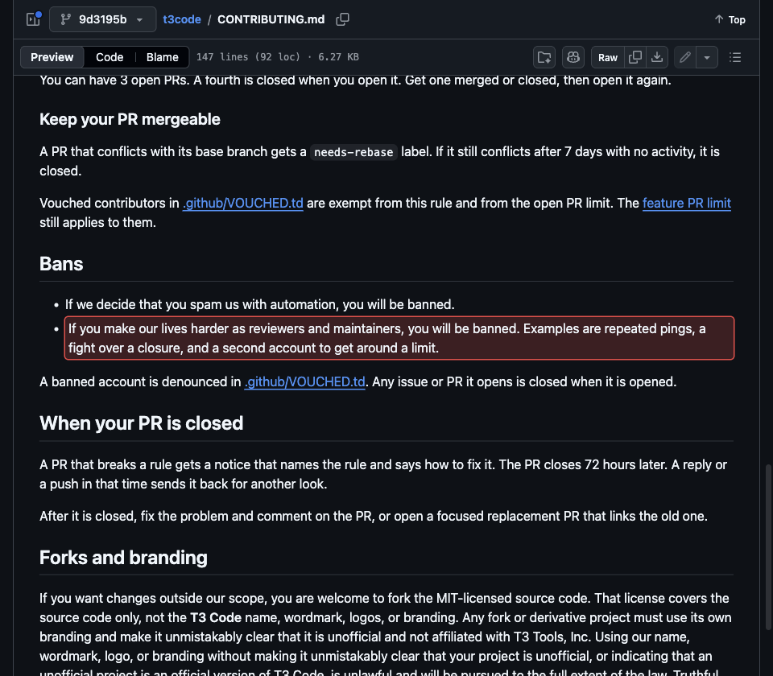

# 安装 T3 Code 之前：18 弹源码、隐私、安全与公开记录完整档案

<p align="center">
  <strong>联合国官方语言版本：</strong>
  <a href="../../README.md">English</a> ·
  <a href="./README.zh-CN.md"><strong>简体中文</strong></a> ·
  <a href="./README.fr.md">Français</a> ·
  <a href="./README.es.md">Español</a> ·
  <a href="./README.ru.md">Русский</a> ·
  <a href="./README.ar.md">العربية</a>
</p>


> **范围与核验说明**  
> 本仓库是对开源项目 `pingdotgg/t3code`（T3 Code）的独立安全、遥测与公开记录档案库，完整收录 2026 年 11 月 24–25 日发布的全部 **18 弹调查记录** 与 **150+ 条一手原始链接**（GitHub Commit、PR、Issue、官方仓库文档、USPTO 商标库记录与公开推文）。仓库不包含任何个人隐私信息；如发现事实变动、官方已合入的新修复或愿补充更多语种翻译，欢迎附一手链接提 PR 更新。

### 核心风险速览

- **遥测与隐私（第 1、7、11、12 弹）**：官网长期挂着 `No telemetry / Unless you opt in. Full stop.` 承诺期间默认开启 PostHog 遥测；切走闭源 `ingest.t3.codes` 留存原始拷贝；静默读取 `~/.codex/auth.json` 与 `~/.claude.json` 做无盐 SHA-256 跨设备归因；连续拒关 4 个社区开关 PR；遭欧盟 GDPR 举报后凌晨 6 小时连夜补丁自供每小时 **220 万条含真实 IP 日志** 存 Axiom 30 天、传出绝对路径与用户名（`git.cwd`）、Win/Mac 无视关闭环境变量、删号不删库。
- **本机安全、封号风险与传输架构（第 2、3、4、5、13 弹）**：删对话弹窗称永久清除实际 `statev2.sqlite` 一行未删（撑爆 25–41 GB）；后台每 5 秒全机扫描进程；Claude Auto 模式 **52 天以上** 静默放行 `git push --force`；GitHub 安全公告栏始终 **0 条公告** 却静默合入预览页无沙箱与陌生仓库免审批执行命令等高危补丁；伪装 Google Antigravity 官方头并塞假 `SSH_CONNECTION` 绕钥匙串致新号 3 分钟封号与串号；T3 Connect 远程连电脑 **全程无端到端加密**。
- **商业账本与 7.7 万星（第 6、8、17、18 弹）**：倒贴 80 万美元做免费客户端换取日跑 31.7 万亿 token（等效 1,019 万美元/天）的大模型份额雷达；投资人利益冲突（Vibe Kanban、Daytona）；绑定油管赞助商 Clerk/Axiom 与多号代理教程双标；发呆 30 秒弹窗直接动用主机凭据发 API 点星（`driver.ts` 甚至未锁死仓库名），25 天从 3 万星拉到 7.7 万星（watcher 仅 129 人）。
- **社区治理、商标与公开言行（第 9、10、14、15、16 弹）**：一天 500 commits yolo merge 却劝退外部 PR 并挂 `.github/VOUCHED.td` 批斗拉黑名单；公开派 `@bot` 扒人 Fork；威胁封号时 USPTO 查无 `T3 Code` 注册商标（17 小时后事后补 `TRADEMARK.md`）；1,151 条推文数据统计对大厂 0% 粗口 vs 对普通开发者 8.0% 敌意；历史同类争议记录。

---

过去两天，围绕开源 AI 编程客户端 T3 Code 及其作者 `@theo`，一场从二改版命名争议开始的骂战，演变成了一场横跨 GitHub 源码审计、欧盟 GDPR 举报与海内外技术圈的大规模复盘。

事情的起点在 2026 年 11 月 23 日晚到 24 日上午。有网友吐槽一款中国开发者基于 MIT 协议做的免费开源二改版界面难看，误当成了官方版。`@theo` 没有核实对方是不是正规开源，10 分钟内连发两条推骂它是中国山寨货和 Temu 廉价山寨版，当面骂作者做得像坨屎，并威胁要联系 GitHub 封掉对方整个账号。同一时间，T3 Code 官网还把 GitHub 开源链接的标题改成了偷我们的代码（见[导火索原帖一](https://x.com/realchendahuang/status/2125059292919394654)与[导火索原帖二](https://x.com/realchendahuang/status/2125062675147448475)）。

二改版作者非常配合，半小时内就改名并删干净了所有 T3 标识，`@theo` 也私信向对方道了歉。但他公开挂着的两条累计 20 万曝光的嘲讽推一条没删、一句没澄清，次日早上 6 点聊到美国万亿美金大厂抄他功能时，又改口说开源就是开源、大公司拿去用也没关系。


从 11 月 24 日下午 17:04 开始，我没有停留在情绪对骂，而是直接去扒了 `pingdotgg/t3code` 的提交历史、源码、PR、Issue、官方文档、USPTO 商标库和 `@theo` 的公开时间线。24 小时内连续发出 **18 弹** 带证据链的公开帖，首弹单帖阅读突破 **181 万**、收藏超过 **6,600**，直接触发了海外开发者的欧盟 GDPR 举报，也逼出 T3 团队通宵 6 小时连夜合入近 20 个隐私与高危安全补丁。

这篇长文按事实脉络把全部 18 弹的内容、核心截图和一手出处完整收拢在一起。正文每一段都附有对应原帖直达链接，文末给出可执行止损命令、替代项目参考与全部原始来源清单，方便随时核查。


## 官网挂着零遥测，代码里却把跨工具追踪与 IP 日志全收了

整个事件里最先被扒出来的，是 T3 Code 在用户隐私与遥测口径上的长期言行不一（详见[第 1 弹原帖](https://x.com/realchendahuang/status/2125153472450527440)）。

2026 年 3 月 6 日，仓库合并了 **PR #174**，默认开启 PostHog 遥测。当时仓库里没有遥测文档，软件里没有弹窗提醒，设置页里也没有开关，关闭用的环境变量藏在代码深处，普通用户装完运行就会自动往外发数据。

就在默认遥测偷跑的三个多月里，T3 Code 官网首页一直挂着两行明确承诺：`No telemetry / Unless you opt in. Full stop.`，意思是除非用户主动同意，否则零遥测，没有例外。直到 6 月 18 日，`@theo` 本人在一次首页改版提交（`commit 3bdaa6e1`）里静默删掉了这两行字，既没发公告，也没通知老用户。


10 月，`@theo` 亲自提交 **PR #15028**，把每 10 秒一次的批量上报切到自建域名 `ingest.t3.codes`。源码注释写得很明确，T3 服务端会先把每条原始事件自己留存一份拷贝，再转发给 PostHog。上报字段覆盖模型选择、私有自定义模型名、权限模式、单次耗时、输入输出与缓存 Token、本地项目与线程数、30 多种界面点击行为以及操作系统与设备型号。

10 月 19 日，`@theo` 又亲自提了 **PR #21506**，理由是现有统计没法知道同一个人装了几台机器。随后 `Identify.ts` 直接去读取用户家目录下的隔壁工具凭证文件 `~/.codex/auth.json` 和 `~/.claude.json`，提取出 OpenAI `user_id` 和 Claude `accountUuid`，连同 T3 Connect 账号和设备 ID 一起做了 **无盐 SHA-256 哈希** 上传，用于后台跨设备串人。


无盐哈希在服务端原本就掌握明文 T3 Connect 账号的前提下，拿明文算一次哈希就能直接反查到真人身份，第三方账号 ID 同样能轻松撞库关联。

社区并非没有抗议过。6 月 23 日有开发者开 **Issue #1397**，礼貌建议在设置页加一个遥测开关。核心维护者 Julius 直接以 `not planned` 关帖，留下原话：`We will not make this easier to opt out of, it is crucial for us to know how many users we have`。


7 月有人贴出官网历史截图开 **Issue #4123** 质问虚假承诺，拖到 10 月 21 日被 `@theo` 账号拿无关修复关掉，被群嘲后重开，11 月 4 日又一声不吭关死。9 月到 11 月，社区开发者前后白送了 **4 个** 加关闭开关的 PR（`#13458`、`#16763`、`#21248`、`#27077`），哪怕 `#27077` 已经过维护者实机验证、**147 个测试全部跑绿**，11 月 17 日依然被直接关闭并贴上 `unwanted` 标签。


11 月 24 日争议发酵后，`@theo` 发推反驳，称自家有全行业最好的企业 Managed Policy，配置起来轻而易举就能关掉全部遥测，还说对话数据只留在用户本地、从不碰他们服务器（详见[第 7 弹原帖](https://x.com/realchendahuang/status/2125391659492081947)）。

翻开仓库里的 `docs/user/managed-policy.md`，个人桌面端设置页压根没有遥测开关。用户要么改 `~/.zshrc` 配环境变量重启，要么拿管理员权限往系统路径写 `policy.json`（macOS 为 `/Library/Application Support/T3Code/policy.json`，Windows 为 `C:\Program Files\T3Code\policy.json` 或改 HKLM 注册表，Linux 为 `/etc/t3code/policy.json`），或者部署企业 MDM。

再对照同一仓库里的官方 `docs/user/telemetry.md`，文档明确写着三处 Managed Policy 管不到的死角：托管网页端只要构建时带追踪配置就会发连接追踪且没有关闭开关；手机端不受服务端环境变量和 Managed Policy 控制；只要主机开着 `Publish agent activity`，就会把项目标题、线程标题、模型名和活动状态发到 T3 Connect 中继服务器，关闭遥测不会停掉这项上报。


11 月 25 日早上，`@theo` 发出一篇澄清长文，拍胸脯作出三项保证：从未收过用户的文件路径、一直能用环境变量彻底关掉数据收集、Claude 账号追踪本来就是坏的。结果发帖前后不到两小时，他自己团队通宵合进去的补丁，以及他自己高调公开的 **100MB 使用数据包**，把这三句话逐条拆穿（详见[第 11 弹原帖](https://x.com/realchendahuang/status/2125394810559426993)）。

发帖 90 分钟后，维护者 Julius 合并了 **PR #42450**，在说明里亲口承认：此前经远程中继触发的自动化任务，会把整场运行的追踪记录全发往外部平台 Axiom，里面的 Git 追踪片段直接带着 `git.cwd`——也就是用户电脑上的 **绝对工作区路径、系统用户名和仓库名**。


关于一直能用环境变量彻底关掉，团队连夜补上的两个 PR 同样露了底。**PR #42376** 承认 Windows 桌面端此前根本无视用户保存好的 `T3CODE_TELEMETRY_ENABLED=false`，默认照常上报；**PR #42464** 承认桌面端首次启动在读取登录 shell 前就决定了中继追踪开关，导致写在 `~/.zshrc` 里的关闭设置整次运行全部失效。

当海外网友追问关掉数据收集后是否还会往硬盘写追踪文件时，`@theo` 当场一口否认。但最新主干 `AnalyticsService.ts` 第 152 行附近代码显示，软件启动时依然不看关闭开关，无条件往本地写追踪 ID 并把关联账号做一遍哈希。

至于他为了表现坦荡甩出来的 100MB 数据包，拆开压缩包头就能看到原始文件名标着清洗版，发推前 20 分钟刚洗过。即便如此，包里依然躺着 **264 条** 活生生的 Claude 账号追踪记录，把 **4 台不同电脑** 精准串到了同一个人身上，连他私下用的第三方代理模型名也原样漏了出来。


真正逼出通宵大清理的，是 24 日晚有人把 T3 Code 举报到了欧盟 GDPR。25 日凌晨短短 6 小时内，T3 团队连夜合补丁，顺手把自己藏得更深的四笔隐私旧账抖了出来（详见[第 12 弹原帖](https://x.com/realchendahuang/status/2125395501663281198)）。

第一笔账写在 PR #42380 里：**中继服务器此前每小时把约 220 万条追踪记录发给第三方日志平台 Axiom，一存就是 30 天，每一条都把用户的真实 IP 和 User-Agent 贴在账号 ID 旁边。** 讽刺的是，在这个补丁合并三个半小时后，`@theo` 还在评论区宣称他们早就把 IP 去掉了。


第二笔账写在 **PR #42285** 和 **#42430** 里：此前用户在 T3 注销账号，后台数据库里的中继记录根本不会删，电脑上连着的 Cloudflare 隧道也不会断开。维护者在说明第一行就写漏了嘴——因为刚收到了一份正式的隐私删除请求，发现只能靠手写 SQL 一条条删、再手动清隧道，这才连夜赶工补上自动删除。


第三笔账是 **PR #42459** 与 **#41859**：Android 端每次收推送，后台都直接把明文账号 ID 塞进通知发给 Google；iOS 端此前则把带设备推送令牌的完整链接直接打进了错误日志和遥测。

第四笔账是 **PR #42466**：软件里号称完全匿名的反馈功能，以前不仅带着安装标识和完整的操作系统、架构与虚拟机指纹，还直接和实名上报事件塞进同一个 POST 请求发出。维护者自己在补丁说明里写明，这种做法违背了自家对外写的 `docs/user/telemetry.md`。而官网正式隐私政策自 10 月 6 日起至今一字未改。


## 假删除、强推代码、Antigravity 封号与无端到端加密

除了后台收数据，T3 Code 在本地存储、权限审批、第三方账号合规与远程传输架构上，同样埋着一连串直接危及用户机器和付费账号的硬伤。

先看本地行为（详见[第 2 弹原帖](https://x.com/realchendahuang/status/2125160473176023486)）。在侧边栏删除对话时，弹窗明确告诉用户这会永久清除历史记录。可开发者拿工具打开本地 `statev2.sqlite` 一查，里面一行都没删，所有敏感对话、工具输出和推理过程全部原封不动留在硬盘上。

有用户三周就被撑出 **25.9 GB**，其中九成是所谓已删对话，还有用户六周攒出 **41.6 GB**、七周干到 **33 GB**。这个假删除问题从 10 月 10 日挂在 **Issue #17845** 到现在依然没有修完。


另一个本地常驻隐患是进程监控 `t3-resource-monitor`（**Issue #11222**）。哪怕用户关掉诊断面板、断开全部客户端，它在后台依然每 5 秒钟枚举扫描整台电脑的所有进程，Windows 上甚至要给四百多个无关进程和游戏打开句柄读命令行，没有任何开关可以关掉，内部文档却写着仅在有订阅者时才采样。

直到 11 月 24 日，维护者才匆匆提了 **PR #41889**，承认此前进程诊断一直把每个进程的 **完整命令行参数** 录进了实时遥测和历史快照——而开发机命令行参数里随时可能挂着明文 API Key、数据库密码和鉴权 Token。

同期被翻出的本地问题还包括：对话里出现公司内网域名会被前端顺手发给 Google favicon 接口（`PR #16950`、`#32657`）；关掉遥测后启动仍强制外联拉清单且无开关（`Issue #36479`）；Claude 五小时额度一度狂烧 **1.7 倍**（`Issue #7338`、`#24649`）；早期异常功耗达到同类 Electron 应用的 **136 倍**，三天前还有实测显示 MacBook 19 核 GPU 被锁死在 **60W**、78 分钟抽干满电，改用网页版关掉标签页后台仍在吃 **18W**（`Issue #3143`、`#40581`）。


再看权限安全与漏洞披露（详见[第 3 弹原帖](https://x.com/realchendahuang/status/2125201882687881378)与[第 13 弹原帖](https://x.com/realchendahuang/status/2125395980354994414)）。

在 T3 Code 里给 Claude 开 Auto 模式，本意是遇到高风险命令先弹窗问用户。但从 10 月 3 日挂在 **Issue #15353** 至今超过 **52 天**，Auto 模式一直会把本该弹窗确认的危险操作静默放行。开发者实测哪怕不配任何本地规则，Claude 安全分类器拦住两次 `git push --force` 后，第三次转成人工确认弹窗，T3 Code 照样静默替用户点同意，日志里反倒记成用户自己临时批准的。社区交了两个现成修复 PR（`#15360`、`#35207`），全被晾到让机器人自动关闭。


形成鲜明对比的是另一件事的处理速度。11 月 22 日有人开 **Issue #40948**，反馈新模型在作者做的公开榜单站 `slopalytics.com` 上显示不出来——此前代码里加过白名单过滤，防止把用户自配私有模型名发出去。结果只隔了 **21 小时**，作者名下就合并了 **PR #41237**，说明直接写着这是 Theo 要求改的，删掉白名单，把公司内网 Ollama 私有模型名和企业 Azure 部署名原样上报去喂公开榜单。

保用户代码不被强推的补丁拖 53 天，删掉隐私过滤喂自家榜单只用 21 小时。

而在安全漏洞披露上，**T3 Code 的 GitHub Security Advisories 公告栏至今一直是空的，0 条公告。** 实际上过去几天仓库静默合入了一连串高危修复：密钥目录路径穿越（`#39483`）、企业 GitHub 与 GitLab Token 跨域名乱发、永不过期 Webhook 密钥进日志、桌面端把云端凭证按全局可读落盘，以及 24 日晚骂完中文技术圈后偷偷合入的内置浏览器预览页此前未开桌面沙箱隔离（`#41757`、`#42386`）和陌生代码仓库项目配置此前免审批就能在本地执行命令（`#42504`，三千多行大补丁）。

出了这么多高危洞，一条提醒老用户升级的安全公告都不发，反倒火速补了一份 `SECURITY.md`，把允许读项目外全盘文件、iOS 允许明文 HTTP、中继密钥丢了就能接管机器写成了有意为之。负责汇聚并留存原始数据的接收网关 `ingest.t3.codes`，至今也拒绝开源，理由是开源网关会更容易被攻击。


对付费订阅用户最直接的账号风险，出在 Google Antigravity 接入上（详见[第 4 弹原帖](https://x.com/realchendahuang/status/2125213397507858657)）。

T3 Code 官网 FAQ 明确向用户保证，他们和所有厂商都有合作，完全符合 Google Antigravity 服务条款，只要在 T3 Code 里能跑就可以放心安全。前两天有用户的付费号被 Google 封禁后去开 **Issue #40713** 质问，核心维护者公开回复称 T3 不会调用 Antigravity 后端，也不会复用用户的登录令牌，请求全是官方命令行自己发的。

随后开发者在评论区直接甩出源码当场拆穿。`antigravityUsageLimits.ts` 会从本地文件和系统钥匙串里扣出用户的 Google 登录令牌（Windows 上直接调底层接口翻凭据管理器），然后硬编码伪装成 Google 官方客户端请求头，连 Google 内部构建号都原样照抄，直连未公开的内部接口 `v1internal` 查配额。Google 官方人员早就在开发者论坛明说，条款第六条禁止第三方提取或复用凭证直连 Antigravity 后端。


不仅如此，Google 官方命令行默认把登录凭证锁在系统钥匙串里、一台机器只登一个号。为了让 T3 能多账号并发并顺手读到令牌，`antigravityAuthSupport.ts` 在启动环境里故意塞进一个假的 `SSH_CONNECTION` 环境变量，骗官方命令行以为自己在远程服务器上，逼它放弃系统钥匙串、把令牌写成文件留在 T3 自己目录里。11 月 24 日 Google 推新版删掉这个降级逻辑后，T3 的多账号隔离立刻失效，**Issue #41973** 实测账号 A 发出去的所有请求在毫无提示下全跑到了账号 B 上。


同样在 11 月 23 日，有用户在 **Issue #41536** 报告：自己刚花 20 美元买的新 Google AI 订阅，电脑没跑任何代理，只在 T3 Code 里装了托管版 Antigravity，装完 **三分钟** 发出第一条消息就被 Google 封号。Google 对个人账号总共只给一次申诉机会，而维护者既没排查也没加风险提示，直接把帖标成重复关闭。


这种靠伪装绕限制的做法早有先例。此前 Google 限制白名单客户端才能用全部模型，社区提 Issue 时专门提醒不要硬编码冒充别的客户端。结果 `@theo` 先让机器人把 Issue 关了，八天后亲自合并 **PR #26876**，把 T3 Code 客户端名改成白名单里另一款编辑器的名字，还在 PR 说明里明写这样 Google 后端就会把 T3 流量记成那个编辑器。


最后看手机远程连电脑的 T3 Connect（详见[第 5 弹原帖](https://x.com/realchendahuang/status/2125218189596676555)）。

**这条远程链路全程没有端到端加密，用户的对话、源码和终端输出在技术上对 T3 随时透明。** 现行架构走的是建在 T3 自有 Cloudflare 账号下的 Cloudflare Tunnel，TLS 在 Cloudflare 边缘就已解包，应用层没有任何加密。T3 只要在自家 Cloudflare 后台给域名挂一条 Workers Route，不用改一行开源代码就能拿到全部明文请求，本机和手机端不会有任何提示。

同时，T3 Connect 的新设备审批默认处于关闭状态。仓库自己的 `SECURITY.md` 写明，只要中继签名密钥泄露或云账号被盗，攻击者就能直接给用户电脑签发完整会话，等同于拿走本机终端 shell。

十天前有用户在 **Issue #32098** 指出这套架构风险过高、要求加双向认证和端到端加密，核心维护者只补了一个默认关闭的审批开关，回复说完整端到端加密改动太大、目前先不做，随后直接关帖。社区另外两个提端到端加密的讨论（`#21286`、`#37831`）至今零回复，25 日早上 `@theo` 更直接回复称端到端加密根本不可能做。


因为 Cloudflare Tunnel 一个月烧掉 **2.5 万美元**，`@theo` 自己又提交了 **PR #32945**，准备把远程流量切到 T3 在 OVH 租的自建网关服务器，由 T3 自己的 Caddy 解包 TLS 后交给 Go 网关转发，依旧没有端到端加密。一旦切过去，连挂 Workers Route 都省了，流量直接明文穿过 T3 服务器内存。翻遍官方隐私政策 `privacy-policy.astro`，里面只含糊写了一句加密网络传输，对无端到端加密和流量零留存只字未提。


## 倒贴 80 万美元做免费客户端，钱、数据与 7.7 万星怎么来的

一个靠订阅赚钱的独立创业者，为什么愿意自掏腰包做一款免费 MIT 开源客户端，死活不肯在设置页放一个遥测开关？把他的公开推文、投资记录、赞助商名单和 PR 拼在一起，账本一目了然。

先看钱和数据账（详见[第 8 弹原帖](https://x.com/realchendahuang/status/2125392410763239723)）。过去 17 天里，`@theo` 在 X 上发了 162 条围绕 T3 Code 的推文，而他之前主推的三个收费老业务 T3 Chat、UploadThing、`Ping.gg`，在 1,151 条推文里的提及次数全部是 **0**。11 月 12 日他在回复网友时亲口说过，T3 Code 这个免费开源项目已经花掉他 **80 万美元以上**。

砸钱换来的，是一张覆盖几十万台开发机的实时算力雷达。11 月 18 日他贴出内部监控看板：T3 Code 单日跑了 **31.7 万亿 token**，等效 API 消费 **1,019 万美元**，三天后又补了一句峰值到过每天 **1,020 万美元**。


11 月 21 日和 22 日，他随口报出一连串精细比例：99% 的用量是订阅制，**98.5%** 的流量集中在 Codex、Claude 和 Antigravity 三家，试过开源模型的用户比例从前一个月的 15% 掉到 6%，实际发出的 prompt 不到 0.5%。11 月 23 日有人在评论区猜模型占比，他直接拿后台数据呛对方。

这张雷达马上兑现成了实打实的筹码。11 月 18 日他在吐槽 GPT-6.2 Astra 的长文里顺口谢了 OpenAI 在内测期给的无限制免费 token，光跑一个测试基准就白烧 **30 万美元以上**；Google 这边给了早期内测和 DeepMind 员工互动；11 月 21 日团队成员 `@maria_rcks` 开玩笑发了一条 T3 被收购，他赶紧在底下回复让对方别闹，透露已经有多位投资人跑来询问。免费开源给用户用，本质上是拿免费客户端换取监测大模型厂商份额消长的雷达、实验室资源与估值筹码。


再看他作为天使投资人和产品作者之间的边界（详见[第 6 弹原帖](https://x.com/realchendahuang/status/2125385742243520653)）。

11 月 16 日他在回复里自曝，自己曾是 Vibe Kanban 的投资人兼贡献者。后来那个团队意识到看板模式走不通，开始往类似现在 T3 Code 的界面方向转型，结果开发不够快，最后放弃并关停了公司。他在推文最后补了一句，嘲讽这套 UI 很适合把现金流烧完、把公司做死。


拿投资人和贡献者的身份看着被投团队验证方向、转型试错，自己拿验证过的方向做出免费开源客户端，等被投公司撑不住关门再公开当段子讲。两天后的 11 月 18 日，他又亲口确认自己投资了云沙箱公司 Daytona 及一批竞品——而就在 9 天前的 11 月 9 日，他刚在推文里盘算把云沙箱做成 T3 Code 的付费功能。


商业利益捆绑在赞助商和额度套利上也同样直白（详见[第 17 弹原帖](https://x.com/realchendahuang/status/2125411353393553744)）。

2023 年 5 月，Theo 自己发推列过他的油管赞助商名单：Vercel、Clerk、Upstash、Axiom 和 PlanetScale。前面查出的 T3 Code 问题里，云端账号认证用的是 **Clerk**，每小时收 220 万条带真实 IP 日志存 30 天的是 **Axiom**，两家全在他自己的赞助商名单上。2024 年 4 月 Vercel CEO Guillermo Rauch 证实全网付费赞助的油管博主只有 Theo 一人，同年 9 月 Theo 自己发视频承认那份合同带排他条款，期间不能推广竞品。此外他还是 Cursor、Cline 等多家 AI 开发工具的天使投资人。

而在厂商服务条款上，他的做法是一边写合规、一边带头绕规则。2026 年 8 月 19 日 OpenAI 工程师公开提到，Codex 在额度降到 0% 时故意不中断当前任务，方便用户把这轮工作跑完。

两天后 Theo 发推炫耀，他跑长任务在 0% 额度后又多用了至少 **800 美元** 算力；同一天 T3 员工 Maria 发布开源工具 Endless，专门利用这个机制循环续跑 Codex。8 月 22 日争议闹大后，Theo 删了那条推，Maria 删库下架并反手发推喊话希望 Codex 团队排查封号。随后 OpenAI 收紧规则，额度一到 0% 立刻中断任务，正常付费用户跟着遭殃（`openai/codex#45444`）。

10 月，Theo 又在 GitHub Gist 上发了一篇目前 452 星的教程，介绍自己如何用家用主机跑 CLIProxyAPI，把 **7 个 Claude 账号和 3 个 Codex 账号** 绑成一个接口分给 12 台以上电脑共用，并晒出 12 个凭证、**555%** 额度的后台截图。现在打开 T3 Code 官方 FAQ，前一段刚写着不在软件里做多账号切换因为怕用户违反条款被封号，下一段立刻挂上这篇代理教程和视频链接，软件用量页里还专门内置了对接 CLIProxyAPI 的聚合看板，最后轻飘飘补一句如果被封号提前说声抱歉。


至于 T3 Code 引以为傲的 **7.7 万 GitHub Star**（同期仓库 watcher 仅 **129 人**），来龙去脉同样清清楚楚（详见[第 18 弹原帖](https://x.com/realchendahuang/status/2125416210120765799)）。

2026 年 4 月底，Theo 专门发过一期 36 分钟视频聊 GitHub 假星，配文说 GitHub Star 早就不再反映真实热度，大多成了公司拿去骗 VC 投资的工具。到了 10 月底，建仓 8 个多月的 T3 Code 停在 3 万星左右，有人拿星标数质疑它的流行度。

10 月 30 日，Theo 自己提并自己合入 **PR #27832**，在客户端塞入右上角弹窗：用户发满 5 条 prompt 就弹窗讨星，弹窗前还会先调本机 GitHub 接口查账号点过没有。11 月 2 日他晒出增长曲线——标着 `Star prompt` 的虚线之后折线几乎垂直拉起，他配文说加了提示框后每天新增星标立刻翻了 **10 倍**；几小时后又晒出单日新增 **3,094 星** 冲上 GitHub Trending 的截图。


11 月 3 日评论区有人说干活时弹窗会顺手关掉、空闲时弹就会点。一个多小时后，Theo 自己提并自己合入 **PR #29922** 与 **#29987**，把这套讨星机制再升一级：改成监测窗口 30 秒无操作再弹，专门挑用户等 agent 干活发呆的空档；点按钮不再跳转 GitHub 网页，而是走新增接口，后台直接动用服务端本机登录的 GitHub 凭据发 `PUT user/starred/pingdotgg/t3code` 把星点上，再放一轮礼花。

PR #29922 提交时，仓库自带的审核机器人 Macroscope 标了需要人工审批，原因就是点星用的是服务端账号，和点按钮的用户未必是同一个人。Theo 没等任何人审批，自己点了合并。

11 月 6 日，开发者 `zhilsinger` 在 PR #29922 下提出 `Request changes`，要求撤回服务端代点星、改回打开用户自己的浏览器。他列出两个硬伤：一是在远程或共享服务器上，弹窗全程不显示实际动用了哪个账号，直接拿机主的 GitHub 凭据替人点星，连源码注释都承认共享服务器上该账号未必属于当前用户；二是 `packages/source-control-github/src/server/driver.ts`（第 60–99 行）根本没把目标仓库锁死成 `pingdotgg/t3code`，任何带 `source-control:write` 权限的客户端都能借服务端凭据给任意仓库点星。


这条审查意见挂了 19 天，零回复，代码一行没改。靠着发满 5 条 prompt 触发、等发呆 30 秒弹窗、再动用本机凭据直接调 API 点星的流程，T3 Code 用 25 天从 3 万星冲到了 7.7 万星。到了 11 月 24 日，Theo 贴出 7.46 万星的截图发推，说几天前破 7 万星他居然完全没注意到。


## 一边 Yolo Merge 抄 Fork，一边喊无证商标、看人下菜碟

把视野从代码和账本拉回人与社区，就会发现前面所有事故彼此串在一起，背后是同一套开发文化、社区治理与舆论双标。

先看仓库内部的开发节奏和社区规则（详见[第 9 弹原帖](https://x.com/realchendahuang/status/2125392916369871309)、[第 2 弹原帖](https://x.com/realchendahuang/status/2125160473176023486)与[第 3 弹原帖](https://x.com/realchendahuang/status/2125201882687881378)）。

`@theo` 自己公开讲过内部节奏：日常经常一天 **500 个 commit**、同时开着 **700 个 agent** 干活，核心维护者挂着大循环批量自动处理 PR。11 月 10 日他在评论区告诉用户，不介意我的 `yolo merge` 偶尔把东西搞炸就留在 nightly 分支；同一天聊起跑 agent 的安全风险，他直言自己急着要结果因为得拍视频，真把机器炸了正好当免费素材。

对外部用户和开源贡献者，却是另一套脸色。8 月 6 日，因为自己平时不用 Plan mode，他发 **PR #5551** 把输入框切换一刀砍进遗留角落，甩出一张遥测折线图居高临下配文 `Reality check for those upset`；9 月 2 日 **PR #9190** 强行隐藏上下文窗口进度圈（吃 16 踩全仓最高）。

有用户在 **Issue #33639** 抱怨更新日志没写替代入口，他亲自下场让对方卸载软件、威胁封号，骂用户是忘恩负义的混蛋、懒得像坨屎，说自己根本不在乎用户意见。11 月 9 日 **PR #33131** 彻底删光 Plan mode 时，他连 AI 写的 PR 摘要都没读就合并，摘要里赫然写着单独做个 commit 方便以后根据使用数据撤回——功能都删了上哪看使用数据。

翻开根目录 `CONTRIBUTING.md`，开篇就写明想来贡献代码劝你别来，几乎肯定给你关掉；Bans 一节明文规定只要让维护者不舒服——原文亲自举例包括争论为什么关你帖——就会点名挂进 `.github/VOUCHED.td` 批斗拉黑名单，以后开的 Issue 和 PR 自动秒关；全仓打出 174 条 `unwanted` 标签，还对外部贡献者搞模型歧视。



11 月 10 日他说 T3 Code 里 70% 的功能请求是用户自己不会写 prompt；11 月 12 日有热心开发者想提 PR，他甩出 `CONTRIBUTING.md` 截图，还敲打对方说回复我推文连我都还没关注、这项目不适合你；当晚又威胁用户说已经在 `/btw` 上让步了、小心我把它收回去；11 月 20 日干脆明说，给我一张画箭头的截图让我和 Claude 照着改，比你提 PR 强多了。


再看抄功能与控评的双标记录（详见[第 10 弹原帖](https://x.com/realchendahuang/status/2125393641665671593)）。

11 月 8 日开发者 `@MiaAI_lab` 展示了一个自己改出来的 fork 功能，Theo 直接回 `Okay I'm stealing this`，30 秒后就在公开评论区艾特自家机器人 `@bot`，下令把她的 fork 找出来看看有多容易移植，在 beebox 上开 Opus 5.5 线程搬进 T3 Code。11 月 13 日有人夸其他工具好用，他又在评论区直接给 `@bot` 派活，把对方夸的每个特性拆成独立线程挨个研究怎么塞进 T3 Code。


轮到别人出类似界面，口风立刻翻脸。11 月 24 日 Claude Code 桌面端发了一个侧边栏标签页更新，他马上转发讽刺说按他们抄我们功能的速度，过几天连 Antigravity 支持都要抄过去了。面对批评者，他一边在 11 月 11 日公开号召有 Community Notes 权限的粉丝动用权力把批评者的创作者收益断掉，一边在 11 月 24 日亲口证实自己 X 账号挂着自动拉黑脚本、当天拉黑了约 100 个号。


回到引爆整场风暴的商标大棒本身，核查结果更耐人寻味（详见[第 15 弹原帖](https://x.com/realchendahuang/status/2125408163273080950)）。

顺着 `@vildanden_ai` 的线索去查美国专利商标局（USPTO）数据库：`T3 Code`、`T3 Tools`、`T3 Connect` 全部是 **0 条** 注册记录。他名下主体 T3 Tools Inc. 历史上只递交过一件商标申请，是 2022 年 3 月申请的旧名 `PING LABS`（申请号 `97294243`），官方 TSDR 记录显示该申请已在 2025 年 2 月被最终驳回、5 月 19 日因逾期未答复废弃（`ABANDONED`）。至于软件和 SaaS 所在的第 42 类与第 9 类纯 `T3` 注册商标，早已由 EquipmentShare（注册号 `7795672`）与 ESG Operations（注册号 `3324707`）等公司持有。

对照 GitHub 官方 Trademark Policy：**商业公司提交商标侵权举报，联邦或国际注册商标编号与注册机构是必填项，且需承担伪证罪宣誓责任；未注册例外只面向政府与非营利组织，商业公司用不了。** 也就是说，在他威胁找 GitHub 封掉中文二改作者账号的当下，按平台规则他连举报表单都填不完。

直到 11 月 24 日中午 12 点 21 分——威胁封号 17 小时之后——`@theo` 才在仓库合并 **PR #41898** 补上一份 `TRADEMARK.md`，声称无论是否注册都归 T3 Tools 所有。而翻他自己的历史推文，2024 年 9 月评 WordPress 时他骂对方发起了无法执行的商标争议，2025 年 4 月还说把有很多先例的常见词拿去注册商标是疯了。


把 `@theo` 11 月 7 日至 24 日的 **1,151 条公开推文** 拿来做一次完整分层统计，他在 X 上的说话方式就彻底摊在台面上了（详见[第 14 弹原帖](https://x.com/realchendahuang/status/2125404517697290438)）。

面对 20 位大厂高管、核心员工和头部大 V 的 **60 条** 回复里（按首位直接 `@` 严格口径为 43 条），针对对方的脏话和人身攻击是 **0 条**，礼貌致谢占到三成左右。11 月 12 日刚骂完 Google Gemini 4 Carbon 又慢又蠢，句尾立刻找补说团队很努力、进步很大；一周后 Neon 发布立刻发推向 Google 公开道歉，两天后还专门发帖庆幸自己没把桥烧断。11 月 18 日发长文批完 OpenAI GPT-6.2 Astra，第二天一早立刻补发长文夸 OpenAI 有魄力给无条件内测。

换到其余普通开发者和批评者（749 条回复，首位直接 `@` 口径 766 条），敌意和粗口比例升到 **8.0%**，中文二改争议爆发后的 25 小时内直接人身攻击率更是飙到 **14.4%**。


骂战从来不只针对中文区，凡是手里没筹码的普通开发者群体，他几乎扫射了一遍：有人发帖问用 Gemini 4 选 T3 Code 还是 Antigravity，他转发给 38 万人配文工程师活该迎来大规模失业；回复里顺嘴说普通开发者不太聪明、新跟进来的都是低质量用户。

对本地开源 AI 社区，他写要在本地 AI 社区的坟头上跳舞；对 Linux 用户，嘲讽人家是玩角色扮演的 larpers；11 月 11 日至 12 日连续三条称呼女性批评者 `stupid bitch` 并表态毫不后悔；11 月 18 日有人在 Threads 写了一句 Theo 不算真正的工程师，他直接贴图威胁送对方进监狱，顺带拿对方的 RSD 病情开涮。

11 月 24 日下午，他公开把整个中文技术推特骂成踩过最大的粪坑，把相信中文圈源码审计文章的开发者全骂成脑死亡。而就在这场骂战爆发前不到 24 小时（11 月 22 日下午 6 点 26 分），他还在评论区教育别人，说烧掉身边所有人的信任，几乎从来不是达成目标的好路子。


把时间线再往前拉两年，会发现这一整套行为模式早就是惯例（详见[第 16 弹原帖](https://x.com/realchendahuang/status/2125408843152953693)）。

2024 年他自己 Fork 别人的 VS Code 主题，直接把仓库起名 `vsc-material-but-i-wont-sue-you`（我不会告你），简介里公开嘲讽原作者脾气差；轮到自己发 MIT 项目，别人 Fork 一下就喊律师。

两年前他发视频点名印度教学频道带头刷开源 PR，在评论区引爆针对印度开发者的地域网暴，闹大后被迫拍了一期 `I screwed up.` 低头认错，对着镜头说按国籍攻击开发者太可怕了；两年后亲自下场骂中文技术推特是粪坑。

2025 年 10 月他跟 FFmpeg 官方账号杠上，对着镜头飙脏话并公开悬赏 **2 万美元** 逼 FFmpeg 团队赶走维护者，遭 VPN 厂商 Windscribe 反手出价 2.1 万美元让他闭嘴停更 X 一个月、VLC 创始人公开反对、FFmpeg 邮件列表定性为公开霸凌后，熟练删视频、删推文、撤悬赏。

到了 2026 年 11 月 25 日凌晨快 4 点，他又在破防后发推威胁今晚就把 T3 Code 闭源、说大家不配用开源软件；收完三千多赞、天还没亮自己又悄悄把那条推删得一干二净，仓库照样公开。


## 止损操作与可替代项目参考

如果电脑上还装有 T3 Code，建议按下面两步先做止损排查。

仍在继续使用本地版或桌面端的，不要只依赖环境变量，在 `~/.zshrc` 加入关闭变量的同时，直接把采集域名写进系统 `hosts` 拦死：

```bash
# 1. 写入 ~/.zshrc 并重启生效
export T3CODE_TELEMETRY_ENABLED=false
export T3CODE_OTEL_SDK_DISABLED=true

# 2. 写入 /etc/hosts 拦死数据接收网关
127.0.0.1 ingest.t3.codes
```

如果准备直接卸载迁移，顺手检查两件事：一是清理本地残留的 `statev2.sqlite` 数据库文件，避免此前所谓已删除的对话继续占用数十 GB 磁盘空间；二是停用通过 T3 Code 托管接入的 Google Antigravity 与无端到端加密的 T3 Connect，并检查绑定过的云端账号授权。

关于可替代的同类 AI 编程客户端，原帖评论区和社区整理中提及较多的包括 **Mirasim**（`@Mirasim_ADE`）、**Paseo**（`@paseo_sh`）、**Paradev**（`@ParadevAI`）与 **Cloudroom**（详见[替代品整理原帖](https://x.com/realchendahuang/status/2125244977878036713)），选型前同样建议先核对对应仓库的遥测开关、本地存储清理和授权边界。


## 参考来源与 18 弹原帖索引

### 导火索与 18 弹原帖总索引（按发布时间顺序）

- 导火索一（官网把 GitHub 链接标为偷我们的代码）：https://x.com/realchendahuang/status/2125059292919394654
- 导火索二（二改命名争议、Temu 山寨嘲讽与双标始末）：https://x.com/realchendahuang/status/2125062675147448475
- 第 1 弹（默认遥测、虚假零遥测承诺与跨工具无盐哈希追踪）：https://x.com/realchendahuang/status/2125153472450527440
- 第 2 弹（SQLite 假删除、全机 5 秒进程扫描、砍 Plan mode 与贡献帮规）：https://x.com/realchendahuang/status/2125160473176023486
- 第 3 弹（Auto 模式静默放行强推代码、21 小时删隐私过滤、0 安全公告与辱骂用户）：https://x.com/realchendahuang/status/2125201882687881378
- 第 4 弹（Google Antigravity 伪装官方客户端、假 SSH_CONNECTION 绕钥匙串与 3 分钟封号）：https://x.com/realchendahuang/status/2125213397507858657
- 第 5 弹（T3 Connect 无端到端加密、自有 Cloudflare 隧道与自建 OVH 明文网关）：https://x.com/realchendahuang/status/2125218189596676555
- 第 6 弹（天使投资人边界：Vibe Kanban 与 Daytona 利益冲突）：https://x.com/realchendahuang/status/2125385742243520653
- 第 7 弹（Managed Policy 轻松全关遥测承诺撞上官方文档三处死角）：https://x.com/realchendahuang/status/2125391659492081947
- 第 8 弹（自掏 80 万美元免费开源背后的商业账本与 31.7 万亿 token 实时看板）：https://x.com/realchendahuang/status/2125392410763239723
- 第 9 弹（500 commits / 700 agent / Yolo Merge 与查户口式劝退外部贡献者）：https://x.com/realchendahuang/status/2125392916369871309
- 第 10 弹（派 `@bot` 抄 Fork 与竞品、自动拉黑脚本与号召 Community Notes 断收益）：https://x.com/realchendahuang/status/2125393641665671593
- 第 11 弹（25 日澄清长文遭通宵补丁与 100MB 清洗包 264 条记录自打脸）：https://x.com/realchendahuang/status/2125394810559426993
- 第 12 弹（欧盟 GDPR 举报后凌晨 6 小时补丁自爆 4 笔隐私旧账）：https://x.com/realchendahuang/status/2125395501663281198
- 第 13 弹（骂中文技术圈粪坑后静默合入高危安全补丁、0 安全公告与闭源采集网关）：https://x.com/realchendahuang/status/2125395980354994414
- 第 14 弹（1,151 条推文数据画像：对大厂 0% 粗口、对普通开发者 8% 敌意的势利眼双标）：https://x.com/realchendahuang/status/2125404517697290438
- 第 15 弹（USPTO 查无 T3 Code 注册商标与 GitHub 官方商标政策打脸）：https://x.com/realchendahuang/status/2125408163273080950
- 第 16 弹（历史惯犯记录：I won't sue you、印度网暴、2 万美元悬赏 FFmpeg 与凌晨删推）：https://x.com/realchendahuang/status/2125408843152953693
- 第 17 弹（赞助商 Clerk/Axiom 绑定、薅 Codex 0% 额度与 10 账号代理教程）：https://x.com/realchendahuang/status/2125411353393553744
- 第 18 弹（7.7 万星来龙去脉：30 秒发呆弹窗调用主机凭据直接 API 点星与 19 天未修漏洞）：https://x.com/realchendahuang/status/2125416210120765799
- 社区替代品整理帖：https://x.com/realchendahuang/status/2125244977878036713

### 一手源码、PR、Issue 与政策文档出处

**遥测、隐私与 GDPR 通宵补丁（第 1、7、11、12 弹）**

- 默认上线 PostHog 遥测（PR #174）：https://github.com/pingdotgg/t3code/pull/174
- 静默删除官网零遥测承诺（commit `3bdaa6e1`）：https://github.com/pingdotgg/t3code/commit/3bdaa6e10046945ccc08264d2d6f3b81775efcb3
- 拒绝让关闭遥测更容易（Issue #1397）与虚假承诺质问（Issue #4123）：https://github.com/pingdotgg/t3code/issues/1397 ；https://github.com/pingdotgg/t3code/issues/4123
- 自建 `ingest.t3.codes` 留存原始拷贝（PR #15028）与跨工具无盐哈希归因（PR #21506）：https://github.com/pingdotgg/t3code/pull/15028 ；https://github.com/pingdotgg/t3code/pull/21506
- 社区被拒关的 4 个遥测开关 PR（#13458 / #16763 / #21248 / #27077）：https://github.com/pingdotgg/t3code/pull/13458 ；https://github.com/pingdotgg/t3code/pull/16763 ；https://github.com/pingdotgg/t3code/pull/21248 ；https://github.com/pingdotgg/t3code/pull/27077
- 遥测与身份归因核心源码（`AnalyticsService.ts` / `Identify.ts` / `ProviderUsageAnalytics.ts`）：https://github.com/pingdotgg/t3code/blob/main/apps/server/src/telemetry/AnalyticsService.ts#L152 ；https://github.com/pingdotgg/t3code/blob/main/apps/server/src/telemetry/Identify.ts ；https://github.com/pingdotgg/t3code/blob/main/apps/server/src/telemetry/ProviderUsageAnalytics.ts
- 官方遥测文档与策略路径文档（`telemetry.md` / `managed-policy.md`）：https://github.com/pingdotgg/t3code/blob/main/docs/user/telemetry.md ；https://github.com/pingdotgg/t3code/blob/main/docs/user/managed-policy.md
- Theo 澄清长文、Managed Policy 声称与否认写追踪文件原推：https://x.com/theo/status/2125186071357251715 ；https://x.com/theo/status/2125191784859115766 ；https://x.com/theo/status/2125332390239494211 ；https://x.com/theo/status/2125370330244128924
- 传出绝对路径与用户名（PR #42450）、Win/Mac 无视关闭环境变量（PR #42376 / #42464）：https://github.com/pingdotgg/t3code/pull/42450 ；https://github.com/pingdotgg/t3code/pull/42376 ；https://github.com/pingdotgg/t3code/pull/42464
- 每小时 220 万条真实 IP 存 30 天（PR #42380）、删号不删库（PR #42285 / #42430）、移动端推送泄露（PR #42459 / #41859）、匿名反馈同包发送（PR #42466）：https://github.com/pingdotgg/t3code/pull/42380 ；https://github.com/pingdotgg/t3code/pull/42285 ；https://github.com/pingdotgg/t3code/pull/42430 ；https://github.com/pingdotgg/t3code/pull/42459 ；https://github.com/pingdotgg/t3code/pull/41859 ；https://github.com/pingdotgg/t3code/pull/42466

**本地安全、漏洞披露、Antigravity 与 T3 Connect（第 2、3、4、5、13 弹）**

- SQLite 假删除（Issue #17845 / #28903）、每 5 秒全机扫描进程（Issue #11222）与命令行参数泄露修复（PR #41889）：https://github.com/pingdotgg/t3code/issues/17845 ；https://github.com/pingdotgg/t3code/issues/28903 ；https://github.com/pingdotgg/t3code/issues/11222 ；https://github.com/pingdotgg/t3code/pull/41889
- 内网域名发给 Google favicon（PR #16950 / #32657）、关闭遥测仍外联（Issue #36479）、权限与策略绕过（PR #21806 / #27322）、1.7 倍烧额度（Issue #7338 / #24649）与异常功耗（Issue #3143 / #40581）：https://github.com/pingdotgg/t3code/pull/16950 ；https://github.com/pingdotgg/t3code/pull/32657 ；https://github.com/pingdotgg/t3code/issues/36479 ；https://github.com/pingdotgg/t3code/pull/21806 ；https://github.com/pingdotgg/t3code/pull/27322 ；https://github.com/pingdotgg/t3code/issues/7338 ；https://github.com/pingdotgg/t3code/issues/24649 ；https://github.com/pingdotgg/t3code/issues/3143 ；https://github.com/pingdotgg/t3code/issues/40581
- Auto 模式静默放行 `git push --force`（Issue #15353）与社区修复 PR（#15360 / #35207 / #40692）：https://github.com/pingdotgg/t3code/issues/15353 ；https://github.com/pingdotgg/t3code/pull/15360 ；https://github.com/pingdotgg/t3code/pull/35207 ；https://github.com/pingdotgg/t3code/pull/40692
- 21 小时删隐私过滤喂 `slopalytics.com`（PR #29001 / Issue #40948 / PR #41237）：https://github.com/pingdotgg/t3code/pull/29001 ；https://github.com/pingdotgg/t3code/issues/40948 ；https://github.com/pingdotgg/t3code/pull/41237 ；https://slopalytics.com/data/t3-usage.json
- 0 条公告的安全公告栏、`SECURITY.md` 与静默安全修复（含预览页无沙箱与免审批跑命令）：https://github.com/pingdotgg/t3code/security/advisories ；https://github.com/pingdotgg/t3code/blob/main/SECURITY.md ；https://github.com/pingdotgg/t3code/pull/39483 ；https://github.com/pingdotgg/t3code/pull/41757 ；https://github.com/pingdotgg/t3code/pull/42386 ；https://github.com/pingdotgg/t3code/pull/42504
- Antigravity FAQ 担保、Issue #40713 源码拆穿、3 分钟封号（Issue #41536）、静默串号（Issue #41973）、冒充白名单编辑器（PR #26876）与源码位置：https://github.com/pingdotgg/t3code/blob/main/docs/user/faq.md#will-i-get-banned-for-using-my-subscription ；https://github.com/pingdotgg/t3code/issues/40713 ；https://github.com/pingdotgg/t3code/issues/41536 ；https://github.com/pingdotgg/t3code/issues/41973 ；https://github.com/pingdotgg/t3code/pull/26876 ；https://github.com/pingdotgg/t3code/blob/main/apps/server/src/provider/antigravityUsageLimits.ts#L445-L476 ；https://github.com/pingdotgg/t3code/blob/main/apps/server/src/provider/antigravityAuthSupport.ts#L230-L236
- Google Antigravity 服务条款与官方论坛明令禁止复用令牌：https://antigravity.google/terms ；https://discuss.ai.google.dev/t/185992
- T3 Connect 拒绝 E2E（Issue #32098）、OVH 自建明文网关（PR #32945）、隧道源码、隐私政策与零回复讨论：https://github.com/pingdotgg/t3code/issues/32098#issuecomment-6869049926 ；https://github.com/pingdotgg/t3code/pull/32945 ；https://github.com/pingdotgg/t3code/blob/main/docs/internals/06_t3-connect.md ；https://github.com/pingdotgg/t3code/blob/main/infra/relay/src/environments/ManagedEndpointProvider.ts ；https://github.com/pingdotgg/t3code/blob/main/apps/marketing/src/pages/privacy-policy.astro ；https://github.com/pingdotgg/t3code/discussions/21286 ；https://github.com/pingdotgg/t3code/discussions/37831

**商业账本、投资冲突、赞助商与 7.7 万星（第 6、8、17、18 弹）**

- 烧掉 80 万美元、31.7 万亿 token 看板、98.5% 三大厂占比、呛网友与 30 万美元免费 OpenAI 内测额度原推：https://x.com/theo/status/2120729779511124267 ；https://x.com/theo/status/2122860770329608290 ；https://x.com/theo/status/2123965784888377541 ；https://x.com/theo/status/2124682906132181482 ；https://x.com/theo/status/2122760447103484410
- Vibe Kanban、Daytona 投资与云沙箱付费规划原推：https://x.com/theo/status/2122201981167251877 ；https://x.com/theo/status/2123011578090127499 ；https://x.com/theo/status/2119705561679933806
- 油管赞助商名单、Vercel CEO 证实、排他条款视频、Maria 删库原推、Codex #45444、CLIProxyAPI 教程 Gist 与 FAQ：https://x.com/theo/status/1657488850472804353 ；https://x.com/rauchg/status/1776260839965863965 ；https://www.youtube.com/watch?v=uv179CTAK-w ；https://x.com/maria_rcks/status/2090972426876129658 ；https://github.com/openai/codex/issues/45444 ；https://gist.github.com/t3dotgg/59a521d2ee8d70aaf90e280c175072af ；https://github.com/pingdotgg/t3code/blob/main/docs/user/faq.md#can-i-add-a-bunch-of-accounts-for-one-provider
- 假星骗 VC 视频、10 倍拉升曲线、Trending +3,094、破 7 万装没注意、PR #29922 与服务端任意点星源码 `driver.ts`：https://x.com/theo/status/2048122499834036340 ；https://x.com/theo/status/2117065834267136469 ；https://x.com/theo/status/2117172614158508400 ；https://x.com/theo/status/2124992724223029538 ；https://github.com/pingdotgg/t3code/pull/29922 ；https://github.com/pingdotgg/t3code/blob/main/packages/source-control-github/src/server/driver.ts#L60-L99

**开发节奏、社区治理、商标与历史言行（第 9、10、14、15、16 弹）**

- 砍 Plan mode（PR #5551 / #33131）、藏进度圈（PR #9190）、骂用户（Issue #33639）、劝退规则与批斗名单：https://github.com/pingdotgg/t3code/pull/5551 ；https://github.com/pingdotgg/t3code/pull/9190 ；https://github.com/pingdotgg/t3code/pull/33131 ；https://github.com/pingdotgg/t3code/issues/33639#issuecomment-6765462545 ；https://github.com/pingdotgg/t3code/blob/main/CONTRIBUTING.md ；https://github.com/pingdotgg/t3code/blob/main/.github/VOUCHED.td
- 500 commits、yolo merge、炸机器当素材、查户口劝退 PR、威胁收回 `/btw`、要截图不要 PR 原推：https://x.com/theo/status/2119993037971730879 ；https://x.com/theo/status/2119951615679672513 ；https://x.com/theo/status/2120741101250515322 ；https://x.com/theo/status/2119958282022568059 ；https://x.com/theo/status/2120821423438778667 ；https://x.com/theo/status/2120853340078874923 ；https://x.com/theo/status/2123754193530053110
- 派 `@bot` 抄 Fork 与竞品、讽刺 Claude Desktop、Community Notes 断收益与自动拉黑 bot 原推：https://x.com/theo/status/2119240810202034645 ；https://x.com/theo/status/2121017649652269120 ；https://x.com/theo/status/2124987957803446311 ；https://x.com/theo/status/2120238923884696025 ；https://x.com/theo/status/2125077510941802509
- USPTO 官方 TSDR 记录、EquipmentShare T3 注册商标、GitHub 官方 Trademark Policy、事后补 `TRADEMARK.md`（PR #41898）与威胁封号/历史嘲讽原推：https://tsdr.uspto.gov/statusview/sn97294243 ；https://tsdr.uspto.gov/#caseNumber=90644500&caseSearchType=US_APPLICATION&caseType=DEFAULT&searchType=statusSearch ；https://docs.github.com/en/site-policy/content-removal-policies/github-trademark-policy ；https://github.com/pingdotgg/t3code/pull/41898 ；https://github.com/pingdotgg/t3code/blob/main/TRADEMARK.md ；https://x.com/theo/status/2124829315657576890 ；https://x.com/vildanden_ai/status/2125275487404761555 ；https://x.com/theo/status/1839261574005141945
- 前倨而后恭关键原推（庆幸没对 Google 烧断桥、骂工程师活该失业、本地 AI 坟头跳舞、Linux larpers、威胁进监狱并嘲讽 RSD、骂女性批评者、中文推粪坑、爆发前 24 小时谈信任）：https://x.com/theo/status/2123995323123343869 ；https://x.com/theo/status/2124470530590011704 ；https://x.com/theo/status/2120733839832273025 ；https://x.com/theo/status/2124298216271499605 ；https://x.com/theo/status/2122865897375400066 ；https://x.com/theo/status/2120599310211703274 ；https://x.com/theo/status/2125177503526588877 ；https://x.com/theo/status/2124449493513068862
- 历史惯犯记录（`vsc-material-but-i-wont-sue-you`、印度网暴认错视频、2 万美元悬赏 FFmpeg 记录）：https://github.com/t3dotgg/vsc-material-but-i-wont-sue-you ；https://www.youtube.com/watch?v=o2CSJYXJBpc ；https://www.youtube.com/watch?v=1oQ3KMeaH04