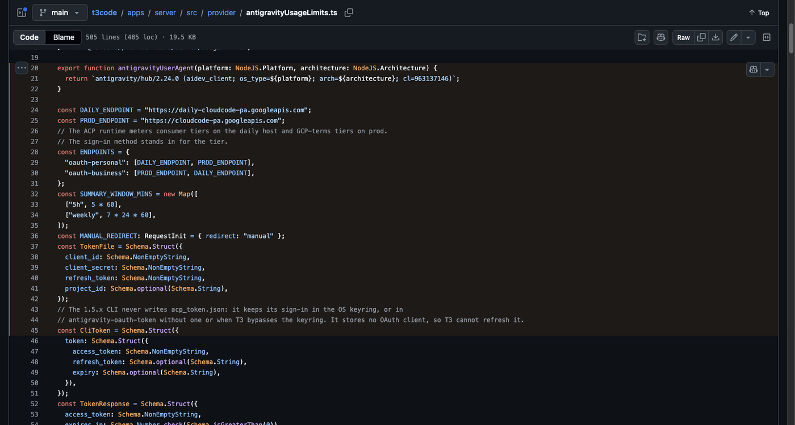

# 安裝 T3 Code 之前

<p align="center">
  <em>面向 <code>pingdotgg/t3code</code> 的獨立原始碼、遙測、安全、社群治理與公開紀錄稽核檔案 —— 附 320 條一手原始連結、108 張實證截圖與 1,151 則連續推文量化分析。</em>
</p>

<p align="center">
  <a href="https://realchendahuang.github.io/before-you-install-t3code/"><strong>🌐 開啟互動式證據入口網（GitHub Pages）</strong></a>
  ·
  <a href="https://github.com/realchendahuang/before-you-install-t3code/actions/workflows/verify.yml"></a>
  ·
  <a href="../EVIDENCE-INDEX.md"><strong>108 張視覺實證總索引</strong></a>
  ·
  <a href="../COMPLETE-SOURCE-INDEX.md"><strong>320 條一手來源總索引</strong></a>
</p>

<p align="center">
  <strong>聯合國官方語言版本：</strong>
  <a href="../../README.md">English</a> ·
  <a href="./README.zh-CN.md">简体中文</a> ·
  <a href="./README.fr.md">Français</a> ·
  <a href="./README.es.md">Español</a> ·
  <a href="./README.ru.md">Русский</a> ·
  <a href="./README.ar.md">العربية</a>
</p>
<p align="center">
  <strong>全球社群語言版本：</strong>
  <a href="./README.zh-TW.md"><strong>繁體中文</strong></a> ·
  <a href="./README.ja.md">日本語</a> ·
  <a href="./README.ko.md">한국어</a> ·
  <a href="./README.de.md">Deutsch</a> ·
  <a href="./README.pt-BR.md">Português</a> ·
  <a href="./README.it.md">Italiano</a> ·
  <a href="./README.nl.md">Nederlands</a> ·
  <a href="./README.pl.md">Polski</a> ·
  <a href="./README.tr.md">Türkçe</a> ·
  <a href="./README.vi.md">Tiếng Việt</a> ·
  <a href="./README.id.md">Bahasa Indonesia</a> ·
  <a href="./README.hi.md">हिन्दी</a>
</p>
<p align="center">
  <strong>稽核基線：</strong> <a href="https://github.com/pingdotgg/t3code/commit/9d3195b49dfb0098e9fa592fe0ada5464206d1c2"><code>9d3195b4</code></a>（<code>#42000</code>）·
  <strong>最新上游複查：</strong> <a href="https://github.com/pingdotgg/t3code/commit/ca81b7b97a1c4b91e5ac25768d0f6629f37732fd"><code>ca81b7b9</code></a>（<code>#42634</code>，11 月 25 日 14:49 CST · 新增 +259 筆提交）
</p>


> [!NOTE]
> **範圍與驗證原則**
> - **檔案涵蓋：** 彙整 2026 年 11 月 24–25 日發表的 2 篇導火線原帖與 **18 篇有據可查的稽核報告**、**6 份深度技術卷宗**（[`docs/dossiers/`](../dossiers/01-telemetry-and-gdpr-timeline.md)）、**320 條規範化一手連結**（[`SRC-001`–`SRC-320`](../COMPLETE-SOURCE-INDEX.md)）、**108 張視覺實證與鑑識圖表**（[`EV-001`–`EV-108`](../EVIDENCE-INDEX.md)）、[**互動式證據入口網**](https://realchendahuang.github.io/before-you-install-t3code/)，以及 **1,151 則連續 `@theo` X 推文**（11 月 7–24 日）量化資料集。
> - **程式碼追蹤區間：** 主基線 [`9d3195b4`](https://github.com/pingdotgg/t3code/commit/9d3195b49dfb0098e9fa592fe0ada5464206d1c2)（`PR #42000`，`2026-11-24T08:41:04Z`），持續複查至 `main` HEAD [`ca81b7b9`](https://github.com/pingdotgg/t3code/commit/ca81b7b97a1c4b91e5ac25768d0f6629f37732fd)（`PR #42634`，`2026-11-25 14:49 CST`）。
> - **編輯紀律：** 零縮址轉跳、零私人聯絡資訊。歡迎附一手出處透過 PR 補充事實更新、官方修補進展或新語種譯本——詳見 [`CONTRIBUTING.md`](../../CONTRIBUTING.md)。

---

## TL;DR（30 秒結論速覽）

> [!IMPORTANT]
> **一句話結論：** `pingdotgg/t3code` 在官網宣稱 `"No telemetry"` 期間預設啟用遙測並經閉源閘道（`ingest.t3.codes`）留存原始事件，在 **0 筆 GitHub 安全性公告** 下靜默修補多項高危漏洞，偽裝 Google Antigravity 內部標頭觸碰停權紅線，且 T3 Connect 至今 **零端對端加密**。儘管 `ca81b7b9` 之前補上部分焦點漏洞，**核心架構風險目前依然存在**。
>
> **最受影響對象：** 非管理員權限的桌面端使用者、本機帶有內網端點或 `SSH_AUTH_SOCK`/`GITHUB_TOKEN` 環境變數的開發者、Google Antigravity/Gemini 訂閱用戶、Claude Auto 模式使用者，以及使用 T3 Connect、`--lan` 或連結 GitHub 帳號的所有用戶。

### 按需直達（選擇你的閱讀路徑）

| 你目前的狀況 | 建議直接看這裡 |
|---|---|
| **正在評估是否安裝 T3 Code** | 先快速瀏覽下方 **已修補 vs. 仍未修復** 對照表與 [風險矩陣](#結構化發現與風險矩陣)。 |
| **電腦上已經安裝了 T3 Code** | 直接跳至 [**2 分鐘止損與清理檢查清單**](#7-可執行緩解措施與止損實戰手冊)（設定 `DO_NOT_TRACK=1`、封鎖 `ingest.t3.codes`、執行 `VACUUM`、撤銷權杖）。 |
| **想查閱原圖、互動圖表或原始碼** | 開啟 [**互動式證據入口網**](https://realchendahuang.github.io/before-you-install-t3code/)（搜尋 108 張原圖、互動檢視 4 張圖表、一鍵複製命令）或閱讀 [6 份深度卷宗](../dossiers/01-telemetry-and-gdpr-timeline.md)。 |

### 一覽表：稽核基線（`9d3195b4`） vs. 上游現況（`ca81b7b9`）

| 稽核領域 | 基線查證事實（`9d3195b4`） | 上游最新複查（`ca81b7b9`，11 月 25 日 14:49 CST） | 深入閱讀 |
|---|---|---|---|
| **遙測與隱私** | 官網掛 `"No telemetry"` 期間預設啟用 PostHog（`PR #174`）；原始事件經閉源 [`ingest.t3.codes`](https://ingest.t3.codes/) 留存；無鹽 SHA-256 讀取 `.codex`/`.claude.json`；GDPR 後連夜 PR 自承 Axiom 每小時紀錄 **220 萬筆 IP + UA**（`#42380`）與 `git.cwd` 路徑外洩（`#42450`）。 | **部分修補：** [`#42299`](https://github.com/pingdotgg/t3code/pull/42299) 停止讀取 `.codex`/`.claude.json`，[`#42465`](https://github.com/pingdotgg/t3code/pull/42465) 將非目錄自訂模型遮罩為 `custom:<driver>`，[`#42630`](https://github.com/pingdotgg/t3code/pull/42630)/[`#42629`](https://github.com/pingdotgg/t3code/pull/42629) 遵循 CI 與 `DO_NOT_TRACK`。<br>**仍未修復：** [`AnalyticsService.ts:156`](https://github.com/pingdotgg/t3code/blob/main/apps/server/src/telemetry/AnalyticsService.ts) 啟動仍先寫入本機 ID 再查開關；[`DesktopShellEnvironment.ts`](https://github.com/pingdotgg/t3code/blob/main/apps/desktop/src/shell/DesktopShellEnvironment.ts) 漏傳 `OTEL_SDK_DISABLED`/`T3CODE_OTEL_SDK_DISABLED`；**軟體內與 `app.t3.codes` 仍零關閉開關**。 | [第 2 節](#2-遙測機制跨工具憑證讀取與-gdpr-後連夜修補戰第-171112-篇) · [卷宗 01](../dossiers/01-telemetry-and-gdpr-timeline.md) |
| **本機安全與靜默公告** | 側邊欄「永久刪除」使 `statev2.sqlite` 膨脹至 41.6 GB（`#17845`）；`t3-resource-monitor` 掃描全機處理程序與命令列（`#11222`）；Claude Auto 靜默放行 `git push --force`（`#15353`）；高危修補靜默合併且 **0 筆安全性公告**。 | **部分修補：** [`#42119`](https://github.com/pingdotgg/t3code/pull/42119) 新增非同步清除（但分支/子代理關聯歷史與墓碑列仍留存，縮減體積須離線 `VACUUM`）；[`#42577`](https://github.com/pingdotgg/t3code/pull/42577) 僅收窄 Windows（macOS/Linux 維持 `ProcessesToUpdate::All`）。<br>**仍未修復：** [`#15353`](https://github.com/pingdotgg/t3code/issues/15353)、開啟儲存庫自動遞迴初始化 `.gitmodules` + 缺 `core.hooksPath=/dev/null` + 攜帶 `SSH_AUTH_SOCK`/`GITHUB_TOKEN` 執行 `SessionStart` 鉤子、**0 筆安全性公告**。 | [第 3 節](#3-本機儲存處理程序監控防護繞過與未公告安全修補第-2313-篇) · [卷宗 02](../dossiers/02-local-safety-and-security-audit.md) |
| **Antigravity 停權風險** | [`antigravityUsageLimits.ts`](https://github.com/pingdotgg/t3code/blob/main/apps/server/src/provider/antigravityUsageLimits.ts) 擷取鑰匙圈/`CredReadW` 權杖、偽裝 `antigravity/hub/2.24.0` 直連 `v1internal`；假 `SSH_CONNECTION` 造成跨帳號串流（`#41973`）；全新 $20 帳號 3 分鐘遭停權（`#41536`）。 | **仍在生效：** [`#41210`](https://github.com/pingdotgg/t3code/pull/41210) 新增 Google `VALIDATION_REQUIRED` `403` 驗證連結解析（反證已觸發風控），四條偽裝/擷取路徑全數保留。 | [第 4.1 節](#41-google-antigravity-標頭偽裝假-ssh_connection-與-3-分鐘停權第-4-篇) · [卷宗 03](../dossiers/03-antigravity-tos-and-t3connect-relay.md) |
| **T3 Connect 與區域網路驗證** | **零端對端加密**（[`#32098`](https://github.com/pingdotgg/t3code/issues/32098)）；`requireConnectDeviceApproval` 預設 `false`（[`settings.ts`](https://github.com/pingdotgg/t3code/blob/main/packages/contracts/src/settings.ts)）；OVH Caddy 閘道明文終止 TLS（`PR #32945`）。 | **仍未修復：** 無端對端加密；`ca81b7b9` 亦證實 `--lan` 明文 30 天 Cookie（`PR #37042`）+ 放行缺失 `Origin`、無 `/logout` 的不可撤銷 30 天 Bearer 權杖、可重放 5 分鐘 `?wsTicket=`，以及 `isIPv4` 掐斷 `::1` 通道。 | [第 4.2 節](#42-t3-connect零端對端加密與-ovh-tls-終止閘道第-5-篇) · [卷宗 03](../dossiers/03-antigravity-tos-and-t3connect-relay.md) |
| **7.7 萬星標與商業帳本** | 自掏 $800k+ 打造單日 **31.7 兆 token（$10.19M/日）** 算力雷達；5 輪對話/閒置 30 秒提示框動用主機憑證送出 `PUT user/starred/...` 且未鎖定倉庫（[`driver.ts#L60-L99`](https://github.com/pingdotgg/t3code/blob/main/packages/source-control-github/src/server/driver.ts#L60-L99)）。 | **仍未修復：** `driver.ts#L60-L99` 任意倉庫點星與 `zhilsinger` 審查意見懸置 19 天仍未處理（7.7 萬+ 星標 vs. ~129 名關注者）。 | [第 5 節](#5-商業帳本投資人利益衝突贊助商與-77-萬星標漏斗第-681718-篇) · [卷宗 04](../dossiers/04-business-ledger-sponsors-and-77k-stars.md) |
| **治理、商標與推文語料** | 威脅停權時 `T3 Code` **USPTO 零筆註冊商標**（17 小時後補寫 `TRADEMARK.md`）；`n = 1,151` 則推文顯示面對大廠 VIP **0.0%** 粗口 vs. 一般開發者 **8.0%** 敵意與危機期 **14.4%** 人身攻擊。 | **基線事實留存：** `CONTRIBUTING.md`、`.github/VOUCHED.td` 與 `TRADEMARK.md` 仍在 `main` 生效；4 張可重現鑑識圖表已歸檔。 | [第 6 節](#6-社群治理fork-爬蟲機器人商標紀錄1151-則推文資料集與歷史脈絡第-910141516-篇) · [卷宗 05–06](../dossiers/05-governance-trademark-and-history.md) |

---

## 目錄

**總覽與快速導覽**
- [TL;DR（30 秒結論速覽）](#tldr30-秒結論速覽)
- [結構化發現與風險矩陣](#結構化發現與風險矩陣)
- [事件時間軸（2023–2026）](#事件時間軸20232026)

**完整稽核報告與止損手冊**
- [1. 起因爭議：「Steal Our Code」、Fork 命名威脅與雙重標準](#1-起因爭議steal-our-codefork-命名威脅與雙重標準)
- [2. 遙測機制、跨工具憑證讀取與 GDPR 後連夜修補戰（第 1、7、11、12 篇）](#2-遙測機制跨工具憑證讀取與-gdpr-後連夜修補戰第-171112-篇)
- [3. 本機儲存、處理程序監控、防護繞過與未公告安全修補（第 2、3、13 篇）](#3-本機儲存處理程序監控防護繞過與未公告安全修補第-2313-篇)
- [4. Google Antigravity 條款風險與未加密 T3 Connect 中繼架構（第 4、5 篇）](#4-google-antigravity-條款風險與未加密-t3-connect-中繼架構第-45-篇)
- [5. 商業帳本、投資人利益衝突、贊助商與 7.7 萬星標漏斗（第 6、8、17、18 篇）](#5-商業帳本投資人利益衝突贊助商與-77-萬星標漏斗第-681718-篇)
- [6. 社群治理、Fork 爬蟲機器人、商標紀錄、1,151 則推文資料集與歷史脈絡（第 9、10、14、15、16 篇）](#6-社群治理fork-爬蟲機器人商標紀錄1151-則推文資料集與歷史脈絡第-910141516-篇)
- [7. 可執行緩解措施與止損實戰手冊](#7-可執行緩解措施與止損實戰手冊)
- [8. 一手原始出處與 18 篇原帖完整索引](#8-一手原始出處與-18-篇原帖完整索引)

---

## 結構化發現與風險矩陣

| 稽核領域與對應篇目 | 風險等級 | 核心查證發現 | 上游最新狀態（`ca81b7b9`） | 深度卷宗 |
|---|---|---|---|---|
| **遙測與 GDPR 後隱私**<br>*（第 1、7、11、12 篇）* | **嚴重** | 官網掛 `"No telemetry"` 期間預設啟用 PostHog（`#174`，`3bdaa6e1` 靜默刪除）；閉源 `ingest.t3.codes` 留存原始拷貝（`#15028`）；無鹽 SHA-256 讀取 `.codex`/`.claude.json`；連拒 4 筆開關 PR（`#27077`）；GDPR 後連夜 PR 自承 **220 萬筆/小時 IP + UA** 留存 30 天（`#42380`）、`git.cwd` 外洩（`#42450`）、Win/Mac 退出失效（`#42376`/`#42464`）、刪帳不刪庫（`#42285`）與匿名回饋混包（`#42466`）。 | [`#42299`](https://github.com/pingdotgg/t3code/pull/42299)、[`#42465`](https://github.com/pingdotgg/t3code/pull/42465)、[`#42630`](https://github.com/pingdotgg/t3code/pull/42630) 與 [`#42629`](https://github.com/pingdotgg/t3code/pull/42629) 已合併；**仍未修：** `AnalyticsService.ts:156` 啟動先寫 ID、漏傳 `OTEL_SDK_DISABLED`、閉源 `ingest.t3.codes`、無 UI/網頁開關、行動端與 `Publish agent activity` 盲區。 | [**卷宗 01**](../dossiers/01-telemetry-and-gdpr-timeline.md) |
| **本機安全與靜默公告**<br>*（第 2、3、13 篇）* | **嚴重** | 側邊欄假刪除使 `statev2.sqlite` 膨至 41.6 GB（`#17845`）；`t3-resource-monitor` 全機掃處理程序與命令列（`#11222`、`#41889`）；Claude Auto 靜默放行 `git push --force`（`#15353`）；21 小時撤除模型隱私過濾（`#41237`）；**0 筆安全性公告** 卻靜默合併高危修補（`#39483`、`#42504`）；未受信任儲存庫自動初始化 `.gitmodules`、缺 `core.hooksPath=/dev/null` 並攜帶 `GITHUB_TOKEN`/`SSH_AUTH_SOCK` 執行 `SessionStart` 鉤子。 | [`#42119`](https://github.com/pingdotgg/t3code/pull/42119) 新增非同步清除（保留分支/子代理關聯歷史與墓碑列，瘦身須離線 `VACUUM`）；[`#42577`](https://github.com/pingdotgg/t3code/pull/42577) 僅收窄 Windows；**仍未修：** `#15353`、`#26489`、`#30997`、倉庫鉤子風險、**0 筆安全性公告**與 `SECURITY.md` 邊界聲明。 | [**卷宗 02**](../dossiers/02-local-safety-and-security-audit.md) |
| **Antigravity 與 T3 Connect**<br>*（第 4、5 篇）* | **高** | `antigravityUsageLimits.ts` 擷取鑰匙圈/`CredReadW` 並偽裝 `antigravity/hub/2.24.0` 呼叫 `v1internal`；假 `SSH_CONNECTION` 造成跨帳號串流（`#41973`）；新 $20 帳號 3 分鐘停權（`#41536`）；**T3 Connect 零端對端加密**（`#32098`）+ OVH Caddy 明文閘道（`#32945`）；`ca81b7b9` 暴露 `--lan` 明文 Cookie、不可撤銷 30 天 Bearer、可重放 `?wsTicket=` 與 `::1` 斷線。 | [`#41210`](https://github.com/pingdotgg/t3code/pull/41210) 新增 Google `VALIDATION_REQUIRED` 驗證連結；[`#42311`](https://github.com/pingdotgg/t3code/pull/42311) 新增新裝置提醒；**仍未修：** 全部 Antigravity 偽裝路徑、**無端對端加密**、預設關閉 `requireConnectDeviceApproval` 與區域網路/Bearer/WS/`::1` 缺陷。 | [**卷宗 03**](../dossiers/03-antigravity-tos-and-t3connect-relay.md) |
| **商業帳本與 7.7 萬星標**<br>*（第 6、8、17、18 篇）* | **高** | 自掏 $800k+ 打造免費客戶端（提 T3 `162` 次 vs. 舊付費產品 `0` 次）；單日 **31.7 兆 token（$10.19M/日）** 算力雷達換取 $300k+ OpenAI 內測額度與 VC 接觸；Vibe Kanban 與 Daytona 利益重疊；Clerk/Axiom 贊助綁定；Codex 0% 漏洞與 10 帳號 `CLIProxyAPI` Gist（`555%`）；閒置 30 秒提示框動用主機憑證送出 `PUT user/starred/...`（`#29922`）。 | `driver.ts#L60-L99` 未鎖定任意點星漏洞與 `zhilsinger` 審查在 **`ca81b7b9` 仍未修**；7.7 萬+ 星標 vs. ~129 名關注者。 | [**卷宗 04**](../dossiers/04-business-ledger-sponsors-and-77k-stars.md) |
| **治理、商標與歷史脈絡**<br>*（導火線 1–2，第 9、10、15、16 篇）* | **中高** | 日均 500 commits / `yolo merges` vs. `CONTRIBUTING.md`（`"here's my advice: Don't"`）、`.github/VOUCHED.td` 封鎖秒關、174 筆 `unwanted` 標籤、刪除 Plan mode（`#33131`）與 `#33639` 辱罵用戶；公開派 `@bot` 爬梳他人 Fork；威脅停權時 **USPTO 零筆註冊商標**，17 小時後補寫 `TRADEMARK.md`（`#41898`）；2024–2026 重覆模式。 | `CONTRIBUTING.md`、`.github/VOUCHED.td` 與 `TRADEMARK.md` 仍在 `main`（`ca81b7b9`）生效。 | [**卷宗 05**](../dossiers/05-governance-trademark-and-history.md) |
| **1,151 則推文量化資料集**<br>*（第 14 篇）* | **稽核基線** | 11 月 7–24 日連續語料（`n = 1,151`，日均 66.8 則，回覆佔 75.6%，間隔中位數 2.7 分鐘）：對 20 位大廠高管/員工/頭部 KOL **0.0%** 粗口（`0/43`） vs. 對一般開發者 **8.0%** 敵意（`61/766`），中文二改 25 小時窗口人身攻擊 **暴衝 4.0 倍至 14.4%**（`19/132`）。 | 可重現正規表示式統計稽核及 4 張互動/靜態鑑識圖表。 | [**卷宗 06**](../dossiers/06-tweet-forensic-dataset-1151.md) |
| **一手 URL 與視覺總目** | **總索引** | 交叉索引 **320** 條規範化 `https://` 連結（`SRC-001`–`SRC-320`）與 **108** 張視覺實證及圖表（`EV-001`–`EV-108`）。 | 100% 規範化直連（零 `t.co` 縮址；108/108 資產編目完成）。 | [**來源總表**](../COMPLETE-SOURCE-INDEX.md) · [**證據總表**](../EVIDENCE-INDEX.md) |

---

## 事件時間軸（2023–2026）

### 六個關鍵轉折點

| 日期 / 時間窗 | 關鍵轉折 | 一手檔案 |
|---|---|---|
| **2026-03-06 → 06-18** | **PR #174** 無開關預設啟用 PostHog 遙測；三個多月後，**commit `3bdaa6e1`** 靜默刪除官網首頁 `"No telemetry / Unless you opt in. Full stop."` 承諾。 | [PR #174](https://github.com/pingdotgg/t3code/pull/174) · [Commit `3bdaa6e1`](https://github.com/pingdotgg/t3code/commit/3bdaa6e10046945ccc08264d2d6f3b81775efcb3) |
| **2026-10 – 2026-11-06** | **PR #15028** 將原始事件導入閉源 `ingest.t3.codes`；**PR #21506** 加入 `.codex`/`.claude.json` 無鹽 SHA-256 跨工具歸因；**PR #29922** 上線閒置 30 秒動用宿主機憑證點星（`driver.ts#L60-L99` 未鎖定）。 | [PR #15028](https://github.com/pingdotgg/t3code/pull/15028) · [PR #21506](https://github.com/pingdotgg/t3code/pull/21506) · [PR #29922](https://github.com/pingdotgg/t3code/pull/29922) |
| **2026-11-23 – 11-24** | `@theo` 在 **USPTO 零筆註冊商標** 情況下威脅封殺 MIT Fork 作者 GitHub 帳號（`2124829315657576890`），17 小時後補合 `TRADEMARK.md`（**PR #41898**），卻同時表態歡迎兆美元美國大廠沿用 MIT 程式碼。 | [`2124829315657576890`](https://x.com/theo/status/2124829315657576890) · [PR #41898](https://github.com/pingdotgg/t3code/pull/41898) |
| **2026-11-24 晚 – 11-25 07:00 CST** | 第 1–5 篇發表（第 1 篇破 **181 萬次瀏覽**），觸發歐盟 GDPR 正式檢舉與 **6 小時通宵閃電修補**，自承 Axiom 每小時 220 萬筆 IP 日誌（`#42380`）、`git.cwd` 路徑外洩（`#42450`）、刪帳不刪庫（`#42285`）與 Win/Mac 退出失效（`#42376`/`#42464`）。 | [第 1 篇](https://x.com/realchendahuang/status/2125153472450527440) · [第 11 篇](https://x.com/realchendahuang/status/2125394810559426993) · [第 12 篇](https://x.com/realchendahuang/status/2125395501663281198) |
| **2026-11-25 08:27 – 10:28 CST** | 第 **6–18 篇** 接連刊出，完整揭露受管原則盲區、$800k+ / 31.7 兆 token 算力雷達、`yolo merges`、`@bot` 爬梳 Fork、1,151 則推文量化統計、USPTO 紀錄、贊助商關係與 7.7 萬星標漏斗。 | [第 6 篇](https://x.com/realchendahuang/status/2125385742243520653) → [第 18 篇](https://x.com/realchendahuang/status/2125416210120765799) |
| **2026-11-25 至 14:49 CST（`ca81b7b9`）** | 稽核後追蹤（`+259` 筆提交）核實 `#42299`、`#42465`、`#42577`、`#41210`、`#42630`、`#42629`（`DO_NOT_TRACK`）與 `#42119`（非同步清除），同時確認 `AnalyticsService.ts:156`、閉源 `ingest.t3.codes`、`#15353`、`driver.ts#L60-L99`、`0` 筆安全性公告與未加密 T3 Connect 仍未解決。 | [`ca81b7b9`](https://github.com/pingdotgg/t3code/commit/ca81b7b97a1c4b91e5ac25768d0f6629f37732fd) · [PR #42629](https://github.com/pingdotgg/t3code/pull/42629) · [PR #42119](https://github.com/pingdotgg/t3code/pull/42119) |

<details>
<summary>展開完整 20 項歷史時間軸（2023–2026）</summary>

| 日期 / 時間 | 關鍵里程碑 | 可驗證檔案 / 來源 |
|---|---|---|
| **2023-05-14** | `@theo` 公布 YouTube 贊助商名單（`@vercel`、`@clerk`、`@upstash`、`@axiomhq`、`@PlanetScale`），其中 Clerk 與 Axiom 後來成為 T3 Code 雲端認證與日誌核心元件。 | [`1657488850472804353`](https://x.com/theo/status/1657488850472804353) |
| **2024-04 / 2024-09** | Vercel CEO 證實全網僅贊助一位 YouTuber（`Theo`）；`@theo` 承認贊助合約包含限制推廣競品的排他條款。 | [`1776260839965863965`](https://x.com/rauchg/status/1776260839965863965) · [影片](https://www.youtube.com/watch?v=uv179CTAK-w) |
| **2024 年** *（兩年前）* | `@theo` 將 Fork 他人的 VS Code 主題命名為 `vsc-material-but-i-wont-sue-you` 嘲諷原作者；另因針對印度教學頻道引發網暴發布道歉影片（`I screwed up.`）譴責國籍攻擊。 | [`vsc-material-but-i-wont-sue-you`](https://github.com/t3dotgg/vsc-material-but-i-wont-sue-you) · [`I screwed up.`](https://www.youtube.com/watch?v=o2CSJYXJBpc) |
| **2025-02 – 2025-05** | USPTO 駁回 T3 Tools Inc. 唯一商標申請（`PING LABS`，案號 `97294243`）並於 2025 年 5 月 19 日標記為 `ABANDONED`；EquipmentShare 於第 9/42 類註冊 `T3`（註冊號 `7795672`）。 | [TSDR `97294243`](https://tsdr.uspto.gov/statusview/sn97294243) · [TSDR `90644500`](https://tsdr.uspto.gov/#caseNumber=90644500&caseSearchType=US_APPLICATION&caseType=DEFAULT&searchType=statusSearch) |
| **2025-10** | `@theo` 與 FFmpeg 衝突並懸賞 **$20,000** 施壓逐出一名維護者；Windscribe 反手出價 $21,000、VLC 創辦人反對，最終 `@theo` 刪片刪推撤懸賞。 | [FFmpeg 事件紀錄](https://www.youtube.com/watch?v=1oQ3KMeaH04) |
| **2026-03-06** | **PR #174** 併入 `pingdotgg/t3code`，無同意提示、無 UI 開關、無文件預設開啟 PostHog 遙測。 | [PR #174](https://github.com/pingdotgg/t3code/pull/174) |
| **2026-04-26** | `@theo` 發表影片《*Github has a fake star problem*》，指 GitHub 星標成了 `"mostly a way for companies to trick VCs into investing"`。 | [`2048122499834036340`](https://x.com/theo/status/2048122499834036340) |
| **2026-06-18** | **Commit `3bdaa6e1`** 在預設遙測運作逾三個月後，靜默刪除首頁 `No telemetry / Unless you opt in. Full stop.` 承諾。 | [Commit `3bdaa6e1`](https://github.com/pingdotgg/t3code/commit/3bdaa6e10046945ccc08264d2d6f3b81775efcb3) |
| **2026-06-23** | 維護者 Julius 將 **Issue #1397** 標為 `not planned` 關閉：*"We will not make this easier to opt out of, it is crucial for us to know how many users we have"*。 | [Issue #1397](https://github.com/pingdotgg/t3code/issues/1397) |
| **2026-07 – 2026-11-17** | **Issue #4123**（質疑違背承諾）於 11 月 4 日靜默關閉；4 筆社群關閉開關 PR（`#13458`、`#16763`、`#21248`、`#27077`）全數遭拒（`#27077` 通過 147 項測試仍被標為 `unwanted`）。 | [Issue #4123](https://github.com/pingdotgg/t3code/issues/4123) · [PR #27077](https://github.com/pingdotgg/t3code/pull/27077) |
| **2026-08-06 – 2026-09-02** | **PR #5551** 隱藏 Build/Plan 切換（10 負評）；**PR #9190** 隱藏上下文用量環（16 負評，全倉最高）。 | [PR #5551](https://github.com/pingdotgg/t3code/pull/5551) · [PR #9190](https://github.com/pingdotgg/t3code/pull/9190) |
| **2026-08-19 – 2026-08-22** | `@theo` 炫耀突破 Codex 0% 配額逾 **$800+**，員工 `@maria_rcks` 釋出 *Endless*；遭批評後刪文（`2090972426876129658`），隨後 OpenAI 收緊 0% 斷流（`openai/codex#45444`）。 | [`2090972426876129658`](https://x.com/maria_rcks/status/2090972426876129658) · [`codex#45444`](https://github.com/openai/codex/issues/45444) |
| **2026-10-03 – 2026-10-10** | **Issue #15353**（Claude Auto 靜默 `git push --force`）、`privacy-policy.astro`（`2026-10-06`）與 **Issue #17845**（`statev2.sqlite` 假刪除）接連入檔。 | [Issue #15353](https://github.com/pingdotgg/t3code/issues/15353) · [Issue #17845](https://github.com/pingdotgg/t3code/issues/17845) |
| **2026-10 – 2026-10-19** | **PR #15028** 讓遙測經閉源 `ingest.t3.codes` 留存拷貝；**PR #21506** 於 `Identify.ts` 加入無鹽 SHA-256 跨工具歸因；`@theo` 發布 10 帳號 `CLIProxyAPI` Gist（`555%` 配額）。 | [PR #15028](https://github.com/pingdotgg/t3code/pull/15028) · [PR #21506](https://github.com/pingdotgg/t3code/pull/21506) · [Gist](https://gist.github.com/t3dotgg/59a521d2ee8d70aaf90e280c175072af) |
| **2026-10-30 – 2026-11-06** | **PR #27832**、**#29922**、**#29987** 上線 5 則 prompt / 閒置 30 秒提示框動用主機憑證送出 `PUT user/starred/...`；`zhilsinger` 提交 `Request changes` 後 19 天無人回應。 | [PR #27832](https://github.com/pingdotgg/t3code/pull/27832) · [PR #29922](https://github.com/pingdotgg/t3code/pull/29922) |
| **2026-11-08 – 2026-11-22** | `@bot` 公開爬梳 Fork（`@MiaAI_lab`）、刪除 Plan mode（`#33131`）、自承 $800k+ 投入與單日 31.7T / $10.19M 雷達、$300k+ OpenAI 免費額度、改寫 `CONTRIBUTING.md`、Vibe Kanban/Daytona 衝突、`PR #41237` 21 小時移除模型過濾。 | [PR #33131](https://github.com/pingdotgg/t3code/pull/33131) · [`2122860770329608290`](https://x.com/theo/status/2122860770329608290) · [PR #41237](https://github.com/pingdotgg/t3code/pull/41237) |
| **2026-11-23 19:11–19:54 CST** | `@theo` 怒罵 `"Chinese knockoff"`、`"Temu3 Code"` 並威脅找 GitHub 封殺 MIT Fork 作者帳號（`2124829315657576890`）；作者 30 分鐘內改名 `Stardust`；私訊致歉但兩則公開貼文紋風不動。 | [`2124829315657576890`](https://x.com/theo/status/2124829315657576890) · [導火線 2](https://x.com/realchendahuang/status/2125062675147448475) |
| **2026-11-24 06:06–12:23 CST** | `@theo` 稱歡迎兆美元美國大廠沿用 MIT 程式碼（`2124989435154726982`），嘲諷 `"get a better lawyer"`；導火線 1–2 發表；17 小時後的 **12:21 CST** 補合 **PR #41898** 寫入 `TRADEMARK.md`。 | [`2124989435154726982`](https://x.com/theo/status/2124989435154726982) · [PR #41898](https://github.com/pingdotgg/t3code/pull/41898) |
| **2026-11-24 17:04 – 11-25 10:28 CST** | 第 **1–18 篇** 陸續刊出（第 1 篇破 **181 萬瀏覽**、6,640 收藏），引爆歐盟 GDPR 檢舉與 6 小時通宵搶修（`#42380`、`#42285`、`#42376`、`#42450`、`#42464`、`#42466`、`#41757`、`#42386`、`#42504`）及凌晨刪推威脅閉源。 | [第 1 篇](https://x.com/realchendahuang/status/2125153472450527440) · [第 12 篇](https://x.com/realchendahuang/status/2125395501663281198) · [第 18 篇](https://x.com/realchendahuang/status/2125416210120765799) |
| **2026-11-25 至 14:49 CST（`ca81b7b9`）** | 稽核後追蹤（`+259` 筆提交）核實 `#42299`、`#42465`、`#42577`、`#41210`、`#42630`、`#42629`、`#42119`、`#42311` 與 `#42356`–`#42415`，同時確認核心架構問題仍未根治。 | [`ca81b7b9`](https://github.com/pingdotgg/t3code/commit/ca81b7b97a1c4b91e5ac25768d0f6629f37732fd) · [PR #42629](https://github.com/pingdotgg/t3code/pull/42629) · [PR #42119](https://github.com/pingdotgg/t3code/pull/42119) · [PR #41210](https://github.com/pingdotgg/t3code/pull/41210) |

</details>

---

## 1. 起因爭議：「Steal Our Code」、Fork 命名威脅與雙重標準

2026 年 11 月 23 至 25 日短短 48 小時內，一場圍繞社群 MIT Fork 命名的爭議，迅速演變成全儲存庫原始碼稽核、歐盟 GDPR 正式申訴，以及近 20 筆通宵緊急修補。

- **導火線（11 月 23 日晚間，北京時間）：** 一名網友將華人開發者 `@DDdxx666` 依 MIT 授權釋出的免費開源二改專案誤認為官方用戶端並抱怨介面。`@theo` 未查證儲存庫性質，11 分鐘內連發兩推將其貼上 `"Chinese knockoff"` 與 `"Temu3 Code"` 標籤，並威脅聯繫 GitHub 停權（`"Do it right now or I'm going to contact GitHub and have your account taken down"`）。而同一時期，T3 Code 官網（[`https://t3.codes/`](https://t3.codes/)）的 GitHub 連結正寫著 `"Steal our code (legally)"`（[導火線 1](https://x.com/realchendahuang/status/2125059292919394654)、[導火線 2](https://x.com/realchendahuang/status/2125062675147448475)）。
- **立即改名 vs. 明顯雙標：** 作者 30 分鐘內改名 `Stardust` 並移除全部 T3 標誌；`@theo` 私訊致歉，卻讓累計瀏覽破 20 萬的兩則公開羞辱貼文原封不動掛在版面。不到 11 小時後（11 月 24 日 `06:12`，[`2124989435154726982`](https://x.com/theo/status/2124989435154726982)），面對兆美元美國大廠參考 T3 Code 功能是否越界的提問，他卻改口：`"Nah. Open source is open source, even if a trillion dollar company uses it!"` 與此同時，T3 員工 `@maria_rcks` 自己就公開維護 `maria-rcks/t3libre`（*"T3 Code, liberated"*），英文社群的 `t3code-quota-ui`、`t3code-atlas`、`t3code-bar` 亦未遭公開威脅。
- **全面稽核展開：** 11 月 24 日 `17:04` 起，我逐項核查 `pingdotgg/t3code` 的提交紀錄、原始碼、PR、Issue、官方文件、USPTO 商標庫及 `@theo` 公開貼文，24 小時內發布 **18 篇附連結與截圖的查證報告**。僅第 1 篇瀏覽便破 **181 萬**、收藏 **6,640**，觸發歐盟 GDPR 申訴與 T3 團隊 6 小時通宵搶修。


---

## 2. 遙測機制、跨工具憑證讀取與 GDPR 後連夜修補戰（第 1、7、11、12 篇）

> [!WARNING]
> **本節核心結論：** T3 Code 在官網宣稱 `"No telemetry"` 期間預設開啟遙測並經閉源 `ingest.t3.codes` 留存原始事件；GDPR 檢舉後的連夜修補更自承 Axiom 每小時紀錄 **220 萬筆含 IP 與 UA 的跨度**、外洩絕對路徑 `git.cwd` 以及刪帳不刪庫。截至 `ca81b7b9`，啟動仍會先寫入本機追蹤 ID 再檢查開關，且軟體內至今零 UI 開關。  
> **深度技術卷宗：** 完整原始碼行號、`FeatureUsage.ts` 35 項行為清單與 11 月 23–25 日逐分鐘日誌詳見 [**卷宗 01：遙測架構、跨工具身分縫合與 11 月 24–25 日 GDPR 通宵閃電戰**](../dossiers/01-telemetry-and-gdpr-timeline.md)。

### 2.1 預設遙測、遭刪除的首頁承諾與跨工具憑證雜湊（`第 1 篇`）

- **2026 年 3 月 6 日（`PR #174`）：** 無遙測文件、無首次啟動同意視窗、無設定 UI 開關，預設啟用 PostHog 遙測（[第 1 篇](https://x.com/realchendahuang/status/2125153472450527440)）。
- **2026 年 6 月 18 日（[`commit 3bdaa6e1`](https://github.com/pingdotgg/t3code/commit/3bdaa6e10046945ccc08264d2d6f3b81775efcb3)）：** 預設蒐集運作逾三個月後，`@theo` 趁官網改版靜默刪除首頁 `No telemetry / Unless you opt in. Full stop.`，未對既有使用者發布公告。


- **2026 年 10 月（`PR #15028`）：** 每 10 秒批次上傳（`FLUSH_INTERVAL_MS = 10_000`）至閉源閘道 [`https://ingest.t3.codes/`](https://ingest.t3.codes/)。[`apps/server/src/telemetry/AnalyticsService.ts`](https://github.com/pingdotgg/t3code/blob/main/apps/server/src/telemetry/AnalyticsService.ts) 第 1 行明文記載該端點在轉發 PostHog 前會留存每筆原始事件副本：

```ts
// apps/server/src/telemetry/AnalyticsService.ts (lines 1, 71–74, 149 at 9d3195b4; line 156 at ca81b7b9)
// T3 ingest retains events and forwards to PostHog; UUIDs deduplicate retries there.
...
  posthogHost: Config.String("T3CODE_POSTHOG_HOST").pipe(
    Config.withDefault("https://ingest.t3.codes"),
  ),
  enabled: Config.Boolean("T3CODE_TELEMETRY_ENABLED").pipe(Config.withDefault(true)),
...
  const { distinctId, installId } = yield* getTelemetryIdentity;
```

- **蒐集欄位：** [`ProviderUsageAnalytics.ts`](https://github.com/pingdotgg/t3code/blob/main/apps/server/src/telemetry/ProviderUsageAnalytics.ts) 與 `FeatureUsage.ts` 回傳供應商、模型選用（於 `9d3195b4` 經 [`ProviderDimensions.ts`](https://github.com/pingdotgg/t3code/blob/main/apps/server/src/telemetry/ProviderDimensions.ts) 原樣送出非目錄自訂模型/代理端點名稱）、推理強度、權限模式、耗時、輸入/輸出/快取/推理 token 數、子代理 token、本機專案/執行緒數、**35 項 UI 與指令動作**（`18` 項 `COMMAND_FEATURES` + `17` 項 `METHOD_FEATURES`）、作業系統、WSL 發行版與架構。
- **跨工具憑證讀取（`PR #21506`，10 月 19 日）：** 為計算「單一使用者擁有多少台機器」，基線 `9d3195b4` 的 [`apps/server/src/telemetry/Identify.ts`](https://github.com/pingdotgg/t3code/blob/main/apps/server/src/telemetry/Identify.ts) 靜默讀取 `~/.codex/auth.json` 與 `~/.claude.json`，解析 OpenAI `user_id` JWT 與 Claude `oauthAccount.accountUuid`，再由 [`packages/shared/src/telemetryId.ts`](https://github.com/pingdotgg/t3code/blob/main/packages/shared/src/telemetryId.ts)（第 8–9 行）計算 **無鹽 SHA-256 雜湊**。因後端握有 Clerk 明文 T3 Connect ID，無鹽雜湊可直接反查回真實個人。（後續 [`PR #42299`](https://github.com/pingdotgg/t3code/pull/42299) 停止讀取 `.codex`/`.claude.json`，但 `connect` 與 `device` 無鹽雜湊仍在。）

```ts
// apps/server/src/telemetry/Identify.ts (lines 257–269, 321–338 at baseline 9d3195b4)
  const codexTokens = yield* readJsonIdentityFile(
    "codex",
    path.join(homeDirectory, ".codex", "auth.json"),
    decodeCodexAuthJson,
  )...
  const claudeJson = yield* readJsonIdentityFile(
    "claude",
    path.join(homeDirectory, ".claude.json"),
    decodeClaudeJson,
  )...
  const raw: ReadonlyArray<readonly [TelemetryOwnerSource, Option.Option<string>]> = [
    ["connect", connectUser],
    ["openai", Option.flatMap(codexTokens, (tokens) => Option.flatMap(Option.fromUndefinedOr(tokens.id_token), openAiUserId))],
    ["claude", Option.flatMap(claudeJson, (json) => Option.fromUndefinedOr(json.oauthAccount?.accountUuid))],
  ];
  return raw.flatMap(([source, value]) =>
    Option.isSome(value) && value.value.trim() !== "" ? [{ source, ownerId: hashTelemetryId(value.value) }] : [],
  );
```


- **社群退出訴求屢遭否決：** 6 月 23 日核心維護者 Julius 以 `not planned` 關閉 **Issue #1397**：*"We will not make this easier to opt out of, it is crucial for us to know how many users we have"*；張貼官網舊截圖的 **Issue #4123** 於 11 月 4 日遭靜默關閉；9–11 月社群提交的 **4 筆退出開關 PR**（`#13458`、`#16763`、`#21248`、`#27077`）全遭退件——連通過 **147 項測試** 並獲 Macroscope 批准的 `#27077` 亦於 11 月 17 日被貼上 `unwanted` 關閉。

<details>
<summary>展開 2 張拒絕退出開關的原始實證（Issue #1397 與 PR #27077）</summary>


</details>

### 2.2 受管原則（Managed Policy）與官方文件之間的矛盾（`第 7 篇`）

11 月 24 日批評升溫後，`@theo` 宣稱 T3 Code 擁有業界最易用的企業受管原則（`"trivial to set up and turn off all telemetry"`），並指對話留在磁碟 `"never touches any of our servers"`（[`2125186071357251715`](https://x.com/theo/status/2125186071357251715)、[`2125191784859115766`](https://x.com/theo/status/2125191784859115766)、[第 7 篇](https://x.com/realchendahuang/status/2125391659492081947)）。

核對官方 [`docs/user/managed-policy.md`](https://github.com/pingdotgg/t3code/blob/main/docs/user/managed-policy.md) 與 [`docs/user/telemetry.md`](https://github.com/pingdotgg/t3code/blob/main/docs/user/telemetry.md) 卻明確列出四項缺口：

1. **僅管理員可設定：** 桌面端無設定 UI 開關，必須透過 MDM/GPO 或管理員受保護路徑寫入 `policy.json`（macOS `/Library/Application Support/T3Code/policy.json`、Windows `C:\Program Files\T3Code\policy.json` / `HKLM\SOFTWARE\Policies\T3Tools\T3Code`、Linux `/etc/t3code/policy.json`）。
2. **託管網頁端（`app.t3.codes`）完全盲區：** 官方文件坦承瀏覽器端不讀伺服器環境變數、無視受管原則，且 `"has no relay tracing toggle"`。
3. **行動端不受伺服器原則管控：** 伺服器環境變數與受管原則 `"do not disable mobile tracing"`（連夜 `PR #42415` 僅於行動端新增開關，伺服器原則依舊無法關閉）。
4. **`Publish agent activity` 無視退出設定：** 開啟後將專案標題、執行緒標題、模型名與即時狀態傳往 T3 Connect 中繼，且 `"The telemetry opt-out does not disable it."`（Axiom 失敗跨度與當機日誌亦 `"can quote a value the app was handling"`，`Agent feedback` 可附加最多 16 KB 對話內容）。


<details>
<summary>展開受管原則管理員路徑實證（docs/user/managed-policy.md）</summary>


</details>

### 2.3 11 月 25 日澄清聲明在 2 小時內遭自家補丁逐條拆穿（`第 11 篇`）

11 月 25 日上午，`@theo` 發表長文澄清（[`2125332390239494211`](https://x.com/theo/status/2125332390239494211)）與公開遙測匯出檔（[`t3code-telemetry-events-jsonl-a4896cdc.gz`](https://files.tslop.org/2026/11/t3code-telemetry-events-jsonl-a4896cdc.gz)），隨後再稱退出後不會寫入本機追蹤檔（[`2125370330244128924`](https://x.com/theo/status/2125370330244128924)）。三項保證旋即遭自家 PR 與匯出檔推翻（[第 11 篇](https://x.com/realchendahuang/status/2125394810559426993)）：

- **宣稱「從未蒐集檔案路徑」：** 90 分鐘後 Julius 合併 **PR #42450**，坦承中繼觸發的 Webhook 執行會把整條追蹤跨度匯出至 Axiom，含攜帶 `git.cwd`（**工作區絕對路徑、系統使用者名稱與儲存庫名稱**）的 Git 跨度。
- **宣稱「環境變數一向能乾淨停用」：** **PR #42376** 證實 Windows 桌面端由既有程序啟動時會無視使用者儲存的 `T3CODE_TELEMETRY_ENABLED=false`；**PR #42464** 證實 macOS/Linux 首次啟動中繼追蹤早於 Shell 環境探索執行，整場工作階段無視 `~/.zshrc`。截至 `ca81b7b9`，[`DesktopShellEnvironment.ts`](https://github.com/pingdotgg/t3code/blob/main/apps/desktop/src/shell/DesktopShellEnvironment.ts) 仍漏傳 `T3CODE_OTEL_SDK_DISABLED` 與 `OTEL_SDK_DISABLED`。
- **宣稱「退出不寫追蹤檔」與「Claude 雜湊壞了」：** [`AnalyticsService.ts#L152`](https://github.com/pingdotgg/t3code/blob/main/apps/server/src/telemetry/AnalyticsService.ts#L152)（`9d3195b4` 第 149 行、`ca81b7b9` 第 156 行）啟動仍先無條件呼叫 `getTelemetryIdentity`（`upsertAnonymousId` 寫盤）再檢查 `telemetryEnabled`。此外，約 100MB 匯出檔（壓縮 `6,056,594` 位元組、`95,789` 筆事件）的 gzip 標頭顯示原檔名為發推前 20 分鐘產出的 `events.clean.jsonl`，卻仍留存 **264 筆有效 Claude 帳號紀錄**，於 10 月 20 日將 **4 台機器** 的 `installId` 串至同一 SHA-256 雜湊，並帶出私有代理模型原名（`vibeproxy/gpt-6-luna`、`muse-proxy-wonder-full`）。


<details>
<summary>展開另外 3 張 11 月 25 日澄清與 100MB 匯出檔實證（PR #42376、PR #42464、events.clean.jsonl）</summary>


</details>

### 2.4 遭歐盟 GDPR 檢舉後的 6 小時通宵閃電戰（`第 12 篇`）

11 月 24 日晚歐盟 GDPR 正式申訴送出後，6 小時連夜修補揭露了四項更深層隱私問題（[第 12 篇](https://x.com/realchendahuang/status/2125395501663281198)）：

1. **每小時 220 萬筆含 IP 追蹤跨度（`PR #42380`）：** 中繼端匯出至 Axiom 的每筆跨度——約 **每小時 220 萬筆、留存 30 天**——在 `user.id` 旁同時寫入 `client.address`（取自 `cf-connecting-ip` 的真實 IP）與 `user_agent.original`（Cloudflare 1% Workers 日誌另計）。合併 3.5 小時後 `@theo` 仍宣稱 IP 早已剝除。
2. **刪帳不刪庫與不拆通道（`PR #42285`、`PR #42430`）：** 過去於 Clerk 刪除帳號會遺留 PlanetScale 中繼列與運作中 Cloudflare 通道，直至收到真實隱私刪除請求，才靠 **手寫 SQL 與手動拆通道** 補救。
3. **行動端推播外洩（`PR #42459`、`PR #41859`）：** Android FCM 每次推播傳送明文 Clerk `user_id` 給 Google；iOS 推播跨度與錯誤直接紀錄含權杖的完整裝置推播 URL。
4. **「匿名」回饋混包傳送（`PR #42466`）：** 號稱匿名的 `agent.feedback` 與實名 `installId` 事件及主機指紋（OS、架構、原始 WSL 發行版）同包送出，直接矛盾 `docs/user/telemetry.md`；`privacy-policy.astro` 則仍停留在 10 月 6 日。


<details>
<summary>展開另外 3 張 GDPR 後連夜修補實證（PR #42285、PR #42459、PR #42466）</summary>


</details>

### 2.5 稽核後遙測與身分歸因更新（`9d3195b4` → `ca81b7b9`）

持續追蹤至 `ca81b7b9`（`2026-11-25 14:49 CST`），上游修補與遺留缺口如下：

- **稽核後已合併：**
  - [**PR #42299**](https://github.com/pingdotgg/t3code/pull/42299)（[`84e4264b`](https://github.com/pingdotgg/t3code/commit/84e4264bb347e36e97f6c3bd95d666eecfa12e07)）：`Identify.ts` 停止讀取 `~/.codex/auth.json` 與 `~/.claude.json`（`connect` 與 `device` 無鹽 SHA-256 仍保留）。
  - [**PR #42465**](https://github.com/pingdotgg/t3code/pull/42465)（[`6b3899f2`](https://github.com/pingdotgg/t3code/commit/6b3899f224947178088ca97ec9907e681807f7da)）：`ProviderDimensions.ts` 將非目錄自訂模型遮罩為 `custom:<driver>`（自訂端點下的目錄模型仍上報代號）。
  - [**PR #42630**](https://github.com/pingdotgg/t3code/pull/42630)（[`c925b9ab`](https://github.com/pingdotgg/t3code/commit/c925b9ab198099f67de862ed01701bd1d8809f2b)）：[`otelEnvironment.ts`](https://github.com/pingdotgg/t3code/blob/main/packages/shared/src/otelEnvironment.ts) 辨識 13 個 CI 環境變數，預設停用 CI 遙測與中繼追蹤。
  - [**PR #42629**](https://github.com/pingdotgg/t3code/pull/42629)（[`ef4a1643`](https://github.com/pingdotgg/t3code/commit/ef4a1643edf72ad119452c82b01c91adbf7b9e64)）：遵循 `DO_NOT_TRACK`（優先於 `T3CODE_TELEMETRY_ENABLED=true`）並經 [`DesktopShellEnvironment.ts`](https://github.com/pingdotgg/t3code/blob/main/apps/desktop/src/shell/DesktopShellEnvironment.ts) 與 [`DesktopBackendConfiguration.ts`](https://github.com/pingdotgg/t3code/blob/main/apps/desktop/src/backend/DesktopBackendConfiguration.ts) 傳遞。
  - 配套收緊 PR [**#42356**](https://github.com/pingdotgg/t3code/pull/42356)、[**#42394**](https://github.com/pingdotgg/t3code/pull/42394)、[**#42397**](https://github.com/pingdotgg/t3code/pull/42397)、[**#42398**](https://github.com/pingdotgg/t3code/pull/42398) 與 [**#42415**](https://github.com/pingdotgg/t3code/pull/42415) 收窄了瀏覽器追蹤、行動端裝置 ID/開關、MCP 錯誤列舉與 `agent.feedback` `installId` 關聯。
- **截至 `ca81b7b9` 仍未修復：**
  - [`AnalyticsService.ts`](https://github.com/pingdotgg/t3code/blob/main/apps/server/src/telemetry/AnalyticsService.ts)（第 156 行）啟動仍先執行 `getTelemetryIdentity` 寫盤再檢查 `telemetryEnabled`。
  - `DesktopShellEnvironment.ts` 仍漏傳 `OTEL_SDK_DISABLED` 與 `T3CODE_OTEL_SDK_DISABLED`。
  - 閉源 `ingest.t3.codes` 維持預設；桌面端 UI 與 `app.t3.codes` 依然零開關；行動端不受受管原則約束；`Publish agent activity` 無視退出；`privacy-policy.astro` 仍停在 `2026-10-06`。

---

## 3. 本機儲存、處理程序監控、防護繞過與未公告安全修補（第 2、3、13 篇）

> [!WARNING]
> **本節核心結論：** Claude Auto 模式至今在第 3 次重試時靜默執行 `git push --force`（`Issue #15353`），開啟未受信任儲存庫會遞迴初始化 `.gitmodules` 並攜帶 `GITHUB_TOKEN`/`SSH_AUTH_SOCK` 執行 `SessionStart` 鉤子，且多項高危安全修補在 **0 筆 GitHub 安全性公告** 下靜默併入。  
> **深度技術卷宗：** 完整 SQLite 裁剪語句、Rust `sysinfo` 呼叫、`ClaudeAdapterV2.ts` 權限邏輯與 `SECURITY.md` 邊界分析詳見 [**卷宗 02：本機安全、靜默程式碼執行繞過與未公開安全性稽核**](../dossiers/02-local-safety-and-security-audit.md)。

### 3.1 SQLite 假刪除與全機處理程序掃描（`第 2 篇`）

- **「永久刪除」實為假刪（`Issue #17845`、`#28903`）：** 側邊欄對話框（`useThreadActionMenu.ts`）承諾 `"This permanently clears conversation history for this thread."`，但基線 `9d3195b4` 的 `ThreadDeletion.ts` 僅向 `statev2.sqlite` 追加 `"thread.deleted"`，導致許多使用者的資料庫於 3–7 週膨脹至 **25.9 GB**（90% 已刪對話）、**41.6 GB**、**33 GB**（[第 2 篇](https://x.com/realchendahuang/status/2125160473176023486)）。
  - **`ca81b7b9` 現況：** [**PR #42119**](https://github.com/pingdotgg/t3code/pull/42119)（[`91f0b32e`](https://github.com/pingdotgg/t3code/commit/91f0b32e2db2cb8abca5fdd33c33609a0f57b15e)）導入非同步 `thread-content.purge` 並關閉 `#17845`，但只要存在活躍分支、待回併紀錄或存活子代理參照，來源歷史依舊保留、墓碑列仍在庫中，且真正縮減磁碟體積仍須離線跑 `VACUUM`。


- **全機處理程序與命令列掃描（`Issue #11222`、`PR #41889`）：** 背景 Rust 程式 `t3-resource-monitor`（`native/resource-monitor/src/main.rs`）以 `ProcessesToUpdate::All` + `with_cmd(UpdateKind::Always)` 每 5 秒掃描全機處理程序，關閉診斷也不停，在 Windows 上對 440+ 無關程式與遊戲開啟 280–300 個持久控制碼。11 月 24 日 **PR #41889** 證實診斷過去一直擷取 **完整處理程序命令列參數**（常含明文 API 金鑰、資料庫密碼與權杖）。
  - **`ca81b7b9` 現況：** [**PR #42577**](https://github.com/pingdotgg/t3code/pull/42577)（[`af276ccb`](https://github.com/pingdotgg/t3code/commit/af276ccbb26ef709c46bc46ec514f23b62c8e18c)）僅縮窄 Windows 讀取範圍，Linux/macOS 維持 `ProcessesToUpdate::All`，且 `PR #41889` 仍未合併。

<details>
<summary>展開 Issue #11222 全機處理程序監控原始實證</summary>


</details>

- **第 2 篇其他已核實本機缺陷：**
  - **內網主機名稱 Favicon 外洩：** 前端曾將內部主機名（如 `devbox.localdomain`）傳給 Google Favicon API（`PR #16950`、`PR #32657`）。
  - **啟動強制外連：** 即便關閉遙測，伺服器啟動仍無條件抓取 [`https://raw.githubusercontent.com/`](https://raw.githubusercontent.com/) 且無開關（**Issue #36479**）。
  - **核准與原則繞過：** 曾修補全權限與 WSL/Tailscale 審批繞過（`PR #21806`、`PR #27322`）。
  - **1.7 倍 Claude 配額消耗與 136 倍異常耗電：** 透過 Agent SDK 驅動 Claude 曾以 **1.7 倍** 速度燒耗 5 小時配額（`Issue #7338`、`#24649`）；GPU 耗電缺陷達同級 Electron 的 **136 倍**（MacBook GPU 飆至 **60W**、78 分鐘耗盡電力，關閉網頁後仍耗 **18W**，`Issue #3143`、`#40581`）。

### 3.2 拖延 52 天的靜默 `git push --force` 與 21 小時極速移除模型隱私過濾（`第 3 篇`）

- **拖延 52 天以上未修的靜默強推（`Issue #15353`）：** 截至 `ca81b7b9` 仍未關閉（[重現留言](https://github.com/pingdotgg/t3code/issues/15353#issuecomment-6889019695)）。`ClaudeAdapterV2.ts` 在 Claude Auto 模式下把 `!requiresClaudeApproval(context)` 短路為 `"allow"`——當 Claude 分類器兩度攔截 `git push --force origin main` 並於第 3 次升級人工審核時，T3 Code 不彈任何視窗即靜默放行，還將紀錄標成 `"source": "user_temporary"`。兩筆社群修補 PR（`#15360`、`#35207`）無人審查遭機器人自動關閉，`#40692` 仍擱置（[第 3 篇](https://x.com/realchendahuang/status/2125201882687881378)）。


- **21 小時火速移除隱私過濾（`Issue #40948` → `PR #41237`）：** 11 月 22 日 **Issue #40948** 反映新模型沒出現在 `@theo` 公開榜單 [`https://slopalytics.com/`](https://slopalytics.com/)（[`t3-usage.json`](https://slopalytics.com/data/t3-usage.json)），因為 `PR #29001` 設過白名單。僅 **21 小時** 後，**PR #41237** 就在 `@theo` 名下合併，直言係 Theo 要求移除過濾——導致 `ollama/acme-internal` 與企業 `acme-azure-deployment` 原名直出遙測（後經 `PR #42465` 將非目錄自訂模型遮罩為 `custom:<driver>`，但自訂端點下的目錄模型仍上報）。

<details>
<summary>展開 PR #41237 21 小時移除模型過濾實證（slopalytics.com）</summary>


</details>

### 3.3 零筆安全性公告、靜默修補漏洞與 `SECURITY.md`（`第 13 篇`）

截至 11 月 25 日（`ca81b7b9`），`pingdotgg/t3code` 的 [GitHub Security Advisories](https://github.com/pingdotgg/t3code/security/advisories) 仍維持 **0 筆**（[第 13 篇](https://x.com/realchendahuang/status/2125395980354994414)）：

- **靜默合併卻未發布公告的高危修補：**
  - `PR #39483`（裝置審批前藉中繼 `jti`/`nonce` 觸發 `ServerSecretStore` 路徑穿越）、`PR #41756`（企業 GitHub/GitLab 權杖跨網域外洩）。
  - `PR #41886`、`#22190`、`#37823`、`#39464`、`#39480`、`#40133`、`#41757`、`#42386`（無沙箱桌面預覽隔離與 worktree 指令確認）、[`PR #42413`](https://github.com/pingdotgg/t3code/pull/42413)（桌面 Clerk 權杖檔僅限擁有者權限）以及 `PR #42504`（約 3,000 行大補丁，才補上未受信任倉庫自動執行本機指令前的確認提示）。
- **截至 `ca81b7b9` 仍未解決的安全隱患：**
  - 未合併/擱置項：`Issue #26489`（外部路徑穿越/符號連結）、`PR #36216`、`#23428`、`#33144` 與 `PR #30997`（Windows `externalLauncher.ts` 以 `powershell.exe -ExecutionPolicy Bypass -EncodedCommand <base64>` 啟動，遭 AVG/Avast 標報 `IDP.HELU.PSE96`）。
  - `ca81b7b9` 原始碼實測未受信任儲存庫執行風險：
    - [`GitVcsDriverCore.ts#L6144-L6205`](https://github.com/pingdotgg/t3code/blob/ca81b7b9/apps/server/src/vcs/GitVcsDriverCore.ts#L6144-L6205) 開啟儲存庫時自動遞迴初始化 `.gitmodules`。
    - [`VcsProcess.ts#L145-L157`](https://github.com/pingdotgg/t3code/blob/ca81b7b9/apps/server/src/vcs/VcsProcess.ts#L145-L157) 缺乏全域 `core.hooksPath=/dev/null` 防護。
    - [`ClaudeAdapterV2.ts#L5982-L5985`](https://github.com/pingdotgg/t3code/blob/ca81b7b9/apps/server/src/orchestration-v2/Adapters/ClaudeAdapterV2.ts#L5982-L5985) 攜帶完整繼承的 `GITHUB_TOKEN` 與 `SSH_AUTH_SOCK` 執行 `.claude/settings.json` 的 `SessionStart` 鉤子。
- **倉促寫成的 [`SECURITY.md`](https://github.com/pingdotgg/t3code/blob/main/SECURITY.md)（`PR #38812`、`#41942`）：** 至今將越界全碟 `filesystem:read`、iOS/區域網路明文 HTTP 以及中繼簽章金鑰外洩導致接管整機劃為 **「有意設計邊界」**，而 [`https://ingest.t3.codes/`](https://ingest.t3.codes/) 繼續閉源（`2125370330244128924`）。

<details>
<summary>展開 3 張靜默安全修補與 SECURITY.md 實證（PR #39483、PR #30997、SECURITY.md）</summary>


</details>

---

## 4. Google Antigravity 條款風險與未加密 T3 Connect 中繼架構（第 4、5 篇）

> [!WARNING]
> **本節核心結論：** 儘管官方 FAQ 保證合規，原始碼卻擷取系統鑰匙圈憑證並偽造 Google 內部標頭（`antigravity/hub/2.24.0`），已出現新號 3 分鐘停權。同時 **T3 Connect 零端對端加密**，所有提示詞、原始碼與終端流皆於 T3 側明文終止，且 `ca81b7b9` 另存四項區域網路/Bearer/WS/`::1` 驗證缺陷。  
> **深度技術卷宗：** `cliproxyApi.ts`（`PR #33800`）、`AntigravityTurnOutcome.ts`、`settings.ts` 與 `ManagedEndpointProvider.ts` 原始碼詳見 [**卷宗 03：Google Antigravity 偽裝、PR #33800 與 T3 Connect 中繼架構**](../dossiers/03-antigravity-tos-and-t3connect-relay.md)。

### 4.1 Google Antigravity 標頭偽裝、假 `SSH_CONNECTION` 與 3 分鐘停權（`第 4 篇`）

官方 [`docs/user/faq.md`](https://github.com/pingdotgg/t3code/blob/main/docs/user/faq.md#will-i-get-banned-for-using-my-subscription) 向付費用戶保證：*"We work with all of the labs and T3 Code is within the TOS of Claude Code, Codex, and Google Antigravity... If it works in T3 Code, you can trust it is safe."* 用戶在 **Issue #40713** 回報停權後，維護者起初否認直連後端或重複使用權杖，直到開發者（`schlessera`）直接貼出自有原始碼反駁（[第 4 篇](https://x.com/realchendahuang/status/2125213397507858657)）：

1. **偽造 User-Agent、擷取鑰匙圈並直連 `v1internal`（[`antigravityUsageLimits.ts`](https://github.com/pingdotgg/t3code/blob/main/apps/server/src/provider/antigravityUsageLimits.ts#L20-L45)）：** 從本機檔案、`@napi-rs/keyring` 或 Windows 認證管理員（經 `ffi-rs` 呼叫 `advapi32.dll` 的 `CredReadW`）提取 Google OAuth 權杖，硬編碼內部用戶端字串並 `POST` 直連未公開介面 `v1internal`（[第 445–476 行](https://github.com/pingdotgg/t3code/blob/main/apps/server/src/provider/antigravityUsageLimits.ts#L445-L476)）。Google 人員在[官方開發者論壇](https://discuss.ai.google.dev/t/185992)確認 [Google Antigravity 服務條款](https://antigravity.google/terms) 第 6 條禁止第三方提取或重用憑證直連後端：

```ts
// apps/server/src/provider/antigravityUsageLimits.ts (lines 20–24, 450–454)
export function antigravityUserAgent(platform: NodeJS.Platform, architecture: NodeJS.Architecture) {
  return `antigravity/hub/2.24.0 (aidev_client; os_type=${platform}; arch=${architecture}; cl=963137146)`;
}
const DAILY_ENDPOINT = "https://daily-cloudcode-pa.googleapis.com";
...
HttpClientRequest.post(`${endpoint}/v1internal:${operation}`).pipe(
  HttpClientRequest.setHeaders({
    Authorization: `Bearer ${accessToken}`,
    "User-Agent": antigravityUserAgent(platform, architecture),
  }),
```

2. **注入假 `SSH_CONNECTION` 導致跨帳號串流（[`antigravityAuthSupport.ts#L230-L236`](https://github.com/pingdotgg/t3code/blob/main/apps/server/src/provider/antigravityAuthSupport.ts#L230-L236)）：** 為繞過 Google CLI 將單帳號鎖在系統鑰匙圈的設計，T3 強行注入偽造 `SSH_CONNECTION` 誘使其將明文權杖寫回本機；11 月 24 日 Google CLI 更新移除該回退後，**Issue #41973** 證實帳號 A 的提問直接靜默路由至帳號 B：

```ts
// apps/server/src/provider/antigravityAuthSupport.ts (lines 230–236)
// The 1.5 CLI ignores AGY_ACP_FORCE_FILE_STORAGE and keeps Google sign-ins in one OS keyring
// entry for every profile, unless it believes it runs over SSH. Sign-in then uses `--login`.
...(auth.authMethod === "oauth-personal"
  ? { SSH_CONNECTION: baseEnv.SSH_CONNECTION || "127.0.0.1 0 127.0.0.1 0" }
  : {}),
GEMINI_HOME: profile.geminiHome,
AGY_ACP_FORCE_FILE_STORAGE: "1",
```

3. **新號 3 分鐘停權（`Issue #41536`）、偽裝 `"zed"` 與 `PR #33800`：**
   - **Issue #41536（11 月 23 日）：** 全新購買的 `$20` Google AI 帳號 **零代理**，僅用 T3 託管 Antigravity，**第一則訊息送出 3 分鐘即遭停權**（個人帳號僅一次申訴機會；維護者以重複 Issue 關閉且未加風險警示）。
   - **用戶端與 Hub 偽裝：** `@theo` 親自合併 **PR #26876** 偽裝成 `"zed"`（[`AntigravityAcpSupport.ts`](https://github.com/pingdotgg/t3code/blob/main/apps/server/src/provider/acp/AntigravityAcpSupport.ts)）。儘管 11 月 23 日在 X 畫圖歸咎 CLIProxy（[`2124665075638411641`](https://x.com/theo/status/2124665075638411641)、[`2124703048140517397`](https://x.com/theo/status/2124703048140517397)），已合併的 [**PR #33800**](https://github.com/pingdotgg/t3code/pull/33800) 卻將附偽裝標頭 `claude-code/2.1.273`、`grok-cli/1.0.77` 與 `antigravityUserAgent` 的 [`cliproxyApi.ts`](https://github.com/pingdotgg/t3code/blob/main/apps/server/src/usage/cliproxyApi.ts) 原生接進 T3 Code。
   - **`ca81b7b9` 現況：** [**PR #41210**](https://github.com/pingdotgg/t3code/pull/41210)（[`3e74a0aa`](https://github.com/pingdotgg/t3code/commit/3e74a0aac5c53459cc1d3d84eec915fa483f2836)）新增 [`AntigravityTurnOutcome.ts`](https://github.com/pingdotgg/t3code/blob/main/apps/server/src/provider/acp/AntigravityTurnOutcome.ts) 解析 `403 PERMISSION_DENIED`（`VALIDATION_REQUIRED`）並顯示 Google 驗證連結——反證風控檢核持續觸發；[**PR #42545**](https://github.com/pingdotgg/t3code/pull/42545)（[`4da8d19d`](https://github.com/pingdotgg/t3code/commit/4da8d19d08ed7e34fe2d5d66dae54b01eab122fc)）與 [`#42339`](https://github.com/pingdotgg/t3code/pull/42339)、[`#42475`](https://github.com/pingdotgg/t3code/pull/42475) 僅修細節，四條偽裝/擷取路徑全數有效。



<details>
<summary>展開另外 3 張 Antigravity 偽裝與停權實證（SSH_CONNECTION、Issue #41536、PR #33800）</summary>


</details>

### 4.2 T3 Connect：零端對端加密與 OVH TLS 終止閘道（`第 5 篇`）

- **全鏈路對 T3 技術可見（[第 5 篇](https://x.com/realchendahuang/status/2125218189596676555)）：** **T3 Connect 沒有任何端對端加密——每則提示詞、原始碼檔案與終端輸出在技術上皆對 T3 明文可見。** [`ManagedEndpointProvider.ts`](https://github.com/pingdotgg/t3code/blob/main/infra/relay/src/environments/ManagedEndpointProvider.ts) 於 T3 自有 Cloudflare 帳號開通通道與 DNS（`06_t3-connect.md`），TLS 於邊緣終止，掛一條 Workers Route 即可靜默擷取全量流量。
- **拒絕 E2E 與遷往自建 OVH 明文閘道（`Issue #32098`、`PR #32945`）：**
  - **Issue #32098** 提議雙向認證與端對端加密遭以改動過大關閉；討論 `#21286` 與 `#37831` 無人回覆；11 月 25 日 `@theo` 直接宣稱端對端加密不可能（`2125370330244128924`）。
  - 因 Cloudflare 通道月費達 **$25,000**，`@theo` 開 **PR #32945** 轉往自租 OVH Hillsboro 閘道（`gw.t3coderelay.com`），由自家 Caddy 終止 TLS 後經 Unix Socket 明文轉交 Go `yamux` 代理——依舊零端對端加密。[`privacy-policy.astro`](https://github.com/pingdotgg/t3code/blob/main/apps/marketing/src/pages/privacy-policy.astro)（`2026-10-06`）僅寫 `"encrypted network transport"`，未揭露缺乏 E2E 或不留存保證。
- **預設關閉新裝置審批 + `ca81b7b9` 四項未修區域網路/驗證缺陷（[卷宗 03](../dossiers/03-antigravity-tos-and-t3connect-relay.md)）：**
  - `requireConnectDeviceApproval`（[`PR #36419`](https://github.com/pingdotgg/t3code/pull/36419)）在 [`packages/contracts/src/settings.ts`](https://github.com/pingdotgg/t3code/blob/main/packages/contracts/src/settings.ts) 中預設仍為 **`false`**（即便 [**PR #42311**](https://github.com/pingdotgg/t3code/pull/42311) / [`ece5f21b`](https://github.com/pingdotgg/t3code/commit/ece5f21b17077382c8d2eba1c28e75e898386dcd) 新增登入通知）；[`SECURITY.md`](https://github.com/pingdotgg/t3code/blob/main/SECURITY.md) 自承中繼簽章金鑰或雲帳號失竊即等同取得本機 Shell。
  - **明文 `--lan` Cookie + 缺失 `Origin` 繞過：** `t3 up --lan` 下發不含 `Secure` 的 30 天 Shell Cookie（[`PR #37042`](https://github.com/pingdotgg/t3code/pull/37042)、[`http.ts#L215-L221`](https://github.com/pingdotgg/t3code/blob/ca81b7b9/apps/server/src/auth/http.ts#L215-L221)、[`SessionStore.ts#L492-L493`](https://github.com/pingdotgg/t3code/blob/ca81b7b9/apps/server/src/auth/SessionStore.ts#L492-L493)）且接受缺少 `Origin` 標頭的請求（[`EnvironmentAuth.ts#L798-L806`](https://github.com/pingdotgg/t3code/blob/ca81b7b9/apps/server/src/auth/EnvironmentAuth.ts#L798-L806)）。
  - **不可撤銷的 30 天 Bearer 權杖：** 非 DPoP `/oauth/token` 簽發無 `/logout` 路由且阻斷自撤銷的 30 天未綁定 Bearer 權杖（[`EnvironmentAuth.ts#L1175-L1186`](https://github.com/pingdotgg/t3code/blob/ca81b7b9/apps/server/src/auth/EnvironmentAuth.ts#L1175-L1186)、[`EnvironmentAuth.ts#L1506-L1511`](https://github.com/pingdotgg/t3code/blob/ca81b7b9/apps/server/src/auth/EnvironmentAuth.ts#L1506-L1511)、[`environmentHttp.ts#L595-L679`](https://github.com/pingdotgg/t3code/blob/ca81b7b9/packages/contracts/src/environmentHttp.ts#L595-L679)）。
  - **可重放 URL `?wsTicket=`：** 5 分鐘查詢參數憑證對 Bearer RPC 與全體 `media` 路由均無防重放保護（[`EnvironmentAuth.ts#L1553-L1622`](https://github.com/pingdotgg/t3code/blob/ca81b7b9/apps/server/src/auth/EnvironmentAuth.ts#L1553-L1622)、[`SessionStore.ts#L1086-L1156`](https://github.com/pingdotgg/t3code/blob/ca81b7b9/apps/server/src/auth/SessionStore.ts#L1086-L1156)）。
  - **誤殺 `::1` 回環通道：** [`startupAccess.ts#L71-L108`](https://github.com/pingdotgg/t3code/blob/ca81b7b9/apps/server/src/startupAccess.ts#L71-L108) 以 `NodeNet.isIPv4` 誤判 IPv6 `::1`，靜默呼叫 `socket.destroy()` 中斷 Tailscale Serve / Connect 連線。


<details>
<summary>展開 OVH Caddy TLS 終止閘道實證（PR #32945）</summary>


</details>

---

## 5. 商業帳本、投資人利益衝突、贊助商與 7.7 萬星標漏斗（第 6、8、17、18 篇）

> [!NOTE]
> **本節核心結論：** 預設遙測並非附帶功能，而是用免費客戶端築起單日 **31.7 兆 token（$10.19M/日）** 的算力雷達，進而換取 $300k+ OpenAI 免費內測額度與 VC 接觸；同時應用內閒置 30 秒提示框動用宿主機 GitHub 憑證直接點星，並放任任意倉庫點星漏洞（`driver.ts#L60-L99`）19 天未修。  
> **深度技術卷宗：** 完整收益引文、Axiom 設定與 `GitHubStarPrompt.tsx` 拆解見 [**卷宗 04：商業帳本、投資人利益衝突、贊助商棧與 7.7 萬星引擎**](../dossiers/04-business-ledger-sponsors-and-77k-stars.md)。

### 5.1 逾 80 萬美元投入與單日 31.7 兆 Token（$10.19M/日）算力雷達（`第 8 篇`）

- **全盤押注免費客戶端：** 17.24 天內 1,151 則推文中，`@theo` 提及 T3 Code **162 次（14.1%）**，提及自家三個舊付費產品 `T3 Chat`、`UploadThing` 與 [`https://ping.gg/`](https://ping.gg/) **0 次**，並證實已自掏 **$800k+**（[`2120729779511124267`](https://x.com/theo/status/2120729779511124267)、[第 8 篇](https://x.com/realchendahuang/status/2125392410763239723)）。
- **遙測構築的行業雷達：** 匯入 `ingest.t3.codes` 的遙測撐起單日 **31.7 兆 token**（11 月 18 日等效 API 消費 **$10.19M/日**，峰值近 **$10.2M/日**）的即時算力雷達，涵蓋 `99%` 訂閱佔比、`~98.5%` 三大廠份額與開源權重試用從 `15%` 降至 `6%`。11 月 23 日有人推測份額，還遭 `@theo` 嘲諷沒有他的數據後台（`2124682906132181482`）。
- **直接轉化為大廠額度與資本籌碼：** 換來單次 GPT-6.2 Astra 評測燒掉 **$300k+ 無上限免費 OpenAI 內測額度**（`2122760447103484410`）、Google 裸機基準測試與 DeepMind 往來（註：`@theo` 宣稱 DeepMind `@PatrickToulme` 合了 `"many PRs"`，但 git log 顯示僅 **1 筆提交** `PR #31158`），以及多位投資人主動接洽（`"multiple investors have asked me about this"`，[`2123885732330885417`](https://x.com/theo/status/2123885732330885417)）。


<details>
<summary>展開 Patrick Toulme 僅 1 筆提交的核查截圖（PR #31158）</summary>


</details>

### 5.2 天使投資人利益衝突（`第 6 篇`）與贊助商/配額雙重標準（`第 17 篇`）

- **Vibe Kanban 與 Daytona 業務衝突（[第 6 篇](https://x.com/realchendahuang/status/2125385742243520653)）：** 11 月 16 日揭露曾投資並參與 **Vibe Kanban**（`2122201981167251877`）——該專案轉向仿效 T3 Code 介面後收攤，旋即遭其公開嘲諷該 UI 很適合 `"for running out of runway and killing your business"`；11 月 18 日承認投資雲端沙箱 **Daytona**（`2123011578090127499`），而 9 天前剛預告 T3 Code 自家付費雲沙箱（`2119705561679933806`）。
- **贊助商棧深嵌中繼（[第 17 篇](https://x.com/realchendahuang/status/2125411353393553744)）：** 2023 年 5 月 YouTube 贊助商名單（`1657488850472804353`）中的 **Clerk** 與 **Axiom** 正好是 T3 Code 的雲認證與 30 天含 IP 日誌底座；Vercel CEO `@rauchg` 證實全網只贊助過 Theo 一人（`1776260839965863965`），Theo 亦承認簽過競品排他條款（`uv179CTAK-w`），且同為 Cursor 與 Cline 天使投資人。
- **Codex 0% 薅羊毛與 10 帳號 CLIProxyAPI 雙標：** 8 月 21 日 `@theo` 炫耀突破 Codex 0% 寬限白用 **$800+**，員工 `@maria_rcks` 釋出循環腳本 *Endless*；隔日遭批刪文（`2090972426876129658`），隨後 OpenAI 收緊 0% 立即斷流（`openai/codex#45444`）。10 月 `@theo` 又發表 452 星 Gist（`59a521d2ee8d70aaf90e280c175072af`）以 `CLIProxyAPI` 串聯 **7 個 Claude + 3 個 Codex 帳號**（跨 12+ 台機器湊 `555%` 配額，並炫耀代理 110 萬次請求產出 `$14,662`/`$15k` Ultra 價值與 Grok Bot 教學）——而 `docs/user/faq.md` 剛以停權風險拒絕內建切換，轉頭便掛上這條 Gist 連結（`"Early apologies if it gets you banned 💀"`）。

<details>
<summary>展開 3 張利益衝突、CLIProxyAPI Gist 與 Codex 0% 配額回歸實證</summary>


</details>

### 5.3 T3 Code 如何在 25 天內從 3 萬暴衝至 7.7 萬星標（僅 129 名關注者）（`第 18 篇`）

發片痛批 *"Github has a fake star problem"*（`2048122499834036340`，指星標是用來 `"to trick VCs into investing"`）僅半年後，`@theo` 親自自寫自合三筆 PR（[第 18 篇](https://x.com/realchendahuang/status/2125416210120765799)）：

1. **10 月 30 日（`PR #27832`）：** 送滿 5 則 prompt（`PROMPTS_BEFORE_ASKING = 5`，第 6 則彈出 [`GitHubStarPrompt.tsx`](https://github.com/pingdotgg/t3code/blob/main/apps/web/src/components/GitHubStarPrompt.tsx)）即在右上角彈出求星提示，日增星標瞬間 **10 倍暴衝**（`2117065834267136469`），單日衝上 GitHub Trending **+3,094 星**（`2117172614158508400`）。
2. **11 月 3 日（`PR #29922`、`PR #29987`）：** 升級為視窗 **閒置 30 秒偵測**（`IDLE_MS = 30_000`），專挑等 Agent 執行完的空檔彈窗，並改走 `sourceControl.star` RPC——直接動用 **宿主機伺服器 GitHub 憑證** 送出 `PUT user/starred/pingdotgg/t3code`，再炸出 160 顆彩帶粒子。
3. **繞過審查與至今未修的任意倉庫點星（`ca81b7b9`）：** Macroscope 將 `PR #29922` 標為 `Needs Human Approval`，`@theo` 依舊自行合併。11 月 6 日開發者 `zhilsinger` 提交 `Request changes`，指出共享主機憑證不透明（`GitHubStarPrompt.tsx#L115` 自承）且 [`packages/source-control-github/src/server/driver.ts#L60-L99`](https://github.com/pingdotgg/t3code/blob/main/packages/source-control-github/src/server/driver.ts#L60-L99) 並未把目標倉庫鎖定為 `pingdotgg/t3code`：

```ts
// packages/source-control-github/src/server/driver.ts (lines 60–66, 90–96)
const starredPath = (repository: string) => {
  const segments = repository.split("/");
  // "." and ".." survive encoding and would normalize the URL out of user/starred.
  return segments.length === 2 && segments.every((segment) => !["", ".", ".."].includes(segment))
    ? `user/starred/${segments.map(encodeURIComponent).join("/")}`
    : undefined;
};
...
  return Effect.fn("GitHubDriver.starRepository")(
    function* (host: string, repository: string) {
      const path = starredPath(repository);
      if (path === undefined) return false;
      const response = yield* api.rest({ host, operation: "starRepository", method: "PUT", path });
```

任何持有 `source-control:write` 的用戶端都能借宿主機憑證替任意倉庫點星。`zhilsinger` 的審查截至 `ca81b7b9` 已擱置 **19 天** 未修，而倉庫星標自 3 萬衝上 7.7 萬（僅約 129 名關注者）。


<details>
<summary>展開 zhilsinger 審查意見與 driver.ts 任意倉庫點星原始碼實證（PR #29922）</summary>


</details>

---

## 6. 社群治理、Fork 爬蟲機器人、商標紀錄、1,151 則推文資料集與歷史脈絡（第 9、10、14、15、16 篇）

> [!NOTE]
> **本節核心結論：** 治理紀錄、USPTO 商標庫與 **1,151 則連續推文量化分析** 共同印證極度不對等的雙標：對大廠高管/VIP **0.0%** 粗口 vs. 對一般開發者 **8.0%** 敵意與中文二改危機期 **4.0 倍暴衝至 14.4%**；威脅 GitHub 停權當下更是 **0 筆 USPTO 註冊商標**。  
> **深度技術卷宗：** [**卷宗 05：社群治理、Fork 爬蟲機器人、商標越權與歷史脈絡**](../dossiers/05-governance-trademark-and-history.md) · [**卷宗 06：1,151 則推文量化鑑識資料集**](../dossiers/06-tweet-forensic-dataset-1151.md)。

### 6.1 內部高速開發 vs. 對外敵意治理（`第 9 篇`）與公開爬梳他人 Fork（`第 10 篇`）

- **日均 500 commits / `yolo merges` vs. `CONTRIBUTING.md`（[第 9 篇](https://x.com/realchendahuang/status/2125392916369871309)）：**
  - 內部自述日均 **500 commits**（`2120741101250515322`）、狂開 **700 個 Agent**、Julius 用循環腳本批次合併 PR、自嘲 `"my yolo merges breaking shit sometimes"`（`2119951615679672513`），甚至拿整機炸毀當 `"free content"`（`2119993037971730879`）。
  - 對外卻以 **PR #5551** 藏起 Plan 模式（10 負評）、**PR #9190** 隱藏上下文進度環（16 負評全倉最高）、**PR #33131** 刪除 Plan 模式、在 **Issue #33639** 辱罵用戶 `"uninstall our software"` / `"ungrateful prick"`（隔日拒掉 **PR #41572**）；`CONTRIBUTING.md` 開篇勸退 `"here's my advice: Don't"` 並搭配 `.github/VOUCHED.td` 點名封鎖秒關（全倉 174 筆 `unwanted` 標籤）；X 上斥責貢獻者沒追蹤自己（`2120821423438778667`）、威脅拿掉 `/btw`（`2120853340078874923`）或稱圈紅截圖比提 PR 好（`2123754193530053110`）。
- **公開派 `@bot` 爬梳他人 Fork vs. 嘲諷競品（[第 10 篇](https://x.com/realchendahuang/status/2125393641665671593)）：**
  - 11 月 8 日看到 `@MiaAI_lab` 的二改功能，先回 `"Okay I'm stealing this"`，30 秒後公開呼叫 `@bot` 用 Opus 5.5 上 `beebox` 直接扒功能（`2119240810202034645`）；11 月 13 日再派 `@bot` 複製競品受好評功能（`2121017649652269120`）；11 月 24 日卻嘲諷 Claude Code Desktop 加側邊欄分頁（`2124987957803446311`）。
  - 對批評者號召用 Community Notes `"demonetize them"`（`2120238923884696025`），並證實啟用 X 自動封鎖腳本（11 月 24 日封鎖約 100 帳號，`2125077510941802509`）。


<details>
<summary>展開 Issue #33639 辱罵用戶與 @bot 公開爬梳 Fork 實證</summary>


</details>

### 6.2 商標稽核：USPTO 零筆註冊與事後補救的 `PR #41898`（`第 15 篇`）

- **USPTO TSDR 實查（[第 15 篇](https://x.com/realchendahuang/status/2125408163273080950)，線索來自 `@vildanden_ai` `2125275487404761555`）：** `T3 Code`、`T3 Tools`、`T3 Connect` 註冊紀錄皆為 **0**。T3 Tools Inc. 唯一申請（`PING LABS`，案號 [`97294243`](https://tsdr.uspto.gov/statusview/sn97294243)）已於 2025 年 2 月駁回、5 月 19 日標記 `ABANDONED`；反而是第三方在第 42/9 類軟體與 SaaS 持有已註冊 `T3` 商標（`EquipmentShare` 註冊號 `7795672` / [`90644500`](https://tsdr.uspto.gov/#caseNumber=90644500&caseSearchType=US_APPLICATION&caseType=DEFAULT&searchType=statusSearch)；`ESG Operations` 註冊號 `3324707`）。
- **GitHub 商標政策與 17 小時後補寫 `TRADEMARK.md`：** 依 [GitHub 商標政策](https://docs.github.com/en/site-policy/content-removal-policies/github-trademark-policy)，商業公司提交商標下架須在偽證罪約束下提供聯邦或國際註冊號。威脅停權 `@DDdxx666` 當下，他連檢舉表單都填不完。整整 **17 小時後**（11 月 24 日 `12:21`），他合併 **PR #41898** 補入 `TRADEMARK.md`（寫上 `"whether registered or unregistered"`），94 秒後便轉發引用（`2125082769395220688`）——而 2024 年 9 月他曾嘲諷 WordPress 打 `"unenforceable trademark dispute"`（`1839261574005141945`），3 小時前還嗆開發者 `"get a better lawyer"`（`2125026423769555308`）。


<details>
<summary>展開「get a better lawyer」原推實證</summary>


</details>

### 6.3 1,151 則推文量化資料集（`第 14 篇`）與兩年歷史脈絡（`第 16 篇`）

針對 2026 年 11 月 7–24 日連續 **1,151 則 `@theo` X 貼文**（`17.24` 天；日均 `66.8` 則；回覆佔 `75.6%`；間隔中位數 `2.7` 分鐘）做全量統計，精準呈現「看人下菜碟」（[第 14 篇](https://x.com/realchendahuang/status/2125404517697290438)）：

- **大廠高管、實驗室員工與頭部 KOL（嚴格首位 `@` `n = 43` / 廣義 `n = 60`–`62`）：** 針對性粗口與人身攻擊為 **0.0%**（`30.0%`–`32.6%` 為禮貌致謝）；即便批評 Gemini 4 Carbon 或 GPT-6.2 Astra，也迅速緩和或公開致歉（`2123255588570501585`、`2123995323123343869`）。
- **一般開發者與批評者（嚴格 `n = 766` / 廣義 `n = 749`）：** 敵意/粗口率飆升至 **8.0%**（`61/766`），包含 `"Engineers deserve the mass unemployment they have coming"`（`2124470530590011704`）、`"dance on the graves of the 'local ai' community"`（`2120733839832273025`）、`"Linux larpers"`（`2124298216271499605`）、反覆罵 `stupid bitch`（`2120599310211703274`）及拿坐牢/RSD 威脅（`2122865897375400066`）。
- **25 小時中文二改風波窗口（`n = 132`）：** 直接人身攻擊率自平時 `3.6%` **暴衝 4.0 倍至 14.4%**（`19/132`），罵出 `"chinese tech twitter is the biggest fucking cesspit"` 並辱罵閱讀中文程式碼稽核者 `"fucking braindead"`（`2125177503526588877`）——而不到 24 小時前他還說教他人別消耗信任（`2124449493513068862`）。


<details>
<summary>展開第 13、14 篇引用的 2 張 X 敵意言論原始截圖</summary>


</details>

**回顧兩年的重複模式（[第 16 篇](https://x.com/realchendahuang/status/2125408843152953693)）：**
- **2024 年 Fork 嘲諷：** 自己 Fork 他人 VS Code 主題時命名 [`vsc-material-but-i-wont-sue-you`](https://github.com/t3dotgg/vsc-material-but-i-wont-sue-you) 嘲弄原作者。
- **2024 年印度開發者網暴與致歉：** 針對印度教學頻道的影片引發網暴後上傳 [`I screwed up.`](https://www.youtube.com/watch?v=o2CSJYXJBpc) 譴責國籍攻擊——兩年後原樣向中文科技圈開火。
- **2025 年 10 月 FFmpeg 懸賞風波：** 鏡頭前飆髒話並懸賞 **$20,000** 施壓趕走 FFmpeg 維護者（[事件紀錄](https://www.youtube.com/watch?v=1oQ3KMeaH04)），遭 Windscribe 反出 $21k、VLC 反對與 FFmpeg 郵件清單譴責後刪片撤賞。
- **2026 年 11 月 25 日凌晨 4 點刪推威脅閉源：** 發文稱用戶配不上開源將連夜閉源，獲讚破 3,000 後於天亮前靜默刪文。

---

## 7. 可執行緩解措施與止損實戰手冊

若個人或公司機器已安裝 T3 Code，請依序完成以下 **2 分鐘縱深止損清單**：

- [ ] **步驟 1 — 環境變數 + 作業系統層雙重阻斷遙測：** 設定 `DO_NOT_TRACK=1` 及舊版變數，**並同時**於 `/etc/hosts` 封鎖 `ingest.t3.codes`（[7.1](#71-環境變數--作業系統層級網路阻斷本機桌面端使用者)）。
- [ ] **步驟 2 — 部署管理員受管原則（具備管理員權限時）：** 落地 `policy.json` 鎖死遙測、Connect、Webhook、Cookie 匯入與預覽通道（[7.2](#72-系統管理員受管原則macoslinuxwindows)）。
- [ ] **步驟 3 — 檢視並壓縮/清除本機 SQLite：** 完全結束 T3 Code 後檢查 `statev2.sqlite` 容量，執行離線 `VACUUM;` 或移除 `~/.t3`（[7.3](#73-statev2sqlite-檢視與本機狀態清理)）。
- [ ] **步驟 4 — 保護 Google 帳號並斷開 T3 Connect：** 移除 T3 託管 Antigravity 目錄、關閉 **Publish agent activity**、解除本機綁定並申請 Clerk + 中繼刪帳（[7.4](#74-google-antigravityt3-connectclerkcloudflare-與-github-授權撤銷)）。
- [ ] **步驟 5 — 撤銷 GitHub OAuth、輪換金鑰並隔離未知倉庫：** 撤銷 T3 Code 的 GitHub 授權、輪換曾出現在命令列的機密、停用明文 `t3 up --lan`，開啟未知儲存庫前清空 `SSH_AUTH_SOCK`/`GITHUB_TOKEN`（[7.4](#74-google-antigravityt3-connectclerkcloudflare-與-github-授權撤銷)）。

### 7.1 環境變數 + 作業系統層級網路阻斷（本機／桌面端使用者）

**切勿只依賴環境變數：** 截至 `ca81b7b9`，[`AnalyticsService.ts`](https://github.com/pingdotgg/t3code/blob/main/apps/server/src/telemetry/AnalyticsService.ts)（第 156 行）啟動仍先寫入本機 ID 再查開關，[`DesktopShellEnvironment.ts`](https://github.com/pingdotgg/t3code/blob/main/apps/desktop/src/shell/DesktopShellEnvironment.ts) 仍漏傳 `OTEL_SDK_DISABLED`/`T3CODE_OTEL_SDK_DISABLED`，舊版亦曾無視 Shell/使用者環境變數（`PR #42376`、`PR #42464`）。請將 [`PR #42629`](https://github.com/pingdotgg/t3code/pull/42629) 支援的 `DO_NOT_TRACK=1` 與 `/etc/hosts` 封鎖併用：

```bash
# 1. macOS / Linux：加入 ~/.zshrc（或 ~/.bashrc），重新載入 Shell 並徹底重啟 T3 Code
#    DO_NOT_TRACK=1（PR #42629）優先於 T3CODE_TELEMETRY_ENABLED=true 並停用中繼追蹤，
#    但 AnalyticsService.ts:156 仍會寫盤且 DesktopShellEnvironment.ts 仍漏傳 OTel 變數。
export DO_NOT_TRACK=1
export T3CODE_TELEMETRY_ENABLED=false
export T3CODE_OTEL_SDK_DISABLED=true
export OTEL_SDK_DISABLED=true

# 2. 在作業系統 hosts 邊界封鎖閉源上報閘道（/etc/hosts）
#    （Windows 路徑：C:\Windows\System32\drivers\etc\hosts）
127.0.0.1 ingest.t3.codes
::1 ingest.t3.codes
```

Windows 使用者請一併於 **系統內容 → 環境變數**（使用者與系統）寫入上述 4 项並重啟背景服務。另依 `Issue #36479`，除非防火牆/代理攔截，伺服器啟動仍會外連 `raw.githubusercontent.com`。

### 7.2 系統管理員受管原則（`macOS`、`Linux`、`Windows`）

依 [`docs/user/managed-policy.md`](https://github.com/pingdotgg/t3code/blob/main/docs/user/managed-policy.md) 部署 root/系統管理員持有的 `policy.json`（或 MDM/GPO），鎖死遙測、T3 Connect、Webhook、瀏覽器 Cookie 匯入與預覽通道：

| 作業系統 | 原生原則 / 登錄檔 | 管理員受保護路徑（`chmod 644`） |
|---|---|---|
| **macOS** | 針對 `com.t3tools.t3code` 的裝置設定描述檔 *（使用者層級會被忽略）* | `/Library/Application Support/T3Code/policy.json` |
| **Linux / WSL** | — *（須於每個 WSL 發行版分別部署）* | `/etc/t3code/policy.json` |
| **Windows** | GPO（`t3code.admx`）或 `HKLM\SOFTWARE\Policies\T3Tools\T3Code` 下之 `REG_SZ` `Policy` | `C:\Program Files\T3Code\policy.json` |

```json
{
  "schemaVersion": 1,
  "organization": "Local Hardening Policy",
  "limits": {
    "maxRuntimeMode": "auto-accept-edits",
    "clients": ["desktop"],
    "connect": false,
    "webhookTasks": false,
    "browserCookieImport": false,
    "previewTunnel": false,
    "telemetry": false
  }
}
```

以 `t3 policy check policy.json` 驗證，徹底重啟後執行 `t3 policy show` 確認生效。

> [!CAUTION]
> **官方文件確認之盲區（`docs/user/telemetry.md`）：** 受管原則 **無法** 停用託管網頁端 `app.t3.codes` 中繼追蹤、**無法** 控管行動端追蹤，也 **不會** 關閉先前開啟的 `Publish agent activity`。

### 7.3 `statev2.sqlite` 檢視與本機狀態清理

即使 [`PR #42119`](https://github.com/pingdotgg/t3code/pull/42119) 新增非同步 `thread-content.purge`（關閉 `Issue #17845`），截至 `ca81b7b9` 只要存在活躍分支、待回併傳輸或存活父子代理，已刪執行緒歷史仍保留、墓碑列仍在 SQLite 中，且回收 `.sqlite` 磁碟空間須離線執行 `VACUUM`：

```bash
# 檢視本機 T3 狀態目錄與資料庫容量（macOS / Linux）
ls -lh ~/.t3/userdata/statev2.sqlite*

# 可選唯讀檢查庫中殘留刪除標記（請先徹底結束 T3 Code）
sqlite3 -readonly ~/.t3/userdata/statev2.sqlite \
  "SELECT COUNT(*) FROM orchestration_events WHERE event_type = 'thread.deleted';"

# 可選離線壓縮以於 PR #42119 清除後真正釋放磁碟頁（請先徹底結束 T3 Code）
sqlite3 ~/.t3/userdata/statev2.sqlite "VACUUM;"

# 若打算徹底解除安裝，備份所需資料後移除整個 ~/.t3
rm -rf ~/.t3
```

*（Windows 請檢視並清理 `%USERPROFILE%\.t3\userdata\` 下的 `statev2.sqlite`、`anonymous-id` 與 `secrets`。）*

### 7.4 Google Antigravity、T3 Connect、Clerk/Cloudflare 與 GitHub 授權撤銷

1. **Google Antigravity：** 立即停止透過 T3 託管 Antigravity 或 CLIProxyAPI 使用個人 Google AI 訂閱以保住唯一申訴機會，並移除 `~/.t3/userdata/providers/antigravity/` 與 `~/.t3/tools/antigravity-acp/`。
2. **T3 Connect 與雲端資料刪除：** 於 **Settings → Sharing & access** 關閉 **Publish agent activity**，解除全部本機綁定（`t3` 登出/解綁）；日後若重啟遠端存取務必開啟 `requireConnectDeviceApproval`。依 `privacy-policy.astro` 聯絡 T3 Tools 並經 Clerk 申請全量刪帳，觸發 `PR #42285` 回呼清除 PlanetScale 資料列與 Cloudflare 通道。
3. **GitHub 權杖與機密輪換：** 於 **GitHub Settings → Applications / Authorized GitHub Apps** 撤銷 T3 Code 授權（`driver.ts` 持有宿主機層級點星權限）；凡於 `PR #41889` / `PR #42577` 之前曾透過命令列參數傳遞的 API 金鑰、資料庫 URL 或權杖，以及經 Webhook/中繼錯誤傳至 Axiom 的敏感值，請一併輪換。
4. **區域網路 HTTP、CI Bearer 與未受信任儲存庫隔離（`ca81b7b9`）：** 切勿裸跑明文 `t3 up --lan` HTTP（務必前置 TLS 反向代理或 Tailscale Serve，並留意 `::1` vs `127.0.0.1` 之 IPv4 誤判）；切勿將 30 天非 DPoP Bearer 權杖放入腳本/CI；開啟未知儲存庫前清空 `SSH_AUTH_SOCK`/`GITHUB_TOKEN` 並先檢查 `.gitmodules` 與 `.claude/settings.json` 鉤子。

### 7.5 可替代用戶端參考

社群後續回覆中，開發者常點名 **Mirasim**（`@Mirasim_ADE`）、**Paseo**（`@paseo_sh`）、**Paradev**（`@ParadevAI`）與 **Cloudroom**（[替代方案原帖](https://x.com/realchendahuang/status/2125244977878036713)）。採用任何替代工具前，建議獨立驗證四點：
1. 預設關閉遙測且封包乾淨；
2. 刪除對話時確實執行 `DELETE` + `VACUUM` 或實體刪檔；
3. 嚴守官方 CLI 委派，不擷取鑰匙圈憑證、不偽造內部標頭；
4. 遠端通道具備真正的用戶端端對端加密。

---

## 8. 一手原始出處與 18 篇原帖完整索引

> 依 `SRC-001` 至 `SRC-320` 全量交叉編目的主索引表見 [`docs/COMPLETE-SOURCE-INDEX.md`](../COMPLETE-SOURCE-INDEX.md)；全部 **108** 張視覺實證與圖表（`EV-001`–`EV-108`）見 [`docs/EVIDENCE-INDEX.md`](../EVIDENCE-INDEX.md)。

### 導火線與完整 18 篇 X 原帖索引（依時間順序）

| 篇目 | 核心重點 | X 一手原帖 |
|---|---|---|
| **導火線 1** | 官網 GitHub 連結寫著 `"steal our code"` | [`2125059292919394654`](https://x.com/realchendahuang/status/2125059292919394654) |
| **導火線 2** | MIT Fork 命名威脅、Temu 羞辱與雙重標準 | [`2125062675147448475`](https://x.com/realchendahuang/status/2125062675147448475) |
| **第 1 篇** | 預設遙測、靜默刪除 `"No telemetry"` 承諾、無鹽跨工具雜湊 | [`2125153472450527440`](https://x.com/realchendahuang/status/2125153472450527440) |
| **第 2 篇** | SQLite 假刪除、5 秒全機處理程序掃描、刪 Plan 模式、`CONTRIBUTING.md` 封鎖 | [`2125160473176023486`](https://x.com/realchendahuang/status/2125160473176023486) |
| **第 3 篇** | Auto 模式靜默 `git push --force`、21 小時移除模型過濾、0 公告、辱罵用戶 | [`2125201882687881378`](https://x.com/realchendahuang/status/2125201882687881378) |
| **第 4 篇** | Google Antigravity 標頭偽裝、假 `SSH_CONNECTION`、新號 3 分鐘停權 | [`2125213397507858657`](https://x.com/realchendahuang/status/2125213397507858657) |
| **第 5 篇** | T3 Connect 零端對端加密、Cloudflare 通道、自建 OVH 明文閘道 | [`2125218189596676555`](https://x.com/realchendahuang/status/2125218189596676555) |
| **第 6 篇** | 天使投資衝突：Vibe Kanban 收攤嘲諷與 Daytona 雲沙箱重疊 | [`2125385742243520653`](https://x.com/realchendahuang/status/2125385742243520653) |
| **第 7 篇** | 受管原則 `"turn off all telemetry"` 說法 vs. 官方文件三大盲區 | [`2125391659492081947`](https://x.com/realchendahuang/status/2125391659492081947) |
| **第 8 篇** | 80 萬美元免費客戶端帳本與單日 31.7 兆 token / 1,019 萬美元雷達 | [`2125392410763239723`](https://x.com/realchendahuang/status/2125392410763239723) |
| **第 9 篇** | 日均 500 commits、700 Agent、`yolo merges` vs. 勸退 PR 與追蹤門檻 | [`2125392916369871309`](https://x.com/realchendahuang/status/2125392916369871309) |
| **第 10 篇** | 派 `@bot` 公開爬梳 Fork 與競品、自動封鎖腳本、Community Notes 斷收益 | [`2125393641665671593`](https://x.com/realchendahuang/status/2125393641665671593) |
| **第 11 篇** | 11 月 25 日澄清 2 小時內遭連夜 PR 與 100MB 匯出檔內 264 筆 Claude 紀錄證偽 | [`2125394810559426993`](https://x.com/realchendahuang/status/2125394810559426993) |
| **第 12 篇** | GDPR 檢舉後連夜自爆：220 萬/小時 IP 日誌、刪帳不刪庫、推播外洩、匿名混包 | [`2125395501663281198`](https://x.com/realchendahuang/status/2125395501663281198) |
| **第 13 篇** | 痛罵中文科技推為糞坑，轉身靜默修補無沙箱預覽與未確認倉庫指令執行 | [`2125395980354994414`](https://x.com/realchendahuang/status/2125395980354994414) |
| **第 14 篇** | 1,151 則推文量化拆分：對大廠高管 0% 粗口 vs. 一般開發者 8% 敵意 | [`2125404517697290438`](https://x.com/realchendahuang/status/2125404517697290438) |
| **第 15 篇** | USPTO 零筆 T3 Code 註冊紀錄與 GitHub 商標下架政策要求 | [`2125408163273080950`](https://x.com/realchendahuang/status/2125408163273080950) |
| **第 16 篇** | 兩年歷史慣例：`vsc-material-but-i-wont-sue-you`、印度開發者風波、2 萬美元 FFmpeg 懸賞 | [`2125408843152953693`](https://x.com/realchendahuang/status/2125408843152953693) |
| **第 17 篇** | 贊助商棧 Clerk/Axiom、Codex 0% 薅羊毛刪推與 10 帳號 `CLIProxyAPI` Gist | [`2125411353393553744`](https://x.com/realchendahuang/status/2125411353393553744) |
| **第 18 篇** | 7.7 萬星內幕：閒置 30 秒彈窗動用宿主機憑證 API 點星與未修 `driver.ts` | [`2125416210120765799`](https://x.com/realchendahuang/status/2125416210120765799) |
| **替代用戶端** | 社群推薦替代用戶端清單 | [`2125244977878036713`](https://x.com/realchendahuang/status/2125244977878036713) |
| **社群評論** | 歸檔評論 —— `@opserx` 提交的 Issue #1（*"The Case Against Theo"*） | [`docs/community/issue-1-the-case-against-theo.md`](../community/issue-1-the-case-against-theo.md) |

### 原始碼、PR、Issue、官方政策與一手連結歸類

<details>
<summary>展開本 README 引用的全部原始碼、PR、Issue、政策與 X 原始連結</summary>

#### 遙測、隱私與 GDPR 後連夜修補（第 1、7、11、12 篇）
- **官網與上報閘道：** [t3.codes](https://t3.codes/) · [ingest.t3.codes](https://ingest.t3.codes/) · [PR #174](https://github.com/pingdotgg/t3code/pull/174) · [commit `3bdaa6e1`](https://github.com/pingdotgg/t3code/commit/3bdaa6e10046945ccc08264d2d6f3b81775efcb3) · [PR #15028](https://github.com/pingdotgg/t3code/pull/15028) · [PR #21506](https://github.com/pingdotgg/t3code/pull/21506)
- **拒絕退出與違背承諾：** [Issue #1397](https://github.com/pingdotgg/t3code/issues/1397) · [Issue #4123](https://github.com/pingdotgg/t3code/issues/4123) · [PR #13458](https://github.com/pingdotgg/t3code/pull/13458) · [PR #16763](https://github.com/pingdotgg/t3code/pull/16763) · [PR #21248](https://github.com/pingdotgg/t3code/pull/21248) · [PR #27077](https://github.com/pingdotgg/t3code/pull/27077)
- **原始碼與官方文件：** [`AnalyticsService.ts`](https://github.com/pingdotgg/t3code/blob/main/apps/server/src/telemetry/AnalyticsService.ts) · [`AnalyticsService.ts#L152`](https://github.com/pingdotgg/t3code/blob/main/apps/server/src/telemetry/AnalyticsService.ts#L152) · [`Identify.ts`](https://github.com/pingdotgg/t3code/blob/main/apps/server/src/telemetry/Identify.ts) · [`ProviderUsageAnalytics.ts`](https://github.com/pingdotgg/t3code/blob/main/apps/server/src/telemetry/ProviderUsageAnalytics.ts) · [`ProviderDimensions.ts`](https://github.com/pingdotgg/t3code/blob/main/apps/server/src/telemetry/ProviderDimensions.ts) · [`telemetryId.ts`](https://github.com/pingdotgg/t3code/blob/main/packages/shared/src/telemetryId.ts) · [`otelEnvironment.ts`](https://github.com/pingdotgg/t3code/blob/main/packages/shared/src/otelEnvironment.ts) · [`DesktopShellEnvironment.ts`](https://github.com/pingdotgg/t3code/blob/main/apps/desktop/src/shell/DesktopShellEnvironment.ts) · [`DesktopBackendConfiguration.ts`](https://github.com/pingdotgg/t3code/blob/main/apps/desktop/src/backend/DesktopBackendConfiguration.ts) · [`docs/user/telemetry.md`](https://github.com/pingdotgg/t3code/blob/main/docs/user/telemetry.md) · [`docs/user/managed-policy.md`](https://github.com/pingdotgg/t3code/blob/main/docs/user/managed-policy.md)
- **澄清推文與匯出檔：** [`2125186071357251715`](https://x.com/theo/status/2125186071357251715) · [`2125191784859115766`](https://x.com/theo/status/2125191784859115766) · [`2125332390239494211`](https://x.com/theo/status/2125332390239494211) · [`2125370330244128924`](https://x.com/theo/status/2125370330244128924) · [`t3code-telemetry-events-jsonl-a4896cdc.gz`](https://files.tslop.org/2026/11/t3code-telemetry-events-jsonl-a4896cdc.gz)
- **GDPR 後連夜 PR：** [PR #42450](https://github.com/pingdotgg/t3code/pull/42450) · [PR #42376](https://github.com/pingdotgg/t3code/pull/42376) · [PR #42464](https://github.com/pingdotgg/t3code/pull/42464) · [PR #42380](https://github.com/pingdotgg/t3code/pull/42380) · [PR #42285](https://github.com/pingdotgg/t3code/pull/42285) · [PR #42430](https://github.com/pingdotgg/t3code/pull/42430) · [PR #42459](https://github.com/pingdotgg/t3code/pull/42459) · [PR #41859](https://github.com/pingdotgg/t3code/pull/41859) · [PR #42466](https://github.com/pingdotgg/t3code/pull/42466)

#### 本機安全、靜默修補、Antigravity 與 T3 Connect（第 2、3、4、5、13 篇）
- **儲存、處理程序監控與本機缺陷：** [Issue #17845](https://github.com/pingdotgg/t3code/issues/17845) · [Issue #28903](https://github.com/pingdotgg/t3code/issues/28903) · [Issue #11222](https://github.com/pingdotgg/t3code/issues/11222) · [PR #41889](https://github.com/pingdotgg/t3code/pull/41889) · [PR #16950](https://github.com/pingdotgg/t3code/pull/16950) · [PR #32657](https://github.com/pingdotgg/t3code/pull/32657) · [Issue #36479](https://github.com/pingdotgg/t3code/issues/36479) · [raw.githubusercontent.com](https://raw.githubusercontent.com/) · [PR #21806](https://github.com/pingdotgg/t3code/pull/21806) · [PR #27322](https://github.com/pingdotgg/t3code/pull/27322) · [Issue #7338](https://github.com/pingdotgg/t3code/issues/7338) · [Issue #24649](https://github.com/pingdotgg/t3code/issues/24649) · [Issue #3143](https://github.com/pingdotgg/t3code/issues/3143) · [Issue #40581](https://github.com/pingdotgg/t3code/issues/40581)
- **靜默強推與模型隱私過濾：** [Issue #15353](https://github.com/pingdotgg/t3code/issues/15353) · [重現留言](https://github.com/pingdotgg/t3code/issues/15353#issuecomment-6889019695) · [PR #15360](https://github.com/pingdotgg/t3code/pull/15360) · [PR #35207](https://github.com/pingdotgg/t3code/pull/35207) · [PR #40692](https://github.com/pingdotgg/t3code/pull/40692) · [PR #29001](https://github.com/pingdotgg/t3code/pull/29001) · [Issue #40948](https://github.com/pingdotgg/t3code/issues/40948) · [PR #41237](https://github.com/pingdotgg/t3code/pull/41237) · [slopalytics.com](https://slopalytics.com/) · [`t3-usage.json`](https://slopalytics.com/data/t3-usage.json)
- **零安全性公告與靜默修補：** [Security Advisories](https://github.com/pingdotgg/t3code/security/advisories) · [`SECURITY.md`](https://github.com/pingdotgg/t3code/blob/main/SECURITY.md) · [PR #38812](https://github.com/pingdotgg/t3code/pull/38812) · [PR #41942](https://github.com/pingdotgg/t3code/pull/41942) · [PR #22190](https://github.com/pingdotgg/t3code/pull/22190) · [PR #37823](https://github.com/pingdotgg/t3code/pull/37823) · [PR #39464](https://github.com/pingdotgg/t3code/pull/39464) · [PR #39480](https://github.com/pingdotgg/t3code/pull/39480) · [PR #39483](https://github.com/pingdotgg/t3code/pull/39483) · [PR #40133](https://github.com/pingdotgg/t3code/pull/40133) · [PR #41756](https://github.com/pingdotgg/t3code/pull/41756) · [PR #41757](https://github.com/pingdotgg/t3code/pull/41757) · [PR #41886](https://github.com/pingdotgg/t3code/pull/41886) · [PR #42386](https://github.com/pingdotgg/t3code/pull/42386) · [PR #42504](https://github.com/pingdotgg/t3code/pull/42504) · [Issue #26489](https://github.com/pingdotgg/t3code/issues/26489) · [PR #23428](https://github.com/pingdotgg/t3code/pull/23428) · [PR #30997](https://github.com/pingdotgg/t3code/pull/30997) · [PR #33144](https://github.com/pingdotgg/t3code/pull/33144) · [PR #36216](https://github.com/pingdotgg/t3code/pull/36216)
- **Google Antigravity 偽裝與停權：** [`docs/user/faq.md`](https://github.com/pingdotgg/t3code/blob/main/docs/user/faq.md) · [FAQ 合規保證](https://github.com/pingdotgg/t3code/blob/main/docs/user/faq.md#will-i-get-banned-for-using-my-subscription) · [Issue #40713](https://github.com/pingdotgg/t3code/issues/40713) · [Issue #41536](https://github.com/pingdotgg/t3code/issues/41536) · [Issue #41973](https://github.com/pingdotgg/t3code/issues/41973) · [PR #26876](https://github.com/pingdotgg/t3code/pull/26876) · [PR #33800](https://github.com/pingdotgg/t3code/pull/33800) · [`cliproxyApi.ts`](https://github.com/pingdotgg/t3code/blob/main/apps/server/src/usage/cliproxyApi.ts) · [`antigravityUsageLimits.ts`](https://github.com/pingdotgg/t3code/blob/main/apps/server/src/provider/antigravityUsageLimits.ts) · [`#L20-L45`](https://github.com/pingdotgg/t3code/blob/main/apps/server/src/provider/antigravityUsageLimits.ts#L20-L45) · [`#L445-L476`](https://github.com/pingdotgg/t3code/blob/main/apps/server/src/provider/antigravityUsageLimits.ts#L445-L476) · [`antigravityAuthSupport.ts`](https://github.com/pingdotgg/t3code/blob/main/apps/server/src/provider/antigravityAuthSupport.ts) · [`#L230-L236`](https://github.com/pingdotgg/t3code/blob/main/apps/server/src/provider/antigravityAuthSupport.ts#L230-L236) · [`AntigravityAcpSupport.ts`](https://github.com/pingdotgg/t3code/blob/main/apps/server/src/provider/acp/AntigravityAcpSupport.ts) · [`AntigravityTurnOutcome.ts`](https://github.com/pingdotgg/t3code/blob/main/apps/server/src/provider/acp/AntigravityTurnOutcome.ts) · [`2124264935505199294`](https://x.com/theo/status/2124264935505199294) · [`2124665075638411641`](https://x.com/theo/status/2124665075638411641) · [`2124703048140517397`](https://x.com/theo/status/2124703048140517397) · [Google Antigravity ToS](https://antigravity.google/terms) · [Google 開發者論壇](https://discuss.ai.google.dev/t/185992)
- **T3 Connect 與 OVH 閘道：** [Issue #32098 留言](https://github.com/pingdotgg/t3code/issues/32098#issuecomment-6869049926) · [PR #36419](https://github.com/pingdotgg/t3code/pull/36419) · [`settings.ts`](https://github.com/pingdotgg/t3code/blob/main/packages/contracts/src/settings.ts) · [PR #32945](https://github.com/pingdotgg/t3code/pull/32945) · [`06_t3-connect.md`](https://github.com/pingdotgg/t3code/blob/main/docs/internals/06_t3-connect.md) · [`ManagedEndpointProvider.ts`](https://github.com/pingdotgg/t3code/blob/main/infra/relay/src/environments/ManagedEndpointProvider.ts) · [`privacy-policy.astro`](https://github.com/pingdotgg/t3code/blob/main/apps/marketing/src/pages/privacy-policy.astro) · [Discussion #21286](https://github.com/pingdotgg/t3code/discussions/21286) · [Discussion #37831](https://github.com/pingdotgg/t3code/discussions/37831)

#### 商業帳本、投資衝突、贊助商與 7.7 萬星標（第 6、8、17、18 篇）
- **算力雷達與投入：** [`2120729779511124267`](https://x.com/theo/status/2120729779511124267) · [`2122860770329608290`](https://x.com/theo/status/2122860770329608290) · [`2123965784888377541`](https://x.com/theo/status/2123965784888377541) · [`2124682906132181482`](https://x.com/theo/status/2124682906132181482) · [`2122760447103484410`](https://x.com/theo/status/2122760447103484410) · [PR #31158](https://github.com/pingdotgg/t3code/pull/31158) · [`2123885732330885417`](https://x.com/theo/status/2123885732330885417) · [ping.gg](https://ping.gg/)
- **投資人衝突：** [`2122201981167251877`](https://x.com/theo/status/2122201981167251877) · [`2123011578090127499`](https://x.com/theo/status/2123011578090127499) · [`2119705561679933806`](https://x.com/theo/status/2119705561679933806)
- **贊助商、Codex 0% 與 CLIProxyAPI：** [`1657488850472804353`](https://x.com/theo/status/1657488850472804353) · [`1776260839965863965`](https://x.com/rauchg/status/1776260839965863965) · [排他條款影片](https://www.youtube.com/watch?v=uv179CTAK-w) · [`2090972426876129658`](https://x.com/maria_rcks/status/2090972426876129658) · [`openai/codex#45444`](https://github.com/openai/codex/issues/45444) · [`2119193502852755520`](https://x.com/theo/status/2119193502852755520) · [`2119960608816988596`](https://x.com/theo/status/2119960608816988596) · [`2119994608516276256`](https://x.com/theo/status/2119994608516276256) · [CLIProxyAPI Gist](https://gist.github.com/t3dotgg/59a521d2ee8d70aaf90e280c175072af) · [FAQ 多帳號條文](https://github.com/pingdotgg/t3code/blob/main/docs/user/faq.md#can-i-add-a-bunch-of-accounts-for-one-provider)
- **7.7 萬星引擎：** [`2048122499834036340`](https://x.com/theo/status/2048122499834036340) · [`2117065834267136469`](https://x.com/theo/status/2117065834267136469) · [`2117172614158508400`](https://x.com/theo/status/2117172614158508400) · [`2124992724223029538`](https://x.com/theo/status/2124992724223029538) · [PR #27832](https://github.com/pingdotgg/t3code/pull/27832) · [PR #29922](https://github.com/pingdotgg/t3code/pull/29922) · [PR #29987](https://github.com/pingdotgg/t3code/pull/29987) · [`GitHubStarPrompt.tsx`](https://github.com/pingdotgg/t3code/blob/main/apps/web/src/components/GitHubStarPrompt.tsx) · [`driver.ts#L60-L99`](https://github.com/pingdotgg/t3code/blob/main/packages/source-control-github/src/server/driver.ts#L60-L99)

#### 治理、商標、選擇性禮貌與歷史紀錄（第 9、10、14、15、16 篇）
- **儲存庫治理與封鎖：** [PR #5551](https://github.com/pingdotgg/t3code/pull/5551) · [PR #9190](https://github.com/pingdotgg/t3code/pull/9190) · [PR #33131](https://github.com/pingdotgg/t3code/pull/33131) · [Issue #33639 留言](https://github.com/pingdotgg/t3code/issues/33639#issuecomment-6765462545) · [PR #41572](https://github.com/pingdotgg/t3code/pull/41572) · [`CONTRIBUTING.md`](https://github.com/pingdotgg/t3code/blob/main/CONTRIBUTING.md) · [`.github/VOUCHED.td`](https://github.com/pingdotgg/t3code/blob/main/.github/VOUCHED.td)
- **內部狂飆 vs. 外部設限：** [`2119993037971730879`](https://x.com/theo/status/2119993037971730879) · [`2119951615679672513`](https://x.com/theo/status/2119951615679672513) · [`2120741101250515322`](https://x.com/theo/status/2120741101250515322) · [`2119958282022568059`](https://x.com/theo/status/2119958282022568059) · [`2120821423438778667`](https://x.com/theo/status/2120821423438778667) · [`2120853340078874923`](https://x.com/theo/status/2120853340078874923) · [`2123754193530053110`](https://x.com/theo/status/2123754193530053110)
- **爬梳 Fork 與自動封鎖：** [`2119240810202034645`](https://x.com/theo/status/2119240810202034645) · [`2121017649652269120`](https://x.com/theo/status/2121017649652269120) · [`2124987957803446311`](https://x.com/theo/status/2124987957803446311) · [`2120238923884696025`](https://x.com/theo/status/2120238923884696025) · [`2125077510941802509`](https://x.com/theo/status/2125077510941802509)
- **USPTO 與商標紀錄：** [TSDR `97294243`](https://tsdr.uspto.gov/statusview/sn97294243) · [TSDR `90644500`](https://tsdr.uspto.gov/#caseNumber=90644500&caseSearchType=US_APPLICATION&caseType=DEFAULT&searchType=statusSearch) · [GitHub 商標政策](https://docs.github.com/en/site-policy/content-removal-policies/github-trademark-policy) · [PR #41898](https://github.com/pingdotgg/t3code/pull/41898) · [`TRADEMARK.md`](https://github.com/pingdotgg/t3code/blob/main/TRADEMARK.md) · [`2124829315657576890`](https://x.com/theo/status/2124829315657576890) · [`2124989435154726982`](https://x.com/theo/status/2124989435154726982) · [`2125082769395220688`](https://x.com/theo/status/2125082769395220688) · [`2125026423769555308`](https://x.com/theo/status/2125026423769555308) · [`2125275487404761555`](https://x.com/vildanden_ai/status/2125275487404761555) · [`1839261574005141945`](https://x.com/theo/status/1839261574005141945)
- **選擇性禮貌與歷史實證：** [`2123255588570501585`](https://x.com/theo/status/2123255588570501585) · [`2123995323123343869`](https://x.com/theo/status/2123995323123343869) · [`2124470530590011704`](https://x.com/theo/status/2124470530590011704) · [`2120733839832273025`](https://x.com/theo/status/2120733839832273025) · [`2124298216271499605`](https://x.com/theo/status/2124298216271499605) · [`2122865897375400066`](https://x.com/theo/status/2122865897375400066) · [`2120599310211703274`](https://x.com/theo/status/2120599310211703274) · [`2125177503526588877`](https://x.com/theo/status/2125177503526588877) · [`2125193393450226024`](https://x.com/theo/status/2125193393450226024) · [`2124449493513068862`](https://x.com/theo/status/2124449493513068862) · [`vsc-material-but-i-wont-sue-you`](https://github.com/t3dotgg/vsc-material-but-i-wont-sue-you) · [`I screwed up.`](https://www.youtube.com/watch?v=o2CSJYXJBpc) · [FFmpeg 事件紀錄](https://www.youtube.com/watch?v=1oQ3KMeaH04)

</details>

### 稽核後上游持續追蹤（`9d3195b4` 至 `ca81b7b9`，`SRC-280`–`SRC-320`）

<details>
<summary>展開全部 41 條稽核後提交、PR 與 ca81b7b9 原始碼實證（SRC-280–SRC-320）</summary>

- **稽核基線與最新 HEAD：** [`9d3195b4`](https://github.com/pingdotgg/t3code/commit/9d3195b49dfb0098e9fa592fe0ada5464206d1c2) · [`ca81b7b9`](https://github.com/pingdotgg/t3code/commit/ca81b7b97a1c4b91e5ac25768d0f6629f37732fd)
- **遙測與身分歸因收窄：** [PR #42299](https://github.com/pingdotgg/t3code/pull/42299)（[`84e4264b`](https://github.com/pingdotgg/t3code/commit/84e4264bb347e36e97f6c3bd95d666eecfa12e07)） · [PR #42465](https://github.com/pingdotgg/t3code/pull/42465)（[`6b3899f2`](https://github.com/pingdotgg/t3code/commit/6b3899f224947178088ca97ec9907e681807f7da)） · [PR #42630](https://github.com/pingdotgg/t3code/pull/42630)（[`c925b9ab`](https://github.com/pingdotgg/t3code/commit/c925b9ab198099f67de862ed01701bd1d8809f2b)） · [PR #42629](https://github.com/pingdotgg/t3code/pull/42629)（[`ef4a1643`](https://github.com/pingdotgg/t3code/commit/ef4a1643edf72ad119452c82b01c91adbf7b9e64)）
- **本機清除、監控與安全：** [PR #42119](https://github.com/pingdotgg/t3code/pull/42119)（[`91f0b32e`](https://github.com/pingdotgg/t3code/commit/91f0b32e2db2cb8abca5fdd33c33609a0f57b15e)） · [PR #42577](https://github.com/pingdotgg/t3code/pull/42577)（[`af276ccb`](https://github.com/pingdotgg/t3code/commit/af276ccbb26ef709c46bc46ec514f23b62c8e18c)） · [PR #42413](https://github.com/pingdotgg/t3code/pull/42413)
- **Antigravity 驗證與 CLI 更新：** [PR #41210](https://github.com/pingdotgg/t3code/pull/41210)（[`3e74a0aa`](https://github.com/pingdotgg/t3code/commit/3e74a0aac5c53459cc1d3d84eec915fa483f2836)） · [PR #42545](https://github.com/pingdotgg/t3code/pull/42545)（[`4da8d19d`](https://github.com/pingdotgg/t3code/commit/4da8d19d08ed7e34fe2d5d66dae54b01eab122fc)） · [PR #42339](https://github.com/pingdotgg/t3code/pull/42339) · [PR #42475](https://github.com/pingdotgg/t3code/pull/42475)
- **T3 Connect 提醒與中繼/行動端收窄：** [PR #42311](https://github.com/pingdotgg/t3code/pull/42311)（[`ece5f21b`](https://github.com/pingdotgg/t3code/commit/ece5f21b17077382c8d2eba1c28e75e898386dcd)） · [PR #42356](https://github.com/pingdotgg/t3code/pull/42356) · [PR #42394](https://github.com/pingdotgg/t3code/pull/42394) · [PR #42397](https://github.com/pingdotgg/t3code/pull/42397) · [PR #42398](https://github.com/pingdotgg/t3code/pull/42398) · [PR #42415](https://github.com/pingdotgg/t3code/pull/42415)
- **`ca81b7b9` 區域網路 Cookie、Bearer、`?wsTicket=`、`::1` 與未受信任儲存庫實證（`SRC-308`–`SRC-320`）：** [PR #37042](https://github.com/pingdotgg/t3code/pull/37042) · [`SessionStore.ts#L492-L493`](https://github.com/pingdotgg/t3code/blob/ca81b7b9/apps/server/src/auth/SessionStore.ts#L492-L493) · [`http.ts#L215-L221`](https://github.com/pingdotgg/t3code/blob/ca81b7b9/apps/server/src/auth/http.ts#L215-L221) · [`EnvironmentAuth.ts#L798-L806`](https://github.com/pingdotgg/t3code/blob/ca81b7b9/apps/server/src/auth/EnvironmentAuth.ts#L798-L806) · [`EnvironmentAuth.ts#L1175-L1186`](https://github.com/pingdotgg/t3code/blob/ca81b7b9/apps/server/src/auth/EnvironmentAuth.ts#L1175-L1186) · [`EnvironmentAuth.ts#L1506-L1511`](https://github.com/pingdotgg/t3code/blob/ca81b7b9/apps/server/src/auth/EnvironmentAuth.ts#L1506-L1511) · [`environmentHttp.ts#L595-L679`](https://github.com/pingdotgg/t3code/blob/ca81b7b9/packages/contracts/src/environmentHttp.ts#L595-L679) · [`EnvironmentAuth.ts#L1553-L1622`](https://github.com/pingdotgg/t3code/blob/ca81b7b9/apps/server/src/auth/EnvironmentAuth.ts#L1553-L1622) · [`SessionStore.ts#L1086-L1156`](https://github.com/pingdotgg/t3code/blob/ca81b7b9/apps/server/src/auth/SessionStore.ts#L1086-L1156) · [`startupAccess.ts#L71-L108`](https://github.com/pingdotgg/t3code/blob/ca81b7b9/apps/server/src/startupAccess.ts#L71-L108) · [`GitVcsDriverCore.ts#L6144-L6205`](https://github.com/pingdotgg/t3code/blob/ca81b7b9/apps/server/src/vcs/GitVcsDriverCore.ts#L6144-L6205) · [`VcsProcess.ts#L145-L157`](https://github.com/pingdotgg/t3code/blob/ca81b7b9/apps/server/src/vcs/VcsProcess.ts#L145-L157) · [`ClaudeAdapterV2.ts#L5982-L5985`](https://github.com/pingdotgg/t3code/blob/ca81b7b9/apps/server/src/orchestration-v2/Adapters/ClaudeAdapterV2.ts#L5982-L5985)

</details>
