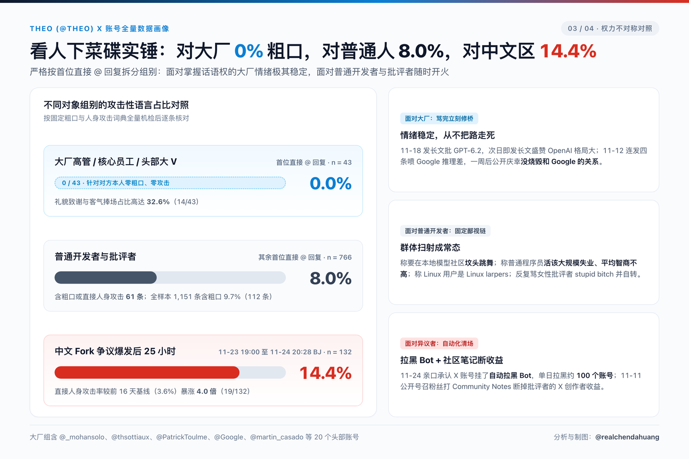

# Temu3 Code — 安裝 T3 Code 之前

<p align="center">
  <em>面向 pingdotgg/t3code 的獨立公共調查檔案 —— 以第一手原始碼、截圖與量化資料，完整記錄種族歧視雙重標準、隱密遙測、高風險產品缺陷與商業操弄的始末。</em>
</p>

<p align="center">
  <a href="https://temu3code.com/?lang=zh-TW"><strong>🌐 temu3code.com</strong></a> ·
  <a href="https://temu3code.com/mail/?lang=zh-TW"><strong>✉ Tmail 收件匣</strong></a> ·
  <a href="https://temu3code.com/?lang=zh-TW#x-receipts"><strong>📸 12 張 X 原始截圖</strong></a> ·
  <a href="https://temu3code.com/memes/?lang=zh-TW"><strong>🃏 61 張迷因</strong></a>
</p>
<p align="center">
  <a href="https://github.com/realchendahuang/temu3code/actions/workflows/verify.yml"></a> ·
  <a href="../EVIDENCE-INDEX.md"><strong>109 份證據</strong></a> ·
  <a href="../COMPLETE-SOURCE-INDEX.md"><strong>327 個來源</strong></a>
</p>

<p align="center">
  <strong>語言（18）：</strong><br />
  <a href="../../README.md">English</a> ·
  <a href="./README.zh-CN.md">简体中文</a> ·
  <a href="./README.zh-TW.md"><strong>繁體中文</strong></a> ·
  <a href="./README.fr.md">Français</a> ·
  <a href="./README.es.md">Español</a> ·
  <a href="./README.ru.md">Русский</a> ·
  <a href="./README.ar.md">العربية</a> ·
  <a href="./README.ja.md">日本語</a> ·
  <a href="./README.ko.md">한국어</a> ·
  <a href="./README.de.md">Deutsch</a> ·
  <a href="./README.pt-BR.md">Português</a> ·
  <a href="./README.it.md">Italiano</a> ·
  <a href="./README.nl.md">Nederlands</a> ·
  <a href="./README.pl.md">Polski</a> ·
  <a href="./README.tr.md">Türkçe</a> ·
  <a href="./README.vi.md">Tiếng Việt</a> ·
  <a href="./README.id.md">Bahasa Indonesia</a> ·
  <a href="./README.hi.md">हिन्दी</a>
</p>


> [!IMPORTANT]
> **獨立公共調查檔案 · 全球 18 語種**
>
> 零遙測、反對種族主義與種族歧視。本檔案每一項指控均以公開原話、原始碼行號、PR/Commit 記錄、USPTO 官方資料庫與歸檔原圖為依據，接受全球開發者公開複核。
>
> - **核實罪證:** 20 項完整罪證（#00–#19）
> - **第一手素材:** 109 張實證原圖 · 327 條原始連結
> - **程式碼追蹤:** [`9d3195b4`](https://github.com/pingdotgg/t3code/commit/9d3195b49dfb0098e9fa592fe0ada5464206d1c2) → [`ca81b7b9`](https://github.com/pingdotgg/t3code/commit/ca81b7b97a1c4b91e5ac25768d0f6629f37732fd) (`+259` commits · 2026-11-25 14:49 CST)
> - **安全公告:** 0 條 GitHub Security Advisories

---

## 60 秒看懂整起事件的來龍去脈

一場針對中國開發者 MIT 開源二改專案的歧視性辱罵與封號威脅，引發全球開發者對 T3 Code 原始碼、商業帳本與過往言行的全面追查。

1. **歧視性導火線與毫不掩飾的雙重標準** *(2026-11-23)* — 有網友將中國開發者的免費 MIT 二改版誤認為官方客戶端，@theo 10 分鐘內連發兩篇貼文辱罵其為「Chinese knockoff」「Temu3 Code」並威脅找 GitHub 封鎖帳號——當時他名下的 USPTO 註冊商標數量為 0；不到 11 小時後，他又表態歡迎上兆美元規模的美國大廠直接複製 MIT 程式碼。
2. **原始碼揭底：產品劣質問題全面曝光** *(2026-11-24)* — 逐行審計 pingdotgg/t3code 原始碼發現：官網掛著「No telemetry」期間預設啟用 PostHog，並經閉源 ingest.t3.codes 留存原始資料、擅自讀取 ~/.codex 與 ~/.claude.json 進行無鹽雜湊、41.6 GB 的假刪除、52 天未修的無提示 git push --force、偽造 Google Antigravity 請求標頭導致帳號遭封鎖，以及零端對端加密的明文 T3 Connect。
3. **226 萬次閱讀、歐盟 GDPR 舉報與 6 小時徹夜自曝** *(11 月 24 日晚間至 11 月 25 日清晨)* — 第一波貼文在 X 上突破 226 萬次閱讀，並引發歐盟 GDPR 正式舉報。團隊在 6 小時徹夜緊急修補的 PR 中意外自曝：中繼服務每小時向 Axiom 發送 220 萬條含真實 IP 與 UA 的日誌，保存 30 天、洩露 git.cwd 絕對路徑、刪除帳號卻不刪資料庫、Windows/Mac 退出開關長期失效。
4. **核心架構隱患至今仍未解決** *(11 月 25 日（ca81b7b9）及持續追蹤)* — 持續複核 259 個新提交至 ca81b7b9 證實：雖然修補了部分輿論焦點，但啟動時先寫入本機追蹤 ID、UI 沒有關閉按鈕、0 條安全公告、任意儲存庫皆可被 Star 的漏洞，以及第 19 項查證屬實的區域網路 30 天明文 shell Cookie、不可撤銷的 Bearer 與陌生儲存庫暴露 SSH_AUTH_SOCK，全都依然存在。

---

## 全部 20 項經核實罪證一覽（#00–#19）

以下每條罪證均直接連到本儲存庫對應的簡潔獨立圖文頁，以及視覺化網頁端的專屬分享卡片。本儲存庫將持續追蹤，並依 #20、#21…… 順延更新。

### 第一卷 · 種族歧視、雙重標準與慣犯實錄

*從商標註冊為零卻以「Chinese knockoff」「Temu3 Code」威脅封殺中國開發者，到 1,151 條推文量化實證（對大廠 VIP 為 0.0% 粗話、普通開發者 8.0%，辱華危機期間更暴漲至 14.4%），再到過去兩年反覆出現的慣行。*

- **#00 · [起因導火線：「偷我們的程式碼」、Fork 封號威脅與赤裸雙標](../../cases/zh-TW/00-origin-fork-dispute-and-double-standard.md)** — `📌 事實留檔`
  11 分鐘內，@theo 連發兩帖，將一名中國開發者免費的 MIT 二次開發辱罵為「Chinese knockoff」「Temu3 Code」，並威脅找 GitHub 封掉其帳號；不到 11 小時後，他又公開表態歡迎萬億美元美國大廠照抄 MIT 程式碼。
  [查看完整圖文檔案](../../cases/zh-TW/00-origin-fork-dispute-and-double-standard.md) · [視覺化證據卡](https://temu3code.com/mail/?thread=2026-11-23-origin-temu3-threat&lang=zh-TW) · [查看 X 原帖](https://x.com/realchendahuang/status/2125062675147448475)
- **#14 · [1,151 則連續推文量化鐵證：對大廠 VIP 0.0% 粗口 vs 辱華危機期暴漲 4.0 倍](../../cases/zh-TW/14-1151-tweet-quantitative-double-standard.md)** — `📌 事實留檔`
  對 2026 年 11 月 7 日至 24 日 @theo 全部 1,151 則連續推文做窮舉量化審計，坐實了赤裸裸的權力大小眼：面對 20 位大廠高階主管與員工 0.0% 粗口，面對一般開發者 8.0% 敵意，而在中文二改 25 小時窗口內人身攻擊暴漲 4.0 倍至 14.4%。
  [查看完整圖文檔案](../../cases/zh-TW/14-1151-tweet-quantitative-double-standard.md) · [視覺化證據卡](https://temu3code.com/mail/?thread=2026-11-19-selective-politeness-vips&lang=zh-TW) · [查看 X 原帖](https://x.com/realchendahuang/status/2125404517697290438)
- **#15 · [威脅 GitHub 封鎖帳號時 USPTO 註冊商標為 0，17 小時後緊急補寫 `TRADEMARK.md`](../../cases/zh-TW/15-zero-uspto-trademarks-and-retroactive-policy.md)** — `📌 事實留檔`
  當 @theo 威脅找 GitHub 封鎖中國開發者帳號並指控對方「侵犯商標」時，T3 Tools Inc. 名下對 `T3 Code`、`T3 Tools` 與 `T3 Connect` 的 USPTO 註冊商標全部為 0——直到 17 小時後，他才倉促補上了一份 `TRADEMARK.md`。
  [查看完整圖文檔案](../../cases/zh-TW/15-zero-uspto-trademarks-and-retroactive-policy.md) · [視覺化證據卡](https://temu3code.com/mail/?thread=2026-11-24-retroactive-trademark-blocker&lang=zh-TW) · [查看 X 原帖](https://x.com/realchendahuang/status/2125408163273080950)
- **#16 · [兩年反覆累犯實錄：為印度開發者網路霸凌道歉、$20,000 FFmpeg 懸賞與凌晨威脅閉源後刪推](../../cases/zh-TW/16-two-year-pattern-of-bullying-and-deletions.md)** — `📌 事實留檔`
  2026 年 11 月針對中國開發者的辱罵絕非偶發失言——2024 至 2026 年的公開紀錄完整勾勒出一套反覆上演的行為閉環：挑起國籍敵意、霸凌開源維護者、嘲諷他人介面博取流量，事發後刪帖撤回。
  [查看完整圖文檔案](../../cases/zh-TW/16-two-year-pattern-of-bullying-and-deletions.md) · [視覺化證據卡](https://temu3code.com/mail/?thread=2025-10-ffmpeg-bounty&lang=zh-TW) · [查看 X 原帖](https://x.com/realchendahuang/status/2125408843152953693)

### 第二卷 · 隱密遙測與隱私欺騙

*拆穿「No telemetry」首頁承諾背後的預設上報、閉源閘道 ingest.t3.codes 留存、跨工具憑證讀取、Managed Policy 三大盲區，以及 GDPR 舉報後自曝的每小時 220 萬條 IP 日誌。*

- **#01 · [官網掛著「零遙測」承諾卻預設全量上報、偷讀跨工具憑證並連拒四個關閉開關 PR](../../cases/zh-TW/01-default-telemetry-and-cross-tool-tracking.md)** — `🟡 部分修補`
  在官網白紙黑字寫著「No telemetry. Unless you opt in. Full stop.」期間，T3 Code 預設啟用 PostHog 遙測，並經閉源閘道 `ingest.t3.codes` 留存原始資料，還悄悄讀取 `~/.codex` 與 `~/.claude.json`，以無鹽雜湊進行跨裝置歸因；此外，它更拒絕了社群主動送上的四個關閉開關 PR。
  [查看完整圖文檔案](../../cases/zh-TW/01-default-telemetry-and-cross-tool-tracking.md) · [視覺化證據卡](https://temu3code.com/mail/?thread=2026-03-06-pr174-default-telemetry&lang=zh-TW) · [查看 X 原帖](https://x.com/realchendahuang/status/2125153472450527440)
- **#07 · [Managed Policy 謊言：自誇「全業界最好一鍵關閉」，自家文件打臉四大盲區](../../cases/zh-TW/07-managed-policy-blind-spots.md)** — `🔴 仍未修復`
  @theo 宣稱 T3 Code 擁有全業界最好的企業 Managed Policy、「輕而易舉關閉全部遙測」，卻被自家官方文件 `docs/user/telemetry.md` 與 `docs/user/managed-policy.md` 逐條證偽。
  [查看完整圖文檔案](../../cases/zh-TW/07-managed-policy-blind-spots.md) · [視覺化證據卡](https://temu3code.com/mail/?thread=2026-11-24-managed-policy-plaintext-relay&lang=zh-TW) · [查看 X 原帖](https://x.com/realchendahuang/status/2125391659492081947)
- **#11 · [11 月 25 日澄清長文 2 小時內被自家通宵 PR 與 100 MB 匯出包三連打臉](../../cases/zh-TW/11-nov25-clarification-contradicted-in-2-hours.md)** — `🟡 部分修補`
  11 月 25 日早晨，@theo 發長文拍胸脯作出三項隱私保證並放出 100 MB 遙測匯出包——不到兩小時，全部三項說法均被自家團隊通宵合入的 PR 與匯出包原始數據正面證偽。
  [查看完整圖文檔案](../../cases/zh-TW/11-nov25-clarification-contradicted-in-2-hours.md) · [視覺化證據卡](https://temu3code.com/mail/?thread=2026-11-25-gdpr-overnight-collapse&lang=zh-TW) · [查看 X 原帖](https://x.com/realchendahuang/status/2125394810559426993)
- **#12 · [歐盟 GDPR 檢舉後 6 小時通宵自爆：每小時 220 萬筆 IP 日誌與刪號不刪庫](../../cases/zh-TW/12-post-gdpr-overnight-blitz-2m-ip-logs.md)** — `🟡 部分修補`
  11 月 24 日晚間有人向歐盟提起正式 GDPR 檢舉後，團隊在 6 小時內連夜合入的一連串急救補丁，反手把藏得更深的四筆隱私舊帳抖了個底朝天——其中僅 Axiom 一項就曾每小時記錄 220 萬筆真實 IP 與 UA，保存整整 30 天。
  [查看完整圖文檔案](../../cases/zh-TW/12-post-gdpr-overnight-blitz-2m-ip-logs.md) · [視覺化證據卡](https://temu3code.com/mail/?thread=2026-11-25-gdpr-overnight-collapse&lang=zh-TW) · [查看 X 原帖](https://x.com/realchendahuang/status/2125395501663281198)

### 第三卷 · 產品劣質與高風險安全漏洞

*41.6 GB SQLite 假刪除、全機程序與命令列掃描、52 天無提示 force push、偽裝 Google Antigravity 導致新帳號 3 分鐘內遭封鎖、T3 Connect 明文零加密、0 條安全公告，以及 ca81b7b9 的區域網路／認證／SSH_AUTH_SOCK 重大漏洞。*

- **#02 · [SQLite 假「永久刪除」撐爆 41.6 GB 硬碟與每 5 秒全機行程命令列掃描](../../cases/zh-TW/02-fake-sqlite-delete-and-process-scanner.md)** — `🟡 部分修補`
  在側邊欄點擊「永久刪除」根本不會刪掉歷史資料，導致本地 `statev2.sqlite` 膨脹至 41.6 GB；後台 Rust 監控程式每 5 秒無開關掃描全機所有行程與完整命令列參數。
  [查看完整圖文檔案](../../cases/zh-TW/02-fake-sqlite-delete-and-process-scanner.md) · [視覺化證據卡](https://temu3code.com/mail/?thread=2026-10-28-fake-delete-process-spy&lang=zh-TW) · [查看 X 原帖](https://x.com/realchendahuang/status/2125160473176023486)
- **#03 · [拖延 52 天不修的靜默 `git push --force` vs 21 小時撤除隱私過濾](../../cases/zh-TW/03-silent-force-push-vs-21h-filter-removal.md)** — `🔴 仍未修復`
  會直接衝毀主分支的 Claude Auto 靜默強推漏洞拖了 52 天以上無人修復；但為了讓私有模型登上 @theo 的公開排行榜，團隊僅用 21 小時就撤掉了模型隱私白名單。
  [查看完整圖文檔案](../../cases/zh-TW/03-silent-force-push-vs-21h-filter-removal.md) · [視覺化證據卡](https://temu3code.com/mail/?thread=2026-10-03-issue15353-force-push&lang=zh-TW) · [查看 X 原帖](https://x.com/realchendahuang/status/2125201882687881378)
- **#04 · [偽裝 Google Antigravity 內部請求標頭、偽造 `SSH_CONNECTION`，新帳號 3 分鐘即遭封鎖](../../cases/zh-TW/04-antigravity-spoofing-and-3-minute-bans.md)** — `🔴 仍未修復`
  官網 FAQ 白紙黑字擔保符合 Google Antigravity 服務條款；原始碼卻提取系統鑰匙圈權杖、偽造 `antigravity/hub/2.24.0` 直連 `v1internal` 內部介面並注入假 `SSH_CONNECTION`，導致全新 $20 付費帳號 3 分鐘內被封鎖。
  [查看完整圖文檔案](../../cases/zh-TW/04-antigravity-spoofing-and-3-minute-bans.md) · [視覺化證據卡](https://temu3code.com/mail/?thread=2026-11-22-antigravity-spoof-3min-ban&lang=zh-TW) · [查看 X 原帖](https://x.com/realchendahuang/status/2125213397507858657)
- **#05 · [T3 Connect 零端對端加密：所有提示詞、原始碼與終端機輸出皆以明文行經 T3 自有閘道](../../cases/zh-TW/05-t3-connect-zero-e2e-plaintext-relay.md)** — `🔴 仍未修復`
  透過 T3 Connect 遠端連線電腦時，完全沒有任何端對端加密——所有對話、原始碼與終端機輸出，都在 T3 控制的 Cloudflare 或 OVH Caddy 閘道上以明文終結，且新裝置核准預設為關閉。
  [查看完整圖文檔案](../../cases/zh-TW/05-t3-connect-zero-e2e-plaintext-relay.md) · [視覺化證據卡](https://temu3code.com/mail/?thread=2026-11-24-managed-policy-plaintext-relay&lang=zh-TW) · [查看 X 原帖](https://x.com/realchendahuang/status/2125218189596676555)
- **#13 · [GitHub 安全性公告始終為 0，卻靜默修補多個高風險漏洞並倉促改寫 `SECURITY.md`](../../cases/zh-TW/13-zero-security-advisories-and-silent-patches.md)** — `🔴 仍未修復`
  一邊把中文技術圈原始碼審計罵成「糞坑」，一邊悄悄合入金鑰目錄路徑穿越、跨網域權杖洩漏、未隔離預覽與陌生儲存庫自動執行等高風險修補——卻連一則提醒舊版使用者升級的 GitHub Security Advisory 都不發。
  [查看完整圖文檔案](../../cases/zh-TW/13-zero-security-advisories-and-silent-patches.md) · [視覺化證據卡](https://temu3code.com/mail/?thread=2026-11-25-ca81b7b9-active-vulns&lang=zh-TW) · [查看 X 原帖](https://x.com/realchendahuang/status/2125395980354994414)
- **#19 · [`ca81b7b9` 重大認證與程式碼執行漏洞：區域網路 30 天明文 Shell、不可撤銷權杖與 `SSH_AUTH_SOCK` 裸奔](../../cases/zh-TW/19-ca81b7b9-lan-cookie-bearer-ws-and-repo-rce.md)** — `🔴 仍未修復`
  鎖定最新上游提交 `ca81b7b9`（11 月 25 日 14:49 CST）逐行核驗，證實五項現網高危安全與底層缺陷：同區域網路抓一個封包即可白拿一個月完整終端控制權、30 天裸 Bearer 無法自行註銷、5 分鐘內可重放 `?wsTicket=`、`isIPv4` 掐斷 `::1` 隧道，以及開啟陌生倉庫就把整台機器的 `SSH_AUTH_SOCK` 與 `GITHUB_TOKEN` 暴露出去。
  [查看完整圖文檔案](../../cases/zh-TW/19-ca81b7b9-lan-cookie-bearer-ws-and-repo-rce.md) · [視覺化證據卡](https://temu3code.com/mail/?thread=2026-11-25-ca81b7b9-active-vulns&lang=zh-TW) · [查看 X 原帖](https://x.com/realchendahuang/status/2125494234614788390)

### 第四卷 · 商業操弄、利益衝突與社群霸凌

*自掏 80 萬美元打造每日處理 31.7 兆 token 算力雷達的商業帳本、Vibe Kanban/Daytona 投資衝突、贊助商綁定、閒置 30 秒動用主機憑證刷出 7.7 萬顆星、派 @bot 追查他人 Fork 與封鎖機制。*

- **#06 · [天使投資人利益衝突：公開嘲諷被投企業 Vibe Kanban 倒閉與 Daytona 重疊](../../cases/zh-TW/06-angel-investor-conflicts-vibe-kanban-daytona.md)** — `📌 事實留檔`
  除程式碼漏洞外，@theo 本人的公開推文亦暴露其身為天使投資人與 T3 Code 作者之間的嚴重角色界線衝突。
  [查看完整圖文檔案](../../cases/zh-TW/06-angel-investor-conflicts-vibe-kanban-daytona.md) · [視覺化證據卡](https://temu3code.com/mail/?thread=2026-11-16-vibe-kanban-daytona&lang=zh-TW) · [查看 X 原帖](https://x.com/realchendahuang/status/2125385742243520653)
- **#08 · [自掏 80 萬美元的真實帳本：日跑 31.7 兆 Token（$10.19M/天）算力雷達](../../cases/zh-TW/08-800k-spend-and-31t-token-radar.md)** — `📌 事實留檔`
  預設開啟的遙測絕非「順手統計一下人數」：它為 @theo 撐起了一台日跑 31.7 兆 Token（折合每日 1,019 萬美元 API 消耗）的即時產業雷達，並直接換來逾 30 萬美元的 OpenAI 免費內測額度與創投接洽。
  [查看完整圖文檔案](../../cases/zh-TW/08-800k-spend-and-31t-token-radar.md) · [視覺化證據卡](https://temu3code.com/mail/?thread=2026-11-18-31t-token-radar&lang=zh-TW) · [查看 X 原帖](https://x.com/realchendahuang/status/2125392410763239723)
- **#09 · [內部日均 500 次提交與 `yolo merges`，對外卻勸退貢獻者、公開拉黑並辱罵使用者](../../cases/zh-TW/09-yolo-merges-vs-community-hostility.md)** — `📌 事實留檔`
  對內靠 700 個 Agent 每天狂推 500 個提交，自承 `yolo merges` 經常把程式碼搞炸；對外卻在 `CONTRIBUTING.md` 寫「勸你別來」、用 `.github/VOUCHED.td` 公開拉黑、刪除核心功能，還在 Issue 裡直接辱罵回報問題的使用者。
  [查看完整圖文檔案](../../cases/zh-TW/09-yolo-merges-vs-community-hostility.md) · [視覺化證據卡](https://temu3code.com/mail/?thread=2026-11-09-issue33639-bermudi-insult&lang=zh-TW) · [查看 X 原帖](https://x.com/realchendahuang/status/2125392916369871309)
- **#10 · [30 秒後公開派出 @bot，挖取社群女開發者 Fork 並抄走功能，卻嘲諷競品抄襲、出動封鎖機器人](../../cases/zh-TW/10-fork-scraping-bot-and-critics-suppression.md)** — `📌 事實留檔`
  一邊嘲諷競品抄襲自己的介面設計，一邊對獨立開發者的 Fork 回一句「Okay I'm stealing this」，並在 30 秒後公開派出 `@bot` 挖取對方程式碼；對批評者則煽動以 Community Notes 打壓、斷其收益，並啟用自動批次封鎖機器人。
  [查看完整圖文檔案](../../cases/zh-TW/10-fork-scraping-bot-and-critics-suppression.md) · [視覺化證據卡](https://temu3code.com/mail/?thread=2026-11-08-stealing-miaai-fork&lang=zh-TW) · [查看 X 原帖](https://x.com/realchendahuang/status/2125393641665671593)
- **#17 · [贊助商深度綁定、帶頭鑽 Codex 0% 漏洞與 10 個帳號 `CLIProxyAPI` 的雙標](../../cases/zh-TW/17-sponsor-stack-and-quota-exploit-hypocrisy.md)** — `📌 事實留檔`
  嘴上講技術中立與遵守條款、以封號風險為由拒絕內建帳號切換；背地裡，T3 雲端架構綁著自家 YouTube 贊助商（Clerk/Axiom），本人更帶頭刷爆 Codex 0% 額度漏洞，並公開發布 10 個帳號池化 `CLIProxyAPI` 教學，直接掛進官方 FAQ。
  [查看完整圖文檔案](../../cases/zh-TW/17-sponsor-stack-and-quota-exploit-hypocrisy.md) · [視覺化證據卡](https://temu3code.com/mail/?thread=2023-05-sponsor-roster&lang=zh-TW) · [查看 X 原帖](https://x.com/realchendahuang/status/2125411353393553744)
- **#18 · [25 天衝出 7.7 萬星的祕密：發呆 30 秒彈窗動用主機 GitHub 憑證背景點星與未修漏洞](../../cases/zh-TW/18-77k-star-funnel-and-arbitrary-repo-starring.md)** — `🔴 仍未修復`
  痛批 GitHub Star 淪為「誆騙 VC 投資的工具」僅半年後，@theo 自寫自併了發呆 30 秒彈窗，並直接動用主機 `gh` CLI / `GH_TOKEN` 在背景呼叫 API 點星，25 天從 3 萬星衝到 7.7 萬星（僅約 129 名 watcher），更把任意倉庫點星漏洞擱了 19 天未修。
  [查看完整圖文檔案](../../cases/zh-TW/18-77k-star-funnel-and-arbitrary-repo-starring.md) · [視覺化證據卡](https://temu3code.com/mail/?thread=2026-11-02-pr29922-77k-stars&lang=zh-TW) · [查看 X 原帖](https://x.com/realchendahuang/status/2125416210120765799)

---

## 核心代表實證





---

## 2 分鐘止血與清理操作手冊

如果電腦已經安裝 T3 Code，切勿只依賴環境變數：ca81b7b9 仍會在檢查開關前先寫入本機追蹤 ID，且桌面端仍漏傳 OTEL_SDK_DISABLED。請同步搭配環境變數、hosts 封鎖、離線資料庫壓縮與權杖撤銷。

- [ ] 同時設定 DO_NOT_TRACK=1 與傳統遙測關閉變數，並在 /etc/hosts 中封鎖閉源採集閘道 ingest.t3.codes。
- [ ] 徹底退出 T3 Code，檢查 statev2.sqlite 容量並執行離線 VACUUM;，或直接清理 ~/.t3 目錄。
- [ ] 立即停止在 T3 Code 託管目錄下使用個人 Google AI / Antigravity 付費訂閱，保住唯一申訴機會。
- [ ] 關閉 Publish agent activity、解除綁定所有 T3 Connect 裝置、向 Clerk 與中繼服務申請資料刪除，並到 GitHub 撤銷 T3 Code 授權。
- [ ] 嚴禁直接以明文執行 t3 up --lan；勿將 30 天裸 Bearer 放入 CI；開啟陌生儲存庫前先清空 SSH_AUTH_SOCK 與 GITHUB_TOKEN。

```bash
# macOS / Linux: combine DO_NOT_TRACK=1 with legacy flags + /etc/hosts sinkhole
export DO_NOT_TRACK=1
export T3CODE_TELEMETRY_ENABLED=false
export T3CODE_OTEL_SDK_DISABLED=true
export OTEL_SDK_DISABLED=true
sudo sh -c 'printf "\n127.0.0.1 ingest.t3.codes\n::1 ingest.t3.codes\n" >> /etc/hosts'

# Quit T3 Code first, then compact statev2.sqlite or clean local directories
sqlite3 ~/.t3/userdata/statev2.sqlite "VACUUM;"
rm -rf ~/.t3/userdata/providers/antigravity/ ~/.t3/tools/antigravity-acp/
```

**社群推薦替代客戶端:** 開發者特別推薦 Mirasim（@Mirasim_ADE）、Paseo（@paseo_sh）、Paradev（@ParadevAI）、Cloudroom、Conductor、Emdash 與 Orca。切換前請核驗：預設關閉遙測、確實刪除本機對話、嚴格呼叫官方 CLI 且不偽造請求標頭、遠端通道具備客戶端端對端加密。

---

## 社群證言與獨立投稿（與第一手鐵證分欄隔離）

主檔案 #00–#19 嚴格限定為公開可核驗的原始碼、PR、官方註冊記錄與公開原帖。社群長評與私訊控訴單獨列於本區，以確保主證據鏈的最高公信力。

- **Issue #1 ·《對 Theo 的指控》（@opserx 投稿）** — 2026 年 11 月 25 日由社群成員提交至本儲存庫的長篇公開評述完整留檔，並附上對 PR #42450 與 PR #41237 的精確信源勘誤註記。 ([閱讀 Issue #1 完整歸檔](../community/issue-1-the-case-against-theo.md))
- **開發者私訊控訴與持續線索徵集** — 事件曝光後，多位開發者透過私訊送來自己與 @theo 或 T3 Code 相關的經歷與線索。為堅持最高核驗紀律，未經公開第三方實證複核的私訊內容不混入 #00–#19 主編號庫。歡迎附上公開連結，透過 PR 或 Issue 提交新鐵證或官方修復進展。 ([查看投稿與核驗規範](../../CONTRIBUTING.md))

---

## 深度技術卷宗與完整總索引

如需查閱逐行程式碼 diff、完整 SQL 陳述式與 327 條原始連結總表，可直接進入以下專家級底層檔案：

- [Dossier 01 · Telemetry Architecture, Cross-Tool Stitching & GDPR Sprint](../dossiers/01-telemetry-and-gdpr-timeline.md)
- [Dossier 02 · Local Safety, Guardrail Bypasses & Undisclosed Security Patches](../dossiers/02-local-safety-and-security-audit.md)
- [Dossier 03 · Google Antigravity ToS Spoofing & T3 Connect Plaintext Relay](../dossiers/03-antigravity-tos-and-t3connect-relay.md)
- [Dossier 04 · Business Ledger, Investor Conflicts, Sponsors & 77k-Star Funnel](../dossiers/04-business-ledger-sponsors-and-77k-stars.md)
- [Dossier 05 · Governance, Fork-Scraping Bots, USPTO Trademark Record & History](../dossiers/05-governance-trademark-and-history.md)
- [Dossier 06 · 1,151-Tweet Quantitative Forensic Dataset](../dossiers/06-tweet-forensic-dataset-1151.md)
- [109 張原圖檔案館 (`docs/EVIDENCE-INDEX.md`)](../EVIDENCE-INDEX.md)
- [327 條第一手信源 (`docs/COMPLETE-SOURCE-INDEX.md`)](../COMPLETE-SOURCE-INDEX.md)

### 持續追蹤與社群共建

本儲存庫長期持續追蹤更新。如發現新的一手鐵證、上游已確認修復某項漏洞，或改進任一語種翻譯，歡迎附上公開一手連結提交 PR 或 Issue——詳見 CONTRIBUTING.md。
